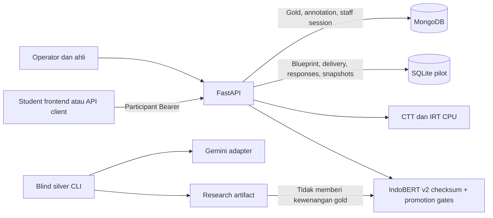

# Arsitektur dan Konvensi API

Implementasi API **2.1.0** memakai FastAPI sebagai boundary lokal untuk legacy `/v1`, classifier `/v2`, anotasi `/internal/v2`, dan pilot/psikometrik `/api/v1`. Gateway Express lama sudah dihapus; Redis/Node gateway baru belum tersedia.

API lokal: `http://127.0.0.1:8000`; Swagger `/docs`, ReDoc `/redoc`, OpenAPI `/openapi.json`. Tidak ada keharusan port 5000/gateway Node untuk menjalankan pilot.

## Boundary dan aktor

Participant Bearer hanya untuk assessment yang diprovision operator. Subject/population/scoring berasal dari server, bukan body. Staff memakai cookie invite-only atau service credential `X-Internal-API-Key`; mutation cookie memerlukan CSRF. Keputusan empiris manusia memerlukan cookie, CSRF, profil ahli dan role yang sesuai; admin/service token saja tidak cukup.

Cookie staff `HttpOnly` kini memakai path `/` agar auth anotasi dapat dipakai pada empirical review. Secure aktif di luar development. Opsi publik opaque; key/solution/mapping internal tidak disertakan pada delivery maupun receipt siswa. Route `/api/v1` dan internal memakai Cache-Control no-store.

Allowed host/origin dikonfigurasi lewat environment. CORS menerima Authorization, Idempotency-Key, X-CSRF-Token, X-Internal-API-Key dan Content-Type; service credential tetap berada pada backend/operator.

## Operasi dan kontrak

JSON camelCase dan unknown request fields ditolak. Error aktif memakai `{"detail": ...}`, bukan envelope gateway target. Mutation start/response/complete memakai Idempotency-Key; response key sama dengan responseId. Event, blueprint dan snapshot tidak ditimpa. Completion adalah transisi monotonic.

CTT/IRT dijalankan di threadpool agar pekerjaan numerik/SQLite tidak memblokir event loop. Endpoint saat ini synchronous request/response, bukan job 202. Batas matriks 500.000 sel. Redis queue, async jobs, multihost store, rate limits platform, rotation/revocation invite, authoring frontend dan gateway generation masih target.

Readiness model dan data dipisahkan: IndoBERT unapproved/research-only tetap 503; IRT kurang data/asumsi menghasilkan CTT dan status waiting. Gold manusia tetap prasyarat delivery. Lihat [12 endpoint aktual](12_ENDPOINT_MASTER_REFERENCE.md), [07 psikometrik](07_PSYCHOMETRICS_API.md), [27 runbook](27_PSYCHOMETRICS_IMPLEMENTATION_RUNBOOK.md).
