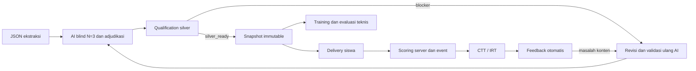

# Arsitektur API silver

FastAPI `app.main:app` versi 2.2.0 menyediakan registrasi snapshot silver, assessment, sesi siswa, scoring dan analisis empiris. SQLite menyimpan dataset, assessment dan event. MongoDB opsional untuk import sumber, akun operator, audit dan metadata model.

Service menggunakan `X-Internal-API-Key` yang dicocokkan dengan `PSYCHOMETRICS_API_TOKEN`. Cookie operator memerlukan CSRF untuk mutation. Siswa memakai participant Bearer yang terikat assessment. ID populasi, identitas pseudonim dan correctness ditentukan server.

Endpoint assignment, anotasi pedagogis, diskusi pelabel dan keputusan empiris manual telah dihapus. Jalur auth operator `/internal/v2/auth/login` dan `/auth/logout` tetap tersedia ketika MongoDB dikonfigurasi.

Kunci dan solusi hanya tersedia pada data internal. Delivery memakai opsi opaque, tidak mengirim label atau kunci. Event terikat `questionVersionId`, `contentVersion` dan `contentHash`; perubahan isi membutuhkan versi baru.
