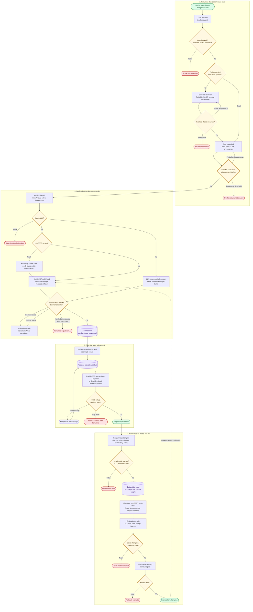

# Arsitektur Autonomous Hybrid AI dan Psychometric-Informed Learning

## 1. Tujuan dan posisi dokumen

Dokumen ini mendefinisikan arsitektur target end-to-end untuk pemrosesan, klasifikasi, penyaringan, penyajian, evaluasi psikometrik, dan peningkatan model soal secara otomatis menggunakan:

- teacher authoring melalui input manual atau import source;
- deterministic validation;
- ekstraksi PDF, gambar, dan sumber terstruktur;
- IndoBERT multi-head;
- LLM ensemble dengan self-consistency;
- agreement, uncertainty, dan risk routing;
- Classical Test Theory (CTT);
- psychometric-informed fine-tuning;
- automated champion-challenger deployment.

Arsitektur ini memakai teacher sebagai **authoring actor**: teacher memasukkan soal, memperbaiki candidate hasil ekstraksi, mengubah authoring draft, lalu melakukan submit. Teacher bukan reviewer, annotator, adjudikator, atau approval gate. Setelah submit, validasi, klasifikasi, agreement, adjudikasi, dan routing dilakukan otomatis. Jika sistem meminta perbaikan, teacher hanya membuat content version baru; teacher tidak dapat mengubah AI decision atau memaksa item lolos.

Karena tidak ada expert annotation pada workflow target, hasil klasifikasi tidak disebut `gold_label`. Istilah yang digunakan adalah:

- `model_suggestion`: prediksi satu model;
- `pseudo_label`: label otomatis untuk weak supervision;
- `ai_consensus`: IndoBERT dan LLM menyepakati seluruh head serta lolos risk gate;
- `provisional_item`: item yang dapat dipilotkan secara terbatas;
- `empirically_screened`: item yang sudah mempunyai bukti psikometrik memadai.

Dokumen ini adalah **target architecture**. Sebagian komponen sudah ada dalam repository, sedangkan komponen LLM ensemble, automated arbitration, queue, model registry, drift monitoring, dan empirical multi-task heads masih harus dikembangkan.

## 2. Batas klaim sistem

Sistem dapat mengklaim:

- ekstraksi dan normalisasi sumber soal secara otomatis;
- klasifikasi kognitif berbasis konsensus IndoBERT-LLM;
- pengukuran ketidakpastian dan disagreement;
- penyaringan item berdasarkan data respons;
- pembelajaran ulang difficulty dan item-quality targets dari psikometrik.

Sistem tidak boleh mengklaim:

- `ai_consensus` adalah kebenaran pedagogis absolut;
- kesepakatan dua model setara dengan kesepakatan dua ahli;
- statistik respons membuktikan Bloom atau knowledge dimension;
- difficulty index dari satu populasi berlaku universal;
- pseudo-label adalah gold dataset.

Psikometrik memberi bukti empiris untuk difficulty, discrimination, distraktor, waktu, dan perilaku item. Psikometrik tidak secara langsung membuktikan proses kognitif Bloom atau dimensi pengetahuan.

## 3. Arsitektur end-to-end

Diagram berikut menunjukkan alur utama beserta titik keputusan. Persegi panjang adalah proses, belah ketupat adalah keputusan, silinder adalah penyimpanan data, dan bentuk membulat adalah status akhir. Garis putus-putus menunjukkan model hasil pelatihan yang kembali dipakai untuk memeriksa soal baru.



Versi gambar: [PNG](15_AUTONOMOUS_AI_PSYCHOMETRIC_LEARNING_ARCHITECTURE_FLOW.png) untuk dibuka langsung dan [SVG](15_AUTONOMOUS_AI_PSYCHOMETRIC_LEARNING_ARCHITECTURE_FLOW.svg) untuk diperbesar tanpa kehilangan ketajaman.

Alur teknis rinci:

```text
QUESTION AUTHORING SOURCES
Teacher Manual Input | Teacher Upload | Object Storage | External API
PDF/Image/JSON/CSV/TXT/TEX
        |
        v
AUTHORING DRAFT & SUBMIT
teacher edits content | versioned draft | teacher is not reviewer/adjudicator
        |
        v
API GATEWAY & SECURITY GATE
Express | Multer | AJV | checksum | MIME validation | rate limit
        |
        +-- invalid/duplicate --------------------------> rejected_ingestion
        |
        v
ASYNCHRONOUS EXTRACTION JOB
Redis + Celery/RQ
        |
        v
DOCUMENT EXTRACTION ENGINE
        |
        +-- PDF with text layer ------> PyMuPDF
        +-- scanned PDF/image --------> Tesseract ind+eng
        +-- formula region -----------> Paddle DocLayout + FormulaNet
        +-- JSON/CSV/TXT/TEX ---------> structured parser
        |
        v
EXTRACTION QUALITY GATE
OCR confidence | segmentation | option completeness | formula renderability
        |
        +-- low quality --> higher DPI / alternate OCR / full-page fallback
        |                       |
        |                       +-- retry exhausted --> quarantine_extraction
        v
CANONICAL QUESTION BUILDER
Pydantic | Unicode NFKC | normalized options | normalized LaTeX | provenance
        |
        v
DETERMINISTIC VALIDATION
JSON Schema | type/range | answer-option | duplicate | LaTeX | content hash
        |
        +-- repairable structure --> safe auto-repair --> validate again
        +-- non-repairable -------> rejected_invalid
        v
AUTOMATED ANSWER VERIFICATION
        |
        +-- deterministic math --> SymPy/rule verifier
        +-- non-deterministic ---> independent LLM solver ensemble
        |
        +-- answer conflict/missing stable key -------> quarantine_answer_conflict
        v
MODEL AVAILABILITY ROUTER
        |
        +-- IndoBERT absent --> LLM weak labels + rules --> bootstrap dataset
        |                         --> train IndoBERT v0
        +-- IndoBERT ready -----------------------------------------+
        |                                                            |
        v                                                            v
INDOBERT MULTI-HEAD                                      LLM TAXONOMY ENSEMBLE
Bloom 6 | Knowledge 4 | Difficulty 3                    rubric | retrieval | N samples
probability | entropy | margin | OOD                     voting | evidence | abstention
        |                                                            |
        +-------------------------+----------------------------------+
                                  v
AI AGREEMENT & RISK ENGINE
per-head agreement | extraction risk | answer risk | uncertainty | OOD
        |
        +-- full agreement + all gates pass ------------> ai_consensus
        |
        +-- disagreement -------------------------------> automated arbitration
        |                                                    |
        |                                      alternate prompt/model/provider
        |                                                    |
        |                                      +-- resolved --> risk gate again
        |                                      +-- unresolved --> quarantined
        |
        +-- critical warning/high risk -----------------> quarantined
        v
VERSIONED AI-CONSENSUS DATA STORE
MongoDB operational state | JSONL/Parquet snapshots | provenance | model versions
        |
        v
PROVISIONAL ITEM BANK
        |
        v
ASSESSMENT DELIVERY API
versioned serving | server-side scoring | pseudonymous response events
        |
        v
RESPONSE VALIDATION & AGGREGATION
deduplication | valid version | rapid guess | group by population/assessment
        |
        v
EMPIRICAL PSYCHOMETRIC ENGINE
p | Wilson CI | discrimination | corrected point-biserial | distractor | time
        |
        +-- insufficient sample ------------------------> collect_more_events
        +-- severe flags -------------------------------> auto_unpublish/quarantine
        +-- stable -------------------------------------> empirically_screened
        v
PSYCHOMETRIC TARGET BUILDER
empirical p | hardness | discrimination | item quality | expected response time
        |
        v
TRAINING ELIGIBILITY & SAMPLE WEIGHTING
sample size | CI width | stability | rapid-guess rate | version consistency
        |
        +-- ineligible ---------------------------------> observation_only
        v
VERSIONED PSYCHOMETRIC TRAINING DATASET
canonical text + AI labels + psychometric targets + provenance + weights
        |
        v
PSYCHOMETRIC-INFORMED INDOBERT FINE-TUNING
        |
        +-- Bloom head
        +-- Knowledge head
        +-- Intended difficulty head
        +-- Empirical difficulty regression head
        +-- Discrimination regression head
        +-- Item-quality risk head
        +-- Expected-time regression head
        v
AUTOMATED MODEL EVALUATION
F1 | confusion matrix | MAE/RMSE | rank correlation | false accept | latency
        |
        v
CHAMPION-CHALLENGER RELEASE GATE
        |
        +-- regression/failure -------------------------> reject candidate
        +-- pass --> shadow --> canary --> monitor
                                      |
                                      +-- regression --> automatic rollback
                                      +-- stable -----> promote champion
                                                           |
                                                           +--> IndoBERT runtime
```

### 3.1 Batas peran teacher

Teacher boleh:

- membuat soal manual;
- mengunggah sumber dan memperbaiki hasil ekstraksi;
- mengisi grade, topic, subtopic, learning objective, opsi, kunci, dan penjelasan;
- membuat revision setelah menerima warning `revision_required` atau quarantine summary;
- melihat safe status dan taxonomy summary.

Teacher tidak boleh:

- menetapkan Bloom/knowledge/difficulty sebagai label final;
- melihat lalu memilih output model untuk meningkatkan agreement;
- menjalankan atau memutus adjudikasi;
- mengubah risk score, psychometric result, atau status acceptance;
- mengirim item langsung ke student delivery tanpa gate.

Teacher identity dan ownership berasal dari authentication context. Setiap edit menaikkan `content_version`; workflow lama tetap immutable dan workflow baru dijalankan terhadap snapshot version baru.

## 4. Layer 0-3: ingestion dan ekstraksi

### 4.1 Ingestion request

Input dapat berasal dari teacher authoring, object storage, batch directory, atau REST API. Untuk file/batch, kontrak minimum:

```json
{
  "request_id": "REQ-001",
  "source_uri": "s3://question-source/algebra.pdf",
  "filename": "algebra.pdf",
  "media_type": "application/pdf",
  "checksum_sha256": "...",
  "metadata": {
    "subject": "Matematika",
    "grade": 10,
    "topic": "Aljabar"
  }
}
```

Gateway memeriksa request schema, ukuran, ekstensi, MIME signature, checksum duplikat, dan limit. File valid dikirim ke queue agar OCR dan LLM tidak memblokir request HTTP.

### 4.2 Jalur extraction

- PDF dengan text layer: PyMuPDF menjadi jalur utama.
- PDF tanpa teks memadai: render halaman lalu Tesseract `ind+eng`.
- Gambar: Pillow untuk decode dan Tesseract untuk OCR.
- Formula: Paddle document layout dan formula recognition menghasilkan LaTeX.
- JSON/CSV/TXT/TEX: structured parser tanpa OCR.

Output extraction adalah kandidat, bukan item final:

```json
{
  "candidate_id": "Q-001",
  "question_text": "Tentukan akar persamaan berikut.",
  "classification_text": "Tentukan akar persamaan berikut. Formula: $x^2+5x+6=0$",
  "options": [
    {"label": "A", "text": "-2 dan -3"},
    {"label": "B", "text": "2 dan 3"}
  ],
  "math_formulas": [
    {
      "latex": "x^2+5x+6=0",
      "source": "PP-FormulaNet-S",
      "latex_renderable": true
    }
  ],
  "extraction_method": "ocr",
  "extraction_confidence": 0.87,
  "warnings": [],
  "provenance": {"pages": [1]}
}
```

### 4.3 Automated recovery

Jika extraction quality rendah, sistem dapat:

1. menaikkan DPI;
2. mencoba OCR alternatif;
3. memakai full-page fallback;
4. mengulangi segmentasi;
5. membatasi retry dengan `Rmax`.

Setelah `Rmax` terlampaui, status menjadi `quarantine_extraction`. Sistem tidak boleh membentuk teks atau opsi spekulatif untuk memaksa item lolos.

## 5. Layer 4-6: canonicalization, deterministic validation, dan jawaban

### 5.1 Canonical question

Canonicalizer melakukan normalisasi Unicode NFKC, whitespace, penomoran, option labels, dan LaTeX.

```json
{
  "question_id": "MTK-SMA-ALG-001",
  "content_version": 1,
  "question_text": "Jika x² + 5x + 6 = 0, tentukan akar-akarnya.",
  "classification_text": "Jika $x^2+5x+6=0$, tentukan akar-akarnya.",
  "question_type": "multiple_choice",
  "options": [
    {"id": "A", "text": "-2 dan -3"},
    {"id": "B", "text": "2 dan 3"}
  ],
  "answer_key": "A",
  "subject": "Matematika",
  "grade": 10,
  "topic": "Aljabar",
  "subtopic": "Persamaan Kuadrat",
  "learning_objective": "Menerapkan pemfaktoran",
  "source_provenance": {}
}
```

### 5.2 Deterministic gate

Gatekeeper memeriksa bentuk data yang dapat dipastikan tanpa AI:

- field wajib dan tipe data;
- question type enum;
- jumlah, keunikan, dan isi opsi;
- jawaban berada dalam opsi;
- grade/range;
- LaTeX dapat dirender;
- content hash dan near duplicate;
- batas panjang.

Safe auto-repair hanya boleh mengubah bentuk, misalnya whitespace, option labels, atau format. Sistem tidak boleh mengubah makna soal melalui safe repair.

### 5.3 Answer verification

Untuk matematika yang dapat diselesaikan simbolik, SymPy/rule verifier membandingkan computed answer dengan supplied key. Kasus yang tidak deterministik memakai independent LLM solver ensemble.

Jika answer key tidak tersedia, jawaban tidak konsisten, atau solver tidak mencapai consensus, item masuk `quarantine_answer_conflict`.

## 6. Layer 7-12: IndoBERT, LLM ensemble, dan AI agreement

### 6.1 Cold start

Jika artefak IndoBERT belum ada, LLM ensemble dan rule-based baseline menghasilkan weak labels. Hanya kasus dengan schema valid, answer verified, dan self-consistency tinggi yang masuk bootstrap pseudo-dataset.

Model hasilnya disebut `weakly_supervised_indobert_v0`, bukan model gold-trained.

### 6.2 IndoBERT multi-head

Input canonical:

```text
[QUESTION] question_text
[OPTIONS] option texts
[OBJECTIVE] learning_objective
[TOPIC] topic + subtopic
[GRADE] grade
[FORMULA] normalized LaTeX
```

Shared encoder menghasilkan tiga output awal:

```text
IndoBERT encoder
    |-- Bloom logits:      6 kelas
    |-- Knowledge logits:  4 kelas
    `-- Difficulty logits: 3 kelas
```

Softmax:

\[
P_i=\frac{e^{z_i}}{\sum_j e^{z_j}}
\]

Normalized entropy:

\[
H_{norm}(P)=\frac{-\sum_iP_i\log_2P_i}{\log_2K}
\]

Top-two margin:

\[
M=P_{(1)}-P_{(2)}
\]

Entropy dihitung per head karena Bloom, knowledge, dan difficulty mempunyai jumlah kelas berbeda.

### 6.3 LLM taxonomy ensemble

LLM menerima canonical question, versioned rubric, retrieved examples, dan strict JSON Schema. LLM tidak melihat prediksi IndoBERT pada fase taxonomy screening utama agar dua keluaran tidak saling mengarahkan.

Pipeline:

```text
Retrieve examples
    -> build versioned prompt
    -> sample N=3/N=5
    -> validate every JSON output
    -> vote per head
    -> check evidence consistency
    -> aggregate or abstain
```

Self-consistency untuk label `c`:

\[
SC(c)=\frac{\text{jumlah sampling yang memilih }c}{N}
\]

Self-consistency bukan probability of correctness. Nilai ini hanya menunjukkan kestabilan hasil sampling.

### 6.4 Agreement dan arbitration

Agreement dihitung per head:

```text
A_B = IndoBERT Bloom == LLM Bloom
A_K = IndoBERT Knowledge == LLM Knowledge
A_D = IndoBERT Difficulty == LLM Difficulty

A_all = A_B AND A_K AND A_D
```

Jika tidak full agreement, arbitration dapat memakai alternate prompt, larger model, second provider, additional retrieval, atau sample count lebih besar. Arbitration dibatasi `Amax`; konflik yang tidak selesai menjadi `quarantine_ai_conflict`.

### 6.5 Composite risk

Contoh risk score:

\[
R=w_1H_B+w_2H_K+w_3H_D+w_4(1-SC_B)+w_5(1-SC_K)+w_6(1-SC_D)+w_7OOD+w_8W_{extract}
\]

Bobot dan threshold wajib ditentukan dari eksperimen atau frozen reference set, bukan ditetapkan sebagai angka universal.

Acceptance membutuhkan:

- seluruh head sepakat;
- answer verification passed;
- entropy di bawah threshold per head;
- margin di atas threshold per head;
- self-consistency di atas threshold per head;
- evidence consistent;
- tidak OOD;
- tidak ada warning kritis.

Item yang lolos berstatus `ai_consensus` dan dapat masuk `provisional_item_bank`.

## 7. Layer 13-17: data store, delivery, dan response events

### 7.1 Penyimpanan keputusan

Simpan terpisah:

- canonical content dan `content_version`;
- extraction provenance;
- answer-verification result;
- seluruh probabilitas/uncertainty IndoBERT;
- seluruh sampling LLM;
- aggregated LLM decision;
- arbitration history;
- risk decision;
- rubric, prompt, model, dan dataset version.

### 7.2 Delivery dan scoring

Hanya item `provisional` yang lolos acceptance gate yang dapat dipilotkan. Assessment API harus mengirim versi item dan menghitung correctness pada server.

Response event minimum:

```json
{
  "response_id": "RESP-001",
  "question_id": "MTK-SMA-ALG-001",
  "question_version": 1,
  "assessment_id": "ASSESS-001",
  "population_id": "GRADE-10-REFERENCE",
  "pseudonymous_subject_hash": "...",
  "selected_answer": "A",
  "server_computed_correctness": true,
  "response_time_ms": 42000,
  "answer_changes": 1,
  "delivery_timestamp": "..."
}
```

Event validation memeriksa ID unik, question version, assessment, response time, duplicate submission, rapid guessing, missing answer, dan anomaly pattern.

## 8. Layer 18-22: evaluasi psikometrik dan training targets

### 8.1 Response aggregation

Response dikelompokkan berdasarkan:

```text
question_id + content_version + population_id + assessment family
```

Semua snapshot harus mempertahankan populasi dan waktu pengukuran. Nilai psikometrik tidak boleh dianggap atribut universal item.

### 8.2 CTT metrics

Difficulty index:

\[
p=\frac{B}{N}
\]

`B` adalah jumlah benar dan `N` jumlah respons valid. Wilson interval perlu disimpan agar ketidakpastian `p` terlihat.

Empirical category saat ini:

```text
p > 0.70          -> Easy
0.30 <= p <= 0.70 -> Medium
p < 0.30          -> Hard
```

Upper-lower discrimination:

\[
D=P_{upper}-P_{lower}
\]

Corrected point-biserial menghubungkan skor item dengan total score yang sudah mengeluarkan skor item tersebut. Analisis juga menghitung distractor efficiency, response-time median/IQR, dan rapid-guess rate.

### 8.3 Quality gate

Snapshot belum eligible untuk training bila:

- respons valid belum cukup;
- confidence interval terlalu lebar;
- content version berubah;
- population metadata hilang;
- rapid-guess/anomaly rate terlalu tinggi;
- hasil tidak stabil antar-assessment.

Hasil yang belum stabil berstatus `observation_only` atau `collect_more_events`.

### 8.4 Empirical targets

Target yang dapat dibentuk:

```text
y_p = difficulty_index
y_h = 1 - difficulty_index
y_d = corrected_point_biserial atau discrimination index
y_q = acceptable | revise | reject
y_t = log(median_response_time_ms)
```

Simpan intended dan empirical difficulty secara terpisah:

```json
{
  "intended_difficulty": "Medium",
  "difficulty_index": 0.18,
  "empirical_difficulty": "Hard",
  "difficulty_mismatch": true
}
```

Difficulty mismatch merupakan training signal. Ia tidak mengubah Bloom atau knowledge label.

### 8.5 Sample weighting

Tidak semua snapshot memiliki kekuatan bukti yang sama. Contoh:

\[
w_N=\min\left(1,\frac{N}{N_{ref}}\right)
\]

\[
w_{CI}=\max(0,1-\text{CI width})
\]

\[
w_{sample}=w_N\times w_{CI}\times w_{stability}
\]

`Nref`, stability, dan threshold ditentukan melalui eksperimen. Weight bukan pengganti quality gate; snapshot kritis tetap harus dikeluarkan.

## 9. Unified psychometric training record

```json
{
  "question_id": "MTK-SMA-ALG-001",
  "content_version": 1,
  "model_input": {
    "question_text": "Jika x² + 5x + 6 = 0, tentukan akar-akarnya.",
    "options": ["-2 dan -3", "2 dan 3"],
    "learning_objective": "Menerapkan pemfaktoran",
    "grade": 10,
    "topic": "Aljabar",
    "question_type": "multiple_choice",
    "normalized_latex": "x^2+5x+6=0"
  },
  "ai_consensus_targets": {
    "bloom": "C3",
    "knowledge_dimension": "procedural",
    "intended_difficulty": "Medium"
  },
  "psychometric_targets": {
    "difficulty_index": 0.18,
    "empirical_hardness": 0.82,
    "empirical_difficulty": "Hard",
    "discrimination": 0.36,
    "corrected_point_biserial": 0.41,
    "distractor_efficiency": 0.67,
    "median_response_time_ms": 84000,
    "item_quality": "acceptable"
  },
  "population": {
    "population_id": "GRADE-10-REFERENCE",
    "grade": 10
  },
  "quality": {
    "valid_response_count": 240,
    "difficulty_ci_width": 0.09,
    "rapid_guess_rate": 0.03,
    "sample_weight": 0.83
  }
}
```

Join key wajib memuat `question_id`, `content_version`, dan `population_id` agar respons tidak terhubung ke versi konten yang salah.

## 10. Layer 23-29: psychometric-informed fine-tuning

### 10.1 Dataset snapshot dan leakage prevention

Dataset disimpan sebagai immutable JSONL/Parquet bersama manifest:

- dataset version dan SHA-256;
- source/model/prompt/rubric versions;
- psychometric calculation policy;
- cutoff policy;
- population definition;
- split manifest.

Split harus dilakukan berdasarkan question identity, near-duplicate family, source document, dan content-version lineage. Seluruh snapshot dari item yang sama harus berada di split yang sama.

### 10.2 Target model

```text
Text + metadata
       |
       v
Shared IndoBERT encoder
       |
       |-- Bloom classification head
       |-- Knowledge classification head
       |-- Intended difficulty classification head
       |-- Empirical difficulty regression head
       |-- Discrimination regression head
       |-- Item-quality risk head
       `-- Expected response-time regression head
```

Ini tetap IndoBERT-based multi-task model, tetapi tidak lagi text-only murni bila population/grade metadata digabungkan dengan text embedding.

### 10.3 Loss

\[
\begin{aligned}
L_{total}={}&\lambda_B L_{Bloom}
+\lambda_K L_{Knowledge}
+\lambda_I L_{IntendedDifficulty}\\
&+\lambda_P L_{EmpiricalP}
+\lambda_D L_{Discrimination}
+\lambda_Q L_{ItemQuality}
+\lambda_T L_{ResponseTime}
\end{aligned}
\]

Implementasi:

```text
L_Bloom              = CrossEntropy
L_Knowledge          = CrossEntropy
L_IntendedDifficulty = CrossEntropy atau ordinal loss
L_EmpiricalP         = Huber(predicted_p, observed_p)
L_Discrimination     = Huber(predicted_discrimination, observed_discrimination)
L_ItemQuality        = Binary/Categorical CrossEntropy
L_ResponseTime       = Huber(predicted_log_time, observed_log_time)
```

Loss setiap record dikalikan `sample_weight`. Bobot `lambda` dipilih dari validation performance, bukan diasumsikan sama.

### 10.4 Tahapan training

Tahap paling feasible:

```text
Stage A
Freeze encoder + Bloom + Knowledge
Train empirical difficulty dan item-quality heads

Stage B
Unfreeze transformer layer terakhir
Train intended + empirical difficulty + item quality

Stage C
Jika dataset memadai, multi-task retraining penuh
```

Tahap bertingkat mengurangi risiko psychometric targets merusak representasi Bloom/knowledge yang belum memiliki gold labels.

### 10.5 Evaluation

Bloom/knowledge:

- Macro-F1 dan per-class F1 terhadap frozen reference jika tersedia;
- confusion matrix;
- stability dan agreement rate.

Empirical difficulty/discrimination/time:

- MAE/RMSE;
- Spearman rank correlation;
- empirical difficulty category Macro-F1.

Item quality:

- precision/recall;
- false-accept rate;
- false-reject rate.

System:

- inference latency;
- memory;
- OOD rate;
- AI disagreement rate;
- quarantine rate.

### 10.6 Automated release

Candidate dibandingkan dengan production champion. Candidate harus:

- tidak menimbulkan regression kritis pada Bloom/knowledge;
- memperbaiki empirical difficulty error atau item-quality detection;
- tidak meningkatkan false-accept rate;
- memenuhi latency/memory limits.

Candidate yang lolos masuk shadow deployment, kemudian canary. Runtime regression memicu automatic rollback; candidate stabil dipromosikan menjadi champion.

## 11. Optional IRT extension

IRT baru layak ditambahkan setelah tersedia response matrix, common scale, population/linking design, dan pemeriksaan item fit.

```text
Response matrix
    -> IRT calibration
    -> a: discrimination
    -> b: difficulty
    -> c: pseudo-guessing (3PL, untuk konteks yang sesuai)
    -> item-fit quality gate
    -> stable IRT training targets
```

Possible heads:

- `irt_difficulty_head` memprediksi `b`;
- `irt_discrimination_head` memprediksi `a`;
- `guessing_risk_head` memprediksi `c` atau risk band.

Parameter dari dua assessment tidak boleh dicampur jika skalanya belum di-link. Untuk implementasi awal, CTT lebih feasible daripada langsung memakai 2PL/3PL.

## 12. Status lifecycle

```text
author_draft
  -> submitted
  -> ingested
  -> extracting
      -> extraction_retry
          -> quarantine_extraction (jika retry habis)
  -> extracted
  -> canonicalized
  -> structural_validation
      -> auto_repair
      -> revision_required (teacher membuat content version baru)
      -> rejected_invalid
  -> answer_verification
      -> quarantine_answer_conflict
  -> semantically_screened
  -> indobert_screened
  -> llm_ensemble_completed
  -> ai_agreement
      -> automated_arbitration
      -> quarantine_ai_conflict
  -> ai_consensus
  -> provisional_item
  -> collecting_responses
  -> psychometric_analysis
      -> collect_more_events
      -> auto_unpublished
      -> empirically_screened
  -> active_item_bank
  -> drift_monitoring
      -> reclassification
      -> retired
```

## 13. Data stores

| Store | Isi | Teknologi target |
|---|---|---|
| Source object store | File sumber dan preview | MinIO/S3-compatible |
| Operational question store | Canonical question, version, workflow | MongoDB |
| AI decision events | IndoBERT, LLM samples, arbitration, risk | MongoDB |
| Response events | Jawaban, correctness, timing, changes | MongoDB/event store |
| Psychometric snapshots | CTT/IRT metrics per population dan version | MongoDB/Parquet |
| Dataset snapshots | Immutable train/validation/test artifacts | JSONL/Parquet |
| Reference vector index | Retrieved taxonomy examples | FAISS/vector store |
| Model registry | Weights, tokenizer, metrics, manifest | MLflow/artifact store |

## 14. Tech stack

| Area | Teknologi |
|---|---|
| API gateway | Node.js, Express |
| Upload | Multer |
| Runtime schema | AJV, Pydantic, Mongoose |
| AI service | Python, FastAPI |
| Queue | Redis + Celery/RQ |
| PDF extraction | PyMuPDF |
| Text OCR | Tesseract `ind+eng` |
| Image processing | Pillow |
| Formula OCR | PaddleOCR, PP-DocLayout, PP-FormulaNet |
| Mathematical verification | SymPy + rule verifier |
| Baseline | Python rules/regex |
| Main encoder | IndoBERT, PyTorch, Hugging Face Transformers |
| LLM | Provider-agnostic adapter + strict JSON output |
| Retrieval | FAISS + sentence embeddings |
| Data preparation | Pandas, NumPy |
| Evaluation/psychometrics | SciPy, scikit-learn |
| Operational database | MongoDB |
| Dataset format | JSONL, Parquet |
| Artifact/model registry | MLflow atau versioned manifests |
| Monitoring | Prometheus, Grafana, OpenTelemetry |
| Deployment | Docker, Docker Compose |
| Testing | Pytest, Node Test Runner |
| CI/CD | GitHub Actions atau pipeline setara |

## 15. Status implementasi repository

### Sudah tersedia

- FastAPI AI service;
- Express gateway pada prototype integration project;
- PyMuPDF dan Tesseract extraction;
- Paddle formula OCR;
- segmentation dan visual preview;
- AJV/Pydantic/Mongoose validation;
- rule-based classification baseline;
- IndoBERT multi-head definition dan training script;
- MongoDB Question/Response models pada prototype backend;
- CTT dasar;
- Docker foundation;
- unit/API tests.

### Perlu dikembangkan

- source object-store ingestion;
- Redis/Celery asynchronous job orchestration;
- MIME-signature/antivirus security gate;
- automated answer verifier dan SymPy integration;
- provider-agnostic LLM adapter;
- strict structured LLM contract;
- self-consistency aggregator;
- evidence checker;
- AI agreement/risk engine;
- automated arbitration;
- OOD detection;
- quarantine lifecycle;
- immutable psychometric dataset builder;
- empirical difficulty/discrimination/item-quality/time heads;
- sample-weighted multi-task loss;
- MLflow/model registry;
- shadow/canary deployment;
- drift monitoring dan automatic rollback.

### Future extension

- IRT 1PL/2PL/3PL setelah data dan asumsi memadai;
- test-form linking;
- adaptive testing;
- distributed event streaming;
- multi-provider LLM resilience;
- formal security and privacy controls.

## 16. Endpoint target tambahan

Endpoint berikut belum semuanya tersedia dan merupakan target kontrak:

```http
POST /api/v1/extractions
GET  /api/v1/extractions/{jobId}

POST /api/v1/questions
PUT  /api/v1/questions/{questionId}/draft
POST /api/v1/questions/{questionId}/submit
GET  /api/v1/workflow-runs/{runId}

POST /api/v1/internal/ai/verify-answer
POST /api/v1/internal/ai-decisions/screen
POST /api/v1/internal/ai-decisions/{decisionId}/adjudicate
GET  /api/v1/questions/{questionId}/ai-decisions

POST /api/v1/internal/psychometrics/items/{questionId}/screen
GET  /api/v1/psychometrics/items/{questionId}/snapshots

POST /api/v1/internal/training/datasets/build
POST /api/v1/internal/training/runs
GET  /api/v1/internal/training/runs/{runId}
GET  /api/v1/internal/models
POST /api/v1/internal/models/{modelVersion}/promote
```

Endpoint dengan prefix `internal` tidak masuk frontend SDK dan wajib memakai service authentication, authorization, idempotency, audit log, dan deployment policy.

## 17. Risiko utama dan mitigasi

| Risiko | Dampak | Mitigasi |
|---|---|---|
| IndoBERT dan LLM salah tetapi sepakat | False acceptance | independent inputs, OOD gate, answer verification, psychometric auto-unpublish |
| Recursive pseudo-labeling | Model memperkuat biasnya sendiri | provenance, frozen set, lower pseudo-label weight, generation limits |
| OCR salah | Input model rusak | recovery, visual/formula checks, quarantine |
| LLM tidak konsisten | Label tidak stabil | N sampling, abstention, evidence validation, arbitration |
| Confidence tidak terkalibrasi | Threshold menyesatkan | validation-based thresholds, per-head entropy/margin |
| Population shift | Difficulty berubah | snapshot per population, metadata, drift detection |
| Content version mismatch | Respons terhubung ke soal salah | versioned delivery dan join key |
| Train/test leakage | Evaluasi terlalu optimistis | group split berdasarkan source/family/version lineage |
| Psychometric signal disalahgunakan | Bloom ikut berubah tanpa dasar | empirical targets hanya ke difficulty/item-quality heads |
| Automatic bad deployment | Produksi menurun | champion-challenger, shadow, canary, rollback |

## 18. Ringkasan akhir

```text
Teacher authoring or source ingestion
  -> versioned authoring draft and submit
  -> extraction and recovery
  -> canonicalization
  -> deterministic validation
  -> answer verification
  -> IndoBERT screening
  -> independent LLM ensemble
  -> agreement and automated arbitration
  -> risk gate
  -> AI-consensus provisional item
  -> assessment response events
  -> psychometric screening
  -> stable empirical training targets
  -> versioned weighted dataset
  -> psychometric-informed IndoBERT fine-tuning
  -> automated evaluation
  -> shadow/canary deployment
  -> monitoring and automatic rollback
```

Nilai utama arsitektur ini adalah pemisahan peran dan sumber bukti. Teacher memiliki authoring content tetapi bukan label final; IndoBERT dan LLM memberi klasifikasi teoretis; deterministic gate dan answer verifier memeriksa struktur serta kunci; LLM adjudicator menyelesaikan konflik yang memenuhi policy; psikometrik mengukur perilaku item; deployment gate menjaga model baru tidak langsung menggantikan model aktif. Semua hasil tetap menyimpan provenance agar teacher input, `AI consensus`, pseudo-label, dan bukti empiris tidak tercampur menjadi klaim `gold label`.
