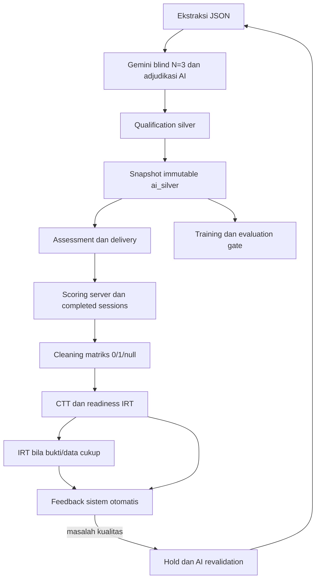

# Arsitektur AI dan feedback otomatis silver

Alur aktif menghubungkan validasi AI, snapshot silver, delivery siswa, scoring server dan CTT/IRT. Tidak ada pelabelan manusia atau pembentukan gold dalam jalur operasional.

`app/silver`, `app/llm`, `app/training/v2`, `app/classification/v2`, `app/assessment` dan `app/psychometrics` menyediakan alur. `app/staff` hanya auth operator dan MongoDB opsional. SQLite menyimpan dataset, form, sesi, event, snapshot empiris dan feedback.

Tiga run model yang sama dapat salah bersama. Silver qualification mempertahankan bukti, kunci, solusi dan visual; metrik model terhadap silver dilaporkan sebagai kecocokan rujukan AI. IRT memberikan bukti respons terpisah dari penilaian isi.

Difficulty agen, intended label, CTT p dan IRT b tidak saling ditimpa. Feedback menahan masalah kualitas dan menyimpan riwayat; perubahan konten memerlukan versi baru serta penilaian AI baru. Integrasi mengatur scheduler screen, bukan setiap respons memicu recalibration.

Generator varian, CAT, learner profile, equating/DIF, continuous retraining dan release calibration masih pengembangan berikutnya.
