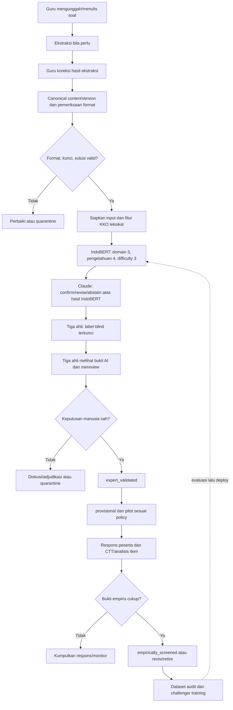

# Arsitektur IndoBERT, Claude, Validasi Ahli, dan Psikometrik

> Dokumen ini adalah **arsitektur target**, bukan klaim fitur yang sudah berjalan. Judul lama menyebut "autonomous"; keputusan pedagogis dan izin pilot **tidak otonom**. Lihat [status implementasi](00_README.md) dan [kontrak klasifikasi](04_CLASSIFICATION_API.md).

Versi visual yang dapat di-zoom ada pada [diagram end-to-end](20_END_TO_END_VALIDATION_FLOW.md).

## 1. Prinsip dan batas otoritas

Sistem menggabungkan empat sumber bukti yang tidak boleh dipertukarkan:

| Sumber | Yang dapat didukung | Yang tidak dapat diputuskan sendiri |
|---|---|---|
| Aturan format dan verifier | Struktur soal, keterbacaan, kunci dan konsistensi jawaban | Domain kognitif atau kualitas empiris |
| IndoBERT | Prediksi tiga head beserta probabilitas dan ketidakpastian | Gold label atau izin pilot |
| Claude | Audit **atas prediksi IndoBERT**, penjelasan dan usulan revisi | Review independen atau adjudikasi final |
| Tiga ahli matematika | Keputusan konten, kunci dan label berdasarkan rubrik | Karakteristik empiris semua populasi |
| Respons pilot | Kesukaran, daya beda, fungsi distraktor dan anomali pada populasi tertentu | Pembuktian otomatis domain kognitif atau knowledge dimension |

Karena Claude menerima hasil IndoBERT, kecocokan kedua model adalah *agreement bersyarat*, bukan dua suara independen. **Tidak ada majority vote tiga AI**: mayoritas 2 dari 3 hanya berlaku pada tiga ahli manusia. Teacher adalah author/pengoreksi sumber dan tidak dapat memaksa label expert.

## 2. Tahapan end-to-end

Urutan teknis tahap pra-model: **ingestion → ekstraksi → koreksi guru → canonicalisasi → validasi format dan jawaban → IndoBERT → Claude → pakar**. Pemeriksaan teknis sebelum model perlu agar teks kacau atau kunci salah tidak menjadi input klasifikasi. Validasi pakar dilakukan sesudah dua model, sebelum pilot. Sesudah pilot dilakukan **validasi empiris/psikometrik**, bukan voting ulang label kognitif rutin. Bila teks, kunci, format, atau konstruk direvisi secara substantif, buat contentVersion baru dan ulangi review konten serta tiga head. Bila konten tetap, penambahan data respons cukup memperbarui snapshot psikometrik.

## 3. Identitas dan audit

Unit keputusan adalah `questionId + contentVersion`. Simpan checksum teks, opsi, gambar/formula, kunci, solusi, tujuan pembelajaran, grade, sumber, format, serta waktu dan actor perubahan. Jangan menimpa versi yang sudah dianotasi atau disajikan. Semua model output, tiga penilaian awal, review sesudah AI, hasil voting, adjudikasi, dan snapshot psikometrik mempunyai ID, waktu, dan versi rubrik tersendiri.

Penyimpanan target memakai `questions`, `question_versions`, `ai_decisions`, `expert_annotations`, `expert_decisions`, `delivery_instances`, `response_events`, dan `psychometric_snapshots`; lihat [ERD](17_MONGODB_DATA_MODEL_ERD.md). MongoDB persisten dan gateway baru belum tersedia pada worktree ini.

## 4. Validasi format dan matematis

Gunakan schema untuk tipe `multiple_choice`, `true_false`, `matching`, `checkbox`, `interactive_grid`/click-the-box dan `short_answer` atau uraian sesuai implementasi. Periksa jumlah opsi, identitas jawaban, rendering LaTeX/gambar, bahasa, grade, ambiguitas, opsi ganda benar, serta kesesuaian soal–solusi. Verifier simbolik (misalnya SymPy) hanya untuk bentuk yang memang bisa diverifikasi deterministik; kegagalan verifikasi atau soal terbuka ditandai untuk manusia, bukan ditebak sebagai benar oleh Claude. Semua jawaban yang ditampilkan ke siswa dipisahkan dari DTO publik.

## 5. Gold label dan tiga head IndoBERT

IndoBERT tidak "menemukan" rubrik sendiri. Sebelum pelatihan, kumpulkan sampel soal representatif yang dinilai **blind** oleh tiga ahli menggunakan panduan dan contoh jangkar; lakukan adjudikasi konflik, bekukan gold set, lalu split berdasarkan item family/sumber agar parafrasa tidak bocor ke test. Latih, kalibrasi, dan uji pada hold-out. Pada produksi, expert review item baru menjadi data kandidat pelatihan berikutnya, **bukan** pembenaran retroaktif atas evaluasi yang sama.

| Head | Label | Pertanyaan keputusan |
|---|---|---|
| 1 — domain kognitif matematika | `knowing / applying / reasoning` | Apakah tugas utamanya recall/prosedur rutin, penerapan prosedur pada konteks, atau penalaran/justifikasi yang tidak rutin? |
| 2 — dimensi pengetahuan | `factual / conceptual / procedural / metacognitive` | Pengetahuan apa yang dominan dan benar-benar dituntut oleh tugas? |
| 3 — intended difficulty | `Easy / Medium / Hard` | Seberapa sulit diperkirakan bagi populasi/grade sasaran, **sebelum** respons tersedia? |

Head 1 diadaptasi dari kerangka matematika [TIMSS](https://timssandpirls.bc.edu/timss2023/frameworks/pdf/T23_Frameworks_Ch1_Mathematics.pdf) dengan keselarasan terbatas ke konteks [AKM numerasi](https://pusmendik.kemdikbud.go.id/an/Framework_AKM_31032022.pdf); itu bukan pemetaan 1:1 ke Bloom C1–C6. Head 2 merujuk [Revised Bloom](https://eric.ed.gov/?id=EJ667155). Contoh: satu pilihan ganda bisa menilai `reasoning` bila solusi menuntut pembuktian/analisis; bentuk pilihan ganda sendiri tidak menentukan label. `metacognitive` harus memerlukan refleksi/pemilihan strategi yang eksplisit, bukan dipaksakan pada setiap soal.

Input model: stem, opsi dan representasi, solusi/kunci yang terverifikasi bila tersedia, tujuan pembelajaran, grade, topik, format, dan provenance. KKO berada di `features.lexical.detectedKKO` sebagai sinyal leksikal lemah. "Tentukan" dapat menunjuk tugas rutin ataupun penalaran; **KKO tidak diubah langsung menjadi head 1**. Catat fitur non-leksikal seperti langkah solusi, kebutuhan generalisasi/justifikasi, keterkaitan konsep, sifat rutin/novel, dan beban representasi. Jalankan ablation dengan/ tanpa KKO dan metadata untuk menguji apakah fitur membantu tanpa shortcut. Simpan logits/probabilitas, entropy, margin, OOD flag, model version, rubric version dan kalibrasi per head. Threshold abstain ditentukan pada validation set, bukan angka universal.

Dataset harus melaporkan macro-F1, confusion matrix tiap head, kalibrasi, ketidakpastian, performa per grade/topik/format, dan interval ketidakpastian. Head 3 dimaksudkan kesukaran awal dan tidak boleh disamakan dengan kesukaran empiris. Base IndoBERT [IndoNLU](https://aclanthology.org/2020.aacl-main.85/) hanya titik awal representasi Bahasa Indonesia, bukan bukti bahwa classifier sudah valid untuk matematika.

## 6. Claude setelah IndoBERT

Adapter backend memakai `ANTHROPIC_API_KEY`, `CLAUDE_MODEL`, dan Messages API/structured output sesuai [dokumen 18](18_CLAUDE_PROVIDER_SETUP.md). Prompt memuat item kanonis, solusi terverifikasi atau status tidak tersedia, tiga prediksi dan probabilitas IndoBERT, fitur relevan, serta rubrik. Claude mengembalikan per head `confirm`, `revise`, atau `abstain`, label usulan bila revise, alasan yang menunjuk bukti dalam soal, dan catatan konflik/kunci. Schema validation dan batas retry diberlakukan; respons malformed, timeout, provider error, atau klaim yang tidak didukung menjadi `ai_review_failed`/quarantine, bukan fallback ke keputusan final.

Simpan input hash, model dan prompt version, penggunaan token/biaya yang tidak memuat data sensitif, timestamp, dan keluaran tervalidasi. Minimalkan data pribadi dan jangan kirim identitas peserta. Evaluasi **IndoBERT saja** dan **IndoBERT→Claude** terhadap gold blind yang sama; jangan klaim dua model independen atau akurasi berdasarkan kesepakatan keduanya.

## 7. Tiga ahli: blind, review, dan konflik

Tiga ahli matematika memenuhi kriteria yang ditetapkan protokol (kompetensi jenjang/topik, pelatihan rubrik, bebas konflik kepentingan). Jumlah **tiga** adalah keputusan desain untuk memperoleh mayoritas sederhana tanpa selalu memanggil adjudicator. Dua ahli saja adalah minimum untuk mengukur kesepakatan tetapi pada perbedaan 1–1 tidak ada mayoritas; ahli ketiga dibutuhkan. Tidak ada maksimum ilmiah universal; lebih banyak ahli dapat dipakai pada kalibrasi rubrik, sampel sulit, atau studi reliabilitas sesuai anggaran.

1. Setiap ahli memberi label tiga head, alasan singkat, validitas kunci/konten dan tingkat keyakinan **tanpa melihat model atau ahli lain**. Setelah submit, rekamannya immutable.
2. Tampilkan hasil IndoBERT dan Claude; ahli memberi review `accept/change/reject/abstain` beserta alasan. Simpan terpisah dari blind labels agar efek anchoring terukur.
3. Per head, tiga suara sah 3–0 atau 2–1 menghasilkan mayoritas. Split 1–1–1, abstain yang membuat mayoritas tidak ada, atau sengketa konten/kunci menuju diskusi terstruktur dan adjudicator senior. Adjudicator bukan LLM.
4. Keputusan final mencatat distribusi suara, perubahan pre/post-AI, rationale, rubricVersion, contentVersion, dan metode penetapan. Tanpa keputusan yang sah item tetap quarantined; tidak dikirim ke pilot.

Laporkan agreement awal dan sesudah review (misalnya persentase kesepakatan, Fleiss' kappa atau Krippendorff's alpha dengan interpretasi hati-hati, dan matriks disagreement per head). Angka reliabilitas adalah diagnostik rubrik, bukan pengganti penilaian matematika. Contoh 2–1 bukan jaminan benar: label minority dengan bukti kuat tetap dapat memicu adjudikasi. Rincian endpoint dan state ada di [05](05_AI_DECISION_ARBITRATION_API.md).

## 8. Pilot dan psikometrik

Hanya contentVersion `expert_validated` dengan kunci sah dan risiko yang diterima policy dapat diberi status `provisional` untuk pilot. Delivery menyimpan snapshot versi, opsi acak, populasi dan aturan scoring; respons diberi ID pseudonim dan correctness dihitung server-side. Agregasi respons dilakukan pada `questionId + contentVersion + populationId + assessmentFamily`.

CTT dasar pada respons valid: `p = jumlah benar / N` (nilai p besar berarti lebih mudah), `D = proporsi benar kelompok atas − kelompok bawah`, dan corrected item–total correlation / point-biserial. Tambahkan distraktor, nonresponse, waktu, rapid guessing, interval ketidakpastian, dan differential behavior bila desain data mengizinkan. Kategori empiris Easy/Medium/Hard harus mengikuti batas yang **ditetapkan dan dikalibrasi untuk populasi/protokol**; angka 0,30/0,70 boleh menjadi contoh eksplorasi, bukan hukum universal.

Snapshot diberi `observation_only` bila N kurang, CI lebar, populasi tidak jelas, anomali tinggi, atau hasil antar-administrasi tidak stabil. Itu bukan alasan untuk otomatis mengubah head 1 atau 2. Jika p empiris bertentangan dengan intended difficulty, catat `difficulty_mismatch`, telaah item/populasi, dan gunakan sebagai kandidat umpan balik head 3. Jika diskriminasi rendah/kunci bermasalah, tahan penyajian, lakukan review konten, dan buat version baru bila direvisi. Item dapat menjadi `empirically_screened`, tetap menunggu data, atau retired menurut policy.

## 9. Learning loop yang aman

Buat dataset immutable dengan item family, contentVersion, sumber, gold blind expert, final expert decision, populasi, pilot snapshot, cutoff waktu, model/prompt/rubric version. Split pada family dan dokumen sumber, bukan baris respons. Cegah data yang pernah dilihat Claude pada review item test masuk ke gold evaluation yang sama. Pisahkan label manusia dari pseudo-label/Claude output dan dari empirical targets.

Training head 1–2 memakai label pakar beradjudikasi; head 3 dapat memakai label intended pakar dan, sebagai tugas tambahan terpisah, `p` empiris/quality risk berbobot kualitas snapshot. Jangan mengubah knowing/applying/reasoning atau dimensi pengetahuan hanya karena p rendah/tinggi. Challenger diuji pada hold-out stabil dan audit per subkelompok, lalu shadow/canary dan rollback jika regresi. Tidak ada auto-promotion hanya berdasarkan loss training.

## 10. Status implementasi dan urutan kerja

Saat ini repo Python mempunyai prototype ekstraksi, klasifikasi lama C1–C6 dan CTT dasar. `project_assessment` lama sudah kosong dalam worktree, sehingga gateway/collection MongoDB lama bukan implementasi aktif. Claude CLI terdeteksi di mesin, tetapi API key dan `MONGODB_URI` tidak ada pada environment audit; worker Claude dan workflow tiga ahli belum terpasang. Dokumen ini tidak boleh digunakan untuk mengklaim layanan sudah siap produksi.

Urutan implementasi yang dapat diuji: (1) kunci rubrik dan dataset blind awal; (2) migrasi schema/model menjadi tiga head; (3) canonical format/answer gate; (4) Claude adapter dengan kontrak output dan smoke test; (5) penyimpanan immutable dan UI tiga ahli; (6) pilot delivery aman; (7) CTT/monitoring; (8) empirical challenger. Setiap tahap punya integration test dan status eksplisit `implemented/prototype/target`.

## Landasan

- [TIMSS 2023 Mathematics Framework](https://timssandpirls.bc.edu/timss2023/frameworks/pdf/T23_Frameworks_Ch1_Mathematics.pdf) dan [Framework AKM Numerasi](https://pusmendik.kemdikbud.go.id/an/Framework_AKM_31032022.pdf): domain tugas matematika.
- [Krathwohl (2002), A Revision of Bloom's Taxonomy](https://eric.ed.gov/?id=EJ667155): dimensi pengetahuan, bukan pemetaan otomatis KKO.
- [IndoNLU](https://aclanthology.org/2020.aacl-main.85/): basis model bahasa Indonesia.
- [Claude Messages API](https://platform.claude.com/docs/en/api/messages/create) dan [Structured outputs](https://platform.claude.com/docs/en/build-with-claude/structured-outputs): integrasi provider.
