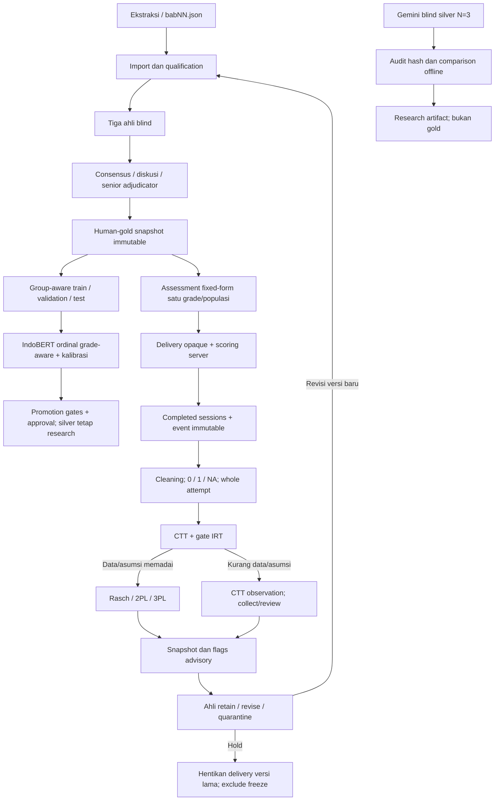

# Arsitektur AI dan Feedback Psikometrik Terkontrol

Implementasi saat ini menghubungkan validasi soal manusia, pilot server-scored, CTT/IRT dan keputusan empiris. Pembaruan label/model tetap memerlukan versioning dan ahli; sistem tidak melakukan self-training otomatis dari respons siswa.

Kode aktif: `app/annotation`, `app/training/v2`, `app/classification/v2`, `app/assessment`, `app/psychometrics`. MongoDB menyimpan keputusan/gold; SQLite menyimpan pilot/empirical. [07](07_PSYCHOMETRICS_API.md) menjelaskan statistik, [27](27_PSYCHOMETRICS_IMPLEMENTATION_RUNBOOK.md) menjelaskan eksekusi.

LLM blind dilakukan sebelum prediksi model untuk silver penelitian. Tiga run AI bukan tiga annotator manusia. Review anchored legacy tidak menjadi validasi baru. Hidden chain-of-thought tidak disimpan; alasan terstruktur dapat diaudit.

Judgment difficulty agen 1–5, label intended Easy/Medium/Hard, p CTT dan b IRT mempunyai makna berbeda. Tidak ada mapping otomatis antarfield. Version/population/grade/time-window/policy tetap melekat pada bukti empiris.

Calibrated confidence classifier, agreement LLM dan posterior uncertainty IRT juga berbeda. Model promotion tidak mengikuti convergence IRT atau voting AI. Semua keputusan empirical advisory tetap researchOnly=true.

Generator varian, multigroup linking, DIF/equating, CAT, continuous scheduled retraining, Redis jobs, Claude API dan public authoring lengkap masih desain lanjutan. Tidak ada klaim bahwa setiap blok arsitektur target sudah berjalan di deployment.
