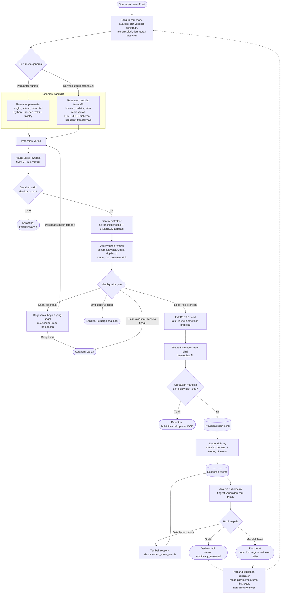

# Arsitektur Controlled Question Variation Generation

Dokumen ini adalah **desain generator varian**, belum endpoint runtime. CTT/Rasch/2PL/3PL dan fixed-form pilot sudah tersedia pada [27](27_PSYCHOMETRICS_IMPLEMENTATION_RUNBOOK.md); API aktif tidak membuat varian, family aggregation, equating atau CAT. Skema/pseudocode generator di bawah tidak boleh diperlakukan sebagai kontrak pilot aktif.

## 1. Tujuan dan ruang lingkup

Dokumen ini mendefinisikan arsitektur **tahap lanjutan** untuk membuat variasi soal dari induk yang telah lolos verifikasi jawaban **dan validasi tiga ahli**. Setiap varian substantif memerlukan keputusan ahli sendiri sebelum pilot; label induk hanya acuan pembanding.

Ruang lingkup dokumen hanya mencakup:

- pembentukan `item model` dari soal induk;
- perubahan angka atau parameter secara terkendali;
- perubahan konteks, redaksi, atau representasi secara terbatas;
- perhitungan ulang jawaban benar;
- pembentukan distraktor berbasis pola kesalahan;
- validasi kualitas varian;
- penyimpanan keluarga dan versi soal;
- penyajian varian ke platform;
- feedback psikometrik untuk memperbaiki generator.

Dokumen ini merupakan **target architecture**. Keberadaan komponen di dalam dokumen tidak berarti seluruhnya sudah tersedia pada repository.

Teacher dapat menyediakan dan merevisi parent sebagai author. Generation, answer verification, IndoBERT dan Claude menghasilkan kandidat serta usulan; tiga ahli memutuskan kelayakan sebelum pilot. Kandidat yang tidak dapat dipastikan masuk `quarantined`, `rejected`, atau keluarga soal baru.

## 2. Istilah dan batas klaim

Istilah utama:

- `verified_parent_item`: soal induk dengan struktur, jawaban dan keputusan tiga ahli valid pada contentVersion terkunci;
- `item_model`: template formal yang menentukan bagian tetap, bagian yang boleh berubah, constraint, dan aturan penyelesaian;
- `item_family`: kumpulan soal yang berasal dari item model dan konstruk yang sama;
- `parameter_variant`: varian yang terutama mengubah angka, satuan, atau nilai variabel;
- `isomorphic_candidate`: varian konteks atau representasi yang diduga mempertahankan konstruk dan langkah penyelesaian;
- `provisional_item`: varian yang lolos gate otomatis, validasi tiga ahli, dan policy pilot;
- `empirically_screened`: varian yang sudah mempunyai bukti psikometrik memadai.

Sistem boleh mengklaim bahwa varian:

- memenuhi schema dan constraint;
- mempunyai jawaban yang dihitung ulang dan diverifikasi;
- mempertahankan invariant sesuai pemeriksaan otomatis;
- memiliki prediksi IndoBERT, proposal Claude, dan keputusan tiga ahli yang terpisah;
- mempunyai kualitas empiris tertentu setelah respons mencukupi.

Sistem tidak boleh langsung mengklaim bahwa:

- semua varian dari satu template pasti setara secara psikometrik;
- perubahan konteks pasti tidak mengubah kesulitan;
- persetujuan Claude pada IndoBERT adalah human gold atau izin pilot;
- `intended_difficulty` sama dengan tingkat kesulitan empiris;
- varian otomatis adalah `gold item`.

## 3. Flow end-to-end

Diagram memakai notasi flowchart berikut agar alur teknis dan keputusan sistem dapat dibaca secara konsisten.

| Notasi | Makna |
|---|---|
| Oval atau sudut membulat | Titik awal atau status akhir |
| Persegi panjang | Proses otomatis |
| Belah ketupat | Keputusan berdasarkan hasil validasi |
| Silinder | Penyimpanan data |
| Garis penuh | Alur utama atau perpindahan status |
| Garis putus-putus | Umpan balik untuk memperbaiki generator |



Alur utama bersifat **deterministic-first** untuk parameter, jawaban dan constraint. Claude dapat membantu bahasa, konteks dan usulan miskonsepsi; keputusan pedagogis final memerlukan tiga ahli. File gambar lama dihapus dan diagram Mermaid di atas menjadi rujukan.

## 4. Verified parent question

Generator hanya boleh menerima soal yang sudah mempunyai:

- `question_id` dan `content_version`;
- teks soal yang sudah dinormalisasi;
- opsi yang valid untuk pilihan ganda;
- jawaban induk yang sudah diverifikasi;
- topik, subtopik, kelas, dan tujuan pembelajaran;
- formula atau jejak penyelesaian jika tersedia;
- klasifikasi `mathCognitiveDomain`, `knowledgeDimension`, dan `intendedDifficulty` dari keputusan tiga ahli;
- provenance sumber.

Jika jawaban belum stabil, ekstraksi memiliki warning kritis, atau tujuan pembelajaran tidak diketahui, item masuk `quarantine_parent` dan tidak diteruskan ke generator.

## 5. Item model

`Item model` adalah pusat generator. Parameter generator dan LLM tidak boleh bekerja tanpa batasan item model.

Contoh kontrak:

```json
{
  "item_model_id": "IM-GEO-TRAPEZOID-AREA-001",
  "item_model_version": 1,
  "item_family_id": "IF-GEO-TRAPEZOID-AREA-001",
  "parent_question_id": "MTK-SMP-GEO-001",
  "parent_content_version": 1,
  "target_construct": "menghitung_luas_trapesium",
  "learning_objective": "Menerapkan rumus luas trapesium",
  "construction_strategy": {
    "strategy_id": "trapezoid-integer-area-v1",
    "method": "constraint_guided_constructive"
  },
  "construct_invariants": {
    "required_formula": "A=(a+b)h/2",
    "solution_steps": [
      "add_parallel_sides",
      "multiply_by_height",
      "divide_by_two"
    ],
    "math_cognitive_domain": "applying",
    "knowledge_dimension": "procedural"
  },
  "parameters": {
    "a": {"type": "integer", "role": "given", "unit": "cm", "min": 4, "max": 30},
    "b": {"type": "integer", "role": "given", "unit": "cm", "min": 4, "max": 30},
    "h": {"type": "integer", "role": "given", "unit": "cm", "min": 2, "max": 20}
  },
  "constraints": [
    "a < b",
    "h > 0",
    "((a + b) * h) % 2 == 0"
  ],
  "solution_rule": "((a + b) * h) / 2",
  "distractor_rules": [
    "omit_half_factor",
    "subtract_parallel_sides",
    "use_single_base"
  ],
  "allowed_transformations": [
    "replace_context",
    "paraphrase_instruction",
    "text_to_simple_diagram"
  ],
  "forbidden_transformations": [
    "change_required_formula",
    "change_target_construct",
    "add_new_mathematical_concept"
  ],
  "range_provenance": {
    "item_family_policy": "trapezoid-area-v1",
    "grade_profile": "grade-8-number-profile-v1",
    "difficulty_profile": "medium-v1",
    "empirical_snapshot": null
  }
}
```

Sebelum aktif, item model harus melewati dry-run untuk memastikan constraint dapat dipenuhi, solution rule dapat dijalankan, dan cukup banyak kombinasi unik dapat dihasilkan.

Nilai `min` dan `max` pada contoh di atas hanya memperlihatkan bentuk kontrak. Nilai tersebut bukan standar universal. Range final harus diturunkan dari mekanisme pada Bagian 6.3 dan menyimpan `range_provenance` agar alasan pemilihannya dapat diaudit.

## 6. Dua mode generasi

### 6.1 Parameter generator

Parameter generator mengubah:

- angka;
- satuan yang kompatibel;
- nilai atau nama variabel;
- urutan opsi.

Bagian yang harus tetap:

- konstruk yang diukur;
- formula inti;
- target jawaban;
- urutan utama penyelesaian;
- tujuan pembelajaran.

Generator memakai seeded random number generator agar hasil dapat dibuat ulang. Setiap nilai harus melewati constraint sebelum dipakai.

Teknologi utama:

- Python seeded RNG atau NumPy Generator;
- SymPy;
- Python constraint rules;
- Hypothesis untuk property-based testing;
- Z3 atau OR-Tools hanya jika constraint berkembang menjadi kompleks.

### 6.2 Isomorphic candidate generator

Generator ini mengubah permukaan soal, misalnya:

- konteks taman menjadi atap;
- susunan kalimat;
- nama objek;
- penyajian teks menjadi diagram sederhana.

LLM hanya boleh memilih transformasi yang tercantum pada `allowed_transformations`. Keluaran wajib berbentuk JSON terstruktur dan harus memuat daftar perubahan yang dilakukan.

Varian disebut `isomorphic_candidate`, bukan langsung `isomorphic_item`, karena kesetaraan belum terbukti hanya dari keluaran LLM.

Perubahan berikut diarahkan menjadi keluarga baru:

- formula inti berubah;
- target variabel berubah dan menambah operasi baru;
- konsep baru ditambahkan;
- jumlah langkah penalaran berubah besar;
- prerequisite berbeda;
- klasifikasi kognitif bergeser signifikan.

Teknologi utama:

- Claude adapter berversi dengan antarmuka yang dapat diganti bila diperlukan;
- prompt dan transformation policy berversi;
- strict JSON Schema;
- sampling terbatas dan self-consistency;
- sentence embeddings hanya sebagai sinyal kemiripan, bukan bukti kesetaraan.

### 6.3 Landasan parameter dan range

Range bukan sekadar angka minimum dan maksimum. Range adalah seluruh ruang nilai yang boleh digunakan setelah aturan matematika, tujuan pembelajaran, profil kelas, dan target kesulitan diterapkan.

Secara konseptual:

```text
Allowed parameter domain
    = mathematical domain
    ∩ construct constraints
    ∩ grade number profile
    ∩ intended-difficulty profile
    ∩ operational constraints
```

Tidak ada satu range yang berlaku untuk seluruh topik, kelas, dan tingkat kesulitan. Setiap item family harus memiliki range dan construction strategy berversi.

#### 6.3.1 Sumber penetapan range

Range awal dibentuk dari lima sumber berikut.

| Sumber | Pertanyaan yang dijawab | Contoh |
|---|---|---|
| Aturan matematika | Nilai apa yang secara matematis sah? | Penyebut tidak nol, tinggi positif |
| Construct/learning objective | Kemampuan apa yang sedang diukur? | Tidak menambahkan konversi satuan jika target hanya rumus luas |
| Parent item profile | Kompleksitas numerik apa yang dimiliki soal induk? | Integer, 1-2 digit, tanpa pembulatan |
| Grade dan difficulty profile | Tipe angka dan operasi apa yang ditargetkan? | Easy tanpa desimal; Medium dapat memakai beberapa operasi |
| Bukti psikometrik | Fitur mana yang secara empiris membuat varian terlalu mudah atau sulit? | Varian desimal memiliki `p` lebih rendah daripada varian integer |

Urutan kekuatan buktinya:

```text
hard mathematical rule
    -> construct and curriculum policy
    -> source/parent-derived design prior
    -> intended-difficulty hypothesis
    -> empirical psychometric calibration
```

Range yang hanya berasal dari satu soal induk tetap merupakan hipotesis awal. Range tersebut tidak boleh disebut standar kelas atau tingkat kesulitan universal sebelum mempunyai dukungan data yang memadai.

#### 6.3.2 Parameter bukan hanya `min` dan `max`

Spesifikasi parameter dapat memuat:

| Field | Fungsi |
|---|---|
| `type` | Integer, decimal, fraction, angle, length, atau derived |
| `role` | Nilai yang diberikan, ditanyakan, atau diturunkan |
| `min`/`max` | Batas numerik jika memang sesuai |
| `step` | Kelipatan atau interval yang diperbolehkan |
| `allowed_values` | Daftar nilai diskret seperti persentase atau triple Pythagoras |
| `unit` | Satuan dan dimensi besaran |
| `precision` | Jumlah angka desimal dan aturan pembulatan |
| `dependencies` | Hubungan dengan parameter lain |
| `difficulty_features` | Digit, parity, fraction, carrying, conversion, dan jumlah operasi |

Contoh yang lebih lengkap:

```json
{
  "parameter_schema": {
    "short_base": {
      "type": "integer",
      "role": "given",
      "unit": "cm",
      "min": 4,
      "max": 20,
      "step": 1
    },
    "long_base": {
      "type": "integer",
      "role": "given",
      "unit": "cm",
      "min": 8,
      "max": 30,
      "depends_on": ["short_base"]
    },
    "height": {
      "type": "integer",
      "role": "given",
      "unit": "cm",
      "min": 2,
      "max": 15
    },
    "area": {
      "type": "derived",
      "role": "target",
      "unit": "cm²",
      "expression": "((short_base + long_base) * height) / 2"
    }
  }
}
```

Untuk beberapa konsep, `allowed_values` lebih tepat daripada min-max. Contohnya persentase dasar dapat memakai daftar `[10, 20, 25, 50, 75]`, sedangkan segitiga siku-siku dapat memakai daftar triple yang valid atau formula pembentuk triple.

#### 6.3.3 Hard constraint dan soft constraint

`Hard constraint` adalah aturan yang tidak boleh dilanggar:

- domain matematika valid;
- tidak ada pembagian dengan nol;
- panjang, tinggi, waktu, atau jumlah yang relevan tidak negatif;
- tepat satu opsi benar;
- formula dan target construct tetap;
- semua parameter wajib dapat diselesaikan.

Pelanggaran hard constraint menghasilkan `reject`, `regenerate`, atau `quarantine`.

`Soft constraint` adalah preferensi desain:

- jawaban sebaiknya tidak terlalu besar;
- teks sebaiknya berada di bawah panjang tertentu;
- jawaban sebaiknya dua digit;
- konteks sebaiknya familier;
- jumlah operasi sebaiknya sesuai target difficulty.

Pelanggaran soft constraint meningkatkan risk score atau memicu regeneration, tetapi tidak selalu berarti soal salah secara matematis.

```json
{
  "hard_constraints": [
    "height > 0",
    "long_base > short_base",
    "correct_option_count == 1"
  ],
  "soft_constraints": [
    {"rule": "answer_digit_count <= 3", "weight": 0.4},
    {"rule": "reading_length <= 40", "weight": 0.2}
  ]
}
```

#### 6.3.4 Constructive generation

Generator tidak boleh bergantung pada random murni lalu berharap kandidat lolos pemeriksaan. Metode utama adalah **constructive generation**: parameter dibentuk sejak awal berdasarkan sifat matematika masalah. Random hanya memilih di antara nilai yang sudah sah.

Contoh luas trapesium:

```text
1. Pilih target difficulty dan number profile.
2. Pilih tinggi h dari domain yang sah.
3. Jika h ganjil, pilih a dan b dengan parity yang sama agar a+b genap.
4. Jika h genap, pilih a dan b dari domain yang diizinkan.
5. Pastikan b > a dan selisihnya memenuhi family policy.
6. Hitung area dan complexity features.
7. Jika complexity berada di target band, bentuk distraktor.
8. Jalankan final safety validation.
```

Dengan strategi tersebut, syarat

```text
((a + b) * h) % 2 == 0
```

dipenuhi melalui cara konstruksi, bukan ditemukan secara kebetulan melalui percobaan acak.

Strategi harus spesifik per keluarga soal. Contoh:

- persamaan kuadrat: pilih akar terlebih dahulu, lalu bentuk dan ekspansi `(x-r1)(x-r2)`;
- segitiga siku-siku: gunakan triple Pythagoras atau formula pembentuk triple;
- persentase: pilih persentase diskret dan total yang menghasilkan bentuk jawaban yang ditargetkan;
- pecahan: pilih denominator berdasarkan target KPK dan kompleksitas operasi;
- sistem persamaan: pilih solusi terlebih dahulu, lalu konstruksi koefisien dan konstanta yang konsisten.

Rejection sampling masih boleh menjadi fallback untuk constraint ringan, tetapi harus mempunyai `Rmax`, failure reason, dan monitoring. Jika rejection rate tinggi, construction strategy harus diperbaiki.

#### 6.3.5 Difficulty profile

Difficulty tidak ditentukan hanya oleh besar kecilnya angka. Generator juga mencatat:

```json
{
  "difficulty_features": {
    "number_type": "integer",
    "maximum_digits": 2,
    "decimal_places": 0,
    "allows_negative": false,
    "requires_carrying": false,
    "requires_unit_conversion": false,
    "requires_formula_rearrangement": false,
    "reasoning_steps": 3,
    "irrelevant_information_count": 0,
    "representation": "text"
  }
}
```

Profil awal dapat dirancang sebagai berikut:

```text
Easy
    -> integer sederhana, formula langsung, tanpa konversi/pembulatan

Medium
    -> beberapa operasi atau pilihan informasi, tetapi construct tetap tunggal

Hard
    -> formula rearrangement, fraction/decimal, konversi, atau beberapa langkah
```

Profil ini hanya menghasilkan `intended_difficulty`. `Empirical difficulty` baru diperoleh dari respons dan harus disimpan pada field terpisah.

#### 6.3.6 Algoritma runtime

```text
Generation request
    -> load item-family mathematical rules
    -> load grade number profile
    -> load intended-difficulty profile
    -> compute intersection as allowed domain
    -> select domain-specific construction strategy
    -> construct parameters
    -> compute derived answer and solution trace
    -> compute difficulty features
    -> compare features with target band
        -> outside band: reconstruct with bounded retry
        -> inside band: continue
    -> generate misconception-based distractors
    -> final mathematical and structural safety check
    -> persist parameter snapshot and range provenance
```

Komponen teknisnya:

- Python rules untuk domain dan relasi sederhana;
- SymPy untuk formula, simplifikasi, substitusi, dan solution verification;
- Z3 atau OR-Tools jika constraint kombinatorial menjadi kompleks;
- Hypothesis untuk menguji banyak kombinasi sebelum item model dipromosikan;
- seeded RNG untuk memilih secara reproducible dari domain yang telah valid.

LLM dapat mengusulkan kandidat parameter atau constraint, tetapi bukan otoritas penetapan range. Usul LLM harus melewati schema, mathematical rules, grade profile, dry-run, dan property-based tests.

#### 6.3.7 Kalibrasi dan provenance

Setiap range harus menyimpan asal kebijakan:

```json
{
  "range_provenance": {
    "item_family_policy": "trapezoid-area-v1",
    "parent_profile_snapshot": "PARENT-MTK-SMP-GEO-001-V1",
    "grade_profile": "grade-8-number-profile-v1",
    "difficulty_profile": "medium-v1",
    "empirical_snapshot": null
  }
}
```

Setelah data respons memadai, `empirical_snapshot` menunjuk pada bukti yang digunakan untuk membentuk versi baru. Contohnya, jika varian dengan semua angka genap terlalu mudah sedangkan varian desimal terlalu sulit, generator dapat mengubah probabilitas fitur atau difficulty band pada `item_family_policy` berikutnya.

Perubahan range tidak boleh menimpa versi lama:

```text
item_family_policy v1
    -> collect psychometric evidence
    -> candidate policy v2
    -> dry-run and replay old seeds
    -> compare invalid-generation and difficulty errors
    -> promote atau reject v2
```

Dengan mekanisme ini, jawaban atas pertanyaan "range berasal dari mana?" dapat ditelusuri ke mathematical rule, item-family policy, grade profile, intended-difficulty profile, dan psychometric snapshot yang spesifik.

## 7. Jawaban benar dan distraktor

Jawaban benar pada soal induk tidak boleh disalin langsung ke varian. Setelah angka atau struktur berubah, jawaban wajib dihitung ulang.

```text
parameters
    -> solution rule
    -> computed answer
    -> independent substitution/check
    -> verified computed answer
```

Untuk matematika deterministik, SymPy dan rule verifier menjadi pemeriksa utama. Claude dapat memberi bukti tambahan pada kasus yang tidak dapat diselesaikan secara simbolik, tetapi hasilnya bukan verifikasi independen atau pengganti ahli matematika; kasus yang masih ambigu ditahan untuk review manusia.

Distraktor dibuat dari pola kesalahan, bukan angka acak. Contoh:

| Distractor rule | Pola kesalahan |
|---|---|
| `omit_half_factor` | Melupakan faktor `1/2` |
| `subtract_parallel_sides` | Mengurangkan dua sisi sejajar |
| `use_single_base` | Hanya memakai satu sisi sebagai alas |
| `unit_conversion_error` | Salah mengubah satuan |

Setiap opsi harus memenuhi:

- tepat satu jawaban benar;
- tidak ada opsi duplikat atau ekuivalen;
- tipe data dan satuan konsisten;
- setiap distraktor benar-benar salah;
- nilai masih masuk akal untuk konteks soal;
- format atau panjang opsi tidak membocorkan kunci.

LLM dapat mengusulkan pola miskonsepsi, tetapi deterministic engine tetap menghitung nilai distraktornya dan memeriksa bahwa nilai tersebut salah.

## 8. Automated quality gate

Quality gate terdiri dari tiga kelompok pemeriksaan.

### 8.1 Structural gate

- schema dan field wajib;
- LaTeX dan diagram dapat dirender;
- opsi valid dan unik;
- content hash dan near-duplicate check;
- lineage, seed, dan version tersedia.

### 8.2 Mathematical gate

- constraint dipenuhi;
- solver menghasilkan satu jawaban stabil;
- independent check menyetujui jawaban;
- semua distraktor salah;
- satuan dan pembulatan konsisten.

### 8.3 Construct preservation gate

- learning objective tetap;
- required formula tetap;
- solution graph tidak berubah di luar batas;
- reasoning-step delta dalam batas;
- tidak ada prerequisite baru;
- perubahan reading atau representation complexity dicatat.

Routing:

```text
semua gate lolos
    -> lanjut ke IndoBERT → Claude → tiga ahli

kesalahan dapat diperbaiki dan retry < Rmax
    -> regenerate bagian yang gagal

construct drift tinggi tetapi masih merupakan soal valid
    -> new_item_family_candidate

jawaban konflik, schema rusak, atau retry habis
    -> quarantined/rejected
```

Threshold dan bobot construct drift harus ditentukan dari eksperimen. Nilainya bukan konstanta universal.

## 9. IndoBERT → Claude → tiga ahli

Setiap varian diklasifikasikan ulang. Label soal induk hanya menjadi referensi, bukan label otomatis bagi varian.

IndoBERT mengeluarkan tiga distribusi probabilitas terpisah: domain matematika `knowing/applying/reasoning`, dimensi pengetahuan `factual/conceptual/procedural/metacognitive`, dan intended difficulty `Easy/Medium/Hard`. Simpan juga entropy, margin, OOD signal, model version dan fitur KKO leksikal yang terdeteksi. KKO bukan label final.

Claude menerima item dan hasil IndoBERT, memeriksa kecocokan solusi, tujuan pembelajaran, representasi dan invariant, lalu mengusulkan `confirm/revise/abstain` per head dengan bukti. Keduanya tidak independen dan kesepakatannya tidak memberi izin pilot. Bila Claude gagal atau kontrak output tidak valid, item tertahan.

Tiga ahli matematika menilai varian secara blind dahulu, lalu meninjau usulan AI. Mayoritas 2 dari 3 per head dapat membentuk keputusan bila bukti dan kunci sah; split 1-1-1, abstain, atau keberatan validitas matematika memerlukan diskusi/adjudikasi manusia. Hanya `expert_validated` yang boleh menjadi `provisional` menurut policy. Prosedur lengkap pada [05](05_AI_DECISION_ARBITRATION_API.md).

## 10. Kontrak generation request dan hasil varian

Contoh request:

```json
{
  "item_model_id": "IM-GEO-TRAPEZOID-AREA-001",
  "item_model_version": 1,
  "generation_mode": "numeric_parameterization",
  "variant_count": 10,
  "target_grade": 8,
  "target_intended_difficulty": "Medium",
  "seed": 18421,
  "max_regeneration_attempts": 5
}
```

Contoh hasil internal:

```json
{
  "variant_id": "IF-GEO-TRAPEZOID-AREA-001-V014",
  "item_family_id": "IF-GEO-TRAPEZOID-AREA-001",
  "parent_question_id": "MTK-SMP-GEO-001",
  "parent_content_version": 1,
  "item_model_version": 1,
  "generator_version": "parameter-generator-0.1.0",
  "generation_mode": "numeric_parameterization",
  "generation_seed": 18421,
  "parameters": {"a": 10, "b": 16, "h": 6},
  "question_text": "Sebuah trapesium memiliki sisi sejajar 10 cm dan 16 cm serta tinggi 6 cm. Hitung luasnya.",
  "options": [
    {"id": "opt-1", "text": "78 cm²", "kind": "correct"},
    {"id": "opt-2", "text": "156 cm²", "kind": "distractor", "misconception": "omit_half_factor"},
    {"id": "opt-3", "text": "18 cm²", "kind": "distractor", "misconception": "subtract_parallel_sides"},
    {"id": "opt-4", "text": "60 cm²", "kind": "distractor", "misconception": "use_single_base"}
  ],
  "computed_answer": {"value": 78, "unit": "cm²"},
  "construct_drift_score": 0.08,
  "status": "provisional"
}
```

Field `computed_answer`, `kind`, `misconception`, dan solution trace hanya untuk penyimpanan internal. Field tersebut tidak boleh dikirim ke klien siswa.

## 11. Endpoint target

Endpoint berikut merupakan target dan belum diasumsikan sudah tersedia:

```http
POST /api/v1/internal/item-models
GET  /api/v1/internal/item-models/{itemModelId}
POST /api/v1/internal/item-models/{itemModelId}/validate

POST /api/v1/internal/generation/jobs
GET  /api/v1/generation/jobs/{jobId}
GET  /api/v1/item-families/{itemFamilyId}/variants
GET  /api/v1/variants/{variantId}

POST /api/v1/internal/variants/{variantId}/screen
POST /api/v1/internal/variants/{variantId}/regenerate
POST /api/v1/internal/variants/{variantId}/quarantine

POST /api/v1/assessments/{assessmentId}/sessions
GET  /api/v1/sessions/{sessionId}/items/next
POST /api/v1/responses
```

Generation job sebaiknya asynchronous karena LLM, batch generation, rendering, dan screening dapat memerlukan waktu lebih panjang daripada request HTTP biasa.

## 12. Penyimpanan dan delivery

Koleksi utama:

| Koleksi | Isi |
|---|---|
| `item_models` | Invariant, parameter schema, constraints, solution dan distractor rules |
| `item_families` | Identitas konstruk dan hubungan dengan parent question |
| `item_variants` | Konten varian, parameter snapshot, answer, status, lineage |
| `generation_runs` | Request, seed, retry, kegagalan, versi generator dan LLM |
| `workflow_runs` dan `ai_decisions` | Hasil structural, mathematical, construct, prediksi IndoBERT dan usulan Claude |
| `expert_annotations` dan `expert_decisions` | Tiga label blind, review AI, voting, dan adjudikasi manusia |
| `delivery_instances` | Snapshot varian dan urutan opsi untuk satu attempt |
| `response_events` | Pilihan, correctness server-side, waktu, dan perubahan jawaban |
| `psychometric_snapshots` | Statistik per varian, keluarga, populasi, dan versi |

Delivery API hanya mengirim `deliveryInstanceId`, public item ID, teks, media, dan opsi publik. Kunci, internal `variantId`, `contentVersion`, dan option mapping tetap berada di server kecuali policy API secara eksplisit membutuhkan identifier non-sensitif tertentu.

Satu attempt harus memakai snapshot yang tetap. Refresh halaman tidak boleh menghasilkan angka, varian, atau urutan opsi baru tanpa membuat delivery instance baru.

## 13. Psychometric feedback

Analisis dilakukan pada dua tingkat:

```text
variant level
    -> difficulty index
    -> discrimination
    -> corrected point-biserial
    -> distractor selection
    -> response time

family level
    -> perbedaan difficulty antarvarian
    -> variance dalam keluarga
    -> stabilitas discrimination
    -> kestabilan fungsi distraktor
```

Hasil psikometrik dapat memperbaiki:

- rentang parameter;
- difficulty driver;
- aturan distraktor;
- pilihan konteks;
- transformation policy;
- pola yang harus langsung ditolak.

Varian dengan data belum cukup tetap berstatus `collect_more_events`. Severe flags dapat memicu penangguhan penyajian otomatis untuk keselamatan, tetapi keputusan revisi konten, regenerasi, atau pensiun memerlukan audit manusia dan version baru bila konten berubah.

Seluruh varian dalam satu `item_family_id` harus berada pada split dataset yang sama agar tidak terjadi train/test leakage.

## 14. Status lifecycle

```text
generation_requested
    -> generating
    -> generated_candidate
    -> answer_verification
        -> quarantine_answer_conflict
    -> distractor_validation
        -> regenerate_distractors
        -> rejected_distractors
    -> construct_screening
        -> regenerate_variant
        -> new_item_family_candidate
        -> quarantine_construct_drift
    -> indobert_screening
    -> claude_review
        -> quarantine_ai_failure
    -> expert_blind_annotation
    -> expert_ai_review
        -> human_adjudication
        -> quarantine_expert_conflict
    -> expert_validated
    -> provisional
    -> pilot_active
    -> collecting_responses
        -> collect_more_events
        -> auto_unpublished
        -> needs_regeneration
        -> retired
        -> empirically_screened
```

## 15. Tech stack

| Area | Teknologi | Peran |
|---|---|---|
| API gateway | Runtime dipilih saat implementasi | Endpoint publik dan proxy layanan |
| Runtime schema | AJV, Pydantic, Mongoose | Validasi kontrak dan penyimpanan |
| Generation service | Python, FastAPI | Orkestrasi item model dan varian |
| Parameter generator | Python seeded RNG, NumPy | Sampling yang reproducible |
| Mathematical engine | SymPy + rule verifier | Jawaban dan distraktor deterministik |
| Constraint engine | Python rules | Constraint awal yang mudah diaudit |
| Advanced constraint | Z3 atau OR-Tools, opsional | Constraint kombinatorial kompleks |
| Property testing | Hypothesis, Pytest | Menguji banyak kombinasi parameter |
| Semantic generator | Claude adapter | Konteks, redaksi, dan proposal miskonsepsi |
| Structured LLM output | JSON Schema + Pydantic | Menolak keluaran LLM yang tidak sesuai |
| Taxonomy screening | IndoBERT, PyTorch, Hugging Face | Domain matematika, knowledge, difficulty, uncertainty |
| Expert review | Tiga ahli dan audit trail | Keputusan manusia sebelum pilot |
| Similarity | sentence-transformers, FAISS | Near duplicate dan sinyal semantic drift |
| Queue | Redis + Celery/RQ | Batch generation asynchronous |
| Operational store | MongoDB | Model, family, variant, run, delivery, response |
| Immutable dataset | JSONL, Parquet | Audit dan dataset training/evaluation |
| Platform UI | React, KaTeX, JSXGraph/SVG | Menampilkan teks, formula, dan diagram |
| Psychometrics | Pandas, NumPy, SciPy, scikit-learn | Analisis varian dan keluarga |
| Model registry | MLflow atau versioned manifest | Versi generator, model, prompt, dan metrik |
| Monitoring | Prometheus, Grafana, OpenTelemetry | Error, latency, quarantine, dan drift |
| Deployment | Docker, Docker Compose | Runtime lokal dan deployment konsisten |

Pembagian otoritas:

```text
Angka dan parameter       -> Python constraint generator
Jawaban matematika        -> SymPy dan rule verifier
Distraktor matematika     -> misconception rules, dibantu LLM
Konteks dan redaksi       -> LLM dengan transformation policy
Klasifikasi taksonomi     -> IndoBERT → Claude → tiga ahli
Validitas struktur        -> deterministic quality gate
Kualitas nyata varian     -> psychometric evidence
```

## 16. Tahapan implementasi

### Tahap 1: deterministic MVP

- item model ditulis untuk beberapa topik terpilih;
- numeric parameter generator;
- SymPy answer verification;
- rule-based misconception distractors;
- schema, render, dan uniqueness gate;
- penyimpanan item family dan variant.

Topik awal yang sesuai antara lain operasi bilangan, persamaan linear, persamaan kuadrat terkontrol, luas/keliling bangun datar, volume sederhana, persentase, dan perbandingan.

### Tahap 2: delivery dan response

- assessment assembly;
- delivery instance berversi;
- opsi diacak di server;
- kunci tidak dikirim ke frontend;
- correctness dihitung server-side;
- response event dan timing disimpan.

### Tahap 3: psychometric feedback

- statistik per varian;
- analisis distraktor;
- perbandingan dalam satu item family;
- auto-unpublish dan retirement;
- feedback untuk parameter serta distractor rules.

### Tahap 4: isomorphic candidate generation

- LLM structured transformation;
- transformation policy;
- construct drift screening;
- review Claude atas IndoBERT dan validasi tiga ahli;
- context dan representation variation.

Urutan ini membuat generator deterministik menjadi fondasi. LLM ditambahkan setelah answer engine, constraint, versioning, dan delivery sudah stabil.

## 17. Risiko utama dan mitigasi

| Risiko | Dampak | Mitigasi |
|---|---|---|
| Angka berubah dan kesulitan ikut bergeser | Target difficulty tidak tercapai | Difficulty drivers, range per grade, empirical screening |
| LLM mengubah konstruk | Varian mengukur kemampuan berbeda | Invariants, transformation policy, solution graph, drift gate |
| Jawaban induk disalin ke varian | Kunci salah | Recompute setiap varian dengan SymPy/rules |
| Distraktor acak atau tidak masuk akal | Opsi mudah ditebak | Misconception rules dan distractor analysis |
| Lebih dari satu opsi benar | Scoring tidak sah | Evaluate semua opsi terhadap solution rule |
| IndoBERT dan Claude salah tetapi sepakat | False acceptance | Pemeriksaan deterministik, blind gold tiga ahli, adjudikasi, OOD gate, pilot |
| Varian dianggap data independen | Leakage dan metrik terlalu optimistis | Group split berdasarkan `item_family_id` |
| Varian berubah saat attempt | Respons tidak dapat direproduksi | Delivery snapshot, seed, content version |
| Kunci dikirim ke browser | Kebocoran jawaban | Server-side scoring dan public delivery DTO |
| Semua varian dianggap setara | Klaim psikometrik berlebihan | Statistik per varian dan family-level equivalence analysis |
| Sumber terlalu dekat dengan varian | Risiko provenance dan penggunaan konten | Simpan sumber, lisensi, transformation trace, near-duplicate check |

## 18. Ringkasan

```text
Verified parent item
    -> versioned item model
    -> parameter atau isomorphic candidate generation
    -> answer recomputation
    -> misconception-based distractors
    -> deterministic and construct quality gates
    -> IndoBERT → Claude → tiga ahli
    -> provisional item bank
    -> secure platform delivery
    -> response collection
    -> variant/family psychometrics
    -> generator improvement or retirement
```

Prinsip utama arsitektur ini adalah **deterministic-first dan LLM-assisted**. LLM menangani bahasa dan variasi semantik, sedangkan constraint, jawaban, scoring, versioning, dan acceptance gate tetap dikendalikan oleh mekanisme yang dapat diuji dan diaudit.

## 19. Batas terhadap distraktor pipeline ekstraksi

Tiga distraktor pada `babNN.json` dibuat untuk mengubah/menormalkan soal sumber menjadi candidate pilihan ganda. Aktivitas tersebut bukan generasi varian item family: tidak ada parameter transformasi, equivalence claim, exposure policy, atau pewarisan statistik. Setiap opsi tetap harus diperiksa terhadap jawaban benar; validator saat ini mendeteksi duplikasi teks dan sebagian nilai numerik senilai, tetapi belum membuktikan semua ekuivalensi simbolik/semantik.

Jika candidate agentic kelak menjadi parent untuk generator terkontrol, ia harus lebih dahulu diimpor, diberi content version, lolos gate jawaban, IndoBERT→Claude dan tiga ahli. Lineage generator dimulai dari version tervalidasi tersebut, bukan dari file batch mentah.
