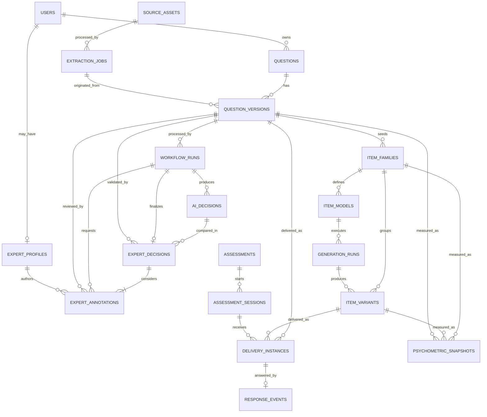

# Model Data MongoDB dan ERD Logis

Alur proses dan peta tech stack yang memakai koleksi-koleksi ini ada pada [diagram end-to-end](20_END_TO_END_VALIDATION_FLOW.md).

## 1. Tujuan

Dokumen ini mendefinisikan target collection MongoDB, atribut, hubungan, index, versioning, dan keputusan embed/reference untuk arsitektur pada dokumen 15-16.

Subset fase IndoBERT sudah diterapkan dengan Pydantic + `pymongo.AsyncMongoClient`: `users`, `expert_profiles`, `questions`, `question_versions`, `annotation_assignments`, `expert_annotations`, `expert_decisions`, `dataset_snapshots`, `training_runs`, `model_versions`, `audit_events`, dan `sessions`. Collection Claude/delivery/psikometrik pada ERD tetap target. Atlas belum diprovision, sehingga ini adalah `implemented_unprovisioned`.

MongoDB tidak menerapkan foreign key seperti database relasional. ERD di bawah adalah **relasi logis** yang dijaga oleh application service, schema validation, unique index, idempotency, dan reconciliation job.

## 2. Notasi

| Notasi | Makna |
|---|---|
| `PK` | Business identifier unik, biasanya string/ULID |
| `REF` | Referensi logis ke collection lain |
| `UK` | Unique key/index |
| `IDX` | Non-unique index |
| `EMBED` | Subdocument yang disimpan bersama parent |
| `IMMUTABLE` | Tidak diubah setelah dibuat; perubahan membuat record/version/event baru |
| `TTL` | Dokumen dapat dihapus otomatis setelah waktu tertentu |
| `1:N` | Satu parent mempunyai banyak child |
| `0..1` | Relasi opsional |

Semua dokumen memakai `_id: ObjectId` sebagai internal storage key, tetapi API dan relasi memakai business ID seperti `questionId` atau `variantId`. Browser tidak perlu mengetahui `_id`.

## 3. ERD logis



Satu delivery menggunakan `questionVersion` langsung atau `itemVariant`. Jika memakai variant, variant tetap membawa lineage ke parent question version.

### 3.1 Flow ekstraksi sampai validasi ahli dan psikometrik

Ekstraksi membentuk **authoring candidate**. Sesudah validasi format dan jawaban, IndoBERT mengklasifikasikan tiga head, Claude mengolah hasilnya, lalu tiga annotator ahli mereview dengan penilaian awal blind. Psikometrik dijalankan setelah pilot. Seed dataset untuk melatih IndoBERT pertama kali harus dinilai ahli sebelum flow produksi ini dapat berjalan.

```mermaid
flowchart TD
    A[Upload sumber<br/>PDF, gambar, JSON, CSV, TXT, atau LaTeX]
    B[(source_assets<br/>checksum dan provenance)]
    C{Security gate<br/>ukuran, ekstensi, MIME,<br/>malware, dan duplikasi}
    C_FAIL[Reject atau quarantine source]
    D[(extraction_jobs<br/>queued lalu running)]

    subgraph EXTRACT[Ekstraksi multimodal]
        E{Jenis sumber}
        F[PDF text layer<br/>PyMuPDF]
        G{Teks cukup dan terurut?}
        H[Render halaman<br/>OCR ind dan eng]
        I[Image OCR]
        J[Structured parser]
        K[Math region detection<br/>dan formula OCR]
        L[Normalisasi konservatif<br/>teks, LaTeX, halaman, bbox,<br/>confidence, dan method]
        M[Segmentasi nomor soal<br/>stem dan opsi A sampai H]
        N[Crop visual per soal<br/>dan simpan preview reference]
    end

    O{Candidate dapat dibaca?}
    O_FAIL[completed_with_warnings<br/>atau needs_manual_review]
    P[Authoring candidate<br/>bukan Question final]
    Q[Teacher memperbaiki hasil ekstraksi<br/>tanpa menetapkan label final]
    R[(questions dan question_versions<br/>author_draft dengan source lineage)]
    S[Submit dan kunci contentVersion]

    subgraph PRECHECK[Validasi sebelum model]
        T[Canonicalization<br/>dan deterministic validation]
        U{Schema, opsi, LaTeX,<br/>duplikasi, dan range valid?}
        U_FAIL[revision_required]
        V[Answer verification<br/>rule atau symbolic solver]
        W{Kunci dan solusi terbukti?}
        W_FAIL[quarantined<br/>answer conflict]
    end

    subgraph AI[Pipeline AI berurutan]
        X[Ekstraksi fitur deterministik<br/>KKO, format, representasi,<br/>kelas dan topik]
        Y[IndoBERT multi-head<br/>Knowing Applying Reasoning;<br/>knowledge; intended difficulty]
        Z[Claude memeriksa prediksi IndoBERT<br/>confirm revise abstain per head]
        AC[(ai_decisions<br/>input, model, prompt dan rubric versions)]
    end

    subgraph HUMAN[Validasi ahli]
        AD[Annotator A<br/>label dan rationale blind]
        AE[Annotator B<br/>label dan rationale blind]
        AF[Annotator C<br/>label dan rationale blind]
        AG[Freeze 3 initial annotations<br/>hitung agreement per head]
        AH[Review proposal IndoBERT dan Claude<br/>accept revise abstain per head]
        AI3{Voting manusia 3-0 atau 2-1?}
        AJ[expert_consensus<br/>catat dissent]
        AK[Diskusi terstruktur<br/>atau senior adjudicator]
        AK2{Konflik terselesaikan?}
        AL[unresolved atau quarantined]
    end

    AM[Evaluasi IndoBERT dan Claude<br/>terhadap human gold<br/>Macro-F1, per-class F1,<br/>agreement, dan calibration]
    AN{Lolos policy untuk pilot?}
    AN_FAIL[revision_required<br/>atau model_review]
    AO[pilot_active]
    AP[(delivery_instances<br/>dan response_events)]
    AQ[(psychometric_snapshots<br/>p dan CI, D, rpbis,<br/>distraktor, waktu, populasi)]
    AR{Post-pilot decision}
    AS[empirically_screened<br/>atau active]
    AT{Perlu perubahan konten,<br/>opsi, kunci, atau solusi?}
    AU[Buat contentVersion baru<br/>validasi lama menjadi superseded]
    AV[quarantined atau retired]

    A --> B --> C
    C -- gagal --> C_FAIL
    C -- lolos --> D --> E
    E -- PDF --> F --> G
    G -- ya --> L
    G -- tidak --> H --> K --> L
    E -- gambar --> I --> K
    I --> L
    E -- terstruktur --> J --> L
    L --> M --> N --> O
    O -- tidak --> O_FAIL
    O -- ya --> P --> Q --> R --> S --> T --> U
    U -- tidak --> U_FAIL
    U -- ya --> V --> W
    W -- tidak --> W_FAIL
    W -- ya --> X --> Y --> Z --> AC
    W -- versi yang sama --> AD
    W -- versi yang sama --> AE
    W -- versi yang sama --> AF
    AD --> AG
    AE --> AG
    AF --> AG
    AG --> AH
    AC --> AH
    AH --> AI3
    AI3 -- ya --> AJ
    AI3 -- tidak --> AK --> AK2
    AK2 -- ya --> AJ
    AK2 -- tidak --> AL
    AC --> AM
    AJ --> AM
    AM --> AN
    AN -- tidak --> AN_FAIL
    AN -- ya --> AO --> AP --> AQ --> AR
    AR -- bukti memadai dan stabil --> AS
    AR -- statistik bermasalah --> AT
    AT -- ya --> AU --> T
    AT -- tidak dan dapat diterima --> AS
    AT -- tidak tetapi risiko tinggi --> AV
```



Aturan keputusan flow:

1. `extraction_jobs` hanya menghasilkan kandidat beserta provenance, confidence, warning, dan visual preview. Ekstraktor tidak menetapkan jawaban benar atau label kognitif.
2. Teacher boleh memperbaiki teks hasil ekstraksi sebelum membuat `question_versions`, tetapi teacher tetap berperan sebagai author dan bukan annotator/adjudikator.
3. KKO berada pada `features.lexical.detectedKKO`; IndoBERT membaca soal, solusi terverifikasi dan metadata. Claude menerima hasil IndoBERT dan mengembalikan usulan `confirm/revise/abstain`. Keduanya bukan pengukuran independen.
4. Tiga annotator tidak melihat AI atau peer pada putaran awal. Ketiga initial annotation disimpan immutable; setelahnya pakar mereview usulan Claude.
5. Keputusan `3-0` atau `2-1` dicatat per head. `1-1-1` atau abstention memerlukan diskusi/adjudikasi manusia; jika tetap tidak selesai, `unresolved` atau `quarantined`.
6. Agreement dihitung dari tiga initial annotation sebelum hasil AI dibuka. Blind consensus menjadi gold untuk pelatihan/evaluasi IndoBERT; keputusan setelah review menjadi label operasional final, dan keduanya disimpan terpisah.
7. Full expert validation berlaku untuk satu `contentVersion`. Perubahan stem, opsi, kunci, solusi, learning objective, atau metadata konstruk membuat version baru dan membatalkan keputusan lama.
8. Psychometric snapshot tidak otomatis mengubah domain kognitif atau knowledge dimension. `intendedDifficulty` tetap dipisahkan dari `empiricalDifficulty` yang terikat populasi, assessment family, dan time window.
9. Post-pilot decision selalu dicatat. Double-annotation penuh tidak perlu diulang jika konten tidak berubah dan statistik stabil; item yang direvisi kembali ke deterministic validation sebagai version baru.

Pemetaan artefak ke collection:

| Tahap | Collection utama | Bukti yang wajib disimpan |
|---|---|---|
| Upload dan security gate | `source_assets` | checksum, MIME terdeteksi, malware status, owner, object key |
| Ekstraksi | `extraction_jobs` | engine manifest, page provenance, method, confidence, warning, candidate |
| Perbaikan authoring | `questions`, `question_versions` | immutable content, source lineage, content hash |
| Validasi dan answer verification | `workflow_runs` | stage event, policy version, error/routing |
| IndoBERT lalu Claude | `ai_decisions` | fitur KKO, prediksi, proposal Claude, model/prompt/rubric version |
| Tiga annotator ahli | `expert_annotations` | label blind dan hasil review AI per head, rationale, rubric version |
| Consensus/adjudikasi | `expert_decisions` | input annotation IDs, disputed heads, final labels, rationale, adjudicator |
| Pilot | `delivery_instances`, `response_events` | exact delivered version, server score, population, response time |
| Psikometrik | `psychometric_snapshots` | sample manifest, p dan CI, discrimination, distractor, time, routing |

`expert_annotations` dan `expert_decisions` adalah target reference collections baru. Keduanya tidak boleh di-embed sebagai array tanpa batas pada `questions`, karena mempunyai lifecycle, audit trail, dan query agreement sendiri.

## 4. Aturan embed versus reference

Embed jika:

- data kecil dan bounded;
- selalu dibaca bersama parent;
- tidak mempunyai lifecycle independen;
- tidak berkembang tanpa batas.

Reference jika:

- history/event bertambah terus;
- memerlukan index/query sendiri;
- immutable dan berversi;
- digunakan oleh beberapa aggregate;
- mengandung trace besar/restricted.

Keputusan utama:

| Data | Keputusan | Alasan |
|---|---|---|
| Current status/summary pada Question | EMBED | Cepat untuk teacher dashboard |
| Question content versions | Reference collection | Immutable history dan delivery join |
| Options dan answerSpec satu version | EMBED dalam question version | Selalu dibaca bersama konten |
| AI samples/decision history | Reference collection | Besar, sensitif, terus bertambah |
| Expert profiles | Reference collection | Verifikasi expertise dan lifecycle independen dari account |
| Initial expert annotations | Reference collection | Immutable, blind, dipakai menghitung agreement |
| Expert consensus/adjudication | Reference collection | Final human decision harus terpisah dari AI decision |
| Item-model constraints | EMBED dalam item model version | Satu kesatuan executable spec |
| Response events | Reference collection | Volume tinggi, append-only |
| Psychometric snapshots | Reference collection | Banyak population/time/version |
| Public/internal option mapping | EMBED dalam delivery instance | Khusus satu attempt dan harus immutable |

## 5. `users`

Menyimpan account/subject operasional untuk teacher, expert reviewer, psychometrician, system admin, dan service account. Student identity sebaiknya dikelola identity/session provider; response event hanya menyimpan pseudonymous hash.

| Field | Tipe | Aturan |
|---|---|---|
| `userId` | string | `PK`, `UK` |
| `tenantId` | string | `IDX`, wajib jika multi-tenant |
| `roles` | array enum | teacher/expert_reviewer/psychometrician/system_admin/service_account |
| `displayName` | string | Tidak disalin ke event analytics |
| `authSubject` | string | `UK` per auth provider |
| `status` | enum | `active`, `disabled` |
| `createdAt`, `updatedAt` | date | Wajib |

Status expertise tidak di-embed pada `users`. Hak untuk membuat annotation/adjudication memerlukan role yang sesuai dan `expert_profiles` aktif. Role teacher tidak otomatis memberikan hak tersebut; author item juga dilarang menjadi annotator untuk version yang sama.

Index:

```javascript
{ userId: 1 } unique
{ authSubject: 1 } unique
{ tenantId: 1, roles: 1, status: 1 }
```

## 6. `source_assets`

Metadata sumber; binary disimpan di object storage.

| Field | Tipe | Aturan |
|---|---|---|
| `sourceAssetId` | string | `PK`, `UK` |
| `ownerUserId` | string | `REF users.userId`, `IDX` |
| `tenantId` | string | `IDX` |
| `objectKey` | string | Restricted; tidak dikirim mentah ke UI |
| `filename`, `mediaType`, `sizeBytes` | scalar | Wajib |
| `checksumSha256` | string | Dedup/security index |
| `malwareScan` | object | status, engine, scannedAt |
| `retentionUntil` | date/null | Storage policy |
| `createdAt` | date | Wajib |

Index:

```javascript
{ sourceAssetId: 1 } unique
{ tenantId: 1, checksumSha256: 1 }
{ retentionUntil: 1 }
```

## 7. `extraction_jobs`

| Field | Tipe | Aturan |
|---|---|---|
| `jobId` | string | `PK`, `UK` |
| `sourceAssetId` | string | `REF`, `IDX` |
| `ownerUserId`, `tenantId` | string | Ownership indexes |
| `status` | enum | queued/running/completed/completed_with_warnings/failed/quarantined |
| `engineManifest` | object | Pipeline/model versions |
| `attempts` | array bounded | Retry summary, bukan raw log besar |
| `candidates` | array | Candidate metadata/text; pindah blob besar ke object store |
| `warnings`, `error` | array/object | Machine-readable |
| `createdAt`, `startedAt`, `completedAt` | date | Lifecycle |
| `expiresAt` | date/null | `TTL` untuk transient job jika policy mengizinkan |

Index:

```javascript
{ jobId: 1 } unique
{ ownerUserId: 1, createdAt: -1 }
{ status: 1, createdAt: 1 }
{ expiresAt: 1 } expireAfterSeconds: 0
```

## 8. `questions`

Aggregate identity dan current read model; bukan tempat menyimpan seluruh histori.

| Field | Tipe | Aturan |
|---|---|---|
| `questionId` | string | `PK`, `UK` |
| `ownerUserId` | string | `REF users`, `IDX` |
| `tenantId` | string | `IDX` |
| `currentContentVersion` | integer | Pointer ke question_versions |
| `activeContentVersion` | integer/null | Version aktif/deliverable |
| `status` | enum | Lifecycle target |
| `currentWorkflowRunId` | string/null | REF workflow_runs |
| `activeDecisionId` | string/null | REF ai_decisions |
| `activeExpertDecisionId` | string/null | REF expert_decisions |
| `summary` | EMBED object | subject, grade, topic, subtopic, type, short text |
| `safeAiSummary` | EMBED object/null | Proposal AI dan status review; tidak disebut label final sebelum expert decision |
| `createdAt`, `updatedAt` | date | Wajib |

Index:

```javascript
{ questionId: 1 } unique
{ tenantId: 1, ownerUserId: 1, updatedAt: -1 }
{ tenantId: 1, status: 1, updatedAt: -1 }
{ currentWorkflowRunId: 1 }
```

## 9. `question_versions`

Konten immutable per revision.

| Field | Tipe | Aturan |
|---|---|---|
| `questionVersionId` | string | `PK`, `UK` |
| `questionId` | string | `REF questions`, `IDX` |
| `contentVersion` | integer | `UK` bersama questionId |
| `createdByUserId` | string | Teacher author |
| `authoringContent` | EMBED object | Sesuai JSON Schema |
| `canonicalContent` | EMBED object/null | Dibentuk saat submit |
| `answerSpecInternal` | EMBED object | Restricted; tidak masuk delivery DTO |
| `sourceLineage` | EMBED object | manual/import/extraction/generated IDs |
| `contentHash` | string | Duplicate/replay |
| `createdAt` | date | Wajib |

Index:

```javascript
{ questionVersionId: 1 } unique
{ questionId: 1, contentVersion: 1 } unique
{ contentHash: 1 }
{ "canonicalContent.grade": 1, "canonicalContent.topic": 1 }
```

Update dilarang setelah version dipakai workflow/delivery. Koreksi membuat version baru.

## 10. `workflow_runs`

| Field | Tipe | Aturan |
|---|---|---|
| `workflowRunId` | string | `PK`, `UK` |
| `questionId`, `contentVersion` | scalar | `REF`, compound index |
| `status` | enum | queued/running/awaiting_experts/succeeded/failed/quarantined |
| `currentStage` | enum | canonicalization/validation/answer/feature_extraction/indobert/claude/expert_blind/expert_ai_review/expert_adjudication/routing |
| `stageEvents` | array bounded | Stage summary dan timestamps |
| `policyVersions` | object | Validation/risk/routing policies |
| `idempotencyKey` | string | `UK` bersama command scope |
| `terminalRouting` | string/null | expert_validated/revision/quarantine/reject |
| `createdAt`, `updatedAt`, `completedAt` | date | Lifecycle |

Index:

```javascript
{ workflowRunId: 1 } unique
{ questionId: 1, contentVersion: 1, createdAt: -1 }
{ status: 1, updatedAt: 1 }
{ idempotencyKey: 1 } unique sparse
```

## 11. `ai_decisions`

Decision event immutable. Raw prompt/sample besar dapat dipisahkan ke restricted object store dengan hash/reference.

| Field | Tipe | Aturan |
|---|---|---|
| `decisionId` | string | `PK`, `UK` |
| `workflowRunId` | string | `REF`, `IDX` |
| `questionId`, `contentVersion` | scalar | `REF`, compound index |
| `answerVerification` | EMBED object | status, method, version, evidence ref |
| `featureManifest` | EMBED object | KKO pada lexical features, format, metadata, input/provenance hash |
| `indobert` | EMBED object | tiga head, probabilities, entropy, margin, OOD, modelVersion |
| `claudeProposal` | EMBED object | confirm/revise/abstain per head, evidence, rubric/prompt/model manifests |
| `pipelineComparison` | EMBED object | Perubahan usulan IndoBERT oleh Claude; bukan agreement independen |
| `risk` | EMBED object | Score, band, reasons, policyVersion |
| `decisionType` | enum | indobert_prediction/claude_proposal/ai_processing_failed |
| `finalRouting` | enum | pending_expert_review/revision_required/quarantine |
| `createdAt` | date | Wajib |

Index:

```javascript
{ decisionId: 1 } unique
{ workflowRunId: 1, createdAt: -1 }
{ questionId: 1, contentVersion: 1, createdAt: -1 }
{ decisionType: 1, finalRouting: 1 }
```

### 11A. `expert_profiles`

Profil keahlian terpisah dari account. Verifikasi dilakukan oleh pihak berwenang berdasarkan bukti yang terdokumentasi; pakar tidak dapat memverifikasi dirinya sendiri.

| Field | Tipe | Aturan |
|---|---|---|
| `expertProfileId` | string | `PK`, `UK` |
| `userId`, `tenantId` | string | `REF users`, compound index |
| `subjects` | array enum/string | Minimal memuat Matematika untuk workflow ini |
| `gradeBands`, `curriculumScopes` | array | Ruang lingkup item yang boleh dinilai |
| `qualificationEvidenceRefs` | array | Restricted references, bukan dokumen publik |
| `rubricTraining` | array | rubricVersion, completedAt, calibration result |
| `verificationStatus` | enum | pending/verified/suspended/expired |
| `verifiedByUserId` | string/null | Tidak boleh sama dengan `userId` |
| `validFrom`, `validUntil` | date/null | Masa berlaku |
| `createdAt`, `updatedAt` | date | Wajib |

Index:

```javascript
{ expertProfileId: 1 } unique
{ tenantId: 1, userId: 1 } unique
{ tenantId: 1, subjects: 1, gradeBands: 1, verificationStatus: 1 }
```

### 11B. `expert_annotations`

Initial annotation per pakar dan `questionVersion` bersifat immutable. UI wajib menyembunyikan prediksi IndoBERT, usulan Claude dan annotation pakar lain sampai submission awal dikunci. Review AI kedua disimpan sebagai event baru, bukan menimpa initial annotation.

| Field | Tipe | Aturan |
|---|---|---|
| `annotationId` | string | `PK`, `UK` |
| `workflowRunId` | string | `REF workflow_runs`, `IDX` |
| `questionId`, `contentVersion`, `questionVersionId` | scalar | Version binding, compound index |
| `expertProfileId` | string | `REF expert_profiles`, `IDX` |
| `assignmentRole` | enum | primary_a/primary_b/primary_c/senior_adjudicator |
| `phase` | enum | blind_initial/ai_review/adjudication |
| `labels` | object | mathCognitiveDomain, knowledgeDimension, intendedDifficulty |
| `rationales` | object | Alasan terpisah per head |
| `aiReview` | object/null | action accept/revise/abstain per head, previousAnnotationId, evidence |
| `contentChecks` | object | answer, clarity, curriculum, distractors, bias/ambiguity flags |
| `rubricVersion` | string | Wajib |
| `blindProtocol` | object | aiHidden, peerAnnotationsHidden, protocolVersion |
| `status` | enum | submitted/withdrawn/superseded |
| `contentHash` | string | Harus sama dengan version yang dinilai |
| `submittedAt` | date | Wajib |

Index:

```javascript
{ annotationId: 1 } unique
{ questionVersionId: 1, expertProfileId: 1, rubricVersion: 1, phase: 1 } unique
{ workflowRunId: 1, assignmentRole: 1 }
{ expertProfileId: 1, submittedAt: -1 }
```

Annotator A, B dan C harus menggunakan `expertProfileId` berbeda. `createdByUserId` pada `question_versions` tidak boleh sama dengan user pemilik expert profile yang menilai version tersebut. Koreksi annotation tidak melakukan update in-place; record baru mereferensikan annotation sebelumnya. Audit harus bisa memisahkan kesepakatan blind dari perubahan setelah melihat AI.

### 11C. `expert_decisions`

Final human decision dibentuk setelah tiga initial annotation dan tiga review AI tersedia. Agreement per item disimpan sebagai pola suara per head; Fleiss' kappa atau Krippendorff's alpha yang sesuai dan interval ketidakpastian dihitung pada kumpulan item, bukan pada satu item.

| Field | Tipe | Aturan |
|---|---|---|
| `expertDecisionId` | string | `PK`, `UK` |
| `workflowRunId` | string | `REF workflow_runs`, `UK` per run |
| `questionId`, `contentVersion`, `questionVersionId` | scalar | Version binding |
| `aiDecisionId` | string/null | `REF ai_decisions`; untuk review AI, bukan suara manusia |
| `initialAnnotationIds` | array | Tepat tiga annotation blind dari pakar berbeda |
| `aiReviewAnnotationIds` | array | Tepat tiga review AI, terkait masing-masing initial annotation |
| `blindConsensusLabels` | object/null | Gold rujukan untuk training/evaluasi jika terselesaikan dari bukti blind |
| `agreement` | object | pola 3-0/2-1/1-1-1 per head sebelum dan sesudah AI |
| `decisionType` | enum | unanimous_consensus/majority_consensus/expert_adjudicated/unresolved |
| `adjudicatorAnnotationId` | string/null | Diisi bila senior adjudicator diperlukan |
| `disputedHeads` | array enum | mathCognitiveDomain/knowledgeDimension/intendedDifficulty/content/answer |
| `finalLabels` | object/null | Null jika unresolved |
| `finalContentChecks` | object | Hasil akhir pemeriksaan isi dan kunci |
| `rationale` | string | Wajib untuk adjudicated/unresolved |
| `rubricVersion`, `policyVersion` | string | Wajib |
| `contentHash` | string | Mengikat keputusan ke version |
| `createdAt` | date | Wajib, immutable |

Index:

```javascript
{ expertDecisionId: 1 } unique
{ workflowRunId: 1 } unique
{ questionVersionId: 1, createdAt: -1 }
{ decisionType: 1, createdAt: -1 }
```

`unanimous_consensus` berarti 3-0; `majority_consensus` berarti 2-1 dan menyimpan dissent. Konflik 1-1-1 memerlukan diskusi atau senior adjudicator. `unresolved` tidak mempunyai `finalLabels` dan selalu dirutekan ke quarantine atau revision. Konflik konten/kunci tetap blocker walaupun tiga head memiliki mayoritas.

## 12. `item_families`

| Field | Tipe | Aturan |
|---|---|---|
| `itemFamilyId` | string | `PK`, `UK` |
| `parentQuestionId`, `parentContentVersion` | scalar | `REF question_versions` |
| `targetConstruct` | string | Wajib |
| `learningObjective` | string | Wajib |
| `taxonomyTarget` | EMBED object | mathCognitiveDomain/knowledgeDimension/intendedDifficulty |
| `status` | enum | draft/active/quarantined/retired |
| `activeItemModelVersion` | integer/null | Pointer |
| `createdAt`, `updatedAt` | date | Wajib |

Index:

```javascript
{ itemFamilyId: 1 } unique
{ parentQuestionId: 1, parentContentVersion: 1 }
{ targetConstruct: 1, status: 1 }
```

## 13. `item_models`

Executable/versioned generation specification.

| Field | Tipe | Aturan |
|---|---|---|
| `itemModelId` | string | `PK` logis |
| `itemModelVersion` | integer | `UK` bersama itemModelId |
| `itemFamilyId` | string | `REF`, `IDX` |
| `constructionStrategy` | EMBED object | Strategy ID/method/version |
| `constructInvariants` | EMBED object | Formula, solution graph, taxonomy |
| `parameterSchema` | EMBED object | Type/domain/roles/units/dependencies |
| `hardConstraints` | array | Executable/compiled-safe rules |
| `softConstraints` | array | Weighted preferences |
| `solutionRule` | object | Restricted executable spec/version |
| `distractorRules` | array | Misconception rule refs |
| `transformationPolicy` | EMBED object | Allowed/forbidden operations |
| `rangeProvenance` | EMBED object | Grade/difficulty/empirical sources |
| `validationSummary` | EMBED object | Dry-run/property results |
| `status` | enum | candidate/active/rejected/retired |
| `createdAt` | date | Wajib |

Index:

```javascript
{ itemModelId: 1, itemModelVersion: 1 } unique
{ itemFamilyId: 1, status: 1, itemModelVersion: -1 }
```

Jangan menjalankan expression string dengan `eval`. Rule disimpan sebagai safe DSL/AST atau reference ke versioned implementation.

## 14. `generation_runs`

| Field | Tipe | Aturan |
|---|---|---|
| `generationRunId` | string | `PK`, `UK` |
| `itemModelId`, `itemModelVersion` | scalar | `REF` |
| `itemFamilyId` | string | `REF`, `IDX` |
| `mode` | enum | numeric/contextual/representation/mixed |
| `targetProfile` | EMBED object | Grade/taxonomy/count |
| `seed` | integer | Reproducibility |
| `status` | enum | queued/running/succeeded/failed/quarantined |
| `attemptSummary` | EMBED object | Counts/rejection reasons |
| `generatorManifest` | EMBED object | Code/model/prompt versions |
| `createdAt`, `completedAt` | date | Lifecycle |

Index:

```javascript
{ generationRunId: 1 } unique
{ itemFamilyId: 1, createdAt: -1 }
{ status: 1, createdAt: 1 }
```

## 15. `item_variants`

| Field | Tipe | Aturan |
|---|---|---|
| `variantId` | string | `PK` logis |
| `variantVersion` | integer | `UK` bersama variantId |
| `itemFamilyId` | string | `REF`, `IDX` |
| `itemModelId`, `itemModelVersion` | scalar | `REF` |
| `generationRunId` | string | `REF` |
| `parentQuestionId`, `parentContentVersion` | scalar | Lineage |
| `generationMode`, `generationSeed` | scalar | Reproducibility |
| `parameterSnapshot` | EMBED object | Nilai final |
| `transformationTrace` | EMBED array | Operasi perubahan |
| `content` | EMBED object | Text, options, media |
| `answerSpecInternal` | EMBED object | Restricted |
| `distractorMetadata` | EMBED array | Misconception map |
| `verification` | EMBED object | Math/option/render checks |
| `activeDecisionId` | string | `REF ai_decisions` |
| `status` | enum | candidate/provisional/pilot/empirically_screened/quarantined/retired |
| `createdAt` | date | Wajib |

Index:

```javascript
{ variantId: 1, variantVersion: 1 } unique
{ itemFamilyId: 1, status: 1 }
{ generationRunId: 1 }
{ parentQuestionId: 1, parentContentVersion: 1 }
```

## 16. `assessments`

| Field | Tipe | Aturan |
|---|---|---|
| `assessmentId` | string | `PK`, `UK` |
| `assessmentFamily` | string | Linking/grouping key |
| `populationId` | string | Target population |
| `status` | enum | draft/active/closed |
| `blueprint` | EMBED object | Grade/topic/taxonomy/difficulty targets |
| `assemblyPolicyVersion` | string | Wajib |
| `deliveryPolicy` | EMBED object | Feedback, expiry, limits |
| `createdAt`, `updatedAt` | date | Wajib |

Item list dapat di-embed jika fixed dan bounded. Jika adaptive/dynamic, simpan assembly rules serta delivery selection event.

## 17. `assessment_sessions`

| Field | Tipe | Aturan |
|---|---|---|
| `sessionId` | string | `PK`, `UK` |
| `assessmentId` | string | `REF`, `IDX` |
| `subjectHash` | string | Pseudonymous, `IDX` terbatas |
| `populationId` | string | Wajib |
| `status` | enum | active/completed/expired/invalidated |
| `sequenceState` | EMBED object | Current/total/selection state |
| `startedAt`, `expiresAt`, `completedAt` | date | Lifecycle |

Index:

```javascript
{ sessionId: 1 } unique
{ assessmentId: 1, subjectHash: 1, startedAt: -1 }
{ expiresAt: 1 }
```

## 18. `delivery_instances`

Immutable snapshot per item attempt.

| Field | Tipe | Aturan |
|---|---|---|
| `deliveryInstanceId` | string | `PK`, `UK` |
| `sessionId`, `assessmentId` | string | `REF`, `IDX` |
| `questionId`, `contentVersion` | scalar/null | Source join |
| `variantId`, `variantVersion` | scalar/null | Variant join |
| `publicItemId` | string | Opaque client ID |
| `publicContentSnapshot` | EMBED object | Exact delivered text/options/media refs |
| `optionMapping` | EMBED object | Public ID -> internal ID, restricted |
| `scoringPolicyVersion` | string | Wajib |
| `deliveredAt`, `expiresAt` | date | Wajib |
| `responseId` | string/null | Pointer setelah dijawab |

Index:

```javascript
{ deliveryInstanceId: 1 } unique
{ sessionId: 1, deliveredAt: 1 }
{ variantId: 1, variantVersion: 1 }
{ questionId: 1, contentVersion: 1 }
```

## 19. `response_events`

| Field | Tipe | Aturan |
|---|---|---|
| `responseId` | string | `PK`, `UK`, idempotency |
| `deliveryInstanceId` | string | `REF`, `UK` untuk single response policy |
| `sessionId`, `assessmentId`, `assessmentFamily` | string | Index aggregation |
| `populationId`, `subjectHash` | string | Pseudonymous grouping |
| `questionId`, `contentVersion` | scalar | Version join |
| `variantId`, `variantVersion` | scalar/null | Variant join |
| `selectedAnswerInternal` | mixed | Restricted |
| `isCorrect`, `score` | scalar | Server computed |
| `responseTimeMs`, `answerChanges` | integer | Behavioral metrics |
| `flags` | array | Timing/anomaly flags |
| `submittedAt` | date | Wajib |

Index:

```javascript
{ responseId: 1 } unique
{ deliveryInstanceId: 1 } unique
{ variantId: 1, variantVersion: 1, populationId: 1, submittedAt: 1 }
{ questionId: 1, contentVersion: 1, populationId: 1, submittedAt: 1 }
{ assessmentId: 1, subjectHash: 1 }
```

## 20. `psychometric_snapshots`

| Field | Tipe | Aturan |
|---|---|---|
| `snapshotId` | string | `PK`, `UK` |
| `entityType` | enum | question/variant/item_family |
| `entityId`, `entityVersion` | scalar | Polymorphic logical REF |
| `populationId`, `assessmentFamily` | string | Wajib |
| `timeWindow` | EMBED object | from/to/cutoff |
| `validResponseCount`, `excludedCounts` | scalar/object | Evidence strength |
| `metrics` | EMBED object | p, CI, D, rpbis, distractor, time |
| `quality` | EMBED object | Stability, flags, routing |
| `policyVersion` | string | Wajib |
| `inputManifestHash` | string | Reproducibility |
| `createdAt` | date | Wajib |

Index:

```javascript
{ snapshotId: 1 } unique
{ entityType: 1, entityId: 1, entityVersion: 1, populationId: 1, createdAt: -1 }
{ quality.recommendedRouting: 1, createdAt: -1 }
```

## 21. Optional artifact collections

Untuk fase training/deployment:

- `dataset_manifests`: immutable file hashes, split by family/source, target policy;
- `model_manifests`: model/tokenizer/rubric/metrics/artifact URI;
- `deployment_events`: shadow/canary/promotion/rollback;
- `audit_events`: actor/service, action, resource, trace, timestamp;
- `idempotency_records`: scope/key/request hash/response reference/expiry.

MLflow/object storage dapat menjadi sumber artifact; MongoDB menyimpan manifest dan pointer, bukan weight besar.

## 22. Lifecycle consistency

Transisi state divalidasi application service:

```text
Question:
author_draft -> submitted -> processing -> pending_expert_review
pending_expert_review -> expert_validated (voting manusia 3-0 atau 2-1)
pending_expert_review -> needs_expert_adjudication (1-1-1, abstain atau konflik konten)
needs_expert_adjudication -> expert_validated | revision_required | quarantined
expert_validated -> provisional -> pilot_active -> empirically_screened -> active -> retired

Variant:
candidate -> provisional -> pilot -> empirically_screened
          -> quarantined | retired
```

Teacher hanya dapat menjalankan create/replace draft/submit. Worker dengan service identity menjalankan transisi otomatis lain.

## 23. Atomicity dan idempotency

Operasi yang memerlukan transaction atau compare-and-set:

- membuat question version dan memperbarui `currentContentVersion`;
- membuat workflow run dan mengubah status question ke submitted;
- mengunci tiga initial expert annotations dan tiga review AI tanpa menimpa bukti awal;
- mengikat `activeExpertDecisionId` hanya jika content hash dan version masih sama;
- membuat response event dan mengikat `deliveryInstance.responseId`;
- mempromosikan active item/model version;
- auto-unpublish berdasarkan psychometric snapshot.

Gunakan unique index sebagai pertahanan terakhir. `If-Match` mencegah lost update authoring; `Idempotency-Key` mencegah command duplikat.

## 24. MongoDB validation

Setiap collection mempunyai `$jsonSchema` validator terpisah dari public JSON Schema. Database validator minimal memeriksa:

- required identity/version/timestamp;
- enum status;
- tipe nested document;
- larangan field legacy yang sudah dimigrasikan jika sesuai fase;
- immutable field melalui application policy/change stream audit.

Public schema tidak langsung digunakan sebagai database validator karena field internal dan redaction berbeda.

## 25. Migration dari prototype

Model prototype lama menempelkan `annotations`, `finalLabels`, dan `psychometricSnapshot` pada Question. Target migration:

1. buat `questions` identity/current read model;
2. salin konten menjadi `question_versions` version 1;
3. pertahankan `modelSuggestion` lama sebagai legacy decision event bila masih diperlukan;
4. pindahkan human annotation lama yang mempunyai provenance memadai ke `expert_annotations` sebagai `legacy_evidence`; jangan menyebutnya gold blind tiga pakar tanpa bukti;
5. bentuk `expert_decisions` hanya jika identity, expertise, rubric version, blind protocol, dan version binding dapat dibuktikan; selain itu tandai sebagai legacy evidence;
6. pindahkan response ke join delivery/version baru atau tandai `legacy_unbound`;
7. buat snapshot psikometrik terpisah dengan population/version metadata jika tersedia;
8. ganti self-verification educator lama dengan assignment tiga pakar yang diverifikasi oleh admin berwenang.

## 26. Checklist ERD implementasi

- Business ID unik dan tidak memakai `_id` di public API.
- Question identity dipisahkan dari immutable content version.
- AI decision, expert annotation, expert decision, response, dan psychometric snapshot tidak di-embed tanpa batas.
- Teacher ownership berasal dari auth context.
- Author tidak dapat menjadi annotator untuk content version yang sama.
- Tiga initial annotation berasal dari expert profile berbeda dan dikunci sebelum hasil AI/peer dibuka.
- Konflik 1-1-1 tidak diselesaikan oleh confidence AI; gunakan diskusi/senior adjudicator atau quarantine.
- Agreement dihitung dari initial annotations sebelum consensus/adjudication.
- Kunci tidak berada pada delivery DTO.
- Semua response terikat delivery instance.
- Variant selalu mempunyai family/model/run/parent lineage.
- Compound index mengikuti aggregation key.
- Event penting append-only dan mempunyai provenance/version.
- Backup, retention, encryption, dan access control ditetapkan per collection.

## 27. Integrasi data pretest hasil merge

Model Beanie `app/db/questions_pretest.py` dan file `soal_pretest_db.json` tetap bukan kontrak v2. Workflow v2 sengaja melewatinya dan mengimpor `babNN.json` melalui `app/ingestion/pretest_import.py` ke Pydantic document + PyMongo. Karena itu jangan melakukan bulk insert langsung dari `soal_pretest_db.json`.

Gunakan staging/import boundary:

| Sumber agentic | Target logis | Catatan |
|---|---|---|
| `book`, PDF, halaman, section, item | `source_assets` + provenance pada `question_versions` | Simpan checksum/versi aset |
| ID `kelasN-bNN-pNNNN-*` | `source.externalId` | Bukan Mongo `_id` publik |
| stimulus + pertanyaan | `question_versions.content` | Hash setelah normalisasi terkontrol |
| opsi + jawaban | private content/answer spec | Jangan bocor ke delivery DTO |
| kunci guru + `jawaban_agen` | extraction evidence/import audit | Bukan expert annotation |
| status/flags staging | extraction/import review record | Bukan lifecycle final |
| `tingkat_kesulitan` 1–5 | legacy heuristic metadata | Jangan isi head difficulty |
| `sesi_pretest.json` | assessment blueprint candidate | Resolve hanya version tervalidasi |

Jika volume audit besar, tambahkan collection bounded `ingestion_imports` dan `ingestion_candidates`, atau simpan payload mentah di object storage dengan pointer/hash. Setelah import sukses, `questions`/`question_versions` menjadi sumber kebenaran; file JSON tetap artefak lineage, bukan database paralel. Import wajib dry-run, idempotent, melaporkan konflik dan menolak output stale. Lihat [dokumen 21](21_PRETEST_AGENTIC_PIPELINE_INTEGRATION.md).
