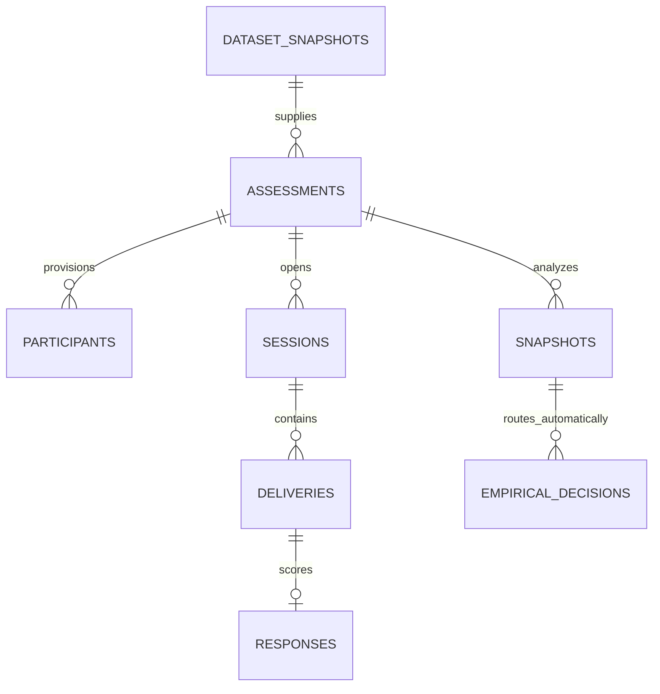

# Model data operasional silver

SQLite adalah storage lokal untuk jalur API silver -> siswa -> CTT/IRT. MongoDB opsional untuk sumber immutable, akun operator dan metadata riset. Collection pelabelan manusia tidak dipakai dan tidak diprovision oleh startup.

`dataset_snapshots` menyimpan snapshot silver dan hash dokumen lengkap. `assessments` menyimpan blueprint immutable dengan grade, `subjectTrack`, populasi, family, versi soal, key privat dan `silverDecisionId`. `participants` hanya menyimpan hash token dan pseudonim.

`sessions`, `deliveries` dan `responses` menyediakan idempotensi serta mapping opsi publik ke opsi internal. Respons menyimpan correctness dari server dan identitas versi; body siswa tidak berwenang mengirim correctness, populasi atau label.

`snapshots` menyimpan data analisis tetap berdasarkan peserta unik, session selesai dan window. `empirical_decisions` menyimpan `actorType=system`, `policyVersion`, review flags dan `affectsSilverLabels=false`. Tabel ini menggunakan nama lama untuk kompatibilitas storage, tetapi keputusan baru dihasilkan otomatis setelah screen.

MongoDB aktif: `users`, `questions`, `question_versions`, `silver_decisions`, `dataset_snapshots`, `training_runs`, `model_versions`, `audit_events`, `sessions`. Bootstrap hanya menyediakan admin/operator. Data historis tidak dihapus dari database pengguna secara otomatis.
