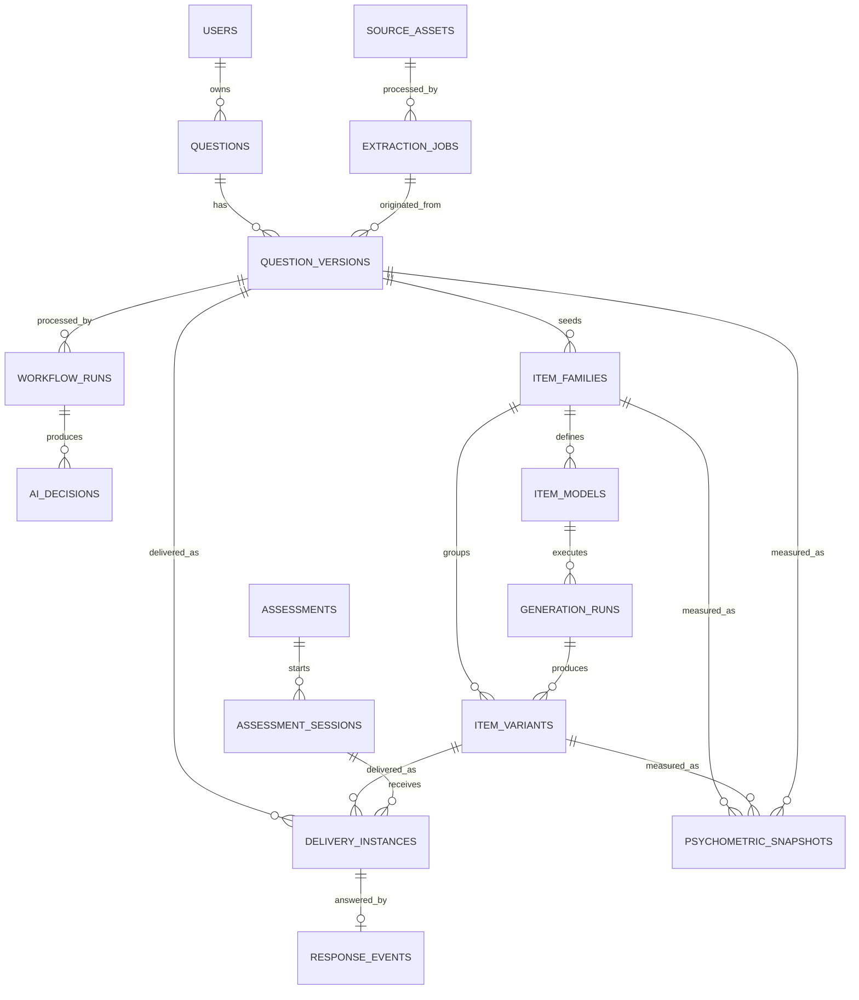

# Model Data MongoDB dan ERD Logis

## 1. Tujuan

Dokumen ini mendefinisikan target collection MongoDB, atribut, hubungan, index, versioning, dan keputusan embed/reference untuk arsitektur pada dokumen 15-16.

MongoDB tidak menerapkan foreign key seperti database relasional. ERD di bawah adalah **relasi logis** yang dijaga oleh application service, schema validation, unique index, idempotency, dan reconciliation job.

## 2. Notasi

| Notasi | Makna |
|---|---|
| `PK` | Business identifier unik, biasanya string/ULID |
| `REF` | Referensi logis ke collection lain |
| `UK` | Unique key/index |
| `IDX` | Non-unique index |
| `EMBED` | Subdocument yang disimpan bersama parent |
| `IMMUTABLE` | Tidak diubah setelah dibuat; perubahan membuat record/version/event baru |
| `TTL` | Dokumen dapat dihapus otomatis setelah waktu tertentu |
| `1:N` | Satu parent mempunyai banyak child |
| `0..1` | Relasi opsional |

Semua dokumen memakai `_id: ObjectId` sebagai internal storage key, tetapi API dan relasi memakai business ID seperti `questionId` atau `variantId`. Browser tidak perlu mengetahui `_id`.

## 3. ERD logis



Satu delivery menggunakan `questionVersion` langsung atau `itemVariant`. Jika memakai variant, variant tetap membawa lineage ke parent question version.

## 4. Aturan embed versus reference

Embed jika:

- data kecil dan bounded;
- selalu dibaca bersama parent;
- tidak mempunyai lifecycle independen;
- tidak berkembang tanpa batas.

Reference jika:

- history/event bertambah terus;
- memerlukan index/query sendiri;
- immutable dan berversi;
- digunakan oleh beberapa aggregate;
- mengandung trace besar/restricted.

Keputusan utama:

| Data | Keputusan | Alasan |
|---|---|---|
| Current status/summary pada Question | EMBED | Cepat untuk teacher dashboard |
| Question content versions | Reference collection | Immutable history dan delivery join |
| Options dan answerSpec satu version | EMBED dalam question version | Selalu dibaca bersama konten |
| AI samples/decision history | Reference collection | Besar, sensitif, terus bertambah |
| Item-model constraints | EMBED dalam item model version | Satu kesatuan executable spec |
| Response events | Reference collection | Volume tinggi, append-only |
| Psychometric snapshots | Reference collection | Banyak population/time/version |
| Public/internal option mapping | EMBED dalam delivery instance | Khusus satu attempt dan harus immutable |

## 5. `users`

Menyimpan account/subject operasional untuk teacher dan system admin. Student identity sebaiknya dikelola identity/session provider; response event hanya menyimpan pseudonymous hash.

| Field | Tipe | Aturan |
|---|---|---|
| `userId` | string | `PK`, `UK` |
| `tenantId` | string | `IDX`, wajib jika multi-tenant |
| `role` | enum | `teacher`, `system_admin`, `service_account` |
| `displayName` | string | Tidak disalin ke event analytics |
| `authSubject` | string | `UK` per auth provider |
| `status` | enum | `active`, `disabled` |
| `createdAt`, `updatedAt` | date | Wajib |

Tidak ada `verifiedExpertise` karena teacher bukan annotator.

Index:

```javascript
{ userId: 1 } unique
{ authSubject: 1 } unique
{ tenantId: 1, role: 1, status: 1 }
```

## 6. `source_assets`

Metadata sumber; binary disimpan di object storage.

| Field | Tipe | Aturan |
|---|---|---|
| `sourceAssetId` | string | `PK`, `UK` |
| `ownerUserId` | string | `REF users.userId`, `IDX` |
| `tenantId` | string | `IDX` |
| `objectKey` | string | Restricted; tidak dikirim mentah ke UI |
| `filename`, `mediaType`, `sizeBytes` | scalar | Wajib |
| `checksumSha256` | string | Dedup/security index |
| `malwareScan` | object | status, engine, scannedAt |
| `retentionUntil` | date/null | Storage policy |
| `createdAt` | date | Wajib |

Index:

```javascript
{ sourceAssetId: 1 } unique
{ tenantId: 1, checksumSha256: 1 }
{ retentionUntil: 1 }
```

## 7. `extraction_jobs`

| Field | Tipe | Aturan |
|---|---|---|
| `jobId` | string | `PK`, `UK` |
| `sourceAssetId` | string | `REF`, `IDX` |
| `ownerUserId`, `tenantId` | string | Ownership indexes |
| `status` | enum | queued/running/completed/completed_with_warnings/failed/quarantined |
| `engineManifest` | object | Pipeline/model versions |
| `attempts` | array bounded | Retry summary, bukan raw log besar |
| `candidates` | array | Candidate metadata/text; pindah blob besar ke object store |
| `warnings`, `error` | array/object | Machine-readable |
| `createdAt`, `startedAt`, `completedAt` | date | Lifecycle |
| `expiresAt` | date/null | `TTL` untuk transient job jika policy mengizinkan |

Index:

```javascript
{ jobId: 1 } unique
{ ownerUserId: 1, createdAt: -1 }
{ status: 1, createdAt: 1 }
{ expiresAt: 1 } expireAfterSeconds: 0
```

## 8. `questions`

Aggregate identity dan current read model; bukan tempat menyimpan seluruh histori.

| Field | Tipe | Aturan |
|---|---|---|
| `questionId` | string | `PK`, `UK` |
| `ownerUserId` | string | `REF users`, `IDX` |
| `tenantId` | string | `IDX` |
| `currentContentVersion` | integer | Pointer ke question_versions |
| `activeContentVersion` | integer/null | Version aktif/deliverable |
| `status` | enum | Lifecycle target |
| `currentWorkflowRunId` | string/null | REF workflow_runs |
| `activeDecisionId` | string/null | REF ai_decisions |
| `summary` | EMBED object | subject, grade, topic, subtopic, type, short text |
| `safeAiSummary` | EMBED object/null | Label/routing aman untuk teacher UI |
| `createdAt`, `updatedAt` | date | Wajib |

Index:

```javascript
{ questionId: 1 } unique
{ tenantId: 1, ownerUserId: 1, updatedAt: -1 }
{ tenantId: 1, status: 1, updatedAt: -1 }
{ currentWorkflowRunId: 1 }
```

## 9. `question_versions`

Konten immutable per revision.

| Field | Tipe | Aturan |
|---|---|---|
| `questionVersionId` | string | `PK`, `UK` |
| `questionId` | string | `REF questions`, `IDX` |
| `contentVersion` | integer | `UK` bersama questionId |
| `createdByUserId` | string | Teacher author |
| `authoringContent` | EMBED object | Sesuai JSON Schema |
| `canonicalContent` | EMBED object/null | Dibentuk saat submit |
| `answerSpecInternal` | EMBED object | Restricted; tidak masuk delivery DTO |
| `sourceLineage` | EMBED object | manual/import/extraction/generated IDs |
| `contentHash` | string | Duplicate/replay |
| `createdAt` | date | Wajib |

Index:

```javascript
{ questionVersionId: 1 } unique
{ questionId: 1, contentVersion: 1 } unique
{ contentHash: 1 }
{ "canonicalContent.grade": 1, "canonicalContent.topic": 1 }
```

Update dilarang setelah version dipakai workflow/delivery. Koreksi membuat version baru.

## 10. `workflow_runs`

| Field | Tipe | Aturan |
|---|---|---|
| `workflowRunId` | string | `PK`, `UK` |
| `questionId`, `contentVersion` | scalar | `REF`, compound index |
| `status` | enum | queued/running/succeeded/failed/quarantined |
| `currentStage` | enum | canonicalization/validation/answer/screen/adjudication/routing |
| `stageEvents` | array bounded | Stage summary dan timestamps |
| `policyVersions` | object | Validation/risk/routing policies |
| `idempotencyKey` | string | `UK` bersama command scope |
| `terminalRouting` | string/null | provisional/revision/quarantine/reject |
| `createdAt`, `updatedAt`, `completedAt` | date | Lifecycle |

Index:

```javascript
{ workflowRunId: 1 } unique
{ questionId: 1, contentVersion: 1, createdAt: -1 }
{ status: 1, updatedAt: 1 }
{ idempotencyKey: 1 } unique sparse
```

## 11. `ai_decisions`

Decision event immutable. Raw prompt/sample besar dapat dipisahkan ke restricted object store dengan hash/reference.

| Field | Tipe | Aturan |
|---|---|---|
| `decisionId` | string | `PK`, `UK` |
| `workflowRunId` | string | `REF`, `IDX` |
| `questionId`, `contentVersion` | scalar | `REF`, compound index |
| `answerVerification` | EMBED object | status, method, version, evidence ref |
| `indobert` | EMBED object | labels, probabilities, entropy, margin, OOD, modelVersion |
| `llmEnsemble` | EMBED object | aggregate, self-consistency, rubric/prompt/model manifests |
| `agreement` | EMBED object | Per-head flags |
| `risk` | EMBED object | Score, band, reasons, policyVersion |
| `adjudication` | EMBED object/null | Attempts, final labels, abstention |
| `decisionType` | enum | model_suggestion/ai_consensus/ai_adjudicated/quarantined |
| `finalRouting` | enum | provisional/revision_required/quarantine/rejected |
| `createdAt` | date | Wajib |

Index:

```javascript
{ decisionId: 1 } unique
{ workflowRunId: 1, createdAt: -1 }
{ questionId: 1, contentVersion: 1, createdAt: -1 }
{ decisionType: 1, finalRouting: 1 }
```

## 12. `item_families`

| Field | Tipe | Aturan |
|---|---|---|
| `itemFamilyId` | string | `PK`, `UK` |
| `parentQuestionId`, `parentContentVersion` | scalar | `REF question_versions` |
| `targetConstruct` | string | Wajib |
| `learningObjective` | string | Wajib |
| `taxonomyTarget` | EMBED object | Bloom/knowledge/intended difficulty |
| `status` | enum | draft/active/quarantined/retired |
| `activeItemModelVersion` | integer/null | Pointer |
| `createdAt`, `updatedAt` | date | Wajib |

Index:

```javascript
{ itemFamilyId: 1 } unique
{ parentQuestionId: 1, parentContentVersion: 1 }
{ targetConstruct: 1, status: 1 }
```

## 13. `item_models`

Executable/versioned generation specification.

| Field | Tipe | Aturan |
|---|---|---|
| `itemModelId` | string | `PK` logis |
| `itemModelVersion` | integer | `UK` bersama itemModelId |
| `itemFamilyId` | string | `REF`, `IDX` |
| `constructionStrategy` | EMBED object | Strategy ID/method/version |
| `constructInvariants` | EMBED object | Formula, solution graph, taxonomy |
| `parameterSchema` | EMBED object | Type/domain/roles/units/dependencies |
| `hardConstraints` | array | Executable/compiled-safe rules |
| `softConstraints` | array | Weighted preferences |
| `solutionRule` | object | Restricted executable spec/version |
| `distractorRules` | array | Misconception rule refs |
| `transformationPolicy` | EMBED object | Allowed/forbidden operations |
| `rangeProvenance` | EMBED object | Grade/difficulty/empirical sources |
| `validationSummary` | EMBED object | Dry-run/property results |
| `status` | enum | candidate/active/rejected/retired |
| `createdAt` | date | Wajib |

Index:

```javascript
{ itemModelId: 1, itemModelVersion: 1 } unique
{ itemFamilyId: 1, status: 1, itemModelVersion: -1 }
```

Jangan menjalankan expression string dengan `eval`. Rule disimpan sebagai safe DSL/AST atau reference ke versioned implementation.

## 14. `generation_runs`

| Field | Tipe | Aturan |
|---|---|---|
| `generationRunId` | string | `PK`, `UK` |
| `itemModelId`, `itemModelVersion` | scalar | `REF` |
| `itemFamilyId` | string | `REF`, `IDX` |
| `mode` | enum | numeric/contextual/representation/mixed |
| `targetProfile` | EMBED object | Grade/taxonomy/count |
| `seed` | integer | Reproducibility |
| `status` | enum | queued/running/succeeded/failed/quarantined |
| `attemptSummary` | EMBED object | Counts/rejection reasons |
| `generatorManifest` | EMBED object | Code/model/prompt versions |
| `createdAt`, `completedAt` | date | Lifecycle |

Index:

```javascript
{ generationRunId: 1 } unique
{ itemFamilyId: 1, createdAt: -1 }
{ status: 1, createdAt: 1 }
```

## 15. `item_variants`

| Field | Tipe | Aturan |
|---|---|---|
| `variantId` | string | `PK` logis |
| `variantVersion` | integer | `UK` bersama variantId |
| `itemFamilyId` | string | `REF`, `IDX` |
| `itemModelId`, `itemModelVersion` | scalar | `REF` |
| `generationRunId` | string | `REF` |
| `parentQuestionId`, `parentContentVersion` | scalar | Lineage |
| `generationMode`, `generationSeed` | scalar | Reproducibility |
| `parameterSnapshot` | EMBED object | Nilai final |
| `transformationTrace` | EMBED array | Operasi perubahan |
| `content` | EMBED object | Text, options, media |
| `answerSpecInternal` | EMBED object | Restricted |
| `distractorMetadata` | EMBED array | Misconception map |
| `verification` | EMBED object | Math/option/render checks |
| `activeDecisionId` | string | `REF ai_decisions` |
| `status` | enum | candidate/provisional/pilot/empirically_screened/quarantined/retired |
| `createdAt` | date | Wajib |

Index:

```javascript
{ variantId: 1, variantVersion: 1 } unique
{ itemFamilyId: 1, status: 1 }
{ generationRunId: 1 }
{ parentQuestionId: 1, parentContentVersion: 1 }
```

## 16. `assessments`

| Field | Tipe | Aturan |
|---|---|---|
| `assessmentId` | string | `PK`, `UK` |
| `assessmentFamily` | string | Linking/grouping key |
| `populationId` | string | Target population |
| `status` | enum | draft/active/closed |
| `blueprint` | EMBED object | Grade/topic/taxonomy/difficulty targets |
| `assemblyPolicyVersion` | string | Wajib |
| `deliveryPolicy` | EMBED object | Feedback, expiry, limits |
| `createdAt`, `updatedAt` | date | Wajib |

Item list dapat di-embed jika fixed dan bounded. Jika adaptive/dynamic, simpan assembly rules serta delivery selection event.

## 17. `assessment_sessions`

| Field | Tipe | Aturan |
|---|---|---|
| `sessionId` | string | `PK`, `UK` |
| `assessmentId` | string | `REF`, `IDX` |
| `subjectHash` | string | Pseudonymous, `IDX` terbatas |
| `populationId` | string | Wajib |
| `status` | enum | active/completed/expired/invalidated |
| `sequenceState` | EMBED object | Current/total/selection state |
| `startedAt`, `expiresAt`, `completedAt` | date | Lifecycle |

Index:

```javascript
{ sessionId: 1 } unique
{ assessmentId: 1, subjectHash: 1, startedAt: -1 }
{ expiresAt: 1 }
```

## 18. `delivery_instances`

Immutable snapshot per item attempt.

| Field | Tipe | Aturan |
|---|---|---|
| `deliveryInstanceId` | string | `PK`, `UK` |
| `sessionId`, `assessmentId` | string | `REF`, `IDX` |
| `questionId`, `contentVersion` | scalar/null | Source join |
| `variantId`, `variantVersion` | scalar/null | Variant join |
| `publicItemId` | string | Opaque client ID |
| `publicContentSnapshot` | EMBED object | Exact delivered text/options/media refs |
| `optionMapping` | EMBED object | Public ID -> internal ID, restricted |
| `scoringPolicyVersion` | string | Wajib |
| `deliveredAt`, `expiresAt` | date | Wajib |
| `responseId` | string/null | Pointer setelah dijawab |

Index:

```javascript
{ deliveryInstanceId: 1 } unique
{ sessionId: 1, deliveredAt: 1 }
{ variantId: 1, variantVersion: 1 }
{ questionId: 1, contentVersion: 1 }
```

## 19. `response_events`

| Field | Tipe | Aturan |
|---|---|---|
| `responseId` | string | `PK`, `UK`, idempotency |
| `deliveryInstanceId` | string | `REF`, `UK` untuk single response policy |
| `sessionId`, `assessmentId`, `assessmentFamily` | string | Index aggregation |
| `populationId`, `subjectHash` | string | Pseudonymous grouping |
| `questionId`, `contentVersion` | scalar | Version join |
| `variantId`, `variantVersion` | scalar/null | Variant join |
| `selectedAnswerInternal` | mixed | Restricted |
| `isCorrect`, `score` | scalar | Server computed |
| `responseTimeMs`, `answerChanges` | integer | Behavioral metrics |
| `flags` | array | Timing/anomaly flags |
| `submittedAt` | date | Wajib |

Index:

```javascript
{ responseId: 1 } unique
{ deliveryInstanceId: 1 } unique
{ variantId: 1, variantVersion: 1, populationId: 1, submittedAt: 1 }
{ questionId: 1, contentVersion: 1, populationId: 1, submittedAt: 1 }
{ assessmentId: 1, subjectHash: 1 }
```

## 20. `psychometric_snapshots`

| Field | Tipe | Aturan |
|---|---|---|
| `snapshotId` | string | `PK`, `UK` |
| `entityType` | enum | question/variant/item_family |
| `entityId`, `entityVersion` | scalar | Polymorphic logical REF |
| `populationId`, `assessmentFamily` | string | Wajib |
| `timeWindow` | EMBED object | from/to/cutoff |
| `validResponseCount`, `excludedCounts` | scalar/object | Evidence strength |
| `metrics` | EMBED object | p, CI, D, rpbis, distractor, time |
| `quality` | EMBED object | Stability, flags, routing |
| `policyVersion` | string | Wajib |
| `inputManifestHash` | string | Reproducibility |
| `createdAt` | date | Wajib |

Index:

```javascript
{ snapshotId: 1 } unique
{ entityType: 1, entityId: 1, entityVersion: 1, populationId: 1, createdAt: -1 }
{ quality.recommendedRouting: 1, createdAt: -1 }
```

## 21. Optional artifact collections

Untuk fase training/deployment:

- `dataset_manifests`: immutable file hashes, split by family/source, target policy;
- `model_manifests`: model/tokenizer/rubric/metrics/artifact URI;
- `deployment_events`: shadow/canary/promotion/rollback;
- `audit_events`: actor/service, action, resource, trace, timestamp;
- `idempotency_records`: scope/key/request hash/response reference/expiry.

MLflow/object storage dapat menjadi sumber artifact; MongoDB menyimpan manifest dan pointer, bukan weight besar.

## 22. Lifecycle consistency

Transisi state divalidasi application service:

```text
Question:
author_draft -> submitted -> processing
    -> revision_required | quarantined | provisional
    -> pilot_active -> empirically_screened -> active -> retired

Variant:
candidate -> provisional -> pilot -> empirically_screened
          -> quarantined | retired
```

Teacher hanya dapat menjalankan create/replace draft/submit. Worker dengan service identity menjalankan transisi otomatis lain.

## 23. Atomicity dan idempotency

Operasi yang memerlukan transaction atau compare-and-set:

- membuat question version dan memperbarui `currentContentVersion`;
- membuat workflow run dan mengubah status question ke submitted;
- membuat response event dan mengikat `deliveryInstance.responseId`;
- mempromosikan active item/model version;
- auto-unpublish berdasarkan psychometric snapshot.

Gunakan unique index sebagai pertahanan terakhir. `If-Match` mencegah lost update authoring; `Idempotency-Key` mencegah command duplikat.

## 24. MongoDB validation

Setiap collection mempunyai `$jsonSchema` validator terpisah dari public JSON Schema. Database validator minimal memeriksa:

- required identity/version/timestamp;
- enum status;
- tipe nested document;
- larangan field legacy yang sudah dimigrasikan jika sesuai fase;
- immutable field melalui application policy/change stream audit.

Public schema tidak langsung digunakan sebagai database validator karena field internal dan redaction berbeda.

## 25. Migration dari prototype

Model prototype saat ini menempelkan `annotations`, `finalLabels`, dan `psychometricSnapshot` pada Question. Target migration:

1. buat `questions` identity/current read model;
2. salin konten menjadi `question_versions` version 1;
3. pertahankan `modelSuggestion` lama sebagai legacy decision event bila masih diperlukan;
4. jangan migrasikan human annotation menjadi `ai_consensus`;
5. pindahkan response ke join delivery/version baru atau tandai `legacy_unbound`;
6. buat snapshot psikometrik terpisah dengan population/version metadata jika tersedia;
7. nonaktifkan endpoint annotation dan educator verification pada frontend baru.

## 26. Checklist ERD implementasi

- Business ID unik dan tidak memakai `_id` di public API.
- Question identity dipisahkan dari immutable content version.
- AI decision, response, dan psychometric snapshot tidak di-embed tanpa batas.
- Teacher ownership berasal dari auth context.
- Kunci tidak berada pada delivery DTO.
- Semua response terikat delivery instance.
- Variant selalu mempunyai family/model/run/parent lineage.
- Compound index mengikuti aggregation key.
- Event penting append-only dan mempunyai provenance/version.
- Backup, retention, encryption, dan access control ditetapkan per collection.

