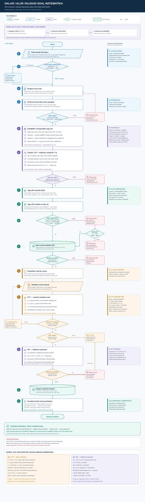

# Alur End-to-End Validasi Soal Matematika

> **Rancangan target, bukan klaim bahwa seluruh komponen sudah berjalan.** [Buka diagram SVG](20_END_TO_END_VALIDATION_FLOW.svg) untuk diperbesar tanpa pecah, atau [PNG](20_END_TO_END_VALIDATION_FLOW.png). Gambar dibuat dari [skrip yang dapat diedit](../scripts/build_combined_architecture_diagram.py). Bagian bawah dokumen ini membedakan fitur prototype dari fitur yang masih direncanakan.

## Keputusan desain yang tidak boleh tercampur

| Istilah | Arti dalam alur ini | Bukan berarti |
|---|---|---|
| `N_claude = 3` | Tiga pemanggilan/penilaian Claude atas **versi soal yang sama**, lalu konsistensinya dihitung **per head** | Tiga pakar independen, probabilitas benar, atau gold label |
| `n_ahli = 3` | Tiga reviewer matematika yang mula-mula bekerja **blind** terhadap AI dan terhadap sesama reviewer | Tiga panggilan Claude |
| Label teoretis | Domain kognitif matematika, dimensi pengetahuan, dan kesulitan *yang diperkirakan*; diputuskan pakar dengan rubrik | Kesulitan empiris dari respons siswa |
| Bukti empiris | Statistik CTT dan, jika layak, estimasi IRT untuk versi dan populasi tertentu | Pengganti otomatis label TIMSS/pengetahuan |

Tiga domain pada Head 1 memakai kerangka [TIMSS 2023 Mathematics](https://timssandpirls.bc.edu/timss2023/frameworks/pdf/T23_Frameworks_Ch1_Mathematics.pdf). Pemakaian kerangka ini **tidak** berarti TIMSS menerbitkan label resmi untuk soal lokal. Head 2 memakai dimensi pengetahuan taksonomi Bloom revisi. Head 3 (`Easy/Medium/Hard`) adalah kategori operasional proyek yang batasnya harus ditetapkan pada rubrik dan dievaluasi setelah pilot; ia bukan kategori resmi TIMSS.

## Urutan operasional pada gambar

### Sebelum langkah 1: rubrik, data rujukan, dan IndoBERT

Definisikan *unit anotasi* (satu butir dan versi isinya), cakupan kelas/topik, definisi setiap label, contoh positif/negatif, aturan jika bukti tidak cukup, dan penanganan soal yang mencampur beberapa proses. Tiga ahli membuat penilaian awal **tanpa keluaran AI**; perbedaan dibahas dengan rubrik. Simpan suara awal dan hasil adjudikasi secara terpisah. Dataset berlabel manusia ini dipisah menurut keluarga/sumber soal menjadi train/validation/test sebelum IndoBERT dilatih. Jangan memasukkan jawaban Claude atau prediksi IndoBERT sebagai gold hanya karena keduanya sepakat. Laporkan kesepakatan *sebelum* diskusi; kesepakatan pascadiskusi bukan reliabilitas antarpenilai independen. [Standards for Educational and Psychological Testing, standar 1.9](https://www.testingstandards.net/uploads/7/6/6/4/76643089/standards_2014edition.pdf); [prosedur resolusi disagreement](https://aclanthology.org/2021.humeval-1.15/).

### 1–4. Soal masuk, ekstraksi bila perlu, lalu pemeriksaan deterministik

1. **Guru membuat soal.** Masukan dapat berupa formulir terstruktur, impor data, PDF yang mengandung teks, hasil scan, atau gambar. Satu dokumen dapat menghasilkan beberapa calon butir; identitas dokumen, halaman, dan daerah asal butir disimpan agar dapat diaudit.
2. **Pilih cara membaca.** Masukan terstruktur langsung diterima; PDF digital memakai ekstraksi teks; halaman berupa gambar memakai OCR/penanganan rumus bila diperlukan. Jangan OCR ulang setiap siswa menjawab. Rumus, diagram, tabel, dan koordinat interaktif perlu dipertahankan sebagai aset/referensi, bukan diratakan menjadi teks yang mungkin salah. OCR yang ragu diberi flag untuk verifikasi. [PyMuPDF: OCR hanya bila bermanfaat dan hasilnya dipakai ulang](https://pymupdf.readthedocs.io/en/latest/recipes-ocr.html).
3. **Simpan versi soal.** Satu versi mengikat stem, opsi, gambar/rumus, kunci, aturan skor, solusi, kelas, dan topik. Perubahan substantif pada bagian tersebut membuat versi baru; jawaban siswa dan hasil model selalu menunjuk versi yang benar.
4. **Gate format dan kunci.** Cek skema jenis soal (PG, benar/salah, matching, checkbox, click-the-box), opsi/target, duplikasi, kunci, skor parsial bila ada, dan konsistensi solusi. Pemeriksaan simbolik boleh membantu tetapi tidak membuktikan semua soal matematika. Jika cacat atau ekstraksi meragukan, minta perbaikan/peninjauan sebelum model. Guru tidak wajib mengoreksi setiap hasil ekstraksi; pemeriksaan manusia ditargetkan pada kasus berisiko.

### 5. IndoBERT menghasilkan tiga distribusi label

Model menerima representasi yang tersedia saat inferensi: stem, opsi/objek visual yang dapat direpresentasikan, solusi yang telah diverifikasi, jenjang, topik, format, serta petunjuk KKO. Tokenizer mengubah teks menjadi token; encoder IndoBERT menghasilkan representasi konteks; tiga *classification head* menghasilkan skor (*logit*) lalu probabilitas `softmax`:

- **Head 1:** `Knowing / Applying / Reasoning` (tiga kelas).
- **Head 2:** `Factual / Conceptual / Procedural / Metacognitive` (empat kelas).
- **Head 3:** perkiraan `Easy / Medium / Hard` (tiga kelas), **bukan** hasil siswa.

Untuk setiap head `h`, simpan `P_h(c)`, label teratas, versi model, fitur/teks yang digunakan, dan ketidakpastian `H_h = −Σ_c P_h(c) log₂ P_h(c)`. Karena jumlah kelas berbeda, entropy dibandingkan **per head**, bukan terhadap satu ambang universal. Probabilitas model memerlukan kalibrasi pada set validasi; entropy tinggi atau input di luar distribusi pelatihan memicu flag, bukan label final paksa. KKO merupakan petunjuk leksikal; kata “jelaskan” tidak otomatis berarti *Reasoning*. C1–C6 bukan target tiga head baru. IndoBERT masuk akal sebagai baseline berbahasa Indonesia, tetapi keunggulan pada soal matematika tetap harus diuji terhadap baseline lain. [IndoNLU](https://aclanthology.org/2020.aacl-main.85/).

### 6. Claude: CoT dan majority voting (`N_claude = 3`)

Ini adalah **tiga run Claude**, bukan tiga suara manusia. Ketiganya memakai soal/versi, rubrik, hasil IndoBERT, dan konfigurasi model yang dicatat; run tidak melihat keluaran run lain. **CoT (*chain-of-thought*) di sini berarti prompt mengarahkan pemeriksaan bertahap**—bukan mengharuskan aplikasi menerima atau menyimpan penalaran internal model. Dalam setiap run, instruksi meminta Claude:

1. memeriksa keterbacaan stem, rumus, gambar, opsi, dan kelengkapan informasi;
2. mengerjakan atau memverifikasi jalur solusi/kunci matematika, menandai asumsi dan kemungkinan jawaban alternatif;
3. menentukan *tuntutan minimum yang cukup untuk menjawab* (bukan sekadar verba/KKO), lalu menilai ketiga head dengan bukti singkat dari soal/solusi;
4. membandingkan penilaiannya dengan setiap prediksi IndoBERT: `confirm`, `revise`, atau `abstain`; serta menandai `needs_revision`/`out_of_scope` sebagai **status kelayakan terpisah**, bukan kelas keempat pada head.

Keluaran tiap run harus mengikuti JSON Schema: `contentStatus`, `contentFlags`, dan tiga `head` berisi `label|null`, `comparison`, serta `evidence`. **Server**, bukan Claude, menambahkan `itemVersion`, `runId`, `modelVersion`, `promptVersion`, waktu, dan penggunaan token dari metadata request/response. Validasi server memeriksa enum, kelengkapan field, panjang/bukti, dan kecocokan versi. *Structured output* membantu format, tetapi **tidak menjamin penalaran matematis benar**. Jika model mendukung *thinking*, konfigurasinya bergantung pada versi API/model; sistem menyimpan ringkasan bukti yang bisa diaudit, bukan mengandalkan atau menyimpan jejak penalaran internal sebagai gold. Jangan mengunci desain pada `temperature` tertentu karena dukungan parameter bergantung pada model. [Claude structured outputs](https://platform.claude.com/docs/en/build-with-claude/structured-outputs); [Claude thinking](https://platform.claude.com/docs/en/build-with-claude/thinking); [Messages API](https://platform.claude.com/docs/en/api/http/messages).

Agregasi **per head** memakai tiga keluaran yang sah. Jika `v_h(c) = Σ_(r=1)^3 1[label_run(r,h)=c]`, sebuah label memiliki mayoritas bila `v_h(c) ≥ 2`: `3–0` = konsisten bulat, `2–1` = ada dissent, sedangkan `1–1–1` atau abstain tanpa dua suara untuk satu label = *disagreement*. Satu abstain + dua label sama dapat menghasilkan usulan mayoritas **hanya jika** abstain bukan flag cacat konten. Bandingkan usulan tiap head terhadap IndoBERT; kesesuaian keduanya dicatat, bukan langsung menjadi label final. Run timeout/JSON rusak diulang **terbatas** menurut kebijakan teknis, bukan diulang sampai suara yang diinginkan muncul. Jika kurang dari jumlah run sah yang disyaratkan, tandai `llm_incomplete`; jangan mengubahnya diam-diam menjadi 2/2 atau melewati Claude. Konflik kunci/konten tetap flag walau ketiga label sama.

Rasio `2/3` atau `3/3` adalah **konsistensi sampel**, bukan probabilitas label benar: ketiga run berasal dari model yang sama dan kesalahannya dapat berkorelasi. Jika konfigurasi menghasilkan keluaran identik terus-menerus, tiga run bahkan mungkin tidak menambah informasi; uji variasi yang didukung model, biaya, latensi, dan manfaat dibanding satu run pada dataset berlabel pakar. Metode pengambilan beberapa jalur dan agregasi diilhami *self-consistency*, tetapi efektivitas `N=3` untuk tiga head ini **harus diuji**, bukan diasumsikan. [Wang dkk., Self-Consistency](https://arxiv.org/abs/2203.11171).

### 7–10. Tiga ahli matematika, keputusan, dan bank soal

**Pass A—blind dan independen.** Tiga ahli berbeda identitas; penulis soal tidak menilai versi miliknya. Mereka melihat soal sebagaimana akan tampil ke siswa, kunci/solusi untuk diperiksa, rubrik dan cakupan kurikulum, **tanpa** prediksi IndoBERT, tiga hasil Claude, atau suara ahli lain. Masing-masing mengisi dua jenis keputusan yang tidak boleh dicampur:

| Pemeriksaan kelayakan | Penilaian label jika layak |
|---|---|
| Sesuai jenjang/topik/tujuan? | Head 1: domain matematika dan bukti langkah solusi |
| Teks, gambar, rumus, instruksi jelas? | Head 2: pengetahuan dominan dan bukti |
| Kunci, alternatif jawaban, solusi, aturan skor benar? | Head 3: kesulitan yang diperkirakan untuk populasi sasaran dan alasan |
| `layak / perlu_revisi / di_luar_cakupan` + alasan | Boleh `tidak_dapat_ditentukan` + alasan; ini **bukan** kelas pelatihan |

Flag serius pada kunci/isi menahan soal untuk diperiksa, walaupun dua ahli lain sudah memilih label. *Soal ambigu* berarti kontennya perlu revisi; *label ambigu* berarti rubrik/bukti klasifikasi perlu dibahas. Penilaian blind dikunci dan diberi waktu/identitas/versi, sehingga tidak bisa ditulis ulang setelah melihat AI.

**Pass B—review AI.** Baru setelah Pass A, tampilkan tiga run Claude, agregatnya, prediksi/probabilitas IndoBERT, dan perbedaan antarmodel. Ahli boleh mempertahankan/mengubah label atau mengabstain dengan alasan. Simpan perubahan Pass A → B agar *anchoring* dapat diaudit. Untuk dataset rujukan model, gunakan keputusan manusia blind yang telah diadjudikasi; koreksi yang pertama kali muncul akibat AI harus diperiksa ulang secara independen sebelum dijadikan gold.

**Putusan manusia dihitung per head**, terpisah dari `N_claude=3`: tiga label sama = `3–0`, dua sama = `2–1` dengan dissent, tiga berbeda = `1–1–1`. Satu abstain + dua label berbeda juga **belum** mempunyai mayoritas; satu abstain + dua label sama dapat diputuskan bila alasan abstain bukan cacat konten. Angka `1–1–1` hanya berlaku untuk **tiga label sah berbeda**, bukan untuk `tidak_dapat_ditentukan`, soal rusak, atau soal di luar cakupan. Jika tidak selesai, lakukan diskusi berbasis rubrik dan adjudikator senior; catat hasil terpisah dari suara awal. Jangan mengarantina seluruh batch: jika kasus 1–1–1 masif, hentikan sementara finalisasi **head yang bermasalah**, audit rubrik/contoh/OCR, lalu anotasi ulang sampel. [Oortwijn dkk. tentang sumber disagreement dan perbaikan panduan](https://aclanthology.org/2021.humeval-1.15/).

Hanya versi soal yang lolos pemeriksaan kelayakan, keputusan pakar, serta kebijakan risiko pilot masuk bank `expert_validated`. Kesepakatan IndoBERT–Claude tidak cukup. Pembuatan varian substantif kembali ke langkah 3; label dan statistik soal induk tidak otomatis diwariskan.

### 11–12. Pilot, penskoran, dan respons siswa

LMS menyajikan versi soal terkunci tanpa mengirim kunci ke browser. Server mencatat respons final, sesi/attempt, siswa terdeidentifikasi, populasi, form tes, waktu, kondisi penyajian, dan versi soal; skor dihitung server sesuai rubrik. *Autosave* yang masih dapat diubah tidak dihitung sebagai respons final tambahan. Respons dapat masuk real-time, tetapi **status valid empiris tidak berubah setiap satu siswa selesai**. Total skor untuk korelasi item–total biasanya tersedia setelah attempt/form selesai. Snapshot analisis dijalankan berkala atau setelah tambahan respons eligible yang ditentukan kebijakan. Satu siswa/attempt tidak boleh terhitung ganda; missing, tidak sempat dijawab, rapid guessing, dan perubahan kondisi tes dicatat terpisah.

### 13–15. Analisis kualitas soal: CTT, keputusan kelayakan IRT, lalu snapshot

**Unit analisis:** `questionId + contentVersion + variantVersion (jika ada) + populationId + assessmentFamily/form + timeWindow`. Jangan menggabungkan versi atau populasi berbeda tanpa rancangan *linking* yang jelas. Simpan `N`, aturan inklusi/eksklusi, interval ketidakpastian, kebijakan ambang, dan metode. Kriteria “cukup” tidak sama untuk semua statistik/model; standar pengujian meminta sampel yang memadai dan beragam untuk prosedur yang dipakai. [Standards, standar 4.9–4.10](https://www.testingstandards.net/uploads/7/6/6/4/76643089/standards_2014edition.pdf).

#### CTT (*Classical Test Theory*) — analisis awal

Misalkan `X_ni ∈ {0,1}` ialah skor siswa `n` pada butir `i` dan `N_i` jumlah respons final yang eligible.

| Ukuran | Rumus / cara menghitung | Tafsir dan batasnya |
|---|---|---|
| Tingkat mudah empiris (*p-value* butir) | `p_i = Σ_n X_ni / N_i`; `q_i = 1 − p_i` | `p` tinggi = lebih mudah **pada populasi ini**, bukan “lebih baik”. Laporkan CI proporsi, misalnya Wilson. |
| Daya beda kelompok atas–bawah | Urutkan siswa memakai skor tes tanpa butir `i`, `T_n,−i`; `D_i = p_atas,i − p_bawah,i` | `D ∈ [−1,1]`; nilai negatif perlu audit kunci, konten, sampling atau kelompok. Fraksi kelompok ekstrem (mis. 27%) adalah pilihan metode yang harus ditulis, bukan hukum universal. |
| Korelasi butir–total terkoreksi | `r_it,i = Corr(X_i, T_−i)`, dengan `T_−i = T − X_i` | Untuk butir dikotomis merupakan *corrected point-biserial*; butuh skor form yang sebanding dan variasi skor. Tidak terdefinisi bila butir/total konstan. |
| Distraktor | Untuk opsi `j`: `s_ij = n_ij/N_i`; bandingkan pilihan opsi di kelompok atas vs bawah | Distraktor yang hampir tidak dipilih atau lebih banyak dipilih siswa berkemampuan tinggi perlu ditinjau, **bukan** otomatis dibuang. |
| Ketepatan estimasi | Simpan `N_i` dan CI untuk `p_i` (contoh Wilson), serta ketidakpastian `D_i`/`r_it,i` via prosedur yang ditentukan | Satu angka tanpa `N`, populasi, dan interval mudah menyesatkan. [NIST: interval proporsi](https://www.itl.nist.gov/div898/handbook/prc/section2/prc241.htm). |
| Kualitas form tes | `α = k/(k−1) × (1 − Σ_i Var(X_i)/Var(T))` bila asumsi/penggunaan relevan | Cronbach α mengukur konsistensi **skor form**, bukan kualitas atau reliabilitas satu butir; jangan jadikan satu-satunya bukti validitas. |
| Waktu dan missingness | Median, IQR, proporsi tidak terjawab/terlambat, pola *rapid guess* | Sinyal pemeriksaan kondisi tes; waktu cepat sendiri tidak membuktikan soal mudah. |

Rumus inti untuk skor dikotomis, dengan `U` dan `L` kelompok atas/bawah yang ditetapkan **sebelum** melihat hasil butir:

$$
p_i=\frac{\sum_{n=1}^{N_i}X_{ni}}{N_i},\qquad
D_i=\frac{\sum_{n\in U}X_{ni}}{|U|}-\frac{\sum_{n\in L}X_{ni}}{|L|},\qquad
r_{it,i}=\operatorname{Corr}(X_i,T-X_i).
$$

Untuk interval Wilson dua sisi pada proporsi benar, gunakan `z=1,96` untuk 95% **bila asumsi sampling yang relevan terpenuhi**:

$$
CI_{Wilson}=\frac{\hat p+z^2/(2N)\ \pm\ z\sqrt{\hat p(1-\hat p)/N+z^2/(4N^2)}}{1+z^2/N}.
$$

Untuk butir skor parsial `0…m_i` (misalnya matching/checkbox), laporkan `mean(X_i)/m_i`, sebaran skor, dan korelasi dengan `T_−i`; jangan memasukkannya ke rumus dikotomis `p_i = benar/N` tanpa aturan dikotomisasi eksplisit. `D_i` dan korelasi dapat dipakai pada skor parsial dengan definisi yang terdokumentasi. Kualitas satu item tidak dapat disimpulkan dari satu metrik. Analisis CTT memang menilai kesukaran, pola opsi, dan hubungan butir dengan skor total. [ETS: definisi item analysis](https://www.es.ets.org/content/dam/ets-org/pdfs/about/standards-quality-fairness.pdf); [ETS: metode kelompok atas–bawah](https://www.ets.org/research/policy_research_reports/publications/report/1952/hnyj.html).

#### IRT (*Item Response Theory*) — kalibrasi lanjutan, bukan syarat pilot

IRT memodelkan peluang skor benar sebagai fungsi kemampuan laten siswa `θ_n` dan parameter butir. Untuk skor `0/1`, definisikan `L(z)=1/(1+e^(−z))` dengan skala logistik `D=1`:

| Model | Fungsi respons butir | Parameter dan kapan dipertimbangkan |
|---|---|---|
| 1PL / Rasch | `P_i(θ)=L(θ−b_i)` | `b_i` lokasi/kesulitan; kemiringan sama setelah penetapan skala. Model awal yang lebih hemat parameter. |
| 2PL | `P_i(θ)=L(a_i(θ−b_i))` | `a_i>0` daya beda dan `b_i` kesulitan; lebih fleksibel, memerlukan data memadai. |
| 3PL | `P_i(θ)=c_i+(1−c_i)L(a_i(θ−b_i))` | `c_i` asimtot bawah/*guessing*; relevan untuk item pilihan, tetapi tidak otomatis dipilih hanya karena soalnya PG. `c_i` juga bukan otomatis `1/jumlah opsi`. |
| PCM/GPCM | `P_i(k;θ) = exp[Σ_(s=1)^k a_i(θ−b_is)] / Σ_(h=0)^m exp[Σ_(s=1)^h a_i(θ−b_is)]` | Peluang skor `k` pada kemampuan `θ`, untuk kategori `0…m` yang terurut; jumlah kosong = 0. PCM membatasi kemiringan bersama, GPCM mengizinkan kemiringan item. |

Sebagai contoh bentuk yang diestimasi, 3PL untuk skor dikotomis dan GPCM untuk skor parsial adalah:

$$
P_i(X=1\mid\theta)=c_i+(1-c_i)\frac{1}{1+\exp[-a_i(\theta-b_i)]},
$$

$$
P_i(X=k\mid\theta)=
\frac{\exp\left[\sum_{s=1}^{k}a_i(\theta-b_{is})\right]}
{\sum_{h=0}^{m_i}\exp\left[\sum_{s=1}^{h}a_i(\theta-b_{is})\right]}.
$$

Sebelum mempublikasikan parameter IRT, periksa kecukupan dan cakupan sampel kemampuan, unidimensionalitas yang masuk akal, independensi lokal, kecocokan model–data, kestabilan parameter, serta keterhubungan form/populasi. Jika syarat tidak terpenuhi, **tetap pada CTT dengan ketidakpastian**, bukan memaksa angka `a/b/c`. Untuk model dikotomis, informasi butir `I_i(θ) = [P'_i(θ)]²/[P_i(θ)(1−P_i(θ))]`; informasi tes adalah jumlah informasi butir pada `θ` yang sama, sehingga presisi kemampuan bergantung pada daerah kemampuan. Laporan harus menyebut metode estimasi, asumsi, *fit*, dan kesalahan baku. [ETS: formulasi 1PL/2PL/3PL serta PCM/GPCM](https://www.ets.org/Media/Research/pdf/RM-20-02.pdf); [ETS: pengantar IRT](https://www.ets.org/Media/Research/pdf/RM-20-06.pdf); [Standards, standar 4.10](https://www.testingstandards.net/uploads/7/6/6/4/76643089/standards_2014edition.pdf).

#### Keputusan sesudah analisis

- **Data belum cukup / CI lebar / IRT tidak fit:** status `collect_more_data` atau `ctt_only`; jangan klaim soal telah tervalidasi secara empiris.
- **Statistik stabil dan sesuai kebijakan:** simpan snapshot `empirically_screened` bersama populasi, versi, metode dan tanggal. Ini dukungan empiris untuk **penggunaan tertentu**, bukan cap valid universal.
- **Flag negatif/aneh:** audit kunci, penilaian, OCR, distribusi siswa, pengajaran, posisi soal, distraktor dan kondisi tes. Tahan penyajian bila berisiko; hasil statistik sendiri bukan vonis otomatis bahwa label TIMSS salah.
- **Isi/kunci direvisi:** buat versi baru dan ulangi gate, model, dan review ahli; lakukan pilot lagi bila revisinya memengaruhi respons. **Konten tidak berubah:** perbarui snapshot empiris tanpa voting ahli ulang rutin.

### 16. Umpan balik dan pengembangan model

Gabungkan **label manusia yang independen** dengan snapshot empiris yang memenuhi syarat sebagai dua jenis target berbeda: label tiga head dan target kualitas/risiko empiris. Latih model penantang pada data berversi, split menurut keluarga/sumber, lalu uji pada data terpisah sebelum mengganti model aktif. Jangan menjadikan persetujuan tiga run Claude sebagai gold otomatis. Varian soal yang dihasilkan dari induk harus melewati validasi baru jika substansi berubah.

## Status implementasi dan batas dokumen

Ekstraksi Python dan CTT dasar tersedia sebagai **prototype**. Kode IndoBERT aktif masih memakai head C1–C6 lama, bukan ketiga head di atas. Orkestrasi tiga run Claude, UI/penyimpanan tiga ahli, statistik CTT penuh, kalibrasi IRT, MongoDB persisten, gateway LMS, dan pemantauan otomatis di diagram adalah **rancangan target**. Definisi endpoint saat ini pada [dokumen keputusan AI](05_AI_DECISION_ARBITRATION_API.md), [psikometrik](07_PSYCHOMETRICS_API.md), dan [ERD](17_MONGODB_DATA_MODEL_ERD.md) perlu disinkronkan dengan pemisahan baru `N_claude=3` versus tiga ahli sebelum implementasi lintas layanan; dokumen 20 ini menjelaskan alur yang diinginkan, bukan menyatakan API tersebut sudah berubah.
