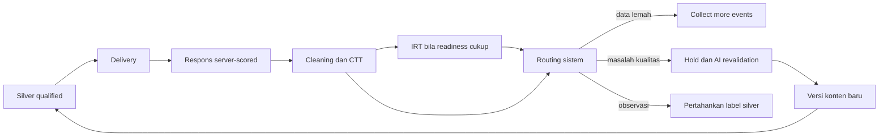

# Feedback empiris otomatis

`AssessmentStore.screen` menyimpan snapshot lalu keputusan otomatis satu per versi soal. Data sedikit atau interval lebar menghasilkan `collect_more_events`; kandidat diskriminasi negatif, distraktor tidak berfungsi atau misfit dapat menghasilkan `needs_ai_review`. Versi itu ditahan dari delivery dan dikecualikan dari freeze yang memakai database assessment.

Perbedaan difficulty awal dan difficulty empiris saja merupakan observasi. Label `intendedDifficulty` tidak ditimpa; hasil CTT/IRT menyimpan field tersendiri. Keputusan mempunyai `actorType=system` dan `affectsSilverLabels=false`.

GET `/api/v1/internal/psychometrics/snapshots/{snapshot_id}/decisions` menampilkan feedback. POST keputusan manual sudah dihapus. Scheduler integrasi dapat menjalankan screen berkala; backend tidak otomatis mengkalibrasi setiap respons masuk. Perbaikan isi dan job revalidation memakai versi baru; regenerasi konten otomatis belum tersedia.
