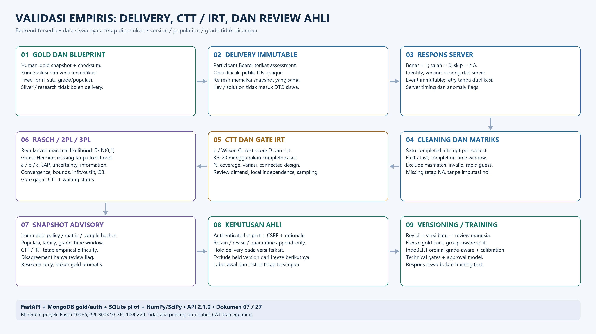

# Alur Validasi Empiris dan Pembaruan Klasifikasi Soal

Alur ini sudah diimplementasikan sebagai backend pilot + analisis penelitian. Respons siswa dinormalisasi sebelum CTT/IRT; hasil menjadi bukti ahli. Diagram dan teks ini menggantikan status lama yang menyebut IRT hanya desain.

[SVG](23_EMPIRICAL_VALIDATION_FEEDBACK_FLOW.svg) · [PNG](23_EMPIRICAL_VALIDATION_FEEDBACK_FLOW.png) · [JPG](23_EMPIRICAL_VALIDATION_FEEDBACK_FLOW.jpg)

## Alur aktif

1. Gold manusia dibekukan, kemudian assessment satu grade/populasi dibuat dari versi yang key/solusinya terverifikasi.
2. Server membuat delivery immutable dengan urutan opsi acak dan public option IDs; siswa tidak menerima kunci.
3. Respons dinilai server dan disimpan bersama version/hash, pseudonymous subject dan server timing. Skip null, salah 0, benar 1.
4. Pilih satu **completed session** per subject berdasarkan first/last dan completion time window; incomplete/repeated/invalid/mismatch/rapid guess tidak menjadi sampel valid.
5. Matriks siswa × versi item memakai 0/1/NA. Complete-case CTT menghasilkan p/Wilson CI, discrimination, corrected item-total, KR-20; log tambahan memberi distraktor/timing.
6. Gate mengecek sample, item count, outcome variation, missing/coverage, connected design dan assumption review. Kurang data/asumsi menghasilkan waiting status, dengan CTT tetap tersedia.
7. Rasch/2PL/3PL memakai regularized marginal likelihood pada θ~N(0,1), missing tidak memberi likelihood. Periksa convergence, boundary, uncertainty dan residual dependence.
8. Snapshot immutable mengunci policy, matrix/sample hashes, population/family/grade/time window, exclusions, CTT dan IRT. Empirical/intended disagreement hanya flag.
9. Ahli retain/revise/quarantine. Hold menghentikan delivery versi terkait dan mengecualikannya dari freeze berikutnya; label lama tidak ditimpa.
10. Konten/label baru hanya melalui versioning/validasi ahli dan snapshot gold baru; kemudian training/kalibrasi/promosi model terkontrol.

## Hubungan dengan AI terbaru

Training default `grade-aware-ordinal-v2`: shared IndoBERT + LoRA query/value, Head 1/2 multiclass, Head 3 cumulative ordinal dengan grade embedding. Arsitektur parallel/conditioned adalah legacy ablation. Class weight hanya train; validation memilih calibration/confidence+entropy; frozen test tetap terkunci sesuai gate.

Silver Gemini N=3 sekarang **blind sebelum prediksi**. Keputusan 3–0 menjadi silver advisory; 2–1, abstain, konflik kunci/visual/content concern membutuhkan adjudikasi terpisah. Audit mengunci checkpoint sebelum comparison offline. Review anchored pascaprediksi dinonaktifkan untuk eksperimen baru. Agreement bukan confidence atau gold manusia. Detail [24](24_INDOBERT_FINETUNING_LLM_REASONING_DETAIL.md) dan [25](25_GRADE_AWARE_ORDINAL_PIPELINE.md).

## Status dan batas

Numerik dan alur API tersedia, tetapi CTT/IRT siswa nyata tetap membutuhkan administrasi nyata yang memadai dan asumsi yang didukung. Simulasi/test tidak membuktikan validitas siswa. Semua empirical outputs research/advisory; tidak ada label/publish/train otomatis.

p CTT dan b IRT tidak mengubah domain, knowledge atau intended difficulty; kalibrasi berbeda populasi/grade/form/version tidak dibandingkan tanpa linking. CAT/DIF/equating/polytomous, family/variant aggregation dan UI siswa masih target.

Kontrak, minimum data dan perhitungan: [07](07_PSYCHOMETRICS_API.md). Perintah siap dijalankan: [27](27_PSYCHOMETRICS_IMPLEMENTATION_RUNBOOK.md). Sumber visual: `scripts/build_empirical_diagrams.py`.
