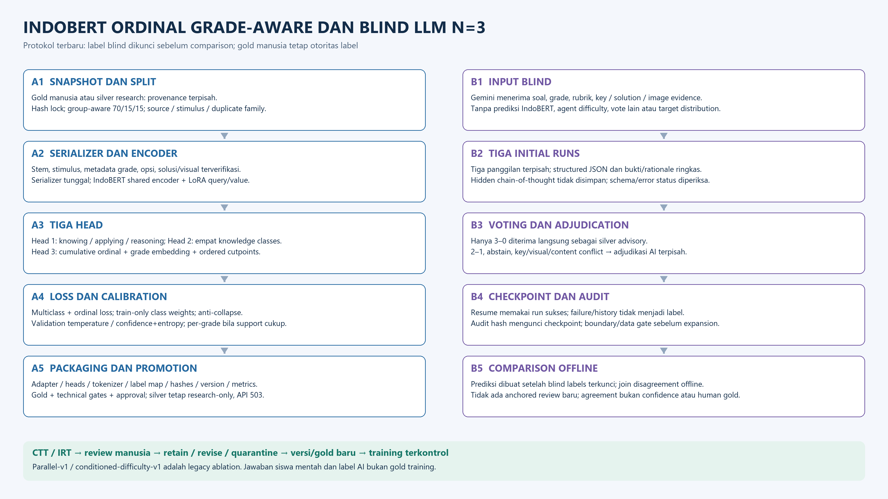

# Fine-tuning IndoBERT Grade-Aware dan Blind Reasoning–Voting LLM

Dokumen ini mengikuti implementasi ordinal terbaru, menggantikan diagram conditioned 775-fitur dan review LLM anchored sebagai alur default. Alur empiris berada pada [23](23_EMPIRICAL_VALIDATION_FEEDBACK_FLOW.md).

[SVG 4K](24_INDOBERT_FINETUNING_LLM_REASONING_DETAIL.svg) · [PNG 4K](24_INDOBERT_FINETUNING_LLM_REASONING_DETAIL.png) · [JPG 4K](24_INDOBERT_FINETUNING_LLM_REASONING_DETAIL.jpg)

## IndoBERT

Snapshot gold manusia atau silver research dikunci melalui hash; provenance tetap terpisah. Group-aware split 70/15/15 menyatukan sumber/stimulus/duplicate family. Serializer/tokenizer sama saat training/inference; solusi/kunci harus terverifikasi.

Shared IndoBERT memakai LoRA query/value. Head 1/2 multiclass menghasilkan 3 dan 4 kelas. Head 3 ordinal menghasilkan Easy/Medium/Hard dari cumulative probabilities dengan grade embedding dan ordered cutpoints. `parallel-v1` dan `conditioned-difficulty-v1` tersedia hanya untuk kompatibilitas/ablation.

Loss multiclass + ordinal, train-only class weights, anti-collapse check, checkpoint berdasarkan weakest-head macro-F1 kemudian mean, validation temperature/confidence+entropy, per-grade calibration hanya bila support mencukupi. Packaging menyimpan tokenizer/adapter/heads/label map, architecture/routing/rubric/model versions, split/data/checksum hashes dan promotion metrics.

Data/anti-collapse/promotion gates serta approval diperlukan. Silver tetap researchOnly dan API classifier tidak servable meskipun metrik teknis baik. Empirical expert hold dikecualikan oleh freeze gold berikutnya; respons siswa mentah bukan training text.

## Blind LLM dan keputusan manusia

Gemini adapter menerima soal, metadata grade, rubrik, key/solution evidence dan gambar yang tersedia. Prompt blind tidak menerima IndoBERT predictions, agent difficulty, vote lain atau distribusi target.

Tiga initial runs terpisah menghasilkan usulan label/head, content/key status dan evidence. Hanya 3–0 yang diterima langsung sebagai silver; 2–1, abstain, conflict/content concern atau incomplete provider output melalui adjudikasi AI terpisah. Checkpoint resumable menyimpan error/history; audit hash mengunci output sebelum comparison offline. Tidak ada peninjauan anchored pascaprediksi pada protokol baru.

Sistem menyimpan keluaran terstruktur dan alasan singkat, bukan hidden chain-of-thought. N=3 mengukur self-consistency, bukan gold atau calibrated correctness. Tiga ahli manusia memberi penilaian blind tersendiri; gold baru ditetapkan workflow mereka.

## Hubungan dengan IRT

CTT/IRT menghasilkan bukti lokal untuk review ahli. Sistem tidak mengubah label kognitif/knowledge dari p/b. Human revise/quarantine menahan versi; konten baru perlu versioning/review sebelum masuk training snapshot berikutnya.

IndoBERT/Gemini/IRT code tersedia; final human gold/model approval dan respons siswa memadai tetap prasyarat penelitian. [25 pipeline](25_GRADE_AWARE_ORDINAL_PIPELINE.md), [07 psikometrik](07_PSYCHOMETRICS_API.md), [27 runbook](27_PSYCHOMETRICS_IMPLEMENTATION_RUNBOOK.md).
