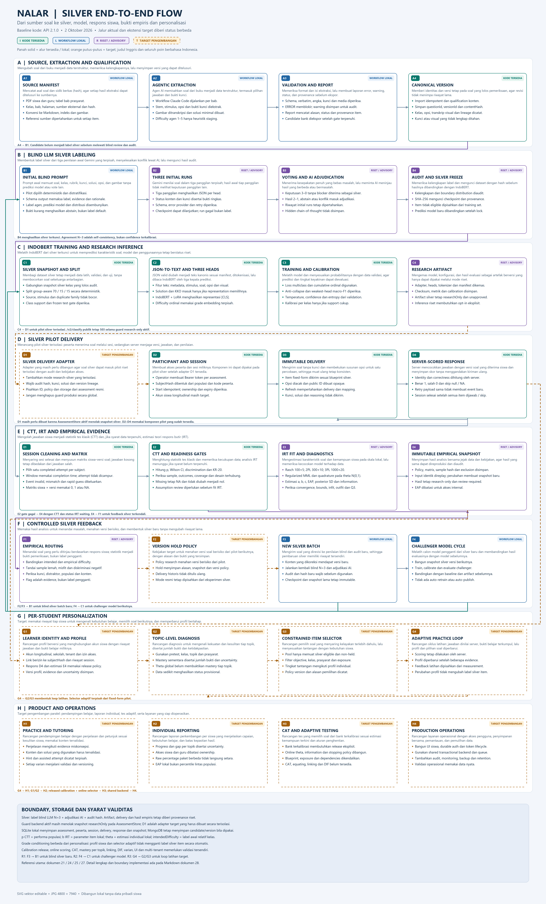
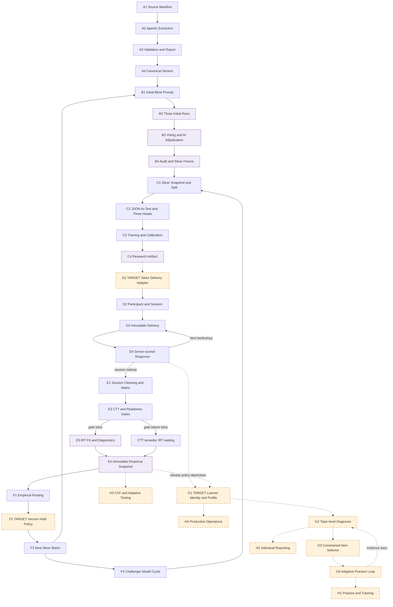
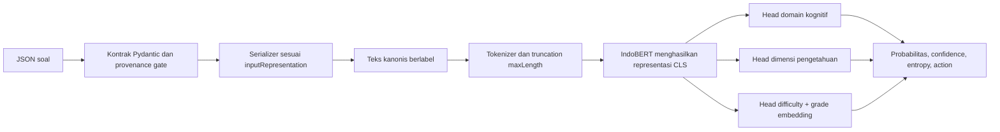
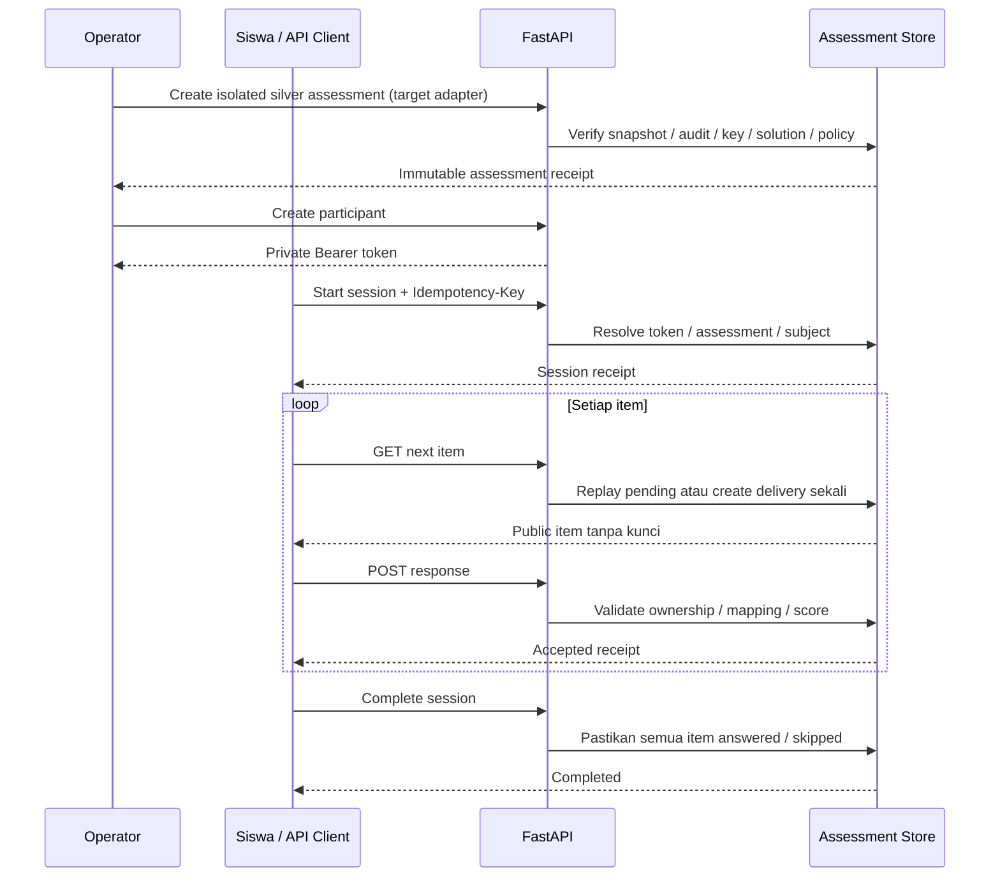

# Nalar Silver End-to-End Flow

Dokumen ini menjelaskan alur teknis berbasis **silver labels** dari sumber soal sampai training IndoBERT, pilot siswa, CTT/IRT, feedback dataset, dan personalisasi per siswa. Judul fase dan node pada diagram memakai bahasa Inggris; penjelasan serta seluruh poin menggunakan bahasa Indonesia.



[SVG vektor editable](28_END_TO_END_PERSONALIZED_ASSESSMENT_FLOW.svg) · [JPG 4800 × 7940](28_END_TO_END_PERSONALIZED_ASSESSMENT_FLOW.jpg) · [Script pembangun](../scripts/build_end_to_end_personalized_diagram.py)

Diagram mempunyai 32 node dalam delapan fase. ID **A1–H4** pada gambar sama dengan subbagian di bawah. Panah solid menunjukkan alur yang sudah mempunyai kode atau workflow lokal. Panah oranye putus-putus menunjukkan integrasi target yang masih perlu dibuat.

Setiap tahap dibaca dengan urutan **judul → deskripsi singkat bahasa Indonesia → poin teknis**. Deskripsi menjelaskan tujuan dan hasil tahap; poin di bawahnya merinci data, aturan, dan proses yang digunakan. Urutan ini sama pada SVG, JPG, dan penjelasan Markdown.

> **Boundary implementasi:** `AssessmentStore` aktif saat ini menolak snapshot `researchOnly=true` dan mensyaratkan provenance lama `human_gold`. Karena proyek ini memilih silver, node D1 adalah adapter target yang harus dibuat secara terisolasi. Diagram tidak menganggap delivery silver sudah aktif sebelum adapter dan policy tersebut selesai.

## 1. Status Legend

Penanda pada tiap node membantu membedakan kemampuan yang sudah ada dengan rancangan berikutnya.

| Penanda | Arti |
|---|---|
| **I — Kode tersedia** | Komponen sudah ada, tetapi tetap membutuhkan konfigurasi dan data yang sesuai. |
| **L — Workflow lokal** | Dijalankan melalui CLI atau pekerjaan operator/development. |
| **R — Riset/advisory** | Dapat digunakan untuk eksperimen, tetapi belum menjadi keputusan produksi. |
| **T — Target pengembangan** | Kontrak atau adapter masih perlu dibangun dan diuji. |

Kode tersedia tidak berarti model sudah valid untuk seluruh populasi. Silver tetap mempunyai provenance riset. Hasil CTT/IRT juga tetap terikat pada populasi, kelas, assessment family, versi item, form, dan time window yang dianalisis.

## 2. Overall Topology

Alur utama bergerak dari source menuju silver freeze, model riset, delivery terisolasi, analisis empiris, dan versi silver berikutnya.



Alur ini memisahkan tiga jenis state:

1. **Item state:** versi soal, kunci, solusi, label silver, audit hash, dan status hold.
2. **Measurement state:** assessment, session, delivery, response event, matriks, dan empirical snapshot.
3. **Learner state:** identitas longitudinal, evidence per topik, uncertainty, dan riwayat pilihan item. Bagian ini masih target.

### 2.1 Initial prompt, fitur awal, validasi, dan perubahan JSON menjadi teks

Bagian ini menjelaskan isi teknis di antara A3, B1–B4, dan C1–C3. Ada dua jalur input yang berbeda dan keduanya tidak boleh dicampur:

1. **Jalur Gemini untuk membuat label silver:** JSON soal dirender menjadi prompt instruksi dan dinilai secara blind tiga kali.
2. **Jalur IndoBERT untuk training/inference:** JSON soal divalidasi, diserialisasi menjadi teks kanonis, ditokenisasi, lalu dibaca encoder.

#### Initial prompt untuk Gemini

Prompt aktif dibuat oleh fungsi `build_silver_prompt()` dengan versi `gemini-silver-math-3x4x3-v4-blind-key-verified`. Prompt ini bukan sekadar pertanyaan “soal ini sulit atau mudah”, tetapi kontrak penilaian lengkap yang memuat:

- identitas bahwa tugas adalah pembuatan **silver label penelitian awal** untuk kelas sasaran;
- aturan blind: tidak boleh melihat prediksi IndoBERT, vote run lain, distribusi label, atau estimasi difficulty agen;
- definisi `knowing`, `applying`, dan `reasoning`;
- definisi `factual`, `conceptual`, `procedural`, dan `metacognitive`;
- definisi `Easy`, `Medium`, dan `Hard` yang relatif terhadap kelas siswa;
- perintah memverifikasi kunci sumber melalui solusi minimum;
- perintah mengisi profil bukti difficulty, bukan menjumlahkan skor buatan;
- aturan `abstain` ketika bukti tidak cukup;
- soal, subtopik, tipe soal, opsi, catatan ekstraksi, kunci sumber, dan gambar jika tersedia.

System instruction-nya ringkas: Gemini bertindak sebagai reviewer asesmen matematika Indonesia, wajib mengikuti schema, memberi bukti singkat, dan abstain jika bukti kurang. Output dipaksa sebagai JSON sesuai `SilverLabelOutput`; hidden chain-of-thought tidak diminta atau disimpan.

Struktur ringkas prompt yang benar-benar dirender:

```text
Klasifikasikan satu soal matematika kelas {grade} sebagai SILVER LABEL penelitian awal.

PENILAIAN INI BLIND.
[rubrik tiga domain kognitif]
[rubrik empat dimensi pengetahuan]
[rubrik difficulty relatif kelas]
[aturan verifikasi kunci, solusi minimum, evidence profile, dan abstain]

ID: {question_id}
Subtopik: {subtopic}
Tipe: {question_type}
Soal:
{stem}

Pilihan dan catatan ekstraksi:
A. {option_text} | catatan sumber: {source_note}
...

Kunci pada sumber: {source_answer_key}
```

Kode sumber: [silver prompt](../app/llm/silver.py) dan [generator tiga run](../scripts/generate_silver_labels_kelas1.py).

#### JSON keluaran Gemini dan validation gate

Setiap run harus menghasilkan struktur berikut. Field tambahan ditolak karena seluruh model Pydantic memakai `extra="forbid"`.

| Bagian output | Isi yang diperiksa |
|---|---|
| `contentStatus`, `contentConcerns` | Apakah isi valid, bermasalah, atau bukti tidak cukup |
| `answerKeyStatus`, `verifiedAnswerKey` | Apakah kunci terverifikasi, konflik, atau tidak dapat diverifikasi |
| `verifiedMinimalSolution` | Solusi sesingkat mungkin yang cukup membuktikan jawaban |
| `mathCognitiveDomain` | `action`, label, maksimal empat evidence spans, dan alasan singkat |
| `knowledgeDimension` | `action`, label, evidence spans, dan alasan singkat |
| `intendedDifficulty` | `action`, label, evidence spans, alasan, serta difficulty evidence profile |
| `visualTranscript` | Fakta visual yang relevan; null jika tidak ada gambar |

Difficulty evidence profile memuat prasyarat yang diharapkan, jumlah langkah saling bergantung, status rutin/nonrutin, pemilihan strategi, perpindahan representasi, unit informasi, constraint yang berinteraksi, beban hitung, tingkat scaffolding, mutu distraktor, dan alasan relatif terhadap kelas.

Validation berjalan berlapis:

1. **Validasi input soal:** stem tidak kosong, minimal dua opsi, label dan teks opsi tidak duplikat, kunci terdapat pada opsi, serta aset gambar tersedia.
2. **Validasi schema respons:** label hanya boleh berasal dari kelas yang terdaftar; `classify` wajib mempunyai label dan evidence; `abstain` wajib mempunyai label null.
3. **Validasi isi:** kunci berstatus `verified` wajib mempunyai `verifiedAnswerKey`; difficulty yang diklasifikasikan wajib mempunyai evidence profile.
4. **Validasi tiga run:** kegagalan provider dicatat sebagai failure dan tidak diterjemahkan menjadi label default.
5. **Voting dan adjudikasi:** hanya 3–0 tanpa blocker yang diterima langsung; 2–1, abstain, konflik, atau concern masuk adjudikasi AI terpisah.
6. **Audit batch:** memeriksa jumlah item, tiga run sukses, versi prompt/rubrik, prompt/response hash, eligibility, distribusi batas, dan hash checkpoint sebelum snapshot digunakan.

#### Fitur awal yang masuk ke IndoBERT

“Fitur” pada model utama bukan daftar skor buatan. Fitur awalnya adalah field teks yang disusun berurutan, ditambah `grade` sebagai input numerik terpisah untuk difficulty head pada arsitektur grade-aware ordinal. Serializer menyediakan empat representasi untuk ablation:

| Representation | Field yang dimasukkan ke teks |
|---|---|
| `stem_options` | Soal dan pilihan |
| `metadata` | Kelas, topik, subtopik, tipe soal, stimulus, soal, pilihan, transkripsi visual |
| `solution` | Seluruh `metadata` ditambah solusi minimum terverifikasi |
| `kko` | Seluruh field `solution` ditambah KKO terdeteksi |

Representation yang digunakan tidak dipilih diam-diam oleh request. Nilainya dikunci dalam manifest artefak sebagai `inputRepresentation`, sehingga training dan inference wajib memakai bentuk yang sama. Artefak diagnostik kelas yang tersedia saat ini mencatat representation `metadata` dengan `maxLength=256`; artefak lain harus mengikuti manifest miliknya sendiri.

KKO dideteksi melalui pola leksikal transparan, misalnya “hitung”, “bandingkan”, atau “jelaskan”. KKO hanya feature tambahan pada representation `kko`, bukan aturan yang langsung menetapkan label kognitif. Baseline berbasis aturan juga terpisah dari model utama dan hanya dipakai sebagai pembanding.

#### Bagaimana JSON diubah menjadi teks

Request pertama-tama divalidasi oleh `V2ClassificationRequest`. Kontrak ini memeriksa field wajib, rentang kelas, hash konten 64 karakter, jumlah opsi, label opsi unik, dan menolak field yang tidak dikenal.

Contoh JSON ringkas:

```json
{
  "questionId": "mat-5-pecahan-001",
  "contentVersion": 1,
  "contentHash": "0000000000000000000000000000000000000000000000000000000000000000",
  "grade": 5,
  "topic": "Pecahan",
  "subtopic": "Penjumlahan pecahan",
  "questionType": "multiple_choice",
  "stimulus": "Ibu membagi dua kue yang sama besar.",
  "stem": "Berapa hasil 1/2 + 1/4?",
  "options": [
    {"label": "A", "text": "2/6"},
    {"label": "B", "text": "3/4"}
  ],
  "verifiedMinimalSolution": "1/2 = 2/4, sehingga 2/4 + 1/4 = 3/4.",
  "detectedKko": ["menghitung"],
  "visualTranscript": null,
  "provenanceStatus": {
    "contentQualified": true,
    "answerKeyVerified": true,
    "solutionVerified": true,
    "visualEssential": false,
    "visualTranscriptVerified": false
  }
}
```

Pada representation `kko`, `serialize_question()` mengubahnya menjadi teks kanonis berikut:

```text
Kelas: 5
Topik: Pecahan
Subtopik: Penjumlahan pecahan
Tipe soal: multiple_choice
Stimulus: Ibu membagi dua kue yang sama besar.
Soal: Berapa hasil 1/2 + 1/4?
Pilihan: A. 2/6
B. 3/4
Solusi minimum terverifikasi: 1/2 = 2/4, sehingga 2/4 + 1/4 = 3/4.
KKO terdeteksi: menghitung
Transkripsi visual: -
```

Normalisasi memakai Unicode NFC, menyamakan line ending, merapikan spasi/tab, dan mengganti nilai kosong dengan `-`. Urutan serta nama field bersifat tetap. Teks ini kemudian di-hash untuk trace, ditokenisasi oleh tokenizer yang dikemas bersama artefak, dipotong sesuai `maxLength`, dan masuk ke IndoBERT. Representasi token `[CLS]` dibaca tiga head; khusus difficulty grade-aware, embedding kelas digabungkan pada difficulty head.



Kode sumber: [kontrak input](../app/classification/v2/contracts.py), [serializer](../app/classification/v2/serializer.py), [runtime dan tokenisasi](../app/classification/v2/runtime.py), [model tiga head](../app/classification/v2/model.py), dan [detektor KKO](../app/classification/v2/kko.py).

#### Isi validation report

Bundle validasi blind saat ini menghasilkan data mesin dan laporan manusia yang saling terhubung:

| Artefak | Fungsi |
|---|---|
| `questions.json` | Soal, opsi, provenance, spesifikasi jawaban terbatas, dan aset visual |
| `validation_results.json` | Keputusan per soal, feature manifest, tiga run, voting/adjudikasi, routing, dan perbandingan model |
| `indobert_predictions.json` | Input serialisasi yang benar-benar dibaca model, jumlah token, batas truncation, latency, dan output tiga head |
| `LAPORAN_VALIDASI.md` | Bentuk mudah dibaca: soal, opsi, kunci, solusi, suara LLM, evidence, probabilitas, confidence, entropy, dan keputusan batch |
| `difficulty/*.json` | Pengelompokan soal menurut difficulty advisory |
| `manifest.json` | Hash artefak agar perubahan file dapat dideteksi |

`featureManifest` per soal minimal mencatat `grade`, `topic`, `subtopic`, `questionType`, `detectedKko`, `serializedInput`, `untruncatedTokenCount`, `maxLength`, dan `wouldTruncate`. Dengan begitu laporan dapat menunjukkan input sebenarnya, bukan hanya mengklaim fitur tertentu digunakan.

Alur silver yang menjadi acuan adalah `generate_silver_labels_kelas1.py` → `audit_grade_aware_pilot.py` → `build_blind_validation_bundle.py`. File `scripts/validate_pipeline.py` adalah utilitas/demo lama yang memakai data mock serta formula 40% IndoBERT + 60% Gemini; formula itu **bukan** policy label silver aktif dan tidak boleh dipakai sebagai sumber kebenaran flow ini.

## 3. A — Source, Extraction and Qualification

Mengubah soal dari buku menjadi data terstruktur, memeriksa kelengkapannya, lalu menyimpan versi yang dapat ditelusuri.

### A1 — Source Manifest

Mencatat asal soal dan sidik berkas (hash), agar setiap hasil ekstraksi dapat ditelusuri ke sumbernya.

- Input mencakup PDF Buku Siswa, PDF Buku Guru, dan tabel bab prasyarat.
- Simpan kelas, buku, bab, subbab, halaman, section, nomor soal, dan checksum sumber.
- Hasil konversi mencakup Markdown per halaman, indeks, serta referensi gambar.
- Aset yang hilang harus terlihat sebagai status data, bukan diganti dengan isi perkiraan.

### A2 — Agentic Extraction

Agen AI memisahkan soal dari buku menjadi data terstruktur, termasuk pilihan jawaban dan bukti kunci.

- Claude Code dipakai sebagai alat development untuk menafsirkan batas soal dan visual.
- Output mencakup stem, stimulus, opsi, bukti kunci, solusi minimal, dan image references.
- Transkripsi visual wajib tersedia jika gambar esensial untuk menjawab.
- `tingkat_kesulitan` 1–5 dari agen hanya dipakai sebagai heuristik staging atau sampling.
- `jawaban_agen` bukan label silver dan bukan respons siswa.

### A3 — Validation and Report

Memeriksa format dan isi ekstraksi, lalu membuat laporan error, warning, status, dan provenance sebelum ekspor.

- Schema strict menolak field tidak dikenal dan bentuk data yang tidak sesuai.
- Verbatim, angka, kunci, opsi ganda/senilai, media, dan provenance diperiksa.
- ERROR memblokir item; warning mempertahankan alasan pemeriksaan lanjutan.
- Validation report mencatat alasan, status, dan provenance setiap item.
- `soal_pretest_db.json` adalah candidate bank, bukan delivery payload siswa.
- `sesi_pretest.json` adalah rancangan pemilihan item, bukan session siswa nyata.

### A4 — Canonical Version

Memberi identitas dan versi tetap pada soal yang lolos pemeriksaan, agar revisi tidak menimpa riwayat lama.

- Import dilakukan idempotent agar retry tidak menggandakan question version.
- Simpan `questionId`, `questionVersionId`, `contentVersion`, dan `contentHash`.
- Source lineage, grade, opsi, key evidence, solusi, dan visual transcript tetap terikat pada versi.
- Konflik kunci, visual esensial hilang, atau konten tidak lengkap menyebabkan hold/review staging.
- Revisi konten menghasilkan versi baru dan tidak menimpa histori versi lama.

Referensi: [21 — pipeline agentic](21_PRETEST_AGENTIC_PIPELINE_INTEGRATION.md), [ingestion code](../app/ingestion/), dan [import CLI](../scripts/import_candidates_v2.py).

## 4. B — Blind LLM Silver Labeling

Membentuk label silver dari tiga penilaian awal Gemini yang terpisah, menyelesaikan konflik lewat AI, lalu mengunci hasil audit.

### B1 — Initial Blind Prompt

Prompt awal memuat soal, kelas, rubrik, kunci, solusi, opsi, dan gambar tanpa prediksi model atau vote lain.

- Pilot dipilih deterministik dengan stratifikasi sumber, bab, visual, dan coverage.
- Prompt memuat soal, target grade, rubrik, key evidence, solusi, dan gambar yang tersedia.
- Prompt tidak memuat label difficulty agen, prediksi IndoBERT, vote lain, atau target distribution.
- Konflik konten, kunci, dan visual tetap dikirim sebagai bukti yang harus dinilai.

### B2 — Three Initial Runs

Gemini menilai soal dalam tiga panggilan terpisah; hasil awal tiap panggilan tidak melihat keputusan panggilan lain.

- Setiap run menilai domain kognitif, dimensi pengetahuan, dan intended difficulty.
- Setiap run juga memberi status konten/kunci, evidence, dan rationale ringkas.
- Output divalidasi terhadap schema; malformed response tidak menjadi label.
- Error 429/503, timeout, atau failure lain disimpan sebagai failure/retry history.
- Checkpoint dapat dilanjutkan tanpa memanggil ulang run yang sudah sukses.

### B3 — Voting and AI Adjudication

Menerima kesepakatan penuh yang bebas masalah, lalu meminta AI meninjau hasil yang berbeda atau bermasalah.

- Hanya hasil 3–0 tanpa blocker yang diterima langsung sebagai silver.
- Hasil 2–1, abstain, key conflict, visual conflict, atau content concern masuk adjudikasi.
- Adjudikasi mempertahankan initial runs sehingga jejak keputusan tidak hilang.
- Provider failure tidak pernah diterjemahkan menjadi label default.
- Sistem menyimpan structured result dan alasan ringkas, bukan hidden chain-of-thought.

### B4 — Audit and Silver Freeze

Memeriksa kelengkapan label dan mengunci dataset dengan hash sebelum hasilnya dibandingkan dengan IndoBERT.

- Periksa jumlah item, jumlah run sukses, eligibility, dan completeness.
- Periksa boundary distribution; label tidak boleh dibuat paksa demi menyeimbangkan kelas.
- SHA-256 mengunci source, checkpoint, rubrik, prompt version, dan hasil audit.
- Item dengan blocker tetap berada pada routing review/retry dan tidak masuk training set.
- Prediksi IndoBERT hanya dibandingkan setelah blind labels terkunci.

Agreement N=3 mengukur self-consistency provider. Nilai tersebut belum menjadi calibrated confidence atau bukti kebenaran universal.

Referensi: [silver generator](../scripts/generate_silver_labels_kelas1.py), [audit](../scripts/audit_grade_aware_pilot.py), [comparison](../scripts/compare_blind_labels_to_predictions.py), [24](24_INDOBERT_FINETUNING_LLM_REASONING_DETAIL.md), dan [25](25_GRADE_AWARE_ORDINAL_PIPELINE.md).

## 5. C — IndoBERT Training and Research Inference

Melatih IndoBERT dari silver terkunci untuk memprediksi karakteristik soal; model dan penggunaannya tetap berstatus riset.

### C1 — Silver Snapshot and Split

Membagi dataset silver tetap menjadi data latih, validasi, dan uji, tanpa membocorkan soal sekeluarga antarbagian.

- Gabungkan snapshot kelas hanya jika audit masing-masing memenuhi gate yang ditetapkan.
- Pertahankan `labelProvenance`, audit hash, source hash, rubric version, dan prompt version.
- Gunakan split group-aware 70/15/15 dengan seed tetap.
- Source family, stimulus yang sama, exact duplicate, dan near duplicate tidak boleh lintas split.
- Class support dan keterwakilan grade diperiksa sebelum training.
- Frozen test tidak digunakan untuk memilih threshold atau hyperparameter.

### C2 — JSON-to-Text and Three Heads

JSON valid diubah menjadi teks kanonis sesuai manifest, ditokenisasi, lalu dibaca IndoBERT oleh tiga kepala prediksi.

| Head | Label |
|---|---|
| `mathCognitiveDomain` | `knowing`, `applying`, `reasoning` |
| `knowledgeDimension` | `factual`, `conceptual`, `procedural`, `metacognitive` |
| `intendedDifficulty` | Ordinal `Easy < Medium < Hard` relatif terhadap grade |

- LoRA dipasang pada modul `query` dan `value`.
- Base encoder dibekukan; LoRA dan classification heads dilatih.
- Serializer yang sama dipakai pada training dan inference.
- Head difficulty menerima pooled representation dan grade embedding.
- Ordered cutpoints menjaga urutan kategori difficulty.

Untuk skor laten `s` dan cutpoints `t1 < t2`:

```text
q1 = sigmoid(s - t1) = P(Y > Easy)
q2 = sigmoid(s - t2) = P(Y > Medium)
P(Easy)   = 1 - q1
P(Medium) = q1 - q2
P(Hard)   = q2
```

### C3 — Training and Calibration

Melatih model dan menyesuaikan probabilitasnya dengan data validasi, agar prediksi dan tingkat keyakinan dapat dievaluasi.

- Gunakan multiclass loss untuk Head 1/2 dan cumulative ordinal loss untuk Head 3.
- Class weights hanya dihitung dari training split.
- Checkpoint dipilih berdasarkan anti-collapse, weakest-head macro-F1, lalu mean macro-F1.
- Temperature scaling, confidence, dan entropy threshold berasal dari validation.
- Kalibrasi per grade hanya dipakai jika support tiap kelas mencukupi dan threshold nontrivial.
- Final seed yang dikonfigurasi adalah 13, 42, dan 73.

### C4 — Research Artifact

Mengemas model, konfigurasi, dan hasil evaluasi sebagai artefak berversi yang hanya dapat dipakai melalui mode riset.

- Simpan adapter, heads, tokenizer, label map, architecture, dan model version.
- Simpan checksum, split/data hashes, calibration, metrics, dan gate results.
- `researchOnly=true` dipertahankan pada artifact berbasis silver.
- Research inference memerlukan opt-in eksplisit.
- Runtime publik tetap menolak artifact research-only dan dapat mengembalikan HTTP 503.
- Tidak ada fallback rule yang menyamarkan model belum siap.

Referensi: [model](../app/classification/v2/model.py), [dataset](../app/training/v2/dataset.py), [training](../app/training/v2/train_lora.py), [calibration](../app/classification/v2/calibration.py), dan [runtime](../app/classification/v2/runtime.py).

## 6. D — Silver Pilot Delivery

Merancang pilot silver terisolasi: peserta menerima soal melalui sesi, sedangkan server menjaga versi, jawaban, dan penilaian.

Bagian ini mendefinisikan pilot riset berbasis silver. D2–D4 menggunakan komponen yang sudah tersedia, sedangkan D1 masih perlu dibuat agar silver dapat masuk tanpa membuka guard produksi.

### D1 — Silver Delivery Adapter

Adapter yang masih perlu dibangun agar soal silver dapat masuk pilot riset terisolasi dengan audit dan kebijakan akses.

- Jangan menghapus guard provenance secara global.
- Tambahkan mode/kontrak assessment yang hanya dapat dibuat operator berwenang.
- Wajibkan silver snapshot ID, snapshot hash, audit hash, source hash, dan policy version.
- Wajibkan verified source key dan solusi minimal sebelum item dapat dikirim.
- Pisahkan namespace assessment, storage path, UI banner, dan hasil dari assessment resmi.
- Tandai response event dan empirical snapshot sebagai `dataOrigin=server_scored` serta `researchOnly=true`.
- Blokir item yang tidak eligible, konflik kunci, visual hilang, atau status hold.

Perubahan minimum ada di `AssessmentCreate`, `AssessmentStore.create_assessment`, CLI create-assessment, kontrak OpenAPI, dan tes yang membuktikan mode silver tidak dapat menyamar sebagai mode resmi.

### D2 — Participant and Session

Membuat akses peserta dan sesi miliknya. Komponen ini dapat dipakai pada pilot silver setelah adapter D1 tersedia.

- Operator membuat Bearer token yang terikat pada satu assessment.
- Store menyimpan token hash, bukan token mentah.
- `subjectHash` dibentuk dari population dan participant code memakai HMAC secret stabil.
- Start memakai `Idempotency-Key` dan retry key yang sama mengembalikan session yang sama.
- Ownership memeriksa assessment dan subject; session mempunyai TTL serta status monotonic.

### D3 — Immutable Delivery

Mengirim soal tanpa kunci dan membekukan susunan opsi untuk satu percobaan, sehingga muat ulang tetap konsisten.

- `GET /api/v1/sessions/{session_id}/items/next` mengambil item berikut dari blueprint.
- Opsi diacak satu kali dan public option ID dibuat opaque.
- Refresh mengembalikan pending delivery yang sama.
- Private mapping tidak dikirim ke client.
- DTO siswa tidak berisi kunci, solusi, internal option IDs, atau reasoning LLM.

### D4 — Server-scored Response

Server mencocokkan jawaban dengan versi soal yang diterima siswa dan menyimpan skor tanpa menggandakan kiriman ulang.

```json
{
  "responseId": "response-001-unique",
  "deliveryInstanceId": "<delivery-id>",
  "selectedOptionIds": ["<opaque-public-option-id>"],
  "skipped": false,
  "responseTimeMs": 42000,
  "answerChanges": 0
}
```

- `Idempotency-Key` wajib sama dengan `responseId`.
- Benar disimpan sebagai 1, salah 0, dan explicit skip sebagai null/NA.
- Server timing dipisahkan dari client timing.
- Response ID dan payload yang sama direplay tanpa membuat event baru.
- Satu delivery hanya mempunyai satu final response.
- Completion hanya berhasil setelah semua item dijawab atau explicitly skipped.
- Receipt pilot tidak membocorkan correctness.



Referensi komponen yang tersedia: [assessment contracts](../app/assessment/contracts.py), [assessment store](../app/assessment/store.py), [assessment routes](../app/assessment/routes.py), dan [27](27_PSYCHOMETRICS_IMPLEMENTATION_RUNBOOK.md).

## 7. E — CTT, IRT and Empirical Evidence

Mengolah jawaban siswa menjadi statistik tes klasik (CTT) dan, jika syarat data terpenuhi, estimasi teori respons butir (IRT).

### E1 — Session Cleaning and Matrix

Menyaring sesi selesai dan menyusun matriks siswa–versi soal; jawaban kosong tetap dibedakan dari jawaban salah.

- Attempt policy memakai `first` atau `last` untuk whole session.
- Time window menggunakan `completed_at` dengan timestamp ber-timezone.
- Event duplicate/conflict, version mismatch, population mismatch, invalid score, dan rapid guess dikeluarkan dengan alasan.
- Missing/skip tetap null dan tidak diubah menjadi salah.
- Matriks berisi satu kolom per question version dan satu baris per subject.

```text
              Item V1   Item V2   Item V3
Subject A        1         0        null
Subject B        0         1          1
Subject C       null       1          0
```

### E2 — CTT and Readiness Gates

Menghitung statistik tes klasik dan memeriksa kecukupan data; analisis IRT menunggu jika syarat belum terpenuhi.

- Difficulty index `p` memakai respons valid yang teramati per item.
- Wilson confidence interval menunjukkan uncertainty p.
- Corrected point-biserial dan upper/lower discrimination memakai complete-case joins.
- KR-20 memakai complete cases dengan denominator yang konsisten.
- Timing dan distractor metrics memakai response events, bukan matriks murni.

Policy aktif:

| Gate | Rasch | 2PL | 3PL |
|---|---:|---:|---:|
| Minimum peserta eligible | 100 | 300 | 1.000 |
| Minimum item | 5 | 10 | 20 |
| Minimum respons per item | 50 | 50 | 50 |
| Minimum benar dan salah per item | 5 masing-masing | 5 masing-masing | 5 masing-masing |
| Minimum coverage | 70% | 70% | 70% |
| Maximum missing per peserta | 30% | 30% | 30% |

Desain harus terhubung. Assumption review harus mendukung unidimensionality, local independence, dan representativeness sebelum IRT difit.

### E3 — IRT Fit and Diagnostics

Mengestimasi karakteristik soal dan kemampuan siswa pada skala lokal, lalu memeriksa kecocokan model terhadap data.

Estimasi menggunakan regularized marginal likelihood dan quadrature Gauss-Hermite.

```text
P(correct | theta) = c + (1-c) × sigmoid(a × (theta-b))
Rasch: a=1, c=0
2PL:   a dan b diestimasi, c=0
3PL:   a, b dan c diestimasi
```

- Skala lokal memakai `theta ~ N(0,1)` dan logistic D=1.
- Missing tidak memberi kontribusi likelihood.
- Output item mencakup a, b, c, uncertainty b, infit, outfit, dan empirical difficulty.
- Output subject mencakup theta EAP, posterior SD, dan jumlah item terjawab.
- Diagnostics mencakup convergence, parameter boundary, test information, dan residual Q3.
- AIC/BIC pada regularized estimates bersifat deskriptif, bukan approval model otomatis.

### E4 — Immutable Empirical Snapshot

Menyimpan hasil analisis bersama jejak data dan kebijakan, agar hasil yang sama dapat direproduksi dan diaudit.

- Simpan policy lengkap dan hash-nya.
- Simpan matrix hash, sample manifest hash, exclusions, dan time window.
- Simpan assessment, population, family, grade, model, CTT, serta status IRT.
- Rerun identik mengambil snapshot lama; perubahan data/policy membuat snapshot baru.
- Full person estimates tetap dibatasi untuk akses internal.
- Snapshot silver tetap `researchOnly=true` dan tidak menjadi label training otomatis.

| Nilai | Arti | Batas interpretasi |
|---|---|---|
| `intendedDifficulty` | Label silver awal relatif terhadap grade | Bukan kemampuan siswa tertentu |
| CTT `p` | Proporsi benar pada populasi dan window tertentu | Bukan difficulty universal |
| IRT `b` | Parameter item pada kalibrasi lokal | Tidak comparable lintas calibration tanpa linking |
| Theta EAP | Estimasi individual pada calibration lokal | Bukan mastery seluruh topik atau percentile nasional |

Referensi: [analysis](../app/psychometrics/analysis.py), [IRT](../app/psychometrics/irt.py), [policy](../configs/psychometrics_policy.json), [07](07_PSYCHOMETRICS_API.md), dan [27](27_PSYCHOMETRICS_IMPLEMENTATION_RUNBOOK.md).

## 8. F — Controlled Silver Feedback

Memakai hasil analisis untuk menandai masalah, menahan versi berisiko, dan membentuk silver baru tanpa mengubah riwayat lama.

### F1 — Empirical Routing

Menandai soal yang perlu ditinjau berdasarkan respons siswa; statistik menjadi bukti pemeriksaan, bukan label pengganti.

- Bandingkan intended difficulty dengan empirical difficulty hanya pada population/version/window yang sama.
- Tandai insufficient sample, wide interval, no variation, negative discrimination, dan distractor tidak berfungsi.
- Tandai IRT non-convergence, boundary, misfit candidate, dan local dependence candidate.
- Periksa kemungkinan masalah kunci, redaksi, distractor, sampling, atau pembelajaran.
- Jangan mengganti label hanya dari p, b, theta, atau satu response siswa.

### F2 — Version Hold Policy

Kebijakan target untuk menahan versi soal berisiko dari pilot berikutnya, dengan alasan dan bukti yang tersimpan.

- Hold terikat question version, empirical snapshot, alasan, dan policy version.
- Held version dikeluarkan dari assessment silver berikutnya.
- Delivery historis serta response event lama tidak ditulis ulang.
- Hold tidak mengubah checkpoint atau snapshot lama.
- Namespace/policy mode silver harus terpisah dari assessment resmi.

Node ini masih target. Endpoint empirical decision aktif saat ini mempunyai model otorisasi berbeda, sehingga jangan mengklaim endpoint tersebut langsung menjadi silver auto-routing.

### F3 — New Silver Batch

Mengirim soal yang direvisi ke penilaian blind dan audit baru, sehingga pembaruan silver memiliki riwayat tersendiri.

- Koreksi stem, opsi, key, solusi, atau visual menghasilkan question version baru.
- Jalankan kembali qualification dan blind Gemini N=3.
- Hasil 2–1/abstain/conflict kembali melalui adjudikasi AI.
- Buat checkpoint, audit, dan snapshot ID baru.
- Pertahankan lineage dari versi lama ke versi baru.
- Jangan melanjutkan checkpoint final yang sudah dikunci.

### F4 — Challenger Model Cycle

Melatih calon model pengganti dari silver baru dan membandingkan hasil evaluasinya dengan model sebelumnya.

- Bangun combined silver snapshot baru.
- Jalankan group-aware split, training, calibration, dan frozen evaluation.
- Bandingkan per-head/per-grade metrics dengan baseline dan artifact sebelumnya.
- Simpan manifest/checksum baru tanpa menimpa artifact lama.
- Artifact silver tetap research-only.
- Tidak ada auto-retrain atau auto-publish.

## 9. G — Per-student Personalization

Target: memakai riwayat tiap siswa untuk mengenali kebutuhan belajar, memilih soal berikutnya, dan memperbarui profil bertahap.

Seluruh bagian G masih target. Personalisasi memerlukan state siswa sendiri; grade embedding pada classifier belum cukup untuk menyesuaikan soal kepada tiap siswa.

### G1 — Learner Identity and Profile

Rancangan profil berversi yang menghubungkan akun siswa dengan riwayat jawaban dan bukti belajar miliknya.

- Gunakan key stabil seperti `(tenantId, learnerId, subject)` dengan ownership server-side.
- Buat mapping berizin antara akun longitudinal dan subject hashes/session evidence.
- Simpan `profileVersion`, source evidence, calibration reference, uncertainty, dan timestamp.
- Pisahkan data identitas langsung dari response/analysis records.
- Batasi akses siswa, guru, operator, dan service sesuai tenant/kelas.

Contoh kontrak target:

```json
{
  "schemaVersion": "learner-profile-proposal-v1",
  "tenantId": "school-a",
  "learnerId": "server-resolved-id",
  "subject": "Matematika",
  "grade": 5,
  "profileVersion": 1,
  "topicEvidence": [
    {
      "topicId": "pecahan",
      "status": "provisional",
      "validAnsweredCount": 3,
      "evidenceResponseIds": ["response-1", "response-2", "response-3"],
      "masteryEstimate": null,
      "uncertainty": null
    }
  ],
  "selectionPolicyVersion": "practice-policy-v1"
}
```

Null menyatakan estimasi belum tersedia. Sistem tidak mengisi nilai buatan hanya agar profile terlihat lengkap.

### G2 — Topic-level Diagnosis

Rancangan diagnosis untuk mengenali kekuatan dan kesulitan tiap topik, disertai jumlah bukti dan ketidakpastian.

- Gunakan grade, topic, subtopic, prerequisite, dan valid response evidence.
- Pisahkan unassisted, hinted, dan assisted responses.
- Simpan jumlah evidence dan uncertainty per topik.
- Theta global tidak disalin menjadi mastery semua topik.
- Cold start menghasilkan diagnostic tambahan atau status provisional.
- Satu jawaban salah/benar belum cukup untuk menaikkan atau menurunkan level.

### G3 — Constrained Item Selector

Rancangan pemilih soal yang menyaring kelayakan terlebih dahulu, lalu menyesuaikan tantangan dengan kebutuhan siswa.

```text
identity = resolve_authenticated_learner()
profile = load_versioned_profile(identity)
pool = eligible_silver_versions(policy)
pool = filter_hold_grade_topic_media_prerequisites(pool, profile)
pool = apply_history_exposure_and_family_constraints(pool, profile)
if pool.empty:
    return explicit_content_gap
selected = rank_for_learning_objective(pool, profile, policy)
record_selection(profile_version, policy_version, candidate_set, reasons)
return create_immutable_delivery(selected)
```

- Pool hanya berisi silver eligible, non-held, dan mempunyai key/solution yang dapat dipakai scoring.
- Filter objective, grade, topic, prerequisite, media support, history, repeat, dan exposure.
- Simpan candidate set/reference, policy version, profile version, alasan, dan selected version.
- Empty pool menghasilkan status kekurangan konten, bukan meloloskan item bermasalah.

### G4 — Adaptive Practice Loop

Rancangan siklus latihan: jawaban dinilai server, bukti belajar terkumpul, lalu profil dan pilihan soal diperbarui.

- Delivery tetap immutable dan scoring tetap server-side.
- Response yang eligible menambahkan evidence ke profile version berikutnya.
- Beberapa evidence diperlukan sebelum perubahan level.
- Feedback latihan dipisahkan dari measurement tanpa bantuan.
- Concurrent updates memerlukan transaction/version check agar evidence tidak hilang atau ganda.
- Perubahan profil siswa tidak mengubah label silver item.

Contoh perilaku:

| Siswa kelas 5 | Evidence | Latihan berikutnya |
|---|---|---|
| A | Lemah pada konsep pecahan dan prasyarat pembagian | Penguatan konsep dan soal bertahap |
| B | Dasar kuat, lemah pada soal cerita | Aplikasi pecahan dalam konteks |
| C | Evidence sedikit atau banyak assisted response | Diagnostic tambahan; profil tetap provisional |

Raw percent correct pada paket berbeda belum langsung comparable. Perbandingan kemampuan membutuhkan calibration/linking dan usage validation yang sesuai.

## 10. H — Product and Operations

Target pengembangan paralel: pendampingan belajar, laporan individual, tes adaptif, serta layanan yang siap dioperasikan.

### H1 — Practice and Tutoring

Rancangan pendampingan belajar dengan penjelasan dan petunjuk sesuai kesulitan siswa, memakai konten tervalidasi.

- Penjelasan mengacu pada key/solution dan evidence miskonsepsi yang tervalidasi.
- Hint serta assisted attempt ditandai agar tidak bercampur dengan measurement.
- Varian baru mempunyai question version dan validation lifecycle sendiri.
- LLM tidak boleh mengirim varian mentah langsung ke siswa.

### H2 — Individual Reporting

Rancangan laporan perkembangan per siswa yang menjelaskan capaian, kebutuhan belajar, dan batas kepastian hasil.

- Tampilkan progress/gap per topik beserta jumlah evidence dan uncertainty.
- Batasi learner/teacher view menggunakan ownership dan tenant policy.
- Jelaskan status provisional jika data belum cukup.
- Jangan menyebut EAP calibration lokal sebagai percentile umum.

### H3 — CAT and Adaptive Testing

Rancangan tes yang memilih soal dari bank terkalibrasi sesuai estimasi kemampuan terkini dan aturan penghentian.

- Membutuhkan bank item dengan calibration release eksplisit.
- Bangun online theta scoring, item information, content constraints, exposure control, dan stopping policy.
- Linking/equating diperlukan untuk perbandingan lintas form/populasi.
- DIF perlu diperiksa sebelum penggunaan berisiko tinggi.
- Batch IRT yang tersedia sekarang belum menjadi CAT engine.

### H4 — Production Operations

Rancangan layanan operasional dengan akses pengguna, penyimpanan bersama, pemantauan, dan pemulihan data.

- Bangun student UI, durable authentication, token revocation, dan rotation.
- Migrasikan SQLite satu host ke shared transactional backend jika multi-host.
- Tambahkan queue/job management untuk pekerjaan numerik panjang.
- Terapkan audit, monitoring, backup, retention, tenant isolation, dan incident recovery.
- Lakukan pilot serta validasi menggunakan data nyata sebelum memperluas penggunaan.

## 11. Current Endpoints and Silver Gaps

Endpoint berikut tersedia, tetapi create-assessment belum menerima silver sebelum D1 dibuat.

| Tahap | Method dan path | Status dalam alur silver |
|---|---|---|
| Extraction legacy | `POST /v1/extract` | Tersedia untuk staging sinkron |
| Research classify | `POST /v2/classify` | Dapat 503 jika artifact silver research-only |
| Model info | `GET /v2/model-info` | Menjelaskan readiness/gate artifact |
| Psychometric info | `GET /v2/psychometrics-info` | Menjelaskan policy/storage lokal |
| Create assessment | `POST /api/v1/internal/assessments` | Perlu adapter D1 untuk provenance silver |
| Create participant | `POST /api/v1/internal/assessments/{assessment_id}/participants` | Dapat digunakan setelah assessment silver valid dibuat |
| Start session | `POST /api/v1/assessments/{assessment_id}/sessions` | Participant Bearer + Idempotency-Key |
| Next item | `GET /api/v1/sessions/{session_id}/items/next` | Fixed-form delivery tersedia |
| Submit response | `POST /api/v1/responses` | Server scoring tersedia |
| Complete | `POST /api/v1/sessions/{session_id}/complete` | Completion tersedia |
| Screen responses | `POST /api/v1/internal/psychometrics/screen` | CTT/IRT dan persist snapshot tersedia |
| Full snapshot | `GET /api/v1/internal/psychometrics/snapshots/{snapshot_id}` | Staff/internal; dapat memuat EAP |
| Item aggregate | `GET /api/v1/psychometrics/items/{question_id}/snapshots` | Aggregate tanpa subject/EAP |

Kontrak request strict menolak field tambahan. Identity, version, scoring, dan population berasal dari server state. Error aktif memakai `{"detail": ...}`. Lihat [12 — endpoint aktual](12_ENDPOINT_MASTER_REFERENCE.md).

## 12. Storage and Lineage

| Storage/artefak | Isi |
|---|---|
| Source/staging files | PDF, Markdown, images, babNN, candidate exports |
| Silver checkpoint | Tiga initial runs, adjudikasi AI, error history, hashes |
| Silver snapshot | Eligible rows, label provenance, audit hash, split/data hash |
| Model artifact | LoRA, heads, tokenizer, manifest, calibration, metrics |
| SQLite pilot | Assessment, participant, session, delivery, response, empirical snapshot |
| Target learner store | Learner/profile versions, topic evidence, selection logs |

Rantai lineage yang dipertahankan:

```text
source / page / checksum
  → questionId / questionVersionId / contentHash
  → blind run IDs / vote / AI adjudication / audit hash
  → silver snapshotId / snapshotHash / splitHash
  → research artifact version / manifest checksums
  → silver assessmentId / policy version
  → subjectHash / sessionId / deliveryInstanceId / responseId
  → matrixHash / sampleManifestHash / empirical snapshotId
  → hold / revised question version / next silver batch
```

## 13. Recommended Silver Adapter Tests

Saat D1 diimplementasikan, tes berikut perlu ditambahkan sebelum delivery silver digunakan:

- Mode default tetap menolak `researchOnly=true`.
- Mode silver hanya menerima service/operator authorization yang benar.
- Snapshot ID, hash, audit hash, prompt/rubric version, key, dan solution wajib konsisten.
- Item blocker, held version, grade mismatch, duplicate question, atau missing visual ditolak.
- Assessment resmi tidak dapat membaca namespace/data silver.
- Response event dan snapshot selalu mempertahankan research provenance.
- IDOR antar-peserta/assessment tetap ditolak.
- Retry start/response/complete tetap idempotent.
- Refresh tidak mengubah opsi atau public mapping.
- Skip tetap null dan tidak menjadi skor nol.
- Rerun screening identik melakukan replay snapshot.

## 14. Diagram Regeneration and Verification

Diagram dibuat dari kode lokal, bukan image generation. Script memeriksa ID duplikat, deskripsi wajib sepanjang 1–3 baris, text overflow, dan connector yang melewati card. Tinggi panel dan kanvas mengikuti ukuran kotak agar penambahan deskripsi tetap terbaca.

```powershell
.\.venv\Scripts\python.exe scripts\build_end_to_end_personalized_diagram.py
.\.venv\Scripts\python.exe scripts\export_api_contracts.py --check
```

Regenerasi hanya memperbarui SVG dan JPG dokumen 28. Script tidak memanggil provider, tidak membuat response siswa, dan tidak melatih model.

## 15. References

- [00 — Indeks dokumentasi](00_README.md)
- [01 — Arsitektur API](01_API_ARCHITECTURE.md)
- [04 — Klasifikasi](04_CLASSIFICATION_API.md)
- [06 — Respons siswa](06_STUDENT_RESPONSE_API.md)
- [07 — Psikometrik](07_PSYCHOMETRICS_API.md)
- [08 — Delivery](08_ASSESSMENT_DELIVERY_API.md)
- [12 — Endpoint aktual](12_ENDPOINT_MASTER_REFERENCE.md)
- [17 — Data model](17_MONGODB_DATA_MODEL_ERD.md)
- [21 — Pipeline agentic](21_PRETEST_AGENTIC_PIPELINE_INTEGRATION.md)
- [24 — IndoBERT dan blind LLM](24_INDOBERT_FINETUNING_LLM_REASONING_DETAIL.md)
- [25 — Grade-aware ordinal pipeline](25_GRADE_AWARE_ORDINAL_PIPELINE.md)
- [27 — CTT/IRT dan pilot](27_PSYCHOMETRICS_IMPLEMENTATION_RUNBOOK.md)
