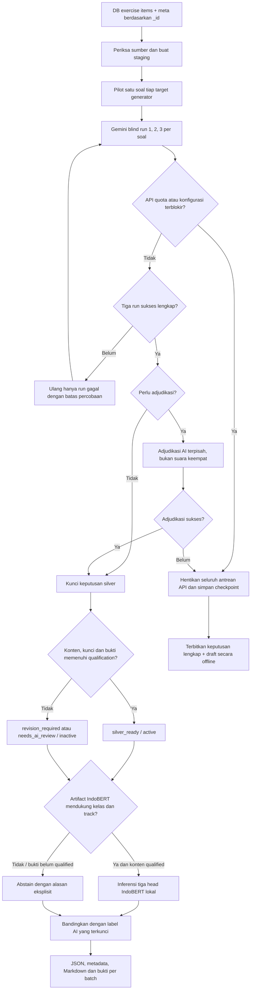

# Validasi exercise per kelas dan batch

Implementasi: [`scripts/validate_exercise_batch.py`](../scripts/validate_exercise_batch.py). Data exercise diproses melalui mekanisme silver pretest yang aktif, dengan sumber, checkpoint dan hasil terpisah. Script tidak mengubah `soal_exercise_db.json`, `soal_exercise_meta.json`, hasil pretest, artifact model atau database assessment.

## Sumber yang tersedia

Inventaris `batch01` pada 5 Oktober 2026:

| Folder | Kelas/track | Soal |
|---|---|---:|
| kelas5 | 5 reguler | 916 |
| kelas7 | 7 reguler | 617 |
| kelas8 | 8 reguler | 538 |
| kelas9 | 9 reguler | 270 |
| kelas10 | 10 reguler | 473 |
| kelas11_tl | 11 TL | 264 |
| kelas12 | 12 reguler | 836 |
| **Total** | **7 folder** | **3.914** |

Kelas lain, termasuk kelas 12 TL, belum memiliki sumber exercise `batch01` pada inventaris ini. Script memeriksa identitas kelas dan track secara persis, kesesuaian batch, ID unik, serta relasi satu-ke-satu DB dan metadata. Ia tidak membuat soal atau folder kelas yang belum tersedia.

`soal_exercise_db.json` memiliki envelope `{pipeline_version, book, batch, items}`. Labeler pretest menerima array, sehingga adapter membuat salinan `items` di `runs/exercise_validation/batch01/<kelas>_exercise_batch01/soal_exercise_db.json`. Staging tidak menyisipkan target atau pembahasan generator ke prompt.

## Alur yang dijalankan

Mengikuti [keputusan silver aktif](05_AI_DECISION_ARBITRATION_API.md) dan [integrasi operasional](36_SILVER_OPERATIONAL_INTEGRATION.md):



Tiga head ialah `mathCognitiveDomain` (knowing/applying/reasoning), `knowledgeDimension` (factual/conceptual/procedural/metacognitive), dan `intendedDifficulty` (Easy/Medium/Hard relatif kelas dan track). Labeler menggunakan rubrik aktif **v8**, prompt **v10**, dan checkpoint N=3. Tiga run awal dinilai blind; perbedaan suara, abstain atau temuan yang memenuhi kriteria kebijakan memicu adjudikasi. Prediksi IndoBERT tidak diberikan kepada penilai blind dan tidak menimpa keputusan AI yang terkunci.

Istilah `llmAdvisory` pada audit menyimpan keputusan N=3 tersebut. Jalur legacy dengan prediksi IndoBERT diberikan lebih dulu kepada AI reviewer tersedia di proyek, tetapi tidak dipakai oleh runner exercise ini. Jangan menyebut diagnostik setelah blind sebagai advisory baru setelah IndoBERT.

Pilot memilih satu soal dengan panjang teks median dari setiap `level_target`. Target dipakai untuk memilih sampel dan tabel perbandingan sesudah validasi. Target tidak menjadi label final dan tidak digunakan untuk memaksa distribusi ⅓–⅓–⅓. `pembahasan` serta `options[].alasan` dari generator juga bukan bukti solusi yang sudah diverifikasi.

## Melanjutkan dengan N=1

Mulai 6 Oktober 2026, exercise dapat dilanjutkan memakai `--runs 1` untuk mengurangi waktu dan token. Contoh untuk kelas 5:

```powershell
.\.venv\Scripts\python.exe -X utf8 scripts/validate_exercise_batch.py run --classes kelas5 --batch batch01 --runs 1 --max-api-calls 2500 --execute
```

Runner mengarsipkan checkpoint dan laporan sebelumnya di `runs/exercise_validation/batch01/kelas5_exercise_batch01/history/before_n1_<hash>/`. Soal N=3 yang sudah final tetap memakai tiga run dan adjudikasi terdahulu. Soal yang belum final memakai satu run; respons sukses yang tersedia digunakan kembali dengan indeks aslinya. Bukti tambahan dari percobaan N=3 disimpan sebagai `previousN3Evidence` dan di arsip, tanpa dihitung sebagai suara N=1. Pemakaian token historis tetap tercatat.

N=1 tetap menggunakan prompt blind dan rubrik yang sama untuk memeriksa isi, kunci jawaban, solusi minimum dan ketiga label. Ia tidak menjalankan adjudikasi otomatis. Respons valid menyelesaikan penilaian; konflik kunci, konten bermasalah, abstain atau struktur tidak sah tetap menghasilkan `inactive`. Gagal API/JSON tetap draft. Stop pada kuota, kegagalan konfigurasi, atau tiga gangguan transport/service berturut-turut tetap berlaku.

`confidence_score` hasil N=1 berupa **angka 0–100**, dihitung sebagai `round(100 * min(P(label akhir Gemini) pada setiap head IndoBERT))`. Gunakan probabilitas untuk label Gemini, meskipun argmax model berbeda. Ini mengukur dukungan model terhadap label akhir, bukan konsistensi antar-run atau akurasi terukur. Nilainya bisa rendah ketika model lama berbeda pendapat dengan rubrik/label Gemini. Draft dan item tanpa probabilitas model memakai 0 dengan `confidence_available=false`; dukungan model sangat kecil juga dapat dibulatkan ke 0, dengan `confidence_available=true`. Hasil N=3 terdahulu tetap memakai dukungan suara awal. Metadata mencatat `confidence_method`, `confidence_available`, `confidence_final_label_probabilities`, `requested_runs`, `validation_method`, `consistency_measured`, `confidence_status`, dan `training_evidence_qualified` per ID. Kolom sumber dan metadata generator dipertahankan; jumlah run dapat bercampur dalam satu batch. Perubahan confidence memakai hasil diagnostik yang tersimpan secara offline, tanpa panggilan Gemini atau pelabelan ulang.

Gate provenance training tetap mensyaratkan tiga respons sukses. Penilaian N=1 dapat lolos qualification konten untuk hasil aplikasi, tetapi tidak otomatis memenuhi gate training atau menjadi bukti akurasi. Distribusi easy/medium/hard mengikuti rubrik, tanpa pemerataan paksa. Resume berikutnya cukup memakai perintah yang sama; `--runs` yang dihilangkan mempertahankan mode checkpoint saat ini.

## Batas IndoBERT

Artifact lokal yang tersedia, `models/indobert-3x4x3-v1`, beridentitas `indobert-3x4x3-silver-kelas1-v1` dan mendukung kelas **1–6 reguler** menurut manifest runtime. Konfigurasi training yang mencakup 12 kelas tidak memperluas scope artifact yang sudah dilatih.

Runner melakukan inferensi CPU secara offline untuk soal qualified yang berada dalam scope. Kelas 7–12 dan TL dicatat `out_of_scope`, label abstain, confidence/entropy null dan probabilitas kosong. Item draft atau bukti konten belum qualified juga abstain. Hasil ini diagnostik penelitian; packaging tidak melatih ulang, mempromosikan model, mendaftarkan soal untuk delivery, atau menghitung parameter IRT.

## Hasil pada setiap batch

Direktori: `output/exercise/<kelas>/batch01/hasil_validasi/`.

| File | Kontrak |
|---|---|
| `validation_results.json` | Array dengan 16 field yang sama, urutan dan ID yang sama dengan `soal_exercise_db.json.items`, mengikuti bentuk export pretest. Hanya empat kolom validasi berubah. |
| `validation_results_meta.json` | Dictionary dengan key `_id` yang sama dengan `soal_exercise_meta.json`; seluruh field metadata asli dipertahankan, ditambah objek `validasi`. |
| `export_status.json` | Final/draft per ID, indeks run sukses/hilang, kebutuhan adjudikasi, kelengkapan batch dan hash checkpoint. |
| `RINGKASAN_VALIDASI.md` | Distribusi, target generator vs label validasi, status dan jumlah keputusan lengkap. |
| `LAPORAN_VALIDASI.md` | Bukti tiga run, adjudikasi, kunci/solusi, routing dan perbandingan tiga head IndoBERT per soal. |
| `indobert_predictions.json` | Inferensi atau abstain beserta alasan dan identitas artifact. |
| `questions.json`, `difficulty_groups.json`, `difficulty/*.json` | Representasi audit dan pengelompokan label yang diputuskan, termasuk undecided. |
| `bukti_validasi/` | Checkpoint silver, audit pilot dan keputusan per soal. |
| `manifest.json` | Hash sumber DB, metadata asli, checkpoint/rubrik/prompt, outputs dan provenance per ID. |

Objek `validasi` pada hasil metadata mencakup level/score/confidence/status, tiga head, routing, dukungan label final, `full_complete`, indeks run dan `level_sesuai_target`. Nilai terakhir null selama label belum diputuskan; false setelah final berarti target generator berbeda dari keputusan AI.

`cognitive_level` menggunakan easy/medium/hard huruf kecil. `cognitive_score` adalah 600/1000/1400 sebagai skor awal, bukan parameter IRT. `confidence_score = round(100 × min(dukungan label final setiap head / 3))`, menghitung suara awal yang mendukung label akhir setelah adjudikasi. Ini konsistensi AI, bukan probabilitas IndoBERT atau bukti akurasi.

Keputusan belum lengkap menghasilkan label/score null, confidence 0 dan inactive. Keputusan final dengan masalah konten juga tetap inactive. Confidence 0 sendiri tidak cukup untuk menentukan kelengkapan: periksa `full_complete`, routing dan bukti tiap head. Hanya `silver_ready` menjadi active.

## Menjalankan dan melanjutkan

Gunakan Python virtualenv proyek dari root. Kredensial dibaca dari `.env`; jangan mencantumkan API key dalam command atau laporan.

```powershell
# Offline: cek dan siapkan seluruh sumber.
.\.venv\Scripts\python.exe -X utf8 scripts/validate_exercise_batch.py stage

# Live: pilot -> full; reuse sukses -> publish semua kelas, termasuk ketika quota stop.
.\.venv\Scripts\python.exe -X utf8 scripts/validate_exercise_batch.py run --max-api-calls 20000 --max-output-tokens 4096 --execute

# Offline: terbitkan ulang laporan dari checkpoint tanpa API.
.\.venv\Scripts\python.exe -X utf8 scripts/validate_exercise_batch.py progress

# Status atau hanya sebagian kelas.
.\.venv\Scripts\python.exe -X utf8 scripts/validate_exercise_batch.py status
.\.venv\Scripts\python.exe -X utf8 scripts/validate_exercise_batch.py run --classes kelas11_tl kelas12 --max-api-calls 20000 --execute
```

`--execute` adalah guard CLI untuk panggilan live yang sudah diotorisasi operator. `--max-api-calls` merupakan batas request aplikasi baru pada satu invocation, bukan token atau prediksi sisa kuota provider. Minimal 11.742 run awal diperlukan untuk seluruh 3.914 soal; adjudikasi dan retry membutuhkan request tambahan. Provider dapat menghitung penggunaan percobaan yang responsnya tidak lolos schema.

Runner memakai satu worker, menyimpan checkpoint setiap request, dan berhenti pada **429 pertama**, quota harian, kredensial/model/config provider yang ditolak. Guard tambahan menghentikan tiga kegagalan transport/5xx berturut-turut sebagai `blocked_provider_temporarily_unavailable`; ini gangguan koneksi/layanan, bukan klaim quota habis. Respons sukses mereset counter tersebut. Ia tidak meneruskan panggilan ke kelas berikutnya ketika provider terblokir. Request sukses sebelumnya dipakai kembali setelah koneksi/kredensial/kuota tersedia. Batas output khusus exercise default 4.096 token, karena 1.200 token menyebabkan beberapa JSON sampel terpotong; `.env` tidak diubah untuk override ini.

Respons format tidak valid diulang maksimal dua percobaan per run dalam labeler; runner `run` dapat melakukan sampai tiga lintasan untuk menyelesaikan run yang masih gagal. Run sukses tidak diulang. Jika format tetap gagal setelah batas ini, hasil tetap draft dan kelas lain dapat diproses. Exit 3 menunjukkan provider stop, 4 batas request, dan 5 keputusan masih belum lengkap setelah retry. Laporan tetap memuat semua ID sumber.

Snapshot immutable berada di `runs/exercise_validation/batch01/<kelas>_exercise_batch01/snapshots/<hash-checkpoint>/`. Hasil publikasi diperiksa terhadap hash input, prompt, respons, rubrik dan bundle sebelum serta sesudah disalin. Ringkasan seluruh kelas tersedia di [`runs/exercise_validation/batch01/README.md`](../runs/exercise_validation/batch01/README.md) dan `progress.json`.

Sumber yang berubah setelah checkpoint ditolak. Gunakan batch baru untuk revisi isi soal; jangan mengubah source atau membuang checkpoint untuk sekadar melanjutkan quota.
