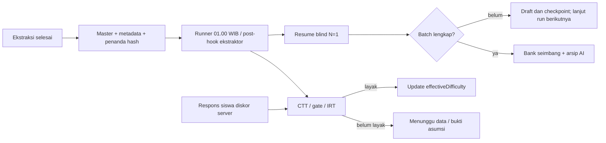

# Otomasi exercise pukul 01.00 WIB dan pembaruan difficulty empiris

Implementasi: `scripts/nightly_pipeline.py`, konfigurasi `configs/nightly_pipeline.json`.
Provider **Gemini langsung**, **N=1** untuk soal yang belum selesai. Konfigurasi
awal memproses exercise `kelas7`; `batch01` menjadi pekerjaan awal yang dilanjutkan.
Ini runner CLI lokal, bukan endpoint HTTP ekstraksi async baru.



## Kontrak untuk ekstraktor otomatis

1. Tulis batch baru di `output/exercise/<kelas>/batchNN/` dengan format proyek:
   `soal_exercise_db.json` (envelope `items`) dan `soal_exercise_meta.json`
   (dictionary per `_id`). ID harus unik, kelas/track sesuai, metadata mencakup
   ID yang sama, dan empat kolom validasi pada master tetap null. Runner ini
   menerima soal teks.
2. Setelah kedua file selesai ditulis, panggil dari root proyek:

   ```powershell
   .\.venv\Scripts\python.exe -X utf8 scripts/nightly_pipeline.py ready --class kelas7 --batch batch02
   ```

   Perintah memvalidasi sumber, menyiapkan staging, lalu menulis atomik
   `extraction_ready.json` sebagai penanda terakhir. Exit code harus 0. Penanda
   berisi `schemaVersion: extraction-ready-v1`, `class`, `batch`, `completedAt`
   dengan zona waktu, `sourceSha256` dan `metadataSha256`.
3. Runner menemukan folder berpenanda untuk `classes` yang diaktifkan pada
   konfigurasi. Folder tanpa penanda dilewati, kecuali `bootstrapJobs` yang
   secara eksplisit diaktifkan. Jangan mengubah sumber setelah checkpoint
   dibuat; gunakan batch baru untuk revisi. Penanda dengan hash salah ditolak.
4. Batch yang siap sebelum pukul 01.00 diproses pada jadwal harian. Jika
   ekstraksi selesai setelah itu dan perlu langsung divalidasi, pasang post-hook
   setelah `ready` sukses:

   ```powershell
   .\.venv\Scripts\python.exe -X utf8 scripts/nightly_pipeline.py run --execute
   ```

   Tanpa post-hook, batch ditemukan malam berikutnya. Lock OS mencegah dua
   runner nightly berjalan bersamaan; task Windows juga mengabaikan pemicu
   tambahan ketika masih berjalan. Jangan menjalankan validasi manual terpisah
   pada batch yang sedang dikerjakan task.

`ready` dan `status` tidak memanggil Gemini. `run --execute` menggunakan `.env`
atau environment. `maxApiCalls` awal 1.300 adalah anggaran **bersama untuk semua
batch dalam satu run**. Retry gagal tetap menghitung anggaran; N=1 berarti satu
evaluasi sukses, bukan larangan retry API/JSON. Resume memakai hasil sukses
yang tersimpan. Kuota/koneksi bermasalah menghentikan panggilan dengan checkpoint.
Tiga keputusan N=3 kelas 7 terdahulu dipertahankan beserta arsipnya. Soal baru
memakai N=1 tanpa adjudikasi otomatis dan tidak memenuhi gate training N=3.

## Output bank seimbang

Setelah `fullComplete=true`, profil bukti yang dikunci dipakai untuk meranking
soal **active** lalu membaginya ke easy/medium/hard dengan selisih paling banyak
satu soal. Item inactive tidak dipaksa masuk kuota. Skor sama di batas kategori
diputuskan berdasarkan urutan sumber dan dicatat pada audit. Label ini relatif
terhadap bank kelas, bukan klaim bahwa LLM memberi tiga label sama banyak.

| File | Isi |
|---|---|
| `output/exercise/kelas7/batch01/hasil_validasi/validation_results.json` | Array database dengan kategori operasional seimbang. Konten, ID, urutan dan qualification tetap mengikuti sumber/bukti. |
| `hasil_validasi/ai_validation_results.json` | Label AI asli sebelum balancing. Training tetap memakai bukti asli yang memenuhi gate. |
| `hasil_validasi/validation_results_meta.json` | Metadata dan hasil, termasuk `ai_cognitive_level`, `ai_confidence_score`, dan `difficulty_provenance`. |
| `hasil_validasi/bukti_validasi/operational_balance_audit.json` | Ranking, kuota, tie, profil, perubahan label dan dukungan run asli. |
| `output/exercise/kelas7/batch01/operational_balance.json` | Pointer ke versi bank seimbang dan distribusi active. |
| `runs/nightly_pipeline/latest.json` | Status semua pekerjaan, error handoff, psikometrik dan sisa anggaran run terakhir. |
| `runs/nightly_pipeline/history/<run>/` | Laporan, log per batch dan kesiapan IRT. |
| `runs/nightly_pipeline/scheduler_logs/` | Output task Windows. |

`difficulty_groups.json`, `difficulty/*.json`, laporan AI dan
`manifest.databaseExport.metadataByQuestionId` tetap menyimpan **label AI asli**.
Gunakan array utama dan audit operasional untuk bank seimbang. Confidence
operasional mengukur dukungan run asli untuk label operasional dan bisa 0.
IndoBERT lokal mencakup SD 1–6, sehingga N=1 kelas 7 tidak mempunyai dukungan
probabilitas dari artifact itu. Periksa `status`, `fullComplete` dan provenance;
confidence 0 sendiri tidak membuktikan kegagalan. Skor 600/1000/1400 adalah skor
awal, bukan parameter IRT.

## IRT dan update label otomatis

Setiap run mencari assessment dengan kelas/track yang diaktifkan dalam SQLite
`ASSESSMENT_DB_PATH`, bahkan ketika Gemini terhambat. Runner tidak membuat
peserta, jawaban simulasi, atau assessment baru. Database/assessment/session
selesai belum tersedia menghasilkan `waiting_for_data`. Analisis default
memakai semua session selesai, attempt `first`, terpisah per assessment,
populasi, versi dan track.

Untuk mengatur window/attempt atau memasukkan bukti asumsi, siapkan file sesuai
`ScreeningInput` dan tambahkan path-nya ke `screeningRequests` pada konfigurasi:

```json
{
  "assessmentId": "ID-ASSESSMENT-YANG-SUDAH-TERDAFTAR",
  "model": "rasch",
  "attemptPolicy": "first"
}
```

Tambahkan `assumptionReview` hanya berdasarkan analisis nyata: `reviewedBy`,
`evidence`, `unidimensional`, `localIndependence`, dan `representativeSample`.
Tanpa bukti itu, IRT dapat berstatus `waiting_for_assumption_review`. Rasch
default memerlukan minimal 100 peserta, 5 item, 50 respons per item serta
variasi/coverage dan asumsi sesuai [runbook CTT/IRT](27_PSYCHOMETRICS_IMPLEMENTATION_RUNBOOK.md).

Modul assessment menyimpan snapshot dan keputusan sistem. Input/policy identik
menggunakan kembali snapshot yang sama. View label tanpa estimasi individu
ditulis otomatis ke:

`runs/nightly_pipeline/empirical/<hash-assessment>/current.json`

Versi `<snapshotId>.json` disimpan di direktori yang sama. View mencakup
assessment/populasi/family/grade, hash policy/snapshot, serta tiap
`questionVersionId`, `contentHash`, `intendedDifficulty`, `empiricalDifficulty`,
`effectiveDifficulty`, `difficultySource`, `reviewFlags`, dan `action`.

`effectiveDifficulty` memakai IRT hanya untuk `server_scored`, readiness lolos,
status `estimated` tanpa warning, item `observation_only`, dan keputusan sistem
`retain`. Ketika belum layak, view memakai label awal assessment (`intended`).
Statistik tidak melepas versi yang ditahan; `deliveryAllowed` hanya menerima
keputusan `retain` atau `collect_more_events`. Versi `needs_ai_review` tetap
ditahan. Label awal tidak ditimpa. IRT tidak diperatakan ke tiga kuota.

Backend dapat mengimpor view berdasarkan **assessment/populasi + versi +
contentHash**, dengan kolom label awal dan empiris terpisah. Jangan join hanya
dengan questionId. Implementasi ini tidak menulis ke database backend temanmu.
Endpoint yang sudah tersedia untuk integrator tetap:

- `POST /api/v1/internal/psychometrics/screen`.
- `GET /api/v1/internal/psychometrics/snapshots/{snapshotId}`.
- `GET /api/v1/internal/psychometrics/snapshots/{snapshotId}/decisions`.

Autentikasi internal mengikuti [API psikometrik](07_PSYCHOMETRICS_API.md).
Runner lokal memakai store yang sama tanpa HTTP. N=1 tidak otomatis
mendaftarkan snapshot delivery/training; jalur snapshot yang ada tetap
memverifikasi provenance. Integrasi delivery/response backend harus menyediakan
versi dan respons server yang benar sebelum dapat dikalibrasi.

## Scheduler Windows

```powershell
.\.venv\Scripts\python.exe -X utf8 scripts/nightly_pipeline.py status
powershell.exe -NoProfile -ExecutionPolicy Bypass -File scripts/install_nightly_task.ps1 -CheckOnly
powershell.exe -NoProfile -ExecutionPolicy Bypass -File scripts/install_nightly_task.ps1
Get-ScheduledTaskInfo -TaskName Nalar-Exercise-Nightly-0100
Get-Content runs/nightly_pipeline/latest.json -Raw
```

Task memakai akun Windows saat instalasi tanpa menyimpan password. Akun harus
masih login; layar boleh terkunci. Host harus memakai `SE Asia Standard Time`
(Asia/Jakarta), virtualenv dan jaringan tersedia. Task berjalan tersembunyi,
meminta wake dari sleep, mengejar jadwal terlewat saat tersedia, membatasi
eksekusi 23 jam dan mencegah instance bertumpuk. Mesin mati/logged out tidak
dijanjikan berjalan tepat 01.00. Untuk layanan tanpa login, gunakan service
account pada server. [Opsi task Microsoft](https://learn.microsoft.com/en-us/powershell/module/scheduledtasks/new-scheduledtasksettingsset?view=windowsserver2025-ps).

Pada Linux, gunakan timezone daemon Asia/Jakarta atau `CRON_TZ=Asia/Jakarta`
jika implementasi cron mendukungnya; pastikan direktori `runs/` sudah ada:

```cron
0 1 * * * cd /srv/assessment_service && .venv/bin/python -X utf8 scripts/nightly_pipeline.py run --execute >> runs/nightly-cron.log 2>&1
```

Kode nonzero menandai handoff invalid, batch belum lengkap atau kegagalan
analisis. Menunggu data/asumsi merupakan status sah, bukan kalibrasi sukses.
Setelah bank diterbitkan, packaging manual menghasilkan ulang ekspor AI;
terbitkan balancing kembali dengan perintah tanpa panggilan Gemini:

```powershell
.\.venv\Scripts\python.exe -X utf8 scripts/nightly_pipeline.py balance --class kelas7 --batch batch01
```
