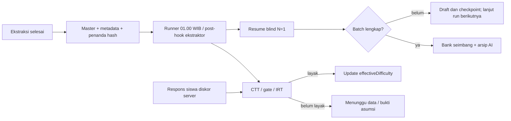

# Otomasi exercise pukul 01.00 WIB dan pembaruan difficulty empiris

Implementasi: `scripts/nightly_pipeline.py`, konfigurasi `configs/nightly_pipeline.json`.
Provider exercise mendukung prioritas **Gemini lalu Groq** saat kuota habis
atau layanan mengalami 503 (`fallbackOn503=true`),
**N=1** untuk soal baru. Provider tanpa key/live mode dilewati sebelum panggilan API.
Setup key Groq ada di [41_GROQ_EXERCISE_VALIDATION.md](41_GROQ_EXERCISE_VALIDATION.md);
alur pergantian dan checkpoint bersama ada di
[42_GEMINI_GROQ_FAILOVER.md](42_GEMINI_GROQ_FAILOVER.md). Konfigurasi
aktif saat ini hanya memproses **`kelas8/batch01`**, sesuai pembatasan sementara
pada 27 Oktober 2026. Kelas lain menunggu instruksi berikutnya. Konfigurasi
sebelum pembatasan disimpan di `runs/nightly_pipeline/config_before_kelas8_*.json`.
Runner tetap mendukung `kelas5`, `kelas7`, `kelas8`, `kelas9`, `kelas10`, `kelas11`,
`kelas11_tl`, `kelas12`, dan `kelas12_tl`. Kelas 6 belum memiliki sumber exercise.
Ini runner CLI lokal, bukan endpoint HTTP ekstraksi async baru.

Kelas 11 reguler dan 12 TL sudah didukung sebagai jalur terpisah. Pada inventaris
27 Oktober 2026, kedua jalur itu belum mempunyai sumber exercise. `status` dan
run baru mencatat `waitingClasses[].status=waiting_for_source`; file pretest tidak
dipakai sebagai pengganti exercise. Setelah sumber tersedia, gunakan `ready`
untuk kelas/jalur yang sesuai agar batch ditemukan. CLI `validate_exercise_batch`
tanpa `--classes` hanya memilih sumber exercise beserta metadata yang tersedia.



## Kontrak untuk ekstraktor otomatis

1. Tulis batch baru di `output/exercise/<kelas>/batchNN/` dengan format proyek:
   `soal_exercise_db.json` (envelope `items`) dan `soal_exercise_meta.json`
   (dictionary per `_id`). ID harus unik, kelas/track sesuai, metadata mencakup
   ID yang sama, dan empat kolom validasi pada master tetap null. Runner ini
   menerima soal teks.
2. Setelah kedua file selesai ditulis, panggil dari root proyek:

   ```powershell
   .\.venv\Scripts\python.exe -X utf8 scripts/nightly_pipeline.py ready --class kelas7 --batch batch02
   ```

   Perintah memvalidasi sumber, menyiapkan staging, lalu menulis atomik
   `extraction_ready.json` sebagai penanda terakhir. Exit code harus 0. Penanda
   berisi `schemaVersion: extraction-ready-v1`, `class`, `batch`, `completedAt`
   dengan zona waktu, `sourceSha256` dan `metadataSha256`.
3. Runner menemukan folder berpenanda untuk `classes` yang diaktifkan pada
   konfigurasi. Folder tanpa penanda dilewati, kecuali `bootstrapJobs` yang
   secara eksplisit diaktifkan. Jangan mengubah sumber setelah checkpoint
   dibuat; gunakan batch baru untuk revisi isi atau `extend` untuk tambahan soal
   dengan seluruh soal lama tetap sama. Penanda dengan hash salah ditolak.
4. Batch yang siap sebelum pukul 01.00 diproses pada jadwal harian. Jika
   ekstraksi selesai setelah itu dan perlu langsung divalidasi, pasang post-hook
   setelah `ready` sukses:

   ```powershell
   .\.venv\Scripts\python.exe -X utf8 scripts/nightly_pipeline.py run --execute
   ```

   Tanpa post-hook, batch ditemukan malam berikutnya. Lock OS mencegah dua
   runner nightly berjalan bersamaan; task Windows juga mengabaikan pemicu
   tambahan ketika masih berjalan. Jangan menjalankan validasi manual terpisah
   pada batch yang sedang dikerjakan task.

`ready` dan `status` tidak memanggil Gemini. `run --execute` menggunakan `.env`
atau environment. `maxApiCalls` 6.500 adalah anggaran **bersama untuk semua
batch dalam satu run**. Retry gagal tetap menghitung anggaran; N=1 berarti satu
evaluasi sukses, bukan larangan retry API/JSON. Resume memakai hasil sukses
yang tersimpan. Gangguan layanan/koneksi sementara dicoba ulang dengan checkpoint.
Tiga keputusan N=3 kelas 7 terdahulu dipertahankan beserta arsipnya. Soal baru
memakai N=1 tanpa adjudikasi otomatis dan tidak memenuhi gate training N=3.

Kuota harian habis atau respons 429 menghentikan panggilan ke kelas berikutnya;
checkpoint menyimpan `executionStatus` dan `stopReason`. Pada run baru,
`latest.json.stopNotice` menjelaskan alasan berhenti. `nightly_pipeline.py status`
juga menulis `runs/nightly_pipeline/status.json` berisi progres checkpoint terbaru,
`providerStop`, token sukses yang tercatat, dan kelas yang menunggu sumber.
Angka token tersebut bukan saldo akun atau jaminan sisa kuota provider.

Konfigurasi saat ini memakai **`stopOn503: true`**:

- HTTP **503 langsung menghentikan run**, sebelum soal/kelas berikutnya dipanggil.
  SDK juga tidak mengulang HTTP 503. Checkpoint mencatat
  `executionStatus=blocked_provider_http_503` dan `stopCategory=http_503`.
- HTTP 504, 500, timeout dan gangguan sementara lain dicoba ulang per soal.
  Bila percobaan terbatas belum berhasil, soal tetap draft/inactive dan proses
  berlanjut ke soal lain. Retry soal yang tertunda tetap dibatasi oleh lintasan
  validasi dan anggaran bersama; error tidak diubah menjadi hasil sukses.
- Kuota habis/429, key atau izin ditolak, serta batas anggaran tetap menghentikan
  panggilan. Perbaikan sumber/kredensial yang diperlukan dicatat sebagai blocker.

Flag diteruskan sebagai `--stop-on-503` ke adapter exercise dan labeler Gemini.
Hasil sukses terdahulu tetap dipakai kembali. Jika `stopOn503` dinonaktifkan,
mekanisme lama untuk `blocked_provider_temporarily_unavailable` tersedia dengan
jeda `providerRetryDelaysSeconds: [15, 30, 60]` dan status `retrying_provider`.

Validasi ini **tidak melatih ulang IndoBERT**. Gemini N=1 memeriksa konten/kunci
dan memberi label sesuai rubrik kelas; artifact IndoBERT dipakai untuk diagnostik.
Artifact lokal hanya mencakup SD kelas 1–6, sehingga kelas 7–12 menghasilkan
`out_of_scope`/abstain dari model tersebut. Label relatif 30/40/30 di ekspor
operasional merupakan alokasi bank, bukan fine-tuning bobot model. Bukti N=1
tidak otomatis memenuhi gate provenance training N=3.

## Output bank seimbang

Setelah `fullComplete=true`, profil bukti yang dikunci dipakai untuk meranking
soal **active dalam setiap bab**, lalu membaginya sekitar **30% easy, 40% medium,
30% hard**. Bab diambil dari `soal_exercise_meta.json[_id].bab_id`; target generator
tidak masuk prompt Gemini. Pembulatan memakai largest remainder, dengan medium
didahulukan saat sisa sama. Bab kecil dapat tidak memiliki ketiga kategori.
Item inactive tidak masuk kuota. Skor sama di batas kategori diputuskan berdasarkan
urutan sumber dan dicatat pada audit. Label ini relatif terhadap bab dan jenjang;
label AI asli tetap disimpan terpisah.

| File | Isi |
|---|---|
| `output/exercise/kelas7/batch01/hasil_validasi/validation_results.json` | Array database dengan kategori operasional seimbang. Konten, ID, urutan dan qualification tetap mengikuti sumber/bukti. |
| `hasil_validasi/ai_validation_results.json` | Label AI asli sebelum balancing. Training tetap memakai bukti asli yang memenuhi gate. |
| `hasil_validasi/validation_results_meta.json` | Metadata dan hasil, termasuk `ai_cognitive_level`, `ai_confidence_score`, dan `difficulty_provenance`. |
| `hasil_validasi/bukti_validasi/operational_balance_audit.json` | Ranking, kuota, tie, profil, perubahan label dan dukungan run asli. |
| `output/exercise/kelas7/batch01/operational_balance.json` | Pointer ke versi bank seimbang dan distribusi active. |
| `runs/nightly_pipeline/latest.json` | Status semua pekerjaan, error handoff, psikometrik dan sisa anggaran run terakhir. |
| `runs/nightly_pipeline/history/<run>/` | Laporan, log per batch dan kesiapan IRT. |
| `runs/nightly_pipeline/scheduler_logs/` | Output task Windows. |

`difficulty_groups.json`, `difficulty/*.json`, laporan AI dan
`manifest.databaseExport.metadataByQuestionId` tetap menyimpan **label AI asli**.
Gunakan array utama dan audit operasional untuk bank seimbang. Confidence
operasional N=3 mengukur dukungan run asli. Untuk N=1, confidence memakai
`round(100 * min(P(label operasional tiap head IndoBERT)))`, sesuai mekanisme
kelas 5. Probabilitas tidak tersedia menghasilkan 0 dan `confidence_available=false`.
IndoBERT lokal mencakup SD 1–6, sehingga N=1 kelas 7 tidak mempunyai dukungan
probabilitas dari artifact itu. Periksa `status`, `fullComplete` dan provenance;
confidence 0 sendiri tidak membuktikan kegagalan. Skor 600/1000/1400 adalah skor
awal, bukan parameter IRT.

## Melanjutkan sumber yang ditambahi bab

Perintah `extend` menerima soal baru jika seluruh soal lama, konten, ID dan urutan
relatifnya tetap sama. Metadata dan identitas kelas diperiksa terlebih dahulu.
Sumber staging, checkpoint dan bundle terdahulu diarsipkan di
`runs/exercise_validation/batch01/<kelas>_exercise_batch01/history/source_extension_*/`.
Run Gemini sukses, biaya dan keputusan N=3 lama dipertahankan. Soal yang diedit,
dihapus atau diurutkan ulang ditolak dan harus memakai batch baru.

```powershell
.\.venv\Scripts\python.exe -X utf8 scripts/validate_exercise_batch.py extend --classes kelas7 kelas8 kelas9 kelas10 kelas11_tl
.\.venv\Scripts\python.exe -X utf8 scripts/validate_exercise_batch.py progress --runs 1
# Jalankan ready untuk setiap kelas yang sumbernya bertambah, lalu:
.\.venv\Scripts\python.exe -X utf8 scripts/nightly_pipeline.py run --execute
```

`progress` menulis semua ID sumber dalam `validation_results.json`; soal yang
belum selesai tetap draft/inactive, confidence 0, level dan skor null. Setelah
seluruh penilaian suatu kelas lengkap, runner menerbitkan balancing per bab.
`latest.json` mencatat kelas yang sedang berjalan; jumlah soal terkini dapat
diperiksa dengan `nightly_pipeline.py status`. Provider stop menghentikan request
untuk kelas berikutnya dan hasil sukses dipakai kembali pada run berikutnya.

## IRT dan update label otomatis

Setiap run mencari assessment dengan kelas/track yang diaktifkan dalam SQLite
`ASSESSMENT_DB_PATH`, bahkan ketika Gemini terhambat. Runner tidak membuat
peserta, jawaban simulasi, atau assessment baru. Database/assessment/session
selesai belum tersedia menghasilkan `waiting_for_data`. Analisis default
memakai semua session selesai, attempt `first`, terpisah per assessment,
populasi, versi dan track.

Untuk mengatur window/attempt atau memasukkan bukti asumsi, siapkan file sesuai
`ScreeningInput` dan tambahkan path-nya ke `screeningRequests` pada konfigurasi:

```json
{
  "assessmentId": "ID-ASSESSMENT-YANG-SUDAH-TERDAFTAR",
  "model": "rasch",
  "attemptPolicy": "first"
}
```

Tambahkan `assumptionReview` hanya berdasarkan analisis nyata: `reviewedBy`,
`evidence`, `unidimensional`, `localIndependence`, dan `representativeSample`.
Tanpa bukti itu, IRT dapat berstatus `waiting_for_assumption_review`. Rasch
default memerlukan minimal 100 peserta, 5 item, 50 respons per item serta
variasi/coverage dan asumsi sesuai [runbook CTT/IRT](27_PSYCHOMETRICS_IMPLEMENTATION_RUNBOOK.md).

Modul assessment menyimpan snapshot dan keputusan sistem. Input/policy identik
menggunakan kembali snapshot yang sama. View label tanpa estimasi individu
ditulis otomatis ke:

`runs/nightly_pipeline/empirical/<hash-assessment>/current.json`

Versi `<snapshotId>.json` disimpan di direktori yang sama. View mencakup
assessment/populasi/family/grade, hash policy/snapshot, serta tiap
`questionVersionId`, `contentHash`, `intendedDifficulty`, `empiricalDifficulty`,
`effectiveDifficulty`, `difficultySource`, `reviewFlags`, dan `action`.

`effectiveDifficulty` memakai IRT hanya untuk `server_scored`, readiness lolos,
status `estimated` tanpa warning, item `observation_only`, dan keputusan sistem
`retain`. Ketika belum layak, view memakai label awal assessment (`intended`).
Statistik tidak melepas versi yang ditahan; `deliveryAllowed` hanya menerima
keputusan `retain` atau `collect_more_events`. Versi `needs_ai_review` tetap
ditahan. Label awal tidak ditimpa. IRT tidak diperatakan ke tiga kuota.

Backend dapat mengimpor view berdasarkan **assessment/populasi + versi +
contentHash**, dengan kolom label awal dan empiris terpisah. Jangan join hanya
dengan questionId. Implementasi ini tidak menulis ke database backend temanmu.
Endpoint yang sudah tersedia untuk integrator tetap:

- `POST /api/v1/internal/psychometrics/screen`.
- `GET /api/v1/internal/psychometrics/snapshots/{snapshotId}`.
- `GET /api/v1/internal/psychometrics/snapshots/{snapshotId}/decisions`.

Autentikasi internal mengikuti [API psikometrik](07_PSYCHOMETRICS_API.md).
Runner lokal memakai store yang sama tanpa HTTP. N=1 tidak otomatis
mendaftarkan snapshot delivery/training; jalur snapshot yang ada tetap
memverifikasi provenance. Integrasi delivery/response backend harus menyediakan
versi dan respons server yang benar sebelum dapat dikalibrasi.

## Scheduler Windows

```powershell
.\.venv\Scripts\python.exe -X utf8 scripts/nightly_pipeline.py status
powershell.exe -NoProfile -ExecutionPolicy Bypass -File scripts/install_nightly_task.ps1 -CheckOnly
powershell.exe -NoProfile -ExecutionPolicy Bypass -File scripts/install_nightly_task.ps1
Get-ScheduledTaskInfo -TaskName Nalar-Exercise-Nightly-0100
Get-Content runs/nightly_pipeline/latest.json -Raw
```

Task memakai akun Windows saat instalasi tanpa menyimpan password. Akun harus
masih login; layar boleh terkunci. Host harus memakai `SE Asia Standard Time`
(Asia/Jakarta), virtualenv dan jaringan tersedia. Task berjalan tersembunyi,
meminta wake dari sleep, mengejar jadwal terlewat saat tersedia, membatasi
eksekusi 23 jam dan mencegah instance bertumpuk. Mesin mati/logged out tidak
dijanjikan berjalan tepat 01.00. Untuk layanan tanpa login, gunakan service
account pada server. [Opsi task Microsoft](https://learn.microsoft.com/en-us/powershell/module/scheduledtasks/new-scheduledtasksettingsset?view=windowsserver2025-ps).

Pada Linux, gunakan timezone daemon Asia/Jakarta atau `CRON_TZ=Asia/Jakarta`
jika implementasi cron mendukungnya; pastikan direktori `runs/` sudah ada:

```cron
0 1 * * * cd /srv/assessment_service && .venv/bin/python -X utf8 scripts/nightly_pipeline.py run --execute >> runs/nightly-cron.log 2>&1
```

Kode nonzero menandai handoff invalid, batch belum lengkap atau kegagalan
analisis. Menunggu data/asumsi merupakan status sah, bukan kalibrasi sukses.
Setelah bank diterbitkan, packaging manual menghasilkan ulang ekspor AI;
terbitkan balancing kembali dengan perintah tanpa panggilan Gemini:

```powershell
.\.venv\Scripts\python.exe -X utf8 scripts/nightly_pipeline.py balance --class kelas7 --batch batch01
```
