# Validasi ulang soal kelas 5 — Gemini blind N=3 dan diagnostik IndoBERT

Model penilai: `gemini-3.1-flash-lite`. Prompt: `gemini-silver-math-3x4x3-v4-blind-key-verified`. Rubrik: `math-rubric-3x4x3-v2-grade-aware`.

Ketiga run menilai soal beserta gambar, kunci sumber, dan rubrik kelas 5 tanpa menerima prediksi IndoBERT. Keputusan awal 3–0 diterima sebagai silver; ketidaksepakatan, abstention, dan persoalan konten diperiksa dalam adjudikasi AI terpisah. Adjudikasi tetap berasal dari Gemini yang sama dan bukan keputusan ahli manusia.

Checkpoint dikunci dengan SHA-256 sebelum inferensi IndoBERT. Label akhir advisory mengikuti penilaian blind yang terkunci. Prediksi model lama dipakai untuk menunjukkan ketidaksepakatan; tidak diberikan kembali ke Gemini.

Jumlah soal: 72; distribusi label advisory: `{"mathCognitiveDomain": {"knowing": 15, "applying": 49, "reasoning": 8}, "knowledgeDimension": {"conceptual": 33, "factual": 4, "procedural": 35, "metacognitive": 0}, "intendedDifficulty": {"Easy": 47, "Hard": 2, "Medium": 23}}`.
Distribusi hanya pada soal tanpa blocker konten: `{"mathCognitiveDomain": {"knowing": 15, "applying": 49, "reasoning": 8}, "knowledgeDimension": {"conceptual": 33, "factual": 4, "procedural": 35, "metacognitive": 0}, "intendedDifficulty": {"Easy": 47, "Hard": 2, "Medium": 23}}`. Label usulan pada soal perlu revisi tidak berarti soalnya sudah sah digunakan.
Routing: `{"pending_expert_review": 72}`.
Run awal sukses: 216/216; adjudikasi: 24; token sukses tercatat: 513,768.

Seluruh label masih silver/advisory, gold manusia tetap null, dan publishing otomatis tidak diaktifkan. CTT/IRT tidak dihitung karena respons siswa belum ada. Boundary audit dan gate training tidak dianggap lolos hanya karena batch API selesai.

IndoBERT aktif: `indobert-3x4x3-silver-kelas1-v1`, arsitektur `parallel-v1`, representation `metadata`. Artifact belum disetujui; tidak ada training ulang dalam batch ini. Difficulty model lama dapat mengalami class collapse. Confidence dari kalibrasi kelas 1 yang kecil belum membuktikan ketepatan label.
KKO eksplisit masuk input encoder: `False`. Solusi minimum masuk input encoder: `False`. KKO/solusi tetap dicatat untuk audit; jangan menyatakan fitur itu dipakai model bila serializer artefak tidak memasukkannya.

## Kelompok difficulty

Kesulitan dinilai relatif terhadap kelas sasaran. Kategori kosong tetap ditampilkan; label tidak diubah untuk memenuhi kuota. Soal tanpa blocker konten tetap memerlukan pemeriksaan ahli.

| Difficulty | Semua usulan | Tanpa blocker konten | Data soal |
|---|---:|---:|---|
| Easy | 47 | 47 | [Easy.json](difficulty/Easy.json) |
| Medium | 23 | 23 | [Medium.json](difficulty/Medium.json) |
| Hard | 2 | 2 | [Hard.json](difficulty/Hard.json) |

## Perhitungan yang dipakai

Encoder menghasilkan representasi [CLS], lalu tiga head menghasilkan logits. Probabilitas adalah pᵢ = exp(zᵢ/T) / Σⱼ exp(zⱼ/T), dengan temperature sesuai manifest. Confidence = max(pᵢ). Entropy H = −Σᵢ pᵢ ln(pᵢ) / ln(K). Probabilitas, confidence, entropy, dan action di bawah berasal dari inferensi lokal; tidak dibuat oleh Gemini.

Suara awal LLM dihitung dari label yang benar-benar diberikan tiap run; abstain tidak menjadi suara kelas. Policy saat ini menerima 3–0 langsung dan meminta adjudikasi untuk kasus lainnya. Majority awal minimal 2/3 dicatat sebagai bukti, bukan confidence probabilistik. Label adjudikasi yang berbeda dari mayoritas awal tetap disimpan dengan alasan dan tidak disamarkan menjadi voting 3–0.

## 1. Soal `467767b4f8454046da41a593`

Kecamatan Kayu Tanam terletak di Kabupaten Padang Pariaman, Provinsi Sumatra Barat. Pada tahun 2018, penduduk kecamatan ini berjumlah 26.932 jiwa yang terdiri atas 13.354 jiwa laki-laki dan tiga belas ribu lima ratus tujuh puluh delapan jiwa perempuan.<br><br>Berdasarkan bacaan tersebut, coba kerjakan beberapa hal berikut.<br><br>Tuliskan jumlah penduduk perempuan Kecamatan Kayu Tanam dan tentukan nilai tempatnya.

| Opsi | Isi |
|---|---|
| A | 13.354 (1 puluh ribuan, 3 ribuan, 3 ratusan, 5 puluhan, 4 satuan) |
| B | 13.587 (1 puluh ribuan, 3 ribuan, 5 ratusan, 8 puluhan, 7 satuan) |
| C | 130.578 (1 ratus ribuan, 3 puluh ribuan, 0 ribuan, 5 ratusan, 7 puluhan, 8 satuan) |
| D | 13.578 (1 puluh ribuan, 3 ribuan, 5 ratusan, 7 puluhan, 8 satuan) |

Kunci sumber: `D`; status AI: `verified`; jawaban diverifikasi AI: `D`.
Solusi minimum hasil AI: Tiga belas ribu lima ratus tujuh puluh delapan ditulis sebagai 13.578. Nilai tempatnya: 1 (puluh ribuan), 3 (ribuan), 5 (ratusan), 7 (puluhan), 8 (satuan).
Gambar sumber: —. Transkripsi visual: —

### 1. Pemeriksaan input dan fitur

Struktur: `pass`; alasan: `[]`. Grade/topik: kelas 5 / Matematika SD Kelas 5. KKO: `['mengidentifikasi', 'menyebutkan']`; KKO hanya petunjuk bantu.
Isi dan kunci berasal dari sumber yang sama pada ketiga run. Versi konten: 2; hash: `038e3e98e3495e1a064562cd40f8ec68e0e15c1c2e0c3efae9540b1391f58636`. Bukti verifikasi AI tidak sama dengan verifikasi ahli.

### 2. Penilaian Gemini blind — tiga run sebelum melihat IndoBERT

| Run | Status | Konten / kunci | Kognitif | Pengetahuan | Difficulty | Token |
|---:|---|---|---|---|---|---:|
| 1 | success | valid / verified | knowing | conceptual | Easy | 1602 |
| 2 | success | valid / verified | knowing | conceptual | Easy | 1645 |
| 3 | success | valid / verified | knowing | conceptual | Easy | 1623 |

Run 1 — solusi: Tiga belas ribu lima ratus tujuh puluh delapan ditulis sebagai 13.578. Nilai tempatnya: 1 (puluh ribuan), 3 (ribuan), 5 (ratusan), 7 (puluhan), 8 (satuan).
- Domain kognitif `classify/knowing`: Siswa diminta menerjemahkan representasi verbal ke numerik dan mengidentifikasi nilai tempat, yang merupakan proses langsung dalam pemahaman bilangan.. Bukti: Tuliskan jumlah penduduk perempuan Kecamatan Kayu Tanam dan tentukan nilai tempatnya.
- Dimensi pengetahuan `classify/conceptual`: Soal menguji pemahaman tentang sistem nilai tempat dan cara penulisan bilangan cacah.. Bukti: tiga belas ribu lima ratus tujuh puluh delapan; tentukan nilai tempatnya
- Intended difficulty `classify/Easy`: Soal ini bersifat rutin untuk kelas 5, hanya memerlukan konversi dari bentuk kata ke angka dan pemahaman dasar nilai tempat.. Bukti: tiga belas ribu lima ratus tujuh puluh delapan; tentukan nilai tempatnya

Profil difficulty run ini:

| Parameter | Nilai |
|---|---|
| expectedPrerequisite | Pemahaman sistem nilai tempat bilangan cacah sampai 100.000. |
| dependentSteps | 2 |
| routineStatus | familiar_routine |
| strategySelection | False |
| representationTransfer | True |
| relevantInformationUnits | 1 |
| interactingConstraints | 0 |
| calculationLoad | low |
| scaffoldLevel | none |
| distractorQuality | plausible |
| gradeRelativeRationale | Materi membaca dan menulis bilangan serta nilai tempat adalah kompetensi dasar yang sudah dikuasai siswa kelas 5. |

Run 2 — solusi: Tiga belas ribu lima ratus tujuh puluh delapan ditulis sebagai 13.578. Nilai tempatnya: 1 (puluh ribuan), 3 (ribuan), 5 (ratusan), 7 (puluhan), 8 (satuan).
- Domain kognitif `classify/knowing`: Siswa diminta untuk menerjemahkan representasi verbal (kata-kata) ke dalam representasi numerik (angka) dan menguraikan nilai tempatnya. Ini adalah proses langsung yang melibatkan pengenalan fakta numerik.. Bukti: Tuliskan jumlah penduduk perempuan Kecamatan Kayu Tanam dan tentukan nilai tempatnya.
- Dimensi pengetahuan `classify/conceptual`: Soal ini menguji pemahaman tentang sistem penulisan bilangan cacah dan nilai tempat, yang merupakan pengetahuan konseptual dasar dalam matematika.. Bukti: tiga belas ribu lima ratus tujuh puluh delapan
- Intended difficulty `classify/Easy`: Soal ini bersifat langsung, menggunakan representasi yang familiar, dan hanya memerlukan satu langkah konversi dari kata ke angka serta penguraian nilai tempat.. Bukti: tiga belas ribu lima ratus tujuh puluh delapan

Profil difficulty run ini:

| Parameter | Nilai |
|---|---|
| expectedPrerequisite | Pemahaman sistem nilai tempat bilangan cacah sampai 100.000. |
| dependentSteps | 1 |
| routineStatus | familiar_routine |
| strategySelection | False |
| representationTransfer | True |
| relevantInformationUnits | 1 |
| interactingConstraints | 0 |
| calculationLoad | low |
| scaffoldLevel | none |
| distractorQuality | plausible |
| gradeRelativeRationale | Siswa kelas 5 diharapkan sudah lancar membaca dan menulis bilangan hingga 100.000. Soal ini merupakan aplikasi langsung dari kemampuan tersebut. |

Run 3 — solusi: Tiga belas ribu lima ratus tujuh puluh delapan ditulis sebagai 13.578. Nilai tempatnya: 1 puluh ribuan, 3 ribuan, 5 ratusan, 7 puluhan, 8 satuan.
- Domain kognitif `classify/knowing`: Siswa diminta untuk menerjemahkan representasi verbal (nama bilangan) ke dalam notasi angka dan menguraikan nilai tempatnya, yang merupakan proses langsung dalam memahami sistem bilangan.. Bukti: Tuliskan jumlah penduduk perempuan Kecamatan Kayu Tanam dan tentukan nilai tempatnya.
- Dimensi pengetahuan `classify/conceptual`: Soal ini menguji pemahaman tentang sistem penulisan bilangan (notasi posisi) dan konsep nilai tempat (place value) yang merupakan pengetahuan konseptual dasar.. Bukti: tiga belas ribu lima ratus tujuh puluh delapan; tentukan nilai tempatnya
- Intended difficulty `classify/Easy`: Soal ini bersifat rutin bagi siswa kelas 5 karena hanya melibatkan konversi langsung dari bentuk kata ke angka dan identifikasi nilai tempat standar.. Bukti: tiga belas ribu lima ratus tujuh puluh delapan; tentukan nilai tempatnya

Profil difficulty run ini:

| Parameter | Nilai |
|---|---|
| expectedPrerequisite | Pemahaman sistem nilai tempat sampai puluhan ribu. |
| dependentSteps | 1 |
| routineStatus | familiar_routine |
| strategySelection | False |
| representationTransfer | True |
| relevantInformationUnits | 1 |
| interactingConstraints | 0 |
| calculationLoad | low |
| scaffoldLevel | none |
| distractorQuality | plausible |
| gradeRelativeRationale | Membaca dan menulis bilangan sampai 100.000 adalah materi dasar kelas 4/5, sehingga soal ini tergolong mudah. |

### 3. Voting awal dan adjudikasi

| Head | Suara awal | Pola / status akhir | Label akhir advisory |
|---|---|---|---|
| Domain kognitif | {"knowing": 3} | unanimous_3_0 / unanimous | knowing |
| Dimensi pengetahuan | {"conceptual": 3} | unanimous_3_0 / unanimous | conceptual |
| Intended difficulty | {"Easy": 3} | unanimous_3_0 / unanimous | Easy |

### 4. Diagnostik IndoBERT setelah label blind dikunci

Model membaca representation `metadata`; token input 213/256; truncation: `False`.

| Head | Probabilitas | Label | Confidence | Entropy | Action / alasan |
|---|---|---|---:|---:|---|
| Domain kognitif | knowing=0.000004; applying=0.999996; reasoning=0.000000 | applying | 0.999996 | 0.000053 | review / selective_threshold_gate_not_met |
| Dimensi pengetahuan | factual=0.004694; conceptual=0.947001; procedural=0.048305; metacognitive=0.000000 | conceptual | 0.947001 | 0.160939 | review / selective_threshold_gate_not_met |
| Intended difficulty | Easy=0.739803; Medium=0.249296; Hard=0.010901 | Easy | 0.739803 | 0.562997 | review / selective_threshold_gate_not_met |

Domain kognitif: Σp = 1.00000000; confidence = max(p) = 0.999996; −Σp ln(p) = 0.000059; H = 0.000059/ln(3) = 0.000053; T = 0.050000.


Dimensi pengetahuan: Σp = 1.00000000; confidence = max(p) = 0.947001; −Σp ln(p) = 0.223109; H = 0.223109/ln(4) = 0.160939; T = 0.209800.


Intended difficulty: Σp = 1.00000000; confidence = max(p) = 0.739803; −Σp ln(p) = 0.618516; H = 0.618516/ln(3) = 0.562997; T = 0.953328.


<details><summary>Input sebenarnya yang dibaca model</summary>

```text
Kelas: 5
Topik: Matematika SD Kelas 5
Subtopik: Membaca dan Menulis Bilangan Cacah Sampai 100.000 dan Menentukan Nilai Tempatnya
Tipe soal: multiple_choice
Stimulus: -
Soal: Kecamatan Kayu Tanam terletak di Kabupaten Padang Pariaman, Provinsi Sumatra Barat. Pada tahun 2018, penduduk kecamatan ini berjumlah 26.932 jiwa yang terdiri atas 13.354 jiwa laki-laki dan tiga belas ribu lima ratus tujuh puluh delapan jiwa perempuan.

Berdasarkan bacaan tersebut, coba kerjakan beberapa hal berikut.

Tuliskan jumlah penduduk perempuan Kecamatan Kayu Tanam dan tentukan nilai tempatnya.
Pilihan: A. 13.354 (1 puluh ribuan, 3 ribuan, 3 ratusan, 5 puluhan, 4 satuan)
B. 13.587 (1 puluh ribuan, 3 ribuan, 5 ratusan, 8 puluhan, 7 satuan)
C. 130.578 (1 ratus ribuan, 3 puluh ribuan, 0 ribuan, 5 ratusan, 7 puluhan, 8 satuan)
D. 13.578 (1 puluh ribuan, 3 ribuan, 5 ratusan, 7 puluhan, 8 satuan)
Transkripsi visual: -
```

</details>

### 5. Keputusan batch

Label advisory blind: `{"mathCognitiveDomain": "knowing", "knowledgeDimension": "conceptual", "intendedDifficulty": "Easy"}`. Routing: `pending_expert_review`.
Status konten: `valid`. Catatan konten: .
Perbedaan model dan blind: `{"mathCognitiveDomain": {"modelLabel": "applying", "blindLabel": "knowing", "agreement": false}, "knowledgeDimension": {"modelLabel": "conceptual", "blindLabel": "conceptual", "agreement": true}, "intendedDifficulty": {"modelLabel": "Easy", "blindLabel": "Easy", "agreement": true}}`.
Gold ahli tetap null; human review wajib. Confidence IndoBERT tidak digunakan untuk mengganti label blind.

## 2. Soal `a58707d1174175358f6a4012`

Bacalah bilangan berikut.<br><br>b. Jarak kota Sibolga ke kota New York adalah 15.229 km.

| Opsi | Isi |
|---|---|
| A | lima belas ribu dua ratus dua puluh sembilan |
| B | lima belas ribu sembilan ratus dua puluh dua |
| C | lima belas ribu dua ratus sembilan puluh dua |
| D | lima puluh ribu dua ratus dua puluh sembilan |

Kunci sumber: `A`; status AI: `verified`; jawaban diverifikasi AI: `A`.
Solusi minimum hasil AI: Angka 15.229 terdiri dari 15 ribu, 2 ratus, 2 puluh, dan 9 satuan, yang dibaca 'lima belas ribu dua ratus dua puluh sembilan'.
Gambar sumber: —. Transkripsi visual: —

### 1. Pemeriksaan input dan fitur

Struktur: `pass`; alasan: `[]`. Grade/topik: kelas 5 / Matematika SD Kelas 5. KKO: `[]`; KKO hanya petunjuk bantu.
Isi dan kunci berasal dari sumber yang sama pada ketiga run. Versi konten: 2; hash: `fb1d28bd08d42cb09137f4fd0d2cd879b8bc6211271913fd81615fa14909c4d6`. Bukti verifikasi AI tidak sama dengan verifikasi ahli.

### 2. Penilaian Gemini blind — tiga run sebelum melihat IndoBERT

| Run | Status | Konten / kunci | Kognitif | Pengetahuan | Difficulty | Token |
|---:|---|---|---|---|---|---:|
| 1 | success | valid / verified | knowing | factual | Easy | 1413 |
| 2 | success | valid / verified | knowing | factual | Easy | 1435 |
| 3 | success | valid / verified | knowing | factual | Easy | 1445 |

Run 1 — solusi: Angka 15.229 terdiri dari 15 ribu, 2 ratus, 2 puluh, dan 9 satuan, yang dibaca 'lima belas ribu dua ratus dua puluh sembilan'.
- Domain kognitif `classify/knowing`: Siswa diminta untuk membaca bilangan secara langsung sesuai dengan aturan penamaan bilangan cacah, yang merupakan proses pengenalan dan penerapan fakta dasar.. Bukti: Bacalah bilangan berikut.; 15.229
- Dimensi pengetahuan `classify/factual`: Soal ini menguji pengetahuan tentang simbol angka dan cara membacanya dalam bahasa Indonesia, yang merupakan pengetahuan faktual.. Bukti: 15.229; lima belas ribu dua ratus dua puluh sembilan
- Intended difficulty `classify/Easy`: Soal ini bersifat langsung, hanya memerlukan pengenalan simbol angka dan konversi ke bentuk verbal tanpa langkah prosedural yang kompleks.. Bukti: 15.229; lima belas ribu dua ratus dua puluh sembilan

Profil difficulty run ini:

| Parameter | Nilai |
|---|---|
| expectedPrerequisite | Pemahaman nilai tempat dan sistem penamaan bilangan cacah hingga 100.000. |
| dependentSteps | 1 |
| routineStatus | familiar_routine |
| strategySelection | False |
| representationTransfer | True |
| relevantInformationUnits | 1 |
| interactingConstraints | 0 |
| calculationLoad | low |
| scaffoldLevel | none |
| distractorQuality | plausible |
| gradeRelativeRationale | Membaca bilangan adalah kompetensi dasar kelas 5 yang bersifat rutin dan langsung. |

Run 2 — solusi: Angka 15.229 terdiri dari 15 ribu, 2 ratus, 2 puluh, dan 9 satuan, yang dibaca 'lima belas ribu dua ratus dua puluh sembilan'.
- Domain kognitif `classify/knowing`: Soal meminta siswa untuk membaca atau melafalkan bilangan cacah sesuai dengan aturan penamaan bilangan standar, yang merupakan proses langsung dan rutin.. Bukti: Bacalah bilangan berikut; 15.229
- Dimensi pengetahuan `classify/factual`: Soal ini menguji pemahaman tentang sistem penamaan bilangan (fakta/konvensi) dalam sistem bilangan desimal.. Bukti: 15.229; lima belas ribu dua ratus dua puluh sembilan
- Intended difficulty `classify/Easy`: Tugas ini bersifat langsung, menggunakan representasi bilangan yang umum, dan tidak memerlukan langkah-langkah kompleks.. Bukti: 15.229; lima belas ribu dua ratus dua puluh sembilan

Profil difficulty run ini:

| Parameter | Nilai |
|---|---|
| expectedPrerequisite | Pemahaman nilai tempat dan cara membaca bilangan sampai 100.000. |
| dependentSteps | 1 |
| routineStatus | familiar_routine |
| strategySelection | False |
| representationTransfer | False |
| relevantInformationUnits | 1 |
| interactingConstraints | 0 |
| calculationLoad | low |
| scaffoldLevel | none |
| distractorQuality | plausible |
| gradeRelativeRationale | Membaca bilangan sampai 100.000 adalah materi dasar kelas 4/5 yang bersifat rutin. |

Run 3 — solusi: Angka 15.229 terdiri dari 15 ribu, 2 ratus, 2 puluh, dan 9 satuan, yang dibaca sebagai 'lima belas ribu dua ratus dua puluh sembilan'.
- Domain kognitif `classify/knowing`: Siswa diminta untuk membaca bilangan cacah sesuai dengan aturan penamaan bilangan yang standar. Ini adalah proses langsung mengenali dan melafalkan simbol angka.. Bukti: Bacalah bilangan berikut.; 15.229
- Dimensi pengetahuan `classify/factual`: Soal ini menguji pengetahuan tentang sistem penamaan bilangan (fakta dasar) dalam sistem numerasi desimal.. Bukti: 15.229; lima belas ribu dua ratus dua puluh sembilan
- Intended difficulty `classify/Easy`: Soal ini sangat mendasar untuk kelas 5, melibatkan pembacaan bilangan yang rutin dan familiar tanpa langkah kompleks.. Bukti: 15.229; Jarak kota Sibolga ke kota New York adalah 15.229 km.

Profil difficulty run ini:

| Parameter | Nilai |
|---|---|
| expectedPrerequisite | Pemahaman nilai tempat bilangan cacah sampai 100.000. |
| dependentSteps | 1 |
| routineStatus | familiar_routine |
| strategySelection | False |
| representationTransfer | False |
| relevantInformationUnits | 1 |
| interactingConstraints | 0 |
| calculationLoad | low |
| scaffoldLevel | none |
| distractorQuality | plausible |
| gradeRelativeRationale | Membaca bilangan sampai 100.000 adalah materi awal kelas 4/5, sehingga soal ini tergolong sangat mudah bagi siswa kelas 5. |

### 3. Voting awal dan adjudikasi

| Head | Suara awal | Pola / status akhir | Label akhir advisory |
|---|---|---|---|
| Domain kognitif | {"knowing": 3} | unanimous_3_0 / unanimous | knowing |
| Dimensi pengetahuan | {"factual": 3} | unanimous_3_0 / unanimous | factual |
| Intended difficulty | {"Easy": 3} | unanimous_3_0 / unanimous | Easy |

### 4. Diagnostik IndoBERT setelah label blind dikunci

Model membaca representation `metadata`; token input 105/256; truncation: `False`.

| Head | Probabilitas | Label | Confidence | Entropy | Action / alasan |
|---|---|---|---:|---:|---|
| Domain kognitif | knowing=0.010106; applying=0.989894; reasoning=0.000000 | applying | 0.989894 | 0.051419 | review / selective_threshold_gate_not_met |
| Dimensi pengetahuan | factual=0.500689; conceptual=0.482053; procedural=0.017258; metacognitive=0.000000 | factual | 0.500689 | 0.554120 | review / selective_threshold_gate_not_met |
| Intended difficulty | Easy=0.920914; Medium=0.077378; Hard=0.001709 | Easy | 0.920914 | 0.259213 | review / selective_threshold_gate_not_met |

Domain kognitif: Σp = 1.00000000; confidence = max(p) = 0.989894; −Σp ln(p) = 0.056490; H = 0.056490/ln(3) = 0.051419; T = 0.050000.


Dimensi pengetahuan: Σp = 1.00000000; confidence = max(p) = 0.500689; −Σp ln(p) = 0.768174; H = 0.768174/ln(4) = 0.554120; T = 0.209800.


Intended difficulty: Σp = 1.00000000; confidence = max(p) = 0.920914; −Σp ln(p) = 0.284775; H = 0.284775/ln(3) = 0.259213; T = 0.953328.


<details><summary>Input sebenarnya yang dibaca model</summary>

```text
Kelas: 5
Topik: Matematika SD Kelas 5
Subtopik: Membaca dan Menulis Bilangan Cacah Sampai 100.000 dan Menentukan Nilai Tempatnya
Tipe soal: multiple_choice
Stimulus: -
Soal: Bacalah bilangan berikut.

b. Jarak kota Sibolga ke kota New York adalah 15.229 km.
Pilihan: A. lima belas ribu dua ratus dua puluh sembilan
B. lima belas ribu sembilan ratus dua puluh dua
C. lima belas ribu dua ratus sembilan puluh dua
D. lima puluh ribu dua ratus dua puluh sembilan
Transkripsi visual: -
```

</details>

### 5. Keputusan batch

Label advisory blind: `{"mathCognitiveDomain": "knowing", "knowledgeDimension": "factual", "intendedDifficulty": "Easy"}`. Routing: `pending_expert_review`.
Status konten: `valid`. Catatan konten: .
Perbedaan model dan blind: `{"mathCognitiveDomain": {"modelLabel": "applying", "blindLabel": "knowing", "agreement": false}, "knowledgeDimension": {"modelLabel": "factual", "blindLabel": "factual", "agreement": true}, "intendedDifficulty": {"modelLabel": "Easy", "blindLabel": "Easy", "agreement": true}}`.
Gold ahli tetap null; human review wajib. Confidence IndoBERT tidak digunakan untuk mengganti label blind.

## 3. Soal `cb199d3a879b430da365173e`

Isilah .... dengan bilangan-bilangan yang sesuai.<br><br>b. ....   50.000   70.000   ....

| Opsi | Isi |
|---|---|
| A | 30.000 dan 90.000 |
| B | 40.000 dan 80.000 |
| C | 60.000 dan 80.000 |
| D | 30.000 dan 80.000 |

Kunci sumber: `A`; status AI: `verified`; jawaban diverifikasi AI: `A`.
Solusi minimum hasil AI: Selisih antara 70.000 dan 50.000 adalah 20.000. Pola bilangan adalah penambahan 20.000. Bilangan sebelum 50.000 adalah 50.000 - 20.000 = 30.000. Bilangan setelah 70.000 adalah 70.000 + 20.000 = 90.000.
Gambar sumber: —. Transkripsi visual: —

### 1. Pemeriksaan input dan fitur

Struktur: `pass`; alasan: `[]`. Grade/topik: kelas 5 / Matematika SD Kelas 5. KKO: `[]`; KKO hanya petunjuk bantu.
Isi dan kunci berasal dari sumber yang sama pada ketiga run. Versi konten: 2; hash: `8bfdb64b725a8fb5e3c46c867ae4218141dfa634b5353440db24d7426623a7c1`. Bukti verifikasi AI tidak sama dengan verifikasi ahli.

### 2. Penilaian Gemini blind — tiga run sebelum melihat IndoBERT

| Run | Status | Konten / kunci | Kognitif | Pengetahuan | Difficulty | Token |
|---:|---|---|---|---|---|---:|
| 1 | success | valid / verified | applying | conceptual | Easy | 1550 |
| 2 | success | valid / verified | applying | conceptual | Easy | 1526 |
| 3 | success | valid / verified | applying | procedural | Easy | 1583 |

Run 1 — solusi: Pola bilangan adalah penambahan 20.000 (70.000 - 50.000 = 20.000). Bilangan sebelum 50.000 adalah 50.000 - 20.000 = 30.000. Bilangan setelah 70.000 adalah 70.000 + 20.000 = 90.000.
- Domain kognitif `classify/applying`: Siswa perlu mengidentifikasi pola penambahan konstan (20.000) dari dua bilangan yang diberikan dan menerapkan pola tersebut untuk menentukan bilangan sebelum dan sesudahnya. Ini adalah penerapan prosedur rutin.. Bukti: 50.000 70.000
- Dimensi pengetahuan `classify/conceptual`: Soal ini menguji pemahaman tentang urutan bilangan dan pola aritmatika sederhana, yang merupakan pengetahuan konseptual tentang struktur bilangan.. Bukti: 50.000 70.000
- Intended difficulty `classify/Easy`: Soal ini melibatkan pola bilangan yang sangat familiar dan langsung, dengan satu operasi aritmatika dasar (penjumlahan/pengurangan 20.000) yang konsisten.. Bukti: 50.000 70.000

Profil difficulty run ini:

| Parameter | Nilai |
|---|---|
| expectedPrerequisite | Pemahaman nilai tempat dan operasi penjumlahan/pengurangan bilangan cacah hingga 100.000. |
| dependentSteps | 2 |
| routineStatus | familiar_routine |
| strategySelection | False |
| representationTransfer | False |
| relevantInformationUnits | 2 |
| interactingConstraints | 1 |
| calculationLoad | low |
| scaffoldLevel | none |
| distractorQuality | plausible |
| gradeRelativeRationale | Untuk kelas 5, mengidentifikasi pola bilangan dengan selisih tetap adalah tugas rutin yang sesuai dengan tingkat perkembangan kognitif mereka. |

Run 2 — solusi: Pola bilangan adalah penambahan 20.000. Sebelum 50.000 adalah 50.000 - 20.000 = 30.000. Setelah 70.000 adalah 70.000 + 20.000 = 90.000.
- Domain kognitif `classify/applying`: Siswa perlu mengidentifikasi pola penambahan konstan (20.000) dari dua bilangan yang diberikan dan menerapkannya untuk melengkapi urutan.. Bukti: 50.000 70.000
- Dimensi pengetahuan `classify/conceptual`: Soal ini menguji pemahaman tentang konsep urutan bilangan dan pola bilangan (konseptual) serta kemampuan melakukan operasi aritmatika dasar untuk melengkapinya (prosedural).. Bukti: 50.000 70.000
- Intended difficulty `classify/Easy`: Soal ini termasuk mudah karena pola penambahannya konsisten dan langsung terlihat dari dua angka yang berdekatan, sesuai dengan kemampuan kelas 5.. Bukti: 50.000 70.000

Profil difficulty run ini:

| Parameter | Nilai |
|---|---|
| expectedPrerequisite | Pemahaman nilai tempat dan operasi penjumlahan/pengurangan bilangan cacah hingga 100.000. |
| dependentSteps | 2 |
| routineStatus | familiar_routine |
| strategySelection | False |
| representationTransfer | False |
| relevantInformationUnits | 2 |
| interactingConstraints | 1 |
| calculationLoad | low |
| scaffoldLevel | none |
| distractorQuality | plausible |
| gradeRelativeRationale | Siswa kelas 5 sudah terbiasa dengan pola bilangan dan operasi dasar pada bilangan besar. |

Run 3 — solusi: Pola bilangan adalah penambahan 20.000 (50.000 - 30.000 = 20.000; 70.000 - 50.000 = 20.000). Maka, bilangan sebelum 50.000 adalah 50.000 - 20.000 = 30.000, dan bilangan setelah 70.000 adalah 70.000 + 20.000 = 90.000.
- Domain kognitif `classify/applying`: Siswa perlu mengidentifikasi pola penambahan konstan (20.000) dari dua bilangan yang diberikan untuk menentukan bilangan berikutnya dan sebelumnya. Ini adalah penerapan prosedur rutin.. Bukti: 50.000 70.000
- Dimensi pengetahuan `classify/procedural`: Soal ini menguji pemahaman tentang urutan bilangan dan pola aritmatika sederhana, yang merupakan pengetahuan prosedural untuk menentukan selisih dan melanjutkan urutan.. Bukti: 50.000 70.000
- Intended difficulty `classify/Easy`: Soal ini tergolong mudah karena pola bilangan (penambahan 20.000) sangat jelas dan langsung terlihat dari dua angka yang berdekatan. Tidak ada jebakan kompleks atau langkah yang rumit.. Bukti: 50.000 70.000

Profil difficulty run ini:

| Parameter | Nilai |
|---|---|
| expectedPrerequisite | Pemahaman dasar tentang nilai tempat bilangan cacah sampai 100.000 dan operasi penjumlahan/pengurangan dasar. |
| dependentSteps | 2 |
| routineStatus | familiar_routine |
| strategySelection | False |
| representationTransfer | False |
| relevantInformationUnits | 2 |
| interactingConstraints | 0 |
| calculationLoad | low |
| scaffoldLevel | none |
| distractorQuality | plausible |
| gradeRelativeRationale | Untuk kelas 5, mengidentifikasi pola bilangan dengan selisih tetap adalah keterampilan dasar yang diharapkan sudah dikuasai. |

### 3. Voting awal dan adjudikasi

| Head | Suara awal | Pola / status akhir | Label akhir advisory |
|---|---|---|---|
| Domain kognitif | {"applying": 3} | unanimous_3_0 / adjudicated | applying |
| Dimensi pengetahuan | {"conceptual": 2, "procedural": 1} | majority_2_of_3 / adjudicated | procedural |
| Intended difficulty | {"Easy": 3} | unanimous_3_0 / adjudicated | Easy |

Adjudikasi AI: `success`; token `3146`.
Konten: `valid`; kunci: `verified`; masalah: .
- Domain kognitif `applying`: Siswa perlu mengidentifikasi pola penambahan konstan (20.000) dari dua bilangan yang diberikan dan menerapkan prosedur rutin tersebut untuk menentukan bilangan sebelum dan sesudahnya.
- Dimensi pengetahuan `procedural`: Soal ini menguji pemahaman tentang urutan bilangan dan pola aritmatika sederhana, yang merupakan pengetahuan prosedural untuk menentukan selisih dan melanjutkan urutan.
- Intended difficulty `Easy`: Soal ini tergolong mudah karena pola bilangan (penambahan 20.000) sangat jelas dan langsung terlihat dari dua angka yang berdekatan. Tidak ada jebakan kompleks atau langkah yang rumit.

Profil difficulty hasil adjudikasi:

| Parameter | Nilai |
|---|---|
| expectedPrerequisite | Pemahaman dasar tentang nilai tempat bilangan cacah sampai 100.000 dan operasi penjumlahan/pengurangan dasar. |
| dependentSteps | 2 |
| routineStatus | familiar_routine |
| strategySelection | False |
| representationTransfer | False |
| relevantInformationUnits | 2 |
| interactingConstraints | 0 |
| calculationLoad | low |
| scaffoldLevel | none |
| distractorQuality | plausible |
| gradeRelativeRationale | Untuk kelas 5, mengidentifikasi pola bilangan dengan selisih tetap adalah keterampilan dasar yang diharapkan sudah dikuasai. |

### 4. Diagnostik IndoBERT setelah label blind dikunci

Model membaca representation `metadata`; token input 108/256; truncation: `False`.

| Head | Probabilitas | Label | Confidence | Entropy | Action / alasan |
|---|---|---|---:|---:|---|
| Domain kognitif | knowing=0.019451; applying=0.980549; reasoning=0.000000 | applying | 0.980549 | 0.087286 | review / selective_threshold_gate_not_met |
| Dimensi pengetahuan | factual=0.520236; conceptual=0.451040; procedural=0.028723; metacognitive=0.000000 | factual | 0.520236 | 0.577833 | review / selective_threshold_gate_not_met |
| Intended difficulty | Easy=0.901898; Medium=0.095384; Hard=0.002718 | Easy | 0.901898 | 0.303401 | review / selective_threshold_gate_not_met |

Domain kognitif: Σp = 1.00000000; confidence = max(p) = 0.980549; −Σp ln(p) = 0.095894; H = 0.095894/ln(3) = 0.087286; T = 0.050000.


Dimensi pengetahuan: Σp = 1.00000000; confidence = max(p) = 0.520236; −Σp ln(p) = 0.801047; H = 0.801047/ln(4) = 0.577833; T = 0.209800.


Intended difficulty: Σp = 1.00000000; confidence = max(p) = 0.901898; −Σp ln(p) = 0.333320; H = 0.333320/ln(3) = 0.303401; T = 0.953328.


<details><summary>Input sebenarnya yang dibaca model</summary>

```text
Kelas: 5
Topik: Matematika SD Kelas 5
Subtopik: Membandingkan dan Mengurutkan Bilangan Cacah Sampai 100.000
Tipe soal: multiple_choice
Stimulus: -
Soal: Isilah .... dengan bilangan-bilangan yang sesuai.

b. .... 50.000 70.000 ....
Pilihan: A. 30.000 dan 90.000
B. 40.000 dan 80.000
C. 60.000 dan 80.000
D. 30.000 dan 80.000
Transkripsi visual: -
```

</details>

### 5. Keputusan batch

Label advisory blind: `{"mathCognitiveDomain": "applying", "knowledgeDimension": "procedural", "intendedDifficulty": "Easy"}`. Routing: `pending_expert_review`.
Status konten: `valid`. Catatan konten: .
Perbedaan model dan blind: `{"mathCognitiveDomain": {"modelLabel": "applying", "blindLabel": "applying", "agreement": true}, "knowledgeDimension": {"modelLabel": "factual", "blindLabel": "procedural", "agreement": false}, "intendedDifficulty": {"modelLabel": "Easy", "blindLabel": "Easy", "agreement": true}}`.
Gold ahli tetap null; human review wajib. Confidence IndoBERT tidak digunakan untuk mengganti label blind.

## 4. Soal `6b5ab982a459198c7d3f10b6`

Isilah .... dengan bilangan-bilangan yang sesuai.<br><br>c. 85.350   ....   85.450   ....   85.550

| Opsi | Isi |
|---|---|
| A | 85.450 dan 85.550 |
| B | 85.360 dan 85.460 |
| C | 86.350 dan 86.450 |
| D | 85.400 dan 85.500 |

Kunci sumber: `D`; status AI: `verified`; jawaban diverifikasi AI: `D`.
Solusi minimum hasil AI: Pola bilangan adalah penambahan 50 pada setiap langkah. 85.350 + 50 = 85.400; 85.450 + 50 = 85.500. Jadi, bilangan yang tepat adalah 85.400 dan 85.500.
Gambar sumber: —. Transkripsi visual: —

### 1. Pemeriksaan input dan fitur

Struktur: `pass`; alasan: `[]`. Grade/topik: kelas 5 / Matematika SD Kelas 5. KKO: `[]`; KKO hanya petunjuk bantu.
Isi dan kunci berasal dari sumber yang sama pada ketiga run. Versi konten: 2; hash: `cb18108d28e5e22097712983b59027f2a5b929f03781a32bc4b0f205cfa322b1`. Bukti verifikasi AI tidak sama dengan verifikasi ahli.

### 2. Penilaian Gemini blind — tiga run sebelum melihat IndoBERT

| Run | Status | Konten / kunci | Kognitif | Pengetahuan | Difficulty | Token |
|---:|---|---|---|---|---|---:|
| 1 | success | valid / verified | applying | conceptual | Easy | 1501 |
| 2 | success | valid / verified | applying | procedural | Easy | 1516 |
| 3 | success | valid / verified | applying | conceptual | Easy | 1483 |

Run 1 — solusi: Pola bilangan adalah penambahan 50 pada setiap langkah. 85.350 + 50 = 85.400; 85.450 + 50 = 85.500. Jadi, bilangan yang tepat adalah 85.400 dan 85.500.
- Domain kognitif `classify/applying`: Siswa perlu mengidentifikasi pola penambahan konstan (50) di antara bilangan yang diberikan untuk menentukan nilai yang hilang.. Bukti: 85.350 .... 85.450 .... 85.550
- Dimensi pengetahuan `classify/conceptual`: Memerlukan pemahaman tentang struktur sistem bilangan cacah dan hubungan antar bilangan dalam urutan.. Bukti: 85.350 .... 85.450 .... 85.550
- Intended difficulty `classify/Easy`: Soal ini melibatkan identifikasi pola bilangan sederhana yang rutin untuk siswa kelas 5.. Bukti: 85.350 .... 85.450 .... 85.550

Profil difficulty run ini:

| Parameter | Nilai |
|---|---|
| expectedPrerequisite | Pemahaman nilai tempat bilangan cacah sampai 100.000 dan operasi penjumlahan dasar. |
| dependentSteps | 2 |
| routineStatus | familiar_routine |
| strategySelection | False |
| representationTransfer | False |
| relevantInformationUnits | 3 |
| interactingConstraints | 1 |
| calculationLoad | low |
| scaffoldLevel | none |
| distractorQuality | plausible |
| gradeRelativeRationale | Mengurutkan dan melengkapi pola bilangan adalah materi dasar kelas 5 yang bersifat rutin. |

Run 2 — solusi: Pola bilangan adalah penambahan 50 pada setiap langkah: 85.350 + 50 = 85.400; 85.450 + 50 = 85.500. Maka bilangan yang tepat adalah 85.400 dan 85.500.
- Domain kognitif `classify/applying`: Siswa perlu mengidentifikasi pola penambahan konstan dalam urutan bilangan untuk menentukan nilai yang hilang, yang merupakan penerapan prosedur rutin.. Bukti: 85.350 .... 85.450 .... 85.550
- Dimensi pengetahuan `classify/procedural`: Soal ini menguji pemahaman tentang urutan bilangan dan nilai tempat, yang merupakan pengetahuan prosedural dalam menentukan selisih antar bilangan.. Bukti: 85.350 .... 85.450 .... 85.550
- Intended difficulty `classify/Easy`: Soal ini bersifat rutin dengan pola yang jelas dan langsung, cocok untuk tingkat kelas 5.. Bukti: 85.350 .... 85.450 .... 85.550

Profil difficulty run ini:

| Parameter | Nilai |
|---|---|
| expectedPrerequisite | Pemahaman nilai tempat bilangan cacah sampai 100.000 dan operasi penjumlahan dasar. |
| dependentSteps | 2 |
| routineStatus | familiar_routine |
| strategySelection | False |
| representationTransfer | False |
| relevantInformationUnits | 3 |
| interactingConstraints | 1 |
| calculationLoad | low |
| scaffoldLevel | none |
| distractorQuality | plausible |
| gradeRelativeRationale | Mengurutkan bilangan adalah kompetensi dasar kelas 5 yang sudah familiar. |

Run 3 — solusi: Pola bilangan adalah penambahan 50 pada setiap suku. 85.350 + 50 = 85.400; 85.450 + 50 = 85.500. Jadi, bilangan yang tepat adalah 85.400 dan 85.500.
- Domain kognitif `classify/applying`: Siswa perlu mengidentifikasi pola penambahan konstan (50) di antara bilangan yang diberikan untuk menentukan suku yang hilang.. Bukti: 85.350 .... 85.450 .... 85.550
- Dimensi pengetahuan `classify/conceptual`: Memerlukan pemahaman tentang struktur nilai tempat dan hubungan urutan bilangan cacah untuk menentukan selisih antar bilangan.. Bukti: 85.350 .... 85.450 .... 85.550
- Intended difficulty `classify/Easy`: Soal ini melibatkan pola bilangan sederhana dengan selisih konstan yang mudah diidentifikasi, sesuai untuk tingkat kelas 5.. Bukti: 85.350 .... 85.450 .... 85.550

Profil difficulty run ini:

| Parameter | Nilai |
|---|---|
| expectedPrerequisite | Pemahaman nilai tempat bilangan cacah sampai 100.000 dan operasi penjumlahan dasar. |
| dependentSteps | 2 |
| routineStatus | familiar_routine |
| strategySelection | False |
| representationTransfer | False |
| relevantInformationUnits | 3 |
| interactingConstraints | 1 |
| calculationLoad | low |
| scaffoldLevel | none |
| distractorQuality | plausible |
| gradeRelativeRationale | Mengurutkan dan melengkapi pola bilangan adalah materi dasar kelas 5 yang bersifat rutin. |

### 3. Voting awal dan adjudikasi

| Head | Suara awal | Pola / status akhir | Label akhir advisory |
|---|---|---|---|
| Domain kognitif | {"applying": 3} | unanimous_3_0 / adjudicated | applying |
| Dimensi pengetahuan | {"conceptual": 2, "procedural": 1} | majority_2_of_3 / adjudicated | conceptual |
| Intended difficulty | {"Easy": 3} | unanimous_3_0 / adjudicated | Easy |

Adjudikasi AI: `success`; token `2922`.
Konten: `valid`; kunci: `verified`; masalah: .
- Domain kognitif `applying`: Siswa perlu mengidentifikasi pola penambahan konstan (50) di antara bilangan yang diberikan untuk menentukan nilai yang hilang, yang merupakan penerapan prosedur rutin.
- Dimensi pengetahuan `conceptual`: Memerlukan pemahaman tentang struktur sistem bilangan cacah dan hubungan antar bilangan dalam urutan untuk menentukan selisih.
- Intended difficulty `Easy`: Soal ini melibatkan pola bilangan sederhana dengan selisih konstan yang mudah diidentifikasi, bersifat rutin, dan sesuai untuk tingkat kelas 5.

Profil difficulty hasil adjudikasi:

| Parameter | Nilai |
|---|---|
| expectedPrerequisite | Pemahaman nilai tempat bilangan cacah sampai 100.000 dan operasi penjumlahan dasar. |
| dependentSteps | 2 |
| routineStatus | familiar_routine |
| strategySelection | False |
| representationTransfer | False |
| relevantInformationUnits | 3 |
| interactingConstraints | 1 |
| calculationLoad | low |
| scaffoldLevel | none |
| distractorQuality | plausible |
| gradeRelativeRationale | Mengurutkan dan melengkapi pola bilangan adalah materi dasar kelas 5 yang bersifat rutin. |

### 4. Diagnostik IndoBERT setelah label blind dikunci

Model membaca representation `metadata`; token input 112/256; truncation: `False`.

| Head | Probabilitas | Label | Confidence | Entropy | Action / alasan |
|---|---|---|---:|---:|---|
| Domain kognitif | knowing=0.019754; applying=0.980246; reasoning=0.000000 | applying | 0.980246 | 0.088365 | review / selective_threshold_gate_not_met |
| Dimensi pengetahuan | factual=0.621008; conceptual=0.357365; procedural=0.021627; metacognitive=0.000000 | factual | 0.621008 | 0.538483 | review / selective_threshold_gate_not_met |
| Intended difficulty | Easy=0.918197; Medium=0.079310; Hard=0.002493 | Easy | 0.918197 | 0.267891 | review / selective_threshold_gate_not_met |

Domain kognitif: Σp = 1.00000000; confidence = max(p) = 0.980246; −Σp ln(p) = 0.097079; H = 0.097079/ln(3) = 0.088365; T = 0.050000.


Dimensi pengetahuan: Σp = 1.00000000; confidence = max(p) = 0.621008; −Σp ln(p) = 0.746496; H = 0.746496/ln(4) = 0.538483; T = 0.209800.


Intended difficulty: Σp = 1.00000000; confidence = max(p) = 0.918197; −Σp ln(p) = 0.294308; H = 0.294308/ln(3) = 0.267891; T = 0.953328.


<details><summary>Input sebenarnya yang dibaca model</summary>

```text
Kelas: 5
Topik: Matematika SD Kelas 5
Subtopik: Membandingkan dan Mengurutkan Bilangan Cacah Sampai 100.000
Tipe soal: multiple_choice
Stimulus: -
Soal: Isilah .... dengan bilangan-bilangan yang sesuai.

c. 85.350 .... 85.450 .... 85.550
Pilihan: A. 85.450 dan 85.550
B. 85.360 dan 85.460
C. 86.350 dan 86.450
D. 85.400 dan 85.500
Transkripsi visual: -
```

</details>

### 5. Keputusan batch

Label advisory blind: `{"mathCognitiveDomain": "applying", "knowledgeDimension": "conceptual", "intendedDifficulty": "Easy"}`. Routing: `pending_expert_review`.
Status konten: `valid`. Catatan konten: .
Perbedaan model dan blind: `{"mathCognitiveDomain": {"modelLabel": "applying", "blindLabel": "applying", "agreement": true}, "knowledgeDimension": {"modelLabel": "factual", "blindLabel": "conceptual", "agreement": false}, "intendedDifficulty": {"modelLabel": "Easy", "blindLabel": "Easy", "agreement": true}}`.
Gold ahli tetap null; human review wajib. Confidence IndoBERT tidak digunakan untuk mengganti label blind.

## 5. Soal `e05bf2067c83ab344656d352`

Ibu Saga berbelanja di pasar sebesar Rp59.000,00. Jika di dompet Ibu Saga ada 2 lembar uang Rp20.000,00; 3 lembar uang Rp10.000,00; 2 lembar uang Rp5.000,00; dan 5 lembar uang Rp2.000,00; berapa komposisi cara membayar yang mungkin dilakukan?

| Opsi | Isi |
|---|---|
| A | 4 cara |
| B | 1 cara |
| C | 3 cara |
| D | 2 cara |

Kunci sumber: `D`; status AI: `verified`; jawaban diverifikasi AI: `D`.
Solusi minimum hasil AI: Target: 59.000. Tersedia: 2x20rb, 3x10rb, 2x5rb, 5x2rb. Kombinasi 1: (2x20rb) + (1x10rb) + (1x5rb) + (2x2rb) = 40+10+5+4 = 59rb. Kombinasi 2: (1x20rb) + (3x10rb) + (1x5rb) + (2x2rb) = 20+30+5+4 = 59rb. Tidak ada kombinasi lain yang memenuhi batasan jumlah lembar.
Gambar sumber: —. Transkripsi visual: —

### 1. Pemeriksaan input dan fitur

Struktur: `pass`; alasan: `[]`. Grade/topik: kelas 5 / Matematika SD Kelas 5. KKO: `['menghitung']`; KKO hanya petunjuk bantu.
Isi dan kunci berasal dari sumber yang sama pada ketiga run. Versi konten: 2; hash: `ae01da4237507f03f2ea682b99e624a8473228ef2e0c0136885b2f11c00bb341`. Bukti verifikasi AI tidak sama dengan verifikasi ahli.

### 2. Penilaian Gemini blind — tiga run sebelum melihat IndoBERT

| Run | Status | Konten / kunci | Kognitif | Pengetahuan | Difficulty | Token |
|---:|---|---|---|---|---|---:|
| 1 | success | valid / verified | reasoning | conceptual | Medium | 1675 |
| 2 | success | valid / verified | reasoning | conceptual | Hard | 1700 |
| 3 | success | valid / verified | reasoning | conceptual | Hard | 1701 |

Run 1 — solusi: Total uang yang dibutuhkan adalah 59.000. Tersedia: 2x20rb, 3x10rb, 2x5rb, 5x2rb. Kombinasi 1: (2x20rb) + (1x10rb) + (1x5rb) + (2x2rb) = 40+10+5+4 = 59rb. Kombinasi 2: (1x20rb) + (3x10rb) + (1x5rb) + (2x2rb) = 20+30+5+4 = 59rb. Kombinasi lain tidak mungkin karena keterbatasan jumlah lembar atau nilai.
- Domain kognitif `classify/reasoning`: Siswa perlu mengintegrasikan informasi tentang ketersediaan uang dan melakukan eksplorasi sistematis untuk menemukan kombinasi yang memenuhi target jumlah, yang merupakan proses penalaran.. Bukti: berapa komposisi cara membayar yang mungkin dilakukan?
- Dimensi pengetahuan `classify/conceptual`: Soal ini menuntut pemahaman konseptual tentang dekomposisi bilangan (nilai uang) dan bagaimana berbagai kombinasi dapat membentuk jumlah yang sama.. Bukti: komposisi cara membayar yang mungkin dilakukan
- Intended difficulty `classify/Medium`: Soal ini memerlukan pemilihan prosedur sistematis untuk menguji kombinasi yang mungkin dengan batasan jumlah lembar uang yang tersedia, sehingga dikategorikan Medium.. Bukti: 2 lembar uang Rp20.000,00; 3 lembar uang Rp10.000,00; 2 lembar uang Rp5.000,00; dan 5 lembar uang Rp2.000,00

Profil difficulty run ini:

| Parameter | Nilai |
|---|---|
| expectedPrerequisite | Penjumlahan bilangan cacah dan pemahaman nilai tempat/mata uang. |
| dependentSteps | 3 |
| routineStatus | routine_selection |
| strategySelection | True |
| representationTransfer | False |
| relevantInformationUnits | 4 |
| interactingConstraints | 4 |
| calculationLoad | moderate |
| scaffoldLevel | none |
| distractorQuality | plausible |
| gradeRelativeRationale | Siswa kelas 5 diharapkan mampu melakukan dekomposisi bilangan, namun mencari semua kombinasi yang mungkin dengan batasan fisik (jumlah lembar) memberikan tantangan kognitif yang sesuai untuk tingkat menengah. |

Run 2 — solusi: Total belanja Rp59.000. Tersedia: 2x20rb, 3x10rb, 2x5rb, 5x2rb. Kombinasi yang mungkin: (1) 2x20rb + 1x10rb + 1x5rb + 2x2rb = 40+10+5+4=59rb. (2) 1x20rb + 3x10rb + 1x5rb + 2x2rb = 20+30+5+4=59rb. Total ada 2 cara.
- Domain kognitif `classify/reasoning`: Siswa perlu menguji berbagai kombinasi nilai uang untuk mencapai target jumlah tertentu, yang melibatkan penalaran sistematis dan pengecekan batasan jumlah lembar uang yang tersedia.. Bukti: berapa komposisi cara membayar yang mungkin dilakukan?
- Dimensi pengetahuan `classify/conceptual`: Soal ini menguji pemahaman konseptual tentang dekomposisi bilangan (nilai uang) ke dalam berbagai bentuk penjumlahan yang setara.. Bukti: komposisi cara membayar yang mungkin dilakukan
- Intended difficulty `classify/Hard`: Soal ini memerlukan ketelitian dalam mengelola beberapa batasan (jumlah lembar uang) sekaligus untuk mencapai target nilai yang sama. Ini melampaui prosedur rutin sederhana.. Bukti: 2 lembar uang Rp20.000,00; 3 lembar uang Rp10.000,00; 2 lembar uang Rp5.000,00; dan 5 lembar uang Rp2.000,00

Profil difficulty run ini:

| Parameter | Nilai |
|---|---|
| expectedPrerequisite | Penjumlahan bilangan cacah dan pemahaman nilai tempat/mata uang. |
| dependentSteps | 4 |
| routineStatus | nonroutine_strategy |
| strategySelection | True |
| representationTransfer | False |
| relevantInformationUnits | 8 |
| interactingConstraints | 4 |
| calculationLoad | moderate |
| scaffoldLevel | none |
| distractorQuality | plausible |
| gradeRelativeRationale | Untuk kelas 5, mengidentifikasi semua kombinasi yang mungkin dengan batasan jumlah item (lembar uang) adalah tugas yang menantang karena memerlukan strategi pencarian yang sistematis agar tidak ada kombinasi yang terlewat atau berlebih. |

Run 3 — solusi: Total uang yang harus dibayar adalah Rp59.000. Tersedia: 2x20rb, 3x10rb, 2x5rb, 5x2rb. Kombinasi 1: (2x20rb) + (1x10rb) + (1x5rb) + (2x2rb) = 40+10+5+4 = 59. Kombinasi 2: (1x20rb) + (3x10rb) + (1x5rb) + (2x2rb) = 20+30+5+4 = 59. Tidak ada kombinasi lain yang memenuhi batasan jumlah lembar uang.
- Domain kognitif `classify/reasoning`: Siswa perlu mengintegrasikan informasi batasan jumlah uang yang tersedia dan melakukan eksplorasi sistematis untuk menemukan kombinasi yang tepat, yang melampaui sekadar prosedur rutin.. Bukti: berapa komposisi cara membayar yang mungkin dilakukan?
- Dimensi pengetahuan `classify/conceptual`: Soal ini menuntut pemahaman konseptual tentang dekomposisi bilangan (59.000) ke dalam unit-unit yang tersedia (pecahan uang) dengan batasan tertentu.. Bukti: komposisi cara membayar yang mungkin dilakukan
- Intended difficulty `classify/Hard`: Soal ini memerlukan penalaran sistematis untuk memeriksa kombinasi yang mungkin dengan batasan jumlah lembar uang yang tersedia, yang merupakan tugas non-rutin bagi siswa kelas 5.. Bukti: 2 lembar uang Rp20.000,00; 3 lembar uang Rp10.000,00; 2 lembar uang Rp5.000,00; dan 5 lembar uang Rp2.000,00

Profil difficulty run ini:

| Parameter | Nilai |
|---|---|
| expectedPrerequisite | Penjumlahan bilangan cacah dan pemahaman nilai tempat/pecahan uang. |
| dependentSteps | 4 |
| routineStatus | nonroutine_strategy |
| strategySelection | True |
| representationTransfer | False |
| relevantInformationUnits | 4 |
| interactingConstraints | 4 |
| calculationLoad | moderate |
| scaffoldLevel | none |
| distractorQuality | plausible |
| gradeRelativeRationale | Meskipun operasi dasarnya adalah penjumlahan, mencari semua kombinasi yang mungkin dengan batasan jumlah lembar uang adalah tugas yang menantang untuk kelas 5 karena memerlukan ketelitian dan strategi pencarian yang sistematis. |

### 3. Voting awal dan adjudikasi

| Head | Suara awal | Pola / status akhir | Label akhir advisory |
|---|---|---|---|
| Domain kognitif | {"reasoning": 3} | unanimous_3_0 / adjudicated | reasoning |
| Dimensi pengetahuan | {"conceptual": 3} | unanimous_3_0 / adjudicated | conceptual |
| Intended difficulty | {"Medium": 1, "Hard": 2} | majority_2_of_3 / adjudicated | Hard |

Adjudikasi AI: `success`; token `3555`.
Konten: `valid`; kunci: `verified`; masalah: .
- Domain kognitif `reasoning`: Siswa harus melakukan eksplorasi sistematis untuk menemukan kombinasi yang memenuhi target jumlah dengan batasan fisik (jumlah lembar uang), yang merupakan proses penalaran (reasoning) daripada sekadar menerapkan prosedur rutin.
- Dimensi pengetahuan `conceptual`: Soal ini menguji pemahaman konseptual tentang dekomposisi bilangan (nilai uang) ke dalam berbagai bentuk penjumlahan yang setara dengan batasan tertentu.
- Intended difficulty `Hard`: Soal ini menuntut strategi pencarian sistematis untuk menguji kombinasi dengan batasan jumlah lembar uang. Bagi siswa kelas 5, ini adalah tugas non-rutin yang memerlukan ketelitian tinggi.

Profil difficulty hasil adjudikasi:

| Parameter | Nilai |
|---|---|
| expectedPrerequisite | Penjumlahan bilangan cacah dan pemahaman nilai tempat/mata uang. |
| dependentSteps | 4 |
| routineStatus | nonroutine_strategy |
| strategySelection | True |
| representationTransfer | False |
| relevantInformationUnits | 4 |
| interactingConstraints | 4 |
| calculationLoad | moderate |
| scaffoldLevel | none |
| distractorQuality | plausible |
| gradeRelativeRationale | Meskipun operasi dasarnya adalah penjumlahan, mencari semua kombinasi yang mungkin dengan batasan jumlah lembar uang adalah tugas yang menantang untuk kelas 5 karena memerlukan strategi pencarian yang sistematis agar tidak ada kombinasi yang terlewat. |

### 4. Diagnostik IndoBERT setelah label blind dikunci

Model membaca representation `metadata`; token input 126/256; truncation: `False`.

| Head | Probabilitas | Label | Confidence | Entropy | Action / alasan |
|---|---|---|---:|---:|---|
| Domain kognitif | knowing=0.000000; applying=1.000000; reasoning=0.000000 | applying | 1.000000 | 0.000000 | review / selective_threshold_gate_not_met |
| Dimensi pengetahuan | factual=0.216964; conceptual=0.769815; procedural=0.013221; metacognitive=0.000000 | conceptual | 0.769815 | 0.425671 | review / selective_threshold_gate_not_met |
| Intended difficulty | Easy=0.839911; Medium=0.155162; Hard=0.004927 | Easy | 0.839911 | 0.420366 | review / selective_threshold_gate_not_met |

Domain kognitif: Σp = 1.00000000; confidence = max(p) = 1.000000; −Σp ln(p) = 0.000000; H = 0.000000/ln(3) = 0.000000; T = 0.050000.


Dimensi pengetahuan: Σp = 1.00000000; confidence = max(p) = 0.769815; −Σp ln(p) = 0.590105; H = 0.590105/ln(4) = 0.425671; T = 0.209800.


Intended difficulty: Σp = 1.00000000; confidence = max(p) = 0.839911; −Σp ln(p) = 0.461819; H = 0.461819/ln(3) = 0.420366; T = 0.953328.


<details><summary>Input sebenarnya yang dibaca model</summary>

```text
Kelas: 5
Topik: Matematika SD Kelas 5
Subtopik: Komposisi dan Dekomposisi Bilangan Sampai 100.000
Tipe soal: multiple_choice
Stimulus: -
Soal: Ibu Saga berbelanja di pasar sebesar Rp59.000,00. Jika di dompet Ibu Saga ada 2 lembar uang Rp20.000,00; 3 lembar uang Rp10.000,00; 2 lembar uang Rp5.000,00; dan 5 lembar uang Rp2.000,00; berapa komposisi cara membayar yang mungkin dilakukan?
Pilihan: A. 4 cara
B. 1 cara
C. 3 cara
D. 2 cara
Transkripsi visual: -
```

</details>

### 5. Keputusan batch

Label advisory blind: `{"mathCognitiveDomain": "reasoning", "knowledgeDimension": "conceptual", "intendedDifficulty": "Hard"}`. Routing: `pending_expert_review`.
Status konten: `valid`. Catatan konten: .
Perbedaan model dan blind: `{"mathCognitiveDomain": {"modelLabel": "applying", "blindLabel": "reasoning", "agreement": false}, "knowledgeDimension": {"modelLabel": "conceptual", "blindLabel": "conceptual", "agreement": true}, "intendedDifficulty": {"modelLabel": "Easy", "blindLabel": "Hard", "agreement": false}}`.
Gold ahli tetap null; human review wajib. Confidence IndoBERT tidak digunakan untuk mengganti label blind.

## 6. Soal `48a418e26c40fb4de2a1783c`

Tuliskan bilangan berikut angka dan bacalah.<br><br>c. Bilangan yang merupakan jumlah dari 9 lembar sepuluh ribuan, 7 lembar seribuan, dan 5 keping seratusan.

| Opsi | Isi |
|---|---|
| A | 97.005, dibaca sembilan puluh tujuh ribu lima |
| B | 79.500, dibaca tujuh puluh sembilan ribu lima ratus |
| C | 97.050, dibaca sembilan puluh tujuh ribu lima puluh |
| D | 97.500, dibaca sembilan puluh tujuh ribu lima ratus |

Kunci sumber: `D`; status AI: `verified`; jawaban diverifikasi AI: `D`.
Solusi minimum hasil AI: 9 x 10.000 + 7 x 1.000 + 5 x 100 = 90.000 + 7.000 + 500 = 97.500
Gambar sumber: —. Transkripsi visual: —

### 1. Pemeriksaan input dan fitur

Struktur: `pass`; alasan: `[]`. Grade/topik: kelas 5 / Matematika SD Kelas 5. KKO: `['menyebutkan']`; KKO hanya petunjuk bantu.
Isi dan kunci berasal dari sumber yang sama pada ketiga run. Versi konten: 2; hash: `0a585972216caa9d0846846fb284f126d4ae2924464306201baabe229ca13da7`. Bukti verifikasi AI tidak sama dengan verifikasi ahli.

### 2. Penilaian Gemini blind — tiga run sebelum melihat IndoBERT

| Run | Status | Konten / kunci | Kognitif | Pengetahuan | Difficulty | Token |
|---:|---|---|---|---|---|---:|
| 1 | success | valid / verified | applying | conceptual | Easy | 1495 |
| 2 | success | valid / verified | applying | conceptual | Easy | 1478 |
| 3 | success | valid / verified | applying | conceptual | Easy | 1482 |

Run 1 — solusi: 9 x 10.000 + 7 x 1.000 + 5 x 100 = 90.000 + 7.000 + 500 = 97.500
- Domain kognitif `classify/applying`: Siswa perlu menerapkan pemahaman nilai tempat untuk mengonstruksi bilangan dari dekomposisinya. Ini adalah proses rutin dalam kurikulum kelas 5.. Bukti: jumlah dari 9 lembar sepuluh ribuan, 7 lembar seribuan, dan 5 keping seratusan
- Dimensi pengetahuan `classify/conceptual`: Soal ini menguji pemahaman tentang struktur sistem bilangan desimal dan nilai tempat (konsep komposisi bilangan).. Bukti: 9 lembar sepuluh ribuan, 7 lembar seribuan, dan 5 keping seratusan
- Intended difficulty `classify/Easy`: Soal ini bersifat rutin dan langsung, hanya memerlukan pemahaman dasar nilai tempat tanpa langkah strategis yang kompleks.. Bukti: 9 lembar sepuluh ribuan, 7 lembar seribuan, dan 5 keping seratusan

Profil difficulty run ini:

| Parameter | Nilai |
|---|---|
| expectedPrerequisite | Pemahaman nilai tempat hingga puluhan ribu. |
| dependentSteps | 2 |
| routineStatus | familiar_routine |
| strategySelection | False |
| representationTransfer | False |
| relevantInformationUnits | 3 |
| interactingConstraints | 0 |
| calculationLoad | low |
| scaffoldLevel | none |
| distractorQuality | plausible |
| gradeRelativeRationale | Siswa kelas 5 diharapkan sudah mahir melakukan komposisi bilangan hingga 100.000 sebagai bagian dari materi dasar. |

Run 2 — solusi: 9 x 10.000 + 7 x 1.000 + 5 x 100 = 90.000 + 7.000 + 500 = 97.500.
- Domain kognitif `classify/applying`: Siswa perlu menerapkan pemahaman nilai tempat dan operasi penjumlahan dasar untuk mengomposisi bilangan dari komponen-komponennya.. Bukti: jumlah dari 9 lembar sepuluh ribuan, 7 lembar seribuan, dan 5 keping seratusan
- Dimensi pengetahuan `classify/conceptual`: Soal ini menguji pemahaman konseptual tentang struktur nilai tempat dalam sistem bilangan desimal.. Bukti: 9 lembar sepuluh ribuan, 7 lembar seribuan, dan 5 keping seratusan
- Intended difficulty `classify/Easy`: Soal ini bersifat rutin dan langsung, hanya memerlukan pemahaman dasar nilai tempat tanpa strategi kompleks.. Bukti: 9 lembar sepuluh ribuan, 7 lembar seribuan, dan 5 keping seratusan

Profil difficulty run ini:

| Parameter | Nilai |
|---|---|
| expectedPrerequisite | Pemahaman nilai tempat hingga puluhan ribu. |
| dependentSteps | 1 |
| routineStatus | familiar_routine |
| strategySelection | False |
| representationTransfer | False |
| relevantInformationUnits | 3 |
| interactingConstraints | 0 |
| calculationLoad | low |
| scaffoldLevel | none |
| distractorQuality | plausible |
| gradeRelativeRationale | Sesuai untuk kelas 5 karena menguji pemahaman dasar komposisi bilangan yang seharusnya sudah dikuasai. |

Run 3 — solusi: 9 lembar sepuluh ribuan = 90.000; 7 lembar seribuan = 7.000; 5 keping seratusan = 500. Jumlah = 90.000 + 7.000 + 500 = 97.500.
- Domain kognitif `classify/applying`: Siswa perlu melakukan operasi penjumlahan berdasarkan nilai tempat yang diberikan secara eksplisit. Ini adalah proses rutin dalam memahami komposisi bilangan.. Bukti: jumlah dari 9 lembar sepuluh ribuan, 7 lembar seribuan, dan 5 keping seratusan
- Dimensi pengetahuan `classify/conceptual`: Soal menguji pemahaman tentang struktur nilai tempat (place value) dalam sistem bilangan desimal.. Bukti: 9 lembar sepuluh ribuan, 7 lembar seribuan, dan 5 keping seratusan
- Intended difficulty `classify/Easy`: Soal ini bersifat langsung dan rutin bagi siswa kelas 5 yang sudah mempelajari nilai tempat hingga puluhan ribu.. Bukti: 9 lembar sepuluh ribuan, 7 lembar seribuan, dan 5 keping seratusan

Profil difficulty run ini:

| Parameter | Nilai |
|---|---|
| expectedPrerequisite | Pemahaman nilai tempat hingga puluhan ribu dan operasi penjumlahan dasar. |
| dependentSteps | 2 |
| routineStatus | familiar_routine |
| strategySelection | False |
| representationTransfer | False |
| relevantInformationUnits | 3 |
| interactingConstraints | 0 |
| calculationLoad | low |
| scaffoldLevel | none |
| distractorQuality | plausible |
| gradeRelativeRationale | Sesuai dengan kurikulum kelas 5 untuk penguatan pemahaman komposisi bilangan besar. |

### 3. Voting awal dan adjudikasi

| Head | Suara awal | Pola / status akhir | Label akhir advisory |
|---|---|---|---|
| Domain kognitif | {"applying": 3} | unanimous_3_0 / unanimous | applying |
| Dimensi pengetahuan | {"conceptual": 3} | unanimous_3_0 / unanimous | conceptual |
| Intended difficulty | {"Easy": 3} | unanimous_3_0 / unanimous | Easy |

### 4. Diagnostik IndoBERT setelah label blind dikunci

Model membaca representation `metadata`; token input 123/256; truncation: `False`.

| Head | Probabilitas | Label | Confidence | Entropy | Action / alasan |
|---|---|---|---:|---:|---|
| Domain kognitif | knowing=0.001310; applying=0.998690; reasoning=0.000000 | applying | 0.998690 | 0.009108 | review / selective_threshold_gate_not_met |
| Dimensi pengetahuan | factual=0.332942; conceptual=0.656143; procedural=0.010915; metacognitive=0.000000 | conceptual | 0.656143 | 0.499143 | review / selective_threshold_gate_not_met |
| Intended difficulty | Easy=0.883831; Medium=0.112769; Hard=0.003400 | Easy | 0.883831 | 0.340956 | review / selective_threshold_gate_not_met |

Domain kognitif: Σp = 1.00000000; confidence = max(p) = 0.998690; −Σp ln(p) = 0.010006; H = 0.010006/ln(3) = 0.009108; T = 0.050000.


Dimensi pengetahuan: Σp = 1.00000000; confidence = max(p) = 0.656143; −Σp ln(p) = 0.691960; H = 0.691960/ln(4) = 0.499143; T = 0.209800.


Intended difficulty: Σp = 1.00000000; confidence = max(p) = 0.883831; −Σp ln(p) = 0.374579; H = 0.374579/ln(3) = 0.340956; T = 0.953328.


<details><summary>Input sebenarnya yang dibaca model</summary>

```text
Kelas: 5
Topik: Matematika SD Kelas 5
Subtopik: Komposisi dan Dekomposisi Bilangan Sampai 100.000
Tipe soal: multiple_choice
Stimulus: -
Soal: Tuliskan bilangan berikut angka dan bacalah.

c. Bilangan yang merupakan jumlah dari 9 lembar sepuluh ribuan, 7 lembar seribuan, dan 5 keping seratusan.
Pilihan: A. 97.005, dibaca sembilan puluh tujuh ribu lima
B. 79.500, dibaca tujuh puluh sembilan ribu lima ratus
C. 97.050, dibaca sembilan puluh tujuh ribu lima puluh
D. 97.500, dibaca sembilan puluh tujuh ribu lima ratus
Transkripsi visual: -
```

</details>

### 5. Keputusan batch

Label advisory blind: `{"mathCognitiveDomain": "applying", "knowledgeDimension": "conceptual", "intendedDifficulty": "Easy"}`. Routing: `pending_expert_review`.
Status konten: `valid`. Catatan konten: .
Perbedaan model dan blind: `{"mathCognitiveDomain": {"modelLabel": "applying", "blindLabel": "applying", "agreement": true}, "knowledgeDimension": {"modelLabel": "conceptual", "blindLabel": "conceptual", "agreement": true}, "intendedDifficulty": {"modelLabel": "Easy", "blindLabel": "Easy", "agreement": true}}`.
Gold ahli tetap null; human review wajib. Confidence IndoBERT tidak digunakan untuk mengganti label blind.

## 7. Soal `0540aa26f4da9da27f7785db`

Toko Zafran menjual beberapa jenis buah, di antaranya mangga, alpukat, jeruk, buah naga, dan kelengkeng. Harga satu bungkus mangga Rp23.500,00; harga satu bungkus jeruk Rp17.000,00; harga satu bungkus kelengkeng Rp34.000,00; harga satu bungkus buah naga Rp15.000,00; dan harga satu bungkus alpukat Rp32.000,00.<br><br>Yohana membeli dua bungkus mangga dan satu bungkus jeruk. Berapa uang yang harus ia bayarkan?

| Opsi | Isi |
|---|---|
| A | Rp40.500,00 |
| B | Rp81.000,00 |
| C | Rp64.000,00 |
| D | Rp63.000,00 |

Kunci sumber: `C`; status AI: `verified`; jawaban diverifikasi AI: `C`.
Solusi minimum hasil AI: 2 x 23.500 + 17.000 = 47.000 + 17.000 = 64.000
Gambar sumber: —. Transkripsi visual: —

### 1. Pemeriksaan input dan fitur

Struktur: `pass`; alasan: `[]`. Grade/topik: kelas 5 / Matematika SD Kelas 5. KKO: `['menghitung']`; KKO hanya petunjuk bantu.
Isi dan kunci berasal dari sumber yang sama pada ketiga run. Versi konten: 2; hash: `a99843402e030abc97e340119e4cb2135663572ae3be3b73e09aa0d9c1d482af`. Bukti verifikasi AI tidak sama dengan verifikasi ahli.

### 2. Penilaian Gemini blind — tiga run sebelum melihat IndoBERT

| Run | Status | Konten / kunci | Kognitif | Pengetahuan | Difficulty | Token |
|---:|---|---|---|---|---|---:|
| 1 | success | valid / verified | applying | procedural | Easy | 1554 |
| 2 | success | valid / verified | applying | procedural | Easy | 1597 |
| 3 | success | valid / verified | applying | procedural | Easy | 1592 |

Run 1 — solusi: 2 x 23.500 + 17.000 = 47.000 + 17.000 = 64.000
- Domain kognitif `classify/applying`: Siswa perlu menerapkan operasi perkalian dan penjumlahan dasar pada konteks belanja yang rutin.. Bukti: Yohana membeli dua bungkus mangga dan satu bungkus jeruk
- Dimensi pengetahuan `classify/procedural`: Soal ini menguji pemahaman tentang urutan operasi hitung (perkalian sebelum penjumlahan) dalam konteks aritmatika.. Bukti: Harga satu bungkus mangga Rp23.500,00; harga satu bungkus jeruk Rp17.000,00
- Intended difficulty `classify/Easy`: Soal ini melibatkan prosedur aritmatika dasar yang familiar bagi siswa kelas 5 dengan beban kognitif rendah.. Bukti: dua bungkus mangga dan satu bungkus jeruk; Rp23.500,00; Rp17.000,00

Profil difficulty run ini:

| Parameter | Nilai |
|---|---|
| expectedPrerequisite | Operasi perkalian dan penjumlahan bilangan cacah. |
| dependentSteps | 2 |
| routineStatus | familiar_routine |
| strategySelection | False |
| representationTransfer | False |
| relevantInformationUnits | 3 |
| interactingConstraints | 0 |
| calculationLoad | low |
| scaffoldLevel | none |
| distractorQuality | plausible |
| gradeRelativeRationale | Sesuai dengan kurikulum kelas 5 untuk operasi hitung bilangan cacah. |

Run 2 — solusi: Total = (2 * 23.500) + 17.000 = 47.000 + 17.000 = 64.000
- Domain kognitif `classify/applying`: Siswa perlu mengidentifikasi operasi yang tepat (perkalian dan penjumlahan) untuk menyelesaikan masalah kontekstual rutin.. Bukti: Yohana membeli dua bungkus mangga dan satu bungkus jeruk
- Dimensi pengetahuan `classify/procedural`: Memerlukan pemahaman tentang algoritma perkalian dan penjumlahan bilangan cacah dalam konteks harga.. Bukti: Harga satu bungkus mangga Rp23.500,00; harga satu bungkus jeruk Rp17.000,00
- Intended difficulty `classify/Easy`: Soal ini melibatkan operasi aritmatika dasar (perkalian dan penjumlahan) dengan konteks belanja yang sangat familiar bagi siswa kelas 5.. Bukti: Yohana membeli dua bungkus mangga dan satu bungkus jeruk; Harga satu bungkus mangga Rp23.500,00; harga satu bungkus jeruk Rp17.000,00

Profil difficulty run ini:

| Parameter | Nilai |
|---|---|
| expectedPrerequisite | Operasi perkalian dan penjumlahan bilangan cacah sampai 100.000. |
| dependentSteps | 2 |
| routineStatus | familiar_routine |
| strategySelection | False |
| representationTransfer | False |
| relevantInformationUnits | 3 |
| interactingConstraints | 0 |
| calculationLoad | low |
| scaffoldLevel | none |
| distractorQuality | plausible |
| gradeRelativeRationale | Operasi hitung campuran dua langkah dengan bilangan puluhan ribu adalah standar kompetensi kelas 5 yang rutin. |

Run 3 — solusi: Total = (2 * 23.500) + 17.000 = 47.000 + 17.000 = 64.000
- Domain kognitif `classify/applying`: Siswa perlu menerapkan operasi perkalian dan penjumlahan pada konteks harga barang yang rutin.. Bukti: Yohana membeli dua bungkus mangga dan satu bungkus jeruk
- Dimensi pengetahuan `classify/procedural`: Soal ini menguji pemahaman prosedur aritmetika dasar (perkalian dan penjumlahan) dalam konteks belanja.. Bukti: Harga satu bungkus mangga Rp23.500,00; harga satu bungkus jeruk Rp17.000,00
- Intended difficulty `classify/Easy`: Soal ini melibatkan operasi aritmetika dasar yang familiar bagi siswa kelas 5 dengan beban kognitif rendah.. Bukti: Yohana membeli dua bungkus mangga dan satu bungkus jeruk; Harga satu bungkus mangga Rp23.500,00; harga satu bungkus jeruk Rp17.000,00

Profil difficulty run ini:

| Parameter | Nilai |
|---|---|
| expectedPrerequisite | Operasi perkalian dan penjumlahan bilangan cacah. |
| dependentSteps | 2 |
| routineStatus | familiar_routine |
| strategySelection | False |
| representationTransfer | False |
| relevantInformationUnits | 3 |
| interactingConstraints | 0 |
| calculationLoad | low |
| scaffoldLevel | none |
| distractorQuality | plausible |
| gradeRelativeRationale | Operasi hitung bilangan cacah hingga 100.000 adalah materi standar kelas 5, dan soal ini menggunakan konteks belanja yang sangat umum. |

### 3. Voting awal dan adjudikasi

| Head | Suara awal | Pola / status akhir | Label akhir advisory |
|---|---|---|---|
| Domain kognitif | {"applying": 3} | unanimous_3_0 / unanimous | applying |
| Dimensi pengetahuan | {"procedural": 3} | unanimous_3_0 / unanimous | procedural |
| Intended difficulty | {"Easy": 3} | unanimous_3_0 / unanimous | Easy |

### 4. Diagnostik IndoBERT setelah label blind dikunci

Model membaca representation `metadata`; token input 177/256; truncation: `False`.

| Head | Probabilitas | Label | Confidence | Entropy | Action / alasan |
|---|---|---|---:|---:|---|
| Domain kognitif | knowing=0.000000; applying=1.000000; reasoning=0.000000 | applying | 1.000000 | 0.000000 | review / selective_threshold_gate_not_met |
| Dimensi pengetahuan | factual=0.005287; conceptual=0.993407; procedural=0.001305; metacognitive=0.000000 | conceptual | 0.993407 | 0.030988 | review / selective_threshold_gate_not_met |
| Intended difficulty | Easy=0.757163; Medium=0.230706; Hard=0.012132 | Easy | 0.757163 | 0.548423 | review / selective_threshold_gate_not_met |

Domain kognitif: Σp = 1.00000000; confidence = max(p) = 1.000000; −Σp ln(p) = 0.000000; H = 0.000000/ln(3) = 0.000000; T = 0.050000.


Dimensi pengetahuan: Σp = 1.00000000; confidence = max(p) = 0.993407; −Σp ln(p) = 0.042958; H = 0.042958/ln(4) = 0.030988; T = 0.209800.


Intended difficulty: Σp = 1.00000000; confidence = max(p) = 0.757163; −Σp ln(p) = 0.602505; H = 0.602505/ln(3) = 0.548423; T = 0.953328.


<details><summary>Input sebenarnya yang dibaca model</summary>

```text
Kelas: 5
Topik: Matematika SD Kelas 5
Subtopik: Operasi Hitung pada Bilangan Cacah Sampai 100.000
Tipe soal: multiple_choice
Stimulus: -
Soal: Toko Zafran menjual beberapa jenis buah, di antaranya mangga, alpukat, jeruk, buah naga, dan kelengkeng. Harga satu bungkus mangga Rp23.500,00; harga satu bungkus jeruk Rp17.000,00; harga satu bungkus kelengkeng Rp34.000,00; harga satu bungkus buah naga Rp15.000,00; dan harga satu bungkus alpukat Rp32.000,00.

Yohana membeli dua bungkus mangga dan satu bungkus jeruk. Berapa uang yang harus ia bayarkan?
Pilihan: A. Rp40.500,00
B. Rp81.000,00
C. Rp64.000,00
D. Rp63.000,00
Transkripsi visual: -
```

</details>

### 5. Keputusan batch

Label advisory blind: `{"mathCognitiveDomain": "applying", "knowledgeDimension": "procedural", "intendedDifficulty": "Easy"}`. Routing: `pending_expert_review`.
Status konten: `valid`. Catatan konten: .
Perbedaan model dan blind: `{"mathCognitiveDomain": {"modelLabel": "applying", "blindLabel": "applying", "agreement": true}, "knowledgeDimension": {"modelLabel": "conceptual", "blindLabel": "procedural", "agreement": false}, "intendedDifficulty": {"modelLabel": "Easy", "blindLabel": "Easy", "agreement": true}}`.
Gold ahli tetap null; human review wajib. Confidence IndoBERT tidak digunakan untuk mengganti label blind.

## 8. Soal `620215ae8a2b079133b0233a`

Tentukan hasil dan nilai tempat dari operasi bilangan berikut.<br><br>b. 67.987 – 13.453 =

| Opsi | Isi |
|---|---|
| A | 53.534 |
| B | 54.434 |
| C | 54.534 |
| D | 81.440 |

Kunci sumber: `C`; status AI: `verified`; jawaban diverifikasi AI: `C`.
Solusi minimum hasil AI: 67.987 - 13.453 = 54.534
Gambar sumber: —. Transkripsi visual: —

### 1. Pemeriksaan input dan fitur

Struktur: `pass`; alasan: `[]`. Grade/topik: kelas 5 / Matematika SD Kelas 5. KKO: `['mengidentifikasi']`; KKO hanya petunjuk bantu.
Isi dan kunci berasal dari sumber yang sama pada ketiga run. Versi konten: 2; hash: `6864b8dd3f540e6b4904c168ba9d10cb58a179d6da57fef82248f53042dd2392`. Bukti verifikasi AI tidak sama dengan verifikasi ahli.

### 2. Penilaian Gemini blind — tiga run sebelum melihat IndoBERT

| Run | Status | Konten / kunci | Kognitif | Pengetahuan | Difficulty | Token |
|---:|---|---|---|---|---|---:|
| 1 | success | valid / verified | knowing | procedural | Easy | 1357 |
| 2 | success | valid / verified | knowing | procedural | Easy | 1368 |
| 3 | success | valid / verified | applying | procedural | Easy | 1358 |

Run 1 — solusi: 67.987 - 13.453 = 54.534
- Domain kognitif `classify/knowing`: Siswa diminta melakukan operasi pengurangan bilangan cacah yang merupakan prosedur rutin dan langsung.. Bukti: 67.987 – 13.453
- Dimensi pengetahuan `classify/procedural`: Soal ini menguji penguasaan algoritma pengurangan bersusun (prosedural) pada bilangan cacah.. Bukti: 67.987 – 13.453
- Intended difficulty `classify/Easy`: Soal ini merupakan operasi aritmatika dasar yang familiar bagi siswa kelas 5 tanpa memerlukan strategi kompleks atau pemecahan masalah.. Bukti: 67.987 – 13.453

Profil difficulty run ini:

| Parameter | Nilai |
|---|---|
| expectedPrerequisite | Pemahaman nilai tempat dan algoritma pengurangan bilangan cacah. |
| dependentSteps | 1 |
| routineStatus | familiar_routine |
| strategySelection | False |
| representationTransfer | False |
| relevantInformationUnits | 2 |
| interactingConstraints | 0 |
| calculationLoad | low |
| scaffoldLevel | none |
| distractorQuality | plausible |
| gradeRelativeRationale | Operasi pengurangan bilangan lima digit adalah standar kompetensi kelas 5 yang bersifat rutin. |

Run 2 — solusi: 67.987 - 13.453 = 54.534
- Domain kognitif `classify/knowing`: Siswa hanya perlu melakukan operasi pengurangan bilangan cacah secara langsung menggunakan algoritma standar.. Bukti: 67.987 – 13.453 =
- Dimensi pengetahuan `classify/procedural`: Soal ini menguji kemampuan siswa dalam menerapkan algoritma pengurangan (prosedur) untuk bilangan cacah.. Bukti: 67.987 – 13.453 =
- Intended difficulty `classify/Easy`: Soal ini merupakan prosedur rutin pengurangan bilangan cacah yang sudah dipelajari di kelas rendah, dengan beban kognitif yang rendah.. Bukti: 67.987 – 13.453 =

Profil difficulty run ini:

| Parameter | Nilai |
|---|---|
| expectedPrerequisite | Pemahaman nilai tempat dan algoritma pengurangan bersusun. |
| dependentSteps | 1 |
| routineStatus | familiar_routine |
| strategySelection | False |
| representationTransfer | False |
| relevantInformationUnits | 2 |
| interactingConstraints | 0 |
| calculationLoad | low |
| scaffoldLevel | none |
| distractorQuality | plausible |
| gradeRelativeRationale | Operasi pengurangan bilangan cacah hingga 100.000 adalah materi dasar yang sudah dikuasai siswa kelas 5. |

Run 3 — solusi: 67.987 - 13.453 = 54.534
- Domain kognitif `classify/applying`: Soal ini meminta siswa melakukan operasi pengurangan bilangan cacah secara langsung, yang termasuk dalam kategori menerapkan prosedur rutin.. Bukti: 67.987 – 13.453
- Dimensi pengetahuan `classify/procedural`: Soal ini menguji penguasaan algoritma pengurangan bersusun, yang merupakan pengetahuan prosedural.. Bukti: 67.987 – 13.453
- Intended difficulty `classify/Easy`: Soal ini merupakan operasi pengurangan standar dengan angka di bawah 100.000 tanpa teknik meminjam yang kompleks, sehingga tergolong mudah bagi siswa kelas 5.. Bukti: 67.987 – 13.453

Profil difficulty run ini:

| Parameter | Nilai |
|---|---|
| expectedPrerequisite | Pemahaman nilai tempat dan algoritma pengurangan bersusun. |
| dependentSteps | 1 |
| routineStatus | familiar_routine |
| strategySelection | False |
| representationTransfer | False |
| relevantInformationUnits | 2 |
| interactingConstraints | 0 |
| calculationLoad | low |
| scaffoldLevel | none |
| distractorQuality | plausible |
| gradeRelativeRationale | Pengurangan bilangan cacah hingga 100.000 adalah materi dasar kelas 4 dan 5 yang rutin dilakukan. |

### 3. Voting awal dan adjudikasi

| Head | Suara awal | Pola / status akhir | Label akhir advisory |
|---|---|---|---|
| Domain kognitif | {"knowing": 2, "applying": 1} | majority_2_of_3 / adjudicated | applying |
| Dimensi pengetahuan | {"procedural": 3} | unanimous_3_0 / adjudicated | procedural |
| Intended difficulty | {"Easy": 3} | unanimous_3_0 / adjudicated | Easy |

Adjudikasi AI: `success`; token `2578`.
Konten: `valid`; kunci: `verified`; masalah: .
- Domain kognitif `applying`: Soal ini meminta siswa melakukan operasi pengurangan bilangan cacah secara langsung menggunakan algoritma standar yang sudah dipelajari, sehingga masuk dalam kategori applying (menerapkan prosedur rutin).
- Dimensi pengetahuan `procedural`: Soal ini menguji penguasaan algoritma pengurangan bersusun, yang merupakan pengetahuan prosedural.
- Intended difficulty `Easy`: Soal ini adalah operasi aritmatika dasar yang rutin bagi siswa kelas 5, dengan beban kognitif rendah dan tidak memerlukan strategi non-rutin.

Profil difficulty hasil adjudikasi:

| Parameter | Nilai |
|---|---|
| expectedPrerequisite | Pemahaman nilai tempat dan algoritma pengurangan bersusun. |
| dependentSteps | 1 |
| routineStatus | familiar_routine |
| strategySelection | False |
| representationTransfer | False |
| relevantInformationUnits | 2 |
| interactingConstraints | 0 |
| calculationLoad | low |
| scaffoldLevel | none |
| distractorQuality | plausible |
| gradeRelativeRationale | Pengurangan bilangan cacah hingga 100.000 adalah materi dasar yang sudah dikuasai siswa kelas 5. |

### 4. Diagnostik IndoBERT setelah label blind dikunci

Model membaca representation `metadata`; token input 88/256; truncation: `False`.

| Head | Probabilitas | Label | Confidence | Entropy | Action / alasan |
|---|---|---|---:|---:|---|
| Domain kognitif | knowing=0.994065; applying=0.005935; reasoning=0.000000 | knowing | 0.994065 | 0.033084 | review / selective_threshold_gate_not_met |
| Dimensi pengetahuan | factual=0.845697; conceptual=0.114128; procedural=0.040175; metacognitive=0.000000 | factual | 0.845697 | 0.374080 | review / selective_threshold_gate_not_met |
| Intended difficulty | Easy=0.927412; Medium=0.070471; Hard=0.002117 | Easy | 0.927412 | 0.245628 | review / selective_threshold_gate_not_met |

Domain kognitif: Σp = 1.00000000; confidence = max(p) = 0.994065; −Σp ln(p) = 0.036347; H = 0.036347/ln(3) = 0.033084; T = 0.050000.


Dimensi pengetahuan: Σp = 1.00000000; confidence = max(p) = 0.845697; −Σp ln(p) = 0.518584; H = 0.518584/ln(4) = 0.374080; T = 0.209800.


Intended difficulty: Σp = 1.00000000; confidence = max(p) = 0.927412; −Σp ln(p) = 0.269850; H = 0.269850/ln(3) = 0.245628; T = 0.953328.


<details><summary>Input sebenarnya yang dibaca model</summary>

```text
Kelas: 5
Topik: Matematika SD Kelas 5
Subtopik: Operasi Hitung pada Bilangan Cacah Sampai 100.000
Tipe soal: multiple_choice
Stimulus: -
Soal: Tentukan hasil dan nilai tempat dari operasi bilangan berikut.

b. 67.987 – 13.453 =
Pilihan: A. 53.534
B. 54.434
C. 54.534
D. 81.440
Transkripsi visual: -
```

</details>

### 5. Keputusan batch

Label advisory blind: `{"mathCognitiveDomain": "applying", "knowledgeDimension": "procedural", "intendedDifficulty": "Easy"}`. Routing: `pending_expert_review`.
Status konten: `valid`. Catatan konten: .
Perbedaan model dan blind: `{"mathCognitiveDomain": {"modelLabel": "knowing", "blindLabel": "applying", "agreement": false}, "knowledgeDimension": {"modelLabel": "factual", "blindLabel": "procedural", "agreement": false}, "intendedDifficulty": {"modelLabel": "Easy", "blindLabel": "Easy", "agreement": true}}`.
Gold ahli tetap null; human review wajib. Confidence IndoBERT tidak digunakan untuk mengganti label blind.

## 9. Soal `bc95fc44d6c120fad4812c7c`

Slamet membantu ibu membagikan beras kepada masyarakat kurang mampu. Total beras yang dibagikan oleh Ibu Slamet 10 kg. Ibu Slamet akan membagikan semua beras ke beberapa orang dengan berat yang sama. Bantulah ibu Slamet untuk membagikan beras tersebut. Tuliskan kemungkinan banyaknya orang yang akan mendapat pembagian beras dari Ibu Slamet?

| Opsi | Isi |
|---|---|
| A | 10 orang, 20 orang, 30 orang, atau 40 orang |
| B | 1 orang, 2 orang, 5 orang, atau 10 orang |
| C | 2 orang, 3 orang, 4 orang, atau 5 orang |
| D | 1 orang, 2 orang, 3 orang, 5 orang, atau 10 orang |

Kunci sumber: `B`; status AI: `verified`; jawaban diverifikasi AI: `B`.
Solusi minimum hasil AI: Banyak orang yang menerima beras harus merupakan faktor dari 10 agar pembagian sama rata tanpa sisa. Faktor dari 10 adalah 1, 2, 5, dan 10.
Gambar sumber: —. Transkripsi visual: —

### 1. Pemeriksaan input dan fitur

Struktur: `pass`; alasan: `[]`. Grade/topik: kelas 5 / Matematika SD Kelas 5. KKO: `['menyebutkan']`; KKO hanya petunjuk bantu.
Isi dan kunci berasal dari sumber yang sama pada ketiga run. Versi konten: 2; hash: `e9424941a927f7612faa5787a21b1ef01a072064caedcd6d47d0d66b65b1e361`. Bukti verifikasi AI tidak sama dengan verifikasi ahli.

### 2. Penilaian Gemini blind — tiga run sebelum melihat IndoBERT

| Run | Status | Konten / kunci | Kognitif | Pengetahuan | Difficulty | Token |
|---:|---|---|---|---|---|---:|
| 1 | success | valid / verified | applying | conceptual | Easy | 1497 |
| 2 | success | valid / verified | applying | conceptual | Easy | 1468 |
| 3 | success | valid / verified | applying | conceptual | Easy | 1493 |

Run 1 — solusi: Banyak orang yang menerima beras harus merupakan faktor dari 10 agar pembagian sama rata tanpa sisa. Faktor dari 10 adalah 1, 2, 5, dan 10.
- Domain kognitif `classify/applying`: Siswa perlu memahami konsep faktor bilangan untuk menentukan pembagi dari 10 yang menghasilkan sisa nol. Ini adalah penerapan konsep dasar pada situasi rutin.. Bukti: membagikan semua beras ke beberapa orang dengan berat yang sama; kemungkinan banyaknya orang
- Dimensi pengetahuan `classify/conceptual`: Soal ini menguji pemahaman konseptual tentang hubungan antara pembagian, sisa, dan faktor bilangan.. Bukti: berat yang sama; kemungkinan banyaknya orang
- Intended difficulty `classify/Easy`: Soal ini tergolong mudah karena hanya melibatkan pencarian faktor dari bilangan kecil (10) yang merupakan prosedur rutin di kelas 5.. Bukti: Total beras yang dibagikan oleh Ibu Slamet 10 kg; membagikan semua beras ke beberapa orang dengan berat yang sama

Profil difficulty run ini:

| Parameter | Nilai |
|---|---|
| expectedPrerequisite | Pemahaman tentang operasi pembagian dan konsep faktor bilangan. |
| dependentSteps | 1 |
| routineStatus | familiar_routine |
| strategySelection | False |
| representationTransfer | False |
| relevantInformationUnits | 2 |
| interactingConstraints | 1 |
| calculationLoad | low |
| scaffoldLevel | none |
| distractorQuality | plausible |
| gradeRelativeRationale | Mencari faktor dari 10 adalah materi standar kelas 4/5 yang bersifat rutin. |

Run 2 — solusi: Banyak orang harus merupakan faktor dari 10 kg agar beras terbagi habis tanpa sisa. Faktor dari 10 adalah 1, 2, 5, dan 10.
- Domain kognitif `classify/applying`: Siswa perlu mengidentifikasi konsep faktor dari bilangan 10 untuk menyelesaikan masalah pembagian rata, yang merupakan penerapan konsep dasar dalam situasi kontekstual.. Bukti: membagikan semua beras ke beberapa orang dengan berat yang sama; kemungkinan banyaknya orang
- Dimensi pengetahuan `classify/conceptual`: Soal ini menguji pemahaman siswa mengenai hubungan antara pembagian bilangan bulat dan konsep faktor (konseptual) serta prosedur menentukan faktor bilangan.. Bukti: berat yang sama; kemungkinan banyaknya orang
- Intended difficulty `classify/Easy`: Soal ini tergolong mudah karena melibatkan bilangan kecil (10) dan konsep faktor yang merupakan materi dasar kelas 5. Siswa hanya perlu melakukan satu langkah penentuan faktor.. Bukti: 10 kg; membagikan semua beras ke beberapa orang dengan berat yang sama

Profil difficulty run ini:

| Parameter | Nilai |
|---|---|
| expectedPrerequisite | Pemahaman dasar tentang operasi pembagian dan konsep faktor bilangan. |
| dependentSteps | 1 |
| routineStatus | familiar_routine |
| strategySelection | False |
| representationTransfer | False |
| relevantInformationUnits | 2 |
| interactingConstraints | 1 |
| calculationLoad | low |
| scaffoldLevel | none |
| distractorQuality | plausible |
| gradeRelativeRationale | Materi faktor dan kelipatan adalah kurikulum standar kelas 5. Soal ini menggunakan angka yang sangat sederhana sehingga beban kognitif rendah. |

Run 3 — solusi: Banyak orang harus merupakan faktor dari 10 agar beras terbagi habis tanpa sisa. Faktor dari 10 adalah 1, 2, 5, dan 10.
- Domain kognitif `classify/applying`: Siswa perlu mengidentifikasi konsep faktor dari bilangan 10 untuk menyelesaikan masalah pembagian rata. Ini melibatkan penerapan konsep matematika pada situasi kontekstual rutin.. Bukti: membagikan semua beras ke beberapa orang dengan berat yang sama; kemungkinan banyaknya orang
- Dimensi pengetahuan `classify/conceptual`: Soal ini menguji pemahaman tentang hubungan antara pembagian dan faktor bilangan, yang merupakan konsep dasar dalam aritmatika.. Bukti: berat yang sama; kemungkinan banyaknya orang
- Intended difficulty `classify/Easy`: Soal ini merupakan masalah rutin yang langsung menguji pemahaman faktor bilangan 10. Tidak ada kompleksitas strategi atau representasi yang tinggi.. Bukti: Total beras yang dibagikan oleh Ibu Slamet 10 kg; membagikan semua beras ke beberapa orang dengan berat yang sama

Profil difficulty run ini:

| Parameter | Nilai |
|---|---|
| expectedPrerequisite | Pemahaman dasar tentang konsep faktor dan pembagian bilangan cacah. |
| dependentSteps | 1 |
| routineStatus | familiar_routine |
| strategySelection | False |
| representationTransfer | False |
| relevantInformationUnits | 2 |
| interactingConstraints | 1 |
| calculationLoad | low |
| scaffoldLevel | none |
| distractorQuality | plausible |
| gradeRelativeRationale | Materi faktor dan kelipatan adalah kurikulum standar kelas 5. Soal ini menggunakan angka kecil (10) yang mudah dipahami siswa. |

### 3. Voting awal dan adjudikasi

| Head | Suara awal | Pola / status akhir | Label akhir advisory |
|---|---|---|---|
| Domain kognitif | {"applying": 3} | unanimous_3_0 / unanimous | applying |
| Dimensi pengetahuan | {"conceptual": 3} | unanimous_3_0 / unanimous | conceptual |
| Intended difficulty | {"Easy": 3} | unanimous_3_0 / unanimous | Easy |

### 4. Diagnostik IndoBERT setelah label blind dikunci

Model membaca representation `metadata`; token input 150/256; truncation: `False`.

| Head | Probabilitas | Label | Confidence | Entropy | Action / alasan |
|---|---|---|---:|---:|---|
| Domain kognitif | knowing=0.000000; applying=1.000000; reasoning=0.000000 | applying | 1.000000 | 0.000000 | review / selective_threshold_gate_not_met |
| Dimensi pengetahuan | factual=0.006632; conceptual=0.957933; procedural=0.035435; metacognitive=0.000000 | conceptual | 0.957933 | 0.139069 | review / selective_threshold_gate_not_met |
| Intended difficulty | Easy=0.753520; Medium=0.240010; Hard=0.006470 | Easy | 0.753520 | 0.535558 | review / selective_threshold_gate_not_met |

Domain kognitif: Σp = 1.00000000; confidence = max(p) = 1.000000; −Σp ln(p) = 0.000000; H = 0.000000/ln(3) = 0.000000; T = 0.050000.


Dimensi pengetahuan: Σp = 1.00000000; confidence = max(p) = 0.957933; −Σp ln(p) = 0.192791; H = 0.192791/ln(4) = 0.139069; T = 0.209800.


Intended difficulty: Σp = 1.00000000; confidence = max(p) = 0.753520; −Σp ln(p) = 0.588370; H = 0.588370/ln(3) = 0.535558; T = 0.953328.


<details><summary>Input sebenarnya yang dibaca model</summary>

```text
Kelas: 5
Topik: Matematika SD Kelas 5
Subtopik: Faktor dan Kelipatan
Tipe soal: multiple_choice
Stimulus: -
Soal: Slamet membantu ibu membagikan beras kepada masyarakat kurang mampu. Total beras yang dibagikan oleh Ibu Slamet 10 kg. Ibu Slamet akan membagikan semua beras ke beberapa orang dengan berat yang sama. Bantulah ibu Slamet untuk membagikan beras tersebut. Tuliskan kemungkinan banyaknya orang yang akan mendapat pembagian beras dari Ibu Slamet?
Pilihan: A. 10 orang, 20 orang, 30 orang, atau 40 orang
B. 1 orang, 2 orang, 5 orang, atau 10 orang
C. 2 orang, 3 orang, 4 orang, atau 5 orang
D. 1 orang, 2 orang, 3 orang, 5 orang, atau 10 orang
Transkripsi visual: -
```

</details>

### 5. Keputusan batch

Label advisory blind: `{"mathCognitiveDomain": "applying", "knowledgeDimension": "conceptual", "intendedDifficulty": "Easy"}`. Routing: `pending_expert_review`.
Status konten: `valid`. Catatan konten: .
Perbedaan model dan blind: `{"mathCognitiveDomain": {"modelLabel": "applying", "blindLabel": "applying", "agreement": true}, "knowledgeDimension": {"modelLabel": "conceptual", "blindLabel": "conceptual", "agreement": true}, "intendedDifficulty": {"modelLabel": "Easy", "blindLabel": "Easy", "agreement": true}}`.
Gold ahli tetap null; human review wajib. Confidence IndoBERT tidak digunakan untuk mengganti label blind.

## 10. Soal `a2afbcfa3b4617cdf0f3a8f2`

Coba kalian tuliskan minimal 5 bilangan kelipatan 6.

| Opsi | Isi |
|---|---|
| A | 6, 11, 16, 21, 26 |
| B | 6, 12, 18, 24, 30 |
| C | 1, 2, 3, 6, 12 |
| D | 6, 12, 18, 24, 32 |

Kunci sumber: `B`; status AI: `verified`; jawaban diverifikasi AI: `B`.
Solusi minimum hasil AI: Kelipatan 6 adalah hasil perkalian 6 dengan bilangan asli: 6x1=6, 6x2=12, 6x3=18, 6x4=24, 6x5=30.
Gambar sumber: —. Transkripsi visual: —

### 1. Pemeriksaan input dan fitur

Struktur: `pass`; alasan: `[]`. Grade/topik: kelas 5 / Matematika SD Kelas 5. KKO: `['menyebutkan']`; KKO hanya petunjuk bantu.
Isi dan kunci berasal dari sumber yang sama pada ketiga run. Versi konten: 2; hash: `91b9b23942da42f4ad4416e616162c49184c967bd6e2afaa0b218346ba788657`. Bukti verifikasi AI tidak sama dengan verifikasi ahli.

### 2. Penilaian Gemini blind — tiga run sebelum melihat IndoBERT

| Run | Status | Konten / kunci | Kognitif | Pengetahuan | Difficulty | Token |
|---:|---|---|---|---|---|---:|
| 1 | success | valid / verified | knowing | procedural | Easy | 1402 |
| 2 | success | valid / verified | knowing | procedural | Easy | 1402 |
| 3 | success | valid / verified | knowing | conceptual | Easy | 1425 |

Run 1 — solusi: Kelipatan 6 diperoleh dengan mengalikan 6 dengan bilangan asli berurutan: 6x1=6, 6x2=12, 6x3=18, 6x4=24, 6x5=30.
- Domain kognitif `classify/knowing`: Siswa hanya perlu melakukan prosedur rutin perkalian atau penjumlahan berulang untuk menentukan kelipatan bilangan.. Bukti: tuliskan minimal 5 bilangan kelipatan 6
- Dimensi pengetahuan `classify/procedural`: Soal ini menguji pemahaman prosedural tentang cara menghasilkan deret kelipatan suatu bilangan.. Bukti: bilangan kelipatan 6
- Intended difficulty `classify/Easy`: Soal ini sangat mendasar dan rutin untuk kelas 5, tidak memerlukan strategi kompleks atau pemecahan masalah.. Bukti: tuliskan minimal 5 bilangan kelipatan 6

Profil difficulty run ini:

| Parameter | Nilai |
|---|---|
| expectedPrerequisite | Pemahaman konsep perkalian dasar dan tabel perkalian. |
| dependentSteps | 1 |
| routineStatus | familiar_routine |
| strategySelection | False |
| representationTransfer | False |
| relevantInformationUnits | 1 |
| interactingConstraints | 0 |
| calculationLoad | low |
| scaffoldLevel | none |
| distractorQuality | plausible |
| gradeRelativeRationale | Menentukan kelipatan adalah materi dasar yang sudah diperkenalkan sejak kelas 4, sehingga untuk kelas 5 ini termasuk kategori mudah. |

Run 2 — solusi: Kelipatan 6 diperoleh dengan mengalikan 6 dengan bilangan asli berurutan: 6x1=6, 6x2=12, 6x3=18, 6x4=24, 6x5=30.
- Domain kognitif `classify/knowing`: Siswa hanya perlu melakukan prosedur perkalian dasar atau penjumlahan berulang untuk menentukan kelipatan, yang merupakan proses langsung.. Bukti: tuliskan minimal 5 bilangan kelipatan 6
- Dimensi pengetahuan `classify/procedural`: Soal ini menguji pemahaman tentang definisi atau prosedur dasar dalam menentukan kelipatan suatu bilangan.. Bukti: bilangan kelipatan 6
- Intended difficulty `classify/Easy`: Soal ini sangat mendasar untuk kelas 5, melibatkan prosedur rutin satu langkah tanpa kompleksitas tambahan.. Bukti: minimal 5 bilangan kelipatan 6

Profil difficulty run ini:

| Parameter | Nilai |
|---|---|
| expectedPrerequisite | Pemahaman konsep perkalian dasar dan tabel perkalian. |
| dependentSteps | 1 |
| routineStatus | familiar_routine |
| strategySelection | False |
| representationTransfer | False |
| relevantInformationUnits | 1 |
| interactingConstraints | 0 |
| calculationLoad | low |
| scaffoldLevel | none |
| distractorQuality | plausible |
| gradeRelativeRationale | Menentukan kelipatan adalah materi dasar yang sudah diperkenalkan sejak kelas 4, sehingga untuk kelas 5 ini dikategorikan mudah. |

Run 3 — solusi: Kelipatan 6 diperoleh dengan mengalikan 6 dengan bilangan asli berurutan: 6x1=6, 6x2=12, 6x3=18, 6x4=24, 6x5=30.
- Domain kognitif `classify/knowing`: Siswa hanya perlu menerapkan definisi dasar kelipatan suatu bilangan secara langsung tanpa memerlukan strategi kompleks atau pemecahan masalah.. Bukti: tuliskan minimal 5 bilangan kelipatan 6
- Dimensi pengetahuan `classify/conceptual`: Soal ini menguji pemahaman tentang konsep dasar kelipatan bilangan.. Bukti: bilangan kelipatan 6
- Intended difficulty `classify/Easy`: Soal ini sangat mendasar, menggunakan prosedur yang sangat familiar bagi siswa kelas 5, dan tidak melibatkan langkah-langkah yang rumit.. Bukti: tuliskan minimal 5 bilangan kelipatan 6

Profil difficulty run ini:

| Parameter | Nilai |
|---|---|
| expectedPrerequisite | Pemahaman konsep perkalian dasar dan kelipatan. |
| dependentSteps | 1 |
| routineStatus | familiar_routine |
| strategySelection | False |
| representationTransfer | False |
| relevantInformationUnits | 2 |
| interactingConstraints | 0 |
| calculationLoad | low |
| scaffoldLevel | none |
| distractorQuality | plausible |
| gradeRelativeRationale | Materi kelipatan adalah topik dasar di kelas 4 dan 5, sehingga soal ini termasuk kategori mudah bagi siswa kelas 5. |

### 3. Voting awal dan adjudikasi

| Head | Suara awal | Pola / status akhir | Label akhir advisory |
|---|---|---|---|
| Domain kognitif | {"knowing": 3} | unanimous_3_0 / adjudicated | knowing |
| Dimensi pengetahuan | {"procedural": 2, "conceptual": 1} | majority_2_of_3 / adjudicated | procedural |
| Intended difficulty | {"Easy": 3} | unanimous_3_0 / adjudicated | Easy |

Adjudikasi AI: `success`; token `2651`.
Konten: `valid`; kunci: `verified`; masalah: .
- Domain kognitif `knowing`: Siswa hanya perlu mengingat definisi kelipatan dan menerapkan prosedur perkalian dasar atau penjumlahan berulang secara langsung.
- Dimensi pengetahuan `procedural`: Soal ini menguji pemahaman prosedural tentang cara menghasilkan deret kelipatan suatu bilangan.
- Intended difficulty `Easy`: Soal ini sangat mendasar, rutin, dan tidak memerlukan strategi kompleks bagi siswa kelas 5.

Profil difficulty hasil adjudikasi:

| Parameter | Nilai |
|---|---|
| expectedPrerequisite | Pemahaman konsep perkalian dasar dan tabel perkalian. |
| dependentSteps | 1 |
| routineStatus | familiar_routine |
| strategySelection | False |
| representationTransfer | False |
| relevantInformationUnits | 1 |
| interactingConstraints | 0 |
| calculationLoad | low |
| scaffoldLevel | none |
| distractorQuality | plausible |
| gradeRelativeRationale | Menentukan kelipatan adalah materi dasar yang sudah diperkenalkan sejak kelas 4, sehingga untuk kelas 5 ini termasuk kategori mudah. |

### 4. Diagnostik IndoBERT setelah label blind dikunci

Model membaca representation `metadata`; token input 86/256; truncation: `False`.

| Head | Probabilitas | Label | Confidence | Entropy | Action / alasan |
|---|---|---|---:|---:|---|
| Domain kognitif | knowing=0.587529; applying=0.412471; reasoning=0.000000 | knowing | 0.587529 | 0.616910 | review / selective_threshold_gate_not_met |
| Dimensi pengetahuan | factual=0.337222; conceptual=0.622132; procedural=0.040646; metacognitive=0.000000 | conceptual | 0.622132 | 0.571317 | review / selective_threshold_gate_not_met |
| Intended difficulty | Easy=0.856247; Medium=0.141338; Hard=0.002415 | Easy | 0.856247 | 0.385925 | review / selective_threshold_gate_not_met |

Domain kognitif: Σp = 1.00000000; confidence = max(p) = 0.587529; −Σp ln(p) = 0.677745; H = 0.677745/ln(3) = 0.616910; T = 0.050000.


Dimensi pengetahuan: Σp = 1.00000000; confidence = max(p) = 0.622132; −Σp ln(p) = 0.792013; H = 0.792013/ln(4) = 0.571317; T = 0.209800.


Intended difficulty: Σp = 1.00000000; confidence = max(p) = 0.856247; −Σp ln(p) = 0.423982; H = 0.423982/ln(3) = 0.385925; T = 0.953328.


<details><summary>Input sebenarnya yang dibaca model</summary>

```text
Kelas: 5
Topik: Matematika SD Kelas 5
Subtopik: Kelipatan
Tipe soal: multiple_choice
Stimulus: -
Soal: Coba kalian tuliskan minimal 5 bilangan kelipatan 6.
Pilihan: A. 6, 11, 16, 21, 26
B. 6, 12, 18, 24, 30
C. 1, 2, 3, 6, 12
D. 6, 12, 18, 24, 32
Transkripsi visual: -
```

</details>

### 5. Keputusan batch

Label advisory blind: `{"mathCognitiveDomain": "knowing", "knowledgeDimension": "procedural", "intendedDifficulty": "Easy"}`. Routing: `pending_expert_review`.
Status konten: `valid`. Catatan konten: .
Perbedaan model dan blind: `{"mathCognitiveDomain": {"modelLabel": "knowing", "blindLabel": "knowing", "agreement": true}, "knowledgeDimension": {"modelLabel": "conceptual", "blindLabel": "procedural", "agreement": false}, "intendedDifficulty": {"modelLabel": "Easy", "blindLabel": "Easy", "agreement": true}}`.
Gold ahli tetap null; human review wajib. Confidence IndoBERT tidak digunakan untuk mengganti label blind.

## 11. Soal `832752421f3344f9b02244e9`

Coba kalian tuliskan minimal 5 bilangan kelipatan 8.

| Opsi | Isi |
|---|---|
| A | 4, 8, 12, 16, 20 |
| B | 1, 2, 4, 8 |
| C | 8, 16, 24, 32, 40 |
| D | 8, 18, 28, 38, 48 |

Kunci sumber: `C`; status AI: `verified`; jawaban diverifikasi AI: `C`.
Solusi minimum hasil AI: Kelipatan 8 adalah hasil perkalian 8 dengan bilangan asli: 8x1=8, 8x2=16, 8x3=24, 8x4=32, 8x5=40.
Gambar sumber: —. Transkripsi visual: —

### 1. Pemeriksaan input dan fitur

Struktur: `pass`; alasan: `[]`. Grade/topik: kelas 5 / Matematika SD Kelas 5. KKO: `['menyebutkan']`; KKO hanya petunjuk bantu.
Isi dan kunci berasal dari sumber yang sama pada ketiga run. Versi konten: 2; hash: `2da2c88ffa9dae2ab8352512656813593ba4d6772d1e99d2b0e3252c365e9a49`. Bukti verifikasi AI tidak sama dengan verifikasi ahli.

### 2. Penilaian Gemini blind — tiga run sebelum melihat IndoBERT

| Run | Status | Konten / kunci | Kognitif | Pengetahuan | Difficulty | Token |
|---:|---|---|---|---|---|---:|
| 1 | success | valid / verified | knowing | procedural | Easy | 1387 |
| 2 | success | valid / verified | knowing | conceptual | Easy | 1370 |
| 3 | success | valid / verified | knowing | procedural | Easy | 1384 |

Run 1 — solusi: Kelipatan 8 diperoleh dengan mengalikan 8 dengan bilangan asli berurutan: 8x1=8, 8x2=16, 8x3=24, 8x4=32, 8x5=40.
- Domain kognitif `classify/knowing`: Siswa hanya perlu melakukan proses langsung (perkalian dasar) untuk menghasilkan kelipatan suatu bilangan, yang merupakan proses rutin.. Bukti: tuliskan minimal 5 bilangan kelipatan 8
- Dimensi pengetahuan `classify/procedural`: Soal ini menguji pemahaman tentang definisi atau prosedur dasar dalam menentukan kelipatan suatu bilangan.. Bukti: bilangan kelipatan 8
- Intended difficulty `classify/Easy`: Soal ini sangat mendasar, hanya memerlukan penerapan definisi kelipatan secara langsung tanpa langkah tambahan atau kompleksitas.. Bukti: tuliskan minimal 5 bilangan kelipatan 8

Profil difficulty run ini:

| Parameter | Nilai |
|---|---|
| expectedPrerequisite | Pemahaman konsep perkalian dasar dan definisi kelipatan. |
| dependentSteps | 1 |
| routineStatus | familiar_routine |
| strategySelection | False |
| representationTransfer | False |
| relevantInformationUnits | 1 |
| interactingConstraints | 0 |
| calculationLoad | low |
| scaffoldLevel | none |
| distractorQuality | plausible |
| gradeRelativeRationale | Untuk kelas 5, menentukan kelipatan bilangan satu digit adalah keterampilan dasar yang sudah dikuasai sejak kelas 4. |

Run 2 — solusi: Kelipatan 8 diperoleh dengan mengalikan 8 dengan bilangan asli (1, 2, 3, 4, 5), yaitu 8x1=8, 8x2=16, 8x3=24, 8x4=32, 8x5=40.
- Domain kognitif `classify/knowing`: Siswa hanya perlu melakukan prosedur perkalian dasar atau penjumlahan berulang untuk menentukan kelipatan, yang merupakan proses langsung.. Bukti: tuliskan minimal 5 bilangan kelipatan 8
- Dimensi pengetahuan `classify/conceptual`: Soal ini menguji pemahaman tentang definisi kelipatan, yang merupakan konsep dasar dalam aritmatika.. Bukti: bilangan kelipatan 8
- Intended difficulty `classify/Easy`: Tugas ini bersifat rutin dan langsung bagi siswa kelas 5, tidak memerlukan strategi kompleks atau integrasi informasi.. Bukti: tuliskan minimal 5 bilangan kelipatan 8

Profil difficulty run ini:

| Parameter | Nilai |
|---|---|
| expectedPrerequisite | Pemahaman konsep perkalian dasar dan tabel perkalian. |
| dependentSteps | 1 |
| routineStatus | familiar_routine |
| strategySelection | False |
| representationTransfer | False |
| relevantInformationUnits | 1 |
| interactingConstraints | 0 |
| calculationLoad | low |
| scaffoldLevel | none |
| distractorQuality | plausible |
| gradeRelativeRationale | Menentukan kelipatan adalah materi dasar yang sudah diajarkan dan dipraktikkan secara rutin di kelas 5. |

Run 3 — solusi: Kelipatan 8 diperoleh dengan mengalikan 8 dengan bilangan asli (1, 2, 3, 4, 5), yaitu 8x1=8, 8x2=16, 8x3=24, 8x4=32, 8x5=40.
- Domain kognitif `classify/knowing`: Soal meminta siswa melakukan proses langsung untuk menghasilkan kelipatan bilangan, yang merupakan prosedur rutin dan dasar.. Bukti: tuliskan minimal 5 bilangan kelipatan 8
- Dimensi pengetahuan `classify/procedural`: Siswa perlu menerapkan algoritma perkalian atau penjumlahan berulang untuk menentukan kelipatan, yang merupakan pengetahuan prosedural.. Bukti: bilangan kelipatan 8
- Intended difficulty `classify/Easy`: Soal ini bersifat rutin, hanya memerlukan satu langkah prosedural (perkalian/penjumlahan berulang), dan menggunakan representasi angka yang sangat familiar bagi siswa kelas 5.. Bukti: tuliskan minimal 5 bilangan kelipatan 8

Profil difficulty run ini:

| Parameter | Nilai |
|---|---|
| expectedPrerequisite | Pemahaman konsep perkalian dasar dan kelipatan bilangan. |
| dependentSteps | 1 |
| routineStatus | familiar_routine |
| strategySelection | False |
| representationTransfer | False |
| relevantInformationUnits | 2 |
| interactingConstraints | 0 |
| calculationLoad | low |
| scaffoldLevel | none |
| distractorQuality | plausible |
| gradeRelativeRationale | Menentukan kelipatan adalah materi dasar kelas 4/5 yang bersifat prosedural langsung tanpa kompleksitas tambahan. |

### 3. Voting awal dan adjudikasi

| Head | Suara awal | Pola / status akhir | Label akhir advisory |
|---|---|---|---|
| Domain kognitif | {"knowing": 3} | unanimous_3_0 / adjudicated | knowing |
| Dimensi pengetahuan | {"procedural": 2, "conceptual": 1} | majority_2_of_3 / adjudicated | procedural |
| Intended difficulty | {"Easy": 3} | unanimous_3_0 / adjudicated | Easy |

Adjudikasi AI: `success`; token `3460`.
Konten: `valid`; kunci: `verified`; masalah: .
- Domain kognitif `knowing`: Siswa hanya perlu melakukan proses langsung (perkalian dasar atau penjumlahan berulang) untuk menghasilkan kelipatan, yang merupakan proses rutin.
- Dimensi pengetahuan `procedural`: Soal ini menguji penerapan prosedur dasar dalam menentukan kelipatan suatu bilangan.
- Intended difficulty `Easy`: Soal ini sangat mendasar, hanya memerlukan penerapan definisi kelipatan secara langsung tanpa langkah tambahan atau kompleksitas.

Profil difficulty hasil adjudikasi:

| Parameter | Nilai |
|---|---|
| expectedPrerequisite | Pemahaman konsep perkalian dasar dan definisi kelipatan. |
| dependentSteps | 1 |
| routineStatus | familiar_routine |
| strategySelection | False |
| representationTransfer | False |
| relevantInformationUnits | 1 |
| interactingConstraints | 0 |
| calculationLoad | low |
| scaffoldLevel | none |
| distractorQuality | plausible |
| gradeRelativeRationale | Untuk kelas 5, menentukan kelipatan bilangan satu digit adalah keterampilan dasar yang sudah dikuasai. |

### 4. Diagnostik IndoBERT setelah label blind dikunci

Model membaca representation `metadata`; token input 84/256; truncation: `False`.

| Head | Probabilitas | Label | Confidence | Entropy | Action / alasan |
|---|---|---|---:|---:|---|
| Domain kognitif | knowing=0.581140; applying=0.418860; reasoning=0.000000 | knowing | 0.581140 | 0.618891 | review / selective_threshold_gate_not_met |
| Dimensi pengetahuan | factual=0.355006; conceptual=0.607510; procedural=0.037484; metacognitive=0.000000 | conceptual | 0.607510 | 0.572401 | review / selective_threshold_gate_not_met |
| Intended difficulty | Easy=0.858010; Medium=0.139687; Hard=0.002303 | Easy | 0.858010 | 0.382606 | review / selective_threshold_gate_not_met |

Domain kognitif: Σp = 1.00000000; confidence = max(p) = 0.581140; −Σp ln(p) = 0.679921; H = 0.679921/ln(3) = 0.618891; T = 0.050000.


Dimensi pengetahuan: Σp = 1.00000000; confidence = max(p) = 0.607510; −Σp ln(p) = 0.793517; H = 0.793517/ln(4) = 0.572401; T = 0.209800.


Intended difficulty: Σp = 1.00000000; confidence = max(p) = 0.858010; −Σp ln(p) = 0.420335; H = 0.420335/ln(3) = 0.382606; T = 0.953328.


<details><summary>Input sebenarnya yang dibaca model</summary>

```text
Kelas: 5
Topik: Matematika SD Kelas 5
Subtopik: Kelipatan
Tipe soal: multiple_choice
Stimulus: -
Soal: Coba kalian tuliskan minimal 5 bilangan kelipatan 8.
Pilihan: A. 4, 8, 12, 16, 20
B. 1, 2, 4, 8
C. 8, 16, 24, 32, 40
D. 8, 18, 28, 38, 48
Transkripsi visual: -
```

</details>

### 5. Keputusan batch

Label advisory blind: `{"mathCognitiveDomain": "knowing", "knowledgeDimension": "procedural", "intendedDifficulty": "Easy"}`. Routing: `pending_expert_review`.
Status konten: `valid`. Catatan konten: .
Perbedaan model dan blind: `{"mathCognitiveDomain": {"modelLabel": "knowing", "blindLabel": "knowing", "agreement": true}, "knowledgeDimension": {"modelLabel": "conceptual", "blindLabel": "procedural", "agreement": false}, "intendedDifficulty": {"modelLabel": "Easy", "blindLabel": "Easy", "agreement": true}}`.
Gold ahli tetap null; human review wajib. Confidence IndoBERT tidak digunakan untuk mengganti label blind.

## 12. Soal `b0a4a7a0fbc116f18ee73c8b`

Asep dan Lukas juga ikut kelas berenang. Mereka berlatih renang di tempat yang sama. Asep berlatih setiap 3 hari dan Lukas berlatih setiap 5 hari. Pada tanggal 20 Agustus mereka berlatih bersama-sama. Kapan waktu paling dekat mereka akan berlatih bersama lagi?

| Opsi | Isi |
|---|---|
| A | 5 September |
| B | 28 Agustus |
| C | 4 September |
| D | 30 Agustus |

Kunci sumber: `C`; status AI: `verified`; jawaban diverifikasi AI: `C`.
Solusi minimum hasil AI: KPK dari 3 dan 5 adalah 15. Tanggal 20 Agustus + 15 hari = 35 Agustus. Karena Agustus memiliki 31 hari, maka 35 - 31 = 4 September.
Gambar sumber: —. Transkripsi visual: —

### 1. Pemeriksaan input dan fitur

Struktur: `pass`; alasan: `[]`. Grade/topik: kelas 5 / Matematika SD Kelas 5. KKO: `[]`; KKO hanya petunjuk bantu.
Isi dan kunci berasal dari sumber yang sama pada ketiga run. Versi konten: 2; hash: `80cd0a893af86cc1bd69725ceb1fe771539562200e8ed09faff6b5db0688c2b5`. Bukti verifikasi AI tidak sama dengan verifikasi ahli.

### 2. Penilaian Gemini blind — tiga run sebelum melihat IndoBERT

| Run | Status | Konten / kunci | Kognitif | Pengetahuan | Difficulty | Token |
|---:|---|---|---|---|---|---:|
| 1 | success | valid / verified | applying | conceptual | Medium | 1474 |
| 2 | success | valid / verified | applying | conceptual | Medium | 1449 |
| 3 | success | valid / verified | applying | conceptual | Medium | 1475 |

Run 1 — solusi: KPK dari 3 dan 5 adalah 15. Tanggal 20 Agustus + 15 hari = 35 Agustus. Karena Agustus memiliki 31 hari, maka 35 - 31 = 4 September.
- Domain kognitif `classify/applying`: Siswa perlu mengidentifikasi masalah sebagai pencarian kelipatan persekutuan terkecil (KPK) dan menerapkan prosedur tersebut dalam konteks kalender.. Bukti: Asep berlatih setiap 3 hari dan Lukas berlatih setiap 5 hari; Kapan waktu paling dekat mereka akan berlatih bersama lagi?
- Dimensi pengetahuan `classify/conceptual`: Soal ini menuntut pemahaman tentang konsep kelipatan dan bagaimana menerapkannya untuk memecahkan masalah penjadwalan.. Bukti: Asep berlatih setiap 3 hari dan Lukas berlatih setiap 5 hari; Kapan waktu paling dekat mereka akan berlatih bersama lagi?
- Intended difficulty `classify/Medium`: Soal ini memerlukan pemahaman konsep KPK dan penyesuaian dengan jumlah hari dalam bulan (Agustus 31 hari), yang merupakan langkah rutin namun membutuhkan ketelitian.. Bukti: Asep berlatih setiap 3 hari dan Lukas berlatih setiap 5 hari; Pada tanggal 20 Agustus mereka berlatih bersama-sama

Profil difficulty run ini:

| Parameter | Nilai |
|---|---|
| expectedPrerequisite | Pemahaman konsep kelipatan, KPK, dan jumlah hari dalam bulan. |
| dependentSteps | 2 |
| routineStatus | familiar_routine |
| strategySelection | False |
| representationTransfer | True |
| relevantInformationUnits | 3 |
| interactingConstraints | 1 |
| calculationLoad | low |
| scaffoldLevel | none |
| distractorQuality | plausible |
| gradeRelativeRationale | Materi KPK adalah standar kelas 5. Penambahan hari melintasi batas bulan adalah tantangan rutin yang sesuai untuk tingkat ini. |

Run 2 — solusi: KPK dari 3 dan 5 adalah 15. Mereka akan berlatih bersama lagi 15 hari setelah 20 Agustus. Agustus memiliki 31 hari, maka 20 + 15 = 35. 35 - 31 = 4. Jadi, 4 September.
- Domain kognitif `classify/applying`: Siswa perlu mengidentifikasi masalah sebagai pencarian KPK dan menerapkan prosedur tersebut dalam konteks kalender.. Bukti: Asep berlatih setiap 3 hari dan Lukas berlatih setiap 5 hari.; Kapan waktu paling dekat mereka akan berlatih bersama lagi?
- Dimensi pengetahuan `classify/conceptual`: Soal ini menguji pemahaman tentang konsep kelipatan persekutuan dan penerapannya dalam urutan waktu.. Bukti: Asep berlatih setiap 3 hari dan Lukas berlatih setiap 5 hari.; KPK 3 dan 5 = 15
- Intended difficulty `classify/Medium`: Soal ini memerlukan dua langkah rutin: mencari KPK dan melakukan penjumlahan tanggal dengan memperhatikan jumlah hari dalam bulan (Agustus 31 hari).. Bukti: Asep berlatih setiap 3 hari dan Lukas berlatih setiap 5 hari.; Pada tanggal 20 Agustus mereka berlatih bersama-sama.

Profil difficulty run ini:

| Parameter | Nilai |
|---|---|
| expectedPrerequisite | Pemahaman KPK dan jumlah hari dalam bulan. |
| dependentSteps | 2 |
| routineStatus | routine_selection |
| strategySelection | True |
| representationTransfer | True |
| relevantInformationUnits | 3 |
| interactingConstraints | 1 |
| calculationLoad | low |
| scaffoldLevel | none |
| distractorQuality | plausible |
| gradeRelativeRationale | Sesuai untuk kelas 5 karena menggabungkan konsep KPK dengan aplikasi kalender yang menuntut ketelitian. |

Run 3 — solusi: KPK dari 3 dan 5 adalah 15. Tanggal 20 Agustus + 15 hari = 35 Agustus. Karena Agustus memiliki 31 hari, maka 35 - 31 = 4 September.
- Domain kognitif `classify/applying`: Siswa perlu mengidentifikasi bahwa masalah ini memerlukan konsep KPK untuk menentukan pertemuan berikutnya, yang merupakan penerapan prosedur rutin pada situasi kontekstual.. Bukti: Asep berlatih setiap 3 hari dan Lukas berlatih setiap 5 hari; Kapan waktu paling dekat mereka akan berlatih bersama lagi?
- Dimensi pengetahuan `classify/conceptual`: Soal ini menguji pemahaman tentang hubungan antara kelipatan dan siklus waktu (konsep KPK), bukan sekadar menghafal fakta.. Bukti: Asep berlatih setiap 3 hari dan Lukas berlatih setiap 5 hari; Pada tanggal 20 Agustus mereka berlatih bersama-sama
- Intended difficulty `classify/Medium`: Soal ini melibatkan dua langkah rutin: mencari KPK dan melakukan penjumlahan tanggal dengan memperhatikan jumlah hari dalam bulan, yang sesuai untuk tingkat kelas 5.. Bukti: Asep berlatih setiap 3 hari dan Lukas berlatih setiap 5 hari; 20 Agustus; Kapan waktu paling dekat mereka akan berlatih bersama lagi?

Profil difficulty run ini:

| Parameter | Nilai |
|---|---|
| expectedPrerequisite | Pemahaman konsep kelipatan, KPK, dan kalender. |
| dependentSteps | 2 |
| routineStatus | familiar_routine |
| strategySelection | False |
| representationTransfer | True |
| relevantInformationUnits | 3 |
| interactingConstraints | 1 |
| calculationLoad | low |
| scaffoldLevel | none |
| distractorQuality | plausible |
| gradeRelativeRationale | Soal ini menuntut siswa untuk tidak hanya menghitung KPK tetapi juga memahami transisi antar bulan, yang merupakan standar kompetensi kelas 5. |

### 3. Voting awal dan adjudikasi

| Head | Suara awal | Pola / status akhir | Label akhir advisory |
|---|---|---|---|
| Domain kognitif | {"applying": 3} | unanimous_3_0 / unanimous | applying |
| Dimensi pengetahuan | {"conceptual": 3} | unanimous_3_0 / unanimous | conceptual |
| Intended difficulty | {"Medium": 3} | unanimous_3_0 / unanimous | Medium |

### 4. Diagnostik IndoBERT setelah label blind dikunci

Model membaca representation `metadata`; token input 98/256; truncation: `False`.

| Head | Probabilitas | Label | Confidence | Entropy | Action / alasan |
|---|---|---|---:|---:|---|
| Domain kognitif | knowing=0.000000; applying=1.000000; reasoning=0.000000 | applying | 1.000000 | 0.000000 | review / selective_threshold_gate_not_met |
| Dimensi pengetahuan | factual=0.387747; conceptual=0.577346; procedural=0.034908; metacognitive=0.000000 | conceptual | 0.577346 | 0.578242 | review / selective_threshold_gate_not_met |
| Intended difficulty | Easy=0.763640; Medium=0.231093; Hard=0.005266 | Easy | 0.763640 | 0.520737 | review / selective_threshold_gate_not_met |

Domain kognitif: Σp = 1.00000000; confidence = max(p) = 1.000000; −Σp ln(p) = 0.000000; H = 0.000000/ln(3) = 0.000000; T = 0.050000.


Dimensi pengetahuan: Σp = 1.00000000; confidence = max(p) = 0.577346; −Σp ln(p) = 0.801613; H = 0.801613/ln(4) = 0.578242; T = 0.209800.


Intended difficulty: Σp = 1.00000000; confidence = max(p) = 0.763640; −Σp ln(p) = 0.572088; H = 0.572088/ln(3) = 0.520737; T = 0.953328.


<details><summary>Input sebenarnya yang dibaca model</summary>

```text
Kelas: 5
Topik: Matematika SD Kelas 5
Subtopik: Kelipatan Persekutuan
Tipe soal: multiple_choice
Stimulus: -
Soal: Asep dan Lukas juga ikut kelas berenang. Mereka berlatih renang di tempat yang sama. Asep berlatih setiap 3 hari dan Lukas berlatih setiap 5 hari. Pada tanggal 20 Agustus mereka berlatih bersama-sama. Kapan waktu paling dekat mereka akan berlatih bersama lagi?
Pilihan: A. 5 September
B. 28 Agustus
C. 4 September
D. 30 Agustus
Transkripsi visual: -
```

</details>

### 5. Keputusan batch

Label advisory blind: `{"mathCognitiveDomain": "applying", "knowledgeDimension": "conceptual", "intendedDifficulty": "Medium"}`. Routing: `pending_expert_review`.
Status konten: `valid`. Catatan konten: .
Perbedaan model dan blind: `{"mathCognitiveDomain": {"modelLabel": "applying", "blindLabel": "applying", "agreement": true}, "knowledgeDimension": {"modelLabel": "conceptual", "blindLabel": "conceptual", "agreement": true}, "intendedDifficulty": {"modelLabel": "Easy", "blindLabel": "Medium", "agreement": false}}`.
Gold ahli tetap null; human review wajib. Confidence IndoBERT tidak digunakan untuk mengganti label blind.

## 13. Soal `47584cde140924518d08fe5d`

Tentukan KPK dari kelompok bilangan berikut.<br><br>b. 6 dan 8

| Opsi | Isi |
|---|---|
| A | 2 |
| B | 24 |
| C | 48 |
| D | 14 |

Kunci sumber: `B`; status AI: `verified`; jawaban diverifikasi AI: `B`.
Solusi minimum hasil AI: Kelipatan 6: 6, 12, 18, 24, 30... Kelipatan 8: 8, 16, 24, 32... Kelipatan persekutuan terkecil adalah 24.
Gambar sumber: —. Transkripsi visual: —

### 1. Pemeriksaan input dan fitur

Struktur: `pass`; alasan: `[]`. Grade/topik: kelas 5 / Matematika SD Kelas 5. KKO: `['mengidentifikasi']`; KKO hanya petunjuk bantu.
Isi dan kunci berasal dari sumber yang sama pada ketiga run. Versi konten: 2; hash: `b83a82cedab8019baaa9607dcc333f20663b3159c5065004015330fb0741ed62`. Bukti verifikasi AI tidak sama dengan verifikasi ahli.

### 2. Penilaian Gemini blind — tiga run sebelum melihat IndoBERT

| Run | Status | Konten / kunci | Kognitif | Pengetahuan | Difficulty | Token |
|---:|---|---|---|---|---|---:|
| 1 | success | valid / verified | applying | procedural | Easy | 1300 |
| 2 | success | valid / verified | applying | procedural | Easy | 1305 |
| 3 | success | valid / verified | applying | procedural | Easy | 1290 |

Run 1 — solusi: Kelipatan 6: 6, 12, 18, 24, 30... Kelipatan 8: 8, 16, 24, 32... Kelipatan persekutuan terkecil adalah 24.
- Domain kognitif `classify/applying`: Siswa diminta menerapkan prosedur standar untuk mencari KPK dari dua bilangan, yang merupakan tugas rutin dalam kurikulum matematika kelas 5.. Bukti: Tentukan KPK dari kelompok bilangan berikut. b. 6 dan 8
- Dimensi pengetahuan `classify/procedural`: Soal ini menguji pemahaman tentang algoritma atau teknik mencari kelipatan persekutuan terkecil.. Bukti: Tentukan KPK dari kelompok bilangan berikut.
- Intended difficulty `classify/Easy`: Soal ini bersifat rutin dengan angka kecil yang mudah dihitung, tidak memerlukan strategi kompleks atau integrasi informasi yang rumit.. Bukti: b. 6 dan 8

Profil difficulty run ini:

| Parameter | Nilai |
|---|---|
| expectedPrerequisite | Pemahaman konsep kelipatan dan perkalian dasar. |
| dependentSteps | 2 |
| routineStatus | familiar_routine |
| strategySelection | False |
| representationTransfer | False |
| relevantInformationUnits | 2 |
| interactingConstraints | 0 |
| calculationLoad | low |
| scaffoldLevel | none |
| distractorQuality | plausible |
| gradeRelativeRationale | Mencari KPK dari dua bilangan satu digit adalah materi dasar kelas 5 yang sangat familiar. |

Run 2 — solusi: Kelipatan 6 adalah 6, 12, 18, 24, 30... Kelipatan 8 adalah 8, 16, 24, 32... Kelipatan persekutuan terkecil (KPK) adalah 24.
- Domain kognitif `classify/applying`: Siswa diminta menerapkan prosedur standar untuk mencari KPK dari dua bilangan, yang merupakan tugas rutin di kelas 5.. Bukti: Tentukan KPK dari kelompok bilangan berikut; 6 dan 8
- Dimensi pengetahuan `classify/procedural`: Soal ini menguji pemahaman tentang algoritma atau teknik mencari kelipatan persekutuan terkecil.. Bukti: Tentukan KPK
- Intended difficulty `classify/Easy`: Soal ini bersifat rutin dengan angka kecil yang familiar bagi siswa kelas 5, tidak memerlukan strategi kompleks.. Bukti: 6 dan 8

Profil difficulty run ini:

| Parameter | Nilai |
|---|---|
| expectedPrerequisite | Pemahaman konsep kelipatan dan perkalian dasar. |
| dependentSteps | 2 |
| routineStatus | familiar_routine |
| strategySelection | False |
| representationTransfer | False |
| relevantInformationUnits | 2 |
| interactingConstraints | 0 |
| calculationLoad | low |
| scaffoldLevel | none |
| distractorQuality | plausible |
| gradeRelativeRationale | Mencari KPK dua bilangan satu digit adalah materi dasar kelas 5 yang sudah sering dilatih. |

Run 3 — solusi: Kelipatan 6: 6, 12, 18, 24, 30... Kelipatan 8: 8, 16, 24, 32... Kelipatan persekutuan terkecil (KPK) adalah 24.
- Domain kognitif `classify/applying`: Siswa diminta menerapkan prosedur standar untuk mencari KPK dari dua bilangan, yang merupakan tugas rutin.. Bukti: Tentukan KPK dari kelompok bilangan berikut; 6 dan 8
- Dimensi pengetahuan `classify/procedural`: Soal ini menguji pemahaman tentang algoritma atau teknik mencari kelipatan persekutuan terkecil.. Bukti: Tentukan KPK dari kelompok bilangan berikut
- Intended difficulty `classify/Easy`: Soal ini adalah prosedur rutin yang diajarkan di kelas 5. Siswa hanya perlu melakukan langkah standar (mencari kelipatan atau faktorisasi prima) tanpa strategi nonrutin.. Bukti: Tentukan KPK dari kelompok bilangan berikut; 6 dan 8

Profil difficulty run ini:

| Parameter | Nilai |
|---|---|
| expectedPrerequisite | Pemahaman konsep kelipatan dan perkalian dasar. |
| dependentSteps | 2 |
| routineStatus | familiar_routine |
| strategySelection | False |
| representationTransfer | False |
| relevantInformationUnits | 2 |
| interactingConstraints | 0 |
| calculationLoad | low |
| scaffoldLevel | none |
| distractorQuality | plausible |
| gradeRelativeRationale | Mencari KPK dua bilangan satu digit adalah materi dasar kelas 5 yang bersifat rutin. |

### 3. Voting awal dan adjudikasi

| Head | Suara awal | Pola / status akhir | Label akhir advisory |
|---|---|---|---|
| Domain kognitif | {"applying": 3} | unanimous_3_0 / unanimous | applying |
| Dimensi pengetahuan | {"procedural": 3} | unanimous_3_0 / unanimous | procedural |
| Intended difficulty | {"Easy": 3} | unanimous_3_0 / unanimous | Easy |

### 4. Diagnostik IndoBERT setelah label blind dikunci

Model membaca representation `metadata`; token input 58/256; truncation: `False`.

| Head | Probabilitas | Label | Confidence | Entropy | Action / alasan |
|---|---|---|---:|---:|---|
| Domain kognitif | knowing=0.999979; applying=0.000021; reasoning=0.000000 | knowing | 0.999979 | 0.000227 | review / selective_threshold_gate_not_met |
| Dimensi pengetahuan | factual=0.669265; conceptual=0.308200; procedural=0.022536; metacognitive=0.000000 | factual | 0.669265 | 0.517194 | review / selective_threshold_gate_not_met |
| Intended difficulty | Easy=0.901555; Medium=0.096271; Hard=0.002174 | Easy | 0.901555 | 0.302284 | review / selective_threshold_gate_not_met |

Domain kognitif: Σp = 1.00000000; confidence = max(p) = 0.999979; −Σp ln(p) = 0.000249; H = 0.000249/ln(3) = 0.000227; T = 0.050000.


Dimensi pengetahuan: Σp = 1.00000000; confidence = max(p) = 0.669265; −Σp ln(p) = 0.716984; H = 0.716984/ln(4) = 0.517194; T = 0.209800.


Intended difficulty: Σp = 1.00000000; confidence = max(p) = 0.901555; −Σp ln(p) = 0.332093; H = 0.332093/ln(3) = 0.302284; T = 0.953328.


<details><summary>Input sebenarnya yang dibaca model</summary>

```text
Kelas: 5
Topik: Matematika SD Kelas 5
Subtopik: Kelipatan Persekutuan
Tipe soal: multiple_choice
Stimulus: -
Soal: Tentukan KPK dari kelompok bilangan berikut.

b. 6 dan 8
Pilihan: A. 2
B. 24
C. 48
D. 14
Transkripsi visual: -
```

</details>

### 5. Keputusan batch

Label advisory blind: `{"mathCognitiveDomain": "applying", "knowledgeDimension": "procedural", "intendedDifficulty": "Easy"}`. Routing: `pending_expert_review`.
Status konten: `valid`. Catatan konten: .
Perbedaan model dan blind: `{"mathCognitiveDomain": {"modelLabel": "knowing", "blindLabel": "applying", "agreement": false}, "knowledgeDimension": {"modelLabel": "factual", "blindLabel": "procedural", "agreement": false}, "intendedDifficulty": {"modelLabel": "Easy", "blindLabel": "Easy", "agreement": true}}`.
Gold ahli tetap null; human review wajib. Confidence IndoBERT tidak digunakan untuk mengganti label blind.

## 14. Soal `5b8b2bc7a8297541cdb45654`

Perhatikan kembali Eksplorasi 2.3B nomor 3 di halaman sebelumnya. Dengan cara yang sama, tentukan faktor-faktor dari bilangan-bilangan berikut.<br><br>4. 72

| Opsi | Isi |
|---|---|
| A | 1, 2, 3, 4, 6, 8, 9, 12, 18, 24, 36 |
| B | 1, 2, 3, 4, 6, 8, 9, 12, 16, 18, 24, 36, 72 |
| C | 1, 2, 3, 4, 6, 8, 9, 12, 18, 24, 36, 72 |
| D | 1, 2, 3, 4, 6, 8, 12, 18, 24, 36, 72 |

Kunci sumber: `C`; status AI: `verified`; jawaban diverifikasi AI: `C`.
Solusi minimum hasil AI: Faktor dari 72 adalah semua bilangan yang membagi habis 72: 1x72, 2x36, 3x24, 4x18, 6x12, 8x9. Himpunan faktornya adalah {1, 2, 3, 4, 6, 8, 9, 12, 18, 24, 36, 72}.
Gambar sumber: —. Transkripsi visual: —

### 1. Pemeriksaan input dan fitur

Struktur: `pass`; alasan: `[]`. Grade/topik: kelas 5 / Matematika SD Kelas 5. KKO: `['mengidentifikasi']`; KKO hanya petunjuk bantu.
Isi dan kunci berasal dari sumber yang sama pada ketiga run. Versi konten: 2; hash: `64c115a1f3d6e9aa3e2e41ce516938e32809ecd4bac298e0404cd73f9b082640`. Bukti verifikasi AI tidak sama dengan verifikasi ahli.

### 2. Penilaian Gemini blind — tiga run sebelum melihat IndoBERT

| Run | Status | Konten / kunci | Kognitif | Pengetahuan | Difficulty | Token |
|---:|---|---|---|---|---|---:|
| 1 | success | valid / verified | applying | procedural | Easy | 1463 |
| 2 | success | valid / verified | applying | procedural | Easy | 1590 |
| 3 | success | valid / verified | applying | procedural | Easy | 1579 |

Run 1 — solusi: Faktor dari 72 adalah semua bilangan yang membagi habis 72: 1x72, 2x36, 3x24, 4x18, 6x12, 8x9. Himpunan faktornya adalah {1, 2, 3, 4, 6, 8, 9, 12, 18, 24, 36, 72}.
- Domain kognitif `classify/applying`: Siswa diminta menerapkan prosedur standar untuk mencari faktor dari bilangan tertentu, yang merupakan tugas rutin di kelas 5.. Bukti: tentukan faktor-faktor dari bilangan-bilangan berikut. 4. 72
- Dimensi pengetahuan `classify/procedural`: Soal ini menguji pemahaman tentang algoritma atau teknik mencari pasangan faktor bilangan.. Bukti: tentukan faktor-faktor dari bilangan-bilangan berikut
- Intended difficulty `classify/Easy`: Soal ini bersifat rutin bagi siswa kelas 5 yang sudah mempelajari konsep faktor. Prosedurnya langsung dan familiar.. Bukti: 72 = 1 x 72 = 2 x 36 = 3 x 24 = 4 x 18 = 6 x 12 = 8 x 9

Profil difficulty run ini:

| Parameter | Nilai |
|---|---|
| expectedPrerequisite | Pemahaman konsep perkalian dan pembagian dasar. |
| dependentSteps | 1 |
| routineStatus | familiar_routine |
| strategySelection | False |
| representationTransfer | False |
| relevantInformationUnits | 1 |
| interactingConstraints | 0 |
| calculationLoad | low |
| scaffoldLevel | none |
| distractorQuality | plausible |
| gradeRelativeRationale | Mencari faktor bilangan dua digit adalah kompetensi dasar kelas 5 yang rutin dilakukan. |

Run 2 — solusi: Faktor dari 72 adalah bilangan yang membagi habis 72. Pasangan faktor: 1x72, 2x36, 3x24, 4x18, 6x12, 8x9. Himpunan faktor: {1, 2, 3, 4, 6, 8, 9, 12, 18, 24, 36, 72}.
- Domain kognitif `classify/applying`: Siswa diminta menerapkan prosedur mencari faktor bilangan dengan membagi habis atau mencari pasangan perkalian, yang merupakan tugas rutin.. Bukti: tentukan faktor-faktor dari bilangan-bilangan berikut. 4. 72
- Dimensi pengetahuan `classify/procedural`: Soal ini menguji pemahaman tentang algoritma atau teknik mencari faktor (prosedural) berdasarkan definisi faktor (konseptual).. Bukti: tentukan faktor-faktor dari bilangan-bilangan berikut
- Intended difficulty `classify/Easy`: Soal ini bersifat rutin bagi siswa kelas 5. Memerlukan ketelitian dalam mendaftar pasangan faktor tanpa ada constraint yang kompleks.. Bukti: 72

Profil difficulty run ini:

| Parameter | Nilai |
|---|---|
| expectedPrerequisite | Pemahaman perkalian dasar dan pembagian. |
| dependentSteps | 6 |
| routineStatus | familiar_routine |
| strategySelection | False |
| representationTransfer | False |
| relevantInformationUnits | 1 |
| interactingConstraints | 0 |
| calculationLoad | low |
| scaffoldLevel | none |
| distractorQuality | plausible |
| gradeRelativeRationale | Mencari faktor bilangan dua digit adalah standar kompetensi kelas 5 yang bersifat prosedural dan rutin. |

Run 3 — solusi: Faktor dari 72 adalah bilangan yang membagi habis 72: 1x72, 2x36, 3x24, 4x18, 6x12, 8x9. Himpunan faktornya adalah {1, 2, 3, 4, 6, 8, 9, 12, 18, 24, 36, 72}.
- Domain kognitif `classify/applying`: Siswa diminta menerapkan prosedur mencari faktor bilangan dengan cara yang sudah dipelajari sebelumnya (Eksplorasi 2.3B). Ini adalah penerapan prosedur rutin.. Bukti: tentukan faktor-faktor dari bilangan-bilangan berikut. 4. 72
- Dimensi pengetahuan `classify/procedural`: Soal ini menguji pemahaman tentang algoritma atau teknik mencari pasangan faktor dari suatu bilangan.. Bukti: tentukan faktor-faktor dari bilangan-bilangan berikut. 4. 72
- Intended difficulty `classify/Easy`: Soal ini merupakan tugas rutin bagi siswa kelas 5 untuk mencari faktor bilangan. Prosedurnya jelas dan familiar.. Bukti: tentukan faktor-faktor dari bilangan-bilangan berikut. 4. 72

Profil difficulty run ini:

| Parameter | Nilai |
|---|---|
| expectedPrerequisite | Pemahaman perkalian dasar dan konsep pembagian. |
| dependentSteps | 1 |
| routineStatus | familiar_routine |
| strategySelection | False |
| representationTransfer | False |
| relevantInformationUnits | 1 |
| interactingConstraints | 0 |
| calculationLoad | low |
| scaffoldLevel | none |
| distractorQuality | plausible |
| gradeRelativeRationale | Mencari faktor bilangan adalah materi standar kelas 5 yang bersifat prosedural dan rutin. |

### 3. Voting awal dan adjudikasi

| Head | Suara awal | Pola / status akhir | Label akhir advisory |
|---|---|---|---|
| Domain kognitif | {"applying": 3} | unanimous_3_0 / unanimous | applying |
| Dimensi pengetahuan | {"procedural": 3} | unanimous_3_0 / unanimous | procedural |
| Intended difficulty | {"Easy": 3} | unanimous_3_0 / unanimous | Easy |

### 4. Diagnostik IndoBERT setelah label blind dikunci

Model membaca representation `metadata`; token input 162/256; truncation: `False`.

| Head | Probabilitas | Label | Confidence | Entropy | Action / alasan |
|---|---|---|---:|---:|---|
| Domain kognitif | knowing=0.908718; applying=0.091282; reasoning=0.000000 | knowing | 0.908718 | 0.278072 | review / selective_threshold_gate_not_met |
| Dimensi pengetahuan | factual=0.019325; conceptual=0.971296; procedural=0.009379; metacognitive=0.000000 | conceptual | 0.971296 | 0.107009 | review / selective_threshold_gate_not_met |
| Intended difficulty | Easy=0.653234; Medium=0.338675; Hard=0.008091 | Easy | 0.653234 | 0.622440 | review / selective_threshold_gate_not_met |

Domain kognitif: Σp = 1.00000000; confidence = max(p) = 0.908718; −Σp ln(p) = 0.305494; H = 0.305494/ln(3) = 0.278072; T = 0.050000.


Dimensi pengetahuan: Σp = 1.00000000; confidence = max(p) = 0.971296; −Σp ln(p) = 0.148346; H = 0.148346/ln(4) = 0.107009; T = 0.209800.


Intended difficulty: Σp = 1.00000000; confidence = max(p) = 0.653234; −Σp ln(p) = 0.683821; H = 0.683821/ln(3) = 0.622440; T = 0.953328.


<details><summary>Input sebenarnya yang dibaca model</summary>

```text
Kelas: 5
Topik: Matematika SD Kelas 5
Subtopik: Faktor
Tipe soal: multiple_choice
Stimulus: -
Soal: Perhatikan kembali Eksplorasi 2.3B nomor 3 di halaman sebelumnya. Dengan cara yang sama, tentukan faktor-faktor dari bilangan-bilangan berikut.

4. 72
Pilihan: A. 1, 2, 3, 4, 6, 8, 9, 12, 18, 24, 36
B. 1, 2, 3, 4, 6, 8, 9, 12, 16, 18, 24, 36, 72
C. 1, 2, 3, 4, 6, 8, 9, 12, 18, 24, 36, 72
D. 1, 2, 3, 4, 6, 8, 12, 18, 24, 36, 72
Transkripsi visual: -
```

</details>

### 5. Keputusan batch

Label advisory blind: `{"mathCognitiveDomain": "applying", "knowledgeDimension": "procedural", "intendedDifficulty": "Easy"}`. Routing: `pending_expert_review`.
Status konten: `valid`. Catatan konten: .
Perbedaan model dan blind: `{"mathCognitiveDomain": {"modelLabel": "knowing", "blindLabel": "applying", "agreement": false}, "knowledgeDimension": {"modelLabel": "conceptual", "blindLabel": "procedural", "agreement": false}, "intendedDifficulty": {"modelLabel": "Easy", "blindLabel": "Easy", "agreement": true}}`.
Gold ahli tetap null; human review wajib. Confidence IndoBERT tidak digunakan untuk mengganti label blind.

## 15. Soal `5d06ae960e3abd045c974c60`

Perhatikan kembali Eksplorasi 2.3B nomor 3 di halaman sebelumnya. Dengan cara yang sama, tentukan faktor-faktor dari bilangan-bilangan berikut.<br><br>1. 24

| Opsi | Isi |
|---|---|
| A | 1, 2, 3, 4, 6, 8, 12, 24 |
| B | 24, 48, 72, 96 |
| C | 1, 2, 3, 4, 6, 8, 12, 16, 24 |
| D | 2, 3, 4, 6, 8, 12 |

Kunci sumber: `A`; status AI: `verified`; jawaban diverifikasi AI: `A`.
Solusi minimum hasil AI: Faktor dari 24 adalah bilangan yang membagi habis 24: 1x24, 2x12, 3x8, 4x6. Jadi faktornya adalah 1, 2, 3, 4, 6, 8, 12, 24.
Gambar sumber: —. Transkripsi visual: —

### 1. Pemeriksaan input dan fitur

Struktur: `pass`; alasan: `[]`. Grade/topik: kelas 5 / Matematika SD Kelas 5. KKO: `['mengidentifikasi']`; KKO hanya petunjuk bantu.
Isi dan kunci berasal dari sumber yang sama pada ketiga run. Versi konten: 2; hash: `99c4df55e292c4f83bc9615f2c43893229734eb92232b68ff1b8a770f6c5e76c`. Bukti verifikasi AI tidak sama dengan verifikasi ahli.

### 2. Penilaian Gemini blind — tiga run sebelum melihat IndoBERT

| Run | Status | Konten / kunci | Kognitif | Pengetahuan | Difficulty | Token |
|---:|---|---|---|---|---|---:|
| 1 | success | valid / verified | applying | procedural | Easy | 1471 |
| 2 | success | valid / verified | applying | procedural | Easy | 1454 |
| 3 | success | valid / verified | applying | procedural | Easy | 1495 |

Run 1 — solusi: Faktor dari 24 adalah bilangan yang membagi habis 24: 1x24, 2x12, 3x8, 4x6. Jadi faktornya adalah 1, 2, 3, 4, 6, 8, 12, 24.
- Domain kognitif `classify/applying`: Siswa diminta menerapkan prosedur rutin untuk mencari faktor dari sebuah bilangan, yang merupakan tugas standar dalam kurikulum kelas 5.. Bukti: tentukan faktor-faktor dari bilangan-bilangan berikut. 1. 24
- Dimensi pengetahuan `classify/procedural`: Soal ini menguji pemahaman tentang algoritma atau teknik mencari pasangan bilangan yang hasil kalinya adalah bilangan target (faktor).. Bukti: tentukan faktor-faktor dari bilangan-bilangan berikut
- Intended difficulty `classify/Easy`: Soal ini bersifat rutin dan langsung, hanya memerlukan satu langkah prosedural untuk mencari pasangan faktor dari bilangan kecil (24).. Bukti: tentukan faktor-faktor dari bilangan-bilangan berikut. 1. 24

Profil difficulty run ini:

| Parameter | Nilai |
|---|---|
| expectedPrerequisite | Pemahaman konsep perkalian dasar dan pembagian. |
| dependentSteps | 1 |
| routineStatus | familiar_routine |
| strategySelection | False |
| representationTransfer | False |
| relevantInformationUnits | 1 |
| interactingConstraints | 0 |
| calculationLoad | low |
| scaffoldLevel | none |
| distractorQuality | plausible |
| gradeRelativeRationale | Mencari faktor bilangan dua digit adalah kompetensi dasar kelas 5 yang bersifat rutin. |

Run 2 — solusi: Faktor dari 24 adalah bilangan yang membagi habis 24: 24/1=24, 24/2=12, 24/3=8, 24/4=6. Jadi faktornya adalah 1, 2, 3, 4, 6, 8, 12, 24.
- Domain kognitif `classify/applying`: Siswa diminta menerapkan prosedur standar untuk mencari faktor bilangan, yang merupakan tugas rutin dalam kurikulum kelas 5.. Bukti: tentukan faktor-faktor dari bilangan-bilangan berikut. 1. 24
- Dimensi pengetahuan `classify/procedural`: Soal ini menguji pemahaman tentang algoritma atau teknik mencari pasangan pembagi bilangan (faktor).. Bukti: tentukan faktor-faktor
- Intended difficulty `classify/Easy`: Soal ini bersifat rutin bagi siswa kelas 5, melibatkan prosedur dasar mencari faktor bilangan dua digit dengan beban kalkulasi rendah.. Bukti: 24

Profil difficulty run ini:

| Parameter | Nilai |
|---|---|
| expectedPrerequisite | Pemahaman konsep pembagian dan perkalian dasar. |
| dependentSteps | 1 |
| routineStatus | familiar_routine |
| strategySelection | False |
| representationTransfer | False |
| relevantInformationUnits | 1 |
| interactingConstraints | 0 |
| calculationLoad | low |
| scaffoldLevel | none |
| distractorQuality | plausible |
| gradeRelativeRationale | Mencari faktor bilangan adalah materi standar kelas 4-5 yang bersifat prosedural langsung. |

Run 3 — solusi: Faktor dari 24 adalah semua bilangan yang membagi habis 24: 24/1=24, 24/2=12, 24/3=8, 24/4=6. Maka faktornya adalah 1, 2, 3, 4, 6, 8, 12, 24.
- Domain kognitif `classify/applying`: Siswa diminta menerapkan prosedur rutin untuk mencari faktor bilangan dengan membagi bilangan tersebut atau menggunakan pasangan perkalian.. Bukti: tentukan faktor-faktor dari bilangan-bilangan berikut. 1. 24
- Dimensi pengetahuan `classify/procedural`: Soal ini menguji pemahaman tentang algoritma atau teknik mencari faktor (prosedural) berdasarkan definisi faktor (konseptual).. Bukti: tentukan faktor-faktor dari bilangan-bilangan berikut
- Intended difficulty `classify/Easy`: Tugas ini adalah prosedur standar yang familiar bagi siswa kelas 5, melibatkan satu konsep utama tanpa kompleksitas tambahan.. Bukti: tentukan faktor-faktor dari bilangan-bilangan berikut. 1. 24

Profil difficulty run ini:

| Parameter | Nilai |
|---|---|
| expectedPrerequisite | Pemahaman perkalian dan pembagian dasar. |
| dependentSteps | 1 |
| routineStatus | familiar_routine |
| strategySelection | False |
| representationTransfer | False |
| relevantInformationUnits | 1 |
| interactingConstraints | 0 |
| calculationLoad | low |
| scaffoldLevel | none |
| distractorQuality | plausible |
| gradeRelativeRationale | Mencari faktor bilangan dua digit adalah materi standar kelas 5 yang bersifat rutin. |

### 3. Voting awal dan adjudikasi

| Head | Suara awal | Pola / status akhir | Label akhir advisory |
|---|---|---|---|
| Domain kognitif | {"applying": 3} | unanimous_3_0 / unanimous | applying |
| Dimensi pengetahuan | {"procedural": 3} | unanimous_3_0 / unanimous | procedural |
| Intended difficulty | {"Easy": 3} | unanimous_3_0 / unanimous | Easy |

### 4. Diagnostik IndoBERT setelah label blind dikunci

Model membaca representation `metadata`; token input 122/256; truncation: `False`.

| Head | Probabilitas | Label | Confidence | Entropy | Action / alasan |
|---|---|---|---:|---:|---|
| Domain kognitif | knowing=0.826307; applying=0.173693; reasoning=0.000000 | knowing | 0.826307 | 0.420252 | review / selective_threshold_gate_not_met |
| Dimensi pengetahuan | factual=0.115199; conceptual=0.870313; procedural=0.014488; metacognitive=0.000000 | conceptual | 0.870313 | 0.311039 | review / selective_threshold_gate_not_met |
| Intended difficulty | Easy=0.840917; Medium=0.155300; Hard=0.003783 | Easy | 0.840917 | 0.415093 | review / selective_threshold_gate_not_met |

Domain kognitif: Σp = 1.00000000; confidence = max(p) = 0.826307; −Σp ln(p) = 0.461694; H = 0.461694/ln(3) = 0.420252; T = 0.050000.


Dimensi pengetahuan: Σp = 1.00000000; confidence = max(p) = 0.870313; −Σp ln(p) = 0.431192; H = 0.431192/ln(4) = 0.311039; T = 0.209800.


Intended difficulty: Σp = 1.00000000; confidence = max(p) = 0.840917; −Σp ln(p) = 0.456027; H = 0.456027/ln(3) = 0.415093; T = 0.953328.


<details><summary>Input sebenarnya yang dibaca model</summary>

```text
Kelas: 5
Topik: Matematika SD Kelas 5
Subtopik: Faktor
Tipe soal: multiple_choice
Stimulus: -
Soal: Perhatikan kembali Eksplorasi 2.3B nomor 3 di halaman sebelumnya. Dengan cara yang sama, tentukan faktor-faktor dari bilangan-bilangan berikut.

1. 24
Pilihan: A. 1, 2, 3, 4, 6, 8, 12, 24
B. 24, 48, 72, 96
C. 1, 2, 3, 4, 6, 8, 12, 16, 24
D. 2, 3, 4, 6, 8, 12
Transkripsi visual: -
```

</details>

### 5. Keputusan batch

Label advisory blind: `{"mathCognitiveDomain": "applying", "knowledgeDimension": "procedural", "intendedDifficulty": "Easy"}`. Routing: `pending_expert_review`.
Status konten: `valid`. Catatan konten: .
Perbedaan model dan blind: `{"mathCognitiveDomain": {"modelLabel": "knowing", "blindLabel": "applying", "agreement": false}, "knowledgeDimension": {"modelLabel": "conceptual", "blindLabel": "procedural", "agreement": false}, "intendedDifficulty": {"modelLabel": "Easy", "blindLabel": "Easy", "agreement": true}}`.
Gold ahli tetap null; human review wajib. Confidence IndoBERT tidak digunakan untuk mengganti label blind.

## 16. Soal `ced0037808c936917602ebcb`

Dania akan merayakan ulang tahun. Ia berencana membuat bingkisan untuk teman-temannya yang hadir di pesta. Setiap paket berisi susu kotak, permen lolipop, dan biskuit. Banyaknya jenis barang pada setiap paket sama. Ia memiliki 36 susu kotak, 48 permen lolipop, dan 24 bungkus biskuit. Berapa paket paling banyak yang dapat dibuat?

| Opsi | Isi |
|---|---|
| A | 144 paket |
| B | 6 paket |
| C | 24 paket |
| D | 12 paket |

Kunci sumber: `D`; status AI: `verified`; jawaban diverifikasi AI: `D`.
Solusi minimum hasil AI: Mencari FPB dari 36, 48, dan 24. Faktorisasi prima: 36 = 2^2 x 3^2; 48 = 2^4 x 3; 24 = 2^3 x 3. FPB = 2^2 x 3 = 4 x 3 = 12.
Gambar sumber: —. Transkripsi visual: —

### 1. Pemeriksaan input dan fitur

Struktur: `pass`; alasan: `[]`. Grade/topik: kelas 5 / Matematika SD Kelas 5. KKO: `['menghitung']`; KKO hanya petunjuk bantu.
Isi dan kunci berasal dari sumber yang sama pada ketiga run. Versi konten: 2; hash: `cf1d6aaf26dca631e73ffe54d680b2bce9ce088d2594c128ab9c5b3fc150df5e`. Bukti verifikasi AI tidak sama dengan verifikasi ahli.

### 2. Penilaian Gemini blind — tiga run sebelum melihat IndoBERT

| Run | Status | Konten / kunci | Kognitif | Pengetahuan | Difficulty | Token |
|---:|---|---|---|---|---|---:|
| 1 | success | valid / verified | applying | procedural | Medium | 1509 |
| 2 | success | valid / verified | applying | procedural | Medium | 1501 |
| 3 | success | valid / verified | applying | procedural | Medium | 1489 |

Run 1 — solusi: Mencari FPB dari 36, 48, dan 24. Faktorisasi prima: 36 = 2^2 x 3^2; 48 = 2^4 x 3; 24 = 2^3 x 3. FPB = 2^2 x 3 = 4 x 3 = 12.
- Domain kognitif `classify/applying`: Siswa perlu mengidentifikasi bahwa masalah ini menuntut pencarian faktor persekutuan terbesar (FPB) dari tiga bilangan untuk menentukan jumlah paket maksimal.. Bukti: Berapa paket paling banyak yang dapat dibuat?
- Dimensi pengetahuan `classify/procedural`: Soal ini menguji pemahaman prosedural tentang algoritma mencari FPB (faktor persekutuan terbesar) untuk menyelesaikan masalah pembagian barang ke dalam paket.. Bukti: 36 susu kotak, 48 permen lolipop, dan 24 bungkus biskuit
- Intended difficulty `classify/Medium`: Soal ini dikategorikan Medium karena siswa harus memilih prosedur FPB yang tepat untuk tiga bilangan, bukan sekadar operasi dasar, namun konteksnya adalah masalah rutin yang umum di kelas 5.. Bukti: 36 susu kotak, 48 permen lolipop, dan 24 bungkus biskuit; Berapa paket paling banyak yang dapat dibuat?

Profil difficulty run ini:

| Parameter | Nilai |
|---|---|
| expectedPrerequisite | Pemahaman konsep faktor, kelipatan, dan faktorisasi prima. |
| dependentSteps | 2 |
| routineStatus | familiar_routine |
| strategySelection | True |
| representationTransfer | False |
| relevantInformationUnits | 3 |
| interactingConstraints | 1 |
| calculationLoad | moderate |
| scaffoldLevel | none |
| distractorQuality | strong |
| gradeRelativeRationale | Mencari FPB dari tiga bilangan adalah standar kompetensi kelas 5 yang memerlukan pemahaman prosedural yang baik. |

Run 2 — solusi: Mencari FPB dari 36, 48, dan 24. Faktorisasi prima: 36 = 2^2 x 3^2; 48 = 2^4 x 3; 24 = 2^3 x 3. FPB = 2^2 x 3 = 4 x 3 = 12.
- Domain kognitif `classify/applying`: Siswa perlu mengidentifikasi bahwa masalah ini menuntut pencarian faktor persekutuan terbesar (FPB) untuk membagi barang secara merata ke dalam jumlah paket maksimal.. Bukti: Berapa paket paling banyak yang dapat dibuat?
- Dimensi pengetahuan `classify/procedural`: Siswa harus menerapkan prosedur algoritma FPB (faktorisasi prima atau pembagian berulang) untuk menyelesaikan masalah pembagian kelompok.. Bukti: 36 susu kotak, 48 permen lolipop, dan 24 bungkus biskuit; Berapa paket paling banyak
- Intended difficulty `classify/Medium`: Soal ini merupakan masalah rutin yang sering ditemui di kelas 5 terkait FPB. Siswa perlu melakukan beberapa langkah perhitungan (faktorisasi atau daftar faktor) untuk tiga bilangan.. Bukti: 36 susu kotak, 48 permen lolipop, dan 24 bungkus biskuit; Berapa paket paling banyak yang dapat dibuat?

Profil difficulty run ini:

| Parameter | Nilai |
|---|---|
| expectedPrerequisite | Pemahaman konsep faktor, kelipatan, dan FPB. |
| dependentSteps | 3 |
| routineStatus | familiar_routine |
| strategySelection | False |
| representationTransfer | False |
| relevantInformationUnits | 3 |
| interactingConstraints | 1 |
| calculationLoad | moderate |
| scaffoldLevel | none |
| distractorQuality | strong |
| gradeRelativeRationale | Mencari FPB dari tiga bilangan adalah standar kompetensi kelas 5, namun memerlukan ketelitian dalam perhitungan faktorisasi. |

Run 3 — solusi: Mencari FPB dari 36, 48, dan 24. Faktorisasi prima: 36 = 2^2 x 3^2, 48 = 2^4 x 3, 24 = 2^3 x 3. FPB = 2^2 x 3 = 12.
- Domain kognitif `classify/applying`: Siswa perlu mengidentifikasi bahwa masalah ini menuntut pencarian faktor persekutuan terbesar (FPB) dari tiga bilangan untuk menentukan jumlah paket maksimal yang identik.. Bukti: Berapa paket paling banyak yang dapat dibuat?
- Dimensi pengetahuan `classify/procedural`: Soal ini menguji pemahaman prosedural tentang algoritma FPB dan konsep konseptual mengenai pembagian barang secara merata ke dalam kelompok.. Bukti: 36 susu kotak, 48 permen lolipop, dan 24 bungkus biskuit; Berapa paket paling banyak yang dapat dibuat?
- Intended difficulty `classify/Medium`: Soal ini dikategorikan Medium karena siswa kelas 5 harus mengenali konteks soal cerita sebagai masalah FPB dan melakukan prosedur faktorisasi atau pembagian berulang pada tiga bilangan sekaligus.. Bukti: 36 susu kotak, 48 permen lolipop, dan 24 bungkus biskuit; Berapa paket paling banyak yang dapat dibuat?

Profil difficulty run ini:

| Parameter | Nilai |
|---|---|
| expectedPrerequisite | Konsep faktor, kelipatan, dan FPB dua bilangan. |
| dependentSteps | 3 |
| routineStatus | familiar_routine |
| strategySelection | True |
| representationTransfer | False |
| relevantInformationUnits | 3 |
| interactingConstraints | 1 |
| calculationLoad | moderate |
| scaffoldLevel | none |
| distractorQuality | strong |
| gradeRelativeRationale | Materi FPB tiga bilangan adalah standar kurikulum kelas 5, menuntut ketelitian dalam perhitungan faktor. |

### 3. Voting awal dan adjudikasi

| Head | Suara awal | Pola / status akhir | Label akhir advisory |
|---|---|---|---|
| Domain kognitif | {"applying": 3} | unanimous_3_0 / unanimous | applying |
| Dimensi pengetahuan | {"procedural": 3} | unanimous_3_0 / unanimous | procedural |
| Intended difficulty | {"Medium": 3} | unanimous_3_0 / unanimous | Medium |

### 4. Diagnostik IndoBERT setelah label blind dikunci

Model membaca representation `metadata`; token input 116/256; truncation: `False`.

| Head | Probabilitas | Label | Confidence | Entropy | Action / alasan |
|---|---|---|---:|---:|---|
| Domain kognitif | knowing=0.000000; applying=1.000000; reasoning=0.000000 | applying | 1.000000 | 0.000000 | review / selective_threshold_gate_not_met |
| Dimensi pengetahuan | factual=0.128132; conceptual=0.848146; procedural=0.023723; metacognitive=0.000000 | conceptual | 0.848146 | 0.354699 | review / selective_threshold_gate_not_met |
| Intended difficulty | Easy=0.795663; Medium=0.198865; Hard=0.005472 | Easy | 0.795663 | 0.483848 | review / selective_threshold_gate_not_met |

Domain kognitif: Σp = 1.00000000; confidence = max(p) = 1.000000; −Σp ln(p) = 0.000000; H = 0.000000/ln(3) = 0.000000; T = 0.050000.


Dimensi pengetahuan: Σp = 1.00000000; confidence = max(p) = 0.848146; −Σp ln(p) = 0.491718; H = 0.491718/ln(4) = 0.354699; T = 0.209800.


Intended difficulty: Σp = 1.00000000; confidence = max(p) = 0.795663; −Σp ln(p) = 0.531562; H = 0.531562/ln(3) = 0.483848; T = 0.953328.


<details><summary>Input sebenarnya yang dibaca model</summary>

```text
Kelas: 5
Topik: Matematika SD Kelas 5
Subtopik: Faktor Persekutuan
Tipe soal: multiple_choice
Stimulus: -
Soal: Dania akan merayakan ulang tahun. Ia berencana membuat bingkisan untuk teman-temannya yang hadir di pesta. Setiap paket berisi susu kotak, permen lolipop, dan biskuit. Banyaknya jenis barang pada setiap paket sama. Ia memiliki 36 susu kotak, 48 permen lolipop, dan 24 bungkus biskuit. Berapa paket paling banyak yang dapat dibuat?
Pilihan: A. 144 paket
B. 6 paket
C. 24 paket
D. 12 paket
Transkripsi visual: -
```

</details>

### 5. Keputusan batch

Label advisory blind: `{"mathCognitiveDomain": "applying", "knowledgeDimension": "procedural", "intendedDifficulty": "Medium"}`. Routing: `pending_expert_review`.
Status konten: `valid`. Catatan konten: .
Perbedaan model dan blind: `{"mathCognitiveDomain": {"modelLabel": "applying", "blindLabel": "applying", "agreement": true}, "knowledgeDimension": {"modelLabel": "conceptual", "blindLabel": "procedural", "agreement": false}, "intendedDifficulty": {"modelLabel": "Easy", "blindLabel": "Medium", "agreement": false}}`.
Gold ahli tetap null; human review wajib. Confidence IndoBERT tidak digunakan untuk mengganti label blind.

## 17. Soal `4971c1d138b152cf3a247dc0`

Temukan faktor persekutuan terbesar (FPB) dari 12 dan 42.

| Opsi | Isi |
|---|---|
| A | 12 |
| B | 6 |
| C | 3 |
| D | 84 |

Kunci sumber: `B`; status AI: `verified`; jawaban diverifikasi AI: `B`.
Solusi minimum hasil AI: Faktor dari 12 adalah {1, 2, 3, 4, 6, 12}. Faktor dari 42 adalah {1, 2, 3, 6, 7, 14, 21, 42}. Faktor persekutuan adalah {1, 2, 3, 6}. FPB adalah 6.
Gambar sumber: —. Transkripsi visual: —

### 1. Pemeriksaan input dan fitur

Struktur: `pass`; alasan: `[]`. Grade/topik: kelas 5 / Matematika SD Kelas 5. KKO: `[]`; KKO hanya petunjuk bantu.
Isi dan kunci berasal dari sumber yang sama pada ketiga run. Versi konten: 2; hash: `d840dfa4e37eab786c1ba0d4d901e22eac4d38e297a790cbdbb65f7a59493378`. Bukti verifikasi AI tidak sama dengan verifikasi ahli.

### 2. Penilaian Gemini blind — tiga run sebelum melihat IndoBERT

| Run | Status | Konten / kunci | Kognitif | Pengetahuan | Difficulty | Token |
|---:|---|---|---|---|---|---:|
| 1 | success | valid / verified | applying | procedural | Easy | 1340 |
| 2 | success | valid / verified | applying | procedural | Easy | 1373 |
| 3 | success | valid / verified | applying | procedural | Easy | 1405 |

Run 1 — solusi: Faktor dari 12 adalah {1, 2, 3, 4, 6, 12}. Faktor dari 42 adalah {1, 2, 3, 6, 7, 14, 21, 42}. Faktor persekutuan adalah {1, 2, 3, 6}. FPB adalah 6.
- Domain kognitif `classify/applying`: Siswa diminta menerapkan prosedur standar untuk mencari FPB dari dua bilangan yang diberikan secara langsung.. Bukti: Temukan faktor persekutuan terbesar (FPB) dari 12 dan 42
- Dimensi pengetahuan `classify/procedural`: Soal ini menguji pemahaman tentang algoritma atau teknik mencari faktor persekutuan terbesar.. Bukti: faktor persekutuan terbesar (FPB)
- Intended difficulty `classify/Easy`: Soal ini merupakan prosedur rutin yang umum diajarkan di kelas 5. Siswa hanya perlu mendaftar faktor atau menggunakan pohon faktor untuk mendapatkan jawaban.. Bukti: Temukan faktor persekutuan terbesar (FPB) dari 12 dan 42

Profil difficulty run ini:

| Parameter | Nilai |
|---|---|
| expectedPrerequisite | Pemahaman konsep faktor bilangan dan perkalian dasar. |
| dependentSteps | 2 |
| routineStatus | familiar_routine |
| strategySelection | False |
| representationTransfer | False |
| relevantInformationUnits | 2 |
| interactingConstraints | 0 |
| calculationLoad | low |
| scaffoldLevel | none |
| distractorQuality | plausible |
| gradeRelativeRationale | Mencari FPB dua bilangan adalah materi standar kelas 5 yang bersifat prosedural langsung. |

Run 2 — solusi: Faktor 12: {1, 2, 3, 4, 6, 12}. Faktor 42: {1, 2, 3, 6, 7, 14, 21, 42}. Faktor persekutuan: {1, 2, 3, 6}. FPB adalah 6.
- Domain kognitif `classify/applying`: Siswa diminta menerapkan prosedur rutin untuk mencari FPB dari dua bilangan yang diberikan, yang merupakan penerapan langsung dari konsep faktor persekutuan.. Bukti: Temukan faktor persekutuan terbesar (FPB) dari 12 dan 42
- Dimensi pengetahuan `classify/procedural`: Soal ini menguji pemahaman tentang algoritma atau teknik mencari faktor persekutuan terbesar, yang termasuk dalam pengetahuan prosedural.. Bukti: Temukan faktor persekutuan terbesar (FPB)
- Intended difficulty `classify/Easy`: Soal ini bersifat rutin bagi siswa kelas 5, melibatkan prosedur standar tanpa kompleksitas tambahan.. Bukti: Temukan faktor persekutuan terbesar (FPB) dari 12 dan 42

Profil difficulty run ini:

| Parameter | Nilai |
|---|---|
| expectedPrerequisite | Pemahaman tentang konsep faktor dan pembagian bilangan. |
| dependentSteps | 2 |
| routineStatus | familiar_routine |
| strategySelection | False |
| representationTransfer | False |
| relevantInformationUnits | 2 |
| interactingConstraints | 0 |
| calculationLoad | low |
| scaffoldLevel | none |
| distractorQuality | plausible |
| gradeRelativeRationale | Mencari FPB dua bilangan adalah materi standar kelas 5 yang diselesaikan dengan prosedur rutin. |

Run 3 — solusi: Faktor dari 12 adalah {1, 2, 3, 4, 6, 12}. Faktor dari 42 adalah {1, 2, 3, 6, 7, 14, 21, 42}. Faktor persekutuan adalah {1, 2, 3, 6}. Nilai terbesar (FPB) adalah 6.
- Domain kognitif `classify/applying`: Siswa diminta menerapkan prosedur standar untuk mencari FPB dari dua bilangan yang diberikan, yang merupakan tugas rutin dalam kurikulum kelas 5.. Bukti: Temukan faktor persekutuan terbesar (FPB) dari 12 dan 42.
- Dimensi pengetahuan `classify/procedural`: Soal ini menguji pemahaman tentang algoritma atau teknik mencari faktor dan menentukan persekutuan terbesar, yang termasuk dalam pengetahuan prosedural.. Bukti: Temukan faktor persekutuan terbesar (FPB)
- Intended difficulty `classify/Easy`: Soal ini bersifat rutin dengan prosedur yang sudah dikenal siswa kelas 5. Tidak ada jebakan kompleks atau integrasi representasi yang sulit.. Bukti: Temukan faktor persekutuan terbesar (FPB) dari 12 dan 42.

Profil difficulty run ini:

| Parameter | Nilai |
|---|---|
| expectedPrerequisite | Pemahaman konsep faktor dan pembagian bilangan. |
| dependentSteps | 2 |
| routineStatus | familiar_routine |
| strategySelection | False |
| representationTransfer | False |
| relevantInformationUnits | 2 |
| interactingConstraints | 0 |
| calculationLoad | low |
| scaffoldLevel | none |
| distractorQuality | plausible |
| gradeRelativeRationale | Mencari FPB dua bilangan adalah standar kompetensi kelas 5 yang bersifat prosedural langsung. |

### 3. Voting awal dan adjudikasi

| Head | Suara awal | Pola / status akhir | Label akhir advisory |
|---|---|---|---|
| Domain kognitif | {"applying": 3} | unanimous_3_0 / unanimous | applying |
| Dimensi pengetahuan | {"procedural": 3} | unanimous_3_0 / unanimous | procedural |
| Intended difficulty | {"Easy": 3} | unanimous_3_0 / unanimous | Easy |

### 4. Diagnostik IndoBERT setelah label blind dikunci

Model membaca representation `metadata`; token input 59/256; truncation: `False`.

| Head | Probabilitas | Label | Confidence | Entropy | Action / alasan |
|---|---|---|---:|---:|---|
| Domain kognitif | knowing=0.998830; applying=0.001170; reasoning=0.000000 | knowing | 0.998830 | 0.008257 | review / selective_threshold_gate_not_met |
| Dimensi pengetahuan | factual=0.200607; conceptual=0.712001; procedural=0.087392; metacognitive=0.000000 | conceptual | 0.712001 | 0.560567 | review / selective_threshold_gate_not_met |
| Intended difficulty | Easy=0.879030; Medium=0.118153; Hard=0.002817 | Easy | 0.879030 | 0.347921 | review / selective_threshold_gate_not_met |

Domain kognitif: Σp = 1.00000000; confidence = max(p) = 0.998830; −Σp ln(p) = 0.009071; H = 0.009071/ln(3) = 0.008257; T = 0.050000.


Dimensi pengetahuan: Σp = 1.00000000; confidence = max(p) = 0.712001; −Σp ln(p) = 0.777112; H = 0.777112/ln(4) = 0.560567; T = 0.209800.


Intended difficulty: Σp = 1.00000000; confidence = max(p) = 0.879030; −Σp ln(p) = 0.382230; H = 0.382230/ln(3) = 0.347921; T = 0.953328.


<details><summary>Input sebenarnya yang dibaca model</summary>

```text
Kelas: 5
Topik: Matematika SD Kelas 5
Subtopik: Faktor Persekutuan
Tipe soal: multiple_choice
Stimulus: -
Soal: Temukan faktor persekutuan terbesar (FPB) dari 12 dan 42.
Pilihan: A. 12
B. 6
C. 3
D. 84
Transkripsi visual: -
```

</details>

### 5. Keputusan batch

Label advisory blind: `{"mathCognitiveDomain": "applying", "knowledgeDimension": "procedural", "intendedDifficulty": "Easy"}`. Routing: `pending_expert_review`.
Status konten: `valid`. Catatan konten: .
Perbedaan model dan blind: `{"mathCognitiveDomain": {"modelLabel": "knowing", "blindLabel": "applying", "agreement": false}, "knowledgeDimension": {"modelLabel": "conceptual", "blindLabel": "procedural", "agreement": false}, "intendedDifficulty": {"modelLabel": "Easy", "blindLabel": "Easy", "agreement": true}}`.
Gold ahli tetap null; human review wajib. Confidence IndoBERT tidak digunakan untuk mengganti label blind.

## 18. Soal `91cfdc7e234e38ad8f34ec21`

Tentukan KPK dan FPB dari bilangan-bilangan berikut dengan menggunakan cara faktorisasi prima dan cara pembagian berulang.<br><br>d. 7, 18, 33

| Opsi | Isi |
|---|---|
| A | KPK = 1.386, FPB = 1 |
| B | KPK = 462, FPB = 1 |
| C | KPK = 1.386, FPB = 3 |
| D | KPK = 4.158, FPB = 1 |

Kunci sumber: `A`; status AI: `verified`; jawaban diverifikasi AI: `A`.
Solusi minimum hasil AI: Faktorisasi prima: 7 = 7, 18 = 2 x 3^2, 33 = 3 x 11. KPK = 2 x 3^2 x 7 x 11 = 1.386. FPB = 1 (tidak ada faktor prima persekutuan).
Gambar sumber: —. Transkripsi visual: —

### 1. Pemeriksaan input dan fitur

Struktur: `pass`; alasan: `[]`. Grade/topik: kelas 5 / Matematika SD Kelas 5. KKO: `['mengidentifikasi']`; KKO hanya petunjuk bantu.
Isi dan kunci berasal dari sumber yang sama pada ketiga run. Versi konten: 2; hash: `77c80c8df55c82a51de65ec444c868f70d21158073ee814e9d4281189c6ced33`. Bukti verifikasi AI tidak sama dengan verifikasi ahli.

### 2. Penilaian Gemini blind — tiga run sebelum melihat IndoBERT

| Run | Status | Konten / kunci | Kognitif | Pengetahuan | Difficulty | Token |
|---:|---|---|---|---|---|---:|
| 1 | success | valid / verified | applying | procedural | Medium | 1513 |
| 2 | success | valid / verified | applying | procedural | Medium | 1346 |
| 3 | success | valid / verified | applying | procedural | Medium | 1514 |

Run 1 — solusi: Faktorisasi prima: 7 = 7, 18 = 2 x 3^2, 33 = 3 x 11. KPK = 2 x 3^2 x 7 x 11 = 1.386. FPB = 1 (tidak ada faktor prima persekutuan).
- Domain kognitif `classify/applying`: Siswa diminta menerapkan prosedur faktorisasi prima untuk menentukan KPK dan FPB dari tiga bilangan, yang merupakan tugas rutin dalam kurikulum matematika kelas 5.. Bukti: Tentukan KPK dan FPB dari bilangan-bilangan berikut dengan menggunakan cara faktorisasi prima
- Dimensi pengetahuan `classify/procedural`: Soal ini menguji pemahaman tentang algoritma faktorisasi prima dan aturan penentuan KPK/FPB, yang merupakan pengetahuan prosedural.. Bukti: menggunakan cara faktorisasi prima dan cara pembagian berulang
- Intended difficulty `classify/Medium`: Soal ini melibatkan tiga bilangan dengan faktorisasi yang berbeda, memerlukan ketelitian dalam mengidentifikasi faktor persekutuan dan kelipatan persekutuan terkecil, namun prosedurnya standar dan rutin.. Bukti: 7, 18, 33

Profil difficulty run ini:

| Parameter | Nilai |
|---|---|
| expectedPrerequisite | Pemahaman konsep bilangan prima, faktorisasi prima, dan definisi KPK/FPB. |
| dependentSteps | 3 |
| routineStatus | familiar_routine |
| strategySelection | False |
| representationTransfer | False |
| relevantInformationUnits | 3 |
| interactingConstraints | 2 |
| calculationLoad | moderate |
| scaffoldLevel | none |
| distractorQuality | plausible |
| gradeRelativeRationale | Sesuai untuk kelas 5 karena melibatkan tiga bilangan yang memerlukan ketelitian dalam faktorisasi dan pemilihan faktor, namun masih dalam lingkup prosedur rutin. |

Run 2 — solusi: Faktorisasi prima: 7 = 7, 18 = 2 x 3^2, 33 = 3 x 11. KPK = 2 x 3^2 x 7 x 11 = 1.386. FPB = 1 (tidak ada faktor prima persekutuan).
- Domain kognitif `classify/applying`: Siswa diminta menerapkan prosedur faktorisasi prima yang sudah dipelajari untuk menentukan KPK dan FPB dari tiga bilangan.. Bukti: Tentukan KPK dan FPB; menggunakan cara faktorisasi prima
- Dimensi pengetahuan `classify/procedural`: Soal menuntut pemahaman dan penerapan algoritma faktorisasi prima untuk menyelesaikan masalah KPK dan FPB.. Bukti: menggunakan cara faktorisasi prima dan cara pembagian berulang
- Intended difficulty `classify/Medium`: Soal melibatkan tiga bilangan dengan faktorisasi yang berbeda, memerlukan ketelitian dalam menentukan faktor prima persekutuan dan kelipatan persekutuan terkecil.. Bukti: 7, 18, 33; KPK dan FPB

Profil difficulty run ini:

| Parameter | Nilai |
|---|---|
| expectedPrerequisite | Pemahaman faktorisasi prima dan konsep dasar KPK/FPB. |
| dependentSteps | 3 |
| routineStatus | familiar_routine |
| strategySelection | False |
| representationTransfer | False |
| relevantInformationUnits | 3 |
| interactingConstraints | 2 |
| calculationLoad | moderate |
| scaffoldLevel | none |
| distractorQuality | plausible |
| gradeRelativeRationale | Sesuai untuk kelas 5 karena melibatkan tiga bilangan yang memerlukan ketelitian dalam faktorisasi prima, namun prosedurnya standar. |

Run 3 — solusi: Faktorisasi prima: 7=7, 18=2x3^2, 33=3x11. KPK = 2x3^2x7x11 = 1.386. FPB = tidak ada faktor prima persekutuan selain 1, maka FPB = 1.
- Domain kognitif `classify/applying`: Siswa diminta menerapkan prosedur faktorisasi prima untuk menentukan KPK dan FPB dari tiga bilangan. Ini adalah penerapan rutin dari algoritma yang dipelajari di kelas 5.. Bukti: Tentukan KPK dan FPB dari bilangan-bilangan berikut dengan menggunakan cara faktorisasi prima
- Dimensi pengetahuan `classify/procedural`: Soal ini menguji penguasaan algoritma faktorisasi prima dan aturan penentuan KPK/FPB dari faktor-faktor tersebut.. Bukti: menggunakan cara faktorisasi prima
- Intended difficulty `classify/Medium`: Soal ini melibatkan tiga bilangan dengan faktorisasi yang berbeda (bilangan prima, kuadrat prima, dan komposit). Siswa harus melakukan faktorisasi untuk setiap bilangan dan mengintegrasikannya, yang merupakan tugas rutin namun memerlukan ketelitian.. Bukti: 7, 18, 33

Profil difficulty run ini:

| Parameter | Nilai |
|---|---|
| expectedPrerequisite | Pemahaman konsep bilangan prima, faktorisasi prima, dan definisi KPK/FPB. |
| dependentSteps | 3 |
| routineStatus | familiar_routine |
| strategySelection | False |
| representationTransfer | False |
| relevantInformationUnits | 3 |
| interactingConstraints | 2 |
| calculationLoad | moderate |
| scaffoldLevel | none |
| distractorQuality | plausible |
| gradeRelativeRationale | Sesuai untuk kelas 5 karena melibatkan tiga bilangan yang memerlukan ketelitian dalam faktorisasi dan pemilihan faktor untuk KPK/FPB. |

### 3. Voting awal dan adjudikasi

| Head | Suara awal | Pola / status akhir | Label akhir advisory |
|---|---|---|---|
| Domain kognitif | {"applying": 3} | unanimous_3_0 / unanimous | applying |
| Dimensi pengetahuan | {"procedural": 3} | unanimous_3_0 / unanimous | procedural |
| Intended difficulty | {"Medium": 3} | unanimous_3_0 / unanimous | Medium |

### 4. Diagnostik IndoBERT setelah label blind dikunci

Model membaca representation `metadata`; token input 118/256; truncation: `False`.

| Head | Probabilitas | Label | Confidence | Entropy | Action / alasan |
|---|---|---|---:|---:|---|
| Domain kognitif | knowing=0.001149; applying=0.998851; reasoning=0.000000 | applying | 0.998851 | 0.008125 | review / selective_threshold_gate_not_met |
| Dimensi pengetahuan | factual=0.106352; conceptual=0.832488; procedural=0.061160; metacognitive=0.000000 | conceptual | 0.832488 | 0.405294 | review / selective_threshold_gate_not_met |
| Intended difficulty | Easy=0.840389; Medium=0.156138; Hard=0.003473 | Easy | 0.840389 | 0.414845 | review / selective_threshold_gate_not_met |

Domain kognitif: Σp = 1.00000000; confidence = max(p) = 0.998851; −Σp ln(p) = 0.008926; H = 0.008926/ln(3) = 0.008125; T = 0.050000.


Dimensi pengetahuan: Σp = 1.00000000; confidence = max(p) = 0.832488; −Σp ln(p) = 0.561857; H = 0.561857/ln(4) = 0.405294; T = 0.209800.


Intended difficulty: Σp = 1.00000000; confidence = max(p) = 0.840389; −Σp ln(p) = 0.455754; H = 0.455754/ln(3) = 0.414845; T = 0.953328.


<details><summary>Input sebenarnya yang dibaca model</summary>

```text
Kelas: 5
Topik: Matematika SD Kelas 5
Subtopik: Menentukan KPK dan FPB dengan Menggunakan Faktor Prima
Tipe soal: multiple_choice
Stimulus: -
Soal: Tentukan KPK dan FPB dari bilangan-bilangan berikut dengan menggunakan cara faktorisasi prima dan cara pembagian berulang.

d. 7, 18, 33
Pilihan: A. KPK = 1.386, FPB = 1
B. KPK = 462, FPB = 1
C. KPK = 1.386, FPB = 3
D. KPK = 4.158, FPB = 1
Transkripsi visual: -
```

</details>

### 5. Keputusan batch

Label advisory blind: `{"mathCognitiveDomain": "applying", "knowledgeDimension": "procedural", "intendedDifficulty": "Medium"}`. Routing: `pending_expert_review`.
Status konten: `valid`. Catatan konten: .
Perbedaan model dan blind: `{"mathCognitiveDomain": {"modelLabel": "applying", "blindLabel": "applying", "agreement": true}, "knowledgeDimension": {"modelLabel": "conceptual", "blindLabel": "procedural", "agreement": false}, "intendedDifficulty": {"modelLabel": "Easy", "blindLabel": "Medium", "agreement": false}}`.
Gold ahli tetap null; human review wajib. Confidence IndoBERT tidak digunakan untuk mengganti label blind.

## 19. Soal `98de773bdad80e3ec2e81668`

Tentukan faktorisasi prima dari bilangan-bilangan berikut dengan menggunakan pohon faktor.<br><br>a. 60

| Opsi | Isi |
|---|---|
| A | 2 × 3 × 10 |
| B | 2 × 2 × 15 |
| C | 2 × 3 × 5 |
| D | 2 × 2 × 3 × 5 |

Kunci sumber: `D`; status AI: `verified`; jawaban diverifikasi AI: `D`.
Solusi minimum hasil AI: 60 dibagi 2 adalah 30. 30 dibagi 2 adalah 15. 15 dibagi 3 adalah 5. Jadi, 60 = 2 x 2 x 3 x 5.
Gambar sumber: —. Transkripsi visual: —

### 1. Pemeriksaan input dan fitur

Struktur: `pass`; alasan: `[]`. Grade/topik: kelas 5 / Matematika SD Kelas 5. KKO: `['mengidentifikasi']`; KKO hanya petunjuk bantu.
Isi dan kunci berasal dari sumber yang sama pada ketiga run. Versi konten: 2; hash: `2d5ceba806d5687484a7a2d1adf5a6d16ebdc59ac870b6ec39b61b2d20ca2f41`. Bukti verifikasi AI tidak sama dengan verifikasi ahli.

### 2. Penilaian Gemini blind — tiga run sebelum melihat IndoBERT

| Run | Status | Konten / kunci | Kognitif | Pengetahuan | Difficulty | Token |
|---:|---|---|---|---|---|---:|
| 1 | success | valid / verified | applying | procedural | Easy | 1394 |
| 2 | success | valid / verified | applying | procedural | Easy | 1386 |
| 3 | success | valid / verified | applying | procedural | Easy | 1376 |

Run 1 — solusi: 60 dibagi 2 adalah 30. 30 dibagi 2 adalah 15. 15 dibagi 3 adalah 5. Jadi, 60 = 2 x 2 x 3 x 5.
- Domain kognitif `classify/applying`: Siswa diminta menerapkan prosedur faktorisasi prima yang sudah dipelajari (pohon faktor) untuk bilangan tertentu. Ini adalah penerapan prosedur rutin.. Bukti: Tentukan faktorisasi prima dari bilangan-bilangan berikut
- Dimensi pengetahuan `classify/procedural`: Soal ini menguji pemahaman tentang algoritma atau teknik faktorisasi prima menggunakan pohon faktor.. Bukti: faktorisasi prima; pohon faktor
- Intended difficulty `classify/Easy`: Soal ini merupakan prosedur standar yang diajarkan di kelas 5. Siswa hanya perlu melakukan pembagian berulang dengan bilangan prima.. Bukti: Tentukan faktorisasi prima dari bilangan-bilangan berikut dengan menggunakan pohon faktor. a. 60

Profil difficulty run ini:

| Parameter | Nilai |
|---|---|
| expectedPrerequisite | Pemahaman bilangan prima dan pembagian dasar. |
| dependentSteps | 3 |
| routineStatus | familiar_routine |
| strategySelection | False |
| representationTransfer | False |
| relevantInformationUnits | 1 |
| interactingConstraints | 1 |
| calculationLoad | low |
| scaffoldLevel | none |
| distractorQuality | plausible |
| gradeRelativeRationale | Faktorisasi prima adalah materi standar kelas 5. Soal ini tidak memerlukan strategi kompleks, hanya eksekusi algoritma. |

Run 2 — solusi: 60 = 2 x 30 = 2 x 2 x 15 = 2 x 2 x 3 x 5. Semua faktor (2, 2, 3, 5) adalah bilangan prima.
- Domain kognitif `classify/applying`: Siswa diminta menerapkan prosedur standar (pohon faktor) untuk menguraikan bilangan menjadi faktor-faktor primanya. Ini adalah penerapan algoritma rutin.. Bukti: Tentukan faktorisasi prima dari bilangan-bilangan berikut
- Dimensi pengetahuan `classify/procedural`: Soal ini menguji pemahaman tentang algoritma faktorisasi prima dan teknik pohon faktor, yang merupakan pengetahuan prosedural.. Bukti: faktorisasi prima; pohon faktor
- Intended difficulty `classify/Easy`: Soal ini bersifat rutin untuk kelas 5, melibatkan satu prosedur standar (pohon faktor) dengan beban kognitif rendah.. Bukti: Tentukan faktorisasi prima dari bilangan-bilangan berikut dengan menggunakan pohon faktor. a. 60

Profil difficulty run ini:

| Parameter | Nilai |
|---|---|
| expectedPrerequisite | Pemahaman tentang bilangan prima dan pembagian dasar. |
| dependentSteps | 2 |
| routineStatus | familiar_routine |
| strategySelection | False |
| representationTransfer | False |
| relevantInformationUnits | 1 |
| interactingConstraints | 0 |
| calculationLoad | low |
| scaffoldLevel | none |
| distractorQuality | plausible |
| gradeRelativeRationale | Mencari faktorisasi prima adalah materi standar kelas 5 yang biasanya diajarkan melalui latihan rutin menggunakan pohon faktor. |

Run 3 — solusi: 60 dibagi 2 adalah 30. 30 dibagi 2 adalah 15. 15 dibagi 3 adalah 5. Jadi, 60 = 2 x 2 x 3 x 5.
- Domain kognitif `classify/applying`: Siswa diminta menerapkan prosedur standar faktorisasi prima menggunakan pohon faktor, yang merupakan prosedur rutin di kelas 5.. Bukti: Tentukan faktorisasi prima dari bilangan-bilangan berikut
- Dimensi pengetahuan `classify/procedural`: Soal ini menguji pemahaman tentang algoritma atau teknik faktorisasi prima (prosedural) untuk menguraikan bilangan komposit menjadi faktor-faktor primanya.. Bukti: faktorisasi prima; pohon faktor
- Intended difficulty `classify/Easy`: Soal ini bersifat rutin dan langsung. Siswa kelas 5 sudah terbiasa dengan konsep pohon faktor untuk bilangan dua digit.. Bukti: 60; faktorisasi prima

Profil difficulty run ini:

| Parameter | Nilai |
|---|---|
| expectedPrerequisite | Pemahaman tentang bilangan prima dan pembagian dasar. |
| dependentSteps | 3 |
| routineStatus | familiar_routine |
| strategySelection | False |
| representationTransfer | False |
| relevantInformationUnits | 1 |
| interactingConstraints | 1 |
| calculationLoad | low |
| scaffoldLevel | none |
| distractorQuality | plausible |
| gradeRelativeRationale | Faktorisasi prima bilangan 60 adalah materi standar kelas 5 yang menggunakan prosedur rutin tanpa jebakan kompleks. |

### 3. Voting awal dan adjudikasi

| Head | Suara awal | Pola / status akhir | Label akhir advisory |
|---|---|---|---|
| Domain kognitif | {"applying": 3} | unanimous_3_0 / unanimous | applying |
| Dimensi pengetahuan | {"procedural": 3} | unanimous_3_0 / unanimous | procedural |
| Intended difficulty | {"Easy": 3} | unanimous_3_0 / unanimous | Easy |

### 4. Diagnostik IndoBERT setelah label blind dikunci

Model membaca representation `metadata`; token input 88/256; truncation: `False`.

| Head | Probabilitas | Label | Confidence | Entropy | Action / alasan |
|---|---|---|---:|---:|---|
| Domain kognitif | knowing=0.830157; applying=0.169843; reasoning=0.000000 | knowing | 0.830157 | 0.414739 | review / selective_threshold_gate_not_met |
| Dimensi pengetahuan | factual=0.762405; conceptual=0.113553; procedural=0.124042; metacognitive=0.000000 | factual | 0.762405 | 0.514140 | review / selective_threshold_gate_not_met |
| Intended difficulty | Easy=0.899836; Medium=0.097318; Hard=0.002845 | Easy | 0.899836 | 0.308007 | review / selective_threshold_gate_not_met |

Domain kognitif: Σp = 1.00000000; confidence = max(p) = 0.830157; −Σp ln(p) = 0.455638; H = 0.455638/ln(3) = 0.414739; T = 0.050000.


Dimensi pengetahuan: Σp = 1.00000000; confidence = max(p) = 0.762405; −Σp ln(p) = 0.712749; H = 0.712749/ln(4) = 0.514140; T = 0.209800.


Intended difficulty: Σp = 1.00000000; confidence = max(p) = 0.899836; −Σp ln(p) = 0.338380; H = 0.338380/ln(3) = 0.308007; T = 0.953328.


<details><summary>Input sebenarnya yang dibaca model</summary>

```text
Kelas: 5
Topik: Matematika SD Kelas 5
Subtopik: Menentukan KPK dan FPB dengan Menggunakan Faktor Prima
Tipe soal: multiple_choice
Stimulus: -
Soal: Tentukan faktorisasi prima dari bilangan-bilangan berikut dengan menggunakan pohon faktor.

a. 60
Pilihan: A. 2 × 3 × 10
B. 2 × 2 × 15
C. 2 × 3 × 5
D. 2 × 2 × 3 × 5
Transkripsi visual: -
```

</details>

### 5. Keputusan batch

Label advisory blind: `{"mathCognitiveDomain": "applying", "knowledgeDimension": "procedural", "intendedDifficulty": "Easy"}`. Routing: `pending_expert_review`.
Status konten: `valid`. Catatan konten: .
Perbedaan model dan blind: `{"mathCognitiveDomain": {"modelLabel": "knowing", "blindLabel": "applying", "agreement": false}, "knowledgeDimension": {"modelLabel": "factual", "blindLabel": "procedural", "agreement": false}, "intendedDifficulty": {"modelLabel": "Easy", "blindLabel": "Easy", "agreement": true}}`.
Gold ahli tetap null; human review wajib. Confidence IndoBERT tidak digunakan untuk mengganti label blind.

## 20. Soal `b3d9b778a4f7d0b7eb930ba1`

Bandingkan kedua gambar berikut ini, kemudian isilah titik-titik dengan tanda <, =, atau >.<br><br>c. ....

| Opsi | Isi |
|---|---|
| A | $\frac{3}{4} = \frac{9}{16}$ |
| B | $\frac{3}{4} > \frac{9}{16}$ |
| C | $\frac{1}{4} > \frac{7}{16}$ |
| D | $\frac{3}{4} < \frac{9}{16}$ |

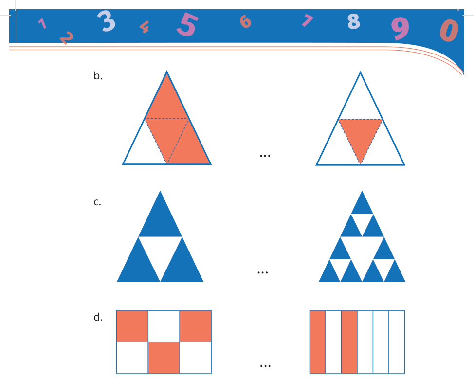


Kunci sumber: `B`; status AI: `verified`; jawaban diverifikasi AI: `B`.
Solusi minimum hasil AI: The left triangle represents 3/4. The right triangle represents 9/16. Converting 3/4 to sixteenths gives 12/16. Since 12/16 > 9/16, the correct relation is 3/4 > 9/16.
Gambar sumber: images/kelas5_panduan_siswa_kelas5.pdf-0091-00.png. Transkripsi visual: The image shows three rows of comparison problems labeled b, c, and d. Row 'c' displays two triangles. The left triangle is divided into 4 smaller triangles, with 3 shaded blue. The right triangle is divided into 16 smaller triangles, with 9 shaded blue. The problem asks to compare these two representations.

### 1. Pemeriksaan input dan fitur

Struktur: `pass`; alasan: `[]`. Grade/topik: kelas 5 / Matematika SD Kelas 5. KKO: `['membandingkan']`; KKO hanya petunjuk bantu.
Isi dan kunci berasal dari sumber yang sama pada ketiga run. Versi konten: 2; hash: `0dee7d99f2271e04a6913c9c0ac0d20bddf3ca57bcc0851bf0cca9b06c8540a6`. Bukti verifikasi AI tidak sama dengan verifikasi ahli.

### 2. Penilaian Gemini blind — tiga run sebelum melihat IndoBERT

| Run | Status | Konten / kunci | Kognitif | Pengetahuan | Difficulty | Token |
|---:|---|---|---|---|---|---:|
| 1 | success | valid / verified | applying | conceptual | Medium | 2597 |
| 2 | success | valid / verified | applying | procedural | Medium | 2737 |
| 3 | success | valid / verified | applying | conceptual | Easy | 2524 |

Run 1 — solusi: Gambar kiri merepresentasikan 3/4 atau 12/16. Gambar kanan merepresentasikan 9/16. Karena 12/16 > 9/16, maka 3/4 > 9/16.
- Domain kognitif `classify/applying`: Siswa perlu menginterpretasikan representasi visual pecahan, mengubahnya ke bentuk numerik, dan membandingkan nilai pecahan tersebut. Ini melibatkan penerapan konsep pecahan pada situasi rutin.. Bukti: Bandingkan kedua gambar berikut ini; 3/4 > 9/16
- Dimensi pengetahuan `classify/conceptual`: Siswa harus memahami hubungan antara representasi visual dan nilai pecahan, serta prinsip menyamakan penyebut untuk membandingkan pecahan.. Bukti: Bandingkan kedua gambar; 3/4 = 12/16
- Intended difficulty `classify/Medium`: Soal ini memerlukan interpretasi visual dan perbandingan pecahan dengan penyebut berbeda, yang merupakan prosedur rutin di kelas 5.. Bukti: Bandingkan kedua gambar; 3/4 > 9/16

Profil difficulty run ini:

| Parameter | Nilai |
|---|---|
| expectedPrerequisite | Pemahaman konsep pecahan sebagai bagian dari keseluruhan dan kemampuan membandingkan pecahan dengan penyebut berbeda. |
| dependentSteps | 2 |
| routineStatus | familiar_routine |
| strategySelection | False |
| representationTransfer | True |
| relevantInformationUnits | 2 |
| interactingConstraints | 1 |
| calculationLoad | low |
| scaffoldLevel | none |
| distractorQuality | plausible |
| gradeRelativeRationale | Siswa kelas 5 diharapkan mampu membandingkan pecahan dengan penyebut berbeda menggunakan visualisasi atau penyamaan penyebut. |

Run 2 — solusi: Gambar kiri merepresentasikan 3/4. Gambar kanan merepresentasikan 9/16. Untuk membandingkan, samakan penyebut: 3/4 = 12/16. Karena 12/16 > 9/16, maka 3/4 > 9/16.
- Domain kognitif `classify/applying`: Siswa perlu mengonversi representasi visual menjadi pecahan numerik, menyamakan penyebut, dan membandingkan nilainya. Ini adalah penerapan prosedur rutin pada situasi yang diberikan.. Bukti: Bandingkan kedua gambar berikut ini; 3/4 > 9/16
- Dimensi pengetahuan `classify/procedural`: Siswa menggunakan algoritma untuk menyamakan penyebut pecahan (prosedur) untuk membandingkan dua nilai pecahan.. Bukti: 3/4 = 12/16; 3/4 > 9/16
- Intended difficulty `classify/Medium`: Soal ini memerlukan langkah rutin: identifikasi pecahan dari gambar, konversi ke penyebut yang sama, dan perbandingan. Ini adalah tugas standar kelas 5.. Bukti: Bandingkan kedua gambar berikut ini; 3/4 > 9/16

Profil difficulty run ini:

| Parameter | Nilai |
|---|---|
| expectedPrerequisite | Pemahaman konsep pecahan sebagai bagian dari keseluruhan dan kemampuan menyamakan penyebut. |
| dependentSteps | 3 |
| routineStatus | familiar_routine |
| strategySelection | False |
| representationTransfer | True |
| relevantInformationUnits | 2 |
| interactingConstraints | 1 |
| calculationLoad | low |
| scaffoldLevel | none |
| distractorQuality | plausible |
| gradeRelativeRationale | Siswa kelas 5 diharapkan mampu membandingkan pecahan dengan penyebut berbeda menggunakan visualisasi atau penyamaan penyebut. |

Run 3 — solusi: Gambar kiri merepresentasikan 3/4 atau 12/16. Gambar kanan merepresentasikan 9/16. Karena 12/16 > 9/16, maka 3/4 > 9/16.
- Domain kognitif `classify/applying`: Siswa perlu menginterpretasikan representasi visual pecahan, mengubahnya menjadi simbol numerik, dan menerapkan prosedur perbandingan pecahan (menyamakan penyebut).. Bukti: Bandingkan kedua gambar berikut ini
- Dimensi pengetahuan `classify/conceptual`: Memerlukan pemahaman konseptual tentang pecahan sebagai bagian dari keseluruhan dan prosedur untuk membandingkan pecahan dengan penyebut berbeda.. Bukti: Bandingkan kedua gambar berikut ini
- Intended difficulty `classify/Easy`: Soal ini rutin bagi siswa kelas 5 yang sudah mempelajari perbandingan pecahan. Memerlukan konversi visual ke numerik dan perbandingan nilai.. Bukti: Bandingkan kedua gambar berikut ini; 3/4 > 9/16

Profil difficulty run ini:

| Parameter | Nilai |
|---|---|
| expectedPrerequisite | Pemahaman pecahan sebagai bagian dari keseluruhan dan cara menyamakan penyebut. |
| dependentSteps | 2 |
| routineStatus | familiar_routine |
| strategySelection | False |
| representationTransfer | True |
| relevantInformationUnits | 2 |
| interactingConstraints | 1 |
| calculationLoad | low |
| scaffoldLevel | none |
| distractorQuality | plausible |
| gradeRelativeRationale | Siswa kelas 5 diharapkan mampu membandingkan pecahan dengan penyebut berbeda menggunakan visualisasi atau perhitungan sederhana. |

### 3. Voting awal dan adjudikasi

| Head | Suara awal | Pola / status akhir | Label akhir advisory |
|---|---|---|---|
| Domain kognitif | {"applying": 3} | unanimous_3_0 / adjudicated | applying |
| Dimensi pengetahuan | {"conceptual": 2, "procedural": 1} | majority_2_of_3 / adjudicated | conceptual |
| Intended difficulty | {"Medium": 2, "Easy": 1} | majority_2_of_3 / adjudicated | Medium |

Adjudikasi AI: `success`; token `3977`.
Konten: `valid`; kunci: `verified`; masalah: .
- Domain kognitif `applying`: The student must interpret the visual representation of fractions, convert them to a common numerical format, and apply the comparison procedure. This is a standard application of fraction concepts.
- Dimensi pengetahuan `conceptual`: The task requires understanding the conceptual relationship between visual area models and numerical fractions, as well as the procedural knowledge of equivalent fractions to compare them.
- Intended difficulty `Medium`: The problem is a standard, routine task for 5th grade. It requires interpreting visual models and performing a simple comparison, which is well within the expected curriculum.

Profil difficulty hasil adjudikasi:

| Parameter | Nilai |
|---|---|
| expectedPrerequisite | Understanding fractions as parts of a whole and the concept of equivalent fractions. |
| dependentSteps | 2 |
| routineStatus | familiar_routine |
| strategySelection | False |
| representationTransfer | True |
| relevantInformationUnits | 2 |
| interactingConstraints | 1 |
| calculationLoad | low |
| scaffoldLevel | none |
| distractorQuality | plausible |
| gradeRelativeRationale | Comparing fractions with different denominators using visual models is a core competency for 5th grade. |

### 4. Diagnostik IndoBERT setelah label blind dikunci

Model membaca representation `metadata`; token input 242/256; truncation: `False`.

| Head | Probabilitas | Label | Confidence | Entropy | Action / alasan |
|---|---|---|---:|---:|---|
| Domain kognitif | knowing=0.000883; applying=0.999117; reasoning=0.000000 | applying | 0.999117 | 0.006458 | review / selective_threshold_gate_not_met |
| Dimensi pengetahuan | factual=0.000711; conceptual=0.962771; procedural=0.036519; metacognitive=0.000000 | conceptual | 0.962771 | 0.117258 | review / selective_threshold_gate_not_met |
| Intended difficulty | Easy=0.619692; Medium=0.364845; Hard=0.015464 | Easy | 0.619692 | 0.663456 | review / selective_threshold_gate_not_met |

Domain kognitif: Σp = 1.00000000; confidence = max(p) = 0.999117; −Σp ln(p) = 0.007094; H = 0.007094/ln(3) = 0.006458; T = 0.050000.


Dimensi pengetahuan: Σp = 1.00000000; confidence = max(p) = 0.962771; −Σp ln(p) = 0.162554; H = 0.162554/ln(4) = 0.117258; T = 0.209800.


Intended difficulty: Σp = 1.00000000; confidence = max(p) = 0.619692; −Σp ln(p) = 0.728881; H = 0.728881/ln(3) = 0.663456; T = 0.953328.


<details><summary>Input sebenarnya yang dibaca model</summary>

```text
Kelas: 5
Topik: Matematika SD Kelas 5
Subtopik: Membandingkan dan Mengurutkan Pecahan
Tipe soal: multiple_choice
Stimulus: -
Soal: Bandingkan kedua gambar berikut ini, kemudian isilah titik-titik dengan tanda <, =, atau >.

c. ....
Pilihan: A. $\frac{3}{4} = \frac{9}{16}$
B. $\frac{3}{4} > \frac{9}{16}$
C. $\frac{1}{4} > \frac{7}{16}$
D. $\frac{3}{4} < \frac{9}{16}$
Transkripsi visual: The image shows three rows of comparison problems labeled b, c, and d. Row 'c' displays two triangles. The left triangle is divided into 4 smaller triangles, with 3 shaded blue. The right triangle is divided into 16 smaller triangles, with 9 shaded blue. The problem asks to compare these two representations.
```

</details>

### 5. Keputusan batch

Label advisory blind: `{"mathCognitiveDomain": "applying", "knowledgeDimension": "conceptual", "intendedDifficulty": "Medium"}`. Routing: `pending_expert_review`.
Status konten: `valid`. Catatan konten: .
Perbedaan model dan blind: `{"mathCognitiveDomain": {"modelLabel": "applying", "blindLabel": "applying", "agreement": true}, "knowledgeDimension": {"modelLabel": "conceptual", "blindLabel": "conceptual", "agreement": true}, "intendedDifficulty": {"modelLabel": "Easy", "blindLabel": "Medium", "agreement": false}}`.
Gold ahli tetap null; human review wajib. Confidence IndoBERT tidak digunakan untuk mengganti label blind.

## 21. Soal `0a7f58a69ba9ec033899af2c`

Bandingkan kedua gambar berikut ini, kemudian isilah titik-titik dengan tanda <, =, atau >.<br><br>d. ....

| Opsi | Isi |
|---|---|
| A | $\frac{3}{6} < \frac{4}{6}$ |
| B | $\frac{3}{6} < \frac{2}{6}$ |
| C | $\frac{3}{6} > \frac{2}{6}$ |
| D | $\frac{3}{6} = \frac{2}{6}$ |


Kunci sumber: `C`; status AI: `verified`; jawaban diverifikasi AI: `C`.
Solusi minimum hasil AI: Gambar kiri merepresentasikan 3/6 dan gambar kanan merepresentasikan 2/6. Karena penyebut sama, bandingkan pembilang: 3 > 2, maka 3/6 > 2/6.
Gambar sumber: images/kelas5_panduan_siswa_kelas5.pdf-0091-00.png. Transkripsi visual: Bagian d menunjukkan dua persegi panjang. Persegi panjang kiri dibagi menjadi 6 kotak (2 baris x 3 kolom), 3 kotak diarsir (3/6). Persegi panjang kanan dibagi menjadi 6 kolom vertikal, 2 kolom diarsir (2/6).

### 1. Pemeriksaan input dan fitur

Struktur: `pass`; alasan: `[]`. Grade/topik: kelas 5 / Matematika SD Kelas 5. KKO: `['membandingkan']`; KKO hanya petunjuk bantu.
Isi dan kunci berasal dari sumber yang sama pada ketiga run. Versi konten: 2; hash: `e4ce53122f8ed1650f788d3bf0a51409ade89624e0d49c3aa19518766f990d0f`. Bukti verifikasi AI tidak sama dengan verifikasi ahli.

### 2. Penilaian Gemini blind — tiga run sebelum melihat IndoBERT

| Run | Status | Konten / kunci | Kognitif | Pengetahuan | Difficulty | Token |
|---:|---|---|---|---|---|---:|
| 1 | success | valid / verified | applying | conceptual | Easy | 2555 |
| 2 | success | valid / verified | applying | conceptual | Easy | 2554 |
| 3 | success | valid / verified | applying | conceptual | Easy | 2535 |

Run 1 — solusi: Gambar kiri merepresentasikan 3/6 dan gambar kanan merepresentasikan 2/6. Karena penyebut sama, bandingkan pembilang: 3 > 2, maka 3/6 > 2/6.
- Domain kognitif `classify/applying`: Siswa perlu mengidentifikasi nilai pecahan dari representasi visual (model area) dan menerapkan prosedur perbandingan pecahan dengan penyebut yang sama.. Bukti: Bandingkan kedua gambar berikut ini; isilah titik-titik dengan tanda <, =, atau >
- Dimensi pengetahuan `classify/conceptual`: Soal ini menguji pemahaman konseptual tentang nilai pecahan yang direpresentasikan secara visual dan prosedur membandingkan pecahan.. Bukti: Bandingkan kedua gambar berikut ini; 3/6 > 2/6
- Intended difficulty `classify/Easy`: Soal ini bersifat rutin untuk kelas 5, melibatkan interpretasi visual sederhana dan perbandingan pecahan dengan penyebut sama.. Bukti: Bandingkan kedua gambar berikut ini; 3/6 > 2/6

Profil difficulty run ini:

| Parameter | Nilai |
|---|---|
| expectedPrerequisite | Pemahaman dasar tentang pecahan sebagai bagian dari keseluruhan dan cara membandingkan pecahan berpenyebut sama. |
| dependentSteps | 2 |
| routineStatus | familiar_routine |
| strategySelection | False |
| representationTransfer | True |
| relevantInformationUnits | 2 |
| interactingConstraints | 0 |
| calculationLoad | low |
| scaffoldLevel | none |
| distractorQuality | plausible |
| gradeRelativeRationale | Siswa kelas 5 sudah terbiasa dengan model area pecahan dan perbandingan pecahan sederhana. |

Run 2 — solusi: Left image represents 3/6. Right image represents 2/6. Since 3/6 > 2/6, the correct sign is >.
- Domain kognitif `classify/applying`: Siswa perlu menginterpretasikan representasi visual pecahan ke dalam bentuk numerik dan membandingkan nilainya. Ini adalah proses applying karena menerapkan konsep perbandingan pecahan pada situasi rutin.. Bukti: Bandingkan kedua gambar berikut ini; isilah titik-titik dengan tanda <, =, atau >
- Dimensi pengetahuan `classify/conceptual`: Soal ini menguji pemahaman tentang hubungan antara representasi visual pecahan dan nilai numeriknya, yang merupakan pengetahuan konseptual.. Bukti: Bandingkan kedua gambar; 3/6 > 2/6
- Intended difficulty `classify/Easy`: Soal ini tergolong mudah karena hanya melibatkan identifikasi pecahan sederhana dari gambar dan perbandingan langsung, yang merupakan prosedur rutin di kelas 5.. Bukti: Bandingkan kedua gambar; 3/6 > 2/6

Profil difficulty run ini:

| Parameter | Nilai |
|---|---|
| expectedPrerequisite | Pemahaman dasar tentang pecahan sebagai bagian dari keseluruhan dan kemampuan membandingkan pecahan dengan penyebut sama. |
| dependentSteps | 2 |
| routineStatus | familiar_routine |
| strategySelection | False |
| representationTransfer | True |
| relevantInformationUnits | 2 |
| interactingConstraints | 0 |
| calculationLoad | low |
| scaffoldLevel | none |
| distractorQuality | plausible |
| gradeRelativeRationale | Siswa kelas 5 diharapkan sudah mahir dalam membandingkan pecahan sederhana. Soal ini menggunakan representasi visual yang umum dan langsung. |

Run 3 — solusi: Gambar kiri merepresentasikan 3/6 dan gambar kanan merepresentasikan 2/6. Karena penyebut sama, bandingkan pembilang: 3 > 2. Maka 3/6 > 2/6.
- Domain kognitif `classify/applying`: Siswa diminta untuk mengidentifikasi nilai pecahan dari representasi visual dan menerapkan prosedur perbandingan pecahan sederhana dengan penyebut yang sama.. Bukti: Bandingkan kedua gambar berikut ini; isilah titik-titik dengan tanda <, =, atau >
- Dimensi pengetahuan `classify/conceptual`: Soal ini menguji pemahaman konseptual tentang nilai pecahan melalui model area dan prosedur perbandingan pecahan.. Bukti: Bandingkan kedua gambar; tanda <, =, atau >
- Intended difficulty `classify/Easy`: Soal ini bersifat rutin untuk kelas 5, melibatkan perbandingan langsung pecahan dengan penyebut yang sama menggunakan representasi visual yang jelas.. Bukti: Bandingkan kedua gambar; isilah titik-titik dengan tanda <, =, atau >

Profil difficulty run ini:

| Parameter | Nilai |
|---|---|
| expectedPrerequisite | Pemahaman dasar tentang pecahan sebagai bagian dari keseluruhan dan kemampuan membandingkan bilangan cacah. |
| dependentSteps | 2 |
| routineStatus | familiar_routine |
| strategySelection | False |
| representationTransfer | True |
| relevantInformationUnits | 2 |
| interactingConstraints | 1 |
| calculationLoad | low |
| scaffoldLevel | none |
| distractorQuality | plausible |
| gradeRelativeRationale | Membandingkan pecahan dengan penyebut sama adalah materi dasar kelas 4/5 yang bersifat rutin. |

### 3. Voting awal dan adjudikasi

| Head | Suara awal | Pola / status akhir | Label akhir advisory |
|---|---|---|---|
| Domain kognitif | {"applying": 3} | unanimous_3_0 / unanimous | applying |
| Dimensi pengetahuan | {"conceptual": 3} | unanimous_3_0 / unanimous | conceptual |
| Intended difficulty | {"Easy": 3} | unanimous_3_0 / unanimous | Easy |

### 4. Diagnostik IndoBERT setelah label blind dikunci

Model membaca representation `metadata`; token input 206/256; truncation: `False`.

| Head | Probabilitas | Label | Confidence | Entropy | Action / alasan |
|---|---|---|---:|---:|---|
| Domain kognitif | knowing=0.201961; applying=0.798039; reasoning=0.000000 | applying | 0.798039 | 0.457949 | review / selective_threshold_gate_not_met |
| Dimensi pengetahuan | factual=0.000118; conceptual=0.993496; procedural=0.006386; metacognitive=0.000000 | conceptual | 0.993496 | 0.028726 | review / selective_threshold_gate_not_met |
| Intended difficulty | Easy=0.553771; Medium=0.437087; Hard=0.009142 | Easy | 0.553771 | 0.666243 | review / selective_threshold_gate_not_met |

Domain kognitif: Σp = 1.00000000; confidence = max(p) = 0.798039; −Σp ln(p) = 0.503108; H = 0.503108/ln(3) = 0.457949; T = 0.050000.


Dimensi pengetahuan: Σp = 1.00000000; confidence = max(p) = 0.993496; −Σp ln(p) = 0.039822; H = 0.039822/ln(4) = 0.028726; T = 0.209800.


Intended difficulty: Σp = 1.00000000; confidence = max(p) = 0.553771; −Σp ln(p) = 0.731943; H = 0.731943/ln(3) = 0.666243; T = 0.953328.


<details><summary>Input sebenarnya yang dibaca model</summary>

```text
Kelas: 5
Topik: Matematika SD Kelas 5
Subtopik: Membandingkan dan Mengurutkan Pecahan
Tipe soal: multiple_choice
Stimulus: -
Soal: Bandingkan kedua gambar berikut ini, kemudian isilah titik-titik dengan tanda <, =, atau >.

d. ....
Pilihan: A. $\frac{3}{6} < \frac{4}{6}$
B. $\frac{3}{6} < \frac{2}{6}$
C. $\frac{3}{6} > \frac{2}{6}$
D. $\frac{3}{6} = \frac{2}{6}$
Transkripsi visual: Bagian d menunjukkan dua persegi panjang. Persegi panjang kiri dibagi menjadi 6 kotak (2 baris x 3 kolom), 3 kotak diarsir (3/6). Persegi panjang kanan dibagi menjadi 6 kolom vertikal, 2 kolom diarsir (2/6).
```

</details>

### 5. Keputusan batch

Label advisory blind: `{"mathCognitiveDomain": "applying", "knowledgeDimension": "conceptual", "intendedDifficulty": "Easy"}`. Routing: `pending_expert_review`.
Status konten: `valid`. Catatan konten: .
Perbedaan model dan blind: `{"mathCognitiveDomain": {"modelLabel": "applying", "blindLabel": "applying", "agreement": true}, "knowledgeDimension": {"modelLabel": "conceptual", "blindLabel": "conceptual", "agreement": true}, "intendedDifficulty": {"modelLabel": "Easy", "blindLabel": "Easy", "agreement": true}}`.
Gold ahli tetap null; human review wajib. Confidence IndoBERT tidak digunakan untuk mengganti label blind.

## 22. Soal `ab3c3fc2501910ff7987e2df`

Populasi suku Batak di Indonesia $\frac{1}{20}$ dari penduduk Indonesia. Populasi suku Jawa di Indonesia $\frac{1}{6}$ dari penduduk Indonesia. Berapa jumlah populasi suku Batak dan suku Jawa dari seluruh penduduk Indonesia?

| Opsi | Isi |
|---|---|
| A | $\frac{7}{60}$ |
| B | $\frac{13}{60}$ |
| C | $\frac{2}{60}$ |
| D | $\frac{2}{26}$ |

Kunci sumber: `B`; status AI: `verified`; jawaban diverifikasi AI: `B`.
Solusi minimum hasil AI: Menyamakan penyebut 20 dan 6 menjadi 60. 1/20 = 3/60 dan 1/6 = 10/60. Penjumlahan: 3/60 + 10/60 = 13/60.
Gambar sumber: —. Transkripsi visual: —

### 1. Pemeriksaan input dan fitur

Struktur: `pass`; alasan: `[]`. Grade/topik: kelas 5 / Matematika SD Kelas 5. KKO: `['menghitung']`; KKO hanya petunjuk bantu.
Isi dan kunci berasal dari sumber yang sama pada ketiga run. Versi konten: 2; hash: `3e68be59c6a427cc9eaa886d549001aa5f1238d0ad752fe0496007a009073278`. Bukti verifikasi AI tidak sama dengan verifikasi ahli.

### 2. Penilaian Gemini blind — tiga run sebelum melihat IndoBERT

| Run | Status | Konten / kunci | Kognitif | Pengetahuan | Difficulty | Token |
|---:|---|---|---|---|---|---:|
| 1 | success | valid / verified | applying | procedural | Medium | 1443 |
| 2 | success | valid / verified | applying | procedural | Medium | 1378 |
| 3 | success | valid / verified | applying | procedural | Medium | 1370 |

Run 1 — solusi: Menyamakan penyebut 20 dan 6 menjadi 60. 1/20 = 3/60 dan 1/6 = 10/60. Penjumlahan: 3/60 + 10/60 = 13/60.
- Domain kognitif `classify/applying`: Siswa perlu menerapkan prosedur penjumlahan pecahan dengan penyebut berbeda yang merupakan prosedur rutin di kelas 5.. Bukti: Berapa jumlah populasi suku Batak dan suku Jawa dari seluruh penduduk Indonesia?
- Dimensi pengetahuan `classify/procedural`: Soal ini menguji pemahaman tentang algoritma penjumlahan pecahan yang memerlukan penyamaan penyebut.. Bukti: 1/20 dari penduduk Indonesia; 1/6 dari penduduk Indonesia
- Intended difficulty `classify/Medium`: Soal ini dikategorikan Medium karena siswa harus melakukan dua langkah rutin: mencari KPK dari penyebut (20 dan 6) dan melakukan konversi pecahan sebelum menjumlahkan.. Bukti: 1/20; 1/6; jumlah populasi

Profil difficulty run ini:

| Parameter | Nilai |
|---|---|
| expectedPrerequisite | Pemahaman konsep pecahan senilai dan operasi penjumlahan pecahan dengan penyebut berbeda. |
| dependentSteps | 2 |
| routineStatus | familiar_routine |
| strategySelection | False |
| representationTransfer | False |
| relevantInformationUnits | 2 |
| interactingConstraints | 1 |
| calculationLoad | moderate |
| scaffoldLevel | none |
| distractorQuality | plausible |
| gradeRelativeRationale | Penjumlahan pecahan dengan penyebut berbeda adalah standar kompetensi kelas 5 yang memerlukan ketelitian dalam mencari KPK. |

Run 2 — solusi: 1/20 + 1/6 = 3/60 + 10/60 = 13/60.
- Domain kognitif `classify/applying`: Siswa perlu menerapkan prosedur penjumlahan pecahan dengan penyebut berbeda yang merupakan prosedur rutin di kelas 5.. Bukti: Berapa jumlah populasi suku Batak dan suku Jawa
- Dimensi pengetahuan `classify/procedural`: Soal ini menguji pemahaman tentang algoritma penjumlahan pecahan yang melibatkan penyamaan penyebut.. Bukti: 1/20 + 1/6
- Intended difficulty `classify/Medium`: Soal ini dikategorikan Medium karena memerlukan dua langkah rutin: mencari KPK dari penyebut (20 dan 6) dan melakukan penjumlahan pecahan, yang merupakan standar kompetensi kelas 5.. Bukti: 1/20; 1/6

Profil difficulty run ini:

| Parameter | Nilai |
|---|---|
| expectedPrerequisite | Pemahaman pecahan senilai dan KPK. |
| dependentSteps | 2 |
| routineStatus | familiar_routine |
| strategySelection | False |
| representationTransfer | False |
| relevantInformationUnits | 2 |
| interactingConstraints | 1 |
| calculationLoad | moderate |
| scaffoldLevel | none |
| distractorQuality | plausible |
| gradeRelativeRationale | Penjumlahan pecahan dengan penyebut berbeda adalah materi inti kelas 5. |

Run 3 — solusi: 1/20 + 1/6 = 3/60 + 10/60 = 13/60.
- Domain kognitif `classify/applying`: Siswa perlu menerapkan prosedur penjumlahan pecahan dengan penyebut berbeda, yang merupakan tugas rutin dalam kurikulum kelas 5.. Bukti: Berapa jumlah populasi suku Batak dan suku Jawa dari seluruh penduduk Indonesia?
- Dimensi pengetahuan `classify/procedural`: Soal ini menguji pemahaman tentang algoritma penjumlahan pecahan yang memerlukan penyamaan penyebut (KPK).. Bukti: 1/20 + 1/6
- Intended difficulty `classify/Medium`: Soal ini dikategorikan Medium karena melibatkan dua langkah rutin: mencari KPK dari penyebut (20 dan 6) dan melakukan penjumlahan pecahan setelah penyebut disamakan.. Bukti: 1/20 + 1/6

Profil difficulty run ini:

| Parameter | Nilai |
|---|---|
| expectedPrerequisite | Pemahaman pecahan senilai dan KPK. |
| dependentSteps | 2 |
| routineStatus | familiar_routine |
| strategySelection | False |
| representationTransfer | False |
| relevantInformationUnits | 2 |
| interactingConstraints | 1 |
| calculationLoad | low |
| scaffoldLevel | none |
| distractorQuality | plausible |
| gradeRelativeRationale | Penjumlahan pecahan dengan penyebut berbeda adalah standar kompetensi kelas 5. |

### 3. Voting awal dan adjudikasi

| Head | Suara awal | Pola / status akhir | Label akhir advisory |
|---|---|---|---|
| Domain kognitif | {"applying": 3} | unanimous_3_0 / unanimous | applying |
| Dimensi pengetahuan | {"procedural": 3} | unanimous_3_0 / unanimous | procedural |
| Intended difficulty | {"Medium": 3} | unanimous_3_0 / unanimous | Medium |

### 4. Diagnostik IndoBERT setelah label blind dikunci

Model membaca representation `metadata`; token input 140/256; truncation: `False`.

| Head | Probabilitas | Label | Confidence | Entropy | Action / alasan |
|---|---|---|---:|---:|---|
| Domain kognitif | knowing=0.000035; applying=0.999965; reasoning=0.000000 | applying | 0.999965 | 0.000360 | review / selective_threshold_gate_not_met |
| Dimensi pengetahuan | factual=0.001363; conceptual=0.964023; procedural=0.034613; metacognitive=0.000000 | conceptual | 0.964023 | 0.115949 | review / selective_threshold_gate_not_met |
| Intended difficulty | Easy=0.670667; Medium=0.324235; Hard=0.005099 | Easy | 0.670667 | 0.600773 | review / selective_threshold_gate_not_met |

Domain kognitif: Σp = 1.00000000; confidence = max(p) = 0.999965; −Σp ln(p) = 0.000395; H = 0.000395/ln(3) = 0.000360; T = 0.050000.


Dimensi pengetahuan: Σp = 1.00000000; confidence = max(p) = 0.964023; −Σp ln(p) = 0.160739; H = 0.160739/ln(4) = 0.115949; T = 0.209800.


Intended difficulty: Σp = 1.00000000; confidence = max(p) = 0.670667; −Σp ln(p) = 0.660017; H = 0.660017/ln(3) = 0.600773; T = 0.953328.


<details><summary>Input sebenarnya yang dibaca model</summary>

```text
Kelas: 5
Topik: Matematika SD Kelas 5
Subtopik: Penjumlahan Bilangan Pecahan
Tipe soal: multiple_choice
Stimulus: -
Soal: Populasi suku Batak di Indonesia $\frac{1}{20}$ dari penduduk Indonesia. Populasi suku Jawa di Indonesia $\frac{1}{6}$ dari penduduk Indonesia. Berapa jumlah populasi suku Batak dan suku Jawa dari seluruh penduduk Indonesia?
Pilihan: A. $\frac{7}{60}$
B. $\frac{13}{60}$
C. $\frac{2}{60}$
D. $\frac{2}{26}$
Transkripsi visual: -
```

</details>

### 5. Keputusan batch

Label advisory blind: `{"mathCognitiveDomain": "applying", "knowledgeDimension": "procedural", "intendedDifficulty": "Medium"}`. Routing: `pending_expert_review`.
Status konten: `valid`. Catatan konten: .
Perbedaan model dan blind: `{"mathCognitiveDomain": {"modelLabel": "applying", "blindLabel": "applying", "agreement": true}, "knowledgeDimension": {"modelLabel": "conceptual", "blindLabel": "procedural", "agreement": false}, "intendedDifficulty": {"modelLabel": "Easy", "blindLabel": "Medium", "agreement": false}}`.
Gold ahli tetap null; human review wajib. Confidence IndoBERT tidak digunakan untuk mengganti label blind.

## 23. Soal `fc9fe265c2c5380ee0471dba`

Populasi penduduk dari Kabupaten Sleman adalah $\frac{2}{5}$ dari penduduk Provinsi D.I. Yogyakarta. Adapun populasi penduduk Kabupaten Kulonprogo $\frac{1}{5}$ dari penduduk Provinsi D.I. Yogyakarta. Berapa jumlah populasi penduduk dari Kabupaten Sleman dan Kulonprogo?

| Opsi | Isi |
|---|---|
| A | $\frac{2}{25}$ |
| B | $\frac{3}{10}$ |
| C | $\frac{3}{5}$ |
| D | $\frac{1}{5}$ |

Kunci sumber: `C`; status AI: `verified`; jawaban diverifikasi AI: `C`.
Solusi minimum hasil AI: Jumlah = 2/5 + 1/5 = (2+1)/5 = 3/5.
Gambar sumber: —. Transkripsi visual: —

### 1. Pemeriksaan input dan fitur

Struktur: `pass`; alasan: `[]`. Grade/topik: kelas 5 / Matematika SD Kelas 5. KKO: `['menghitung']`; KKO hanya petunjuk bantu.
Isi dan kunci berasal dari sumber yang sama pada ketiga run. Versi konten: 2; hash: `db3a395c3403471bb9c372c31cbc34f1bb7dfa1f69a608df7e738172ba73ca0b`. Bukti verifikasi AI tidak sama dengan verifikasi ahli.

### 2. Penilaian Gemini blind — tiga run sebelum melihat IndoBERT

| Run | Status | Konten / kunci | Kognitif | Pengetahuan | Difficulty | Token |
|---:|---|---|---|---|---|---:|
| 1 | success | valid / verified | applying | procedural | Easy | 1351 |
| 2 | success | valid / verified | applying | procedural | Easy | 1371 |
| 3 | success | valid / verified | applying | procedural | Easy | 1371 |

Run 1 — solusi: Jumlah = 2/5 + 1/5 = (2+1)/5 = 3/5.
- Domain kognitif `classify/applying`: Siswa diminta menerapkan prosedur penjumlahan pecahan dengan penyebut yang sama dalam konteks soal cerita sederhana.. Bukti: Berapa jumlah populasi penduduk dari Kabupaten Sleman dan Kulonprogo?
- Dimensi pengetahuan `classify/procedural`: Soal ini menguji pemahaman tentang algoritma atau prosedur penjumlahan pecahan yang memiliki penyebut sama.. Bukti: 2/5 + 1/5
- Intended difficulty `classify/Easy`: Soal ini tergolong mudah karena melibatkan operasi penjumlahan pecahan dengan penyebut yang sudah sama, yang merupakan prosedur standar dan rutin untuk kelas 5.. Bukti: Populasi penduduk dari Kabupaten Sleman adalah 2/5 dari penduduk Provinsi D.I. Yogyakarta.; Adapun populasi penduduk Kabupaten Kulonprogo 1/5 dari penduduk Provinsi D.I. Yogyakarta.

Profil difficulty run ini:

| Parameter | Nilai |
|---|---|
| expectedPrerequisite | Penjumlahan pecahan dengan penyebut sama. |
| dependentSteps | 1 |
| routineStatus | familiar_routine |
| strategySelection | False |
| representationTransfer | False |
| relevantInformationUnits | 2 |
| interactingConstraints | 0 |
| calculationLoad | low |
| scaffoldLevel | none |
| distractorQuality | plausible |
| gradeRelativeRationale | Penjumlahan pecahan dengan penyebut sama adalah materi dasar kelas 5 yang bersifat rutin. |

Run 2 — solusi: Jumlah populasi = 2/5 + 1/5 = (2+1)/5 = 3/5.
- Domain kognitif `classify/applying`: Siswa diminta menerapkan operasi penjumlahan pecahan dengan penyebut yang sama dalam konteks masalah cerita sederhana.. Bukti: Berapa jumlah populasi penduduk dari Kabupaten Sleman dan Kulonprogo?
- Dimensi pengetahuan `classify/procedural`: Soal ini menguji pemahaman tentang algoritma penjumlahan pecahan dengan penyebut yang sama.. Bukti: 2/5 + 1/5
- Intended difficulty `classify/Easy`: Soal ini bersifat rutin untuk kelas 5, melibatkan satu operasi penjumlahan pecahan dengan penyebut sama tanpa perlu konversi.. Bukti: Populasi penduduk dari Kabupaten Sleman adalah 2/5 dari penduduk Provinsi D.I. Yogyakarta.; populasi penduduk Kabupaten Kulonprogo 1/5 dari penduduk Provinsi D.I. Yogyakarta.

Profil difficulty run ini:

| Parameter | Nilai |
|---|---|
| expectedPrerequisite | Pemahaman dasar penjumlahan pecahan dengan penyebut sama. |
| dependentSteps | 1 |
| routineStatus | familiar_routine |
| strategySelection | False |
| representationTransfer | False |
| relevantInformationUnits | 2 |
| interactingConstraints | 0 |
| calculationLoad | low |
| scaffoldLevel | none |
| distractorQuality | plausible |
| gradeRelativeRationale | Penjumlahan pecahan dengan penyebut sama adalah materi standar kelas 5 yang bersifat prosedural langsung. |

Run 3 — solusi: Jumlah = 2/5 + 1/5 = (2+1)/5 = 3/5.
- Domain kognitif `classify/applying`: Siswa diminta menerapkan prosedur penjumlahan pecahan dengan penyebut yang sama dalam konteks soal cerita sederhana.. Bukti: Berapa jumlah populasi penduduk dari Kabupaten Sleman dan Kulonprogo?
- Dimensi pengetahuan `classify/procedural`: Soal ini menguji pemahaman tentang algoritma atau teknik penjumlahan pecahan yang memiliki penyebut sama.. Bukti: 2/5 + 1/5
- Intended difficulty `classify/Easy`: Soal ini merupakan prosedur rutin penjumlahan pecahan dengan penyebut sama yang sudah dipelajari di kelas 5. Tidak ada langkah kompleks atau strategi nonrutin.. Bukti: Populasi penduduk dari Kabupaten Sleman adalah 2/5 dari penduduk Provinsi D.I. Yogyakarta.; populasi penduduk Kabupaten Kulonprogo 1/5 dari penduduk Provinsi D.I. Yogyakarta.; Berapa jumlah populasi penduduk dari Kabupaten Sleman dan Kulonprogo?

Profil difficulty run ini:

| Parameter | Nilai |
|---|---|
| expectedPrerequisite | Penjumlahan pecahan dengan penyebut yang sama. |
| dependentSteps | 1 |
| routineStatus | familiar_routine |
| strategySelection | False |
| representationTransfer | False |
| relevantInformationUnits | 2 |
| interactingConstraints | 0 |
| calculationLoad | low |
| scaffoldLevel | none |
| distractorQuality | plausible |
| gradeRelativeRationale | Penjumlahan pecahan dengan penyebut sama adalah materi dasar kelas 5 yang bersifat rutin. |

### 3. Voting awal dan adjudikasi

| Head | Suara awal | Pola / status akhir | Label akhir advisory |
|---|---|---|---|
| Domain kognitif | {"applying": 3} | unanimous_3_0 / unanimous | applying |
| Dimensi pengetahuan | {"procedural": 3} | unanimous_3_0 / unanimous | procedural |
| Intended difficulty | {"Easy": 3} | unanimous_3_0 / unanimous | Easy |

### 4. Diagnostik IndoBERT setelah label blind dikunci

Model membaca representation `metadata`; token input 152/256; truncation: `False`.

| Head | Probabilitas | Label | Confidence | Entropy | Action / alasan |
|---|---|---|---:|---:|---|
| Domain kognitif | knowing=0.000001; applying=0.999999; reasoning=0.000000 | applying | 0.999999 | 0.000014 | review / selective_threshold_gate_not_met |
| Dimensi pengetahuan | factual=0.000560; conceptual=0.948159; procedural=0.051280; metacognitive=0.000000 | conceptual | 0.948159 | 0.149314 | review / selective_threshold_gate_not_met |
| Intended difficulty | Easy=0.683066; Medium=0.311968; Hard=0.004966 | Easy | 0.683066 | 0.591749 | review / selective_threshold_gate_not_met |

Domain kognitif: Σp = 1.00000000; confidence = max(p) = 0.999999; −Σp ln(p) = 0.000016; H = 0.000016/ln(3) = 0.000014; T = 0.050000.


Dimensi pengetahuan: Σp = 1.00000000; confidence = max(p) = 0.948159; −Σp ln(p) = 0.206994; H = 0.206994/ln(4) = 0.149314; T = 0.209800.


Intended difficulty: Σp = 1.00000000; confidence = max(p) = 0.683066; −Σp ln(p) = 0.650103; H = 0.650103/ln(3) = 0.591749; T = 0.953328.


<details><summary>Input sebenarnya yang dibaca model</summary>

```text
Kelas: 5
Topik: Matematika SD Kelas 5
Subtopik: Penjumlahan Bilangan Pecahan
Tipe soal: multiple_choice
Stimulus: -
Soal: Populasi penduduk dari Kabupaten Sleman adalah $\frac{2}{5}$ dari penduduk Provinsi D.I. Yogyakarta. Adapun populasi penduduk Kabupaten Kulonprogo $\frac{1}{5}$ dari penduduk Provinsi D.I. Yogyakarta. Berapa jumlah populasi penduduk dari Kabupaten Sleman dan Kulonprogo?
Pilihan: A. $\frac{2}{25}$
B. $\frac{3}{10}$
C. $\frac{3}{5}$
D. $\frac{1}{5}$
Transkripsi visual: -
```

</details>

### 5. Keputusan batch

Label advisory blind: `{"mathCognitiveDomain": "applying", "knowledgeDimension": "procedural", "intendedDifficulty": "Easy"}`. Routing: `pending_expert_review`.
Status konten: `valid`. Catatan konten: .
Perbedaan model dan blind: `{"mathCognitiveDomain": {"modelLabel": "applying", "blindLabel": "applying", "agreement": true}, "knowledgeDimension": {"modelLabel": "conceptual", "blindLabel": "procedural", "agreement": false}, "intendedDifficulty": {"modelLabel": "Easy", "blindLabel": "Easy", "agreement": true}}`.
Gold ahli tetap null; human review wajib. Confidence IndoBERT tidak digunakan untuk mengganti label blind.

## 24. Soal `3c69165f4b4cdf66760b5fe1`

Di daerah Nusa Tenggara Timur terdapat beberapa macam bahasa yang digunakan sehari-hari. Penggunaan bahasa Indonesia $\frac{1}{8}$ bagian. Penggunaan bahasa daerah $\frac{3}{10}$ bagian. Berapa bagian selisih penggunaan bahasa indonesia dan bahasa daerah dalam percakapan sehari-hari?

| Opsi | Isi |
|---|---|
| A | $\frac{17}{40}$ |
| B | $\frac{2}{18}$ |
| C | $\frac{2}{40}$ |
| D | $\frac{7}{40}$ |

Kunci sumber: `D`; status AI: `verified`; jawaban diverifikasi AI: `D`.
Solusi minimum hasil AI: Selisih = 3/10 - 1/8 = 12/40 - 5/40 = 7/40.
Gambar sumber: —. Transkripsi visual: —

### 1. Pemeriksaan input dan fitur

Struktur: `pass`; alasan: `[]`. Grade/topik: kelas 5 / Matematika SD Kelas 5. KKO: `['menghitung']`; KKO hanya petunjuk bantu.
Isi dan kunci berasal dari sumber yang sama pada ketiga run. Versi konten: 2; hash: `cf9b5d568118d63c3d15a594dd483778293b1689440d78b71822544b0b741794`. Bukti verifikasi AI tidak sama dengan verifikasi ahli.

### 2. Penilaian Gemini blind — tiga run sebelum melihat IndoBERT

| Run | Status | Konten / kunci | Kognitif | Pengetahuan | Difficulty | Token |
|---:|---|---|---|---|---|---:|
| 1 | success | valid / verified | applying | procedural | Medium | 1401 |
| 2 | success | valid / verified | applying | procedural | Medium | 1394 |
| 3 | success | valid / verified | applying | procedural | Medium | 1437 |

Run 1 — solusi: Selisih = 3/10 - 1/8 = 12/40 - 5/40 = 7/40.
- Domain kognitif `classify/applying`: Siswa perlu menerapkan prosedur pengurangan pecahan dengan penyebut berbeda, yang merupakan prosedur rutin di kelas 5.. Bukti: Berapa bagian selisih penggunaan bahasa indonesia dan bahasa daerah
- Dimensi pengetahuan `classify/procedural`: Soal ini menguji pemahaman tentang algoritma pengurangan pecahan yang memerlukan penyamaan penyebut (KPK).. Bukti: penggunaan bahasa Indonesia 1/8 bagian; penggunaan bahasa daerah 3/10 bagian
- Intended difficulty `classify/Medium`: Soal ini dikategorikan Medium karena melibatkan dua langkah rutin: mencari KPK dari penyebut (8 dan 10) dan melakukan operasi pengurangan pecahan.. Bukti: 1/8 bagian; 3/10 bagian; selisih

Profil difficulty run ini:

| Parameter | Nilai |
|---|---|
| expectedPrerequisite | Pemahaman pecahan senilai dan operasi pengurangan pecahan dengan penyebut berbeda. |
| dependentSteps | 2 |
| routineStatus | familiar_routine |
| strategySelection | False |
| representationTransfer | False |
| relevantInformationUnits | 2 |
| interactingConstraints | 1 |
| calculationLoad | moderate |
| scaffoldLevel | none |
| distractorQuality | plausible |
| gradeRelativeRationale | Siswa kelas 5 diharapkan sudah menguasai operasi hitung pecahan dengan penyebut berbeda sebagai bagian dari kurikulum standar. |

Run 2 — solusi: Selisih = 3/10 - 1/8 = 12/40 - 5/40 = 7/40.
- Domain kognitif `classify/applying`: Siswa perlu menerapkan prosedur pengurangan pecahan dengan penyebut berbeda, yang merupakan prosedur rutin di kelas 5.. Bukti: Berapa bagian selisih penggunaan bahasa indonesia dan bahasa daerah
- Dimensi pengetahuan `classify/procedural`: Soal ini menguji pemahaman tentang algoritma pengurangan pecahan yang memerlukan penyamaan penyebut (KPK).. Bukti: penggunaan bahasa Indonesia 1/8 bagian; penggunaan bahasa daerah 3/10 bagian
- Intended difficulty `classify/Medium`: Soal ini memerlukan dua langkah rutin: mencari KPK dari penyebut (8 dan 10) dan melakukan pengurangan. Ini adalah standar kompetensi kelas 5.. Bukti: 1/8 bagian; 3/10 bagian; selisih

Profil difficulty run ini:

| Parameter | Nilai |
|---|---|
| expectedPrerequisite | Pemahaman pecahan senilai dan KPK. |
| dependentSteps | 2 |
| routineStatus | familiar_routine |
| strategySelection | False |
| representationTransfer | False |
| relevantInformationUnits | 2 |
| interactingConstraints | 1 |
| calculationLoad | moderate |
| scaffoldLevel | none |
| distractorQuality | plausible |
| gradeRelativeRationale | Pengurangan pecahan dengan penyebut berbeda adalah materi inti kelas 5 yang memerlukan ketelitian dalam konversi pecahan. |

Run 3 — solusi: Samakan penyebut: 3/10 = 12/40 dan 1/8 = 5/40. Selisih: 12/40 - 5/40 = 7/40.
- Domain kognitif `classify/applying`: Siswa perlu memilih prosedur yang tepat (menyamakan penyebut) dan menerapkan operasi pengurangan pecahan pada situasi rutin.. Bukti: Berapa bagian selisih penggunaan bahasa indonesia dan bahasa daerah
- Dimensi pengetahuan `classify/procedural`: Soal ini menguji pemahaman tentang algoritma pengurangan pecahan dengan penyebut berbeda, yang merupakan prosedur standar.. Bukti: penggunaan bahasa Indonesia 1/8 bagian; penggunaan bahasa daerah 3/10 bagian
- Intended difficulty `classify/Medium`: Soal ini dikategorikan Medium karena memerlukan dua langkah rutin: mencari KPK dari penyebut (8 dan 10) dan melakukan operasi pengurangan pecahan, yang merupakan standar kompetensi kelas 5.. Bukti: 1/8 bagian; 3/10 bagian; selisih

Profil difficulty run ini:

| Parameter | Nilai |
|---|---|
| expectedPrerequisite | Pemahaman pecahan senilai dan operasi pengurangan pecahan dengan penyebut berbeda. |
| dependentSteps | 2 |
| routineStatus | familiar_routine |
| strategySelection | False |
| representationTransfer | False |
| relevantInformationUnits | 2 |
| interactingConstraints | 1 |
| calculationLoad | moderate |
| scaffoldLevel | none |
| distractorQuality | plausible |
| gradeRelativeRationale | Sesuai untuk kelas 5 karena melibatkan operasi pecahan yang menjadi fokus kurikulum pada jenjang tersebut. |

### 3. Voting awal dan adjudikasi

| Head | Suara awal | Pola / status akhir | Label akhir advisory |
|---|---|---|---|
| Domain kognitif | {"applying": 3} | unanimous_3_0 / unanimous | applying |
| Dimensi pengetahuan | {"procedural": 3} | unanimous_3_0 / unanimous | procedural |
| Intended difficulty | {"Medium": 3} | unanimous_3_0 / unanimous | Medium |

### 4. Diagnostik IndoBERT setelah label blind dikunci

Model membaca representation `metadata`; token input 149/256; truncation: `False`.

| Head | Probabilitas | Label | Confidence | Entropy | Action / alasan |
|---|---|---|---:|---:|---|
| Domain kognitif | knowing=0.000024; applying=0.999976; reasoning=0.000000 | applying | 0.999976 | 0.000255 | review / selective_threshold_gate_not_met |
| Dimensi pengetahuan | factual=0.000276; conceptual=0.972462; procedural=0.027262; metacognitive=0.000000 | conceptual | 0.972462 | 0.092060 | review / selective_threshold_gate_not_met |
| Intended difficulty | Easy=0.693532; Medium=0.300466; Hard=0.006002 | Easy | 0.693532 | 0.587826 | review / selective_threshold_gate_not_met |

Domain kognitif: Σp = 1.00000000; confidence = max(p) = 0.999976; −Σp ln(p) = 0.000280; H = 0.000280/ln(3) = 0.000255; T = 0.050000.


Dimensi pengetahuan: Σp = 1.00000000; confidence = max(p) = 0.972462; −Σp ln(p) = 0.127623; H = 0.127623/ln(4) = 0.092060; T = 0.209800.


Intended difficulty: Σp = 1.00000000; confidence = max(p) = 0.693532; −Σp ln(p) = 0.645793; H = 0.645793/ln(3) = 0.587826; T = 0.953328.


<details><summary>Input sebenarnya yang dibaca model</summary>

```text
Kelas: 5
Topik: Matematika SD Kelas 5
Subtopik: Pengurangan Bilangan Pecahan
Tipe soal: multiple_choice
Stimulus: -
Soal: Di daerah Nusa Tenggara Timur terdapat beberapa macam bahasa yang digunakan sehari-hari. Penggunaan bahasa Indonesia $\frac{1}{8}$ bagian. Penggunaan bahasa daerah $\frac{3}{10}$ bagian. Berapa bagian selisih penggunaan bahasa indonesia dan bahasa daerah dalam percakapan sehari-hari?
Pilihan: A. $\frac{17}{40}$
B. $\frac{2}{18}$
C. $\frac{2}{40}$
D. $\frac{7}{40}$
Transkripsi visual: -
```

</details>

### 5. Keputusan batch

Label advisory blind: `{"mathCognitiveDomain": "applying", "knowledgeDimension": "procedural", "intendedDifficulty": "Medium"}`. Routing: `pending_expert_review`.
Status konten: `valid`. Catatan konten: .
Perbedaan model dan blind: `{"mathCognitiveDomain": {"modelLabel": "applying", "blindLabel": "applying", "agreement": true}, "knowledgeDimension": {"modelLabel": "conceptual", "blindLabel": "procedural", "agreement": false}, "intendedDifficulty": {"modelLabel": "Easy", "blindLabel": "Medium", "agreement": false}}`.
Gold ahli tetap null; human review wajib. Confidence IndoBERT tidak digunakan untuk mengganti label blind.

## 25. Soal `72d2df56927428ed8ca5cade`

Beni memiliki $1\frac{1}{8}$ bagian bika Ambon. Sebanyak $\frac{1}{8}$ bagian bika Ambon diberikan kepada neneknya. Berapa bagian sisa bika Ambon yang masih dimiliki Beni?

| Opsi | Isi |
|---|---|
| A | 1 |
| B | $1\frac{2}{8}$ |
| C | $\frac{7}{8}$ |
| D | $\frac{1}{8}$ |

Kunci sumber: `A`; status AI: `verified`; jawaban diverifikasi AI: `A`.
Solusi minimum hasil AI: 1 1/8 - 1/8 = (8/8 + 1/8) - 1/8 = 9/8 - 1/8 = 8/8 = 1
Gambar sumber: —. Transkripsi visual: —

### 1. Pemeriksaan input dan fitur

Struktur: `pass`; alasan: `[]`. Grade/topik: kelas 5 / Matematika SD Kelas 5. KKO: `['menghitung']`; KKO hanya petunjuk bantu.
Isi dan kunci berasal dari sumber yang sama pada ketiga run. Versi konten: 2; hash: `36f49190b7f14547c6d679373bf0cdb193c434cd78e840c934994878fe1c7b55`. Bukti verifikasi AI tidak sama dengan verifikasi ahli.

### 2. Penilaian Gemini blind — tiga run sebelum melihat IndoBERT

| Run | Status | Konten / kunci | Kognitif | Pengetahuan | Difficulty | Token |
|---:|---|---|---|---|---|---:|
| 1 | success | valid / verified | applying | procedural | Easy | 1395 |
| 2 | success | valid / verified | applying | procedural | Easy | 1382 |
| 3 | success | valid / verified | applying | procedural | Easy | 1388 |

Run 1 — solusi: 1 1/8 - 1/8 = (8/8 + 1/8) - 1/8 = 9/8 - 1/8 = 8/8 = 1
- Domain kognitif `classify/applying`: Soal ini meminta siswa untuk menerapkan operasi pengurangan pecahan campuran sederhana dalam konteks rutin, yang termasuk dalam domain applying.. Bukti: Beni memiliki 1 1/8 bagian bika Ambon. Sebanyak 1/8 bagian bika Ambon diberikan kepada neneknya.
- Dimensi pengetahuan `classify/procedural`: Siswa perlu memahami algoritma pengurangan pecahan dengan penyebut yang sama dan konsep pecahan campuran, yang merupakan pengetahuan prosedural.. Bukti: 1 1/8 - 1/8
- Intended difficulty `classify/Easy`: Soal ini bersifat langsung dengan satu operasi pengurangan yang melibatkan pecahan campuran sederhana, cocok untuk tingkat kesulitan rendah bagi kelas 5.. Bukti: 1 1/8 - 1/8

Profil difficulty run ini:

| Parameter | Nilai |
|---|---|
| expectedPrerequisite | Pemahaman pecahan campuran dan pengurangan pecahan dengan penyebut sama. |
| dependentSteps | 1 |
| routineStatus | familiar_routine |
| strategySelection | False |
| representationTransfer | False |
| relevantInformationUnits | 2 |
| interactingConstraints | 0 |
| calculationLoad | low |
| scaffoldLevel | none |
| distractorQuality | plausible |
| gradeRelativeRationale | Operasi pengurangan pecahan campuran dengan penyebut sama adalah materi standar kelas 5 yang bersifat rutin. |

Run 2 — solusi: 1 1/8 - 1/8 = (9/8) - (1/8) = 8/8 = 1.
- Domain kognitif `classify/applying`: Soal ini meminta siswa menerapkan operasi pengurangan pecahan campuran yang sederhana dan rutin, yang termasuk dalam kategori applying.. Bukti: Beni memiliki 1 1/8 bagian bika Ambon. Sebanyak 1/8 bagian bika Ambon diberikan kepada neneknya.
- Dimensi pengetahuan `classify/procedural`: Siswa perlu memahami algoritma pengurangan pecahan dengan penyebut yang sama, yang merupakan pengetahuan prosedural.. Bukti: 1 1/8 - 1/8
- Intended difficulty `classify/Easy`: Soal ini bersifat rutin dan langsung, hanya melibatkan satu operasi pengurangan pecahan dengan penyebut yang sama tanpa memerlukan konversi kompleks.. Bukti: 1 1/8 - 1/8

Profil difficulty run ini:

| Parameter | Nilai |
|---|---|
| expectedPrerequisite | Pemahaman dasar tentang pecahan campuran dan operasi pengurangan pecahan dengan penyebut sama. |
| dependentSteps | 1 |
| routineStatus | familiar_routine |
| strategySelection | False |
| representationTransfer | False |
| relevantInformationUnits | 2 |
| interactingConstraints | 0 |
| calculationLoad | low |
| scaffoldLevel | none |
| distractorQuality | plausible |
| gradeRelativeRationale | Siswa kelas 5 sudah terbiasa dengan operasi pecahan sederhana. Soal ini tidak memiliki kompleksitas tambahan. |

Run 3 — solusi: 1 1/8 - 1/8 = (8/8 + 1/8) - 1/8 = 9/8 - 1/8 = 8/8 = 1.
- Domain kognitif `classify/applying`: Siswa perlu menerapkan prosedur pengurangan pecahan campuran dengan penyebut yang sama dalam konteks rutin.. Bukti: Beni memiliki 1 1/8 bagian bika Ambon. Sebanyak 1/8 bagian bika Ambon diberikan kepada neneknya.
- Dimensi pengetahuan `classify/procedural`: Soal ini menguji pemahaman tentang algoritma pengurangan pecahan campuran.. Bukti: 1 1/8 - 1/8
- Intended difficulty `classify/Easy`: Soal ini merupakan prosedur standar pengurangan pecahan dengan penyebut sama yang sudah dipelajari di kelas 5, dengan beban kognitif rendah.. Bukti: 1 1/8 - 1/8

Profil difficulty run ini:

| Parameter | Nilai |
|---|---|
| expectedPrerequisite | Pemahaman konsep pecahan campuran dan operasi pengurangan pecahan dengan penyebut sama. |
| dependentSteps | 1 |
| routineStatus | familiar_routine |
| strategySelection | False |
| representationTransfer | False |
| relevantInformationUnits | 2 |
| interactingConstraints | 0 |
| calculationLoad | low |
| scaffoldLevel | none |
| distractorQuality | plausible |
| gradeRelativeRationale | Operasi pengurangan pecahan campuran dengan penyebut sama adalah materi dasar kelas 5 yang bersifat rutin. |

### 3. Voting awal dan adjudikasi

| Head | Suara awal | Pola / status akhir | Label akhir advisory |
|---|---|---|---|
| Domain kognitif | {"applying": 3} | unanimous_3_0 / unanimous | applying |
| Dimensi pengetahuan | {"procedural": 3} | unanimous_3_0 / unanimous | procedural |
| Intended difficulty | {"Easy": 3} | unanimous_3_0 / unanimous | Easy |

### 4. Diagnostik IndoBERT setelah label blind dikunci

Model membaca representation `metadata`; token input 130/256; truncation: `False`.

| Head | Probabilitas | Label | Confidence | Entropy | Action / alasan |
|---|---|---|---:|---:|---|
| Domain kognitif | knowing=0.000020; applying=0.999980; reasoning=0.000000 | applying | 0.999980 | 0.000211 | review / selective_threshold_gate_not_met |
| Dimensi pengetahuan | factual=0.004097; conceptual=0.956733; procedural=0.039170; metacognitive=0.000000 | conceptual | 0.956733 | 0.138313 | review / selective_threshold_gate_not_met |
| Intended difficulty | Easy=0.763015; Medium=0.231912; Hard=0.005072 | Easy | 0.763015 | 0.520744 | review / selective_threshold_gate_not_met |

Domain kognitif: Σp = 1.00000000; confidence = max(p) = 0.999980; −Σp ln(p) = 0.000232; H = 0.000232/ln(3) = 0.000211; T = 0.050000.


Dimensi pengetahuan: Σp = 1.00000000; confidence = max(p) = 0.956733; −Σp ln(p) = 0.191743; H = 0.191743/ln(4) = 0.138313; T = 0.209800.


Intended difficulty: Σp = 1.00000000; confidence = max(p) = 0.763015; −Σp ln(p) = 0.572096; H = 0.572096/ln(3) = 0.520744; T = 0.953328.


<details><summary>Input sebenarnya yang dibaca model</summary>

```text
Kelas: 5
Topik: Matematika SD Kelas 5
Subtopik: Pengurangan Bilangan Pecahan
Tipe soal: multiple_choice
Stimulus: -
Soal: Beni memiliki $1\frac{1}{8}$ bagian bika Ambon. Sebanyak $\frac{1}{8}$ bagian bika Ambon diberikan kepada neneknya. Berapa bagian sisa bika Ambon yang masih dimiliki Beni?
Pilihan: A. 1
B. $1\frac{2}{8}$
C. $\frac{7}{8}$
D. $\frac{1}{8}$
Transkripsi visual: -
```

</details>

### 5. Keputusan batch

Label advisory blind: `{"mathCognitiveDomain": "applying", "knowledgeDimension": "procedural", "intendedDifficulty": "Easy"}`. Routing: `pending_expert_review`.
Status konten: `valid`. Catatan konten: .
Perbedaan model dan blind: `{"mathCognitiveDomain": {"modelLabel": "applying", "blindLabel": "applying", "agreement": true}, "knowledgeDimension": {"modelLabel": "conceptual", "blindLabel": "procedural", "agreement": false}, "intendedDifficulty": {"modelLabel": "Easy", "blindLabel": "Easy", "agreement": true}}`.
Gold ahli tetap null; human review wajib. Confidence IndoBERT tidak digunakan untuk mengganti label blind.

## 26. Soal `f01f2f8c93ea076e4331abae`

Nazilla bisa menjawab dengan benar 6 pertanyaan dari 10 soal yang diberikan. Tentukan berapa persen soal yang dijawab benar tersebut !

| Opsi | Isi |
|---|---|
| A | 6% |
| B | 60% |
| C | 0,6% |
| D | 40% |

Kunci sumber: `B`; status AI: `verified`; jawaban diverifikasi AI: `B`.
Solusi minimum hasil AI: 6/10 = 60/100 = 60%.
Gambar sumber: —. Transkripsi visual: —

### 1. Pemeriksaan input dan fitur

Struktur: `pass`; alasan: `[]`. Grade/topik: kelas 5 / Matematika SD Kelas 5. KKO: `['mengidentifikasi', 'menghitung']`; KKO hanya petunjuk bantu.
Isi dan kunci berasal dari sumber yang sama pada ketiga run. Versi konten: 2; hash: `feb5c76d95b6e449b80f975111ef2925fbbf671e5f804968b2dee44539371ace`. Bukti verifikasi AI tidak sama dengan verifikasi ahli.

### 2. Penilaian Gemini blind — tiga run sebelum melihat IndoBERT

| Run | Status | Konten / kunci | Kognitif | Pengetahuan | Difficulty | Token |
|---:|---|---|---|---|---|---:|
| 1 | success | valid / verified | applying | procedural | Easy | 1322 |
| 2 | success | valid / verified | applying | procedural | Easy | 1237 |
| 3 | success | valid / verified | applying | procedural | Easy | 1229 |

Run 1 — solusi: 6/10 = 60/100 = 60%.
- Domain kognitif `classify/applying`: Siswa perlu menerapkan prosedur konversi pecahan ke persen dengan mengubah penyebut menjadi 100, yang merupakan tugas rutin di kelas 5.. Bukti: 6 pertanyaan dari 10 soal; Tentukan berapa persen
- Dimensi pengetahuan `classify/procedural`: Soal ini menguji pemahaman tentang algoritma atau teknik mengubah pecahan menjadi bentuk persen (prosedural).. Bukti: 6 pertanyaan dari 10 soal; berapa persen
- Intended difficulty `classify/Easy`: Soal ini bersifat rutin dan langsung, hanya memerlukan satu langkah konversi pecahan ke persen dengan penyebut 10.. Bukti: 6 pertanyaan dari 10 soal; Tentukan berapa persen

Profil difficulty run ini:

| Parameter | Nilai |
|---|---|
| expectedPrerequisite | Pemahaman pecahan senilai dan konsep persen sebagai per seratus. |
| dependentSteps | 1 |
| routineStatus | familiar_routine |
| strategySelection | False |
| representationTransfer | False |
| relevantInformationUnits | 2 |
| interactingConstraints | 0 |
| calculationLoad | low |
| scaffoldLevel | none |
| distractorQuality | plausible |
| gradeRelativeRationale | Konversi pecahan ke persen adalah materi standar kelas 5 yang bersifat prosedural langsung. |

Run 2 — solusi: 6/10 = 60/100 = 60%.
- Domain kognitif `classify/applying`: Siswa perlu menerapkan prosedur mengubah pecahan menjadi bentuk persen dengan menyamakan penyebut ke 100 atau mengalikan dengan 100%. Ini adalah prosedur rutin.. Bukti: 6 pertanyaan dari 10 soal; Tentukan berapa persen
- Dimensi pengetahuan `classify/procedural`: Soal ini menguji pemahaman tentang algoritma konversi pecahan ke persen.. Bukti: 6 pertanyaan dari 10 soal; berapa persen
- Intended difficulty `classify/Easy`: Soal ini bersifat rutin bagi siswa kelas 5, melibatkan satu langkah konversi pecahan ke persen dengan penyebut yang mudah dikonversi ke 100.. Bukti: 6 pertanyaan dari 10 soal; Tentukan berapa persen

Profil difficulty run ini:

| Parameter | Nilai |
|---|---|
| expectedPrerequisite | Pemahaman pecahan senilai dan konsep dasar persen sebagai per seratus. |
| dependentSteps | 1 |
| routineStatus | familiar_routine |
| strategySelection | False |
| representationTransfer | False |
| relevantInformationUnits | 2 |
| interactingConstraints | 0 |
| calculationLoad | low |
| scaffoldLevel | none |
| distractorQuality | plausible |
| gradeRelativeRationale | Konversi pecahan ke persen adalah materi standar kelas 5 yang bersifat prosedural langsung. |

Run 3 — solusi: 6/10 = 60/100 = 60%.
- Domain kognitif `classify/applying`: Siswa perlu menerapkan prosedur mengubah pecahan ke bentuk persen dengan menyamakan penyebut menjadi 100 atau mengalikan dengan 100%. Ini adalah penerapan prosedur rutin.. Bukti: 6 pertanyaan dari 10 soal; Tentukan berapa persen
- Dimensi pengetahuan `classify/procedural`: Soal ini menguji pemahaman tentang algoritma konversi pecahan ke persen.. Bukti: 6 pertanyaan dari 10 soal; berapa persen
- Intended difficulty `classify/Easy`: Soal ini merupakan prosedur standar yang diajarkan di kelas 5. Siswa hanya perlu melakukan satu langkah konversi sederhana.. Bukti: 6 pertanyaan dari 10 soal; Tentukan berapa persen

Profil difficulty run ini:

| Parameter | Nilai |
|---|---|
| expectedPrerequisite | Pemahaman dasar pecahan senilai dan konsep persen sebagai per seratus. |
| dependentSteps | 1 |
| routineStatus | familiar_routine |
| strategySelection | False |
| representationTransfer | True |
| relevantInformationUnits | 2 |
| interactingConstraints | 0 |
| calculationLoad | low |
| scaffoldLevel | none |
| distractorQuality | plausible |
| gradeRelativeRationale | Konversi pecahan ke persen adalah materi dasar kelas 5 yang bersifat rutin. |

### 3. Voting awal dan adjudikasi

| Head | Suara awal | Pola / status akhir | Label akhir advisory |
|---|---|---|---|
| Domain kognitif | {"applying": 3} | unanimous_3_0 / unanimous | applying |
| Dimensi pengetahuan | {"procedural": 3} | unanimous_3_0 / unanimous | procedural |
| Intended difficulty | {"Easy": 3} | unanimous_3_0 / unanimous | Easy |

### 4. Diagnostik IndoBERT setelah label blind dikunci

Model membaca representation `metadata`; token input 84/256; truncation: `False`.

| Head | Probabilitas | Label | Confidence | Entropy | Action / alasan |
|---|---|---|---:|---:|---|
| Domain kognitif | knowing=0.103739; applying=0.896261; reasoning=0.000000 | applying | 0.896261 | 0.303311 | review / selective_threshold_gate_not_met |
| Dimensi pengetahuan | factual=0.140868; conceptual=0.829238; procedural=0.029894; metacognitive=0.000000 | conceptual | 0.829238 | 0.386856 | review / selective_threshold_gate_not_met |
| Intended difficulty | Easy=0.843078; Medium=0.154434; Hard=0.002488 | Easy | 0.843078 | 0.407160 | review / selective_threshold_gate_not_met |

Domain kognitif: Σp = 1.00000000; confidence = max(p) = 0.896261; −Σp ln(p) = 0.333221; H = 0.333221/ln(3) = 0.303311; T = 0.050000.


Dimensi pengetahuan: Σp = 1.00000000; confidence = max(p) = 0.829238; −Σp ln(p) = 0.536296; H = 0.536296/ln(4) = 0.386856; T = 0.209800.


Intended difficulty: Σp = 1.00000000; confidence = max(p) = 0.843078; −Σp ln(p) = 0.447311; H = 0.447311/ln(3) = 0.407160; T = 0.953328.


<details><summary>Input sebenarnya yang dibaca model</summary>

```text
Kelas: 5
Topik: Matematika SD Kelas 5
Subtopik: Menghubungkan Pecahan Desimal Perseratusan dengan Konsep Persen
Tipe soal: multiple_choice
Stimulus: -
Soal: Nazilla bisa menjawab dengan benar 6 pertanyaan dari 10 soal yang diberikan. Tentukan berapa persen soal yang dijawab benar tersebut !
Pilihan: A. 6%
B. 60%
C. 0,6%
D. 40%
Transkripsi visual: -
```

</details>

### 5. Keputusan batch

Label advisory blind: `{"mathCognitiveDomain": "applying", "knowledgeDimension": "procedural", "intendedDifficulty": "Easy"}`. Routing: `pending_expert_review`.
Status konten: `valid`. Catatan konten: .
Perbedaan model dan blind: `{"mathCognitiveDomain": {"modelLabel": "applying", "blindLabel": "applying", "agreement": true}, "knowledgeDimension": {"modelLabel": "conceptual", "blindLabel": "procedural", "agreement": false}, "intendedDifficulty": {"modelLabel": "Easy", "blindLabel": "Easy", "agreement": true}}`.
Gold ahli tetap null; human review wajib. Confidence IndoBERT tidak digunakan untuk mengganti label blind.

## 27. Soal `a9e11957b4596092e41bbc15`

Aku berlari mengelilingi tepian lapangan.<br>Lintasan Berlari Asep<br>Perhatikan kembali lintasan berlari Asep di lapangan sepak bola. Lapangan sepak bola dapat kita lihat sebagai bangun datar.<br>50 m<br>100 m<br><br>Bagaimana menentukan panjang lintasan berlarinya?

| Opsi | Isi |
|---|---|
| A | 100 × 50 = 5.000 m |
| B | 4 × 100 = 400 m |
| C | 100 + 50 + 100 + 50 = 300 m |
| D | 100 + 50 = 150 m |

Kunci sumber: `C`; status AI: `verified`; jawaban diverifikasi AI: `C`.
Solusi minimum hasil AI: Keliling persegi panjang adalah jumlah seluruh sisi tepinya: 100 + 50 + 100 + 50 = 300 m.
Gambar sumber: —. Transkripsi visual: —

### 1. Pemeriksaan input dan fitur

Struktur: `pass`; alasan: `[]`. Grade/topik: kelas 5 / Matematika SD Kelas 5. KKO: `[]`; KKO hanya petunjuk bantu.
Isi dan kunci berasal dari sumber yang sama pada ketiga run. Versi konten: 2; hash: `6bcc1375b706196d49248e0558d2b76cc1dfd8bac3f02284dbfe9c0aa08529ea`. Bukti verifikasi AI tidak sama dengan verifikasi ahli.

### 2. Penilaian Gemini blind — tiga run sebelum melihat IndoBERT

| Run | Status | Konten / kunci | Kognitif | Pengetahuan | Difficulty | Token |
|---:|---|---|---|---|---|---:|
| 1 | success | valid / verified | applying | conceptual | Easy | 1478 |
| 2 | success | valid / verified | applying | conceptual | Easy | 1495 |
| 3 | success | valid / verified | applying | conceptual | Easy | 1456 |

Run 1 — solusi: Keliling persegi panjang adalah jumlah seluruh sisi tepinya: 100 + 50 + 100 + 50 = 300 m.
- Domain kognitif `classify/applying`: Siswa diminta menerapkan konsep keliling bangun datar pada situasi kontekstual yang rutin.. Bukti: Bagaimana menentukan panjang lintasan berlarinya?; 100 + 50 + 100 + 50 = 300 m
- Dimensi pengetahuan `classify/conceptual`: Soal ini menguji pemahaman tentang prinsip keliling sebagai penjumlahan panjang sisi-sisi bangun datar.. Bukti: Apakah Keliling Bangun Datar Itu?; 100 + 50 + 100 + 50 = 300 m
- Intended difficulty `classify/Easy`: Soal ini tergolong mudah karena menggunakan prosedur standar (penjumlahan sisi) pada bangun datar yang familiar bagi siswa kelas 5.. Bukti: 100 m; 50 m; 100 + 50 + 100 + 50 = 300 m

Profil difficulty run ini:

| Parameter | Nilai |
|---|---|
| expectedPrerequisite | Pemahaman dasar tentang konsep keliling sebagai total panjang sisi luar bangun datar. |
| dependentSteps | 1 |
| routineStatus | familiar_routine |
| strategySelection | False |
| representationTransfer | False |
| relevantInformationUnits | 2 |
| interactingConstraints | 0 |
| calculationLoad | low |
| scaffoldLevel | none |
| distractorQuality | plausible |
| gradeRelativeRationale | Siswa kelas 5 sudah mempelajari keliling bangun datar sederhana; soal ini adalah aplikasi langsung dari definisi tersebut. |

Run 2 — solusi: Keliling persegi panjang adalah jumlah seluruh sisi tepinya: 100 + 50 + 100 + 50 = 300 m.
- Domain kognitif `classify/applying`: Siswa diminta menerapkan konsep keliling bangun datar (persegi panjang) pada situasi rutin yang diberikan.. Bukti: Bagaimana menentukan panjang lintasan berlarinya?; 100 + 50 + 100 + 50 = 300 m
- Dimensi pengetahuan `classify/conceptual`: Soal ini menguji pemahaman tentang prinsip keliling sebagai jumlah panjang sisi-sisi bangun datar.. Bukti: Apakah Keliling Bangun Datar Itu?; 100 + 50 + 100 + 50 = 300 m
- Intended difficulty `classify/Easy`: Soal ini bersifat rutin untuk kelas 5, melibatkan prosedur penjumlahan sisi yang langsung dan familiar.. Bukti: 50 m; 100 m; 100 + 50 + 100 + 50 = 300 m

Profil difficulty run ini:

| Parameter | Nilai |
|---|---|
| expectedPrerequisite | Pemahaman dasar tentang konsep keliling sebagai jumlah sisi luar bangun datar. |
| dependentSteps | 1 |
| routineStatus | familiar_routine |
| strategySelection | False |
| representationTransfer | False |
| relevantInformationUnits | 2 |
| interactingConstraints | 0 |
| calculationLoad | low |
| scaffoldLevel | none |
| distractorQuality | plausible |
| gradeRelativeRationale | Konsep keliling persegi panjang adalah materi standar kelas 5 yang bersifat prosedural langsung. |

Run 3 — solusi: Keliling persegi panjang adalah jumlah seluruh sisi tepinya: 100 + 50 + 100 + 50 = 300 m.
- Domain kognitif `classify/applying`: Siswa diminta menerapkan konsep keliling bangun datar (persegi panjang) pada situasi kontekstual yang rutin.. Bukti: Bagaimana menentukan panjang lintasan berlarinya?; 100 + 50 + 100 + 50 = 300 m
- Dimensi pengetahuan `classify/conceptual`: Soal ini menguji pemahaman tentang prinsip keliling sebagai jumlah panjang sisi-sisi bangun datar.. Bukti: Lapangan sepak bola dapat kita lihat sebagai bangun datar.; 100 + 50 + 100 + 50 = 300 m
- Intended difficulty `classify/Easy`: Soal ini bersifat rutin untuk kelas 5, melibatkan penjumlahan sederhana dari sisi-sisi yang sudah diketahui nilainya.. Bukti: 100 m; 50 m; 100 + 50 + 100 + 50 = 300 m

Profil difficulty run ini:

| Parameter | Nilai |
|---|---|
| expectedPrerequisite | Pemahaman dasar tentang konsep keliling sebagai jumlah panjang sisi. |
| dependentSteps | 1 |
| routineStatus | familiar_routine |
| strategySelection | False |
| representationTransfer | False |
| relevantInformationUnits | 2 |
| interactingConstraints | 0 |
| calculationLoad | low |
| scaffoldLevel | none |
| distractorQuality | plausible |
| gradeRelativeRationale | Konsep keliling persegi panjang adalah materi standar kelas 4-5 SD yang bersifat prosedural langsung. |

### 3. Voting awal dan adjudikasi

| Head | Suara awal | Pola / status akhir | Label akhir advisory |
|---|---|---|---|
| Domain kognitif | {"applying": 3} | unanimous_3_0 / unanimous | applying |
| Dimensi pengetahuan | {"conceptual": 3} | unanimous_3_0 / unanimous | conceptual |
| Intended difficulty | {"Easy": 3} | unanimous_3_0 / unanimous | Easy |

### 4. Diagnostik IndoBERT setelah label blind dikunci

Model membaca representation `metadata`; token input 116/256; truncation: `False`.

| Head | Probabilitas | Label | Confidence | Entropy | Action / alasan |
|---|---|---|---:|---:|---|
| Domain kognitif | knowing=0.000210; applying=0.999790; reasoning=0.000000 | applying | 0.999790 | 0.001812 | review / selective_threshold_gate_not_met |
| Dimensi pengetahuan | factual=0.601499; conceptual=0.362650; procedural=0.035851; metacognitive=0.000000 | factual | 0.601499 | 0.571977 | review / selective_threshold_gate_not_met |
| Intended difficulty | Easy=0.852587; Medium=0.144909; Hard=0.002505 | Easy | 0.852587 | 0.392209 | review / selective_threshold_gate_not_met |

Domain kognitif: Σp = 1.00000000; confidence = max(p) = 0.999790; −Σp ln(p) = 0.001991; H = 0.001991/ln(3) = 0.001812; T = 0.050000.


Dimensi pengetahuan: Σp = 1.00000000; confidence = max(p) = 0.601499; −Σp ln(p) = 0.792929; H = 0.792929/ln(4) = 0.571977; T = 0.209800.


Intended difficulty: Σp = 1.00000000; confidence = max(p) = 0.852587; −Σp ln(p) = 0.430886; H = 0.430886/ln(3) = 0.392209; T = 0.953328.


<details><summary>Input sebenarnya yang dibaca model</summary>

```text
Kelas: 5
Topik: Matematika SD Kelas 5
Subtopik: Apakah Keliling Bangun Datar Itu?
Tipe soal: multiple_choice
Stimulus: -
Soal: Aku berlari mengelilingi tepian lapangan.
Lintasan Berlari Asep
Perhatikan kembali lintasan berlari Asep di lapangan sepak bola. Lapangan sepak bola dapat kita lihat sebagai bangun datar.
50 m
100 m

Bagaimana menentukan panjang lintasan berlarinya?
Pilihan: A. 100 × 50 = 5.000 m
B. 4 × 100 = 400 m
C. 100 + 50 + 100 + 50 = 300 m
D. 100 + 50 = 150 m
Transkripsi visual: -
```

</details>

### 5. Keputusan batch

Label advisory blind: `{"mathCognitiveDomain": "applying", "knowledgeDimension": "conceptual", "intendedDifficulty": "Easy"}`. Routing: `pending_expert_review`.
Status konten: `valid`. Catatan konten: .
Perbedaan model dan blind: `{"mathCognitiveDomain": {"modelLabel": "applying", "blindLabel": "applying", "agreement": true}, "knowledgeDimension": {"modelLabel": "factual", "blindLabel": "conceptual", "agreement": false}, "intendedDifficulty": {"modelLabel": "Easy", "blindLabel": "Easy", "agreement": true}}`.
Gold ahli tetap null; human review wajib. Confidence IndoBERT tidak digunakan untuk mengganti label blind.

## 28. Soal `cc5fd01ffa204b51f2db5c54`

Sekarang, perhatikan gambar-gambar berikut. Bagaimanakah cara menentukan kelilingnya?<br>Untuk menentukan kelilingnya, kalian dapat mengukur sisi-sisi bangun datar tersebut dengan menggunakan penggaris.<br>Keliling = 4 + 4 + 4 + 4 = 16.<br>Jadi, kelilingnya 16 cm.<br><br>Keliling = … + … + … + … = …. Jadi, kelilingnya … cm.

| Opsi | Isi |
|---|---|
| A | Keliling = 4 × 4 = 16 cm |
| B | Keliling = 4 + 5 + 5 = 14 cm |
| C | Keliling = 4 × 5 = 20 cm |
| D | Keliling = 4 + 5 + 5 + 5 = 19 cm |

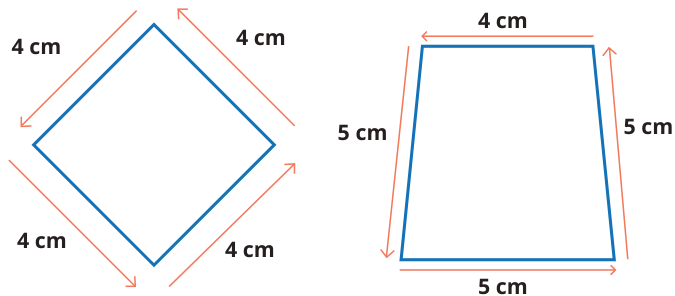


Kunci sumber: `D`; status AI: `verified`; jawaban diverifikasi AI: `D`.
Solusi minimum hasil AI: Keliling adalah jumlah seluruh sisi bangun datar. Untuk bangun kedua (trapesium), keliling = 4 + 5 + 5 + 5 = 19 cm.
Gambar sumber: images/kelas5_panduan_siswa_kelas5.pdf-0130-06.png. Transkripsi visual: Terdapat dua bangun datar. Bangun pertama adalah persegi dengan empat sisi masing-masing 4 cm. Bangun kedua adalah trapesium dengan sisi-sisi berukuran 4 cm, 5 cm, 5 cm, dan 5 cm.

### 1. Pemeriksaan input dan fitur

Struktur: `pass`; alasan: `[]`. Grade/topik: kelas 5 / Matematika SD Kelas 5. KKO: `[]`; KKO hanya petunjuk bantu.
Isi dan kunci berasal dari sumber yang sama pada ketiga run. Versi konten: 2; hash: `386caff73a4d8c85f4825822fa966e8ba5af2b2f367f522e3aa309650e1e7cfa`. Bukti verifikasi AI tidak sama dengan verifikasi ahli.

### 2. Penilaian Gemini blind — tiga run sebelum melihat IndoBERT

| Run | Status | Konten / kunci | Kognitif | Pengetahuan | Difficulty | Token |
|---:|---|---|---|---|---|---:|
| 1 | success | valid / verified | applying | procedural | Easy | 2659 |
| 2 | success | valid / verified | applying | procedural | Easy | 2615 |
| 3 | success | valid / verified | applying | procedural | Easy | 2656 |

Run 1 — solusi: Keliling adalah jumlah seluruh sisi bangun datar. Untuk bangun kedua (trapesium), keliling = 4 + 5 + 5 + 5 = 19 cm.
- Domain kognitif `classify/applying`: Siswa diminta menerapkan definisi keliling (penjumlahan sisi-sisi) pada bangun datar yang diberikan secara eksplisit panjang sisinya.. Bukti: Bagaimanakah cara menentukan kelilingnya?; Keliling = … + … + … + … = ….
- Dimensi pengetahuan `classify/procedural`: Soal ini menguji pemahaman prosedural tentang cara menghitung keliling dengan menjumlahkan panjang sisi-sisi bangun datar.. Bukti: Untuk menentukan kelilingnya, kalian dapat mengukur sisi-sisi bangun datar tersebut
- Intended difficulty `classify/Easy`: Soal ini bersifat rutin dan langsung, meminta siswa menjumlahkan empat bilangan yang sudah diketahui nilainya.. Bukti: Keliling = … + … + … + … = ….

Profil difficulty run ini:

| Parameter | Nilai |
|---|---|
| expectedPrerequisite | Pemahaman dasar tentang konsep keliling sebagai jumlah panjang sisi-sisi bangun datar. |
| dependentSteps | 1 |
| routineStatus | familiar_routine |
| strategySelection | False |
| representationTransfer | False |
| relevantInformationUnits | 4 |
| interactingConstraints | 0 |
| calculationLoad | low |
| scaffoldLevel | partial |
| distractorQuality | plausible |
| gradeRelativeRationale | Untuk kelas 5, menghitung keliling dengan menjumlahkan sisi-sisi yang sudah diketahui angkanya adalah tugas yang sangat mendasar dan rutin. |

Run 2 — solusi: Keliling trapesium adalah jumlah seluruh sisinya: 4 + 5 + 5 + 5 = 19 cm.
- Domain kognitif `classify/applying`: Siswa diminta menerapkan prosedur dasar penjumlahan panjang sisi untuk menentukan keliling bangun datar yang diberikan, yang merupakan tugas rutin.. Bukti: Keliling = … + … + … + … = …. Jadi, kelilingnya … cm.
- Dimensi pengetahuan `classify/procedural`: Soal ini menguji pemahaman tentang algoritma atau teknik menjumlahkan panjang sisi-sisi bangun datar untuk mendapatkan keliling.. Bukti: Untuk menentukan kelilingnya, kalian dapat mengukur sisi-sisi bangun datar tersebut
- Intended difficulty `classify/Easy`: Soal ini bersifat rutin dan langsung, meminta siswa mengikuti pola contoh yang diberikan untuk menjumlahkan sisi-sisi bangun datar.. Bukti: Keliling = … + … + … + … = …. Jadi, kelilingnya … cm.

Profil difficulty run ini:

| Parameter | Nilai |
|---|---|
| expectedPrerequisite | Pemahaman dasar tentang konsep keliling sebagai jumlah panjang sisi-sisi bangun datar. |
| dependentSteps | 1 |
| routineStatus | familiar_routine |
| strategySelection | False |
| representationTransfer | False |
| relevantInformationUnits | 4 |
| interactingConstraints | 0 |
| calculationLoad | low |
| scaffoldLevel | partial |
| distractorQuality | plausible |
| gradeRelativeRationale | Siswa kelas 5 diharapkan sudah sangat familiar dengan konsep keliling dan penjumlahan bilangan sederhana. |

Run 3 — solusi: Keliling adalah jumlah seluruh panjang sisi bangun datar. Untuk trapesium tersebut: 4 + 5 + 5 + 5 = 19 cm.
- Domain kognitif `classify/applying`: Siswa diminta menerapkan definisi keliling (penjumlahan sisi-sisi) pada bangun datar yang diberikan. Ini adalah penerapan prosedur rutin.. Bukti: Bagaimanakah cara menentukan kelilingnya?; Keliling = … + … + … + … = ….
- Dimensi pengetahuan `classify/procedural`: Soal ini menguji pemahaman tentang prosedur menghitung keliling sebagai jumlah panjang sisi-sisi.. Bukti: Untuk menentukan kelilingnya, kalian dapat mengukur sisi-sisi bangun datar tersebut
- Intended difficulty `classify/Easy`: Soal ini sangat mendasar, hanya meminta penjumlahan panjang sisi-sisi yang sudah diketahui nilainya. Tidak ada jebakan atau strategi kompleks.. Bukti: Keliling = … + … + … + … = ….

Profil difficulty run ini:

| Parameter | Nilai |
|---|---|
| expectedPrerequisite | Pemahaman dasar tentang konsep keliling sebagai jumlah panjang sisi. |
| dependentSteps | 1 |
| routineStatus | familiar_routine |
| strategySelection | False |
| representationTransfer | False |
| relevantInformationUnits | 4 |
| interactingConstraints | 0 |
| calculationLoad | low |
| scaffoldLevel | partial |
| distractorQuality | plausible |
| gradeRelativeRationale | Untuk kelas 5, menghitung keliling dengan menjumlahkan sisi-sisi yang sudah tertera adalah tugas yang sangat rutin dan mudah. |

### 3. Voting awal dan adjudikasi

| Head | Suara awal | Pola / status akhir | Label akhir advisory |
|---|---|---|---|
| Domain kognitif | {"applying": 3} | unanimous_3_0 / unanimous | applying |
| Dimensi pengetahuan | {"procedural": 3} | unanimous_3_0 / unanimous | procedural |
| Intended difficulty | {"Easy": 3} | unanimous_3_0 / unanimous | Easy |

### 4. Diagnostik IndoBERT setelah label blind dikunci

Model membaca representation `metadata`; token input 195/256; truncation: `False`.

| Head | Probabilitas | Label | Confidence | Entropy | Action / alasan |
|---|---|---|---:|---:|---|
| Domain kognitif | knowing=0.022034; applying=0.977966; reasoning=0.000000 | applying | 0.977966 | 0.096350 | review / selective_threshold_gate_not_met |
| Dimensi pengetahuan | factual=0.059546; conceptual=0.829751; procedural=0.110703; metacognitive=0.000000 | conceptual | 0.829751 | 0.408631 | review / selective_threshold_gate_not_met |
| Intended difficulty | Easy=0.639416; Medium=0.355195; Hard=0.005389 | Easy | 0.639416 | 0.620560 | review / selective_threshold_gate_not_met |

Domain kognitif: Σp = 1.00000000; confidence = max(p) = 0.977966; −Σp ln(p) = 0.105851; H = 0.105851/ln(3) = 0.096350; T = 0.050000.


Dimensi pengetahuan: Σp = 1.00000000; confidence = max(p) = 0.829751; −Σp ln(p) = 0.566483; H = 0.566483/ln(4) = 0.408631; T = 0.209800.


Intended difficulty: Σp = 1.00000000; confidence = max(p) = 0.639416; −Σp ln(p) = 0.681754; H = 0.681754/ln(3) = 0.620560; T = 0.953328.


<details><summary>Input sebenarnya yang dibaca model</summary>

```text
Kelas: 5
Topik: Matematika SD Kelas 5
Subtopik: Apakah Keliling Bangun Datar Itu?
Tipe soal: multiple_choice
Stimulus: -
Soal: Sekarang, perhatikan gambar-gambar berikut. Bagaimanakah cara menentukan kelilingnya?
Untuk menentukan kelilingnya, kalian dapat mengukur sisi-sisi bangun datar tersebut dengan menggunakan penggaris.
Keliling = 4 + 4 + 4 + 4 = 16.
Jadi, kelilingnya 16 cm.

Keliling = … + … + … + … = …. Jadi, kelilingnya … cm.
Pilihan: A. Keliling = 4 × 4 = 16 cm
B. Keliling = 4 + 5 + 5 = 14 cm
C. Keliling = 4 × 5 = 20 cm
D. Keliling = 4 + 5 + 5 + 5 = 19 cm
Transkripsi visual: Terdapat dua bangun datar. Bangun pertama adalah persegi dengan empat sisi masing-masing 4 cm. Bangun kedua adalah trapesium dengan sisi-sisi berukuran 4 cm, 5 cm, 5 cm, dan 5 cm.
```

</details>

### 5. Keputusan batch

Label advisory blind: `{"mathCognitiveDomain": "applying", "knowledgeDimension": "procedural", "intendedDifficulty": "Easy"}`. Routing: `pending_expert_review`.
Status konten: `valid`. Catatan konten: .
Perbedaan model dan blind: `{"mathCognitiveDomain": {"modelLabel": "applying", "blindLabel": "applying", "agreement": true}, "knowledgeDimension": {"modelLabel": "conceptual", "blindLabel": "procedural", "agreement": false}, "intendedDifficulty": {"modelLabel": "Easy", "blindLabel": "Easy", "agreement": true}}`.
Gold ahli tetap null; human review wajib. Confidence IndoBERT tidak digunakan untuk mengganti label blind.

## 29. Soal `c234ac355c404df57cd80cef`

Apakah nama bangun datar berikut?<br><br>Bagaimana cara menghitung kelilingnya?

| Opsi | Isi |
|---|---|
| A | Keliling = 6 × 4 = 24 cm |
| B | Keliling = 3 × 6 = 18 cm |
| C | Keliling = 6 + 4 = 10 cm |
| D | Keliling = 6 + 6 + 4 = 16 cm |

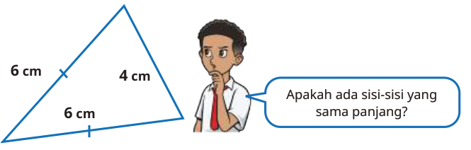


Kunci sumber: `D`; status AI: `verified`; jawaban diverifikasi AI: `D`.
Solusi minimum hasil AI: Keliling segitiga adalah jumlah panjang ketiga sisinya. Berdasarkan gambar, sisi-sisinya adalah 6 cm, 6 cm, dan 4 cm. Maka, keliling = 6 + 6 + 4 = 16 cm.
Gambar sumber: images/kelas5_panduan_siswa_kelas5.pdf-0133-06.png. Transkripsi visual: Gambar menunjukkan segitiga dengan panjang sisi 6 cm, 6 cm, dan 4 cm. Tanda centang pada dua sisi yang berukuran 6 cm menunjukkan bahwa segitiga tersebut adalah segitiga sama kaki. Terdapat ilustrasi anak laki-laki yang bertanya 'Apakah ada sisi-sisi yang sama panjang?'

### 1. Pemeriksaan input dan fitur

Struktur: `pass`; alasan: `[]`. Grade/topik: kelas 5 / Matematika SD Kelas 5. KKO: `[]`; KKO hanya petunjuk bantu.
Isi dan kunci berasal dari sumber yang sama pada ketiga run. Versi konten: 2; hash: `37b07ff2f94d5354181dec522ee1cabc682be81b7b7bbe37edc96bf3d7eae210`. Bukti verifikasi AI tidak sama dengan verifikasi ahli.

### 2. Penilaian Gemini blind — tiga run sebelum melihat IndoBERT

| Run | Status | Konten / kunci | Kognitif | Pengetahuan | Difficulty | Token |
|---:|---|---|---|---|---|---:|
| 1 | success | valid / verified | applying | procedural | Easy | 2531 |
| 2 | success | valid / verified | applying | procedural | Easy | 2512 |
| 3 | success | valid / verified | applying | procedural | Easy | 2500 |

Run 1 — solusi: Keliling segitiga adalah jumlah panjang ketiga sisinya. Berdasarkan gambar, sisi-sisinya adalah 6 cm, 6 cm, dan 4 cm. Maka, keliling = 6 + 6 + 4 = 16 cm.
- Domain kognitif `classify/applying`: Siswa diminta menerapkan konsep dasar keliling (penjumlahan sisi) pada bangun segitiga yang sudah diketahui panjang sisinya. Ini adalah proses rutin.. Bukti: Bagaimana cara menghitung kelilingnya?; 6 + 6 + 4 = 16 cm
- Dimensi pengetahuan `classify/procedural`: Soal ini menguji pemahaman prosedural tentang cara menghitung keliling bangun datar dengan menjumlahkan panjang sisi-sisinya.. Bukti: Keliling = 6 + 6 + 4 = 16 cm
- Intended difficulty `classify/Easy`: Soal ini bersifat rutin dan langsung. Siswa hanya perlu mengidentifikasi panjang sisi dari gambar dan menjumlahkannya. Tidak ada strategi kompleks atau perpindahan representasi yang sulit.. Bukti: 6 cm, 6 cm, dan 4 cm; Keliling = 6 + 6 + 4 = 16 cm

Profil difficulty run ini:

| Parameter | Nilai |
|---|---|
| expectedPrerequisite | Pemahaman konsep keliling sebagai jumlah sisi dan kemampuan penjumlahan dasar. |
| dependentSteps | 1 |
| routineStatus | familiar_routine |
| strategySelection | False |
| representationTransfer | False |
| relevantInformationUnits | 3 |
| interactingConstraints | 0 |
| calculationLoad | low |
| scaffoldLevel | none |
| distractorQuality | plausible |
| gradeRelativeRationale | Untuk kelas 5, menghitung keliling segitiga dengan panjang sisi yang sudah diberikan secara eksplisit adalah tugas yang sangat mendasar dan rutin. |

Run 2 — solusi: Keliling segitiga adalah jumlah panjang ketiga sisinya. Sisi-sisinya adalah 6 cm, 6 cm, dan 4 cm. Maka, keliling = 6 + 6 + 4 = 16 cm.
- Domain kognitif `classify/applying`: Soal meminta siswa menerapkan prosedur standar untuk menghitung keliling segitiga dengan menjumlahkan panjang sisi-sisinya. Ini adalah penerapan konsep rutin.. Bukti: Bagaimana cara menghitung kelilingnya?; Keliling = 6 + 6 + 4 = 16 cm
- Dimensi pengetahuan `classify/procedural`: Siswa perlu memahami prosedur penjumlahan panjang sisi untuk menentukan keliling bangun datar.. Bukti: Keliling = 6 + 6 + 4 = 16 cm
- Intended difficulty `classify/Easy`: Soal ini bersifat rutin dan langsung, hanya memerlukan pemahaman dasar tentang keliling sebagai jumlah sisi-sisi segitiga.. Bukti: 6 cm, 6 cm, dan 4 cm; Keliling = 6 + 6 + 4 = 16 cm

Profil difficulty run ini:

| Parameter | Nilai |
|---|---|
| expectedPrerequisite | Pemahaman dasar tentang keliling bangun datar sebagai jumlah panjang sisi-sisinya. |
| dependentSteps | 1 |
| routineStatus | familiar_routine |
| strategySelection | False |
| representationTransfer | False |
| relevantInformationUnits | 3 |
| interactingConstraints | 0 |
| calculationLoad | low |
| scaffoldLevel | none |
| distractorQuality | plausible |
| gradeRelativeRationale | Untuk kelas 5, menghitung keliling segitiga dengan panjang sisi yang diketahui adalah tugas rutin yang sangat mendasar. |

Run 3 — solusi: Keliling segitiga adalah jumlah panjang ketiga sisinya. Sisi-sisinya adalah 6 cm, 6 cm, dan 4 cm. Maka, keliling = 6 + 6 + 4 = 16 cm.
- Domain kognitif `classify/applying`: Siswa diminta menerapkan definisi keliling (jumlah sisi) pada segitiga yang diberikan. Ini adalah penerapan prosedur rutin.. Bukti: Bagaimana cara menghitung kelilingnya?; 6 + 6 + 4 = 16 cm
- Dimensi pengetahuan `classify/procedural`: Soal ini menguji pemahaman tentang algoritma atau prosedur menghitung keliling bangun datar.. Bukti: Keliling = 6 + 6 + 4 = 16 cm
- Intended difficulty `classify/Easy`: Soal ini bersifat rutin, hanya memerlukan penjumlahan sederhana dari panjang sisi yang sudah diketahui.. Bukti: 6 cm, 6 cm, dan 4 cm; Keliling = 6 + 6 + 4 = 16 cm

Profil difficulty run ini:

| Parameter | Nilai |
|---|---|
| expectedPrerequisite | Pemahaman dasar tentang keliling sebagai jumlah panjang sisi-sisi bangun datar. |
| dependentSteps | 1 |
| routineStatus | familiar_routine |
| strategySelection | False |
| representationTransfer | False |
| relevantInformationUnits | 3 |
| interactingConstraints | 0 |
| calculationLoad | low |
| scaffoldLevel | none |
| distractorQuality | plausible |
| gradeRelativeRationale | Siswa kelas 5 sudah sangat familiar dengan konsep keliling segitiga dan penjumlahan bilangan dasar. |

### 3. Voting awal dan adjudikasi

| Head | Suara awal | Pola / status akhir | Label akhir advisory |
|---|---|---|---|
| Domain kognitif | {"applying": 3} | unanimous_3_0 / unanimous | applying |
| Dimensi pengetahuan | {"procedural": 3} | unanimous_3_0 / unanimous | procedural |
| Intended difficulty | {"Easy": 3} | unanimous_3_0 / unanimous | Easy |

### 4. Diagnostik IndoBERT setelah label blind dikunci

Model membaca representation `metadata`; token input 140/256; truncation: `False`.

| Head | Probabilitas | Label | Confidence | Entropy | Action / alasan |
|---|---|---|---:|---:|---|
| Domain kognitif | knowing=0.025118; applying=0.974882; reasoning=0.000000 | applying | 0.974882 | 0.106805 | review / selective_threshold_gate_not_met |
| Dimensi pengetahuan | factual=0.110905; conceptual=0.883401; procedural=0.005693; metacognitive=0.000000 | conceptual | 0.883401 | 0.276158 | review / selective_threshold_gate_not_met |
| Intended difficulty | Easy=0.865186; Medium=0.131932; Hard=0.002882 | Easy | 0.865186 | 0.372626 | review / selective_threshold_gate_not_met |

Domain kognitif: Σp = 1.00000000; confidence = max(p) = 0.974882; −Σp ln(p) = 0.117337; H = 0.117337/ln(3) = 0.106805; T = 0.050000.


Dimensi pengetahuan: Σp = 1.00000000; confidence = max(p) = 0.883401; −Σp ln(p) = 0.382836; H = 0.382836/ln(4) = 0.276158; T = 0.209800.


Intended difficulty: Σp = 1.00000000; confidence = max(p) = 0.865186; −Σp ln(p) = 0.409371; H = 0.409371/ln(3) = 0.372626; T = 0.953328.


<details><summary>Input sebenarnya yang dibaca model</summary>

```text
Kelas: 5
Topik: Matematika SD Kelas 5
Subtopik: Keliling Segitiga
Tipe soal: multiple_choice
Stimulus: -
Soal: Apakah nama bangun datar berikut?

Bagaimana cara menghitung kelilingnya?
Pilihan: A. Keliling = 6 × 4 = 24 cm
B. Keliling = 3 × 6 = 18 cm
C. Keliling = 6 + 4 = 10 cm
D. Keliling = 6 + 6 + 4 = 16 cm
Transkripsi visual: Gambar menunjukkan segitiga dengan panjang sisi 6 cm, 6 cm, dan 4 cm. Tanda centang pada dua sisi yang berukuran 6 cm menunjukkan bahwa segitiga tersebut adalah segitiga sama kaki. Terdapat ilustrasi anak laki-laki yang bertanya 'Apakah ada sisi-sisi yang sama panjang?'
```

</details>

### 5. Keputusan batch

Label advisory blind: `{"mathCognitiveDomain": "applying", "knowledgeDimension": "procedural", "intendedDifficulty": "Easy"}`. Routing: `pending_expert_review`.
Status konten: `valid`. Catatan konten: .
Perbedaan model dan blind: `{"mathCognitiveDomain": {"modelLabel": "applying", "blindLabel": "applying", "agreement": true}, "knowledgeDimension": {"modelLabel": "conceptual", "blindLabel": "procedural", "agreement": false}, "intendedDifficulty": {"modelLabel": "Easy", "blindLabel": "Easy", "agreement": true}}`.
Gold ahli tetap null; human review wajib. Confidence IndoBERT tidak digunakan untuk mengganti label blind.

## 30. Soal `b1b0e3eb7042a38fd736f941`

Apakah nama bangun datar berikut?

| Opsi | Isi |
|---|---|
| A | Segitiga sembarang |
| B | Segitiga siku-siku |
| C | Segitiga sama sisi |
| D | Segitiga sama kaki |


Kunci sumber: `D`; status AI: `verified`; jawaban diverifikasi AI: `D`.
Solusi minimum hasil AI: Segitiga memiliki dua sisi dengan panjang yang sama yaitu 6 cm dan 6 cm, sedangkan sisi ketiga adalah 4 cm. Berdasarkan definisi, segitiga dengan tepat dua sisi sama panjang disebut segitiga sama kaki.
Gambar sumber: images/kelas5_panduan_siswa_kelas5.pdf-0133-06.png. Transkripsi visual: Gambar menunjukkan sebuah segitiga dengan panjang sisi 6 cm, 6 cm, dan 4 cm. Terdapat tanda garis kecil pada dua sisi yang panjangnya 6 cm, yang mengindikasikan bahwa kedua sisi tersebut sama panjang.

### 1. Pemeriksaan input dan fitur

Struktur: `pass`; alasan: `[]`. Grade/topik: kelas 5 / Matematika SD Kelas 5. KKO: `[]`; KKO hanya petunjuk bantu.
Isi dan kunci berasal dari sumber yang sama pada ketiga run. Versi konten: 2; hash: `08bbf4c168314e4890e8265e80e350ca7c1c012e9dd3f97ce17569835aaf67dd`. Bukti verifikasi AI tidak sama dengan verifikasi ahli.

### 2. Penilaian Gemini blind — tiga run sebelum melihat IndoBERT

| Run | Status | Konten / kunci | Kognitif | Pengetahuan | Difficulty | Token |
|---:|---|---|---|---|---|---:|
| 1 | success | valid / verified | knowing | conceptual | Easy | 2490 |
| 2 | success | valid / verified | knowing | conceptual | Easy | 2461 |
| 3 | success | valid / verified | knowing | conceptual | Easy | 2452 |

Run 1 — solusi: Segitiga memiliki dua sisi dengan panjang yang sama yaitu 6 cm dan 6 cm, sedangkan sisi ketiga adalah 4 cm. Berdasarkan definisi, segitiga dengan tepat dua sisi sama panjang disebut segitiga sama kaki.
- Domain kognitif `classify/knowing`: Soal meminta siswa untuk mengenali dan mengklasifikasikan bangun datar berdasarkan properti sisi yang diberikan. Ini adalah proses pengenalan langsung terhadap definisi geometri.. Bukti: Apakah nama bangun datar berikut?; dua sisinya sama panjang (6 cm dan 6 cm)
- Dimensi pengetahuan `classify/conceptual`: Siswa perlu memahami konsep atau definisi dari jenis-jenis segitiga (sama kaki) untuk mengidentifikasi bangun tersebut.. Bukti: Segitiga sama kaki; dua sisinya sama panjang (6 cm dan 6 cm)
- Intended difficulty `classify/Easy`: Soal ini sangat mendasar, hanya memerlukan pengamatan visual terhadap panjang sisi dan pengetahuan definisi segitiga dasar.. Bukti: Apakah nama bangun datar berikut?; 6 cm, 6 cm, dan 4 cm

Profil difficulty run ini:

| Parameter | Nilai |
|---|---|
| expectedPrerequisite | Pemahaman dasar tentang definisi segitiga sama kaki dan kemampuan membaca label angka pada gambar. |
| dependentSteps | 1 |
| routineStatus | familiar_routine |
| strategySelection | False |
| representationTransfer | False |
| relevantInformationUnits | 3 |
| interactingConstraints | 1 |
| calculationLoad | low |
| scaffoldLevel | none |
| distractorQuality | plausible |
| gradeRelativeRationale | Untuk kelas 5, mengidentifikasi jenis segitiga berdasarkan panjang sisi adalah materi yang sangat rutin dan mendasar. |

Run 2 — solusi: Segitiga memiliki dua sisi dengan panjang yang sama (6 cm dan 6 cm), sehingga diklasifikasikan sebagai segitiga sama kaki.
- Domain kognitif `classify/knowing`: Siswa diminta untuk mengidentifikasi jenis segitiga berdasarkan properti panjang sisi yang diberikan secara eksplisit. Ini adalah proses pengenalan sifat bangun datar yang langsung.. Bukti: Apakah nama bangun datar berikut?; dua sisi yang panjangnya 6 cm
- Dimensi pengetahuan `classify/conceptual`: Soal menguji pemahaman definisi dan klasifikasi segitiga berdasarkan panjang sisinya (konsep segitiga sama kaki).. Bukti: nama bangun datar; dua sisi yang panjangnya 6 cm
- Intended difficulty `classify/Easy`: Soal ini sangat mendasar karena langsung memberikan informasi panjang sisi dan meminta klasifikasi sederhana berdasarkan definisi.. Bukti: Apakah nama bangun datar berikut?; 6 cm, 6 cm, dan 4 cm

Profil difficulty run ini:

| Parameter | Nilai |
|---|---|
| expectedPrerequisite | Definisi segitiga sama kaki, sama sisi, dan sembarang. |
| dependentSteps | 1 |
| routineStatus | familiar_routine |
| strategySelection | False |
| representationTransfer | False |
| relevantInformationUnits | 3 |
| interactingConstraints | 0 |
| calculationLoad | low |
| scaffoldLevel | none |
| distractorQuality | plausible |
| gradeRelativeRationale | Untuk kelas 5, mengidentifikasi jenis segitiga berdasarkan panjang sisi adalah materi dasar yang sudah diperkenalkan di kelas sebelumnya. |

Run 3 — solusi: Segitiga memiliki dua sisi dengan panjang yang sama (6 cm dan 6 cm), sehingga diklasifikasikan sebagai segitiga sama kaki.
- Domain kognitif `classify/knowing`: Siswa diminta untuk mengenali dan mengklasifikasikan jenis segitiga berdasarkan properti panjang sisinya yang diberikan secara eksplisit.. Bukti: Apakah nama bangun datar berikut?; 6 cm, 6 cm, dan 4 cm
- Dimensi pengetahuan `classify/conceptual`: Soal menguji pemahaman konsep definisi segitiga sama kaki (memiliki dua sisi sama panjang).. Bukti: Segitiga sama kaki; 6 cm dan 6 cm
- Intended difficulty `classify/Easy`: Soal ini sangat mendasar, hanya memerlukan pengenalan visual terhadap properti segitiga yang sudah diberikan angkanya secara eksplisit.. Bukti: Apakah nama bangun datar berikut?; 6 cm, 6 cm, dan 4 cm

Profil difficulty run ini:

| Parameter | Nilai |
|---|---|
| expectedPrerequisite | Definisi dasar jenis-jenis segitiga berdasarkan panjang sisi. |
| dependentSteps | 1 |
| routineStatus | familiar_routine |
| strategySelection | False |
| representationTransfer | False |
| relevantInformationUnits | 3 |
| interactingConstraints | 0 |
| calculationLoad | low |
| scaffoldLevel | none |
| distractorQuality | plausible |
| gradeRelativeRationale | Siswa kelas 5 diharapkan sudah sangat familiar dengan klasifikasi segitiga sederhana berdasarkan panjang sisi. |

### 3. Voting awal dan adjudikasi

| Head | Suara awal | Pola / status akhir | Label akhir advisory |
|---|---|---|---|
| Domain kognitif | {"knowing": 3} | unanimous_3_0 / unanimous | knowing |
| Dimensi pengetahuan | {"conceptual": 3} | unanimous_3_0 / unanimous | conceptual |
| Intended difficulty | {"Easy": 3} | unanimous_3_0 / unanimous | Easy |

### 4. Diagnostik IndoBERT setelah label blind dikunci

Model membaca representation `metadata`; token input 97/256; truncation: `False`.

| Head | Probabilitas | Label | Confidence | Entropy | Action / alasan |
|---|---|---|---:|---:|---|
| Domain kognitif | knowing=0.757047; applying=0.242953; reasoning=0.000000 | knowing | 0.757047 | 0.504691 | review / selective_threshold_gate_not_met |
| Dimensi pengetahuan | factual=0.322334; conceptual=0.673369; procedural=0.004297; metacognitive=0.000000 | conceptual | 0.673369 | 0.472227 | review / selective_threshold_gate_not_met |
| Intended difficulty | Easy=0.890698; Medium=0.106429; Hard=0.002873 | Easy | 0.890698 | 0.326180 | review / selective_threshold_gate_not_met |

Domain kognitif: Σp = 1.00000000; confidence = max(p) = 0.757047; −Σp ln(p) = 0.554460; H = 0.554460/ln(3) = 0.504691; T = 0.050000.


Dimensi pengetahuan: Σp = 1.00000000; confidence = max(p) = 0.673369; −Σp ln(p) = 0.654646; H = 0.654646/ln(4) = 0.472227; T = 0.209800.


Intended difficulty: Σp = 1.00000000; confidence = max(p) = 0.890698; −Σp ln(p) = 0.358345; H = 0.358345/ln(3) = 0.326180; T = 0.953328.


<details><summary>Input sebenarnya yang dibaca model</summary>

```text
Kelas: 5
Topik: Matematika SD Kelas 5
Subtopik: Keliling Segitiga
Tipe soal: multiple_choice
Stimulus: -
Soal: Apakah nama bangun datar berikut?
Pilihan: A. Segitiga sembarang
B. Segitiga siku-siku
C. Segitiga sama sisi
D. Segitiga sama kaki
Transkripsi visual: Gambar menunjukkan sebuah segitiga dengan panjang sisi 6 cm, 6 cm, dan 4 cm. Terdapat tanda garis kecil pada dua sisi yang panjangnya 6 cm, yang mengindikasikan bahwa kedua sisi tersebut sama panjang.
```

</details>

### 5. Keputusan batch

Label advisory blind: `{"mathCognitiveDomain": "knowing", "knowledgeDimension": "conceptual", "intendedDifficulty": "Easy"}`. Routing: `pending_expert_review`.
Status konten: `valid`. Catatan konten: .
Perbedaan model dan blind: `{"mathCognitiveDomain": {"modelLabel": "knowing", "blindLabel": "knowing", "agreement": true}, "knowledgeDimension": {"modelLabel": "conceptual", "blindLabel": "conceptual", "agreement": true}, "intendedDifficulty": {"modelLabel": "Easy", "blindLabel": "Easy", "agreement": true}}`.
Gold ahli tetap null; human review wajib. Confidence IndoBERT tidak digunakan untuk mengganti label blind.

## 31. Soal `1227c8e81090cfbb43cbc1c3`

Apakah nama bangun datar berikut?<br><br>Bagaimana cara menghitung kelilingnya?

| Opsi | Isi |
|---|---|
| A | Keliling = 5 × 3 = 15 cm |
| B | Keliling = 5 + 3 = 8 cm |
| C | Keliling = (2 × 5) + (2 × 3) = 16 cm |
| D | Keliling = 4 × 5 = 20 cm |

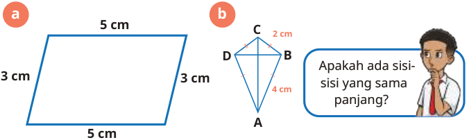


Kunci sumber: `C`; status AI: `verified`; jawaban diverifikasi AI: `C`.
Solusi minimum hasil AI: Keliling jajar genjang = 2 × (panjang + lebar) = 2 × (5 cm + 3 cm) = 2 × 8 cm = 16 cm.
Gambar sumber: images/kelas5_panduan_siswa_kelas5.pdf-0135-05.png. Transkripsi visual: Gambar (a) menunjukkan bangun jajar genjang dengan panjang sisi sejajar 5 cm dan 3 cm. Gambar (b) menunjukkan bangun layang-layang dengan label sisi 2 cm dan 4 cm.

### 1. Pemeriksaan input dan fitur

Struktur: `pass`; alasan: `[]`. Grade/topik: kelas 5 / Matematika SD Kelas 5. KKO: `[]`; KKO hanya petunjuk bantu.
Isi dan kunci berasal dari sumber yang sama pada ketiga run. Versi konten: 2; hash: `bac81957218a2dcfdae0545d31a6aa885040c00eb6b35b88168528996ca0ceb8`. Bukti verifikasi AI tidak sama dengan verifikasi ahli.

### 2. Penilaian Gemini blind — tiga run sebelum melihat IndoBERT

| Run | Status | Konten / kunci | Kognitif | Pengetahuan | Difficulty | Token |
|---:|---|---|---|---|---|---:|
| 1 | success | valid / verified | applying | procedural | Easy | 2556 |
| 2 | success | valid / verified | applying | procedural | Easy | 2555 |
| 3 | success | valid / verified | applying | procedural | Easy | 2579 |

Run 1 — solusi: Keliling jajar genjang = 2 × (panjang + lebar) = 2 × (5 cm + 3 cm) = 2 × 8 cm = 16 cm.
- Domain kognitif `classify/applying`: Siswa diminta menerapkan rumus keliling jajar genjang yang sudah dipelajari (prosedur rutin) pada bangun yang diberikan.. Bukti: Bagaimana cara menghitung kelilingnya?
- Dimensi pengetahuan `classify/procedural`: Soal ini menguji pemahaman tentang algoritma atau rumus keliling bangun datar.. Bukti: Keliling = (2 × 5) + (2 × 3) = 16 cm
- Intended difficulty `classify/Easy`: Soal ini merupakan prosedur standar yang familiar bagi siswa kelas 5, melibatkan satu konsep keliling dengan data yang eksplisit.. Bukti: 5 cm; 3 cm; Keliling = (2 × 5) + (2 × 3) = 16 cm

Profil difficulty run ini:

| Parameter | Nilai |
|---|---|
| expectedPrerequisite | Pemahaman konsep keliling sebagai jumlah seluruh sisi bangun datar. |
| dependentSteps | 2 |
| routineStatus | familiar_routine |
| strategySelection | False |
| representationTransfer | False |
| relevantInformationUnits | 2 |
| interactingConstraints | 0 |
| calculationLoad | low |
| scaffoldLevel | none |
| distractorQuality | plausible |
| gradeRelativeRationale | Siswa kelas 5 diharapkan sudah mampu menghitung keliling bangun datar sederhana seperti jajar genjang dengan data panjang sisi yang diberikan langsung. |

Run 2 — solusi: Keliling jajar genjang = 2 × (panjang + lebar) = 2 × (5 cm + 3 cm) = 2 × 8 cm = 16 cm.
- Domain kognitif `classify/applying`: Siswa diminta menerapkan rumus keliling jajar genjang yang sudah dipelajari sebelumnya pada situasi rutin.. Bukti: Bagaimana cara menghitung kelilingnya?
- Dimensi pengetahuan `classify/procedural`: Soal ini menguji pemahaman tentang prosedur menghitung keliling bangun datar (jajar genjang) dengan menjumlahkan keempat sisinya.. Bukti: Keliling = (2 × 5) + (2 × 3) = 16 cm
- Intended difficulty `classify/Easy`: Soal ini bersifat rutin dan langsung, menggunakan rumus keliling standar yang sesuai untuk kelas 5.. Bukti: 5 cm; 3 cm; Keliling = (2 × 5) + (2 × 3) = 16 cm

Profil difficulty run ini:

| Parameter | Nilai |
|---|---|
| expectedPrerequisite | Pemahaman konsep keliling sebagai jumlah panjang sisi-sisi bangun datar. |
| dependentSteps | 2 |
| routineStatus | familiar_routine |
| strategySelection | False |
| representationTransfer | False |
| relevantInformationUnits | 2 |
| interactingConstraints | 0 |
| calculationLoad | low |
| scaffoldLevel | none |
| distractorQuality | plausible |
| gradeRelativeRationale | Siswa kelas 5 diharapkan sudah mahir menghitung keliling bangun datar sederhana seperti jajar genjang dengan data yang eksplisit. |

Run 3 — solusi: Keliling jajar genjang = 2 × (panjang + lebar) = 2 × (5 cm + 3 cm) = 2 × 8 cm = 16 cm.
- Domain kognitif `classify/applying`: Siswa diminta menerapkan rumus keliling bangun datar (jajar genjang) yang sudah diketahui panjang sisi-sisinya. Ini adalah prosedur rutin.. Bukti: Bagaimana cara menghitung kelilingnya?
- Dimensi pengetahuan `classify/procedural`: Soal ini menguji pemahaman tentang rumus keliling (prosedur) dan bagaimana menerapkannya pada bangun jajar genjang.. Bukti: Keliling = (2 × 5) + (2 × 3) = 16 cm
- Intended difficulty `classify/Easy`: Soal ini sangat standar untuk kelas 5, melibatkan prosedur rutin penjumlahan sisi-sisi bangun datar tanpa jebakan atau strategi kompleks.. Bukti: 5 cm; 3 cm; Keliling = (2 × 5) + (2 × 3) = 16 cm

Profil difficulty run ini:

| Parameter | Nilai |
|---|---|
| expectedPrerequisite | Pemahaman konsep keliling sebagai jumlah seluruh sisi bangun datar. |
| dependentSteps | 2 |
| routineStatus | familiar_routine |
| strategySelection | False |
| representationTransfer | False |
| relevantInformationUnits | 2 |
| interactingConstraints | 0 |
| calculationLoad | low |
| scaffoldLevel | none |
| distractorQuality | plausible |
| gradeRelativeRationale | Sesuai untuk kelas 5 karena menghitung keliling bangun datar sederhana adalah materi dasar yang rutin. |

### 3. Voting awal dan adjudikasi

| Head | Suara awal | Pola / status akhir | Label akhir advisory |
|---|---|---|---|
| Domain kognitif | {"applying": 3} | unanimous_3_0 / unanimous | applying |
| Dimensi pengetahuan | {"procedural": 3} | unanimous_3_0 / unanimous | procedural |
| Intended difficulty | {"Easy": 3} | unanimous_3_0 / unanimous | Easy |

### 4. Diagnostik IndoBERT setelah label blind dikunci

Model membaca representation `metadata`; token input 132/256; truncation: `False`.

| Head | Probabilitas | Label | Confidence | Entropy | Action / alasan |
|---|---|---|---:|---:|---|
| Domain kognitif | knowing=0.004573; applying=0.995427; reasoning=0.000000 | applying | 0.995427 | 0.026579 | review / selective_threshold_gate_not_met |
| Dimensi pengetahuan | factual=0.311316; conceptual=0.669407; procedural=0.019277; metacognitive=0.000000 | conceptual | 0.669407 | 0.510777 | review / selective_threshold_gate_not_met |
| Intended difficulty | Easy=0.833661; Medium=0.163878; Hard=0.002460 | Easy | 0.833661 | 0.421297 | review / selective_threshold_gate_not_met |

Domain kognitif: Σp = 1.00000000; confidence = max(p) = 0.995427; −Σp ln(p) = 0.029200; H = 0.029200/ln(3) = 0.026579; T = 0.050000.


Dimensi pengetahuan: Σp = 1.00000000; confidence = max(p) = 0.669407; −Σp ln(p) = 0.708088; H = 0.708088/ln(4) = 0.510777; T = 0.209800.


Intended difficulty: Σp = 1.00000000; confidence = max(p) = 0.833661; −Σp ln(p) = 0.462842; H = 0.462842/ln(3) = 0.421297; T = 0.953328.


<details><summary>Input sebenarnya yang dibaca model</summary>

```text
Kelas: 5
Topik: Matematika SD Kelas 5
Subtopik: Keliling Segi Empat
Tipe soal: multiple_choice
Stimulus: -
Soal: Apakah nama bangun datar berikut?

Bagaimana cara menghitung kelilingnya?
Pilihan: A. Keliling = 5 × 3 = 15 cm
B. Keliling = 5 + 3 = 8 cm
C. Keliling = (2 × 5) + (2 × 3) = 16 cm
D. Keliling = 4 × 5 = 20 cm
Transkripsi visual: Gambar (a) menunjukkan bangun jajar genjang dengan panjang sisi sejajar 5 cm dan 3 cm. Gambar (b) menunjukkan bangun layang-layang dengan label sisi 2 cm dan 4 cm.
```

</details>

### 5. Keputusan batch

Label advisory blind: `{"mathCognitiveDomain": "applying", "knowledgeDimension": "procedural", "intendedDifficulty": "Easy"}`. Routing: `pending_expert_review`.
Status konten: `valid`. Catatan konten: .
Perbedaan model dan blind: `{"mathCognitiveDomain": {"modelLabel": "applying", "blindLabel": "applying", "agreement": true}, "knowledgeDimension": {"modelLabel": "conceptual", "blindLabel": "procedural", "agreement": false}, "intendedDifficulty": {"modelLabel": "Easy", "blindLabel": "Easy", "agreement": true}}`.
Gold ahli tetap null; human review wajib. Confidence IndoBERT tidak digunakan untuk mengganti label blind.

## 32. Soal `f1bf25d82612cb22f80e24e7`

Apakah nama bangun datar berikut?

| Opsi | Isi |
|---|---|
| A | Belah ketupat |
| B | Layang-layang |
| C | Jajargenjang |
| D | Trapesium |


Kunci sumber: `B`; status AI: `verified`; jawaban diverifikasi AI: `B`.
Solusi minimum hasil AI: Bangun datar pada gambar b memiliki dua pasang sisi yang berdekatan sama panjang (CD=CB=2cm dan AD=AB=4cm), yang merupakan definisi geometris dari layang-layang.
Gambar sumber: images/kelas5_panduan_siswa_kelas5.pdf-0135-05.png. Transkripsi visual: Gambar b menunjukkan bangun datar segi empat dengan titik sudut A, B, C, D. Terdapat tanda garis pada sisi-sisi yang menunjukkan kesamaan panjang: sisi CD dan CB memiliki panjang 2 cm (ditandai dengan satu garis pendek), sedangkan sisi AD dan AB memiliki panjang 4 cm (ditandai dengan dua garis pendek). Bangun ini memiliki dua pasang sisi berdekatan yang sama panjang.

### 1. Pemeriksaan input dan fitur

Struktur: `pass`; alasan: `[]`. Grade/topik: kelas 5 / Matematika SD Kelas 5. KKO: `[]`; KKO hanya petunjuk bantu.
Isi dan kunci berasal dari sumber yang sama pada ketiga run. Versi konten: 2; hash: `7105e7c082e24b84992c4c7862130f856cf7339efc529795dbf8c49444fad301`. Bukti verifikasi AI tidak sama dengan verifikasi ahli.

### 2. Penilaian Gemini blind — tiga run sebelum melihat IndoBERT

| Run | Status | Konten / kunci | Kognitif | Pengetahuan | Difficulty | Token |
|---:|---|---|---|---|---|---:|
| 1 | success | valid / verified | knowing | conceptual | Easy | 2557 |
| 2 | success | valid / verified | knowing | conceptual | Easy | 2546 |
| 3 | success | valid / verified | knowing | conceptual | Easy | 2516 |

Run 1 — solusi: Bangun datar pada gambar b memiliki dua pasang sisi yang berdekatan sama panjang (CD=CB=2cm dan AD=AB=4cm), yang merupakan definisi geometris dari layang-layang.
- Domain kognitif `classify/knowing`: Siswa diminta untuk mengidentifikasi bangun datar berdasarkan properti geometris yang diberikan (dua pasang sisi berdekatan sama panjang). Ini adalah proses mengenali dan mengklasifikasikan objek berdasarkan definisi, yang masuk dalam domain knowing.. Bukti: Apakah nama bangun datar berikut?; dua pasang sisi yang berdekatan sama panjang
- Dimensi pengetahuan `classify/conceptual`: Soal ini menguji pemahaman siswa terhadap definisi dan karakteristik (hubungan antar sisi) dari bangun datar layang-layang.. Bukti: dua pasang sisi yang berdekatan sama panjang
- Intended difficulty `classify/Easy`: Soal ini bersifat langsung, hanya memerlukan pengenalan visual dan pemahaman definisi dasar bangun datar tanpa perhitungan kompleks atau strategi multi-langkah.. Bukti: Apakah nama bangun datar berikut?; dua pasang sisi yang berdekatan sama panjang

Profil difficulty run ini:

| Parameter | Nilai |
|---|---|
| expectedPrerequisite | Pemahaman dasar tentang sifat-sifat bangun datar segi empat (layang-layang). |
| dependentSteps | 1 |
| routineStatus | familiar_routine |
| strategySelection | False |
| representationTransfer | False |
| relevantInformationUnits | 2 |
| interactingConstraints | 1 |
| calculationLoad | low |
| scaffoldLevel | none |
| distractorQuality | plausible |
| gradeRelativeRationale | Siswa kelas 5 diharapkan sudah mengenal klasifikasi bangun datar sederhana berdasarkan sifat sisinya. |

Run 2 — solusi: Bangun datar pada gambar b memiliki dua pasang sisi berdekatan yang sama panjang (CD=CB=2 cm dan AD=AB=4 cm), yang merupakan definisi geometris dari layang-layang.
- Domain kognitif `classify/knowing`: Siswa diminta untuk mengidentifikasi bangun datar berdasarkan properti geometris yang diberikan (panjang sisi). Ini adalah proses mengenali dan mengklasifikasikan objek berdasarkan definisi, yang masuk dalam domain knowing.. Bukti: Apakah nama bangun datar berikut?; dua pasang sisi yang berdekatan sama panjang
- Dimensi pengetahuan `classify/conceptual`: Soal ini menguji pemahaman siswa tentang definisi dan karakteristik (hubungan antar sisi) dari bangun datar layang-layang, bukan sekadar menghafal nama.. Bukti: dua pasang sisi yang berdekatan sama panjang
- Intended difficulty `classify/Easy`: Soal ini bersifat langsung dan rutin untuk siswa kelas 5 yang sudah mempelajari sifat-sifat bangun datar. Tidak ada strategi kompleks atau perhitungan yang diperlukan.. Bukti: Apakah nama bangun datar berikut?; dua pasang sisi yang berdekatan sama panjang

Profil difficulty run ini:

| Parameter | Nilai |
|---|---|
| expectedPrerequisite | Pemahaman dasar tentang sifat-sifat bangun datar segi empat (layang-layang). |
| dependentSteps | 1 |
| routineStatus | familiar_routine |
| strategySelection | False |
| representationTransfer | False |
| relevantInformationUnits | 2 |
| interactingConstraints | 1 |
| calculationLoad | low |
| scaffoldLevel | none |
| distractorQuality | plausible |
| gradeRelativeRationale | Mengidentifikasi bangun datar berdasarkan sifat sisi adalah materi standar kelas 5 SD. |

Run 3 — solusi: Bangun datar pada gambar b memiliki dua pasang sisi yang berdekatan sama panjang (2 cm dan 4 cm), yang merupakan definisi geometris dari layang-layang.
- Domain kognitif `classify/knowing`: Siswa diminta untuk mengidentifikasi bangun datar berdasarkan properti geometris yang diberikan secara visual. Ini adalah proses mengenali dan mengklasifikasikan objek berdasarkan definisi, yang termasuk dalam domain knowing.. Bukti: Apakah nama bangun datar berikut?; dua pasang sisi yang berdekatan sama panjang
- Dimensi pengetahuan `classify/conceptual`: Soal ini menguji pemahaman siswa tentang definisi dan karakteristik (sifat-sifat) dari bangun datar segi empat, yang merupakan pengetahuan konseptual.. Bukti: Apakah nama bangun datar berikut?; dua pasang sisi yang berdekatan sama panjang
- Intended difficulty `classify/Easy`: Soal ini bersifat langsung, menguji pengenalan bentuk dasar berdasarkan properti yang terlihat jelas. Tidak ada langkah perhitungan atau strategi kompleks yang diperlukan.. Bukti: Apakah nama bangun datar berikut?; dua pasang sisi yang berdekatan sama panjang

Profil difficulty run ini:

| Parameter | Nilai |
|---|---|
| expectedPrerequisite | Pemahaman dasar tentang sifat-sifat bangun datar segi empat (layang-layang). |
| dependentSteps | 1 |
| routineStatus | familiar_routine |
| strategySelection | False |
| representationTransfer | False |
| relevantInformationUnits | 2 |
| interactingConstraints | 0 |
| calculationLoad | low |
| scaffoldLevel | none |
| distractorQuality | plausible |
| gradeRelativeRationale | Untuk siswa kelas 5, mengidentifikasi bangun datar berdasarkan sifat sisinya adalah materi standar yang rutin dan tidak menuntut penalaran tingkat tinggi. |

### 3. Voting awal dan adjudikasi

| Head | Suara awal | Pola / status akhir | Label akhir advisory |
|---|---|---|---|
| Domain kognitif | {"knowing": 3} | unanimous_3_0 / unanimous | knowing |
| Dimensi pengetahuan | {"conceptual": 3} | unanimous_3_0 / unanimous | conceptual |
| Intended difficulty | {"Easy": 3} | unanimous_3_0 / unanimous | Easy |

### 4. Diagnostik IndoBERT setelah label blind dikunci

Model membaca representation `metadata`; token input 133/256; truncation: `False`.

| Head | Probabilitas | Label | Confidence | Entropy | Action / alasan |
|---|---|---|---:|---:|---|
| Domain kognitif | knowing=0.000810; applying=0.999190; reasoning=0.000000 | applying | 0.999190 | 0.005984 | review / selective_threshold_gate_not_met |
| Dimensi pengetahuan | factual=0.149174; conceptual=0.844382; procedural=0.006444; metacognitive=0.000000 | conceptual | 0.844382 | 0.331214 | review / selective_threshold_gate_not_met |
| Intended difficulty | Easy=0.794984; Medium=0.201542; Hard=0.003473 | Easy | 0.794984 | 0.477772 | review / selective_threshold_gate_not_met |

Domain kognitif: Σp = 1.00000000; confidence = max(p) = 0.999190; −Σp ln(p) = 0.006574; H = 0.006574/ln(3) = 0.005984; T = 0.050000.


Dimensi pengetahuan: Σp = 1.00000000; confidence = max(p) = 0.844382; −Σp ln(p) = 0.459160; H = 0.459160/ln(4) = 0.331214; T = 0.209800.


Intended difficulty: Σp = 1.00000000; confidence = max(p) = 0.794984; −Σp ln(p) = 0.524886; H = 0.524886/ln(3) = 0.477772; T = 0.953328.


<details><summary>Input sebenarnya yang dibaca model</summary>

```text
Kelas: 5
Topik: Matematika SD Kelas 5
Subtopik: Keliling Segi Empat
Tipe soal: multiple_choice
Stimulus: -
Soal: Apakah nama bangun datar berikut?
Pilihan: A. Belah ketupat
B. Layang-layang
C. Jajargenjang
D. Trapesium
Transkripsi visual: Gambar b menunjukkan bangun datar segi empat dengan titik sudut A, B, C, D. Terdapat tanda garis pada sisi-sisi yang menunjukkan kesamaan panjang: sisi CD dan CB memiliki panjang 2 cm (ditandai dengan satu garis pendek), sedangkan sisi AD dan AB memiliki panjang 4 cm (ditandai dengan dua garis pendek). Bangun ini memiliki dua pasang sisi berdekatan yang sama panjang.
```

</details>

### 5. Keputusan batch

Label advisory blind: `{"mathCognitiveDomain": "knowing", "knowledgeDimension": "conceptual", "intendedDifficulty": "Easy"}`. Routing: `pending_expert_review`.
Status konten: `valid`. Catatan konten: .
Perbedaan model dan blind: `{"mathCognitiveDomain": {"modelLabel": "applying", "blindLabel": "knowing", "agreement": false}, "knowledgeDimension": {"modelLabel": "conceptual", "blindLabel": "conceptual", "agreement": true}, "intendedDifficulty": {"modelLabel": "Easy", "blindLabel": "Easy", "agreement": true}}`.
Gold ahli tetap null; human review wajib. Confidence IndoBERT tidak digunakan untuk mengganti label blind.

## 33. Soal `6a24acac84ee1e57911309bc`

Perhatikan bangun-bangun datar berikut.<br>Perhatikan gambar di samping.<br><br>Bagaimana cara mencari kelilingnya?

| Opsi | Isi |
|---|---|
| A | Keliling = 4 × 3 = 12 cm |
| B | Keliling = 6 × 3 = 18 cm |
| C | Keliling = 5 × 3 = 15 cm |
| D | Keliling = 3 × 3 = 9 cm |

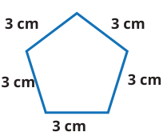


Kunci sumber: `C`; status AI: `verified`; jawaban diverifikasi AI: `C`.
Solusi minimum hasil AI: Bangun tersebut adalah segi lima beraturan dengan 5 sisi yang masing-masing panjangnya 3 cm. Keliling = 5 x 3 cm = 15 cm.
Gambar sumber: images/kelas5_panduan_siswa_kelas5.pdf-0138-06.png. Transkripsi visual: Gambar menunjukkan sebuah bangun datar segi lima beraturan dengan lima sisi yang sama panjang, di mana setiap sisi diberi label panjang 3 cm.

### 1. Pemeriksaan input dan fitur

Struktur: `pass`; alasan: `[]`. Grade/topik: kelas 5 / Matematika SD Kelas 5. KKO: `[]`; KKO hanya petunjuk bantu.
Isi dan kunci berasal dari sumber yang sama pada ketiga run. Versi konten: 2; hash: `5291dfdb13339200cca4b0f5da23a2692808f85dbb674cb780ea879090d997b2`. Bukti verifikasi AI tidak sama dengan verifikasi ahli.

### 2. Penilaian Gemini blind — tiga run sebelum melihat IndoBERT

| Run | Status | Konten / kunci | Kognitif | Pengetahuan | Difficulty | Token |
|---:|---|---|---|---|---|---:|
| 1 | success | valid / verified | applying | conceptual | Easy | 2488 |
| 2 | success | valid / verified | applying | procedural | Easy | 2527 |
| 3 | success | valid / verified | applying | procedural | Easy | 2513 |

Run 1 — solusi: Bangun tersebut adalah segi lima beraturan dengan 5 sisi yang sama panjang (3 cm). Keliling = 5 x 3 cm = 15 cm.
- Domain kognitif `classify/applying`: Soal meminta siswa menerapkan konsep keliling pada bangun datar yang diberikan. Ini adalah penerapan langsung dari definisi keliling (jumlah panjang sisi) pada situasi rutin.. Bukti: Bagaimana cara mencari kelilingnya?
- Dimensi pengetahuan `classify/conceptual`: Siswa perlu memahami konsep keliling sebagai jumlah panjang sisi-sisi bangun datar dan menerapkan prosedur perkalian untuk menghitungnya.. Bukti: Keliling = 5 × 3 = 15 cm
- Intended difficulty `classify/Easy`: Soal ini sangat mendasar, melibatkan pengenalan bangun dan penerapan rumus keliling sederhana.. Bukti: Perhatikan gambar di samping.; Keliling = 5 × 3 = 15 cm

Profil difficulty run ini:

| Parameter | Nilai |
|---|---|
| expectedPrerequisite | Pemahaman dasar tentang keliling bangun datar dan perkalian bilangan cacah. |
| dependentSteps | 1 |
| routineStatus | familiar_routine |
| strategySelection | False |
| representationTransfer | False |
| relevantInformationUnits | 2 |
| interactingConstraints | 0 |
| calculationLoad | low |
| scaffoldLevel | none |
| distractorQuality | plausible |
| gradeRelativeRationale | Sesuai untuk kelas 5 sebagai pengenalan atau latihan dasar keliling bangun datar. |

Run 2 — solusi: Bangun tersebut adalah segi lima beraturan dengan 5 sisi yang sama panjang (3 cm). Keliling = 5 x 3 cm = 15 cm.
- Domain kognitif `classify/applying`: Soal meminta siswa menerapkan konsep keliling (jumlah panjang sisi) pada bangun datar yang diberikan. Ini adalah penerapan langsung dari definisi keliling pada bangun segi banyak beraturan.. Bukti: Bagaimana cara mencari kelilingnya?
- Dimensi pengetahuan `classify/procedural`: Siswa perlu memahami konsep keliling sebagai penjumlahan sisi-sisi bangun datar (konseptual) dan menerapkan prosedur perkalian untuk bangun beraturan (prosedural). Fokus utamanya adalah penggunaan rumus/prosedur keliling.. Bukti: Keliling = 5 × 3 = 15 cm
- Intended difficulty `classify/Easy`: Soal ini sangat mendasar untuk kelas 5, melibatkan pengenalan bangun dan operasi perkalian sederhana untuk menghitung keliling.. Bukti: Perhatikan gambar di samping.; Keliling = 5 × 3 = 15 cm

Profil difficulty run ini:

| Parameter | Nilai |
|---|---|
| expectedPrerequisite | Pemahaman dasar tentang keliling bangun datar dan perkalian bilangan cacah. |
| dependentSteps | 1 |
| routineStatus | familiar_routine |
| strategySelection | False |
| representationTransfer | False |
| relevantInformationUnits | 2 |
| interactingConstraints | 0 |
| calculationLoad | low |
| scaffoldLevel | none |
| distractorQuality | plausible |
| gradeRelativeRationale | Siswa kelas 5 sudah sangat familiar dengan konsep keliling bangun datar sederhana dan operasi perkalian dasar. |

Run 3 — solusi: Bangun tersebut adalah segi lima beraturan dengan 5 sisi yang sama panjang (3 cm). Keliling = 5 x 3 cm = 15 cm.
- Domain kognitif `classify/applying`: Soal meminta siswa menerapkan konsep keliling (penjumlahan sisi-sisi) pada bangun datar yang diberikan. Ini adalah penerapan langsung dari definisi keliling.. Bukti: Bagaimana cara mencari kelilingnya?
- Dimensi pengetahuan `classify/procedural`: Siswa perlu memahami konsep keliling sebagai jumlah panjang sisi-sisi bangun datar (konseptual) dan menerapkan prosedur perkalian untuk menghitungnya (prosedural).. Bukti: Keliling = 5 × 3 = 15 cm
- Intended difficulty `classify/Easy`: Soal ini sangat mendasar, melibatkan pengenalan bangun dan penerapan rumus keliling sederhana. Tidak ada jebakan atau kompleksitas tinggi.. Bukti: Perhatikan gambar di samping.; Keliling = 5 × 3 = 15 cm

Profil difficulty run ini:

| Parameter | Nilai |
|---|---|
| expectedPrerequisite | Pemahaman dasar tentang keliling bangun datar dan perkalian bilangan cacah. |
| dependentSteps | 1 |
| routineStatus | familiar_routine |
| strategySelection | False |
| representationTransfer | False |
| relevantInformationUnits | 2 |
| interactingConstraints | 0 |
| calculationLoad | low |
| scaffoldLevel | none |
| distractorQuality | plausible |
| gradeRelativeRationale | Sesuai untuk kelas 5 sebagai penguatan konsep dasar keliling segi banyak beraturan. |

### 3. Voting awal dan adjudikasi

| Head | Suara awal | Pola / status akhir | Label akhir advisory |
|---|---|---|---|
| Domain kognitif | {"applying": 3} | unanimous_3_0 / adjudicated | applying |
| Dimensi pengetahuan | {"conceptual": 1, "procedural": 2} | majority_2_of_3 / adjudicated | procedural |
| Intended difficulty | {"Easy": 3} | unanimous_3_0 / adjudicated | Easy |

Adjudikasi AI: `success`; token `3806`.
Konten: `valid`; kunci: `verified`; masalah: .
- Domain kognitif `applying`: Siswa diminta menerapkan konsep keliling (jumlah panjang sisi) pada bangun datar yang diberikan. Ini adalah penerapan langsung dari definisi keliling pada situasi rutin.
- Dimensi pengetahuan `procedural`: Siswa perlu menggunakan prosedur perkalian untuk menghitung keliling bangun segi banyak beraturan setelah mengidentifikasi jumlah sisinya.
- Intended difficulty `Easy`: Soal ini sangat mendasar, melibatkan pengenalan bangun dan penerapan rumus keliling sederhana. Tidak ada jebakan atau kompleksitas tinggi.

Profil difficulty hasil adjudikasi:

| Parameter | Nilai |
|---|---|
| expectedPrerequisite | Pemahaman dasar tentang keliling bangun datar dan perkalian bilangan cacah. |
| dependentSteps | 1 |
| routineStatus | familiar_routine |
| strategySelection | False |
| representationTransfer | False |
| relevantInformationUnits | 2 |
| interactingConstraints | 0 |
| calculationLoad | low |
| scaffoldLevel | none |
| distractorQuality | plausible |
| gradeRelativeRationale | Sesuai untuk kelas 5 sebagai penguatan konsep dasar keliling segi banyak beraturan. |

### 4. Diagnostik IndoBERT setelah label blind dikunci

Model membaca representation `metadata`; token input 117/256; truncation: `False`.

| Head | Probabilitas | Label | Confidence | Entropy | Action / alasan |
|---|---|---|---:|---:|---|
| Domain kognitif | knowing=0.597029; applying=0.402971; reasoning=0.000000 | knowing | 0.597029 | 0.613681 | review / selective_threshold_gate_not_met |
| Dimensi pengetahuan | factual=0.605095; conceptual=0.380811; procedural=0.014094; metacognitive=0.000000 | factual | 0.605095 | 0.527814 | review / selective_threshold_gate_not_met |
| Intended difficulty | Easy=0.887570; Medium=0.109380; Hard=0.003050 | Easy | 0.887570 | 0.332762 | review / selective_threshold_gate_not_met |

Domain kognitif: Σp = 1.00000000; confidence = max(p) = 0.597029; −Σp ln(p) = 0.674198; H = 0.674198/ln(3) = 0.613681; T = 0.050000.


Dimensi pengetahuan: Σp = 1.00000000; confidence = max(p) = 0.605095; −Σp ln(p) = 0.731706; H = 0.731706/ln(4) = 0.527814; T = 0.209800.


Intended difficulty: Σp = 1.00000000; confidence = max(p) = 0.887570; −Σp ln(p) = 0.365576; H = 0.365576/ln(3) = 0.332762; T = 0.953328.


<details><summary>Input sebenarnya yang dibaca model</summary>

```text
Kelas: 5
Topik: Matematika SD Kelas 5
Subtopik: Keliling Segi Banyak
Tipe soal: multiple_choice
Stimulus: -
Soal: Perhatikan bangun-bangun datar berikut.
Perhatikan gambar di samping.

Bagaimana cara mencari kelilingnya?
Pilihan: A. Keliling = 4 × 3 = 12 cm
B. Keliling = 6 × 3 = 18 cm
C. Keliling = 5 × 3 = 15 cm
D. Keliling = 3 × 3 = 9 cm
Transkripsi visual: Gambar menunjukkan sebuah bangun datar segi lima beraturan dengan lima sisi yang sama panjang, di mana setiap sisi diberi label panjang 3 cm.
```

</details>

### 5. Keputusan batch

Label advisory blind: `{"mathCognitiveDomain": "applying", "knowledgeDimension": "procedural", "intendedDifficulty": "Easy"}`. Routing: `pending_expert_review`.
Status konten: `valid`. Catatan konten: .
Perbedaan model dan blind: `{"mathCognitiveDomain": {"modelLabel": "knowing", "blindLabel": "applying", "agreement": false}, "knowledgeDimension": {"modelLabel": "factual", "blindLabel": "procedural", "agreement": false}, "intendedDifficulty": {"modelLabel": "Easy", "blindLabel": "Easy", "agreement": true}}`.
Gold ahli tetap null; human review wajib. Confidence IndoBERT tidak digunakan untuk mengganti label blind.

## 34. Soal `15decc9f68f755794c576412`

Setelah mempelajari cara menentukan keliling berbagai bentuk bangun datar, coba tentukan keliling bangun berikut.

| Opsi | Isi |
|---|---|
| A | 80 cm |
| B | 60 cm |
| C | 100 cm |
| D | 40 cm |

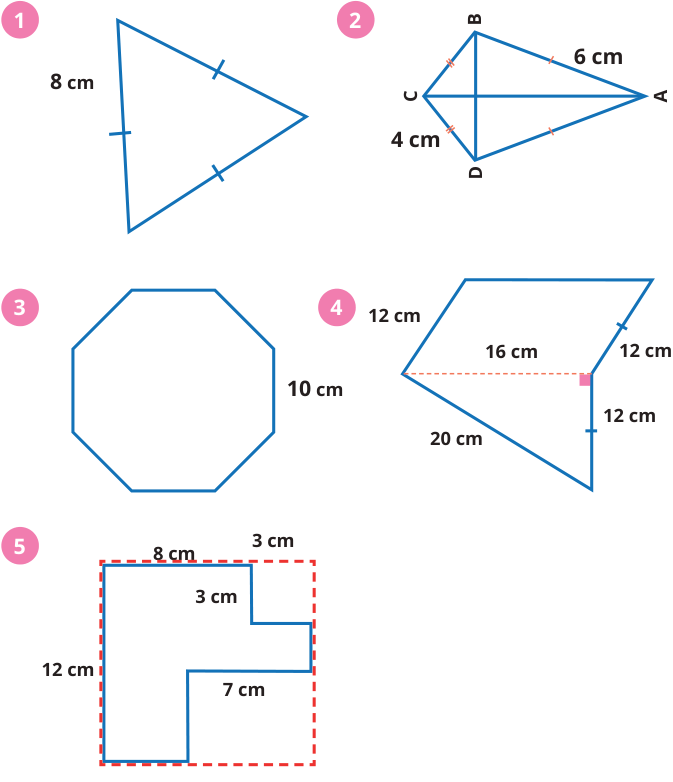


Kunci sumber: `A`; status AI: `verified`; jawaban diverifikasi AI: `A`.
Solusi minimum hasil AI: Bangun tersebut adalah segi delapan beraturan dengan panjang sisi 10 cm. Keliling = 8 × 10 cm = 80 cm.
Gambar sumber: images/kelas5_panduan_siswa_kelas5.pdf-0146-03.png. Transkripsi visual: Gambar menunjukkan 5 bangun datar. Bangun nomor 3 adalah segi delapan beraturan dengan panjang satu sisi 10 cm.

### 1. Pemeriksaan input dan fitur

Struktur: `pass`; alasan: `[]`. Grade/topik: kelas 5 / Matematika SD Kelas 5. KKO: `['mengidentifikasi']`; KKO hanya petunjuk bantu.
Isi dan kunci berasal dari sumber yang sama pada ketiga run. Versi konten: 2; hash: `c40bbaa9320ae6569693e3848ec797ae32b3ff2b70fe9744a2b9ff5c0751fa0a`. Bukti verifikasi AI tidak sama dengan verifikasi ahli.

### 2. Penilaian Gemini blind — tiga run sebelum melihat IndoBERT

| Run | Status | Konten / kunci | Kognitif | Pengetahuan | Difficulty | Token |
|---:|---|---|---|---|---|---:|
| 1 | success | valid / verified | applying | conceptual | Easy | 2475 |
| 2 | success | valid / verified | applying | conceptual | Easy | 2456 |
| 3 | success | valid / verified | applying | conceptual | Easy | 2457 |

Run 1 — solusi: Bangun tersebut adalah segi delapan beraturan dengan panjang sisi 10 cm. Keliling = 8 × 10 cm = 80 cm.
- Domain kognitif `classify/applying`: Siswa diminta menerapkan rumus keliling bangun datar (segi delapan beraturan) yang sudah dipelajari. Ini adalah penerapan langsung dari konsep keliling.. Bukti: tentukan keliling bangun berikut; segi delapan beraturan dengan panjang satu sisi 10 cm
- Dimensi pengetahuan `classify/conceptual`: Soal ini menguji pemahaman tentang konsep keliling sebagai jumlah panjang sisi-sisi bangun datar.. Bukti: keliling berbagai bentuk bangun datar
- Intended difficulty `classify/Easy`: Soal ini sangat rutin dan langsung. Siswa hanya perlu mengidentifikasi jumlah sisi pada segi delapan dan mengalikannya dengan panjang sisi yang diberikan.. Bukti: segi delapan beraturan; 10 cm

Profil difficulty run ini:

| Parameter | Nilai |
|---|---|
| expectedPrerequisite | Pemahaman konsep keliling sebagai jumlah panjang sisi dan pengenalan bangun segi banyak beraturan. |
| dependentSteps | 1 |
| routineStatus | familiar_routine |
| strategySelection | False |
| representationTransfer | False |
| relevantInformationUnits | 2 |
| interactingConstraints | 0 |
| calculationLoad | low |
| scaffoldLevel | none |
| distractorQuality | plausible |
| gradeRelativeRationale | Siswa kelas 5 sudah terbiasa menghitung keliling bangun datar sederhana dengan rumus atau penjumlahan sisi. |

Run 2 — solusi: Bangun tersebut adalah segi delapan beraturan dengan panjang sisi 10 cm. Keliling = 8 × 10 cm = 80 cm.
- Domain kognitif `classify/applying`: Siswa diminta menerapkan rumus keliling bangun datar (segi banyak beraturan) pada situasi rutin yang langsung.. Bukti: tentukan keliling bangun berikut; segi delapan beraturan dengan panjang satu sisi 10 cm
- Dimensi pengetahuan `classify/conceptual`: Soal ini menguji pemahaman tentang konsep keliling sebagai jumlah panjang sisi-sisi bangun datar.. Bukti: keliling berbagai bentuk bangun datar
- Intended difficulty `classify/Easy`: Soal ini bersifat rutin, hanya memerlukan satu langkah perkalian sederhana, dan menggunakan representasi visual yang sangat jelas.. Bukti: segi delapan beraturan; panjang satu sisi 10 cm

Profil difficulty run ini:

| Parameter | Nilai |
|---|---|
| expectedPrerequisite | Pemahaman konsep keliling sebagai jumlah sisi dan perkalian dasar. |
| dependentSteps | 1 |
| routineStatus | familiar_routine |
| strategySelection | False |
| representationTransfer | False |
| relevantInformationUnits | 2 |
| interactingConstraints | 0 |
| calculationLoad | low |
| scaffoldLevel | none |
| distractorQuality | plausible |
| gradeRelativeRationale | Siswa kelas 5 sudah terbiasa menghitung keliling bangun datar sederhana dengan panjang sisi yang diketahui. |

Run 3 — solusi: Bangun nomor 3 adalah segi delapan beraturan. Keliling = 8 sisi × 10 cm/sisi = 80 cm.
- Domain kognitif `classify/applying`: Siswa diminta menerapkan rumus keliling bangun datar (segi banyak beraturan) pada situasi rutin yang langsung.. Bukti: tentukan keliling bangun berikut; segi delapan beraturan dengan panjang satu sisi 10 cm
- Dimensi pengetahuan `classify/conceptual`: Soal ini menguji pemahaman tentang konsep keliling sebagai jumlah panjang sisi-sisi bangun datar.. Bukti: keliling berbagai bentuk bangun datar
- Intended difficulty `classify/Easy`: Soal ini sangat mendasar untuk kelas 5, hanya memerlukan pengenalan bangun dan operasi perkalian sederhana.. Bukti: segi delapan beraturan; panjang satu sisi 10 cm

Profil difficulty run ini:

| Parameter | Nilai |
|---|---|
| expectedPrerequisite | Pemahaman konsep keliling sebagai jumlah sisi dan perkalian dasar. |
| dependentSteps | 1 |
| routineStatus | familiar_routine |
| strategySelection | False |
| representationTransfer | False |
| relevantInformationUnits | 2 |
| interactingConstraints | 0 |
| calculationLoad | low |
| scaffoldLevel | none |
| distractorQuality | plausible |
| gradeRelativeRationale | Siswa kelas 5 sudah terbiasa menghitung keliling bangun datar sederhana dengan panjang sisi yang diketahui. |

### 3. Voting awal dan adjudikasi

| Head | Suara awal | Pola / status akhir | Label akhir advisory |
|---|---|---|---|
| Domain kognitif | {"applying": 3} | unanimous_3_0 / unanimous | applying |
| Dimensi pengetahuan | {"conceptual": 3} | unanimous_3_0 / unanimous | conceptual |
| Intended difficulty | {"Easy": 3} | unanimous_3_0 / unanimous | Easy |

### 4. Diagnostik IndoBERT setelah label blind dikunci

Model membaca representation `metadata`; token input 86/256; truncation: `False`.

| Head | Probabilitas | Label | Confidence | Entropy | Action / alasan |
|---|---|---|---:|---:|---|
| Domain kognitif | knowing=0.983088; applying=0.016912; reasoning=0.000000 | knowing | 0.983088 | 0.078067 | review / selective_threshold_gate_not_met |
| Dimensi pengetahuan | factual=0.516477; conceptual=0.462533; procedural=0.020990; metacognitive=0.000000 | factual | 0.516477 | 0.561915 | review / selective_threshold_gate_not_met |
| Intended difficulty | Easy=0.884803; Medium=0.112082; Hard=0.003115 | Easy | 0.884803 | 0.338212 | review / selective_threshold_gate_not_met |

Domain kognitif: Σp = 1.00000000; confidence = max(p) = 0.983088; −Σp ln(p) = 0.085765; H = 0.085765/ln(3) = 0.078067; T = 0.050000.


Dimensi pengetahuan: Σp = 1.00000000; confidence = max(p) = 0.516477; −Σp ln(p) = 0.778979; H = 0.778979/ln(4) = 0.561915; T = 0.209800.


Intended difficulty: Σp = 1.00000000; confidence = max(p) = 0.884803; −Σp ln(p) = 0.371564; H = 0.371564/ln(3) = 0.338212; T = 0.953328.


<details><summary>Input sebenarnya yang dibaca model</summary>

```text
Kelas: 5
Topik: Matematika SD Kelas 5
Subtopik: Keliling Segi Banyak
Tipe soal: multiple_choice
Stimulus: -
Soal: Setelah mempelajari cara menentukan keliling berbagai bentuk bangun datar, coba tentukan keliling bangun berikut.
Pilihan: A. 80 cm
B. 60 cm
C. 100 cm
D. 40 cm
Transkripsi visual: Gambar menunjukkan 5 bangun datar. Bangun nomor 3 adalah segi delapan beraturan dengan panjang satu sisi 10 cm.
```

</details>

### 5. Keputusan batch

Label advisory blind: `{"mathCognitiveDomain": "applying", "knowledgeDimension": "conceptual", "intendedDifficulty": "Easy"}`. Routing: `pending_expert_review`.
Status konten: `valid`. Catatan konten: .
Perbedaan model dan blind: `{"mathCognitiveDomain": {"modelLabel": "knowing", "blindLabel": "applying", "agreement": false}, "knowledgeDimension": {"modelLabel": "factual", "blindLabel": "conceptual", "agreement": false}, "intendedDifficulty": {"modelLabel": "Easy", "blindLabel": "Easy", "agreement": true}}`.
Gold ahli tetap null; human review wajib. Confidence IndoBERT tidak digunakan untuk mengganti label blind.

## 35. Soal `4b98e16cdb2f561fb46c8068`

Setelah mempelajari cara menentukan keliling berbagai bentuk bangun datar, coba tentukan keliling bangun berikut.

| Opsi | Isi |
|---|---|
| A | 72 cm |
| B | 56 cm |
| C | 88 cm |
| D | 60 cm |


Kunci sumber: `A`; status AI: `verified`; jawaban diverifikasi AI: `A`.
Solusi minimum hasil AI: Keliling adalah jumlah panjang seluruh sisi luar bangun. Sisi-sisinya adalah 12 cm, 16 cm, 12 cm, 12 cm, dan 20 cm. Garis putus-putus 16 cm adalah garis bantu internal dan tidak dihitung. Keliling = 12 + 16 + 12 + 12 + 20 = 72 cm.
Gambar sumber: images/kelas5_panduan_siswa_kelas5.pdf-0146-03.png. Transkripsi visual: Gambar nomor 4 menunjukkan sebuah bangun datar gabungan yang terdiri dari dua bagian. Sisi-sisi luar bangun tersebut memiliki panjang 12 cm, 12 cm, 12 cm, 20 cm, dan 16 cm. Terdapat garis putus-putus horizontal sepanjang 16 cm di bagian dalam bangun yang menghubungkan titik sudut kiri dengan sisi kanan. Tanda siku-siku (persegi kecil) menunjukkan garis putus-putus tersebut tegak lurus dengan sisi kanan.

### 1. Pemeriksaan input dan fitur

Struktur: `pass`; alasan: `[]`. Grade/topik: kelas 5 / Matematika SD Kelas 5. KKO: `['mengidentifikasi']`; KKO hanya petunjuk bantu.
Isi dan kunci berasal dari sumber yang sama pada ketiga run. Versi konten: 2; hash: `ed2550ad7718c1bbc9d7a305d7f6d0df7adf999dc7aeedc6c7a4bf8f52c53c9a`. Bukti verifikasi AI tidak sama dengan verifikasi ahli.

### 2. Penilaian Gemini blind — tiga run sebelum melihat IndoBERT

| Run | Status | Konten / kunci | Kognitif | Pengetahuan | Difficulty | Token |
|---:|---|---|---|---|---|---:|
| 1 | success | valid / verified | applying | procedural | Medium | 2618 |
| 2 | success | valid / verified | applying | procedural | Medium | 2642 |
| 3 | success | valid / verified | applying | conceptual | Medium | 2616 |

Run 1 — solusi: Keliling adalah jumlah seluruh sisi luar bangun. Sisi-sisinya adalah 12 cm, 16 cm, 12 cm, 12 cm, dan 20 cm. Keliling = 12 + 16 + 12 + 12 + 20 = 72 cm.
- Domain kognitif `classify/applying`: Siswa diminta menerapkan pemahaman konsep keliling pada bangun datar gabungan yang spesifik, yang merupakan prosedur rutin dalam kurikulum kelas 5.. Bukti: tentukan keliling bangun berikut
- Dimensi pengetahuan `classify/procedural`: Soal ini menguji pemahaman tentang prinsip keliling (konsep) dan penerapan algoritma penjumlahan sisi-sisi luar (prosedural).. Bukti: menentukan keliling berbagai bentuk bangun datar
- Intended difficulty `classify/Medium`: Soal ini dikategorikan Medium karena siswa harus membedakan antara sisi luar (keliling) dan garis bantu internal (garis putus-putus), yang memerlukan ketelitian lebih daripada sekadar menjumlahkan semua angka yang ada.. Bukti: keliling bangun berikut; 12 cm, 16 cm, 12 cm, 12 cm, 20 cm

Profil difficulty run ini:

| Parameter | Nilai |
|---|---|
| expectedPrerequisite | Pemahaman konsep keliling sebagai jumlah sisi luar bangun datar. |
| dependentSteps | 2 |
| routineStatus | familiar_routine |
| strategySelection | False |
| representationTransfer | False |
| relevantInformationUnits | 5 |
| interactingConstraints | 1 |
| calculationLoad | low |
| scaffoldLevel | none |
| distractorQuality | plausible |
| gradeRelativeRationale | Sesuai untuk kelas 5, di mana siswa mulai belajar membedakan sisi yang dihitung dalam keliling bangun gabungan. |

Run 2 — solusi: Keliling adalah jumlah seluruh sisi luar bangun. Sisi-sisinya adalah 12 cm, 16 cm, 12 cm, 12 cm, dan 20 cm. Total = 12 + 16 + 12 + 12 + 20 = 72 cm.
- Domain kognitif `classify/applying`: Siswa perlu menerapkan konsep keliling pada bangun gabungan yang memerlukan identifikasi sisi luar yang relevan dan mengabaikan garis internal (garis putus-putus).. Bukti: tentukan keliling bangun berikut
- Dimensi pengetahuan `classify/procedural`: Soal ini menguji pemahaman prosedural tentang cara menghitung keliling dan pemahaman konseptual tentang apa yang dimaksud dengan keliling (hanya sisi luar).. Bukti: menentukan keliling berbagai bentuk bangun datar
- Intended difficulty `classify/Medium`: Soal ini dikategorikan Medium karena siswa harus membedakan antara sisi luar (keliling) dan garis bantu internal (garis putus-putus), yang merupakan langkah tambahan di luar sekadar menjumlahkan angka yang ada.. Bukti: bangun berikut; 12 cm, 16 cm, 12 cm, 12 cm, 20 cm

Profil difficulty run ini:

| Parameter | Nilai |
|---|---|
| expectedPrerequisite | Pemahaman dasar tentang keliling bangun datar dan kemampuan membedakan sisi luar dengan garis bantu. |
| dependentSteps | 2 |
| routineStatus | familiar_routine |
| strategySelection | False |
| representationTransfer | False |
| relevantInformationUnits | 5 |
| interactingConstraints | 1 |
| calculationLoad | low |
| scaffoldLevel | none |
| distractorQuality | plausible |
| gradeRelativeRationale | Sesuai untuk kelas 5, di mana siswa mulai diperkenalkan dengan bangun gabungan dan perlu ketelitian dalam mengidentifikasi sisi yang dihitung. |

Run 3 — solusi: Keliling adalah jumlah seluruh sisi luar bangun. Sisi-sisinya adalah 12 cm, 16 cm, 12 cm, 12 cm, dan 20 cm. Keliling = 12 + 16 + 12 + 12 + 20 = 72 cm.
- Domain kognitif `classify/applying`: Siswa perlu mengidentifikasi sisi mana yang termasuk keliling (batas luar) dan mengabaikan garis internal (garis putus-putus), kemudian menerapkan prosedur penjumlahan panjang sisi.. Bukti: tentukan keliling bangun berikut
- Dimensi pengetahuan `classify/conceptual`: Soal ini menguji pemahaman konseptual tentang apa itu keliling (batas luar bangun) dan prosedur penjumlahan panjang sisi-sisi tersebut.. Bukti: menentukan keliling berbagai bentuk bangun datar
- Intended difficulty `classify/Medium`: Soal ini dikategorikan Medium karena siswa harus membedakan antara garis batas luar dan garis internal (garis putus-putus) untuk menentukan sisi mana yang dijumlahkan, yang merupakan langkah rutin namun memerlukan ketelitian.. Bukti: 12 cm, 16 cm, 12 cm, 12 cm, 20 cm

Profil difficulty run ini:

| Parameter | Nilai |
|---|---|
| expectedPrerequisite | Pemahaman dasar tentang keliling bangun datar dan penjumlahan bilangan cacah. |
| dependentSteps | 2 |
| routineStatus | familiar_routine |
| strategySelection | False |
| representationTransfer | False |
| relevantInformationUnits | 5 |
| interactingConstraints | 1 |
| calculationLoad | low |
| scaffoldLevel | none |
| distractorQuality | plausible |
| gradeRelativeRationale | Untuk kelas 5, membedakan sisi luar dan garis bantu pada bangun gabungan adalah standar kompetensi yang diharapkan. |

### 3. Voting awal dan adjudikasi

| Head | Suara awal | Pola / status akhir | Label akhir advisory |
|---|---|---|---|
| Domain kognitif | {"applying": 3} | unanimous_3_0 / adjudicated | applying |
| Dimensi pengetahuan | {"procedural": 2, "conceptual": 1} | majority_2_of_3 / adjudicated | procedural |
| Intended difficulty | {"Medium": 3} | unanimous_3_0 / adjudicated | Medium |

Adjudikasi AI: `success`; token `4158`.
Konten: `valid`; kunci: `verified`; masalah: .
- Domain kognitif `applying`: Siswa perlu menerapkan konsep keliling pada bangun gabungan dengan mengidentifikasi sisi luar yang relevan dan mengabaikan garis internal, yang merupakan prosedur rutin dalam kurikulum kelas 5.
- Dimensi pengetahuan `procedural`: Soal ini menguji pemahaman prosedural tentang cara menghitung keliling dan pemahaman konseptual tentang apa yang dimaksud dengan keliling (hanya sisi luar).
- Intended difficulty `Medium`: Soal ini dikategorikan Medium karena siswa harus membedakan antara garis batas luar dan garis internal (garis putus-putus) untuk menentukan sisi mana yang dijumlahkan, yang memerlukan ketelitian lebih daripada sekadar menjumlahkan semua angka yang ada.

Profil difficulty hasil adjudikasi:

| Parameter | Nilai |
|---|---|
| expectedPrerequisite | Pemahaman dasar tentang keliling bangun datar dan kemampuan membedakan sisi luar dengan garis bantu. |
| dependentSteps | 2 |
| routineStatus | familiar_routine |
| strategySelection | False |
| representationTransfer | False |
| relevantInformationUnits | 5 |
| interactingConstraints | 1 |
| calculationLoad | low |
| scaffoldLevel | none |
| distractorQuality | plausible |
| gradeRelativeRationale | Sesuai untuk kelas 5, di mana siswa mulai diperkenalkan dengan bangun gabungan dan perlu ketelitian dalam mengidentifikasi sisi yang dihitung. |

### 4. Diagnostik IndoBERT setelah label blind dikunci

Model membaca representation `metadata`; token input 146/256; truncation: `False`.

| Head | Probabilitas | Label | Confidence | Entropy | Action / alasan |
|---|---|---|---:|---:|---|
| Domain kognitif | knowing=0.000263; applying=0.999737; reasoning=0.000000 | applying | 0.999737 | 0.002211 | review / selective_threshold_gate_not_met |
| Dimensi pengetahuan | factual=0.013185; conceptual=0.981646; procedural=0.005169; metacognitive=0.000000 | conceptual | 0.981646 | 0.073920 | review / selective_threshold_gate_not_met |
| Intended difficulty | Easy=0.698983; Medium=0.295214; Hard=0.005803 | Easy | 0.698983 | 0.582904 | review / selective_threshold_gate_not_met |

Domain kognitif: Σp = 1.00000000; confidence = max(p) = 0.999737; −Σp ln(p) = 0.002430; H = 0.002430/ln(3) = 0.002211; T = 0.050000.


Dimensi pengetahuan: Σp = 1.00000000; confidence = max(p) = 0.981646; −Σp ln(p) = 0.102474; H = 0.102474/ln(4) = 0.073920; T = 0.209800.


Intended difficulty: Σp = 1.00000000; confidence = max(p) = 0.698983; −Σp ln(p) = 0.640385; H = 0.640385/ln(3) = 0.582904; T = 0.953328.


<details><summary>Input sebenarnya yang dibaca model</summary>

```text
Kelas: 5
Topik: Matematika SD Kelas 5
Subtopik: Keliling Bangun Gabungan
Tipe soal: multiple_choice
Stimulus: -
Soal: Setelah mempelajari cara menentukan keliling berbagai bentuk bangun datar, coba tentukan keliling bangun berikut.
Pilihan: A. 72 cm
B. 56 cm
C. 88 cm
D. 60 cm
Transkripsi visual: Gambar nomor 4 menunjukkan sebuah bangun datar gabungan yang terdiri dari dua bagian. Sisi-sisi luar bangun tersebut memiliki panjang 12 cm, 12 cm, 12 cm, 20 cm, dan 16 cm. Terdapat garis putus-putus horizontal sepanjang 16 cm di bagian dalam bangun yang menghubungkan titik sudut kiri dengan sisi kanan. Tanda siku-siku (persegi kecil) menunjukkan garis putus-putus tersebut tegak lurus dengan sisi kanan.
```

</details>

### 5. Keputusan batch

Label advisory blind: `{"mathCognitiveDomain": "applying", "knowledgeDimension": "procedural", "intendedDifficulty": "Medium"}`. Routing: `pending_expert_review`.
Status konten: `valid`. Catatan konten: .
Perbedaan model dan blind: `{"mathCognitiveDomain": {"modelLabel": "applying", "blindLabel": "applying", "agreement": true}, "knowledgeDimension": {"modelLabel": "conceptual", "blindLabel": "procedural", "agreement": false}, "intendedDifficulty": {"modelLabel": "Easy", "blindLabel": "Medium", "agreement": false}}`.
Gold ahli tetap null; human review wajib. Confidence IndoBERT tidak digunakan untuk mengganti label blind.

## 36. Soal `4d698768a13668ccb860a20d`

Setelah mempelajari cara menentukan keliling berbagai bentuk bangun datar, coba tentukan keliling bangun berikut.

| Opsi | Isi |
|---|---|
| A | 23 cm |
| B | 33 cm |
| C | 40 cm |
| D | 46 cm |


Kunci sumber: `D`; status AI: `verified`; jawaban diverifikasi AI: `D`.
Solusi minimum hasil AI: Keliling bangun datar tersebut sama dengan keliling persegi panjang yang membungkusnya, yaitu 2 x (panjang + lebar). Panjang total = 12 cm. Lebar total = 8 cm + 3 cm = 11 cm. Keliling = 2 x (12 + 11) = 2 x 23 = 46 cm.
Gambar sumber: images/kelas5_panduan_siswa_kelas5.pdf-0146-03.png. Transkripsi visual: Gambar 5 menunjukkan bangun datar berbentuk L yang dibatasi oleh garis biru solid. Sisi-sisi yang diketahui panjangnya adalah 12 cm (sisi kiri vertikal), 8 cm (sisi atas horizontal), 3 cm (sisi vertikal ke bawah), dan 7 cm (sisi horizontal ke kanan). Garis putus-putus merah membentuk persegi panjang pembungkus dengan lebar total 8+3=11 cm dan tinggi 12 cm. Keliling bangun adalah jumlah semua sisi luar: 12 + 8 + 3 + (8-7) + (12-3) + 7 = 46 cm.

### 1. Pemeriksaan input dan fitur

Struktur: `pass`; alasan: `[]`. Grade/topik: kelas 5 / Matematika SD Kelas 5. KKO: `['mengidentifikasi']`; KKO hanya petunjuk bantu.
Isi dan kunci berasal dari sumber yang sama pada ketiga run. Versi konten: 2; hash: `a86353934669b39afc931f3f83dc45b63148bc338f3c848362427072eea3749c`. Bukti verifikasi AI tidak sama dengan verifikasi ahli.

### 2. Penilaian Gemini blind — tiga run sebelum melihat IndoBERT

| Run | Status | Konten / kunci | Kognitif | Pengetahuan | Difficulty | Token |
|---:|---|---|---|---|---|---:|
| 1 | success | valid / verified | applying | conceptual | Medium | 2768 |
| 2 | success | valid / verified | applying | conceptual | Medium | 2846 |
| 3 | success | valid / verified | applying | conceptual | Medium | 2676 |

Run 1 — solusi: Keliling bangun datar tersebut sama dengan keliling persegi panjang yang membungkusnya, yaitu 2 x (panjang + lebar). Panjang total = 12 cm. Lebar total = 8 cm + 3 cm = 11 cm. Keliling = 2 x (12 + 11) = 2 x 23 = 46 cm.
- Domain kognitif `classify/applying`: Siswa perlu memahami konsep keliling bangun datar gabungan dan melakukan penalaran spasial untuk menyimpulkan bahwa keliling bangun tersebut setara dengan keliling persegi panjang pembungkusnya.. Bukti: coba tentukan keliling bangun berikut; sisi-sisi luar bersesuaian dengan persegi panjang
- Dimensi pengetahuan `classify/conceptual`: Soal ini menguji pemahaman konseptual tentang sifat keliling pada bangun datar gabungan yang dapat disederhanakan menjadi bentuk persegi panjang.. Bukti: menentukan keliling berbagai bentuk bangun datar
- Intended difficulty `classify/Medium`: Soal ini dikategorikan Medium karena siswa tidak bisa sekadar menjumlahkan angka yang ada di gambar (distraktor B), melainkan harus memahami hubungan geometris antara sisi-sisi bangun tersebut dengan persegi panjang pembungkusnya.. Bukti: coba tentukan keliling bangun berikut; sisi-sisi luar bersesuaian dengan persegi panjang

Profil difficulty run ini:

| Parameter | Nilai |
|---|---|
| expectedPrerequisite | Pemahaman dasar tentang keliling bangun datar dan konsep penjumlahan sisi. |
| dependentSteps | 3 |
| routineStatus | routine_selection |
| strategySelection | True |
| representationTransfer | True |
| relevantInformationUnits | 4 |
| interactingConstraints | 2 |
| calculationLoad | low |
| scaffoldLevel | none |
| distractorQuality | strong |
| gradeRelativeRationale | Untuk kelas 5, memahami bahwa keliling bangun L-shape dapat dihitung dengan memproyeksikan sisi-sisinya ke persegi panjang adalah standar kompetensi yang menantang namun sesuai. |

Run 2 — solusi: Keliling bangun adalah jumlah seluruh sisi luar. Sisi-sisi vertikal total adalah 12 cm (kiri) + 3 cm + 7 cm = 22 cm. Sisi-sisi horizontal total adalah 8 cm + 3 cm + 12 cm = 23 cm. Namun, cara lebih efisien adalah melihat bangun ini setara dengan persegi panjang 12 cm x 11 cm (karena 8+3=11), sehingga keliling = 2 * (12 + 11) = 46 cm.
- Domain kognitif `classify/applying`: Siswa perlu memilih prosedur yang tepat untuk menghitung keliling bangun gabungan, yaitu dengan menjumlahkan semua sisi atau menggunakan prinsip pergeseran sisi (translasi) untuk membentuk persegi panjang yang ekuivalen. Ini adalah penerapan konsep keliling pada situasi rutin.. Bukti: coba tentukan keliling bangun berikut; sisi-sisi luar bersesuaian dengan persegi panjang 12 cm × (8 + 3) cm
- Dimensi pengetahuan `classify/conceptual`: Soal ini menguji pemahaman siswa tentang prinsip keliling sebagai jumlah panjang sisi luar dan bagaimana struktur bangun gabungan dapat disederhanakan menjadi bentuk dasar.. Bukti: menentukan keliling berbagai bentuk bangun datar; sisi-sisi luar bersesuaian dengan persegi panjang
- Intended difficulty `classify/Medium`: Soal ini dikategorikan Medium karena memerlukan pemahaman tentang bagaimana sisi-sisi pada bangun gabungan dapat dipetakan ke bentuk dasar (persegi panjang) atau menjumlahkan banyak segmen sisi, yang merupakan langkah rutin namun membutuhkan ketelitian lebih dibanding bangun tunggal.. Bukti: Keliling Bangun Gabungan; sisi-sisi luar bersesuaian dengan persegi panjang 12 cm × (8 + 3) cm

Profil difficulty run ini:

| Parameter | Nilai |
|---|---|
| expectedPrerequisite | Pemahaman konsep keliling bangun datar sederhana dan penjumlahan bilangan cacah. |
| dependentSteps | 3 |
| routineStatus | familiar_routine |
| strategySelection | True |
| representationTransfer | True |
| relevantInformationUnits | 6 |
| interactingConstraints | 2 |
| calculationLoad | moderate |
| scaffoldLevel | none |
| distractorQuality | plausible |
| gradeRelativeRationale | Untuk kelas 5, menghitung keliling bangun gabungan adalah standar kompetensi yang diharapkan. Soal ini menuntut siswa tidak hanya menjumlahkan angka yang ada, tetapi memahami struktur bangun. |

Run 3 — solusi: Keliling bangun dapat dihitung dengan menjumlahkan semua sisi luar. Sisi vertikal kanan total = 12 cm. Sisi horizontal bawah total = 8 + 3 = 11 cm. Keliling = 2 x (12 + 11) = 46 cm.
- Domain kognitif `classify/applying`: Siswa perlu menerapkan konsep keliling pada bangun gabungan yang memerlukan pemahaman bahwa sisi-sisi yang tidak diketahui dapat ditentukan dengan melihat sisi sejajar atau menggunakan properti persegi panjang pembungkus.. Bukti: coba tentukan keliling bangun berikut
- Dimensi pengetahuan `classify/conceptual`: Siswa harus memahami prinsip keliling (jumlah panjang sisi luar) dan bagaimana mengaitkan struktur bangun gabungan dengan persegi panjang untuk menentukan panjang sisi yang tidak tertulis.. Bukti: menentukan keliling berbagai bentuk bangun datar
- Intended difficulty `classify/Medium`: Soal ini memerlukan pemahaman tentang sifat bangun datar gabungan. Siswa harus menyadari bahwa keliling bangun tersebut setara dengan keliling persegi panjang yang membungkusnya, yang merupakan langkah rutin namun memerlukan pemahaman konsep yang baik.. Bukti: 8 cm; 3 cm; 7 cm; 12 cm

Profil difficulty run ini:

| Parameter | Nilai |
|---|---|
| expectedPrerequisite | Pemahaman dasar tentang keliling bangun datar dan sifat persegi panjang. |
| dependentSteps | 3 |
| routineStatus | routine_selection |
| strategySelection | True |
| representationTransfer | True |
| relevantInformationUnits | 4 |
| interactingConstraints | 2 |
| calculationLoad | low |
| scaffoldLevel | none |
| distractorQuality | strong |
| gradeRelativeRationale | Untuk kelas 5, soal ini menuntut kemampuan visualisasi dan pemahaman konsep keliling yang melampaui sekadar menjumlahkan angka yang ada di gambar. |

### 3. Voting awal dan adjudikasi

| Head | Suara awal | Pola / status akhir | Label akhir advisory |
|---|---|---|---|
| Domain kognitif | {"applying": 3} | unanimous_3_0 / unanimous | applying |
| Dimensi pengetahuan | {"conceptual": 3} | unanimous_3_0 / unanimous | conceptual |
| Intended difficulty | {"Medium": 3} | unanimous_3_0 / unanimous | Medium |

### 4. Diagnostik IndoBERT setelah label blind dikunci

Model membaca representation `metadata`; token input 176/256; truncation: `False`.

| Head | Probabilitas | Label | Confidence | Entropy | Action / alasan |
|---|---|---|---:|---:|---|
| Domain kognitif | knowing=0.011212; applying=0.988788; reasoning=0.000000 | applying | 0.988788 | 0.055980 | review / selective_threshold_gate_not_met |
| Dimensi pengetahuan | factual=0.032893; conceptual=0.957335; procedural=0.009772; metacognitive=0.000000 | conceptual | 0.957335 | 0.143752 | review / selective_threshold_gate_not_met |
| Intended difficulty | Easy=0.772980; Medium=0.223045; Hard=0.003975 | Easy | 0.772980 | 0.505791 | review / selective_threshold_gate_not_met |

Domain kognitif: Σp = 1.00000000; confidence = max(p) = 0.988788; −Σp ln(p) = 0.061501; H = 0.061501/ln(3) = 0.055980; T = 0.050000.


Dimensi pengetahuan: Σp = 1.00000000; confidence = max(p) = 0.957335; −Σp ln(p) = 0.199282; H = 0.199282/ln(4) = 0.143752; T = 0.209800.


Intended difficulty: Σp = 1.00000000; confidence = max(p) = 0.772980; −Σp ln(p) = 0.555669; H = 0.555669/ln(3) = 0.505791; T = 0.953328.


<details><summary>Input sebenarnya yang dibaca model</summary>

```text
Kelas: 5
Topik: Matematika SD Kelas 5
Subtopik: Keliling Bangun Gabungan
Tipe soal: multiple_choice
Stimulus: -
Soal: Setelah mempelajari cara menentukan keliling berbagai bentuk bangun datar, coba tentukan keliling bangun berikut.
Pilihan: A. 23 cm
B. 33 cm
C. 40 cm
D. 46 cm
Transkripsi visual: Gambar 5 menunjukkan bangun datar berbentuk L yang dibatasi oleh garis biru solid. Sisi-sisi yang diketahui panjangnya adalah 12 cm (sisi kiri vertikal), 8 cm (sisi atas horizontal), 3 cm (sisi vertikal ke bawah), dan 7 cm (sisi horizontal ke kanan). Garis putus-putus merah membentuk persegi panjang pembungkus dengan lebar total 8+3=11 cm dan tinggi 12 cm. Keliling bangun adalah jumlah semua sisi luar: 12 + 8 + 3 + (8-7) + (12-3) + 7 = 46 cm.
```

</details>

### 5. Keputusan batch

Label advisory blind: `{"mathCognitiveDomain": "applying", "knowledgeDimension": "conceptual", "intendedDifficulty": "Medium"}`. Routing: `pending_expert_review`.
Status konten: `valid`. Catatan konten: .
Perbedaan model dan blind: `{"mathCognitiveDomain": {"modelLabel": "applying", "blindLabel": "applying", "agreement": true}, "knowledgeDimension": {"modelLabel": "conceptual", "blindLabel": "conceptual", "agreement": true}, "intendedDifficulty": {"modelLabel": "Easy", "blindLabel": "Medium", "agreement": false}}`.
Gold ahli tetap null; human review wajib. Confidence IndoBERT tidak digunakan untuk mengganti label blind.

## 37. Soal `8fe432cf4c0a120aab6def21`

\|**No**\|**Nama Bangun Datar**\|**Gambar**\|**Banyaknya**\|<br>\|---\|---\|---\|---\|<br>\|1<br>2\|Segitiga<br>...\|...\|...<br>...\|<br><br>Lakukan dekomposisi berbagai macam bangun datar yang ada pada gambar berikut :

| Opsi | Isi |
|---|---|
| A | Segitiga 5, trapesium 1, persegi 1 |
| B | Segitiga 5, jajargenjang 1, persegi 1 |
| C | Segitiga 4, jajargenjang 1, persegi 1 |
| D | Segitiga 6, persegi 1 |

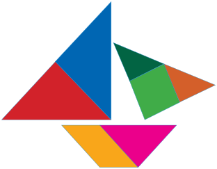


Kunci sumber: `B`; status AI: `verified`; jawaban diverifikasi AI: `B`.
Solusi minimum hasil AI: Identifikasi visual kepingan: 5 segitiga (biru, merah, hijau tua, oranye, merah muda), 1 persegi (hijau muda), dan 1 jajargenjang (kuning). Pilihan B sesuai dengan hitungan ini.
Gambar sumber: images/kelas4_panduan_siswa_kelas4.pdf-0184-10.png. Transkripsi visual: Gambar menunjukkan bentuk perahu yang tersusun dari 7 keping bangun datar: 1 segitiga biru besar, 1 segitiga merah besar, 1 segitiga hijau tua sedang, 1 segitiga oranye kecil, 1 segitiga merah muda kecil, 1 persegi hijau muda, dan 1 jajargenjang kuning. Total terdapat 5 segitiga, 1 persegi, dan 1 jajargenjang.

### 1. Pemeriksaan input dan fitur

Struktur: `pass`; alasan: `[]`. Grade/topik: kelas 5 / Matematika SD Kelas 5. KKO: `[]`; KKO hanya petunjuk bantu.
Isi dan kunci berasal dari sumber yang sama pada ketiga run. Versi konten: 2; hash: `57bec14a2094a4635fe5472d06521dfa49cf3611b086ecec76c8709140d3c3bd`. Bukti verifikasi AI tidak sama dengan verifikasi ahli.

### 2. Penilaian Gemini blind — tiga run sebelum melihat IndoBERT

| Run | Status | Konten / kunci | Kognitif | Pengetahuan | Difficulty | Token |
|---:|---|---|---|---|---|---:|
| 1 | success | valid / verified | applying | conceptual | Easy | 2726 |
| 2 | success | valid / verified | applying | conceptual | Easy | 2704 |
| 3 | success | valid / verified | applying | conceptual | Easy | 2675 |

Run 1 — solusi: Identifikasi visual kepingan: 5 segitiga (biru, merah, hijau tua, oranye, merah muda), 1 persegi (hijau muda), dan 1 jajargenjang (kuning). Pilihan B sesuai dengan hitungan ini.
- Domain kognitif `classify/applying`: Siswa perlu mengidentifikasi dan mengklasifikasikan bentuk geometris dari komposisi gambar yang diberikan. Ini melibatkan pengenalan sifat-sifat bangun datar (segitiga, persegi, jajargenjang) dalam konteks visual, yang merupakan penerapan konsep dasar geometri.. Bukti: Lakukan dekomposisi berbagai macam bangun datar yang ada pada gambar berikut
- Dimensi pengetahuan `classify/conceptual`: Soal ini menguji pemahaman tentang kategori bangun datar dan bagaimana mereka membentuk struktur yang lebih besar (dekomposisi). Ini adalah pemahaman konseptual tentang sifat-sifat bentuk.. Bukti: Lakukan dekomposisi berbagai macam bangun datar
- Intended difficulty `classify/Easy`: Soal ini tergolong mudah bagi kelas 5 karena hanya memerlukan identifikasi visual langsung dari bentuk-bentuk dasar yang sudah dikenal (segitiga, persegi, jajargenjang) tanpa perhitungan kompleks atau strategi non-rutin.. Bukti: Lakukan dekomposisi berbagai macam bangun datar yang ada pada gambar berikut

Profil difficulty run ini:

| Parameter | Nilai |
|---|---|
| expectedPrerequisite | Mengenal sifat-sifat dasar bangun datar (segitiga, persegi, jajargenjang). |
| dependentSteps | 1 |
| routineStatus | familiar_routine |
| strategySelection | False |
| representationTransfer | False |
| relevantInformationUnits | 7 |
| interactingConstraints | 0 |
| calculationLoad | low |
| scaffoldLevel | none |
| distractorQuality | plausible |
| gradeRelativeRationale | Siswa kelas 5 sudah sangat familiar dengan pengenalan bentuk geometri dasar dan tangram sederhana. |

Run 2 — solusi: Identifikasi visual kepingan tangram: 5 segitiga (biru, merah, hijau tua, oranye, merah muda), 1 persegi (hijau muda), dan 1 jajargenjang (kuning).
- Domain kognitif `classify/applying`: Siswa perlu mengidentifikasi dan mengklasifikasikan bentuk geometris dari komposisi visual yang diberikan, yang merupakan proses penerapan konsep dasar geometri.. Bukti: Lakukan dekomposisi berbagai macam bangun datar yang ada pada gambar berikut
- Dimensi pengetahuan `classify/conceptual`: Soal ini menguji pemahaman tentang kategori bentuk bangun datar (segitiga, persegi, jajargenjang) dalam konteks komposisi.. Bukti: Lakukan dekomposisi berbagai macam bangun datar
- Intended difficulty `classify/Easy`: Soal ini bersifat rutin bagi siswa kelas 5 yang sudah mempelajari tangram atau dekomposisi bangun datar. Tugas utamanya adalah menghitung dan mengidentifikasi bentuk, dengan beban kognitif rendah.. Bukti: Lakukan dekomposisi berbagai macam bangun datar yang ada pada gambar berikut

Profil difficulty run ini:

| Parameter | Nilai |
|---|---|
| expectedPrerequisite | Mengenal sifat-sifat bangun datar dasar (segitiga, persegi, jajargenjang). |
| dependentSteps | 1 |
| routineStatus | familiar_routine |
| strategySelection | False |
| representationTransfer | False |
| relevantInformationUnits | 7 |
| interactingConstraints | 0 |
| calculationLoad | low |
| scaffoldLevel | none |
| distractorQuality | plausible |
| gradeRelativeRationale | Dekomposisi bangun datar adalah materi standar kelas 5. Mengidentifikasi jumlah dan jenis kepingan adalah tugas rutin yang sesuai dengan tingkat perkembangan kognitif siswa. |

Run 3 — solusi: Identifikasi visual kepingan tangram: 5 segitiga (biru, merah, hijau tua, oranye, merah muda), 1 persegi (hijau muda), dan 1 jajargenjang (kuning).
- Domain kognitif `classify/applying`: Siswa perlu mengidentifikasi dan mengklasifikasikan bentuk geometris secara visual dari komposisi yang diberikan, yang merupakan proses applying konsep bangun datar.. Bukti: Lakukan dekomposisi berbagai macam bangun datar yang ada pada gambar berikut
- Dimensi pengetahuan `classify/conceptual`: Soal ini menguji pemahaman konseptual tentang sifat-sifat bangun datar (segitiga, persegi, jajargenjang) dalam konteks dekomposisi.. Bukti: Lakukan dekomposisi berbagai macam bangun datar
- Intended difficulty `classify/Easy`: Soal ini memerlukan pengamatan visual yang cermat untuk membedakan bentuk-bentuk geometris yang tersusun, namun prosedurnya rutin bagi siswa kelas 5.. Bukti: Lakukan dekomposisi berbagai macam bangun datar yang ada pada gambar berikut

Profil difficulty run ini:

| Parameter | Nilai |
|---|---|
| expectedPrerequisite | Mengenal sifat-sifat dasar bangun datar (segitiga, persegi, jajargenjang). |
| dependentSteps | 1 |
| routineStatus | familiar_routine |
| strategySelection | False |
| representationTransfer | False |
| relevantInformationUnits | 7 |
| interactingConstraints | 0 |
| calculationLoad | low |
| scaffoldLevel | none |
| distractorQuality | plausible |
| gradeRelativeRationale | Siswa kelas 5 sudah terbiasa dengan identifikasi bentuk dasar dalam tangram atau komposisi bangun datar sederhana. |

### 3. Voting awal dan adjudikasi

| Head | Suara awal | Pola / status akhir | Label akhir advisory |
|---|---|---|---|
| Domain kognitif | {"applying": 3} | unanimous_3_0 / unanimous | applying |
| Dimensi pengetahuan | {"conceptual": 3} | unanimous_3_0 / unanimous | conceptual |
| Intended difficulty | {"Easy": 3} | unanimous_3_0 / unanimous | Easy |

### 4. Diagnostik IndoBERT setelah label blind dikunci

Model membaca representation `metadata`; token input 236/256; truncation: `False`.

| Head | Probabilitas | Label | Confidence | Entropy | Action / alasan |
|---|---|---|---:|---:|---|
| Domain kognitif | knowing=0.016460; applying=0.983540; reasoning=0.000000 | applying | 0.983540 | 0.076391 | review / selective_threshold_gate_not_met |
| Dimensi pengetahuan | factual=0.025736; conceptual=0.960011; procedural=0.014253; metacognitive=0.000000 | conceptual | 0.960011 | 0.139909 | review / selective_threshold_gate_not_met |
| Intended difficulty | Easy=0.693249; Medium=0.296341; Hard=0.010410 | Easy | 0.693249 | 0.602512 | review / selective_threshold_gate_not_met |

Domain kognitif: Σp = 1.00000000; confidence = max(p) = 0.983540; −Σp ln(p) = 0.083924; H = 0.083924/ln(3) = 0.076391; T = 0.050000.


Dimensi pengetahuan: Σp = 1.00000000; confidence = max(p) = 0.960011; −Σp ln(p) = 0.193955; H = 0.193955/ln(4) = 0.139909; T = 0.209800.


Intended difficulty: Σp = 1.00000000; confidence = max(p) = 0.693249; −Σp ln(p) = 0.661927; H = 0.661927/ln(3) = 0.602512; T = 0.953328.


<details><summary>Input sebenarnya yang dibaca model</summary>

```text
Kelas: 5
Topik: Matematika SD Kelas 5
Subtopik: Komposisi dan Dekomposisi Bangun Datar
Tipe soal: multiple_choice
Stimulus: -
Soal: |**No**|**Nama Bangun Datar**|**Gambar**|**Banyaknya**|
|---|---|---|---|
|1<br>2|Segitiga<br>...|...|...<br>...|

Lakukan dekomposisi berbagai macam bangun datar yang ada pada gambar berikut :
Pilihan: A. Segitiga 5, trapesium 1, persegi 1
B. Segitiga 5, jajargenjang 1, persegi 1
C. Segitiga 4, jajargenjang 1, persegi 1
D. Segitiga 6, persegi 1
Transkripsi visual: Gambar menunjukkan bentuk perahu yang tersusun dari 7 keping bangun datar: 1 segitiga biru besar, 1 segitiga merah besar, 1 segitiga hijau tua sedang, 1 segitiga oranye kecil, 1 segitiga merah muda kecil, 1 persegi hijau muda, dan 1 jajargenjang kuning. Total terdapat 5 segitiga, 1 persegi, dan 1 jajargenjang.
```

</details>

### 5. Keputusan batch

Label advisory blind: `{"mathCognitiveDomain": "applying", "knowledgeDimension": "conceptual", "intendedDifficulty": "Easy"}`. Routing: `pending_expert_review`.
Status konten: `valid`. Catatan konten: .
Perbedaan model dan blind: `{"mathCognitiveDomain": {"modelLabel": "applying", "blindLabel": "applying", "agreement": true}, "knowledgeDimension": {"modelLabel": "conceptual", "blindLabel": "conceptual", "agreement": true}, "intendedDifficulty": {"modelLabel": "Easy", "blindLabel": "Easy", "agreement": true}}`.
Gold ahli tetap null; human review wajib. Confidence IndoBERT tidak digunakan untuk mengganti label blind.

## 38. Soal `b1d67520342a7317015c9a90`

Perhatikan bangun-bangun datar berikut.<br><br>Hitunglah luas daerah bangun-bangun datar tersebut dengan menggunakan kertas berpetak.<br><br>E.

| Opsi | Isi |
|---|---|
| A | 5 satuan luas |
| B | 18 satuan luas |
| C | 12 satuan luas |
| D | 9 satuan luas |

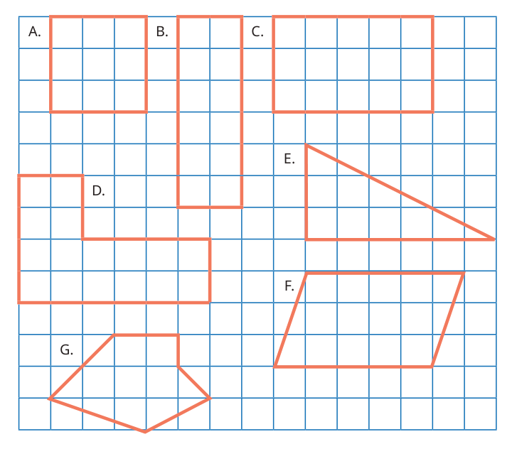


Kunci sumber: `D`; status AI: `verified`; jawaban diverifikasi AI: `D`.
Solusi minimum hasil AI: Luas segitiga E = 1/2 x alas x tinggi = 1/2 x 6 x 3 = 9 satuan luas.
Gambar sumber: images/kelas5_panduan_siswa_kelas5.pdf-0158-07.png. Transkripsi visual: Gambar menunjukkan beberapa bangun datar pada kertas berpetak. Bangun E adalah segitiga siku-siku dengan alas sepanjang 6 satuan dan tinggi 3 satuan.

### 1. Pemeriksaan input dan fitur

Struktur: `pass`; alasan: `[]`. Grade/topik: kelas 5 / Matematika SD Kelas 5. KKO: `['menghitung']`; KKO hanya petunjuk bantu.
Isi dan kunci berasal dari sumber yang sama pada ketiga run. Versi konten: 2; hash: `bbf686f8835c85cd459a2d69863ddc0ff0830b3972b512b453dd6ce31506dc97`. Bukti verifikasi AI tidak sama dengan verifikasi ahli.

### 2. Penilaian Gemini blind — tiga run sebelum melihat IndoBERT

| Run | Status | Konten / kunci | Kognitif | Pengetahuan | Difficulty | Token |
|---:|---|---|---|---|---|---:|
| 1 | success | valid / verified | applying | procedural | Easy | 2479 |
| 2 | success | valid / verified | applying | procedural | Easy | 2513 |
| 3 | success | valid / verified | applying | procedural | Easy | 2504 |

Run 1 — solusi: Luas segitiga E = 1/2 x alas x tinggi = 1/2 x 6 x 3 = 9 satuan luas.
- Domain kognitif `classify/applying`: Siswa diminta menerapkan rumus luas segitiga atau melakukan penghitungan luas pada grid untuk bangun yang sudah ditentukan.. Bukti: Hitunglah luas daerah bangun-bangun datar tersebut dengan menggunakan kertas berpetak.; E.
- Dimensi pengetahuan `classify/procedural`: Soal ini menguji pemahaman tentang prosedur menghitung luas bangun datar (segitiga) pada bidang koordinat/grid.. Bukti: Hitunglah luas daerah bangun-bangun datar tersebut
- Intended difficulty `classify/Easy`: Soal ini merupakan tugas rutin bagi siswa kelas 5 untuk menghitung luas segitiga pada grid. Tidak ada strategi non-rutin yang diperlukan.. Bukti: E.; Hitunglah luas daerah bangun-bangun datar tersebut dengan menggunakan kertas berpetak.

Profil difficulty run ini:

| Parameter | Nilai |
|---|---|
| expectedPrerequisite | Pemahaman konsep luas sebagai satuan persegi dan rumus luas segitiga dasar. |
| dependentSteps | 2 |
| routineStatus | familiar_routine |
| strategySelection | False |
| representationTransfer | False |
| relevantInformationUnits | 2 |
| interactingConstraints | 0 |
| calculationLoad | low |
| scaffoldLevel | none |
| distractorQuality | plausible |
| gradeRelativeRationale | Siswa kelas 5 sudah terbiasa menghitung luas bangun datar sederhana menggunakan grid atau rumus dasar. |

Run 2 — solusi: Luas segitiga = 1/2 x alas x tinggi = 1/2 x 6 x 3 = 9 satuan luas.
- Domain kognitif `classify/applying`: Siswa diminta menerapkan rumus luas segitiga atau menghitung satuan luas pada kertas berpetak untuk bangun yang sudah ditentukan.. Bukti: Hitunglah luas daerah bangun-bangun datar tersebut dengan menggunakan kertas berpetak.; E.
- Dimensi pengetahuan `classify/procedural`: Siswa menggunakan prosedur perhitungan luas bangun datar (segitiga) pada konteks kertas berpetak.. Bukti: Hitunglah luas daerah bangun-bangun datar tersebut
- Intended difficulty `classify/Easy`: Soal ini meminta perhitungan luas bangun datar sederhana yang familiar bagi siswa kelas 5. Prosedur yang digunakan rutin dan langsung.. Bukti: E.; Hitunglah luas daerah bangun-bangun datar tersebut dengan menggunakan kertas berpetak.

Profil difficulty run ini:

| Parameter | Nilai |
|---|---|
| expectedPrerequisite | Pemahaman konsep luas sebagai satuan persegi dan rumus luas segitiga dasar. |
| dependentSteps | 2 |
| routineStatus | familiar_routine |
| strategySelection | False |
| representationTransfer | False |
| relevantInformationUnits | 2 |
| interactingConstraints | 0 |
| calculationLoad | low |
| scaffoldLevel | none |
| distractorQuality | plausible |
| gradeRelativeRationale | Siswa kelas 5 sudah terbiasa menghitung luas bangun datar sederhana menggunakan kertas berpetak sebagai alat bantu visual. |

Run 3 — solusi: Luas segitiga = 1/2 x alas x tinggi = 1/2 x 6 x 3 = 9 satuan luas.
- Domain kognitif `classify/applying`: Siswa diminta menerapkan rumus luas segitiga atau menghitung satuan luas pada grid untuk bangun yang diberikan. Ini adalah penerapan prosedur rutin pada situasi yang sudah dikenal.. Bukti: Hitunglah luas daerah bangun-bangun datar tersebut dengan menggunakan kertas berpetak.; E.
- Dimensi pengetahuan `classify/procedural`: Soal ini menguji pemahaman tentang algoritma atau teknik menghitung luas bangun datar (segitiga) menggunakan grid.. Bukti: Hitunglah luas daerah bangun-bangun datar tersebut dengan menggunakan kertas berpetak.
- Intended difficulty `classify/Easy`: Soal ini tergolong mudah karena melibatkan bangun datar standar (segitiga siku-siku) pada grid yang jelas, dengan prosedur perhitungan yang langsung.. Bukti: E.; Hitunglah luas daerah bangun-bangun datar tersebut dengan menggunakan kertas berpetak.

Profil difficulty run ini:

| Parameter | Nilai |
|---|---|
| expectedPrerequisite | Pemahaman konsep luas sebagai satuan persegi dan rumus luas segitiga dasar. |
| dependentSteps | 2 |
| routineStatus | familiar_routine |
| strategySelection | False |
| representationTransfer | False |
| relevantInformationUnits | 2 |
| interactingConstraints | 0 |
| calculationLoad | low |
| scaffoldLevel | none |
| distractorQuality | plausible |
| gradeRelativeRationale | Siswa kelas 5 sudah terbiasa menghitung luas bangun datar sederhana menggunakan grid atau rumus dasar. |

### 3. Voting awal dan adjudikasi

| Head | Suara awal | Pola / status akhir | Label akhir advisory |
|---|---|---|---|
| Domain kognitif | {"applying": 3} | unanimous_3_0 / unanimous | applying |
| Dimensi pengetahuan | {"procedural": 3} | unanimous_3_0 / unanimous | procedural |
| Intended difficulty | {"Easy": 3} | unanimous_3_0 / unanimous | Easy |

### 4. Diagnostik IndoBERT setelah label blind dikunci

Model membaca representation `metadata`; token input 107/256; truncation: `False`.

| Head | Probabilitas | Label | Confidence | Entropy | Action / alasan |
|---|---|---|---:|---:|---|
| Domain kognitif | knowing=0.046493; applying=0.953507; reasoning=0.000000 | applying | 0.953507 | 0.171177 | review / selective_threshold_gate_not_met |
| Dimensi pengetahuan | factual=0.416268; conceptual=0.553299; procedural=0.030433; metacognitive=0.000000 | conceptual | 0.553299 | 0.576054 | review / selective_threshold_gate_not_met |
| Intended difficulty | Easy=0.865957; Medium=0.130750; Hard=0.003293 | Easy | 0.865957 | 0.372707 | review / selective_threshold_gate_not_met |

Domain kognitif: Σp = 1.00000000; confidence = max(p) = 0.953507; −Σp ln(p) = 0.188057; H = 0.188057/ln(3) = 0.171177; T = 0.050000.


Dimensi pengetahuan: Σp = 1.00000000; confidence = max(p) = 0.553299; −Σp ln(p) = 0.798580; H = 0.798580/ln(4) = 0.576054; T = 0.209800.


Intended difficulty: Σp = 1.00000000; confidence = max(p) = 0.865957; −Σp ln(p) = 0.409460; H = 0.409460/ln(3) = 0.372707; T = 0.953328.


<details><summary>Input sebenarnya yang dibaca model</summary>

```text
Kelas: 5
Topik: Matematika SD Kelas 5
Subtopik: Konsep Luas Daerah Bangun Datar
Tipe soal: multiple_choice
Stimulus: -
Soal: Perhatikan bangun-bangun datar berikut.

Hitunglah luas daerah bangun-bangun datar tersebut dengan menggunakan kertas berpetak.

E.
Pilihan: A. 5 satuan luas
B. 18 satuan luas
C. 12 satuan luas
D. 9 satuan luas
Transkripsi visual: Gambar menunjukkan beberapa bangun datar pada kertas berpetak. Bangun E adalah segitiga siku-siku dengan alas sepanjang 6 satuan dan tinggi 3 satuan.
```

</details>

### 5. Keputusan batch

Label advisory blind: `{"mathCognitiveDomain": "applying", "knowledgeDimension": "procedural", "intendedDifficulty": "Easy"}`. Routing: `pending_expert_review`.
Status konten: `valid`. Catatan konten: .
Perbedaan model dan blind: `{"mathCognitiveDomain": {"modelLabel": "applying", "blindLabel": "applying", "agreement": true}, "knowledgeDimension": {"modelLabel": "conceptual", "blindLabel": "procedural", "agreement": false}, "intendedDifficulty": {"modelLabel": "Easy", "blindLabel": "Easy", "agreement": true}}`.
Gold ahli tetap null; human review wajib. Confidence IndoBERT tidak digunakan untuk mengganti label blind.

## 39. Soal `d7e4c01422c15450739e2b0a`

Perhatikan bangun-bangun datar berikut.<br><br>Hitunglah luas daerah bangun-bangun datar tersebut dengan menggunakan kertas berpetak.<br><br>D.

| Opsi | Isi |
|---|---|
| A | 24 satuan luas |
| B | 12 satuan luas |
| C | 16 satuan luas |
| D | 4 satuan luas |


Kunci sumber: `C`; status AI: `verified`; jawaban diverifikasi AI: `16`.
Solusi minimum hasil AI: Bangun D dapat dipecah menjadi dua persegi panjang: bagian atas 2x2 (luas 4) dan bagian bawah 4x3 (luas 12). Total luas = 4 + 12 = 16 satuan luas.
Gambar sumber: images/kelas5_panduan_siswa_kelas5.pdf-0158-07.png. Transkripsi visual: Terdapat gambar bangun datar berlabel D pada kertas berpetak. Bangun D berbentuk L yang terdiri dari dua bagian persegi panjang: bagian atas berukuran 2x2 kotak (luas 4) dan bagian bawah berukuran 4x3 kotak (luas 12). Total luas adalah 4 + 12 = 16 kotak satuan.

### 1. Pemeriksaan input dan fitur

Struktur: `pass`; alasan: `[]`. Grade/topik: kelas 5 / Matematika SD Kelas 5. KKO: `['menghitung']`; KKO hanya petunjuk bantu.
Isi dan kunci berasal dari sumber yang sama pada ketiga run. Versi konten: 2; hash: `51db071d2d2601f3cc8d43bc580435b59af65dc5e6bbc7f9b5cc612626891e68`. Bukti verifikasi AI tidak sama dengan verifikasi ahli.

### 2. Penilaian Gemini blind — tiga run sebelum melihat IndoBERT

| Run | Status | Konten / kunci | Kognitif | Pengetahuan | Difficulty | Token |
|---:|---|---|---|---|---|---:|
| 1 | success | valid / verified | applying | procedural | Easy | 2587 |
| 2 | success | valid / verified | applying | procedural | Easy | 2580 |
| 3 | success | valid / verified | applying | procedural | Easy | 2588 |

Run 1 — solusi: Bangun D dapat dipecah menjadi dua persegi panjang: bagian atas 2x2 (luas 4) dan bagian bawah 4x3 (luas 12). Total luas = 4 + 12 = 16 satuan luas.
- Domain kognitif `classify/applying`: Siswa diminta menerapkan konsep luas dengan menghitung satuan kotak pada bangun datar komposit (gabungan dua persegi panjang). Ini adalah penerapan prosedur rutin pada situasi yang diberikan.. Bukti: Hitunglah luas daerah bangun-bangun datar tersebut dengan menggunakan kertas berpetak.
- Dimensi pengetahuan `classify/procedural`: Siswa menggunakan teknik menghitung kotak atau membagi bangun menjadi bagian-bagian yang lebih sederhana untuk menentukan luas, yang merupakan prosedur standar.. Bukti: Hitunglah luas daerah bangun-bangun datar tersebut dengan menggunakan kertas berpetak.
- Intended difficulty `classify/Easy`: Soal ini meminta siswa menghitung luas bangun komposit sederhana pada kertas berpetak. Prosedurnya familiar bagi siswa kelas 5, hanya memerlukan penjumlahan dua area sederhana.. Bukti: Hitunglah luas daerah bangun-bangun datar tersebut dengan menggunakan kertas berpetak.; D.

Profil difficulty run ini:

| Parameter | Nilai |
|---|---|
| expectedPrerequisite | Pemahaman konsep luas sebagai jumlah satuan kotak dan kemampuan menghitung luas persegi panjang. |
| dependentSteps | 2 |
| routineStatus | familiar_routine |
| strategySelection | False |
| representationTransfer | False |
| relevantInformationUnits | 2 |
| interactingConstraints | 0 |
| calculationLoad | low |
| scaffoldLevel | none |
| distractorQuality | plausible |
| gradeRelativeRationale | Siswa kelas 5 sudah terbiasa menghitung luas dengan kertas berpetak. Soal ini adalah latihan rutin yang tidak memerlukan strategi kompleks. |

Run 2 — solusi: Bangun D terdiri dari dua bagian persegi panjang: bagian atas (2x2=4 kotak) dan bagian bawah (4x3=12 kotak). Total luas = 4 + 12 = 16 satuan luas.
- Domain kognitif `classify/applying`: Siswa diminta menerapkan konsep luas bangun datar pada situasi rutin (menghitung kotak pada kertas berpetak) untuk bangun komposit sederhana.. Bukti: Hitunglah luas daerah bangun-bangun datar tersebut dengan menggunakan kertas berpetak.
- Dimensi pengetahuan `classify/procedural`: Siswa menggunakan teknik menghitung satuan luas (algoritma penjumlahan luas bagian) untuk menentukan luas bangun komposit.. Bukti: Hitunglah luas daerah bangun-bangun datar tersebut dengan menggunakan kertas berpetak.
- Intended difficulty `classify/Easy`: Soal ini meminta siswa menghitung luas bangun komposit sederhana dengan metode membilang atau menjumlahkan luas bagian. Ini adalah prosedur standar kelas 5.. Bukti: D.; Hitunglah luas daerah bangun-bangun datar tersebut dengan menggunakan kertas berpetak.

Profil difficulty run ini:

| Parameter | Nilai |
|---|---|
| expectedPrerequisite | Pemahaman dasar tentang luas sebagai jumlah satuan kotak. |
| dependentSteps | 2 |
| routineStatus | familiar_routine |
| strategySelection | False |
| representationTransfer | False |
| relevantInformationUnits | 2 |
| interactingConstraints | 0 |
| calculationLoad | low |
| scaffoldLevel | none |
| distractorQuality | plausible |
| gradeRelativeRationale | Siswa kelas 5 sudah terbiasa menghitung luas bangun datar sederhana pada kertas berpetak. Soal ini hanya memerlukan dekomposisi sederhana menjadi dua persegi panjang. |

Run 3 — solusi: Bangun D dapat dipecah menjadi dua bagian: bagian atas (2x2=4 kotak) dan bagian bawah (4x3=12 kotak). Total luas = 4 + 12 = 16 satuan luas.
- Domain kognitif `classify/applying`: Siswa diminta menerapkan konsep luas dengan menghitung unit persegi pada kertas berpetak, yang merupakan prosedur rutin untuk menentukan luas bangun komposit sederhana.. Bukti: Hitunglah luas daerah bangun-bangun datar tersebut dengan menggunakan kertas berpetak.
- Dimensi pengetahuan `classify/procedural`: Soal ini menguji pemahaman tentang teknik menghitung luas (algoritma penjumlahan unit) pada bangun datar komposit.. Bukti: Hitunglah luas daerah bangun-bangun datar tersebut dengan menggunakan kertas berpetak.
- Intended difficulty `classify/Easy`: Soal ini meminta siswa menghitung luas bangun komposit sederhana dengan bantuan grid. Ini adalah tugas rutin yang sesuai untuk kelas 5.. Bukti: Hitunglah luas daerah bangun-bangun datar tersebut dengan menggunakan kertas berpetak.; D.

Profil difficulty run ini:

| Parameter | Nilai |
|---|---|
| expectedPrerequisite | Pemahaman dasar tentang luas sebagai jumlah unit persegi dan kemampuan menghitung luas persegi panjang. |
| dependentSteps | 2 |
| routineStatus | familiar_routine |
| strategySelection | False |
| representationTransfer | False |
| relevantInformationUnits | 2 |
| interactingConstraints | 0 |
| calculationLoad | low |
| scaffoldLevel | none |
| distractorQuality | plausible |
| gradeRelativeRationale | Menghitung luas dengan grid adalah materi standar kelas 5. Soal ini hanya memerlukan dekomposisi sederhana atau penghitungan langsung, sehingga tergolong mudah. |

### 3. Voting awal dan adjudikasi

| Head | Suara awal | Pola / status akhir | Label akhir advisory |
|---|---|---|---|
| Domain kognitif | {"applying": 3} | unanimous_3_0 / unanimous | applying |
| Dimensi pengetahuan | {"procedural": 3} | unanimous_3_0 / unanimous | procedural |
| Intended difficulty | {"Easy": 3} | unanimous_3_0 / unanimous | Easy |

### 4. Diagnostik IndoBERT setelah label blind dikunci

Model membaca representation `metadata`; token input 139/256; truncation: `False`.

| Head | Probabilitas | Label | Confidence | Entropy | Action / alasan |
|---|---|---|---:|---:|---|
| Domain kognitif | knowing=0.014576; applying=0.985424; reasoning=0.000000 | applying | 0.985424 | 0.069273 | review / selective_threshold_gate_not_met |
| Dimensi pengetahuan | factual=0.080200; conceptual=0.898484; procedural=0.021316; metacognitive=0.000000 | conceptual | 0.898484 | 0.274526 | review / selective_threshold_gate_not_met |
| Intended difficulty | Easy=0.772060; Medium=0.224284; Hard=0.003655 | Easy | 0.772060 | 0.505645 | review / selective_threshold_gate_not_met |

Domain kognitif: Σp = 1.00000000; confidence = max(p) = 0.985424; −Σp ln(p) = 0.076104; H = 0.076104/ln(3) = 0.069273; T = 0.050000.


Dimensi pengetahuan: Σp = 1.00000000; confidence = max(p) = 0.898484; −Σp ln(p) = 0.380573; H = 0.380573/ln(4) = 0.274526; T = 0.209800.


Intended difficulty: Σp = 1.00000000; confidence = max(p) = 0.772060; −Σp ln(p) = 0.555508; H = 0.555508/ln(3) = 0.505645; T = 0.953328.


<details><summary>Input sebenarnya yang dibaca model</summary>

```text
Kelas: 5
Topik: Matematika SD Kelas 5
Subtopik: Konsep Luas Daerah Bangun Datar
Tipe soal: multiple_choice
Stimulus: -
Soal: Perhatikan bangun-bangun datar berikut.

Hitunglah luas daerah bangun-bangun datar tersebut dengan menggunakan kertas berpetak.

D.
Pilihan: A. 24 satuan luas
B. 12 satuan luas
C. 16 satuan luas
D. 4 satuan luas
Transkripsi visual: Terdapat gambar bangun datar berlabel D pada kertas berpetak. Bangun D berbentuk L yang terdiri dari dua bagian persegi panjang: bagian atas berukuran 2x2 kotak (luas 4) dan bagian bawah berukuran 4x3 kotak (luas 12). Total luas adalah 4 + 12 = 16 kotak satuan.
```

</details>

### 5. Keputusan batch

Label advisory blind: `{"mathCognitiveDomain": "applying", "knowledgeDimension": "procedural", "intendedDifficulty": "Easy"}`. Routing: `pending_expert_review`.
Status konten: `valid`. Catatan konten: .
Perbedaan model dan blind: `{"mathCognitiveDomain": {"modelLabel": "applying", "blindLabel": "applying", "agreement": true}, "knowledgeDimension": {"modelLabel": "conceptual", "blindLabel": "procedural", "agreement": false}, "intendedDifficulty": {"modelLabel": "Easy", "blindLabel": "Easy", "agreement": true}}`.
Gold ahli tetap null; human review wajib. Confidence IndoBERT tidak digunakan untuk mengganti label blind.

## 40. Soal `dacf45a93c564182ea5cb7dc`

Perhatikan bangun-bangun persegi panjang berikut. Temukan cara menghitung luas daerahnya.<br><br>\|**Bangun**\|**Panjang**\|**Lebar**\|**Luas Daerah**\|**Hitungan**\|<br>\|---\|---\|---\|---\|---\|<br>\|A\|2 satuan\|1 satuan\|2 satuan luas\|2 × 1 = 2\|<br>\|B\|5 satuan\|2 satuan\|… satuan luas\|5 × 2 = …\|<br>\|C\|… satuan\|… satuan\|… satuan luas\|… × … = …\|<br>\|D\|… satuan\|… satuan\|… satuan luas\|… × … = …\|<br><br>Hitunglah panjang, lebar, dan luas daerah setiap kotak di atas. Tuliskan hasilnya pada tabel berikut.<br><br>C

| Opsi | Isi |
|---|---|
| A | Panjang 4 satuan, lebar 3 satuan, luas 14 satuan luas |
| B | Panjang 4 satuan, lebar 3 satuan, luas 7 satuan luas |
| C | Panjang 4 satuan, lebar 3 satuan, luas 12 satuan luas |
| D | Panjang 5 satuan, lebar 4 satuan, luas 20 satuan luas |

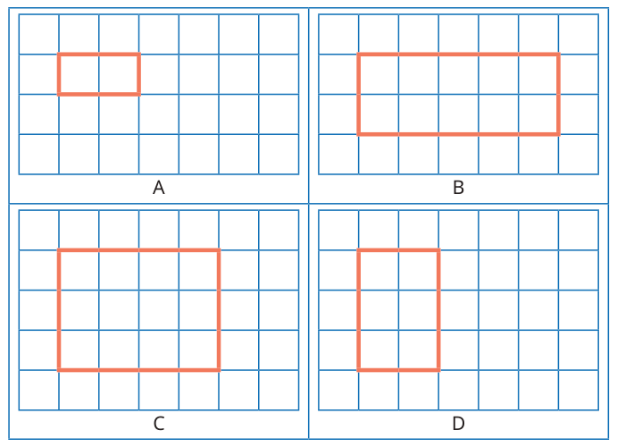


Kunci sumber: `C`; status AI: `verified`; jawaban diverifikasi AI: `C`.
Solusi minimum hasil AI: Bangun C memiliki panjang 4 satuan dan lebar 3 satuan. Luas = panjang x lebar = 4 x 3 = 12 satuan luas.
Gambar sumber: images/kelas5_panduan_siswa_kelas5.pdf-0160-06.png. Transkripsi visual: Terdapat empat persegi panjang (A, B, C, D) yang digambar di atas kertas berpetak. Bangun A berukuran 2x1 petak. Bangun B berukuran 5x2 petak. Bangun C berukuran 4x3 petak. Bangun D berukuran 2x3 petak.

### 1. Pemeriksaan input dan fitur

Struktur: `pass`; alasan: `[]`. Grade/topik: kelas 5 / Matematika SD Kelas 5. KKO: `['menyebutkan', 'menghitung']`; KKO hanya petunjuk bantu.
Isi dan kunci berasal dari sumber yang sama pada ketiga run. Versi konten: 2; hash: `53046b56d202fe8ace44f2d74ac0c6320ae996cc11aec4cef96f63c78c23c27c`. Bukti verifikasi AI tidak sama dengan verifikasi ahli.

### 2. Penilaian Gemini blind — tiga run sebelum melihat IndoBERT

| Run | Status | Konten / kunci | Kognitif | Pengetahuan | Difficulty | Token |
|---:|---|---|---|---|---|---:|
| 1 | success | valid / verified | applying | procedural | Easy | 2729 |
| 2 | success | valid / verified | applying | procedural | Easy | 2756 |
| 3 | success | valid / verified | applying | procedural | Easy | 2725 |

Run 1 — solusi: Bangun C memiliki panjang 4 satuan dan lebar 3 satuan. Luas = panjang x lebar = 4 x 3 = 12 satuan luas.
- Domain kognitif `classify/applying`: Siswa diminta menerapkan rumus luas persegi panjang (panjang x lebar) pada bangun yang diberikan di grid. Ini adalah penerapan prosedur rutin.. Bukti: Temukan cara menghitung luas daerahnya; Hitunglah panjang, lebar, dan luas daerah setiap kotak
- Dimensi pengetahuan `classify/procedural`: Soal ini menguji pemahaman tentang algoritma atau prosedur menghitung luas persegi panjang dengan mengalikan panjang dan lebar.. Bukti: Luas Daerah; 2 × 1 = 2
- Intended difficulty `classify/Easy`: Soal ini bersifat rutin, meminta siswa menghitung luas berdasarkan visualisasi grid yang sederhana. Tidak ada jebakan kompleks atau strategi non-rutin.. Bukti: Perhatikan bangun-bangun persegi panjang berikut; Hitunglah panjang, lebar, dan luas daerah setiap kotak

Profil difficulty run ini:

| Parameter | Nilai |
|---|---|
| expectedPrerequisite | Pemahaman konsep luas sebagai jumlah satuan petak dan rumus luas persegi panjang (p x l). |
| dependentSteps | 2 |
| routineStatus | familiar_routine |
| strategySelection | False |
| representationTransfer | True |
| relevantInformationUnits | 2 |
| interactingConstraints | 0 |
| calculationLoad | low |
| scaffoldLevel | none |
| distractorQuality | plausible |
| gradeRelativeRationale | Sesuai untuk kelas 5 karena mengaitkan representasi visual (grid) dengan prosedur formal perhitungan luas. |

Run 2 — solusi: Bangun C memiliki panjang 4 satuan dan lebar 3 satuan. Luas = panjang x lebar = 4 x 3 = 12 satuan luas.
- Domain kognitif `classify/applying`: Siswa diminta menerapkan rumus luas persegi panjang (panjang x lebar) pada situasi rutin yang disajikan dalam bentuk visual (grid). Ini adalah proses penerapan prosedur yang sudah dipelajari.. Bukti: Temukan cara menghitung luas daerahnya; Hitunglah panjang, lebar, dan luas daerah setiap kotak di atas
- Dimensi pengetahuan `classify/procedural`: Soal ini menguji pemahaman tentang algoritma atau teknik menghitung luas persegi panjang dengan menggunakan panjang dan lebar.. Bukti: 2 × 1 = 2; panjang x lebar
- Intended difficulty `classify/Easy`: Soal ini tergolong mudah karena siswa hanya perlu melakukan pembacaan visual sederhana pada grid dan menerapkan rumus dasar luas persegi panjang secara langsung.. Bukti: Perhatikan bangun-bangun persegi panjang berikut; Hitunglah panjang, lebar, dan luas daerah setiap kotak di atas

Profil difficulty run ini:

| Parameter | Nilai |
|---|---|
| expectedPrerequisite | Pemahaman konsep luas sebagai jumlah satuan persegi dan rumus luas persegi panjang (p x l). |
| dependentSteps | 2 |
| routineStatus | familiar_routine |
| strategySelection | False |
| representationTransfer | True |
| relevantInformationUnits | 2 |
| interactingConstraints | 0 |
| calculationLoad | low |
| scaffoldLevel | none |
| distractorQuality | plausible |
| gradeRelativeRationale | Untuk kelas 5, menghitung luas dengan grid adalah materi dasar yang sudah dikuasai, sehingga tugas ini bersifat rutin dan langsung. |

Run 3 — solusi: Bangun C memiliki panjang 4 satuan dan lebar 3 satuan. Luas = panjang x lebar = 4 x 3 = 12 satuan luas.
- Domain kognitif `classify/applying`: Siswa diminta menerapkan rumus luas persegi panjang (panjang x lebar) pada bangun yang diberikan secara visual, yang merupakan penerapan prosedur rutin.. Bukti: Temukan cara menghitung luas daerahnya; Hitunglah panjang, lebar, dan luas daerah setiap kotak di atas
- Dimensi pengetahuan `classify/procedural`: Soal ini menguji pemahaman tentang algoritma atau teknik menghitung luas persegi panjang dengan mengalikan panjang dan lebar.. Bukti: Luas Daerah; 2 × 1 = 2
- Intended difficulty `classify/Easy`: Soal ini bersifat rutin bagi siswa kelas 5, hanya memerlukan pembacaan visual sederhana dan penerapan rumus dasar.. Bukti: Perhatikan bangun-bangun persegi panjang berikut; Hitunglah panjang, lebar, dan luas daerah setiap kotak di atas

Profil difficulty run ini:

| Parameter | Nilai |
|---|---|
| expectedPrerequisite | Pemahaman konsep luas sebagai jumlah satuan petak dan rumus luas persegi panjang. |
| dependentSteps | 2 |
| routineStatus | familiar_routine |
| strategySelection | False |
| representationTransfer | True |
| relevantInformationUnits | 2 |
| interactingConstraints | 0 |
| calculationLoad | low |
| scaffoldLevel | none |
| distractorQuality | plausible |
| gradeRelativeRationale | Siswa kelas 5 sudah sangat familiar dengan konsep luas bangun datar sederhana dan penggunaan petak satuan. |

### 3. Voting awal dan adjudikasi

| Head | Suara awal | Pola / status akhir | Label akhir advisory |
|---|---|---|---|
| Domain kognitif | {"applying": 3} | unanimous_3_0 / unanimous | applying |
| Dimensi pengetahuan | {"procedural": 3} | unanimous_3_0 / unanimous | procedural |
| Intended difficulty | {"Easy": 3} | unanimous_3_0 / unanimous | Easy |

### 4. Diagnostik IndoBERT setelah label blind dikunci

Model membaca representation `metadata`; token input 309/256; truncation: `True`.

| Head | Probabilitas | Label | Confidence | Entropy | Action / alasan |
|---|---|---|---:|---:|---|
| Domain kognitif | knowing=0.998342; applying=0.001658; reasoning=0.000000 | knowing | 0.998342 | 0.011168 | review / input_reached_truncation_limit; selective_threshold_gate_not_met |
| Dimensi pengetahuan | factual=0.006440; conceptual=0.648395; procedural=0.345165; metacognitive=0.000000 | conceptual | 0.648395 | 0.490933 | review / input_reached_truncation_limit; selective_threshold_gate_not_met |
| Intended difficulty | Easy=0.444456; Medium=0.545540; Hard=0.010004 | Medium | 0.545540 | 0.670905 | review / input_reached_truncation_limit; selective_threshold_gate_not_met |

Domain kognitif: Σp = 1.00000000; confidence = max(p) = 0.998342; −Σp ln(p) = 0.012270; H = 0.012270/ln(3) = 0.011168; T = 0.050000.


Dimensi pengetahuan: Σp = 1.00000000; confidence = max(p) = 0.648395; −Σp ln(p) = 0.680578; H = 0.680578/ln(4) = 0.490933; T = 0.209800.


Intended difficulty: Σp = 1.00000000; confidence = max(p) = 0.545540; −Σp ln(p) = 0.737064; H = 0.737064/ln(3) = 0.670905; T = 0.953328.


<details><summary>Input sebenarnya yang dibaca model</summary>

```text
Kelas: 5
Topik: Matematika SD Kelas 5
Subtopik: Luas Daerah Bangun Datar
Tipe soal: multiple_choice
Stimulus: -
Soal: Perhatikan bangun-bangun persegi panjang berikut. Temukan cara menghitung luas daerahnya.

|**Bangun**|**Panjang**|**Lebar**|**Luas Daerah**|**Hitungan**|
|---|---|---|---|---|
|A|2 satuan|1 satuan|2 satuan luas|2 × 1 = 2|
|B|5 satuan|2 satuan|… satuan luas|5 × 2 = …|
|C|… satuan|… satuan|… satuan luas|… × … = …|
|D|… satuan|… satuan|… satuan luas|… × … = …|

Hitunglah panjang, lebar, dan luas daerah setiap kotak di atas. Tuliskan hasilnya pada tabel berikut.

C
Pilihan: A. Panjang 4 satuan, lebar 3 satuan, luas 14 satuan luas
B. Panjang 4 satuan, lebar 3 satuan, luas 7 satuan luas
C. Panjang 4 satuan, lebar 3 satuan, luas 12 satuan luas
D. Panjang 5 satuan, lebar 4 satuan, luas 20 satuan luas
Transkripsi visual: Terdapat empat persegi panjang (A, B, C, D) yang digambar di atas kertas berpetak. Bangun A berukuran 2x1 petak. Bangun B berukuran 5x2 petak. Bangun C berukuran 4x3 petak. Bangun D berukuran 2x3 petak.
```

</details>

### 5. Keputusan batch

Label advisory blind: `{"mathCognitiveDomain": "applying", "knowledgeDimension": "procedural", "intendedDifficulty": "Easy"}`. Routing: `pending_expert_review`.
Status konten: `valid`. Catatan konten: .
Perbedaan model dan blind: `{"mathCognitiveDomain": {"modelLabel": "knowing", "blindLabel": "applying", "agreement": false}, "knowledgeDimension": {"modelLabel": "conceptual", "blindLabel": "procedural", "agreement": false}, "intendedDifficulty": {"modelLabel": "Medium", "blindLabel": "Easy", "agreement": false}}`.
Gold ahli tetap null; human review wajib. Confidence IndoBERT tidak digunakan untuk mengganti label blind.

## 41. Soal `ee75e145108e35883906fd59`

Cobalah menghitung luas daerah bangun gabungan berikut.<br><br>1

| Opsi | Isi |
|---|---|
| A | 216 cm² |
| B | 84 cm² |
| C | 42 cm² |
| D | 432 cm² |

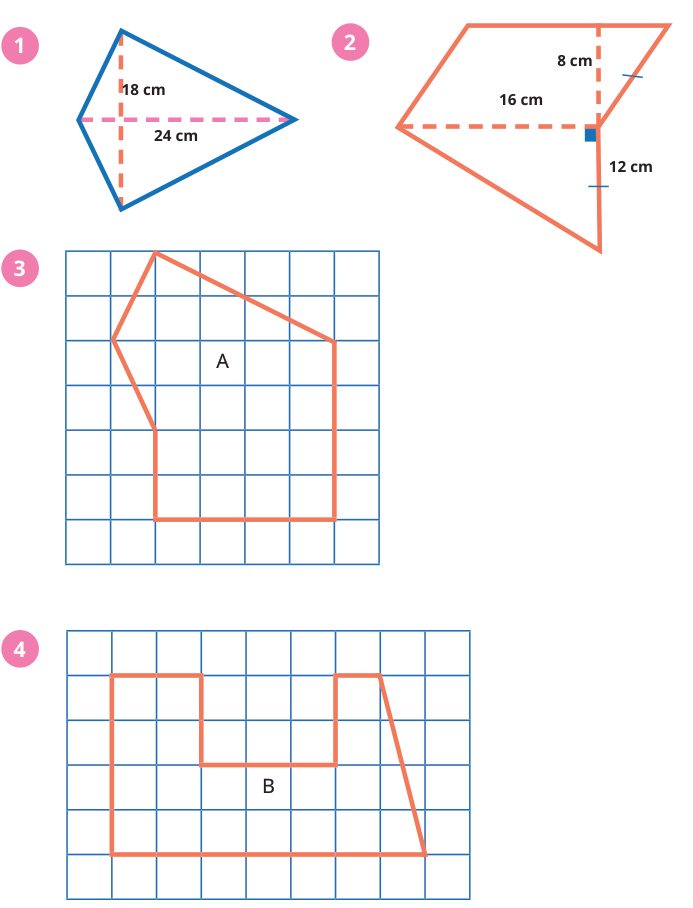


Kunci sumber: `A`; status AI: `verified`; jawaban diverifikasi AI: `A`.
Solusi minimum hasil AI: Luas layang-layang = 1/2 x d1 x d2 = 1/2 x 18 cm x 24 cm = 216 cm².
Gambar sumber: images/kelas5_panduan_siswa_kelas5.pdf-0178-03.png. Transkripsi visual: Gambar 1 menunjukkan sebuah layang-layang dengan panjang diagonal 18 cm dan 24 cm yang ditandai dengan garis putus-putus.

### 1. Pemeriksaan input dan fitur

Struktur: `pass`; alasan: `[]`. Grade/topik: kelas 5 / Matematika SD Kelas 5. KKO: `[]`; KKO hanya petunjuk bantu.
Isi dan kunci berasal dari sumber yang sama pada ketiga run. Versi konten: 2; hash: `84d93e978b5260d50b015e5499cb9e524b86da62ad7fd40768849a6731e2fb22`. Bukti verifikasi AI tidak sama dengan verifikasi ahli.

### 2. Penilaian Gemini blind — tiga run sebelum melihat IndoBERT

| Run | Status | Konten / kunci | Kognitif | Pengetahuan | Difficulty | Token |
|---:|---|---|---|---|---|---:|
| 1 | success | valid / verified | applying | procedural | Easy | 2483 |
| 2 | success | valid / verified | applying | procedural | Easy | 2495 |
| 3 | success | valid / verified | applying | procedural | Easy | 2494 |

Run 1 — solusi: Luas layang-layang = 1/2 x d1 x d2 = 1/2 x 18 cm x 24 cm = 216 cm².
- Domain kognitif `classify/applying`: Siswa diminta untuk menerapkan rumus luas bangun datar (layang-layang) yang sudah dipelajari pada situasi rutin.. Bukti: Cobalah menghitung luas daerah bangun gabungan berikut. 1
- Dimensi pengetahuan `classify/procedural`: Soal ini menguji pemahaman siswa terhadap algoritma atau rumus luas bangun datar.. Bukti: luas layang-layang = 1/2 x 24 x 18 = 216 cm²
- Intended difficulty `classify/Easy`: Soal ini merupakan penerapan langsung rumus luas layang-layang dengan data yang sudah tersedia secara eksplisit.. Bukti: 18 cm; 24 cm

Profil difficulty run ini:

| Parameter | Nilai |
|---|---|
| expectedPrerequisite | Pemahaman rumus luas layang-layang dan operasi perkalian dasar. |
| dependentSteps | 1 |
| routineStatus | familiar_routine |
| strategySelection | False |
| representationTransfer | False |
| relevantInformationUnits | 2 |
| interactingConstraints | 0 |
| calculationLoad | low |
| scaffoldLevel | none |
| distractorQuality | plausible |
| gradeRelativeRationale | Siswa kelas 5 diharapkan sudah menguasai rumus luas bangun datar sederhana seperti layang-layang. |

Run 2 — solusi: Luas layang-layang = 1/2 x d1 x d2 = 1/2 x 18 cm x 24 cm = 9 x 24 cm² = 216 cm².
- Domain kognitif `classify/applying`: Siswa diminta untuk menerapkan rumus luas bangun datar (layang-layang) yang sudah dipelajari secara langsung pada data yang diberikan.. Bukti: Cobalah menghitung luas daerah bangun gabungan berikut. 1
- Dimensi pengetahuan `classify/procedural`: Soal ini menguji pemahaman siswa terhadap rumus atau algoritma perhitungan luas bangun datar.. Bukti: luas layang-layang = 1/2 x 24 x 18
- Intended difficulty `classify/Easy`: Soal ini bersifat rutin bagi siswa kelas 5 karena hanya memerlukan penerapan rumus luas layang-layang secara langsung dengan data yang sudah tersedia.. Bukti: 18 cm; 24 cm

Profil difficulty run ini:

| Parameter | Nilai |
|---|---|
| expectedPrerequisite | Pemahaman rumus luas layang-layang dan operasi perkalian dasar. |
| dependentSteps | 1 |
| routineStatus | familiar_routine |
| strategySelection | False |
| representationTransfer | False |
| relevantInformationUnits | 2 |
| interactingConstraints | 0 |
| calculationLoad | low |
| scaffoldLevel | none |
| distractorQuality | plausible |
| gradeRelativeRationale | Siswa kelas 5 diharapkan sudah menguasai rumus luas bangun datar sederhana seperti layang-layang. |

Run 3 — solusi: Luas layang-layang = 1/2 x d1 x d2 = 1/2 x 18 cm x 24 cm = 216 cm².
- Domain kognitif `classify/applying`: Siswa diminta menerapkan rumus luas layang-layang yang sudah dipelajari secara langsung pada bangun yang diberikan.. Bukti: menghitung luas daerah bangun gabungan berikut; 18 cm; 24 cm
- Dimensi pengetahuan `classify/procedural`: Soal ini menguji pemahaman tentang rumus luas bangun datar (layang-layang) dan prosedur perhitungannya.. Bukti: luas daerah bangun gabungan; 1/2 x 24 x 18
- Intended difficulty `classify/Easy`: Soal ini merupakan penerapan rumus standar yang rutin bagi siswa kelas 5, dengan satu langkah perhitungan langsung.. Bukti: 18 cm; 24 cm; luas daerah bangun gabungan

Profil difficulty run ini:

| Parameter | Nilai |
|---|---|
| expectedPrerequisite | Pemahaman rumus luas layang-layang (1/2 x d1 x d2). |
| dependentSteps | 1 |
| routineStatus | familiar_routine |
| strategySelection | False |
| representationTransfer | False |
| relevantInformationUnits | 2 |
| interactingConstraints | 0 |
| calculationLoad | low |
| scaffoldLevel | none |
| distractorQuality | plausible |
| gradeRelativeRationale | Siswa kelas 5 diharapkan sudah menguasai rumus luas bangun datar sederhana seperti layang-layang. |

### 3. Voting awal dan adjudikasi

| Head | Suara awal | Pola / status akhir | Label akhir advisory |
|---|---|---|---|
| Domain kognitif | {"applying": 3} | unanimous_3_0 / unanimous | applying |
| Dimensi pengetahuan | {"procedural": 3} | unanimous_3_0 / unanimous | procedural |
| Intended difficulty | {"Easy": 3} | unanimous_3_0 / unanimous | Easy |

### 4. Diagnostik IndoBERT setelah label blind dikunci

Model membaca representation `metadata`; token input 84/256; truncation: `False`.

| Head | Probabilitas | Label | Confidence | Entropy | Action / alasan |
|---|---|---|---:|---:|---|
| Domain kognitif | knowing=0.923560; applying=0.076440; reasoning=0.000000 | knowing | 0.923560 | 0.245752 | review / selective_threshold_gate_not_met |
| Dimensi pengetahuan | factual=0.906004; conceptual=0.075338; procedural=0.018659; metacognitive=0.000000 | factual | 0.906004 | 0.258623 | review / selective_threshold_gate_not_met |
| Intended difficulty | Easy=0.930494; Medium=0.065525; Hard=0.003981 | Easy | 0.930494 | 0.243587 | review / selective_threshold_gate_not_met |

Domain kognitif: Σp = 1.00000000; confidence = max(p) = 0.923560; −Σp ln(p) = 0.269986; H = 0.269986/ln(3) = 0.245752; T = 0.050000.


Dimensi pengetahuan: Σp = 1.00000000; confidence = max(p) = 0.906004; −Σp ln(p) = 0.358528; H = 0.358528/ln(4) = 0.258623; T = 0.209800.


Intended difficulty: Σp = 1.00000000; confidence = max(p) = 0.930494; −Σp ln(p) = 0.267607; H = 0.267607/ln(3) = 0.243587; T = 0.953328.


<details><summary>Input sebenarnya yang dibaca model</summary>

```text
Kelas: 5
Topik: Matematika SD Kelas 5
Subtopik: Luas Daerah Bangun Datar
Tipe soal: multiple_choice
Stimulus: -
Soal: Cobalah menghitung luas daerah bangun gabungan berikut.

1
Pilihan: A. 216 cm²
B. 84 cm²
C. 42 cm²
D. 432 cm²
Transkripsi visual: Gambar 1 menunjukkan sebuah layang-layang dengan panjang diagonal 18 cm dan 24 cm yang ditandai dengan garis putus-putus.
```

</details>

### 5. Keputusan batch

Label advisory blind: `{"mathCognitiveDomain": "applying", "knowledgeDimension": "procedural", "intendedDifficulty": "Easy"}`. Routing: `pending_expert_review`.
Status konten: `valid`. Catatan konten: .
Perbedaan model dan blind: `{"mathCognitiveDomain": {"modelLabel": "knowing", "blindLabel": "applying", "agreement": false}, "knowledgeDimension": {"modelLabel": "factual", "blindLabel": "procedural", "agreement": false}, "intendedDifficulty": {"modelLabel": "Easy", "blindLabel": "Easy", "agreement": true}}`.
Gold ahli tetap null; human review wajib. Confidence IndoBERT tidak digunakan untuk mengganti label blind.

## 42. Soal `e4a5a859b3d314d36c30b33a`

Cobalah menghitung luas daerah bangun gabungan berikut.<br><br>3

| Opsi | Isi |
|---|---|
| A | 22 satuan luas |
| B | 20 satuan luas |
| C | 28 satuan luas |
| D | 16 satuan luas |


Kunci sumber: `A`; status AI: `verified`; jawaban diverifikasi AI: `A`.
Solusi minimum hasil AI: Luas = (4x4) + (0.5x1x4) + (0.5x2x4) = 16 + 2 + 4 = 22 satuan luas.
Gambar sumber: images/kelas5_panduan_siswa_kelas5.pdf-0178-03.png. Transkripsi visual: Gambar 3 menunjukkan sebuah bangun datar poligon yang digambar di atas kertas berpetak. Bangun tersebut dapat didekomposisi menjadi sebuah persegi panjang berukuran 4x4 satuan di bagian bawah, sebuah segitiga siku-siku di sisi kiri dengan alas 1 satuan dan tinggi 4 satuan, serta sebuah segitiga siku-siku di sisi kanan dengan alas 2 satuan dan tinggi 4 satuan.

### 1. Pemeriksaan input dan fitur

Struktur: `pass`; alasan: `[]`. Grade/topik: kelas 5 / Matematika SD Kelas 5. KKO: `[]`; KKO hanya petunjuk bantu.
Isi dan kunci berasal dari sumber yang sama pada ketiga run. Versi konten: 2; hash: `cd020f459924b3281895c638464ff742ca604aa09e646192d758f2bad43fa3a7`. Bukti verifikasi AI tidak sama dengan verifikasi ahli.

### 2. Penilaian Gemini blind — tiga run sebelum melihat IndoBERT

| Run | Status | Konten / kunci | Kognitif | Pengetahuan | Difficulty | Token |
|---:|---|---|---|---|---|---:|
| 1 | success | valid / verified | applying | procedural | Medium | 2744 |
| 2 | success | valid / verified | applying | procedural | Medium | 2605 |
| 3 | success | valid / verified | applying | procedural | Easy | 2626 |

Run 1 — solusi: Bangun terdiri dari persegi panjang 4x4 (luas 16), segitiga kiri (alas 1, tinggi 4, luas 2), dan segitiga kanan (alas 2, tinggi 2, luas 2). Total luas = 16 + 2 + 2 = 20 satuan luas.
- Domain kognitif `classify/applying`: Siswa perlu melakukan dekomposisi bangun datar kompleks menjadi bangun-bangun sederhana (persegi panjang dan segitiga) dan menerapkan rumus luas masing-masing, yang merupakan penerapan prosedur rutin.. Bukti: Cobalah menghitung luas daerah bangun gabungan berikut.
- Dimensi pengetahuan `classify/procedural`: Soal ini menguji pemahaman tentang bagaimana menghitung luas bangun gabungan dengan menggunakan rumus luas bangun datar dasar (persegi panjang dan segitiga).. Bukti: luas daerah bangun gabungan
- Intended difficulty `classify/Medium`: Soal ini dikategorikan Medium karena siswa harus melakukan dekomposisi bangun gabungan menjadi beberapa bagian (persegi panjang dan dua segitiga) dan menjumlahkannya, yang melibatkan beberapa langkah rutin.. Bukti: Cobalah menghitung luas daerah bangun gabungan berikut.; 3

Profil difficulty run ini:

| Parameter | Nilai |
|---|---|
| expectedPrerequisite | Rumus luas persegi panjang dan segitiga, konsep dekomposisi bangun datar. |
| dependentSteps | 3 |
| routineStatus | routine_selection |
| strategySelection | True |
| representationTransfer | True |
| relevantInformationUnits | 3 |
| interactingConstraints | 2 |
| calculationLoad | low |
| scaffoldLevel | none |
| distractorQuality | plausible |
| gradeRelativeRationale | Siswa kelas 5 diharapkan mampu menghitung luas bangun gabungan dengan memecahnya menjadi bangun sederhana. Soal ini menuntut ketelitian dalam membaca grid. |

Run 2 — solusi: Luas = (4x4) + (0.5x2x2) + (0.5x2x4) = 16 + 2 + 4 = 22 satuan luas.
- Domain kognitif `classify/applying`: Siswa perlu mengidentifikasi bangun-bangun penyusun (persegi panjang dan dua segitiga) pada kertas berpetak, menerapkan rumus luas masing-masing, dan menjumlahkannya. Ini adalah penerapan prosedur rutin pada situasi yang sedikit dimodifikasi.. Bukti: Cobalah menghitung luas daerah bangun gabungan berikut. 3
- Dimensi pengetahuan `classify/procedural`: Soal ini menguji pemahaman tentang algoritma dan teknik menghitung luas bangun datar gabungan dengan memecahnya menjadi bagian-bagian yang lebih sederhana.. Bukti: luas daerah bangun gabungan
- Intended difficulty `classify/Medium`: Soal ini dikategorikan Medium karena siswa harus melakukan dekomposisi bangun gabungan menjadi tiga bagian (satu persegi panjang dan dua segitiga) dan melakukan perhitungan luas untuk masing-masing bagian sebelum menjumlahkannya.. Bukti: Cobalah menghitung luas daerah bangun gabungan berikut. 3

Profil difficulty run ini:

| Parameter | Nilai |
|---|---|
| expectedPrerequisite | Rumus luas persegi panjang dan segitiga, serta pemahaman konsep luas pada kertas berpetak. |
| dependentSteps | 3 |
| routineStatus | routine_selection |
| strategySelection | True |
| representationTransfer | False |
| relevantInformationUnits | 3 |
| interactingConstraints | 0 |
| calculationLoad | low |
| scaffoldLevel | none |
| distractorQuality | plausible |
| gradeRelativeRationale | Siswa kelas 5 diharapkan mampu melakukan dekomposisi bangun datar sederhana dan menghitung luasnya. Soal ini menuntut ketelitian dalam membagi bangun menjadi bagian yang dapat dihitung luasnya. |

Run 3 — solusi: Bangun dapat didekomposisi menjadi persegi panjang 4x4 (luas 16), segitiga kiri (alas 1, tinggi 4, luas 2), dan segitiga kanan (alas 2, tinggi 4, luas 4). Total luas = 16 + 2 + 4 = 22 satuan luas.
- Domain kognitif `classify/applying`: Siswa perlu melakukan dekomposisi bangun gabungan menjadi bangun-bangun dasar (persegi panjang dan segitiga) dan menerapkan rumus luas masing-masing, yang merupakan penerapan prosedur rutin.. Bukti: Cobalah menghitung luas daerah bangun gabungan berikut. 3
- Dimensi pengetahuan `classify/procedural`: Soal ini menguji pemahaman tentang bagaimana menghitung luas dengan memecah bangun kompleks menjadi bangun-bangun dasar yang rumusnya sudah diketahui.. Bukti: luas daerah bangun gabungan
- Intended difficulty `classify/Easy`: Soal ini tergolong mudah karena bangun dapat didekomposisi dengan jelas pada kertas berpetak, melibatkan operasi dasar yang familiar bagi siswa kelas 5.. Bukti: Cobalah menghitung luas daerah bangun gabungan berikut. 3

Profil difficulty run ini:

| Parameter | Nilai |
|---|---|
| expectedPrerequisite | Rumus luas persegi panjang dan segitiga, konsep dekomposisi bangun datar. |
| dependentSteps | 3 |
| routineStatus | familiar_routine |
| strategySelection | False |
| representationTransfer | False |
| relevantInformationUnits | 3 |
| interactingConstraints | 0 |
| calculationLoad | low |
| scaffoldLevel | none |
| distractorQuality | plausible |
| gradeRelativeRationale | Siswa kelas 5 sudah terbiasa menghitung luas bangun datar sederhana dan gabungan menggunakan kertas berpetak. |

### 3. Voting awal dan adjudikasi

| Head | Suara awal | Pola / status akhir | Label akhir advisory |
|---|---|---|---|
| Domain kognitif | {"applying": 3} | unanimous_3_0 / adjudicated | applying |
| Dimensi pengetahuan | {"procedural": 3} | unanimous_3_0 / adjudicated | procedural |
| Intended difficulty | {"Medium": 2, "Easy": 1} | majority_2_of_3 / adjudicated | Medium |

Adjudikasi AI: `success`; token `4069`.
Konten: `valid`; kunci: `verified`; masalah: .
- Domain kognitif `applying`: Siswa perlu melakukan dekomposisi bangun datar kompleks menjadi bangun-bangun sederhana (persegi panjang dan dua segitiga) dan menerapkan rumus luas masing-masing, yang merupakan penerapan prosedur rutin.
- Dimensi pengetahuan `procedural`: Soal ini menguji pemahaman tentang algoritma dan teknik menghitung luas bangun datar gabungan dengan memecahnya menjadi bagian-bagian yang lebih sederhana.
- Intended difficulty `Medium`: Soal ini dikategorikan Medium karena siswa harus melakukan dekomposisi bangun gabungan menjadi tiga bagian (satu persegi panjang dan dua segitiga) dan melakukan perhitungan luas untuk masing-masing bagian sebelum menjumlahkannya.

Profil difficulty hasil adjudikasi:

| Parameter | Nilai |
|---|---|
| expectedPrerequisite | Rumus luas persegi panjang dan segitiga, konsep dekomposisi bangun datar pada kertas berpetak. |
| dependentSteps | 3 |
| routineStatus | routine_selection |
| strategySelection | True |
| representationTransfer | True |
| relevantInformationUnits | 3 |
| interactingConstraints | 2 |
| calculationLoad | low |
| scaffoldLevel | none |
| distractorQuality | plausible |
| gradeRelativeRationale | Siswa kelas 5 diharapkan mampu melakukan dekomposisi bangun datar sederhana dan menghitung luasnya. Soal ini menuntut ketelitian dalam membagi bangun menjadi bagian yang dapat dihitung luasnya. |

### 4. Diagnostik IndoBERT setelah label blind dikunci

Model membaca representation `metadata`; token input 135/256; truncation: `False`.

| Head | Probabilitas | Label | Confidence | Entropy | Action / alasan |
|---|---|---|---:|---:|---|
| Domain kognitif | knowing=0.007549; applying=0.992451; reasoning=0.000000 | applying | 0.992451 | 0.040421 | review / selective_threshold_gate_not_met |
| Dimensi pengetahuan | factual=0.227486; conceptual=0.758184; procedural=0.014330; metacognitive=0.000000 | conceptual | 0.758184 | 0.438258 | review / selective_threshold_gate_not_met |
| Intended difficulty | Easy=0.843895; Medium=0.153054; Hard=0.003052 | Easy | 0.843895 | 0.407955 | review / selective_threshold_gate_not_met |

Domain kognitif: Σp = 1.00000000; confidence = max(p) = 0.992451; −Σp ln(p) = 0.044407; H = 0.044407/ln(3) = 0.040421; T = 0.050000.


Dimensi pengetahuan: Σp = 1.00000000; confidence = max(p) = 0.758184; −Σp ln(p) = 0.607555; H = 0.607555/ln(4) = 0.438258; T = 0.209800.


Intended difficulty: Σp = 1.00000000; confidence = max(p) = 0.843895; −Σp ln(p) = 0.448184; H = 0.448184/ln(3) = 0.407955; T = 0.953328.


<details><summary>Input sebenarnya yang dibaca model</summary>

```text
Kelas: 5
Topik: Matematika SD Kelas 5
Subtopik: Luas Daerah Bangun Gabungan
Tipe soal: multiple_choice
Stimulus: -
Soal: Cobalah menghitung luas daerah bangun gabungan berikut.

3
Pilihan: A. 22 satuan luas
B. 20 satuan luas
C. 28 satuan luas
D. 16 satuan luas
Transkripsi visual: Gambar 3 menunjukkan sebuah bangun datar poligon yang digambar di atas kertas berpetak. Bangun tersebut dapat didekomposisi menjadi sebuah persegi panjang berukuran 4x4 satuan di bagian bawah, sebuah segitiga siku-siku di sisi kiri dengan alas 1 satuan dan tinggi 4 satuan, serta sebuah segitiga siku-siku di sisi kanan dengan alas 2 satuan dan tinggi 4 satuan.
```

</details>

### 5. Keputusan batch

Label advisory blind: `{"mathCognitiveDomain": "applying", "knowledgeDimension": "procedural", "intendedDifficulty": "Medium"}`. Routing: `pending_expert_review`.
Status konten: `valid`. Catatan konten: .
Perbedaan model dan blind: `{"mathCognitiveDomain": {"modelLabel": "applying", "blindLabel": "applying", "agreement": true}, "knowledgeDimension": {"modelLabel": "conceptual", "blindLabel": "procedural", "agreement": false}, "intendedDifficulty": {"modelLabel": "Easy", "blindLabel": "Medium", "agreement": false}}`.
Gold ahli tetap null; human review wajib. Confidence IndoBERT tidak digunakan untuk mengganti label blind.

## 43. Soal `201997c9ac57959886dabd86`

Cobalah menghitung luas daerah bangun gabungan berikut.<br><br>2

| Opsi | Isi |
|---|---|
| A | 224 cm² |
| B | 128 cm² |
| C | 320 cm² |
| D | 160 cm² |


Kunci sumber: `A`; status AI: `verified`; jawaban diverifikasi AI: `A`.
Solusi minimum hasil AI: Luas = Luas Jajargenjang + Luas Segitiga = (alas x tinggi) + (1/2 x alas x tinggi) = (16 x 8) + (1/2 x 16 x 12) = 128 + 96 = 224 cm².
Gambar sumber: images/kelas5_panduan_siswa_kelas5.pdf-0178-03.png. Transkripsi visual: Gambar 2 menunjukkan bangun gabungan yang terdiri dari jajargenjang di bagian atas dan segitiga di bagian bawah. Jajargenjang memiliki alas 16 cm dan tinggi 8 cm. Segitiga memiliki alas 16 cm (berhimpit dengan alas jajargenjang) dan tinggi 12 cm.

### 1. Pemeriksaan input dan fitur

Struktur: `pass`; alasan: `[]`. Grade/topik: kelas 5 / Matematika SD Kelas 5. KKO: `[]`; KKO hanya petunjuk bantu.
Isi dan kunci berasal dari sumber yang sama pada ketiga run. Versi konten: 2; hash: `68e0f457769debd73efdd9cffa021fb58738b6dc876d0b36935a7b1d5a96f01e`. Bukti verifikasi AI tidak sama dengan verifikasi ahli.

### 2. Penilaian Gemini blind — tiga run sebelum melihat IndoBERT

| Run | Status | Konten / kunci | Kognitif | Pengetahuan | Difficulty | Token |
|---:|---|---|---|---|---|---:|
| 1 | success | valid / verified | applying | procedural | Medium | 2675 |
| 2 | success | valid / verified | applying | procedural | Medium | 2670 |
| 3 | success | valid / verified | applying | procedural | Medium | 2691 |

Run 1 — solusi: Luas = Luas Jajargenjang + Luas Segitiga = (alas x tinggi) + (1/2 x alas x tinggi) = (16 x 8) + (1/2 x 16 x 12) = 128 + 96 = 224 cm².
- Domain kognitif `classify/applying`: Siswa perlu mengidentifikasi dua bangun datar penyusun (jajargenjang dan segitiga) dari gambar gabungan, memilih rumus luas yang tepat untuk masing-masing, dan menjumlahkannya. Ini adalah penerapan prosedur rutin pada situasi gabungan.. Bukti: Cobalah menghitung luas daerah bangun gabungan berikut.; 16 x 8 + 1/2 x 16 x 12
- Dimensi pengetahuan `classify/procedural`: Soal ini menuntut penggunaan algoritma atau teknik perhitungan luas bangun datar (jajargenjang dan segitiga) secara berurutan untuk menyelesaikan masalah.. Bukti: luas daerah bangun gabungan; 16 x 8 + 1/2 x 16 x 12
- Intended difficulty `classify/Medium`: Soal ini dikategorikan Medium karena melibatkan dua langkah rutin yang saling terkait (menghitung luas dua bangun berbeda) dan memerlukan dekomposisi visual dari bangun gabungan, yang sedikit lebih kompleks daripada menghitung luas bangun tunggal.. Bukti: bangun gabungan; 16 x 8 + 1/2 x 16 x 12

Profil difficulty run ini:

| Parameter | Nilai |
|---|---|
| expectedPrerequisite | Pemahaman rumus luas jajargenjang dan segitiga, serta konsep penjumlahan luas bangun datar. |
| dependentSteps | 2 |
| routineStatus | routine_selection |
| strategySelection | True |
| representationTransfer | False |
| relevantInformationUnits | 4 |
| interactingConstraints | 1 |
| calculationLoad | moderate |
| scaffoldLevel | none |
| distractorQuality | plausible |
| gradeRelativeRationale | Siswa kelas 5 diharapkan sudah mampu melakukan dekomposisi bangun datar sederhana dan menerapkan rumus luas dasar secara bertahap. |

Run 2 — solusi: Luas = Luas Jajargenjang + Luas Segitiga = (alas x tinggi) + (1/2 x alas x tinggi) = (16 x 8) + (1/2 x 16 x 12) = 128 + 96 = 224 cm².
- Domain kognitif `classify/applying`: Siswa perlu mengidentifikasi dua bangun datar penyusun (jajargenjang dan segitiga) dari gambar gabungan, memilih rumus luas yang tepat untuk masing-masing, dan menjumlahkannya. Ini adalah penerapan prosedur rutin pada situasi gabungan.. Bukti: Cobalah menghitung luas daerah bangun gabungan berikut.; 16 x 8 + 1/2 x 16 x 12
- Dimensi pengetahuan `classify/procedural`: Soal ini menuntut penggunaan algoritma atau rumus luas bangun datar (jajargenjang dan segitiga) secara berurutan untuk menyelesaikan masalah.. Bukti: luas daerah bangun gabungan; 16 x 8 + 1/2 x 16 x 12
- Intended difficulty `classify/Medium`: Soal ini dikategorikan Medium karena melibatkan dua langkah rutin yang saling terkait (menghitung luas dua bangun berbeda) dan memerlukan dekomposisi visual bangun gabungan, yang sedikit lebih kompleks daripada menghitung luas bangun tunggal.. Bukti: bangun gabungan; 16 x 8 + 1/2 x 16 x 12

Profil difficulty run ini:

| Parameter | Nilai |
|---|---|
| expectedPrerequisite | Pemahaman rumus luas jajargenjang dan segitiga, serta konsep penjumlahan luas bangun datar. |
| dependentSteps | 2 |
| routineStatus | routine_selection |
| strategySelection | True |
| representationTransfer | False |
| relevantInformationUnits | 4 |
| interactingConstraints | 1 |
| calculationLoad | moderate |
| scaffoldLevel | none |
| distractorQuality | plausible |
| gradeRelativeRationale | Siswa kelas 5 diharapkan sudah mampu melakukan operasi hitung luas bangun datar gabungan sederhana dengan dua komponen. |

Run 3 — solusi: Luas = Luas Jajar Genjang + Luas Segitiga = (alas x tinggi) + (1/2 x alas x tinggi) = (16 x 8) + (1/2 x 16 x 12) = 128 + 96 = 224 cm².
- Domain kognitif `classify/applying`: Siswa perlu mengidentifikasi dua bangun datar penyusun (jajar genjang dan segitiga) dan menerapkan rumus luas masing-masing untuk kemudian dijumlahkan. Ini adalah penerapan prosedur rutin pada situasi gabungan.. Bukti: Cobalah menghitung luas daerah bangun gabungan berikut.; 16 x 8 + 1/2 x 16 x 12
- Dimensi pengetahuan `classify/procedural`: Soal ini menguji pemahaman tentang algoritma perhitungan luas bangun datar dan bagaimana menggunakannya dalam urutan langkah untuk menyelesaikan masalah bangun gabungan.. Bukti: luas daerah bangun gabungan; 16 x 8 + 1/2 x 16 x 12
- Intended difficulty `classify/Medium`: Soal ini dikategorikan Medium karena siswa harus melakukan dekomposisi bangun gabungan menjadi dua bangun sederhana (jajar genjang dan segitiga) dan melakukan dua perhitungan luas yang berbeda sebelum menjumlahkannya.. Bukti: bangun gabungan; 16 x 8 + 1/2 x 16 x 12

Profil difficulty run ini:

| Parameter | Nilai |
|---|---|
| expectedPrerequisite | Rumus luas jajar genjang dan segitiga, serta konsep penjumlahan luas. |
| dependentSteps | 3 |
| routineStatus | familiar_routine |
| strategySelection | False |
| representationTransfer | False |
| relevantInformationUnits | 4 |
| interactingConstraints | 1 |
| calculationLoad | moderate |
| scaffoldLevel | none |
| distractorQuality | plausible |
| gradeRelativeRationale | Siswa kelas 5 sudah mempelajari luas bangun datar. Masalah ini adalah standar untuk latihan bangun gabungan, memerlukan ketelitian dalam memilih rumus dan melakukan operasi hitung. |

### 3. Voting awal dan adjudikasi

| Head | Suara awal | Pola / status akhir | Label akhir advisory |
|---|---|---|---|
| Domain kognitif | {"applying": 3} | unanimous_3_0 / unanimous | applying |
| Dimensi pengetahuan | {"procedural": 3} | unanimous_3_0 / unanimous | procedural |
| Intended difficulty | {"Medium": 3} | unanimous_3_0 / unanimous | Medium |

### 4. Diagnostik IndoBERT setelah label blind dikunci

Model membaca representation `metadata`; token input 115/256; truncation: `False`.

| Head | Probabilitas | Label | Confidence | Entropy | Action / alasan |
|---|---|---|---:|---:|---|
| Domain kognitif | knowing=0.009785; applying=0.990215; reasoning=0.000000 | applying | 0.990215 | 0.050073 | review / selective_threshold_gate_not_met |
| Dimensi pengetahuan | factual=0.698240; conceptual=0.269459; procedural=0.032301; metacognitive=0.000000 | factual | 0.698240 | 0.515788 | review / selective_threshold_gate_not_met |
| Intended difficulty | Easy=0.914560; Medium=0.082629; Hard=0.002811 | Easy | 0.914560 | 0.276911 | review / selective_threshold_gate_not_met |

Domain kognitif: Σp = 1.00000000; confidence = max(p) = 0.990215; −Σp ln(p) = 0.055010; H = 0.055010/ln(3) = 0.050073; T = 0.050000.


Dimensi pengetahuan: Σp = 1.00000000; confidence = max(p) = 0.698240; −Σp ln(p) = 0.715034; H = 0.715034/ln(4) = 0.515788; T = 0.209800.


Intended difficulty: Σp = 1.00000000; confidence = max(p) = 0.914560; −Σp ln(p) = 0.304218; H = 0.304218/ln(3) = 0.276911; T = 0.953328.


<details><summary>Input sebenarnya yang dibaca model</summary>

```text
Kelas: 5
Topik: Matematika SD Kelas 5
Subtopik: Luas Daerah Bangun Gabungan
Tipe soal: multiple_choice
Stimulus: -
Soal: Cobalah menghitung luas daerah bangun gabungan berikut.

2
Pilihan: A. 224 cm²
B. 128 cm²
C. 320 cm²
D. 160 cm²
Transkripsi visual: Gambar 2 menunjukkan bangun gabungan yang terdiri dari jajargenjang di bagian atas dan segitiga di bagian bawah. Jajargenjang memiliki alas 16 cm dan tinggi 8 cm. Segitiga memiliki alas 16 cm (berhimpit dengan alas jajargenjang) dan tinggi 12 cm.
```

</details>

### 5. Keputusan batch

Label advisory blind: `{"mathCognitiveDomain": "applying", "knowledgeDimension": "procedural", "intendedDifficulty": "Medium"}`. Routing: `pending_expert_review`.
Status konten: `valid`. Catatan konten: .
Perbedaan model dan blind: `{"mathCognitiveDomain": {"modelLabel": "applying", "blindLabel": "applying", "agreement": true}, "knowledgeDimension": {"modelLabel": "factual", "blindLabel": "procedural", "agreement": false}, "intendedDifficulty": {"modelLabel": "Easy", "blindLabel": "Medium", "agreement": false}}`.
Gold ahli tetap null; human review wajib. Confidence IndoBERT tidak digunakan untuk mengganti label blind.

## 44. Soal `0d61de45054218c7d9af6710`

Bapak memiliki kawat sepanjang 60 cm. Dengan menggunakan kawat tersebut, Bapak ingin membuat kerangka berbentuk persegi panjang. Bantulah beliau membuat gambar kerangka tersebut.<br><br>Manakah yang menghasilkan kerangka yang terluas?

| Opsi | Isi |
|---|---|
| A | Panjang 25 cm dan lebar 5 cm (luas 125 cm²) |
| B | Panjang 15 cm dan lebar 15 cm (luas 225 cm²) |
| C | Panjang 20 cm dan lebar 10 cm (luas 200 cm²) |
| D | Panjang 18 cm dan lebar 12 cm (luas 216 cm²) |

Kunci sumber: `B`; status AI: `verified`; jawaban diverifikasi AI: `B`.
Solusi minimum hasil AI: Keliling = 2(p+l) = 60 cm, maka p+l = 30 cm. Luas = p x l. Membandingkan opsi: A (25x5=125), B (15x15=225), C (20x10=200), D (18x12=216). Luas terbesar adalah 225 cm².
Gambar sumber: —. Transkripsi visual: —

### 1. Pemeriksaan input dan fitur

Struktur: `pass`; alasan: `[]`. Grade/topik: kelas 5 / Matematika SD Kelas 5. KKO: `[]`; KKO hanya petunjuk bantu.
Isi dan kunci berasal dari sumber yang sama pada ketiga run. Versi konten: 2; hash: `37fd60711c6867c4c1cb5df6694237c79f0ea5ce2c713970b0e7ac705d172344`. Bukti verifikasi AI tidak sama dengan verifikasi ahli.

### 2. Penilaian Gemini blind — tiga run sebelum melihat IndoBERT

| Run | Status | Konten / kunci | Kognitif | Pengetahuan | Difficulty | Token |
|---:|---|---|---|---|---|---:|
| 1 | success | valid / verified | reasoning | conceptual | Hard | 1532 |
| 2 | success | valid / verified | reasoning | conceptual | Hard | 1558 |
| 3 | success | valid / verified | reasoning | conceptual | Medium | 1506 |

Run 1 — solusi: Keliling persegi panjang = 2(p+l) = 60 cm, maka p+l = 30 cm. Luas = p x l. Untuk p+l tetap, luas maksimum dicapai saat p=l (persegi). Maka 15x15 = 225 cm² adalah yang terbesar.
- Domain kognitif `classify/reasoning`: Siswa perlu mengintegrasikan konsep keliling dan luas, serta memahami hubungan antara dimensi persegi panjang dengan luasnya untuk menentukan nilai maksimum, yang melampaui sekadar menghitung.. Bukti: Manakah yang menghasilkan kerangka yang terluas?
- Dimensi pengetahuan `classify/conceptual`: Soal ini menguji pemahaman konseptual tentang bagaimana perubahan dimensi (panjang dan lebar) mempengaruhi luas meskipun kelilingnya tetap.. Bukti: Hubungan Keliling dan Luas Daerah Bangun Datar
- Intended difficulty `classify/Hard`: Soal ini menuntut siswa untuk membandingkan beberapa kemungkinan dimensi yang memenuhi syarat keliling tetap, yang merupakan tugas non-rutin bagi siswa kelas 5.. Bukti: Bapak memiliki kawat sepanjang 60 cm.; Manakah yang menghasilkan kerangka yang terluas?

Profil difficulty run ini:

| Parameter | Nilai |
|---|---|
| expectedPrerequisite | Pemahaman rumus keliling dan luas persegi panjang, serta konsep dasar optimasi sederhana. |
| dependentSteps | 3 |
| routineStatus | nonroutine_strategy |
| strategySelection | True |
| representationTransfer | False |
| relevantInformationUnits | 4 |
| interactingConstraints | 2 |
| calculationLoad | moderate |
| scaffoldLevel | none |
| distractorQuality | strong |
| gradeRelativeRationale | Meskipun operasi dasarnya adalah perkalian, konsep bahwa persegi adalah persegi panjang dengan luas maksimum untuk keliling tertentu adalah tantangan konseptual yang tinggi untuk kelas 5. |

Run 2 — solusi: Keliling persegi panjang = 2(p+l) = 60 cm, maka p+l = 30 cm. Luas = p x l. Untuk p+l tetap, luas maksimum dicapai saat p=l (persegi). Maka p=15, l=15, Luas = 15x15 = 225 cm².
- Domain kognitif `classify/reasoning`: Siswa perlu mengintegrasikan konsep keliling dan luas, serta memahami hubungan antara dimensi persegi panjang dengan luas maksimum, yang melampaui sekadar menghitung luas.. Bukti: Manakah yang menghasilkan kerangka yang terluas?
- Dimensi pengetahuan `classify/conceptual`: Soal ini menguji pemahaman konseptual tentang bagaimana perubahan dimensi pada keliling tetap mempengaruhi luas daerah.. Bukti: Bapak memiliki kawat sepanjang 60 cm; Manakah yang menghasilkan kerangka yang terluas?
- Intended difficulty `classify/Hard`: Soal ini menuntut siswa untuk membandingkan beberapa kemungkinan dimensi dan memahami prinsip optimalisasi luas pada keliling tetap, yang merupakan tantangan berpikir tingkat tinggi untuk kelas 5.. Bukti: Bapak memiliki kawat sepanjang 60 cm; Manakah yang menghasilkan kerangka yang terluas?

Profil difficulty run ini:

| Parameter | Nilai |
|---|---|
| expectedPrerequisite | Pemahaman rumus keliling dan luas persegi panjang, serta konsep dasar perbandingan luas. |
| dependentSteps | 3 |
| routineStatus | nonroutine_strategy |
| strategySelection | True |
| representationTransfer | False |
| relevantInformationUnits | 3 |
| interactingConstraints | 2 |
| calculationLoad | moderate |
| scaffoldLevel | none |
| distractorQuality | strong |
| gradeRelativeRationale | Meskipun operasi dasarnya sederhana, konsep bahwa persegi adalah persegi panjang dengan luas maksimum untuk keliling tertentu sering kali belum dipahami secara intuitif oleh siswa kelas 5. |

Run 3 — solusi: Keliling persegi panjang = 2(p+l) = 60, maka p+l = 30. Luas = p x l. Untuk p+l tetap, luas maksimum dicapai saat p=l (persegi). 15x15=225 cm².
- Domain kognitif `classify/reasoning`: Siswa perlu mengintegrasikan konsep keliling dan luas, serta memahami hubungan optimalisasi sederhana (persegi memiliki luas terbesar untuk keliling tetap), yang melampaui sekadar prosedur rutin.. Bukti: Manakah yang menghasilkan kerangka yang terluas?
- Dimensi pengetahuan `classify/conceptual`: Soal ini menguji pemahaman tentang hubungan antara variabel (panjang, lebar, keliling, luas) dan prinsip optimalisasi pada bangun datar.. Bukti: Hubungan Keliling dan Luas Daerah Bangun Datar
- Intended difficulty `classify/Medium`: Soal ini menuntut siswa untuk menguji beberapa kemungkinan atau memahami prinsip luas maksimum, yang merupakan tantangan kognitif di atas prosedur rutin bagi kelas 5.. Bukti: Bapak memiliki kawat sepanjang 60 cm; Manakah yang menghasilkan kerangka yang terluas?

Profil difficulty run ini:

| Parameter | Nilai |
|---|---|
| expectedPrerequisite | Konsep keliling dan luas persegi panjang, operasi perkalian dasar. |
| dependentSteps | 2 |
| routineStatus | routine_selection |
| strategySelection | True |
| representationTransfer | False |
| relevantInformationUnits | 3 |
| interactingConstraints | 2 |
| calculationLoad | low |
| scaffoldLevel | none |
| distractorQuality | strong |
| gradeRelativeRationale | Siswa kelas 5 umumnya terbiasa menghitung luas, namun membandingkan luas dari berbagai kemungkinan dimensi untuk keliling yang sama memerlukan penalaran yang lebih dalam daripada sekadar menghitung satu luas. |

### 3. Voting awal dan adjudikasi

| Head | Suara awal | Pola / status akhir | Label akhir advisory |
|---|---|---|---|
| Domain kognitif | {"reasoning": 3} | unanimous_3_0 / adjudicated | reasoning |
| Dimensi pengetahuan | {"conceptual": 3} | unanimous_3_0 / adjudicated | conceptual |
| Intended difficulty | {"Hard": 2, "Medium": 1} | majority_2_of_3 / adjudicated | Medium |

Adjudikasi AI: `success`; token `3056`.
Konten: `valid`; kunci: `verified`; masalah: .
- Domain kognitif `reasoning`: Siswa tidak hanya menghitung luas, tetapi harus membandingkan hasil dari berbagai kemungkinan dimensi yang memenuhi syarat keliling tetap untuk menentukan nilai maksimum.
- Dimensi pengetahuan `conceptual`: Soal ini menguji pemahaman konseptual tentang hubungan antara dimensi (panjang dan lebar) dengan luas pada keliling yang tetap.
- Intended difficulty `Medium`: Meskipun operasi hitungnya sederhana, siswa kelas 5 harus melakukan perbandingan sistematis atau memahami prinsip optimalisasi (persegi memiliki luas terbesar untuk keliling tertentu), yang merupakan tantangan di atas prosedur rutin.

Profil difficulty hasil adjudikasi:

| Parameter | Nilai |
|---|---|
| expectedPrerequisite | Pemahaman rumus keliling dan luas persegi panjang, serta kemampuan melakukan operasi perkalian. |
| dependentSteps | 2 |
| routineStatus | routine_selection |
| strategySelection | True |
| representationTransfer | False |
| relevantInformationUnits | 4 |
| interactingConstraints | 2 |
| calculationLoad | low |
| scaffoldLevel | none |
| distractorQuality | strong |
| gradeRelativeRationale | Siswa kelas 5 sudah mempelajari luas dan keliling, namun tugas membandingkan beberapa skenario untuk menemukan nilai maksimum memerlukan penalaran yang lebih dari sekadar menghitung satu luas. |

### 4. Diagnostik IndoBERT setelah label blind dikunci

Model membaca representation `metadata`; token input 131/256; truncation: `False`.

| Head | Probabilitas | Label | Confidence | Entropy | Action / alasan |
|---|---|---|---:|---:|---|
| Domain kognitif | knowing=0.002015; applying=0.997985; reasoning=0.000000 | applying | 0.997985 | 0.013215 | review / selective_threshold_gate_not_met |
| Dimensi pengetahuan | factual=0.209075; conceptual=0.777629; procedural=0.013296; metacognitive=0.000000 | conceptual | 0.777629 | 0.418553 | review / selective_threshold_gate_not_met |
| Intended difficulty | Easy=0.906365; Medium=0.090764; Hard=0.002871 | Easy | 0.906365 | 0.294643 | review / selective_threshold_gate_not_met |

Domain kognitif: Σp = 1.00000000; confidence = max(p) = 0.997985; −Σp ln(p) = 0.014519; H = 0.014519/ln(3) = 0.013215; T = 0.050000.


Dimensi pengetahuan: Σp = 1.00000000; confidence = max(p) = 0.777629; −Σp ln(p) = 0.580238; H = 0.580238/ln(4) = 0.418553; T = 0.209800.


Intended difficulty: Σp = 1.00000000; confidence = max(p) = 0.906365; −Σp ln(p) = 0.323698; H = 0.323698/ln(3) = 0.294643; T = 0.953328.


<details><summary>Input sebenarnya yang dibaca model</summary>

```text
Kelas: 5
Topik: Matematika SD Kelas 5
Subtopik: Hubungan Keliling dan Luas Daerah Bangun Datar
Tipe soal: multiple_choice
Stimulus: -
Soal: Bapak memiliki kawat sepanjang 60 cm. Dengan menggunakan kawat tersebut, Bapak ingin membuat kerangka berbentuk persegi panjang. Bantulah beliau membuat gambar kerangka tersebut.

Manakah yang menghasilkan kerangka yang terluas?
Pilihan: A. Panjang 25 cm dan lebar 5 cm (luas 125 cm²)
B. Panjang 15 cm dan lebar 15 cm (luas 225 cm²)
C. Panjang 20 cm dan lebar 10 cm (luas 200 cm²)
D. Panjang 18 cm dan lebar 12 cm (luas 216 cm²)
Transkripsi visual: -
```

</details>

### 5. Keputusan batch

Label advisory blind: `{"mathCognitiveDomain": "reasoning", "knowledgeDimension": "conceptual", "intendedDifficulty": "Medium"}`. Routing: `pending_expert_review`.
Status konten: `valid`. Catatan konten: .
Perbedaan model dan blind: `{"mathCognitiveDomain": {"modelLabel": "applying", "blindLabel": "reasoning", "agreement": false}, "knowledgeDimension": {"modelLabel": "conceptual", "blindLabel": "conceptual", "agreement": true}, "intendedDifficulty": {"modelLabel": "Easy", "blindLabel": "Medium", "agreement": false}}`.
Gold ahli tetap null; human review wajib. Confidence IndoBERT tidak digunakan untuk mengganti label blind.

## 45. Soal `fbc3163f1b8a4e5fbfc4eaae`

Bapak memiliki kawat sepanjang 60 cm. Dengan menggunakan kawat tersebut, Bapak ingin membuat kerangka berbentuk persegi panjang. Bantulah beliau membuat gambar kerangka tersebut.<br><br>Isikan ukuran-ukuran yang mungkin dibuat pada tabel berikut. Jika panjang kerangka 18 cm, berapa lebar dan luas kerangka tersebut?

| Opsi | Isi |
|---|---|
| A | Lebar 42 cm, luas 756 cm² |
| B | Lebar 12 cm, luas 60 cm² |
| C | Lebar 12 cm, luas 30 cm² |
| D | Lebar 12 cm, luas 216 cm² |

Kunci sumber: `D`; status AI: `verified`; jawaban diverifikasi AI: `D`.
Solusi minimum hasil AI: Keliling = 2 x (p + l). 60 = 2 x (18 + l). 30 = 18 + l. l = 12 cm. Luas = p x l = 18 x 12 = 216 cm².
Gambar sumber: —. Transkripsi visual: —

### 1. Pemeriksaan input dan fitur

Struktur: `pass`; alasan: `[]`. Grade/topik: kelas 5 / Matematika SD Kelas 5. KKO: `['menghitung']`; KKO hanya petunjuk bantu.
Isi dan kunci berasal dari sumber yang sama pada ketiga run. Versi konten: 2; hash: `c472db273a0d1d6536df6dd4a63f14a55003a48607bc4160f2fc3b499b354a60`. Bukti verifikasi AI tidak sama dengan verifikasi ahli.

### 2. Penilaian Gemini blind — tiga run sebelum melihat IndoBERT

| Run | Status | Konten / kunci | Kognitif | Pengetahuan | Difficulty | Token |
|---:|---|---|---|---|---|---:|
| 1 | success | valid / verified | applying | conceptual | Medium | 1528 |
| 2 | success | valid / verified | applying | conceptual | Medium | 1552 |
| 3 | success | valid / verified | applying | conceptual | Medium | 1533 |

Run 1 — solusi: Keliling = 2 x (p + l). 60 = 2 x (18 + l). 30 = 18 + l. l = 12 cm. Luas = p x l = 18 x 12 = 216 cm².
- Domain kognitif `classify/applying`: Siswa perlu menerapkan konsep keliling persegi panjang untuk mencari lebar, kemudian menerapkan rumus luas. Ini adalah prosedur rutin yang melibatkan dua langkah berurutan.. Bukti: Bapak memiliki kawat sepanjang 60 cm; Jika panjang kerangka 18 cm, berapa lebar dan luas kerangka tersebut?
- Dimensi pengetahuan `classify/conceptual`: Soal menguji pemahaman tentang hubungan antara rumus keliling dan luas persegi panjang, yang merupakan pengetahuan konseptual tentang sifat bangun datar.. Bukti: kerangka berbentuk persegi panjang; lebar = 60 : 2 - 18 = 12 cm, luas = 18 x 12 = 216 cm²
- Intended difficulty `classify/Medium`: Soal memerlukan dua langkah perhitungan rutin (mencari lebar dari keliling, lalu menghitung luas) yang umum diajarkan di kelas 5.. Bukti: kawat sepanjang 60 cm; panjang kerangka 18 cm; berapa lebar dan luas kerangka tersebut

Profil difficulty run ini:

| Parameter | Nilai |
|---|---|
| expectedPrerequisite | Pemahaman rumus keliling dan luas persegi panjang serta operasi hitung dasar. |
| dependentSteps | 2 |
| routineStatus | familiar_routine |
| strategySelection | False |
| representationTransfer | False |
| relevantInformationUnits | 2 |
| interactingConstraints | 1 |
| calculationLoad | low |
| scaffoldLevel | none |
| distractorQuality | plausible |
| gradeRelativeRationale | Sesuai untuk kelas 5 karena mengintegrasikan dua konsep dasar geometri yang sudah dipelajari. |

Run 2 — solusi: Keliling = 2(p + l) = 60 cm. Maka p + l = 30 cm. Jika p = 18 cm, maka l = 30 - 18 = 12 cm. Luas = p x l = 18 x 12 = 216 cm².
- Domain kognitif `classify/applying`: Siswa perlu menerapkan konsep keliling persegi panjang untuk mencari lebar, kemudian menerapkan rumus luas. Ini adalah penerapan prosedur rutin dalam situasi yang diberikan.. Bukti: Jika panjang kerangka 18 cm, berapa lebar dan luas kerangka tersebut?
- Dimensi pengetahuan `classify/conceptual`: Soal ini menguji pemahaman tentang hubungan antara keliling dan luas bangun datar (persegi panjang), yang merupakan konsep dasar geometri.. Bukti: Bapak memiliki kawat sepanjang 60 cm. Dengan menggunakan kawat tersebut, Bapak ingin membuat kerangka berbentuk persegi panjang.
- Intended difficulty `classify/Medium`: Soal ini melibatkan dua langkah rutin: mencari lebar dari keliling yang diketahui, lalu menghitung luas. Ini sesuai untuk tingkat kelas 5.. Bukti: Bapak memiliki kawat sepanjang 60 cm; Jika panjang kerangka 18 cm, berapa lebar dan luas kerangka tersebut?

Profil difficulty run ini:

| Parameter | Nilai |
|---|---|
| expectedPrerequisite | Pemahaman rumus keliling dan luas persegi panjang, serta operasi aritmatika dasar. |
| dependentSteps | 2 |
| routineStatus | familiar_routine |
| strategySelection | False |
| representationTransfer | False |
| relevantInformationUnits | 2 |
| interactingConstraints | 1 |
| calculationLoad | low |
| scaffoldLevel | none |
| distractorQuality | plausible |
| gradeRelativeRationale | Siswa kelas 5 sudah mempelajari hubungan keliling dan luas. Soal ini menuntut dua langkah perhitungan yang saling terkait namun masih dalam ranah rutin. |

Run 3 — solusi: Keliling = 2(p+l) = 60, maka p+l = 30. Jika p=18, maka l = 30-18 = 12 cm. Luas = p x l = 18 x 12 = 216 cm².
- Domain kognitif `classify/applying`: Siswa perlu menerapkan konsep keliling persegi panjang untuk mencari lebar, kemudian menerapkan rumus luas. Ini adalah penerapan prosedur rutin pada situasi yang diberikan.. Bukti: Bapak memiliki kawat sepanjang 60 cm; Jika panjang kerangka 18 cm, berapa lebar dan luas kerangka tersebut?
- Dimensi pengetahuan `classify/conceptual`: Soal ini menguji pemahaman tentang hubungan antara rumus keliling dan luas persegi panjang, yang merupakan pengetahuan konseptual.. Bukti: kerangka berbentuk persegi panjang; panjang kerangka 18 cm; lebar dan luas kerangka
- Intended difficulty `classify/Medium`: Soal ini memerlukan pemahaman hubungan keliling dan luas. Siswa harus melakukan dua langkah: mencari lebar dari keliling, lalu menghitung luas. Ini sesuai untuk tingkat menengah kelas 5.. Bukti: kawat sepanjang 60 cm; panjang kerangka 18 cm; lebar dan luas kerangka

Profil difficulty run ini:

| Parameter | Nilai |
|---|---|
| expectedPrerequisite | Pemahaman rumus keliling dan luas persegi panjang serta operasi dasar. |
| dependentSteps | 2 |
| routineStatus | familiar_routine |
| strategySelection | False |
| representationTransfer | False |
| relevantInformationUnits | 2 |
| interactingConstraints | 1 |
| calculationLoad | moderate |
| scaffoldLevel | none |
| distractorQuality | plausible |
| gradeRelativeRationale | Siswa kelas 5 sudah mempelajari keliling dan luas bangun datar. Soal ini menuntut pemahaman hubungan antar variabel (keliling ke lebar, lalu ke luas) yang merupakan standar kompetensi kelas 5. |

### 3. Voting awal dan adjudikasi

| Head | Suara awal | Pola / status akhir | Label akhir advisory |
|---|---|---|---|
| Domain kognitif | {"applying": 3} | unanimous_3_0 / unanimous | applying |
| Dimensi pengetahuan | {"conceptual": 3} | unanimous_3_0 / unanimous | conceptual |
| Intended difficulty | {"Medium": 3} | unanimous_3_0 / unanimous | Medium |

### 4. Diagnostik IndoBERT setelah label blind dikunci

Model membaca representation `metadata`; token input 128/256; truncation: `False`.

| Head | Probabilitas | Label | Confidence | Entropy | Action / alasan |
|---|---|---|---:|---:|---|
| Domain kognitif | knowing=0.019992; applying=0.980008; reasoning=0.000000 | applying | 0.980008 | 0.089212 | review / selective_threshold_gate_not_met |
| Dimensi pengetahuan | factual=0.109630; conceptual=0.877586; procedural=0.012784; metacognitive=0.000000 | conceptual | 0.877586 | 0.297686 | review / selective_threshold_gate_not_met |
| Intended difficulty | Easy=0.889109; Medium=0.107156; Hard=0.003735 | Easy | 0.889109 | 0.331974 | review / selective_threshold_gate_not_met |

Domain kognitif: Σp = 1.00000000; confidence = max(p) = 0.980008; −Σp ln(p) = 0.098009; H = 0.098009/ln(3) = 0.089212; T = 0.050000.


Dimensi pengetahuan: Σp = 1.00000000; confidence = max(p) = 0.877586; −Σp ln(p) = 0.412680; H = 0.412680/ln(4) = 0.297686; T = 0.209800.


Intended difficulty: Σp = 1.00000000; confidence = max(p) = 0.889109; −Σp ln(p) = 0.364711; H = 0.364711/ln(3) = 0.331974; T = 0.953328.


<details><summary>Input sebenarnya yang dibaca model</summary>

```text
Kelas: 5
Topik: Matematika SD Kelas 5
Subtopik: Hubungan Keliling dan Luas Daerah Bangun Datar
Tipe soal: multiple_choice
Stimulus: -
Soal: Bapak memiliki kawat sepanjang 60 cm. Dengan menggunakan kawat tersebut, Bapak ingin membuat kerangka berbentuk persegi panjang. Bantulah beliau membuat gambar kerangka tersebut.

Isikan ukuran-ukuran yang mungkin dibuat pada tabel berikut. Jika panjang kerangka 18 cm, berapa lebar dan luas kerangka tersebut?
Pilihan: A. Lebar 42 cm, luas 756 cm²
B. Lebar 12 cm, luas 60 cm²
C. Lebar 12 cm, luas 30 cm²
D. Lebar 12 cm, luas 216 cm²
Transkripsi visual: -
```

</details>

### 5. Keputusan batch

Label advisory blind: `{"mathCognitiveDomain": "applying", "knowledgeDimension": "conceptual", "intendedDifficulty": "Medium"}`. Routing: `pending_expert_review`.
Status konten: `valid`. Catatan konten: .
Perbedaan model dan blind: `{"mathCognitiveDomain": {"modelLabel": "applying", "blindLabel": "applying", "agreement": true}, "knowledgeDimension": {"modelLabel": "conceptual", "blindLabel": "conceptual", "agreement": true}, "intendedDifficulty": {"modelLabel": "Easy", "blindLabel": "Medium", "agreement": false}}`.
Gold ahli tetap null; human review wajib. Confidence IndoBERT tidak digunakan untuk mengganti label blind.

## 46. Soal `4088b8d020de84282c07a2b3`

3. Sebuah tangki air berisi 2.225 liter air. Pada siang hari 975 liter 325 ml air dipompa keluar dari tangki. Berapa banyak air yang tersisa di tangki?

| Opsi | Isi |
|---|---|
| A | 1.249 liter 325 ml |
| B | 1.250 liter 675 ml |
| C | 1.249 liter 675 ml |
| D | 1.250 liter 325 ml |

Kunci sumber: `C`; status AI: `verified`; jawaban diverifikasi AI: `C`.
Solusi minimum hasil AI: 2.225 liter - 975 liter 325 ml = 2.224 liter 1.000 ml - 975 liter 325 ml = (2.224 - 975) liter + (1.000 - 325) ml = 1.249 liter 675 ml.
Gambar sumber: —. Transkripsi visual: —

### 1. Pemeriksaan input dan fitur

Struktur: `pass`; alasan: `[]`. Grade/topik: kelas 5 / Matematika SD Kelas 5. KKO: `['menghitung']`; KKO hanya petunjuk bantu.
Isi dan kunci berasal dari sumber yang sama pada ketiga run. Versi konten: 2; hash: `9af354bcf080103a00a6a08c3daf44c674753858dd6155a0186e14081ec4f370`. Bukti verifikasi AI tidak sama dengan verifikasi ahli.

### 2. Penilaian Gemini blind — tiga run sebelum melihat IndoBERT

| Run | Status | Konten / kunci | Kognitif | Pengetahuan | Difficulty | Token |
|---:|---|---|---|---|---|---:|
| 1 | success | valid / verified | applying | procedural | Medium | 1566 |
| 2 | success | valid / verified | applying | procedural | Medium | 1567 |
| 3 | success | valid / verified | applying | procedural | Medium | 1588 |

Run 1 — solusi: 2.225 liter - 975 liter 325 ml = 2.224 liter 1.000 ml - 975 liter 325 ml = (2.224 - 975) liter + (1.000 - 325) ml = 1.249 liter 675 ml.
- Domain kognitif `classify/applying`: Siswa perlu menerapkan prosedur pengurangan dengan konversi satuan volume (liter ke mililiter) untuk menyelesaikan masalah rutin ini.. Bukti: 2.225 liter - 975 liter 325 ml
- Dimensi pengetahuan `classify/procedural`: Soal ini menguji pemahaman tentang hubungan antar satuan volume (1 liter = 1.000 ml) dan teknik pengurangan yang melibatkan peminjaman antar satuan.. Bukti: 2.225 liter; 975 liter 325 ml
- Intended difficulty `classify/Medium`: Soal ini memerlukan pemahaman konversi satuan dasar dan pengurangan dengan teknik meminjam (regrouping), yang merupakan prosedur standar untuk kelas 5.. Bukti: 2.225 liter - 975 liter 325 ml

Profil difficulty run ini:

| Parameter | Nilai |
|---|---|
| expectedPrerequisite | Pemahaman konversi satuan volume (liter ke ml) dan pengurangan bilangan desimal/satuan. |
| dependentSteps | 2 |
| routineStatus | familiar_routine |
| strategySelection | False |
| representationTransfer | False |
| relevantInformationUnits | 2 |
| interactingConstraints | 1 |
| calculationLoad | moderate |
| scaffoldLevel | none |
| distractorQuality | strong |
| gradeRelativeRationale | Siswa kelas 5 diharapkan mampu melakukan operasi hitung campuran dengan satuan ukuran. Kesulitan terletak pada ketelitian melakukan regrouping 1 liter menjadi 1.000 ml. |

Run 2 — solusi: 2.225 liter - 975 liter 325 ml = 2.224 liter 1.000 ml - 975 liter 325 ml = 1.249 liter 675 ml.
- Domain kognitif `classify/applying`: Siswa perlu menerapkan prosedur pengurangan dengan konversi satuan (meminjam 1 liter menjadi 1.000 ml) untuk menyelesaikan masalah rutin ini.. Bukti: 2.225 liter - 975 liter 325 ml
- Dimensi pengetahuan `classify/procedural`: Soal ini menguji pemahaman tentang algoritma pengurangan yang melibatkan konversi antar satuan volume (liter ke mililiter).. Bukti: 2.225 liter; 975 liter 325 ml
- Intended difficulty `classify/Medium`: Soal ini dikategorikan Medium karena memerlukan pemahaman konversi satuan (1 liter = 1.000 ml) dalam konteks pengurangan, yang merupakan langkah tambahan di luar pengurangan bilangan bulat biasa.. Bukti: 2.225 liter - 975 liter 325 ml

Profil difficulty run ini:

| Parameter | Nilai |
|---|---|
| expectedPrerequisite | Pemahaman konversi satuan volume (liter ke mililiter) dan pengurangan bersusun. |
| dependentSteps | 2 |
| routineStatus | familiar_routine |
| strategySelection | False |
| representationTransfer | False |
| relevantInformationUnits | 2 |
| interactingConstraints | 1 |
| calculationLoad | moderate |
| scaffoldLevel | none |
| distractorQuality | strong |
| gradeRelativeRationale | Siswa kelas 5 diharapkan sudah menguasai operasi hitung satuan volume. Kesalahan pada opsi A, B, dan D menunjukkan jebakan yang umum terjadi pada prosedur peminjaman satuan. |

Run 3 — solusi: 2.225 liter - 975 liter 325 ml = 2.224 liter 1.000 ml - 975 liter 325 ml = 1.249 liter 675 ml.
- Domain kognitif `classify/applying`: Siswa perlu menerapkan prosedur pengurangan dengan konversi satuan volume (liter ke mililiter) untuk menyelesaikan masalah rutin ini.. Bukti: 2.225 liter - 975 liter 325 ml
- Dimensi pengetahuan `classify/procedural`: Soal ini menguji pemahaman tentang algoritma pengurangan yang melibatkan konversi satuan volume (1 liter = 1.000 ml).. Bukti: 2.225 liter; 975 liter 325 ml
- Intended difficulty `classify/Medium`: Soal ini dikategorikan Medium karena memerlukan pemahaman konversi satuan (meminjam 1 liter menjadi 1.000 ml) yang merupakan langkah tambahan di luar pengurangan bilangan bulat biasa.. Bukti: 2.225 liter - 975 liter 325 ml

Profil difficulty run ini:

| Parameter | Nilai |
|---|---|
| expectedPrerequisite | Pemahaman konversi satuan volume (1 liter = 1.000 ml) dan pengurangan bersusun. |
| dependentSteps | 2 |
| routineStatus | familiar_routine |
| strategySelection | False |
| representationTransfer | False |
| relevantInformationUnits | 2 |
| interactingConstraints | 1 |
| calculationLoad | moderate |
| scaffoldLevel | none |
| distractorQuality | strong |
| gradeRelativeRationale | Siswa kelas 5 diharapkan sudah mampu melakukan operasi hitung campuran dengan satuan ukuran, termasuk melakukan 'meminjam' dalam pengurangan satuan yang berbeda. |

### 3. Voting awal dan adjudikasi

| Head | Suara awal | Pola / status akhir | Label akhir advisory |
|---|---|---|---|
| Domain kognitif | {"applying": 3} | unanimous_3_0 / unanimous | applying |
| Dimensi pengetahuan | {"procedural": 3} | unanimous_3_0 / unanimous | procedural |
| Intended difficulty | {"Medium": 3} | unanimous_3_0 / unanimous | Medium |

### 4. Diagnostik IndoBERT setelah label blind dikunci

Model membaca representation `metadata`; token input 105/256; truncation: `False`.

| Head | Probabilitas | Label | Confidence | Entropy | Action / alasan |
|---|---|---|---:|---:|---|
| Domain kognitif | knowing=0.009984; applying=0.990016; reasoning=0.000000 | applying | 0.990016 | 0.050909 | review / selective_threshold_gate_not_met |
| Dimensi pengetahuan | factual=0.664889; conceptual=0.299628; procedural=0.035482; metacognitive=0.000000 | factual | 0.664889 | 0.541693 | review / selective_threshold_gate_not_met |
| Intended difficulty | Easy=0.880027; Medium=0.116479; Hard=0.003494 | Easy | 0.880027 | 0.348321 | review / selective_threshold_gate_not_met |

Domain kognitif: Σp = 1.00000000; confidence = max(p) = 0.990016; −Σp ln(p) = 0.055929; H = 0.055929/ln(3) = 0.050909; T = 0.050000.


Dimensi pengetahuan: Σp = 1.00000000; confidence = max(p) = 0.664889; −Σp ln(p) = 0.750946; H = 0.750946/ln(4) = 0.541693; T = 0.209800.


Intended difficulty: Σp = 1.00000000; confidence = max(p) = 0.880027; −Σp ln(p) = 0.382669; H = 0.382669/ln(3) = 0.348321; T = 0.953328.


<details><summary>Input sebenarnya yang dibaca model</summary>

```text
Kelas: 5
Topik: Matematika SD Kelas 5
Subtopik: Pengukuran Volume
Tipe soal: multiple_choice
Stimulus: -
Soal: 3. Sebuah tangki air berisi 2.225 liter air. Pada siang hari 975 liter 325 ml air dipompa keluar dari tangki. Berapa banyak air yang tersisa di tangki?
Pilihan: A. 1.249 liter 325 ml
B. 1.250 liter 675 ml
C. 1.249 liter 675 ml
D. 1.250 liter 325 ml
Transkripsi visual: -
```

</details>

### 5. Keputusan batch

Label advisory blind: `{"mathCognitiveDomain": "applying", "knowledgeDimension": "procedural", "intendedDifficulty": "Medium"}`. Routing: `pending_expert_review`.
Status konten: `valid`. Catatan konten: .
Perbedaan model dan blind: `{"mathCognitiveDomain": {"modelLabel": "applying", "blindLabel": "applying", "agreement": true}, "knowledgeDimension": {"modelLabel": "factual", "blindLabel": "procedural", "agreement": false}, "intendedDifficulty": {"modelLabel": "Easy", "blindLabel": "Medium", "agreement": false}}`.
Gold ahli tetap null; human review wajib. Confidence IndoBERT tidak digunakan untuk mengganti label blind.

## 47. Soal `5b39909f145e4cc23b6e544c`

Perhatikan bangun datar berikut. Ayo, coba kalian temukan banyaknya sudut siku-siku pada setiap bangun berikut.<br><br>Bangun 5

| Opsi | Isi |
|---|---|
| A | 0 |
| B | 4 |
| C | 3 |
| D | 2 |

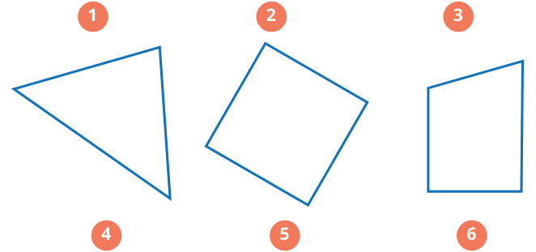


Kunci sumber: `B`; status AI: `verified`; jawaban diverifikasi AI: `B`.
Solusi minimum hasil AI: Bangun 5 adalah persegi yang diputar. Persegi memiliki 4 sudut siku-siku.
Gambar sumber: images/kelas5_panduan_siswa_kelas5.pdf-0185-10.png. Transkripsi visual: Bangun 5 adalah sebuah segiempat yang diputar (tampak seperti persegi yang diputar 45 derajat). Keempat sudutnya membentuk sudut 90 derajat (siku-siku).

### 1. Pemeriksaan input dan fitur

Struktur: `pass`; alasan: `[]`. Grade/topik: kelas 5 / Matematika SD Kelas 5. KKO: `[]`; KKO hanya petunjuk bantu.
Isi dan kunci berasal dari sumber yang sama pada ketiga run. Versi konten: 2; hash: `b0fb4cff2607ef89792bcef22aa31b2658948a0be6d1fbad37d79e59c7d51a19`. Bukti verifikasi AI tidak sama dengan verifikasi ahli.

### 2. Penilaian Gemini blind — tiga run sebelum melihat IndoBERT

| Run | Status | Konten / kunci | Kognitif | Pengetahuan | Difficulty | Token |
|---:|---|---|---|---|---|---:|
| 1 | success | valid / verified | applying | conceptual | Easy | 2441 |
| 2 | success | valid / verified | applying | conceptual | Easy | 2482 |
| 3 | success | valid / verified | applying | conceptual | Easy | 2543 |

Run 1 — solusi: Bangun 5 adalah persegi yang diputar. Persegi memiliki 4 sudut siku-siku.
- Domain kognitif `classify/applying`: Siswa perlu mengidentifikasi properti sudut siku-siku pada bangun datar yang posisinya tidak standar (diputar), yang memerlukan penerapan konsep pada situasi rutin.. Bukti: temukan banyaknya sudut siku-siku pada setiap bangun berikut; Bangun 5
- Dimensi pengetahuan `classify/conceptual`: Soal ini menguji pemahaman tentang definisi dan karakteristik sudut siku-siku sebagai konsep geometris.. Bukti: sudut siku-siku; bangun datar
- Intended difficulty `classify/Easy`: Soal ini tergolong mudah karena hanya meminta identifikasi properti dasar bangun datar (persegi) meskipun dalam orientasi yang diputar.. Bukti: Bangun 5; banyaknya sudut siku-siku

Profil difficulty run ini:

| Parameter | Nilai |
|---|---|
| expectedPrerequisite | Pemahaman dasar tentang sudut siku-siku dan bentuk bangun datar persegi. |
| dependentSteps | 1 |
| routineStatus | familiar_routine |
| strategySelection | False |
| representationTransfer | True |
| relevantInformationUnits | 1 |
| interactingConstraints | 0 |
| calculationLoad | low |
| scaffoldLevel | none |
| distractorQuality | plausible |
| gradeRelativeRationale | Untuk kelas 5, mengidentifikasi sudut siku-siku pada bangun yang diputar adalah tugas rutin yang sesuai dengan tingkat perkembangan kognitif mereka. |

Run 2 — solusi: Bangun 5 adalah persegi yang diputar. Persegi memiliki empat sudut siku-siku (90 derajat).
- Domain kognitif `classify/applying`: Siswa perlu menerapkan pemahaman konsep sudut siku-siku pada bangun yang posisinya tidak standar (diputar), yang merupakan penerapan konsep pada situasi rutin.. Bukti: temukan banyaknya sudut siku-siku pada setiap bangun berikut; Bangun 5
- Dimensi pengetahuan `classify/conceptual`: Soal ini menguji pemahaman konseptual tentang sifat-sifat bangun datar (persegi) dan definisi sudut siku-siku, terlepas dari orientasi bangun tersebut.. Bukti: sudut siku-siku; Bangun 5
- Intended difficulty `classify/Easy`: Soal ini tergolong mudah karena hanya memerlukan pengenalan sifat dasar bangun datar (persegi) meskipun ada sedikit tantangan visual karena rotasi bangun.. Bukti: temukan banyaknya sudut siku-siku; Bangun 5

Profil difficulty run ini:

| Parameter | Nilai |
|---|---|
| expectedPrerequisite | Pemahaman dasar tentang sudut siku-siku dan sifat-sifat persegi. |
| dependentSteps | 1 |
| routineStatus | familiar_routine |
| strategySelection | False |
| representationTransfer | True |
| relevantInformationUnits | 1 |
| interactingConstraints | 0 |
| calculationLoad | low |
| scaffoldLevel | none |
| distractorQuality | plausible |
| gradeRelativeRationale | Untuk kelas 5, mengidentifikasi sudut siku-siku pada bangun yang diputar adalah tugas rutin yang sesuai dengan tingkat perkembangan kognitif mereka. |

Run 3 — solusi: Bangun 5 adalah persegi yang diputar. Sifat dasar persegi adalah memiliki empat sudut siku-siku (90 derajat). Rotasi bangun tidak mengubah besar sudut internalnya, sehingga tetap terdapat 4 sudut siku-siku.
- Domain kognitif `classify/applying`: Siswa perlu menerapkan pemahaman konsep sudut siku-siku pada bangun yang posisinya tidak standar (diputar). Ini melibatkan pengenalan sifat bangun datar terlepas dari orientasinya.. Bukti: temukan banyaknya sudut siku-siku pada setiap bangun berikut; Bangun 5
- Dimensi pengetahuan `classify/conceptual`: Soal ini menguji pemahaman konseptual tentang sifat-sifat bangun datar (persegi) dan definisi sudut siku-siku, bukan sekadar menghafal fakta atau mengikuti prosedur algoritma yang kompleks.. Bukti: banyaknya sudut siku-siku; Bangun 5
- Intended difficulty `classify/Easy`: Soal ini tergolong mudah karena hanya memerlukan identifikasi visual dasar pada bangun datar yang umum (persegi), meskipun ada sedikit tantangan orientasi (rotasi) yang dirancang untuk menguji pemahaman konsep dasar.. Bukti: Bangun 5; mengira sudut siku-siku harus mendatar/tegak

Profil difficulty run ini:

| Parameter | Nilai |
|---|---|
| expectedPrerequisite | Pemahaman dasar tentang sudut siku-siku dan pengenalan bentuk persegi. |
| dependentSteps | 1 |
| routineStatus | familiar_routine |
| strategySelection | False |
| representationTransfer | False |
| relevantInformationUnits | 1 |
| interactingConstraints | 0 |
| calculationLoad | low |
| scaffoldLevel | none |
| distractorQuality | plausible |
| gradeRelativeRationale | Untuk kelas 5, mengidentifikasi sudut siku-siku pada bangun yang diputar adalah tugas rutin yang sesuai dengan tingkat perkembangan kognitif mereka. |

### 3. Voting awal dan adjudikasi

| Head | Suara awal | Pola / status akhir | Label akhir advisory |
|---|---|---|---|
| Domain kognitif | {"applying": 3} | unanimous_3_0 / unanimous | applying |
| Dimensi pengetahuan | {"conceptual": 3} | unanimous_3_0 / unanimous | conceptual |
| Intended difficulty | {"Easy": 3} | unanimous_3_0 / unanimous | Easy |

### 4. Diagnostik IndoBERT setelah label blind dikunci

Model membaca representation `metadata`; token input 100/256; truncation: `False`.

| Head | Probabilitas | Label | Confidence | Entropy | Action / alasan |
|---|---|---|---:|---:|---|
| Domain kognitif | knowing=0.010664; applying=0.989336; reasoning=0.000000 | applying | 0.989336 | 0.053733 | review / selective_threshold_gate_not_met |
| Dimensi pengetahuan | factual=0.040368; conceptual=0.941248; procedural=0.018383; metacognitive=0.000000 | conceptual | 0.941248 | 0.187570 | review / selective_threshold_gate_not_met |
| Intended difficulty | Easy=0.819502; Medium=0.177288; Hard=0.003210 | Easy | 0.819502 | 0.444438 | review / selective_threshold_gate_not_met |

Domain kognitif: Σp = 1.00000000; confidence = max(p) = 0.989336; −Σp ln(p) = 0.059031; H = 0.059031/ln(3) = 0.053733; T = 0.050000.


Dimensi pengetahuan: Σp = 1.00000000; confidence = max(p) = 0.941248; −Σp ln(p) = 0.260027; H = 0.260027/ln(4) = 0.187570; T = 0.209800.


Intended difficulty: Σp = 1.00000000; confidence = max(p) = 0.819502; −Σp ln(p) = 0.488265; H = 0.488265/ln(3) = 0.444438; T = 0.953328.


<details><summary>Input sebenarnya yang dibaca model</summary>

```text
Kelas: 5
Topik: Matematika SD Kelas 5
Subtopik: Sudut Siku-Siku
Tipe soal: multiple_choice
Stimulus: -
Soal: Perhatikan bangun datar berikut. Ayo, coba kalian temukan banyaknya sudut siku-siku pada setiap bangun berikut.

Bangun 5
Pilihan: A. 0
B. 4
C. 3
D. 2
Transkripsi visual: Bangun 5 adalah sebuah segiempat yang diputar (tampak seperti persegi yang diputar 45 derajat). Keempat sudutnya membentuk sudut 90 derajat (siku-siku).
```

</details>

### 5. Keputusan batch

Label advisory blind: `{"mathCognitiveDomain": "applying", "knowledgeDimension": "conceptual", "intendedDifficulty": "Easy"}`. Routing: `pending_expert_review`.
Status konten: `valid`. Catatan konten: .
Perbedaan model dan blind: `{"mathCognitiveDomain": {"modelLabel": "applying", "blindLabel": "applying", "agreement": true}, "knowledgeDimension": {"modelLabel": "conceptual", "blindLabel": "conceptual", "agreement": true}, "intendedDifficulty": {"modelLabel": "Easy", "blindLabel": "Easy", "agreement": true}}`.
Gold ahli tetap null; human review wajib. Confidence IndoBERT tidak digunakan untuk mengganti label blind.

## 48. Soal `ff6d8a6a3950529913ba071e`

Perhatikan bangun datar berikut. Ayo, coba kalian temukan banyaknya sudut siku-siku pada setiap bangun berikut.<br><br>Bangun 1

| Opsi | Isi |
|---|---|
| A | 0 |
| B | 4 |
| C | 2 |
| D | 3 |

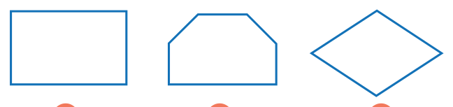


Kunci sumber: `B`; status AI: `verified`; jawaban diverifikasi AI: `B`.
Solusi minimum hasil AI: Bangun pertama adalah persegi panjang. Persegi panjang memiliki empat sudut yang masing-masing besarnya 90 derajat (sudut siku-siku).
Gambar sumber: images/kelas5_panduan_siswa_kelas5.pdf-0185-09.png. Transkripsi visual: Terdapat tiga bangun datar. Bangun pertama adalah persegi panjang yang memiliki empat sudut siku-siku. Bangun kedua adalah trapesium sama kaki yang memiliki dua sudut siku-siku di bagian bawah. Bangun ketiga adalah belah ketupat yang tidak memiliki sudut siku-siku.

### 1. Pemeriksaan input dan fitur

Struktur: `pass`; alasan: `[]`. Grade/topik: kelas 5 / Matematika SD Kelas 5. KKO: `[]`; KKO hanya petunjuk bantu.
Isi dan kunci berasal dari sumber yang sama pada ketiga run. Versi konten: 2; hash: `c7e0c7bbe2334a925438f05e528e8a073f3f7b34dff3dc3c5458b317a7cb67c9`. Bukti verifikasi AI tidak sama dengan verifikasi ahli.

### 2. Penilaian Gemini blind — tiga run sebelum melihat IndoBERT

| Run | Status | Konten / kunci | Kognitif | Pengetahuan | Difficulty | Token |
|---:|---|---|---|---|---|---:|
| 1 | success | valid / verified | knowing | conceptual | Easy | 2465 |
| 2 | success | valid / verified | knowing | conceptual | Easy | 2436 |
| 3 | success | valid / verified | knowing | conceptual | Easy | 2477 |

Run 1 — solusi: Bangun pertama adalah persegi panjang. Persegi panjang memiliki empat sudut yang masing-masing besarnya 90 derajat (sudut siku-siku).
- Domain kognitif `classify/knowing`: Siswa diminta untuk mengidentifikasi dan menghitung jumlah sudut siku-siku pada bangun datar yang diberikan. Ini adalah proses pengenalan sifat geometris dasar.. Bukti: temukan banyaknya sudut siku-siku pada setiap bangun
- Dimensi pengetahuan `classify/conceptual`: Soal ini menguji pemahaman siswa terhadap definisi dan karakteristik sudut siku-siku pada bangun datar.. Bukti: sudut siku-siku
- Intended difficulty `classify/Easy`: Soal ini sangat mendasar untuk kelas 5, hanya memerlukan pengenalan visual langsung terhadap sudut siku-siku pada bangun persegi panjang.. Bukti: temukan banyaknya sudut siku-siku pada setiap bangun; Bangun 1

Profil difficulty run ini:

| Parameter | Nilai |
|---|---|
| expectedPrerequisite | Pemahaman dasar tentang sudut siku-siku dan bentuk persegi panjang. |
| dependentSteps | 1 |
| routineStatus | familiar_routine |
| strategySelection | False |
| representationTransfer | False |
| relevantInformationUnits | 1 |
| interactingConstraints | 0 |
| calculationLoad | low |
| scaffoldLevel | none |
| distractorQuality | plausible |
| gradeRelativeRationale | Mengidentifikasi sudut siku-siku pada persegi panjang adalah materi yang sangat familiar dan mendasar bagi siswa kelas 5. |

Run 2 — solusi: Bangun 1 adalah persegi panjang yang memiliki 4 sudut siku-siku.
- Domain kognitif `classify/knowing`: Siswa diminta untuk mengidentifikasi dan menghitung sudut siku-siku pada bangun datar yang diberikan, yang merupakan proses pengenalan langsung terhadap properti geometris.. Bukti: temukan banyaknya sudut siku-siku pada setiap bangun
- Dimensi pengetahuan `classify/conceptual`: Soal ini menguji pemahaman siswa mengenai definisi dan pengenalan konsep sudut siku-siku pada bangun datar.. Bukti: sudut siku-siku
- Intended difficulty `classify/Easy`: Soal ini bersifat langsung dan rutin bagi siswa kelas 5, hanya memerlukan pengamatan visual sederhana pada bangun datar standar.. Bukti: temukan banyaknya sudut siku-siku pada setiap bangun

Profil difficulty run ini:

| Parameter | Nilai |
|---|---|
| expectedPrerequisite | Pemahaman dasar tentang sudut siku-siku dan bentuk bangun datar. |
| dependentSteps | 1 |
| routineStatus | familiar_routine |
| strategySelection | False |
| representationTransfer | False |
| relevantInformationUnits | 1 |
| interactingConstraints | 0 |
| calculationLoad | low |
| scaffoldLevel | none |
| distractorQuality | plausible |
| gradeRelativeRationale | Siswa kelas 5 sudah sangat familiar dengan identifikasi sudut pada bangun datar sederhana seperti persegi panjang. |

Run 3 — solusi: Bangun 1 adalah persegi panjang. Persegi panjang memiliki empat sudut yang masing-masing besarnya 90 derajat (sudut siku-siku).
- Domain kognitif `classify/knowing`: Siswa diminta untuk mengidentifikasi dan menghitung jumlah sudut siku-siku pada bangun datar yang diberikan. Ini adalah proses pengenalan sifat geometris dasar.. Bukti: temukan banyaknya sudut siku-siku pada setiap bangun berikut; Bangun 1
- Dimensi pengetahuan `classify/conceptual`: Soal ini menguji pemahaman tentang definisi dan pengenalan konsep sudut siku-siku pada bentuk geometri.. Bukti: sudut siku-siku; bangun datar
- Intended difficulty `classify/Easy`: Soal ini sangat mendasar untuk kelas 5, hanya memerlukan pengenalan visual langsung terhadap properti sudut pada persegi panjang.. Bukti: temukan banyaknya sudut siku-siku; Bangun 1

Profil difficulty run ini:

| Parameter | Nilai |
|---|---|
| expectedPrerequisite | Pemahaman dasar tentang sudut siku-siku dan bentuk persegi panjang. |
| dependentSteps | 1 |
| routineStatus | familiar_routine |
| strategySelection | False |
| representationTransfer | False |
| relevantInformationUnits | 1 |
| interactingConstraints | 0 |
| calculationLoad | low |
| scaffoldLevel | none |
| distractorQuality | plausible |
| gradeRelativeRationale | Mengidentifikasi sudut siku-siku pada persegi panjang adalah materi geometri dasar yang sudah dipelajari jauh sebelum kelas 5. |

### 3. Voting awal dan adjudikasi

| Head | Suara awal | Pola / status akhir | Label akhir advisory |
|---|---|---|---|
| Domain kognitif | {"knowing": 3} | unanimous_3_0 / unanimous | knowing |
| Dimensi pengetahuan | {"conceptual": 3} | unanimous_3_0 / unanimous | conceptual |
| Intended difficulty | {"Easy": 3} | unanimous_3_0 / unanimous | Easy |

### 4. Diagnostik IndoBERT setelah label blind dikunci

Model membaca representation `metadata`; token input 118/256; truncation: `False`.

| Head | Probabilitas | Label | Confidence | Entropy | Action / alasan |
|---|---|---|---:|---:|---|
| Domain kognitif | knowing=0.000170; applying=0.999830; reasoning=0.000000 | applying | 0.999830 | 0.001500 | review / selective_threshold_gate_not_met |
| Dimensi pengetahuan | factual=0.032481; conceptual=0.952751; procedural=0.014768; metacognitive=0.000000 | conceptual | 0.952751 | 0.158466 | review / selective_threshold_gate_not_met |
| Intended difficulty | Easy=0.814149; Medium=0.182399; Hard=0.003452 | Easy | 0.814149 | 0.452690 | review / selective_threshold_gate_not_met |

Domain kognitif: Σp = 1.00000000; confidence = max(p) = 0.999830; −Σp ln(p) = 0.001648; H = 0.001648/ln(3) = 0.001500; T = 0.050000.


Dimensi pengetahuan: Σp = 1.00000000; confidence = max(p) = 0.952751; −Σp ln(p) = 0.219680; H = 0.219680/ln(4) = 0.158466; T = 0.209800.


Intended difficulty: Σp = 1.00000000; confidence = max(p) = 0.814149; −Σp ln(p) = 0.497331; H = 0.497331/ln(3) = 0.452690; T = 0.953328.


<details><summary>Input sebenarnya yang dibaca model</summary>

```text
Kelas: 5
Topik: Matematika SD Kelas 5
Subtopik: Sudut Siku-Siku
Tipe soal: multiple_choice
Stimulus: -
Soal: Perhatikan bangun datar berikut. Ayo, coba kalian temukan banyaknya sudut siku-siku pada setiap bangun berikut.

Bangun 1
Pilihan: A. 0
B. 4
C. 2
D. 3
Transkripsi visual: Terdapat tiga bangun datar. Bangun pertama adalah persegi panjang yang memiliki empat sudut siku-siku. Bangun kedua adalah trapesium sama kaki yang memiliki dua sudut siku-siku di bagian bawah. Bangun ketiga adalah belah ketupat yang tidak memiliki sudut siku-siku.
```

</details>

### 5. Keputusan batch

Label advisory blind: `{"mathCognitiveDomain": "knowing", "knowledgeDimension": "conceptual", "intendedDifficulty": "Easy"}`. Routing: `pending_expert_review`.
Status konten: `valid`. Catatan konten: .
Perbedaan model dan blind: `{"mathCognitiveDomain": {"modelLabel": "applying", "blindLabel": "knowing", "agreement": false}, "knowledgeDimension": {"modelLabel": "conceptual", "blindLabel": "conceptual", "agreement": true}, "intendedDifficulty": {"modelLabel": "Easy", "blindLabel": "Easy", "agreement": true}}`.
Gold ahli tetap null; human review wajib. Confidence IndoBERT tidak digunakan untuk mengganti label blind.

## 49. Soal `fd335c551b48bcf09d6a8482`

Berilah tanda centang (√) pada jenis sudut yang sesuai dengan setiap jenis benda berikut ini.<br><br>a. Sudut yang terbentuk oleh jarum pendek dan panjang saat jam menunjukkan pukul 08.00.

| Opsi | Isi |
|---|---|
| A | Tumpul |
| B | Lurus |
| C | Siku-siku |
| D | Lancip |

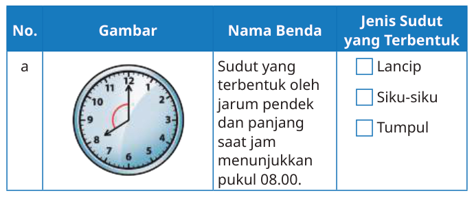


Kunci sumber: `A`; status AI: `verified`; jawaban diverifikasi AI: `Tumpul`.
Solusi minimum hasil AI: Pada pukul 08.00, jarum jam menunjuk ke angka 12 dan 8. Jarak antara angka 12 dan 8 adalah 4 bagian dari 12 bagian lingkaran (4/12 * 360 derajat = 120 derajat). Karena 120 derajat lebih besar dari 90 derajat (siku-siku) dan kurang dari 180 derajat (lurus), maka sudut tersebut adalah sudut tumpul.
Gambar sumber: images/kelas5_panduan_siswa_kelas5.pdf-0188-07.png. Transkripsi visual: Gambar jam analog menunjukkan jarum panjang di angka 12 dan jarum pendek di angka 8. Terdapat busur merah yang menandai sudut interior antara kedua jarum tersebut.

### 1. Pemeriksaan input dan fitur

Struktur: `pass`; alasan: `[]`. Grade/topik: kelas 5 / Matematika SD Kelas 5. KKO: `[]`; KKO hanya petunjuk bantu.
Isi dan kunci berasal dari sumber yang sama pada ketiga run. Versi konten: 2; hash: `36260d1b575b088d73795b2eec74c09611b2daba8fa8efdaa1aabf856f1b9326`. Bukti verifikasi AI tidak sama dengan verifikasi ahli.

### 2. Penilaian Gemini blind — tiga run sebelum melihat IndoBERT

| Run | Status | Konten / kunci | Kognitif | Pengetahuan | Difficulty | Token |
|---:|---|---|---|---|---|---:|
| 1 | success | valid / verified | applying | conceptual | Easy | 2600 |
| 2 | success | valid / verified | applying | conceptual | Easy | 2640 |
| 3 | success | valid / verified | applying | conceptual | Easy | 2630 |

Run 1 — solusi: Pada pukul 08.00, jarum jam menunjuk ke angka 12 dan 8. Jarak antara angka 12 dan 8 adalah 4 bagian dari 12 bagian lingkaran (4/12 * 360 derajat = 120 derajat). Karena 120 derajat lebih besar dari 90 derajat (siku-siku) dan kurang dari 180 derajat (lurus), maka sudut tersebut adalah sudut tumpul.
- Domain kognitif `classify/applying`: Siswa perlu mengidentifikasi karakteristik sudut berdasarkan representasi visual jam dan menerapkan definisi sudut tumpul (lebih besar dari 90 derajat). Ini adalah penerapan konsep dasar pada situasi rutin.. Bukti: Sudut yang terbentuk oleh jarum pendek dan panjang saat jam menunjukkan pukul 08.00
- Dimensi pengetahuan `classify/conceptual`: Soal ini menguji pemahaman tentang klasifikasi sudut (konsep) dan penerapannya pada objek nyata.. Bukti: jenis sudut yang sesuai dengan setiap jenis benda
- Intended difficulty `classify/Easy`: Soal ini tergolong mudah karena siswa kelas 5 sudah familiar dengan konsep sudut dasar dan representasi jam. Tidak diperlukan perhitungan kompleks, hanya estimasi visual atau pengetahuan dasar tentang posisi jarum jam.. Bukti: pukul 08.00; jenis sudut yang sesuai

Profil difficulty run ini:

| Parameter | Nilai |
|---|---|
| expectedPrerequisite | Pemahaman dasar tentang jenis-jenis sudut (lancip, siku-siku, tumpul) dan cara membaca jam analog. |
| dependentSteps | 1 |
| routineStatus | familiar_routine |
| strategySelection | False |
| representationTransfer | True |
| relevantInformationUnits | 2 |
| interactingConstraints | 0 |
| calculationLoad | low |
| scaffoldLevel | none |
| distractorQuality | plausible |
| gradeRelativeRationale | Siswa kelas 5 diharapkan sudah mampu mengklasifikasikan sudut secara visual tanpa harus menghitung derajat secara presisi. |

Run 2 — solusi: Pada pukul 08.00, jarum jam menunjuk ke angka 12 dan 8. Sudut yang terbentuk mencakup 4 bagian dari 12 bagian jam (4/12 * 360 derajat = 120 derajat). Karena 120 derajat lebih besar dari 90 derajat (siku-siku) dan kurang dari 180 derajat (lurus), maka sudut tersebut adalah sudut tumpul.
- Domain kognitif `classify/applying`: Siswa perlu mengidentifikasi jenis sudut berdasarkan representasi visual jam. Ini melibatkan pengenalan karakteristik sudut (tumpul) dibandingkan dengan sudut siku-siku atau lancip, yang merupakan penerapan konsep dasar geometri.. Bukti: Sudut yang terbentuk oleh jarum pendek dan panjang saat jam menunjukkan pukul 08.00; jenis sudut yang sesuai
- Dimensi pengetahuan `classify/conceptual`: Soal ini menguji pemahaman konseptual tentang klasifikasi sudut (lancip, siku-siku, tumpul) dan bagaimana konsep tersebut diterapkan pada objek nyata (jam).. Bukti: jenis sudut yang sesuai; Sudut yang terbentuk oleh jarum pendek dan panjang
- Intended difficulty `classify/Easy`: Soal ini tergolong mudah karena hanya memerlukan pengenalan visual langsung terhadap jenis sudut yang umum diajarkan di kelas 5. Tidak ada perhitungan kompleks yang diperlukan.. Bukti: pukul 08.00; jenis sudut yang sesuai

Profil difficulty run ini:

| Parameter | Nilai |
|---|---|
| expectedPrerequisite | Pemahaman dasar tentang jenis-jenis sudut (lancip, siku-siku, tumpul) dan cara membaca jam analog. |
| dependentSteps | 1 |
| routineStatus | familiar_routine |
| strategySelection | False |
| representationTransfer | True |
| relevantInformationUnits | 2 |
| interactingConstraints | 0 |
| calculationLoad | low |
| scaffoldLevel | none |
| distractorQuality | plausible |
| gradeRelativeRationale | Siswa kelas 5 sudah familiar dengan konsep sudut dan jam analog. Soal ini adalah latihan rutin untuk mengklasifikasikan sudut berdasarkan observasi visual. |

Run 3 — solusi: Pada pukul 08.00, jarum jam berada di angka 8 dan jarum menit di angka 12. Jarak antara angka 12 ke 8 adalah 4 bagian dari 12 bagian lingkaran (4/12 * 360 derajat = 120 derajat). Karena 120 derajat > 90 derajat, maka sudut tersebut adalah sudut tumpul.
- Domain kognitif `classify/applying`: Siswa perlu mengidentifikasi posisi jarum jam, memahami konsep besar sudut pada jam, dan mengklasifikasikan sudut tersebut berdasarkan definisi sudut tumpul (>90 derajat). Ini melibatkan penerapan konsep pada situasi rutin.. Bukti: Sudut yang terbentuk oleh jarum pendek dan panjang saat jam menunjukkan pukul 08.00; jenis sudut yang sesuai
- Dimensi pengetahuan `classify/conceptual`: Soal ini menguji pemahaman konseptual tentang klasifikasi sudut (lancip, siku-siku, tumpul) dan bagaimana konsep tersebut diterapkan pada representasi visual jam.. Bukti: jenis sudut; pukul 08.00
- Intended difficulty `classify/Easy`: Soal ini tergolong mudah karena hanya memerlukan pengenalan visual atau pemahaman dasar tentang sudut tumpul dibandingkan dengan sudut siku-siku yang sudah familiar bagi siswa kelas 5.. Bukti: pukul 08.00; jenis sudut yang terbentuk

Profil difficulty run ini:

| Parameter | Nilai |
|---|---|
| expectedPrerequisite | Pemahaman dasar tentang jenis-jenis sudut (lancip, siku-siku, tumpul) dan cara membaca jam analog. |
| dependentSteps | 2 |
| routineStatus | familiar_routine |
| strategySelection | False |
| representationTransfer | True |
| relevantInformationUnits | 2 |
| interactingConstraints | 0 |
| calculationLoad | low |
| scaffoldLevel | none |
| distractorQuality | plausible |
| gradeRelativeRationale | Siswa kelas 5 sudah sangat familiar dengan konsep sudut dasar dan jam analog, sehingga tugas ini merupakan latihan rutin yang sesuai dengan tingkat kelas. |

### 3. Voting awal dan adjudikasi

| Head | Suara awal | Pola / status akhir | Label akhir advisory |
|---|---|---|---|
| Domain kognitif | {"applying": 3} | unanimous_3_0 / unanimous | applying |
| Dimensi pengetahuan | {"conceptual": 3} | unanimous_3_0 / unanimous | conceptual |
| Intended difficulty | {"Easy": 3} | unanimous_3_0 / unanimous | Easy |

### 4. Diagnostik IndoBERT setelah label blind dikunci

Model membaca representation `metadata`; token input 112/256; truncation: `False`.

| Head | Probabilitas | Label | Confidence | Entropy | Action / alasan |
|---|---|---|---:|---:|---|
| Domain kognitif | knowing=0.995729; applying=0.004271; reasoning=0.000000 | knowing | 0.995729 | 0.025091 | review / selective_threshold_gate_not_met |
| Dimensi pengetahuan | factual=0.352212; conceptual=0.618065; procedural=0.029723; metacognitive=0.000000 | conceptual | 0.618065 | 0.555028 | review / selective_threshold_gate_not_met |
| Intended difficulty | Easy=0.887198; Medium=0.109308; Hard=0.003494 | Easy | 0.887198 | 0.334890 | review / selective_threshold_gate_not_met |

Domain kognitif: Σp = 1.00000000; confidence = max(p) = 0.995729; −Σp ln(p) = 0.027565; H = 0.027565/ln(3) = 0.025091; T = 0.050000.


Dimensi pengetahuan: Σp = 1.00000000; confidence = max(p) = 0.618065; −Σp ln(p) = 0.769432; H = 0.769432/ln(4) = 0.555028; T = 0.209800.


Intended difficulty: Σp = 1.00000000; confidence = max(p) = 0.887198; −Σp ln(p) = 0.367914; H = 0.367914/ln(3) = 0.334890; T = 0.953328.


<details><summary>Input sebenarnya yang dibaca model</summary>

```text
Kelas: 5
Topik: Matematika SD Kelas 5
Subtopik: Pengertian Sudut
Tipe soal: multiple_choice
Stimulus: -
Soal: Berilah tanda centang (√) pada jenis sudut yang sesuai dengan setiap jenis benda berikut ini.

a. Sudut yang terbentuk oleh jarum pendek dan panjang saat jam menunjukkan pukul 08.00.
Pilihan: A. Tumpul
B. Lurus
C. Siku-siku
D. Lancip
Transkripsi visual: Gambar jam analog menunjukkan jarum panjang di angka 12 dan jarum pendek di angka 8. Terdapat busur merah yang menandai sudut interior antara kedua jarum tersebut.
```

</details>

### 5. Keputusan batch

Label advisory blind: `{"mathCognitiveDomain": "applying", "knowledgeDimension": "conceptual", "intendedDifficulty": "Easy"}`. Routing: `pending_expert_review`.
Status konten: `valid`. Catatan konten: .
Perbedaan model dan blind: `{"mathCognitiveDomain": {"modelLabel": "knowing", "blindLabel": "applying", "agreement": false}, "knowledgeDimension": {"modelLabel": "conceptual", "blindLabel": "conceptual", "agreement": true}, "intendedDifficulty": {"modelLabel": "Easy", "blindLabel": "Easy", "agreement": true}}`.
Gold ahli tetap null; human review wajib. Confidence IndoBERT tidak digunakan untuk mengganti label blind.

## 50. Soal `2b5db81c155e3ca6e5058b47`

Berilah tanda centang (√) pada jenis sudut yang sesuai dengan setiap jenis benda berikut ini.<br><br>f. Sudut pada pojokan jendela.

| Opsi | Isi |
|---|---|
| A | Siku-siku |
| B | Lancip |
| C | Lurus |
| D | Tumpul |

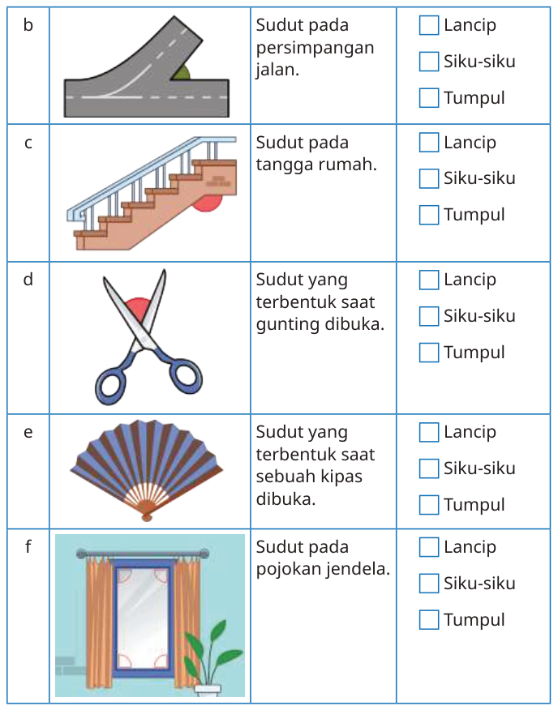


Kunci sumber: `A`; status AI: `verified`; jawaban diverifikasi AI: `A`.
Solusi minimum hasil AI: Pojokan jendela berbentuk persegi panjang, yang secara definisi memiliki sudut siku-siku (90 derajat).
Gambar sumber: images/kelas5_panduan_siswa_kelas5.pdf-0189-01.png. Transkripsi visual: Gambar f menunjukkan sebuah jendela berbentuk persegi panjang dengan tirai di sampingnya. Sudut pada pojokan jendela ditandai dengan busur kecil yang menunjukkan sudut siku-siku (90 derajat).

### 1. Pemeriksaan input dan fitur

Struktur: `pass`; alasan: `[]`. Grade/topik: kelas 5 / Matematika SD Kelas 5. KKO: `[]`; KKO hanya petunjuk bantu.
Isi dan kunci berasal dari sumber yang sama pada ketiga run. Versi konten: 2; hash: `0806eed153abe4065dff719b439139def3c734ae4dcc86985d4e0ebd94f20e28`. Bukti verifikasi AI tidak sama dengan verifikasi ahli.

### 2. Penilaian Gemini blind — tiga run sebelum melihat IndoBERT

| Run | Status | Konten / kunci | Kognitif | Pengetahuan | Difficulty | Token |
|---:|---|---|---|---|---|---:|
| 1 | success | valid / verified | knowing | conceptual | Easy | 2455 |
| 2 | success | valid / verified | knowing | conceptual | Easy | 2438 |
| 3 | success | valid / verified | knowing | conceptual | Easy | 2375 |

Run 1 — solusi: Pojokan jendela berbentuk persegi panjang, yang secara definisi memiliki sudut siku-siku (90 derajat).
- Domain kognitif `classify/knowing`: Siswa hanya perlu mengenali jenis sudut dari objek geometris yang umum (jendela persegi panjang) tanpa perlu melakukan perhitungan atau strategi kompleks.. Bukti: Sudut pada pojokan jendela; jenis sudut yang sesuai
- Dimensi pengetahuan `classify/conceptual`: Soal ini menguji pemahaman siswa mengenai definisi dan klasifikasi jenis sudut (siku-siku) pada objek nyata.. Bukti: jenis sudut yang sesuai; Sudut pada pojokan jendela
- Intended difficulty `classify/Easy`: Soal ini sangat mendasar, menggunakan representasi visual yang familiar, dan hanya memerlukan satu langkah identifikasi langsung.. Bukti: Sudut pada pojokan jendela; Pilihan A. Siku-siku

Profil difficulty run ini:

| Parameter | Nilai |
|---|---|
| expectedPrerequisite | Pemahaman dasar tentang jenis-jenis sudut (siku-siku, lancip, tumpul). |
| dependentSteps | 1 |
| routineStatus | familiar_routine |
| strategySelection | False |
| representationTransfer | False |
| relevantInformationUnits | 1 |
| interactingConstraints | 0 |
| calculationLoad | low |
| scaffoldLevel | none |
| distractorQuality | plausible |
| gradeRelativeRationale | Untuk kelas 5, mengidentifikasi sudut siku-siku pada benda di sekitar adalah materi yang sangat mendasar dan rutin. |

Run 2 — solusi: Pojokan jendela berbentuk persegi panjang, yang secara geometris memiliki sudut sebesar 90 derajat, yaitu sudut siku-siku.
- Domain kognitif `classify/knowing`: Siswa hanya perlu mengenali karakteristik visual dari sudut siku-siku pada objek nyata (jendela) tanpa perlu melakukan perhitungan atau strategi kompleks.. Bukti: Sudut pada pojokan jendela
- Dimensi pengetahuan `classify/conceptual`: Soal ini menguji pemahaman siswa mengenai kategori sudut (siku-siku, lancip, tumpul) dan menghubungkannya dengan objek di dunia nyata.. Bukti: jenis sudut yang sesuai
- Intended difficulty `classify/Easy`: Soal ini sangat mendasar, hanya memerlukan pengenalan visual langsung terhadap bentuk sudut siku-siku yang umum ditemukan di lingkungan sekitar.. Bukti: Sudut pada pojokan jendela

Profil difficulty run ini:

| Parameter | Nilai |
|---|---|
| expectedPrerequisite | Pemahaman dasar tentang jenis-jenis sudut (siku-siku, lancip, tumpul). |
| dependentSteps | 1 |
| routineStatus | familiar_routine |
| strategySelection | False |
| representationTransfer | False |
| relevantInformationUnits | 1 |
| interactingConstraints | 0 |
| calculationLoad | low |
| scaffoldLevel | none |
| distractorQuality | plausible |
| gradeRelativeRationale | Untuk kelas 5, mengidentifikasi sudut siku-siku pada benda konkret adalah materi dasar yang sangat rutin dan mudah. |

Run 3 — solusi: Pojok jendela berbentuk persegi panjang, yang secara definisi memiliki sudut 90 derajat atau sudut siku-siku.
- Domain kognitif `classify/knowing`: Siswa hanya perlu mengenali karakteristik sudut pada objek geometris standar (persegi panjang) yang sudah familiar.. Bukti: Sudut pada pojokan jendela
- Dimensi pengetahuan `classify/conceptual`: Soal ini menguji pemahaman tentang definisi dan klasifikasi jenis sudut (siku-siku) sebagai konsep dasar geometri.. Bukti: jenis sudut yang sesuai
- Intended difficulty `classify/Easy`: Soal ini sangat mendasar, menggunakan objek nyata yang familiar, dan tidak memerlukan perhitungan atau strategi kompleks.. Bukti: Sudut pada pojokan jendela

Profil difficulty run ini:

| Parameter | Nilai |
|---|---|
| expectedPrerequisite | Pemahaman dasar tentang jenis-jenis sudut (siku-siku, lancip, tumpul). |
| dependentSteps | 1 |
| routineStatus | familiar_routine |
| strategySelection | False |
| representationTransfer | False |
| relevantInformationUnits | 1 |
| interactingConstraints | 0 |
| calculationLoad | low |
| scaffoldLevel | none |
| distractorQuality | plausible |
| gradeRelativeRationale | Untuk kelas 5, mengidentifikasi sudut siku-siku pada benda di sekitar adalah materi yang sangat dasar dan rutin. |

### 3. Voting awal dan adjudikasi

| Head | Suara awal | Pola / status akhir | Label akhir advisory |
|---|---|---|---|
| Domain kognitif | {"knowing": 3} | unanimous_3_0 / unanimous | knowing |
| Dimensi pengetahuan | {"conceptual": 3} | unanimous_3_0 / unanimous | conceptual |
| Intended difficulty | {"Easy": 3} | unanimous_3_0 / unanimous | Easy |

### 4. Diagnostik IndoBERT setelah label blind dikunci

Model membaca representation `metadata`; token input 107/256; truncation: `False`.

| Head | Probabilitas | Label | Confidence | Entropy | Action / alasan |
|---|---|---|---:|---:|---|
| Domain kognitif | knowing=0.968607; applying=0.031393; reasoning=0.000000 | knowing | 0.968607 | 0.127026 | review / selective_threshold_gate_not_met |
| Dimensi pengetahuan | factual=0.355803; conceptual=0.618743; procedural=0.025453; metacognitive=0.000000 | conceptual | 0.618743 | 0.546891 | review / selective_threshold_gate_not_met |
| Intended difficulty | Easy=0.906801; Medium=0.090371; Hard=0.002828 | Easy | 0.906801 | 0.293596 | review / selective_threshold_gate_not_met |

Domain kognitif: Σp = 1.00000000; confidence = max(p) = 0.968607; −Σp ln(p) = 0.139552; H = 0.139552/ln(3) = 0.127026; T = 0.050000.


Dimensi pengetahuan: Σp = 1.00000000; confidence = max(p) = 0.618743; −Σp ln(p) = 0.758152; H = 0.758152/ln(4) = 0.546891; T = 0.209800.


Intended difficulty: Σp = 1.00000000; confidence = max(p) = 0.906801; −Σp ln(p) = 0.322549; H = 0.322549/ln(3) = 0.293596; T = 0.953328.


<details><summary>Input sebenarnya yang dibaca model</summary>

```text
Kelas: 5
Topik: Matematika SD Kelas 5
Subtopik: Pengertian Sudut
Tipe soal: multiple_choice
Stimulus: -
Soal: Berilah tanda centang (√) pada jenis sudut yang sesuai dengan setiap jenis benda berikut ini.

f. Sudut pada pojokan jendela.
Pilihan: A. Siku-siku
B. Lancip
C. Lurus
D. Tumpul
Transkripsi visual: Gambar f menunjukkan sebuah jendela berbentuk persegi panjang dengan tirai di sampingnya. Sudut pada pojokan jendela ditandai dengan busur kecil yang menunjukkan sudut siku-siku (90 derajat).
```

</details>

### 5. Keputusan batch

Label advisory blind: `{"mathCognitiveDomain": "knowing", "knowledgeDimension": "conceptual", "intendedDifficulty": "Easy"}`. Routing: `pending_expert_review`.
Status konten: `valid`. Catatan konten: .
Perbedaan model dan blind: `{"mathCognitiveDomain": {"modelLabel": "knowing", "blindLabel": "knowing", "agreement": true}, "knowledgeDimension": {"modelLabel": "conceptual", "blindLabel": "conceptual", "agreement": true}, "intendedDifficulty": {"modelLabel": "Easy", "blindLabel": "Easy", "agreement": true}}`.
Gold ahli tetap null; human review wajib. Confidence IndoBERT tidak digunakan untuk mengganti label blind.

## 51. Soal `08c456eda435cd6d336fd7d0`

Ukurlah sudut terkecil yang dibentuk oleh jarum jam pendek dan panjang pada gambar berikut.<br><br>d. Pukul ....<br>Besar sudut adalah ... $^\circ$

| Opsi | Isi |
|---|---|
| A | Pukul 01.30, $150^\circ$ |
| B | Pukul 01.30, $225^\circ$ |
| C | Pukul 02.30, $105^\circ$ |
| D | Pukul 01.30, $135^\circ$ |

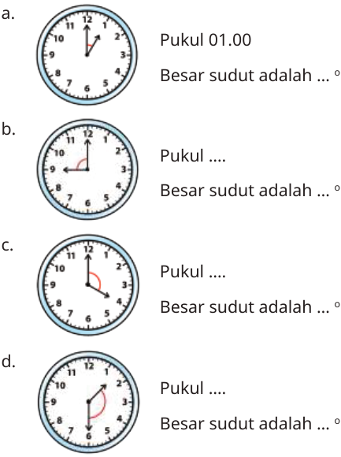


Kunci sumber: `D`; status AI: `verified`; jawaban diverifikasi AI: `D`.
Solusi minimum hasil AI: Satu putaran penuh jam adalah 360 derajat, sehingga setiap angka mewakili 30 derajat (360/12). Pada pukul 01.30, jarum panjang berada di angka 6 (180 derajat dari angka 12). Jarum pendek bergerak dari angka 1 sejauh setengah jam, yaitu 0,5 * 30 derajat = 15 derajat dari angka 1. Posisi jarum pendek dari angka 12 adalah 30 + 15 = 45 derajat. Sudut terkecil = 180 - 45 = 135 derajat.
Gambar sumber: images/kelas5_panduan_siswa_kelas5.pdf-0198-04.png. Transkripsi visual: Gambar d menunjukkan jam analog dengan jarum pendek berada di antara angka 1 dan 2, dan jarum panjang tepat di angka 6. Ini merepresentasikan pukul 01.30.

### 1. Pemeriksaan input dan fitur

Struktur: `pass`; alasan: `[]`. Grade/topik: kelas 5 / Matematika SD Kelas 5. KKO: `[]`; KKO hanya petunjuk bantu.
Isi dan kunci berasal dari sumber yang sama pada ketiga run. Versi konten: 2; hash: `53c615cd14a95ec68281dd1e66ed54b304dfef1b149197954f789ee99cfba7b5`. Bukti verifikasi AI tidak sama dengan verifikasi ahli.

### 2. Penilaian Gemini blind — tiga run sebelum melihat IndoBERT

| Run | Status | Konten / kunci | Kognitif | Pengetahuan | Difficulty | Token |
|---:|---|---|---|---|---|---:|
| 1 | success | valid / verified | applying | procedural | Medium | 2780 |
| 2 | success | valid / verified | applying | procedural | Medium | 2737 |
| 3 | success | valid / verified | applying | procedural | Medium | 2783 |

Run 1 — solusi: Satu putaran penuh jam adalah 360 derajat, sehingga setiap angka mewakili 30 derajat (360/12). Pada pukul 01.30, jarum panjang berada di angka 6 (180 derajat dari angka 12). Jarum pendek bergerak dari angka 1 sejauh setengah jam, yaitu 0,5 * 30 derajat = 15 derajat dari angka 1. Posisi jarum pendek dari angka 12 adalah 30 + 15 = 45 derajat. Sudut terkecil = 180 - 45 = 135 derajat.
- Domain kognitif `classify/applying`: Siswa perlu menerapkan pemahaman konsep sudut pada jam analog, melakukan perhitungan posisi jarum jam yang tidak tepat di angka, dan menentukan selisih sudutnya. Ini melibatkan penerapan prosedur rutin dalam situasi yang sedikit kompleks.. Bukti: Ukurlah sudut terkecil yang dibentuk oleh jarum jam pendek dan panjang
- Dimensi pengetahuan `classify/procedural`: Soal ini memerlukan pemahaman tentang hubungan antara waktu dan posisi jarum jam (konseptual) serta penggunaan algoritma perhitungan sudut (prosedural).. Bukti: Ukurlah sudut terkecil yang dibentuk oleh jarum jam pendek dan panjang
- Intended difficulty `classify/Medium`: Soal ini dikategorikan Medium karena siswa tidak hanya membaca posisi jarum jam yang tepat di angka, tetapi harus memperhitungkan pergeseran jarum pendek (01.30) dan melakukan perhitungan sudut yang melibatkan dua langkah (menentukan posisi jarum pendek dan menghitung selisihnya).. Bukti: Ukurlah sudut terkecil yang dibentuk oleh jarum jam pendek dan panjang pada gambar berikut. d. Pukul .... Besar sudut adalah ... ^o

Profil difficulty run ini:

| Parameter | Nilai |
|---|---|
| expectedPrerequisite | Pemahaman bahwa satu lingkaran penuh adalah 360 derajat dan setiap angka jam mewakili 30 derajat. |
| dependentSteps | 3 |
| routineStatus | routine_selection |
| strategySelection | True |
| representationTransfer | True |
| relevantInformationUnits | 3 |
| interactingConstraints | 2 |
| calculationLoad | moderate |
| scaffoldLevel | none |
| distractorQuality | plausible |
| gradeRelativeRationale | Untuk kelas 5, menghitung sudut jarum jam yang tidak tepat di angka memerlukan ketelitian lebih tinggi daripada soal rutin dasar, namun masih dalam cakupan kurikulum geometri dasar. |

Run 2 — solusi: Satu putaran jam adalah 360 derajat, setiap angka mewakili 30 derajat (360/12). Pada pukul 01.30, jarum panjang di angka 6 (180 derajat dari angka 12). Jarum pendek bergerak dari angka 1 sejauh 0,5 * 30 derajat = 15 derajat. Posisi jarum pendek dari angka 12 adalah 30 + 15 = 45 derajat. Sudut terkecil = 180 - 45 = 135 derajat.
- Domain kognitif `classify/applying`: Siswa harus menerapkan pemahaman konsep sudut pada jam analog, menentukan posisi jarum yang tidak tepat pada angka, dan melakukan perhitungan selisih sudut. Ini melibatkan penerapan prosedur rutin dalam konteks yang sedikit kompleks.. Bukti: Ukurlah sudut terkecil yang dibentuk oleh jarum jam pendek dan panjang
- Dimensi pengetahuan `classify/procedural`: Soal ini menuntut penggunaan algoritma atau teknik perhitungan sudut pada jam (konsep derajat per jam dan per menit) untuk menyelesaikan masalah.. Bukti: Ukurlah sudut terkecil yang dibentuk oleh jarum jam pendek dan panjang
- Intended difficulty `classify/Medium`: Soal ini memerlukan pemahaman bahwa jarum pendek bergerak seiring waktu (tidak statis di angka), yang merupakan langkah tambahan dari sekadar membaca posisi jarum pada angka bulat. Ini adalah tugas rutin namun memerlukan ketelitian.. Bukti: Ukurlah sudut terkecil yang dibentuk oleh jarum jam pendek dan panjang; jarum pendek berada di tengah antara angka 1 dan 2

Profil difficulty run ini:

| Parameter | Nilai |
|---|---|
| expectedPrerequisite | Pemahaman dasar tentang lingkaran (360 derajat), pembagian jam (12 angka), dan operasi pengurangan. |
| dependentSteps | 3 |
| routineStatus | routine_selection |
| strategySelection | False |
| representationTransfer | True |
| relevantInformationUnits | 3 |
| interactingConstraints | 2 |
| calculationLoad | moderate |
| scaffoldLevel | none |
| distractorQuality | plausible |
| gradeRelativeRationale | Untuk kelas 5, menghitung sudut jarum jam yang tidak tepat di angka memerlukan pemahaman konsep yang lebih dalam daripada sekadar membaca jam, sehingga dikategorikan Medium. |

Run 3 — solusi: Satu putaran penuh jam adalah 360 derajat, sehingga setiap angka mewakili 30 derajat (360/12). Pada pukul 01.30, jarum panjang di angka 6 (180 derajat dari angka 12). Jarum pendek bergerak dari angka 1 sejauh 30 menit/60 menit * 30 derajat = 15 derajat. Posisi jarum pendek dari angka 12 adalah 30 + 15 = 45 derajat. Sudut terkecil = 180 - 45 = 135 derajat.
- Domain kognitif `classify/applying`: Siswa perlu menerapkan pemahaman konsep sudut pada jam analog, mengidentifikasi posisi jarum, dan melakukan perhitungan matematis untuk menentukan besar sudut. Ini melibatkan penerapan prosedur rutin pada situasi yang sedikit kompleks.. Bukti: Ukurlah sudut terkecil yang dibentuk oleh jarum jam pendek dan panjang pada gambar berikut; d. Pukul .... Besar sudut adalah ... ^o
- Dimensi pengetahuan `classify/procedural`: Soal ini memerlukan pemahaman prosedural tentang bagaimana menghitung sudut pada jam (konversi waktu ke derajat) dan pemahaman konseptual tentang pembagian lingkaran jam.. Bukti: Ukurlah sudut terkecil; jarum jam pendek dan panjang
- Intended difficulty `classify/Medium`: Soal ini dikategorikan Medium karena siswa tidak hanya membaca posisi jarum, tetapi harus menghitung pergeseran jarum pendek (setengah dari 30 derajat) dan melakukan pengurangan sudut. Ini melibatkan beberapa langkah rutin yang saling terkait.. Bukti: Ukurlah sudut terkecil yang dibentuk oleh jarum jam pendek dan panjang; d. Pukul .... Besar sudut adalah ... ^o

Profil difficulty run ini:

| Parameter | Nilai |
|---|---|
| expectedPrerequisite | Pemahaman bahwa satu lingkaran penuh adalah 360 derajat, setiap angka jam adalah 30 derajat, dan jarum pendek bergerak proporsional terhadap menit. |
| dependentSteps | 3 |
| routineStatus | routine_selection |
| strategySelection | True |
| representationTransfer | True |
| relevantInformationUnits | 3 |
| interactingConstraints | 2 |
| calculationLoad | moderate |
| scaffoldLevel | none |
| distractorQuality | plausible |
| gradeRelativeRationale | Untuk kelas 5, menghitung sudut jarum jam yang tidak tepat di angka (seperti 01.30) memerlukan penalaran lebih dari sekadar membaca sudut pada jam tepat (misal 03.00), sehingga tingkat kesulitan menengah sesuai. |

### 3. Voting awal dan adjudikasi

| Head | Suara awal | Pola / status akhir | Label akhir advisory |
|---|---|---|---|
| Domain kognitif | {"applying": 3} | unanimous_3_0 / unanimous | applying |
| Dimensi pengetahuan | {"procedural": 3} | unanimous_3_0 / unanimous | procedural |
| Intended difficulty | {"Medium": 3} | unanimous_3_0 / unanimous | Medium |

### 4. Diagnostik IndoBERT setelah label blind dikunci

Model membaca representation `metadata`; token input 153/256; truncation: `False`.

| Head | Probabilitas | Label | Confidence | Entropy | Action / alasan |
|---|---|---|---:|---:|---|
| Domain kognitif | knowing=0.008567; applying=0.991433; reasoning=0.000000 | applying | 0.991433 | 0.044884 | review / selective_threshold_gate_not_met |
| Dimensi pengetahuan | factual=0.000692; conceptual=0.995285; procedural=0.004023; metacognitive=0.000000 | conceptual | 0.995285 | 0.023030 | review / selective_threshold_gate_not_met |
| Intended difficulty | Easy=0.544810; Medium=0.449446; Hard=0.005744 | Easy | 0.544810 | 0.655327 | review / selective_threshold_gate_not_met |

Domain kognitif: Σp = 1.00000000; confidence = max(p) = 0.991433; −Σp ln(p) = 0.049310; H = 0.049310/ln(3) = 0.044884; T = 0.050000.


Dimensi pengetahuan: Σp = 1.00000000; confidence = max(p) = 0.995285; −Σp ln(p) = 0.031927; H = 0.031927/ln(4) = 0.023030; T = 0.209800.


Intended difficulty: Σp = 1.00000000; confidence = max(p) = 0.544810; −Σp ln(p) = 0.719950; H = 0.719950/ln(3) = 0.655327; T = 0.953328.


<details><summary>Input sebenarnya yang dibaca model</summary>

```text
Kelas: 5
Topik: Matematika SD Kelas 5
Subtopik: Mengukur dan Membandingkan Sudut
Tipe soal: multiple_choice
Stimulus: -
Soal: Ukurlah sudut terkecil yang dibentuk oleh jarum jam pendek dan panjang pada gambar berikut.

d. Pukul ....
Besar sudut adalah ... $^\circ$
Pilihan: A. Pukul 01.30, $150^\circ$
B. Pukul 01.30, $225^\circ$
C. Pukul 02.30, $105^\circ$
D. Pukul 01.30, $135^\circ$
Transkripsi visual: Gambar d menunjukkan jam analog dengan jarum pendek berada di antara angka 1 dan 2, dan jarum panjang tepat di angka 6. Ini merepresentasikan pukul 01.30.
```

</details>

### 5. Keputusan batch

Label advisory blind: `{"mathCognitiveDomain": "applying", "knowledgeDimension": "procedural", "intendedDifficulty": "Medium"}`. Routing: `pending_expert_review`.
Status konten: `valid`. Catatan konten: .
Perbedaan model dan blind: `{"mathCognitiveDomain": {"modelLabel": "applying", "blindLabel": "applying", "agreement": true}, "knowledgeDimension": {"modelLabel": "conceptual", "blindLabel": "procedural", "agreement": false}, "intendedDifficulty": {"modelLabel": "Easy", "blindLabel": "Medium", "agreement": false}}`.
Gold ahli tetap null; human review wajib. Confidence IndoBERT tidak digunakan untuk mengganti label blind.

## 52. Soal `7ee9b555983c0c876d5f3e5c`

Tentukan besar sudut terkecil yang dibentuk oleh jarum pendek dan jarum panjang pada jam saat menunjukkan pukul<br><br>c. 07.00

| Opsi | Isi |
|---|---|
| A | $210^\circ$ |
| B | $120^\circ$ |
| C | $150^\circ$ |
| D | $70^\circ$ |

Kunci sumber: `C`; status AI: `verified`; jawaban diverifikasi AI: `C`.
Solusi minimum hasil AI: Pada pukul 07.00, jarum panjang menunjuk angka 12 dan jarum pendek menunjuk angka 7. Satu putaran penuh jam adalah 360 derajat, dibagi 12 angka, sehingga setiap jarak antar angka adalah 360/12 = 30 derajat. Jarak terpendek dari angka 7 ke 12 adalah 5 satuan angka. Maka, besar sudut terkecil adalah 5 x 30 derajat = 150 derajat.
Gambar sumber: —. Transkripsi visual: —

### 1. Pemeriksaan input dan fitur

Struktur: `pass`; alasan: `[]`. Grade/topik: kelas 5 / Matematika SD Kelas 5. KKO: `['mengidentifikasi']`; KKO hanya petunjuk bantu.
Isi dan kunci berasal dari sumber yang sama pada ketiga run. Versi konten: 2; hash: `ab0e6efa5ae8a368c688f857ca9032da7b111a4ceee229c252589457a4af8645`. Bukti verifikasi AI tidak sama dengan verifikasi ahli.

### 2. Penilaian Gemini blind — tiga run sebelum melihat IndoBERT

| Run | Status | Konten / kunci | Kognitif | Pengetahuan | Difficulty | Token |
|---:|---|---|---|---|---|---:|
| 1 | success | valid / verified | applying | conceptual | Easy | 1499 |
| 2 | success | valid / verified | applying | conceptual | Easy | 1428 |
| 3 | success | valid / verified | applying | conceptual | Medium | 1470 |

Run 1 — solusi: Pada pukul 07.00, jarum pendek di angka 7 dan jarum panjang di angka 12. Jarak antar angka pada jam adalah 360/12 = 30 derajat. Jarak terpendek dari 7 ke 12 adalah 5 satuan angka. Maka, 5 x 30 derajat = 150 derajat.
- Domain kognitif `classify/applying`: Siswa perlu menerapkan prosedur rutin menghitung sudut pada jam dengan memahami bahwa satu putaran penuh (360 derajat) dibagi 12 angka, sehingga setiap angka bernilai 30 derajat. Ini adalah penerapan konsep pada situasi rutin.. Bukti: Tentukan besar sudut terkecil yang dibentuk oleh jarum pendek dan jarum panjang pada jam saat menunjukkan pukul 07.00
- Dimensi pengetahuan `classify/conceptual`: Soal ini menguji pemahaman tentang hubungan antara posisi jarum jam dan besar sudut (konsep) serta penggunaan algoritma perkalian sederhana untuk menghitung sudut tersebut (prosedural). Fokus utamanya adalah pada prinsip geometri jam.. Bukti: jarum pendek dan jarum panjang pada jam; pukul 07.00
- Intended difficulty `classify/Easy`: Soal ini tergolong mudah karena melibatkan prosedur rutin yang familiar bagi siswa kelas 5 (menghitung sudut jam) dengan satu keputusan utama (memilih jarak terpendek).. Bukti: pukul 07.00; besar sudut terkecil

Profil difficulty run ini:

| Parameter | Nilai |
|---|---|
| expectedPrerequisite | Pemahaman dasar tentang lingkaran, pembagian 360 derajat oleh 12, dan membaca jam. |
| dependentSteps | 2 |
| routineStatus | familiar_routine |
| strategySelection | False |
| representationTransfer | False |
| relevantInformationUnits | 2 |
| interactingConstraints | 0 |
| calculationLoad | low |
| scaffoldLevel | none |
| distractorQuality | plausible |
| gradeRelativeRationale | Materi sudut pada jam adalah topik standar kelas 5. Prosedur menghitung 5 x 30 derajat adalah operasi aritmatika dasar yang sesuai untuk tingkat kelas ini. |

Run 2 — solusi: Pada pukul 07.00, jarum panjang di angka 12 dan jarum pendek di angka 7. Jarak antar angka pada jam adalah 360/12 = 30 derajat. Jarak terpendek dari 7 ke 12 adalah 5 angka. Maka, 5 x 30 derajat = 150 derajat.
- Domain kognitif `classify/applying`: Siswa perlu menerapkan konsep pengukuran sudut pada jam (prosedur rutin) untuk menentukan sudut terkecil.. Bukti: Tentukan besar sudut terkecil yang dibentuk oleh jarum pendek dan jarum panjang pada jam saat menunjukkan pukul 07.00
- Dimensi pengetahuan `classify/conceptual`: Soal ini menguji pemahaman tentang hubungan antara posisi jarum jam dan besar sudut (konsep) serta prosedur menghitungnya.. Bukti: jarum pendek dan jarum panjang pada jam; besar sudut terkecil
- Intended difficulty `classify/Easy`: Soal ini merupakan prosedur rutin yang umum diajarkan di kelas 5. Siswa hanya perlu memahami pembagian sudut lingkaran (360 derajat) menjadi 12 bagian dan mengalikan dengan selisih angka.. Bukti: pukul 07.00

Profil difficulty run ini:

| Parameter | Nilai |
|---|---|
| expectedPrerequisite | Pemahaman dasar tentang lingkaran (360 derajat) dan pembagian jam menjadi 12 bagian. |
| dependentSteps | 2 |
| routineStatus | familiar_routine |
| strategySelection | False |
| representationTransfer | False |
| relevantInformationUnits | 2 |
| interactingConstraints | 0 |
| calculationLoad | low |
| scaffoldLevel | none |
| distractorQuality | plausible |
| gradeRelativeRationale | Materi sudut pada jam adalah topik standar kelas 5 yang bersifat prosedural dan rutin. |

Run 3 — solusi: Pada pukul 07.00, jarum pendek di angka 7 dan jarum panjang di angka 12. Jarak antar angka pada jam adalah 360/12 = 30 derajat. Jarak terpendek dari 7 ke 12 adalah 5 satuan angka. Sudut = 5 x 30 derajat = 150 derajat.
- Domain kognitif `classify/applying`: Siswa perlu menerapkan prosedur rutin menghitung sudut pada jam dengan memahami bahwa satu putaran penuh 360 derajat dibagi 12 angka, sehingga setiap angka bernilai 30 derajat.. Bukti: Tentukan besar sudut terkecil yang dibentuk oleh jarum pendek dan jarum panjang pada jam saat menunjukkan pukul 07.00
- Dimensi pengetahuan `classify/conceptual`: Soal ini memerlukan pemahaman tentang hubungan antara posisi jarum jam dan besar sudut (konsep lingkaran/sudut) serta penggunaan algoritma perkalian sederhana.. Bukti: Tentukan besar sudut terkecil yang dibentuk oleh jarum pendek dan jarum panjang pada jam saat menunjukkan pukul 07.00
- Intended difficulty `classify/Medium`: Soal ini tergolong Medium karena siswa harus melakukan penalaran spasial sederhana tentang posisi jarum jam dan mengonversinya ke nilai derajat, bukan sekadar mengingat fakta.. Bukti: Tentukan besar sudut terkecil yang dibentuk oleh jarum pendek dan jarum panjang pada jam saat menunjukkan pukul 07.00

Profil difficulty run ini:

| Parameter | Nilai |
|---|---|
| expectedPrerequisite | Pemahaman dasar tentang lingkaran, pembagian 360 derajat, dan membaca jam analog. |
| dependentSteps | 2 |
| routineStatus | familiar_routine |
| strategySelection | False |
| representationTransfer | True |
| relevantInformationUnits | 2 |
| interactingConstraints | 1 |
| calculationLoad | low |
| scaffoldLevel | none |
| distractorQuality | plausible |
| gradeRelativeRationale | Sesuai untuk kelas 5 yang sedang mempelajari pengukuran sudut dan geometri dasar. |

### 3. Voting awal dan adjudikasi

| Head | Suara awal | Pola / status akhir | Label akhir advisory |
|---|---|---|---|
| Domain kognitif | {"applying": 3} | unanimous_3_0 / adjudicated | applying |
| Dimensi pengetahuan | {"conceptual": 3} | unanimous_3_0 / adjudicated | conceptual |
| Intended difficulty | {"Easy": 2, "Medium": 1} | majority_2_of_3 / adjudicated | Easy |

Adjudikasi AI: `success`; token `3065`.
Konten: `valid`; kunci: `verified`; masalah: .
- Domain kognitif `applying`: Siswa menerapkan prosedur rutin (menghitung sudut berdasarkan pembagian lingkaran jam) untuk menyelesaikan masalah yang sudah familiar.
- Dimensi pengetahuan `conceptual`: Soal ini menguji pemahaman tentang hubungan antara posisi jarum jam dan besar sudut (konsep) serta penggunaan algoritma perkalian sederhana (prosedural).
- Intended difficulty `Easy`: Soal ini tergolong mudah karena melibatkan prosedur rutin yang familiar bagi siswa kelas 5 (menghitung sudut jam) dengan satu keputusan utama (memilih jarak terpendek).

Profil difficulty hasil adjudikasi:

| Parameter | Nilai |
|---|---|
| expectedPrerequisite | Pemahaman dasar tentang lingkaran, pembagian 360 derajat oleh 12, dan membaca jam analog. |
| dependentSteps | 2 |
| routineStatus | familiar_routine |
| strategySelection | False |
| representationTransfer | False |
| relevantInformationUnits | 2 |
| interactingConstraints | 0 |
| calculationLoad | low |
| scaffoldLevel | none |
| distractorQuality | plausible |
| gradeRelativeRationale | Materi sudut pada jam adalah topik standar kelas 5. Prosedur menghitung 5 x 30 derajat adalah operasi aritmatika dasar yang sesuai untuk tingkat kelas ini. |

### 4. Diagnostik IndoBERT setelah label blind dikunci

Model membaca representation `metadata`; token input 90/256; truncation: `False`.

| Head | Probabilitas | Label | Confidence | Entropy | Action / alasan |
|---|---|---|---:|---:|---|
| Domain kognitif | knowing=0.192391; applying=0.807609; reasoning=0.000000 | applying | 0.807609 | 0.445718 | review / selective_threshold_gate_not_met |
| Dimensi pengetahuan | factual=0.030385; conceptual=0.946634; procedural=0.022982; metacognitive=0.000000 | conceptual | 0.946634 | 0.176576 | review / selective_threshold_gate_not_met |
| Intended difficulty | Easy=0.826903; Medium=0.170649; Hard=0.002448 | Easy | 0.826903 | 0.431106 | review / selective_threshold_gate_not_met |

Domain kognitif: Σp = 1.00000000; confidence = max(p) = 0.807609; −Σp ln(p) = 0.489672; H = 0.489672/ln(3) = 0.445718; T = 0.050000.


Dimensi pengetahuan: Σp = 1.00000000; confidence = max(p) = 0.946634; −Σp ln(p) = 0.244786; H = 0.244786/ln(4) = 0.176576; T = 0.209800.


Intended difficulty: Σp = 1.00000000; confidence = max(p) = 0.826903; −Σp ln(p) = 0.473619; H = 0.473619/ln(3) = 0.431106; T = 0.953328.


<details><summary>Input sebenarnya yang dibaca model</summary>

```text
Kelas: 5
Topik: Matematika SD Kelas 5
Subtopik: Mengukur dan Membandingkan Sudut
Tipe soal: multiple_choice
Stimulus: -
Soal: Tentukan besar sudut terkecil yang dibentuk oleh jarum pendek dan jarum panjang pada jam saat menunjukkan pukul

c. 07.00
Pilihan: A. $210^\circ$
B. $120^\circ$
C. $150^\circ$
D. $70^\circ$
Transkripsi visual: -
```

</details>

### 5. Keputusan batch

Label advisory blind: `{"mathCognitiveDomain": "applying", "knowledgeDimension": "conceptual", "intendedDifficulty": "Easy"}`. Routing: `pending_expert_review`.
Status konten: `valid`. Catatan konten: .
Perbedaan model dan blind: `{"mathCognitiveDomain": {"modelLabel": "applying", "blindLabel": "applying", "agreement": true}, "knowledgeDimension": {"modelLabel": "conceptual", "blindLabel": "conceptual", "agreement": true}, "intendedDifficulty": {"modelLabel": "Easy", "blindLabel": "Easy", "agreement": true}}`.
Gold ahli tetap null; human review wajib. Confidence IndoBERT tidak digunakan untuk mengganti label blind.

## 53. Soal `aacaa86c1fc9990161672c5c`

Memasang Keramik<br><br>Seorang tukang keramik memasang keramik dengan menggunakan pola berikut.<br><br>Pak Tukang akan memotong keramik untuk mengisi bagian kosong yang diberi tanda panah. Bantulah Pak Tukang untuk membuat potongan yang tepat. Berapa besar sudut potongan keramik untuk Pola 1? (Keramik merah berbentuk segi lima beraturan, keramik biru berbentuk persegi.)

| Opsi | Isi |
|---|---|
| A | $36^\circ$ |
| B | $144^\circ$ |
| C | $72^\circ$ |
| D | $54^\circ$ |

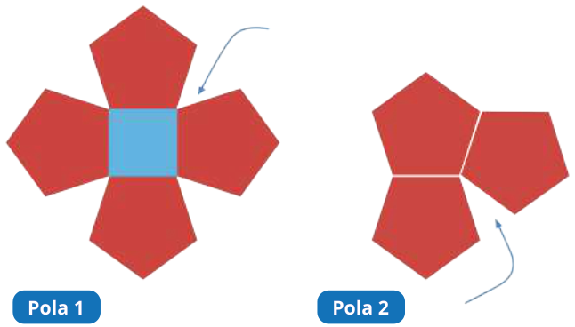


Kunci sumber: `D`; status AI: `verified`; jawaban diverifikasi AI: `D`.
Solusi minimum hasil AI: Sudut dalam segi lima beraturan adalah 108 derajat. Sudut persegi adalah 90 derajat. Sudut celah pada Pola 1 = 360 - (108 + 108 + 90) = 360 - 306 = 54 derajat.
Gambar sumber: images/kelas5_panduan_siswa_kelas5.pdf-0206-05.png. Transkripsi visual: Gambar menunjukkan dua pola keramik. Pola 1 terdiri dari satu persegi biru di tengah yang dikelilingi oleh empat segi lima merah. Tanda panah menunjuk ke celah sudut di antara dua segi lima dan satu persegi. Pola 2 terdiri dari tiga segi lima merah yang saling bersinggungan, dengan tanda panah menunjuk ke celah sudut di antara dua segi lima.

### 1. Pemeriksaan input dan fitur

Struktur: `pass`; alasan: `[]`. Grade/topik: kelas 5 / Matematika SD Kelas 5. KKO: `['menghitung']`; KKO hanya petunjuk bantu.
Isi dan kunci berasal dari sumber yang sama pada ketiga run. Versi konten: 2; hash: `eaefe6797d8d6028e8f5144dd0ced9aa36657fda46988c1f8ab8790163486c2c`. Bukti verifikasi AI tidak sama dengan verifikasi ahli.

### 2. Penilaian Gemini blind — tiga run sebelum melihat IndoBERT

| Run | Status | Konten / kunci | Kognitif | Pengetahuan | Difficulty | Token |
|---:|---|---|---|---|---|---:|
| 1 | success | valid / verified | reasoning | conceptual | Medium | 2747 |
| 2 | success | valid / verified | reasoning | conceptual | Medium | 2802 |
| 3 | success | valid / verified | reasoning | conceptual | Hard | 2763 |

Run 1 — solusi: Sudut dalam segi lima beraturan adalah (5-2)x180/5 = 108 derajat. Sudut persegi adalah 90 derajat. Sudut gap = 360 - (108 + 108 + 90) = 360 - 306 = 54 derajat.
- Domain kognitif `classify/reasoning`: Siswa perlu mengintegrasikan pengetahuan tentang sudut dalam poligon (segi lima dan persegi) dan menerapkan konsep sudut satu putaran penuh (360 derajat) untuk memecahkan masalah non-rutin yang melibatkan konfigurasi geometris.. Bukti: Berapa besar sudut potongan keramik untuk Pola 1?; Keramik merah berbentuk segi lima beraturan, keramik biru berbentuk persegi.
- Dimensi pengetahuan `classify/conceptual`: Soal ini menguji pemahaman konseptual tentang sifat-sifat sudut pada poligon beraturan dan bagaimana mereka berinteraksi dalam sebuah susunan (tessellation/pola).. Bukti: sudut dalam segi lima beraturan 108 derajat, persegi 90 derajat
- Intended difficulty `classify/Medium`: Soal ini dikategorikan Medium karena memerlukan pemahaman tentang sudut poligon yang tidak selalu diajarkan secara eksplisit sebagai prosedur rutin, serta kemampuan mengintegrasikan beberapa informasi geometris untuk menemukan sudut yang hilang.. Bukti: Berapa besar sudut potongan keramik untuk Pola 1?; 360 - 108 - 108 - 90 = 54 derajat

Profil difficulty run ini:

| Parameter | Nilai |
|---|---|
| expectedPrerequisite | Pemahaman sudut dalam poligon beraturan dan sudut satu putaran penuh. |
| dependentSteps | 3 |
| routineStatus | routine_selection |
| strategySelection | True |
| representationTransfer | True |
| relevantInformationUnits | 3 |
| interactingConstraints | 2 |
| calculationLoad | moderate |
| scaffoldLevel | none |
| distractorQuality | plausible |
| gradeRelativeRationale | Meskipun konsep sudut dasar, mengaplikasikannya pada pola keramik yang melibatkan segi lima (yang jarang dibahas mendalam di SD) membuat soal ini menantang bagi siswa kelas 5. |

Run 2 — solusi: Sudut satu putaran penuh di titik pertemuan adalah 360 derajat. Sudut yang mengelilingi titik tersebut adalah dua sudut dalam segi lima (108 derajat + 108 derajat) dan satu sudut persegi (90 derajat). Maka, sudut celah = 360 - (108 + 108 + 90) = 360 - 306 = 54 derajat.
- Domain kognitif `classify/reasoning`: Siswa perlu mengintegrasikan informasi visual (geometri bangun datar) dengan pengetahuan tentang besar sudut dalam poligon (segi lima dan persegi) untuk menyelesaikan masalah yang tidak rutin (menghitung sudut celah di antara bangun).. Bukti: Berapa besar sudut potongan keramik untuk Pola 1?; Keramik merah berbentuk segi lima beraturan, keramik biru berbentuk persegi.
- Dimensi pengetahuan `classify/conceptual`: Soal ini memerlukan pemahaman tentang sifat-sifat bangun datar (konsep sudut dalam poligon) dan hubungan antar bangun dalam pola tersebut.. Bukti: sudut dalam segi lima beraturan 108 derajat; persegi 90 derajat
- Intended difficulty `classify/Medium`: Soal ini dikategorikan Medium karena memerlukan pemahaman konsep sudut dalam poligon yang tidak langsung diberikan, serta kemampuan mengintegrasikan beberapa informasi (sudut segi lima dan persegi) untuk menemukan sudut yang tidak diketahui.. Bukti: Berapa besar sudut potongan keramik untuk Pola 1?; 360 - 108 - 108 - 90 = 54 derajat

Profil difficulty run ini:

| Parameter | Nilai |
|---|---|
| expectedPrerequisite | Pemahaman tentang sudut dalam segi lima beraturan (108 derajat) dan persegi (90 derajat), serta konsep sudut satu putaran penuh (360 derajat). |
| dependentSteps | 3 |
| routineStatus | routine_selection |
| strategySelection | True |
| representationTransfer | True |
| relevantInformationUnits | 3 |
| interactingConstraints | 2 |
| calculationLoad | moderate |
| scaffoldLevel | none |
| distractorQuality | plausible |
| gradeRelativeRationale | Untuk kelas 5, menghitung sudut dalam poligon dan menggunakannya dalam konteks pola geometris adalah tantangan yang sesuai untuk tingkat menengah, karena memerlukan penalaran di luar sekadar menghafal rumus. |

Run 3 — solusi: Sudut dalam segi lima beraturan adalah (5-2)x180/5 = 108 derajat. Sudut persegi adalah 90 derajat. Sudut satu putaran penuh adalah 360 derajat. Sudut celah = 360 - (108 + 108 + 90) = 360 - 306 = 54 derajat.
- Domain kognitif `classify/reasoning`: Siswa perlu mengintegrasikan pengetahuan tentang sudut dalam poligon (segi lima dan persegi) dan memahami hubungan geometris di sekitar titik pertemuan untuk menentukan sudut yang tersisa.. Bukti: Berapa besar sudut potongan keramik untuk Pola 1?; Keramik merah berbentuk segi lima beraturan, keramik biru berbentuk persegi.
- Dimensi pengetahuan `classify/conceptual`: Soal ini memerlukan pemahaman konsep sifat-sifat bangun datar (sudut dalam) dan prinsip sudut satu putaran penuh (360 derajat) untuk memecahkan masalah.. Bukti: Keramik merah berbentuk segi lima beraturan, keramik biru berbentuk persegi.; Berapa besar sudut potongan keramik untuk Pola 1?
- Intended difficulty `classify/Hard`: Soal ini menuntut siswa untuk mengidentifikasi hubungan sudut di sekitar titik pertemuan dan melakukan perhitungan multi-langkah yang melibatkan pengetahuan geometri yang tidak sekadar hafalan.. Bukti: Berapa besar sudut potongan keramik untuk Pola 1?; Keramik merah berbentuk segi lima beraturan, keramik biru berbentuk persegi.

Profil difficulty run ini:

| Parameter | Nilai |
|---|---|
| expectedPrerequisite | Pemahaman tentang sudut dalam segi lima beraturan (108 derajat) dan persegi (90 derajat), serta konsep sudut satu putaran penuh (360 derajat). |
| dependentSteps | 3 |
| routineStatus | nonroutine_strategy |
| strategySelection | True |
| representationTransfer | True |
| relevantInformationUnits | 3 |
| interactingConstraints | 3 |
| calculationLoad | moderate |
| scaffoldLevel | none |
| distractorQuality | strong |
| gradeRelativeRationale | Meskipun operasi dasarnya adalah pengurangan, mengintegrasikan properti sudut poligon yang berbeda dalam konfigurasi spasial adalah tantangan yang cukup tinggi untuk kelas 5. |

### 3. Voting awal dan adjudikasi

| Head | Suara awal | Pola / status akhir | Label akhir advisory |
|---|---|---|---|
| Domain kognitif | {"reasoning": 3} | unanimous_3_0 / adjudicated | reasoning |
| Dimensi pengetahuan | {"conceptual": 3} | unanimous_3_0 / adjudicated | conceptual |
| Intended difficulty | {"Medium": 2, "Hard": 1} | majority_2_of_3 / adjudicated | Medium |

Adjudikasi AI: `success`; token `4534`.
Konten: `valid`; kunci: `verified`; masalah: .
- Domain kognitif `reasoning`: Siswa harus mengintegrasikan pengetahuan tentang sudut dalam poligon (segi lima dan persegi) dan menerapkan konsep sudut satu putaran penuh (360 derajat) untuk memecahkan masalah non-rutin yang melibatkan konfigurasi geometris.
- Dimensi pengetahuan `conceptual`: Soal ini menguji pemahaman konseptual tentang sifat-sifat sudut pada poligon beraturan dan bagaimana mereka berinteraksi dalam sebuah susunan (tessellation).
- Intended difficulty `Medium`: Soal ini dikategorikan Medium karena memerlukan pemahaman tentang sudut poligon yang tidak selalu diajarkan secara eksplisit sebagai prosedur rutin, serta kemampuan mengintegrasikan beberapa informasi geometris untuk menemukan sudut yang hilang.

Profil difficulty hasil adjudikasi:

| Parameter | Nilai |
|---|---|
| expectedPrerequisite | Pemahaman sudut dalam poligon beraturan dan sudut satu putaran penuh. |
| dependentSteps | 3 |
| routineStatus | routine_selection |
| strategySelection | True |
| representationTransfer | True |
| relevantInformationUnits | 3 |
| interactingConstraints | 2 |
| calculationLoad | moderate |
| scaffoldLevel | none |
| distractorQuality | plausible |
| gradeRelativeRationale | Meskipun konsep sudut dasar, mengaplikasikannya pada pola keramik yang melibatkan segi lima (yang jarang dibahas mendalam di SD) membuat soal ini menantang bagi siswa kelas 5. |

### 4. Diagnostik IndoBERT setelah label blind dikunci

Model membaca representation `metadata`; token input 189/256; truncation: `False`.

| Head | Probabilitas | Label | Confidence | Entropy | Action / alasan |
|---|---|---|---:|---:|---|
| Domain kognitif | knowing=0.000000; applying=1.000000; reasoning=0.000000 | applying | 1.000000 | 0.000000 | review / selective_threshold_gate_not_met |
| Dimensi pengetahuan | factual=0.001231; conceptual=0.984977; procedural=0.013792; metacognitive=0.000000 | conceptual | 0.984977 | 0.059323 | review / selective_threshold_gate_not_met |
| Intended difficulty | Easy=0.667772; Medium=0.324678; Hard=0.007550 | Easy | 0.667772 | 0.611480 | review / selective_threshold_gate_not_met |

Domain kognitif: Σp = 1.00000000; confidence = max(p) = 1.000000; −Σp ln(p) = 0.000000; H = 0.000000/ln(3) = 0.000000; T = 0.050000.


Dimensi pengetahuan: Σp = 1.00000000; confidence = max(p) = 0.984977; −Σp ln(p) = 0.082239; H = 0.082239/ln(4) = 0.059323; T = 0.209800.


Intended difficulty: Σp = 1.00000000; confidence = max(p) = 0.667772; −Σp ln(p) = 0.671779; H = 0.671779/ln(3) = 0.611480; T = 0.953328.


<details><summary>Input sebenarnya yang dibaca model</summary>

```text
Kelas: 5
Topik: Matematika SD Kelas 5
Subtopik: Melukis Sudut
Tipe soal: multiple_choice
Stimulus: -
Soal: Memasang Keramik

Seorang tukang keramik memasang keramik dengan menggunakan pola berikut.

Pak Tukang akan memotong keramik untuk mengisi bagian kosong yang diberi tanda panah. Bantulah Pak Tukang untuk membuat potongan yang tepat. Berapa besar sudut potongan keramik untuk Pola 1? (Keramik merah berbentuk segi lima beraturan, keramik biru berbentuk persegi.)
Pilihan: A. $36^\circ$
B. $144^\circ$
C. $72^\circ$
D. $54^\circ$
Transkripsi visual: Gambar menunjukkan dua pola keramik. Pola 1 terdiri dari satu persegi biru di tengah yang dikelilingi oleh empat segi lima merah. Tanda panah menunjuk ke celah sudut di antara dua segi lima dan satu persegi. Pola 2 terdiri dari tiga segi lima merah yang saling bersinggungan, dengan tanda panah menunjuk ke celah sudut di antara dua segi lima.
```

</details>

### 5. Keputusan batch

Label advisory blind: `{"mathCognitiveDomain": "reasoning", "knowledgeDimension": "conceptual", "intendedDifficulty": "Medium"}`. Routing: `pending_expert_review`.
Status konten: `valid`. Catatan konten: .
Perbedaan model dan blind: `{"mathCognitiveDomain": {"modelLabel": "applying", "blindLabel": "reasoning", "agreement": false}, "knowledgeDimension": {"modelLabel": "conceptual", "blindLabel": "conceptual", "agreement": true}, "intendedDifficulty": {"modelLabel": "Easy", "blindLabel": "Medium", "agreement": false}}`.
Gold ahli tetap null; human review wajib. Confidence IndoBERT tidak digunakan untuk mengganti label blind.

## 54. Soal `0340747e52966376a7c4bd21`

Memasang Keramik<br><br>Seorang tukang keramik memasang keramik dengan menggunakan pola berikut.<br><br>Pak Tukang akan memotong keramik untuk mengisi bagian kosong yang diberi tanda panah. Bantulah Pak Tukang untuk membuat potongan yang tepat. Berapa besar sudut potongan keramik untuk Pola 2? (Keramik merah berbentuk segi lima beraturan.)

| Opsi | Isi |
|---|---|
| A | $54^\circ$ |
| B | $36^\circ$ |
| C | $108^\circ$ |
| D | $72^\circ$ |


Kunci sumber: `B`; status AI: `verified`; jawaban diverifikasi AI: `B`.
Solusi minimum hasil AI: Sudut dalam segi lima beraturan adalah (5-2)x180/5 = 108 derajat. Pada Pola 2, tiga sudut segi lima bertemu di satu titik. Besar sudut celah adalah 360 - (3 x 108) = 360 - 324 = 36 derajat.
Gambar sumber: images/kelas5_panduan_siswa_kelas5.pdf-0206-05.png. Transkripsi visual: Gambar menunjukkan dua pola pemasangan keramik. Pola 1 terdiri dari empat keramik berbentuk segi lima beraturan yang mengelilingi sebuah persegi di tengah. Pola 2 terdiri dari tiga keramik berbentuk segi lima beraturan yang bertemu pada satu titik pusat, menyisakan celah kosong yang ditunjuk oleh tanda panah.

### 1. Pemeriksaan input dan fitur

Struktur: `pass`; alasan: `[]`. Grade/topik: kelas 5 / Matematika SD Kelas 5. KKO: `['menghitung']`; KKO hanya petunjuk bantu.
Isi dan kunci berasal dari sumber yang sama pada ketiga run. Versi konten: 2; hash: `12aba04493401e12d17afcadfde39c6f778e110e9fca3f2bebc95e70771d3730`. Bukti verifikasi AI tidak sama dengan verifikasi ahli.

### 2. Penilaian Gemini blind — tiga run sebelum melihat IndoBERT

| Run | Status | Konten / kunci | Kognitif | Pengetahuan | Difficulty | Token |
|---:|---|---|---|---|---|---:|
| 1 | success | valid / verified | reasoning | conceptual | Hard | 2804 |
| 2 | success | valid / verified | reasoning | conceptual | Hard | 2778 |
| 3 | success | valid / verified | reasoning | conceptual | Medium | 2788 |

Run 1 — solusi: Sudut dalam segi lima beraturan adalah (5-2)x180/5 = 108 derajat. Pada Pola 2, celah kosong dibentuk oleh pertemuan tiga sudut segi lima beraturan di satu titik pusat (atau lebih tepatnya, celah tersebut melengkapi sudut di sekitar titik pertemuan). Namun, melihat visual Pola 2, celah tersebut berada di antara dua segi lima yang bersinggungan. Sudut celah = 360 - (108 + 108 + 108) = 36 derajat.
- Domain kognitif `classify/reasoning`: Siswa perlu mengintegrasikan pengetahuan tentang sudut dalam segi lima beraturan (108 derajat) dan memahami hubungan sudut di sekitar titik pertemuan (360 derajat) untuk menentukan besar sudut celah. Ini memerlukan penalaran geometris, bukan sekadar ingatan.. Bukti: Berapa besar sudut potongan keramik untuk Pola 2?; Keramik merah berbentuk segi lima beraturan.
- Dimensi pengetahuan `classify/conceptual`: Soal ini menguji pemahaman konseptual tentang sifat sudut pada bangun datar (segi lima) dan bagaimana sudut-sudut tersebut berinteraksi dalam sebuah pola (tessellation/susunan).. Bukti: Keramik merah berbentuk segi lima beraturan.; Berapa besar sudut potongan keramik untuk Pola 2?
- Intended difficulty `classify/Hard`: Soal ini menuntut siswa untuk melakukan analisis visual dan perhitungan geometris yang tidak rutin bagi siswa kelas 5, karena mereka harus menyimpulkan hubungan sudut di sekitar titik pertemuan tanpa diberikan rumus langsung.. Bukti: Keramik merah berbentuk segi lima beraturan.; Berapa besar sudut potongan keramik untuk Pola 2?

Profil difficulty run ini:

| Parameter | Nilai |
|---|---|
| expectedPrerequisite | Pemahaman tentang sudut dalam segi lima beraturan (108 derajat) dan sudut satu putaran penuh (360 derajat). |
| dependentSteps | 3 |
| routineStatus | nonroutine_strategy |
| strategySelection | True |
| representationTransfer | True |
| relevantInformationUnits | 3 |
| interactingConstraints | 2 |
| calculationLoad | moderate |
| scaffoldLevel | none |
| distractorQuality | plausible |
| gradeRelativeRationale | Meskipun operasi dasarnya sederhana, konsep sudut pada segi lima dan analisis pola visual di titik pertemuan adalah materi yang menantang untuk tingkat kelas 5. |

Run 2 — solusi: Sudut dalam segi lima beraturan adalah (5-2)x180/5 = 108 derajat. Pada Pola 2, tiga sudut segi lima bertemu di satu titik. Besar sudut celah adalah 360 - (3 x 108) = 360 - 324 = 36 derajat.
- Domain kognitif `classify/reasoning`: Siswa perlu mengintegrasikan pengetahuan tentang sudut dalam segi lima beraturan dengan pemahaman geometri tentang sudut satu putaran penuh (360 derajat) untuk menentukan besar sudut celah.. Bukti: Berapa besar sudut potongan keramik untuk Pola 2?; tiga sudut segi lima beraturan bertemu: 360 - 3 x 108 = 36 derajat
- Dimensi pengetahuan `classify/conceptual`: Soal ini menuntut pemahaman konseptual tentang sifat bangun datar (segi lima) dan hubungan sudut-sudut yang bertemu pada satu titik.. Bukti: Keramik merah berbentuk segi lima beraturan; 360 - 3 x 108 = 36 derajat
- Intended difficulty `classify/Hard`: Soal ini memerlukan pemahaman konsep sudut dalam segi lima dan kemampuan untuk memvisualisasikan hubungan sudut di sekitar titik pusat. Ini melampaui prosedur rutin sederhana.. Bukti: Berapa besar sudut potongan keramik untuk Pola 2?; tiga sudut segi lima beraturan bertemu

Profil difficulty run ini:

| Parameter | Nilai |
|---|---|
| expectedPrerequisite | Pengetahuan tentang besar sudut dalam segi lima beraturan (108 derajat) dan konsep sudut satu putaran penuh (360 derajat). |
| dependentSteps | 2 |
| routineStatus | nonroutine_strategy |
| strategySelection | True |
| representationTransfer | True |
| relevantInformationUnits | 3 |
| interactingConstraints | 2 |
| calculationLoad | moderate |
| scaffoldLevel | none |
| distractorQuality | plausible |
| gradeRelativeRationale | Meskipun operasi hitungnya sederhana, siswa kelas 5 jarang diminta untuk mengintegrasikan properti poligon dengan geometri sudut pada titik pertemuan secara mandiri tanpa panduan langkah demi langkah. |

Run 3 — solusi: Sudut dalam segi lima beraturan adalah (5-2)x180/5 = 108 derajat. Pada Pola 2, tiga sudut segi lima bertemu di satu titik. Total sudut satu putaran penuh adalah 360 derajat. Maka, sudut celah = 360 - (3 x 108) = 360 - 324 = 36 derajat.
- Domain kognitif `classify/reasoning`: Siswa perlu mengintegrasikan pengetahuan tentang sudut dalam segi lima beraturan dengan konsep sudut satu putaran penuh (360 derajat) untuk menentukan besar sudut celah yang tersisa. Ini memerlukan penalaran geometris, bukan sekadar ingatan atau prosedur rutin.. Bukti: Berapa besar sudut potongan keramik untuk Pola 2?; tiga sudut segi lima beraturan bertemu: 360 - 3 x 108 = 36 derajat
- Dimensi pengetahuan `classify/conceptual`: Soal ini menguji pemahaman konseptual tentang hubungan antara sudut-sudut poligon yang bertemu pada satu titik dan bagaimana mereka membentuk sudut satu putaran penuh.. Bukti: Keramik merah berbentuk segi lima beraturan; 360 - 3 x 108 = 36 derajat
- Intended difficulty `classify/Medium`: Soal ini dikategorikan Medium karena siswa kelas 5 perlu melakukan beberapa langkah: mengingat/menghitung sudut segi lima, memahami konfigurasi pertemuan sudut, dan melakukan operasi aritmatika untuk menemukan selisih sudut.. Bukti: Keramik merah berbentuk segi lima beraturan; Berapa besar sudut potongan keramik untuk Pola 2?

Profil difficulty run ini:

| Parameter | Nilai |
|---|---|
| expectedPrerequisite | Pengetahuan tentang sudut dalam segi lima (108 derajat) dan konsep sudut satu putaran penuh (360 derajat). |
| dependentSteps | 3 |
| routineStatus | routine_selection |
| strategySelection | True |
| representationTransfer | True |
| relevantInformationUnits | 3 |
| interactingConstraints | 1 |
| calculationLoad | moderate |
| scaffoldLevel | none |
| distractorQuality | plausible |
| gradeRelativeRationale | Meskipun konsep sudut segi lima mungkin menantang bagi sebagian siswa kelas 5, langkah-langkah penyelesaiannya logis dan terstruktur, sesuai untuk tingkat kesulitan menengah. |

### 3. Voting awal dan adjudikasi

| Head | Suara awal | Pola / status akhir | Label akhir advisory |
|---|---|---|---|
| Domain kognitif | {"reasoning": 3} | unanimous_3_0 / adjudicated | reasoning |
| Dimensi pengetahuan | {"conceptual": 3} | unanimous_3_0 / adjudicated | conceptual |
| Intended difficulty | {"Hard": 2, "Medium": 1} | majority_2_of_3 / adjudicated | Hard |

Adjudikasi AI: `success`; token `4511`.
Konten: `valid`; kunci: `verified`; masalah: .
- Domain kognitif `reasoning`: Siswa harus mengintegrasikan pengetahuan tentang sudut dalam segi lima (108 derajat) dengan konsep sudut satu putaran penuh (360 derajat) untuk menyimpulkan besar sudut celah. Ini adalah proses penalaran geometris, bukan sekadar ingatan.
- Dimensi pengetahuan `conceptual`: Soal ini menguji pemahaman konseptual tentang sifat sudut pada bangun datar (segi lima) dan bagaimana sudut-sudut tersebut berinteraksi dalam sebuah pola (tessellation).
- Intended difficulty `Hard`: Soal ini menuntut analisis visual dan perhitungan geometris yang tidak rutin bagi siswa kelas 5, karena mereka harus menyimpulkan hubungan sudut di sekitar titik pertemuan tanpa diberikan rumus langsung.

Profil difficulty hasil adjudikasi:

| Parameter | Nilai |
|---|---|
| expectedPrerequisite | Pemahaman tentang sudut dalam segi lima beraturan (108 derajat) dan sudut satu putaran penuh (360 derajat). |
| dependentSteps | 3 |
| routineStatus | nonroutine_strategy |
| strategySelection | True |
| representationTransfer | True |
| relevantInformationUnits | 3 |
| interactingConstraints | 2 |
| calculationLoad | moderate |
| scaffoldLevel | none |
| distractorQuality | plausible |
| gradeRelativeRationale | Meskipun operasi dasarnya sederhana, konsep sudut pada segi lima dan analisis pola visual di titik pertemuan adalah materi yang menantang untuk tingkat kelas 5. |

### 4. Diagnostik IndoBERT setelah label blind dikunci

Model membaca representation `metadata`; token input 169/256; truncation: `False`.

| Head | Probabilitas | Label | Confidence | Entropy | Action / alasan |
|---|---|---|---:|---:|---|
| Domain kognitif | knowing=0.000000; applying=1.000000; reasoning=0.000000 | applying | 1.000000 | 0.000000 | review / selective_threshold_gate_not_met |
| Dimensi pengetahuan | factual=0.000884; conceptual=0.990605; procedural=0.008511; metacognitive=0.000000 | conceptual | 0.990605 | 0.040492 | review / selective_threshold_gate_not_met |
| Intended difficulty | Easy=0.632935; Medium=0.360139; Hard=0.006926 | Easy | 0.632935 | 0.629644 | review / selective_threshold_gate_not_met |

Domain kognitif: Σp = 1.00000000; confidence = max(p) = 1.000000; −Σp ln(p) = 0.000000; H = 0.000000/ln(3) = 0.000000; T = 0.050000.


Dimensi pengetahuan: Σp = 1.00000000; confidence = max(p) = 0.990605; −Σp ln(p) = 0.056133; H = 0.056133/ln(4) = 0.040492; T = 0.209800.


Intended difficulty: Σp = 1.00000000; confidence = max(p) = 0.632935; −Σp ln(p) = 0.691734; H = 0.691734/ln(3) = 0.629644; T = 0.953328.


<details><summary>Input sebenarnya yang dibaca model</summary>

```text
Kelas: 5
Topik: Matematika SD Kelas 5
Subtopik: Melukis Sudut
Tipe soal: multiple_choice
Stimulus: -
Soal: Memasang Keramik

Seorang tukang keramik memasang keramik dengan menggunakan pola berikut.

Pak Tukang akan memotong keramik untuk mengisi bagian kosong yang diberi tanda panah. Bantulah Pak Tukang untuk membuat potongan yang tepat. Berapa besar sudut potongan keramik untuk Pola 2? (Keramik merah berbentuk segi lima beraturan.)
Pilihan: A. $54^\circ$
B. $36^\circ$
C. $108^\circ$
D. $72^\circ$
Transkripsi visual: Gambar menunjukkan dua pola pemasangan keramik. Pola 1 terdiri dari empat keramik berbentuk segi lima beraturan yang mengelilingi sebuah persegi di tengah. Pola 2 terdiri dari tiga keramik berbentuk segi lima beraturan yang bertemu pada satu titik pusat, menyisakan celah kosong yang ditunjuk oleh tanda panah.
```

</details>

### 5. Keputusan batch

Label advisory blind: `{"mathCognitiveDomain": "reasoning", "knowledgeDimension": "conceptual", "intendedDifficulty": "Hard"}`. Routing: `pending_expert_review`.
Status konten: `valid`. Catatan konten: .
Perbedaan model dan blind: `{"mathCognitiveDomain": {"modelLabel": "applying", "blindLabel": "reasoning", "agreement": false}, "knowledgeDimension": {"modelLabel": "conceptual", "blindLabel": "conceptual", "agreement": true}, "intendedDifficulty": {"modelLabel": "Easy", "blindLabel": "Hard", "agreement": false}}`.
Gold ahli tetap null; human review wajib. Confidence IndoBERT tidak digunakan untuk mengganti label blind.

## 55. Soal `f311bf91df38724a90b35b69`

Perhatikan huruf-huruf berikut ini.<br><br>Huruf manakah yang hanya memiliki satu pasang garis sejajar dan dua pasang garis tegak lurus?

| Opsi | Isi |
|---|---|
| A | Huruf E |
| B | Tidak ada |
| C | Huruf M |
| D | Huruf T |

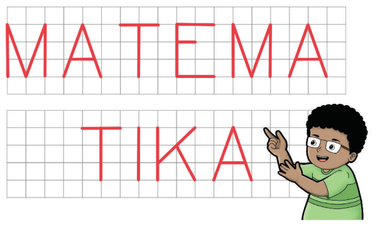


Kunci sumber: `B`; status AI: `verified`; jawaban diverifikasi AI: `B`.
Solusi minimum hasil AI: Analisis geometri huruf: E memiliki 3 pasang garis sejajar dan 4 pasang tegak lurus. M memiliki 1 pasang garis sejajar, 0 tegak lurus. T memiliki 0 pasang garis sejajar, 1 pasang tegak lurus. Tidak ada huruf yang memenuhi syarat tepat 1 pasang sejajar dan 2 pasang tegak lurus.
Gambar sumber: images/kelas3_panduan_siswa_kelas3.pdf-0198-01.png. Transkripsi visual: Gambar menunjukkan kata 'MATEMATIKA' yang ditulis di atas kertas berpetak. Huruf E memiliki 3 pasang garis sejajar (horizontal) dan 4 pasang garis tegak lurus. Huruf M memiliki 1 pasang garis sejajar (kaki-kaki vertikal) tetapi tidak memiliki garis tegak lurus. Huruf T memiliki 1 pasang garis tegak lurus tetapi tidak memiliki garis sejajar. Huruf A memiliki garis miring yang tidak sejajar maupun tegak lurus.

### 1. Pemeriksaan input dan fitur

Struktur: `pass`; alasan: `[]`. Grade/topik: kelas 5 / Matematika SD Kelas 5. KKO: `[]`; KKO hanya petunjuk bantu.
Isi dan kunci berasal dari sumber yang sama pada ketiga run. Versi konten: 2; hash: `57e31f2b47a07a161cce87ea4d54c9adcb3f57763576215496fe63b47c4eb3c3`. Bukti verifikasi AI tidak sama dengan verifikasi ahli.

### 2. Penilaian Gemini blind — tiga run sebelum melihat IndoBERT

| Run | Status | Konten / kunci | Kognitif | Pengetahuan | Difficulty | Token |
|---:|---|---|---|---|---|---:|
| 1 | success | valid / verified | applying | conceptual | Medium | 2780 |
| 2 | success | valid / verified | applying | conceptual | Medium | 2737 |
| 3 | success | valid / verified | applying | conceptual | Medium | 2703 |

Run 1 — solusi: Analisis geometri huruf: E memiliki 3 pasang garis sejajar dan 4 pasang tegak lurus. M memiliki 1 pasang garis sejajar, 0 tegak lurus. T memiliki 0 pasang garis sejajar, 1 pasang tegak lurus. Tidak ada huruf yang memenuhi syarat tepat 1 pasang sejajar dan 2 pasang tegak lurus.
- Domain kognitif `classify/applying`: Siswa perlu menganalisis properti geometris dari setiap huruf (sejajar dan tegak lurus) dan membandingkannya dengan kriteria yang diberikan. Ini melibatkan proses klasifikasi dan verifikasi properti, yang masuk dalam ranah applying.. Bukti: Huruf manakah yang hanya memiliki satu pasang garis sejajar dan dua pasang garis tegak lurus?
- Dimensi pengetahuan `classify/conceptual`: Soal ini menguji pemahaman konseptual tentang definisi garis sejajar dan tegak lurus serta kemampuan menerapkannya pada bentuk visual (huruf).. Bukti: Garis-Garis Tegak Lurus dan Garis-Garis Sejajar
- Intended difficulty `classify/Medium`: Soal ini menuntut siswa untuk memeriksa beberapa objek (huruf) secara sistematis terhadap kriteria ganda. Meskipun prosedurnya rutin, siswa harus melakukan analisis pada beberapa kasus untuk sampai pada kesimpulan 'tidak ada', yang meningkatkan beban kognitif sedikit di atas level dasar.. Bukti: Huruf manakah yang hanya memiliki satu pasang garis sejajar dan dua pasang garis tegak lurus?

Profil difficulty run ini:

| Parameter | Nilai |
|---|---|
| expectedPrerequisite | Pemahaman dasar tentang definisi garis sejajar dan tegak lurus. |
| dependentSteps | 3 |
| routineStatus | routine_selection |
| strategySelection | True |
| representationTransfer | True |
| relevantInformationUnits | 4 |
| interactingConstraints | 2 |
| calculationLoad | low |
| scaffoldLevel | none |
| distractorQuality | plausible |
| gradeRelativeRationale | Untuk kelas 5, mengidentifikasi sifat garis pada bentuk alfabet adalah tugas standar, namun keharusan memeriksa beberapa opsi dan menyimpulkan 'tidak ada' memerlukan ketelitian lebih. |

Run 2 — solusi: Analisis geometri huruf: E memiliki 3 pasang garis sejajar dan 4 pasang garis tegak lurus. M memiliki 1 pasang garis sejajar dan 0 garis tegak lurus. T memiliki 0 pasang garis sejajar dan 1 pasang garis tegak lurus. Tidak ada huruf yang memenuhi kriteria tepat 1 pasang sejajar dan 2 pasang tegak lurus.
- Domain kognitif `classify/applying`: Siswa perlu menganalisis sifat geometris dari setiap huruf (sejajar dan tegak lurus) dan membandingkannya dengan kriteria yang diberikan, yang merupakan proses menerapkan konsep pada situasi visual.. Bukti: Huruf manakah yang hanya memiliki satu pasang garis sejajar dan dua pasang garis tegak lurus?
- Dimensi pengetahuan `classify/conceptual`: Soal ini menguji pemahaman konseptual tentang definisi dan identifikasi garis sejajar dan tegak lurus pada bentuk geometris.. Bukti: Garis-Garis Tegak Lurus dan Garis-Garis Sejajar
- Intended difficulty `classify/Medium`: Soal ini memerlukan analisis visual yang cermat terhadap beberapa objek (huruf) dan verifikasi kondisi ganda (sejajar dan tegak lurus) untuk setiap opsi, yang melampaui sekadar pengenalan rutin.. Bukti: Huruf manakah yang hanya memiliki satu pasang garis sejajar dan dua pasang garis tegak lurus?

Profil difficulty run ini:

| Parameter | Nilai |
|---|---|
| expectedPrerequisite | Pemahaman definisi garis sejajar dan tegak lurus. |
| dependentSteps | 4 |
| routineStatus | routine_selection |
| strategySelection | True |
| representationTransfer | True |
| relevantInformationUnits | 4 |
| interactingConstraints | 2 |
| calculationLoad | low |
| scaffoldLevel | none |
| distractorQuality | plausible |
| gradeRelativeRationale | Siswa kelas 5 diharapkan mampu mengidentifikasi sifat garis pada bangun datar sederhana. Soal ini menuntut ketelitian dalam memeriksa setiap huruf terhadap dua kriteria sekaligus. |

Run 3 — solusi: Analisis geometri huruf: E memiliki 3 garis sejajar dan 4 tegak lurus. M memiliki 1 pasang garis sejajar, 0 tegak lurus. T memiliki 2 tegak lurus, 0 sejajar. Tidak ada huruf yang memenuhi syarat tepat 1 pasang sejajar dan 2 pasang tegak lurus.
- Domain kognitif `classify/applying`: Siswa harus menganalisis properti geometris dari setiap huruf secara individual dan membandingkannya dengan kriteria yang diberikan, yang merupakan proses penerapan konsep pada situasi rutin.. Bukti: Huruf manakah yang hanya memiliki satu pasang garis sejajar dan dua pasang garis tegak lurus?
- Dimensi pengetahuan `classify/conceptual`: Soal ini menguji pemahaman konseptual tentang definisi dan hubungan antara garis sejajar dan tegak lurus dalam bentuk geometris.. Bukti: Garis-Garis Tegak Lurus dan Garis-Garis Sejajar
- Intended difficulty `classify/Medium`: Soal ini memerlukan analisis visual dan klasifikasi properti geometris pada beberapa objek (huruf), yang melibatkan beberapa langkah rutin untuk setiap huruf.. Bukti: Huruf manakah yang hanya memiliki satu pasang garis sejajar dan dua pasang garis tegak lurus?

Profil difficulty run ini:

| Parameter | Nilai |
|---|---|
| expectedPrerequisite | Pemahaman definisi garis sejajar dan tegak lurus. |
| dependentSteps | 4 |
| routineStatus | routine_selection |
| strategySelection | False |
| representationTransfer | True |
| relevantInformationUnits | 4 |
| interactingConstraints | 2 |
| calculationLoad | low |
| scaffoldLevel | none |
| distractorQuality | plausible |
| gradeRelativeRationale | Siswa kelas 5 diharapkan mampu mengidentifikasi sifat garis pada bangun datar sederhana atau huruf. Memeriksa setiap huruf adalah tugas rutin namun memerlukan ketelitian. |

### 3. Voting awal dan adjudikasi

| Head | Suara awal | Pola / status akhir | Label akhir advisory |
|---|---|---|---|
| Domain kognitif | {"applying": 3} | unanimous_3_0 / unanimous | applying |
| Dimensi pengetahuan | {"conceptual": 3} | unanimous_3_0 / unanimous | conceptual |
| Intended difficulty | {"Medium": 3} | unanimous_3_0 / unanimous | Medium |

### 4. Diagnostik IndoBERT setelah label blind dikunci

Model membaca representation `metadata`; token input 157/256; truncation: `False`.

| Head | Probabilitas | Label | Confidence | Entropy | Action / alasan |
|---|---|---|---:|---:|---|
| Domain kognitif | knowing=0.001475; applying=0.998525; reasoning=0.000000 | applying | 0.998525 | 0.010093 | review / selective_threshold_gate_not_met |
| Dimensi pengetahuan | factual=0.015734; conceptual=0.954720; procedural=0.029545; metacognitive=0.000000 | conceptual | 0.954720 | 0.154094 | review / selective_threshold_gate_not_met |
| Intended difficulty | Easy=0.721473; Medium=0.273930; Hard=0.004596 | Easy | 0.721473 | 0.559779 | review / selective_threshold_gate_not_met |

Domain kognitif: Σp = 1.00000000; confidence = max(p) = 0.998525; −Σp ln(p) = 0.011088; H = 0.011088/ln(3) = 0.010093; T = 0.050000.


Dimensi pengetahuan: Σp = 1.00000000; confidence = max(p) = 0.954720; −Σp ln(p) = 0.213619; H = 0.213619/ln(4) = 0.154094; T = 0.209800.


Intended difficulty: Σp = 1.00000000; confidence = max(p) = 0.721473; −Σp ln(p) = 0.614980; H = 0.614980/ln(3) = 0.559779; T = 0.953328.


<details><summary>Input sebenarnya yang dibaca model</summary>

```text
Kelas: 5
Topik: Matematika SD Kelas 5
Subtopik: Garis-Garis Tegak Lurus dan Garis-Garis Sejajar
Tipe soal: multiple_choice
Stimulus: -
Soal: Perhatikan huruf-huruf berikut ini.

Huruf manakah yang hanya memiliki satu pasang garis sejajar dan dua pasang garis tegak lurus?
Pilihan: A. Huruf E
B. Tidak ada
C. Huruf M
D. Huruf T
Transkripsi visual: Gambar menunjukkan kata 'MATEMATIKA' yang ditulis di atas kertas berpetak. Huruf E memiliki 3 pasang garis sejajar (horizontal) dan 4 pasang garis tegak lurus. Huruf M memiliki 1 pasang garis sejajar (kaki-kaki vertikal) tetapi tidak memiliki garis tegak lurus. Huruf T memiliki 1 pasang garis tegak lurus tetapi tidak memiliki garis sejajar. Huruf A memiliki garis miring yang tidak sejajar maupun tegak lurus.
```

</details>

### 5. Keputusan batch

Label advisory blind: `{"mathCognitiveDomain": "applying", "knowledgeDimension": "conceptual", "intendedDifficulty": "Medium"}`. Routing: `pending_expert_review`.
Status konten: `valid`. Catatan konten: .
Perbedaan model dan blind: `{"mathCognitiveDomain": {"modelLabel": "applying", "blindLabel": "applying", "agreement": true}, "knowledgeDimension": {"modelLabel": "conceptual", "blindLabel": "conceptual", "agreement": true}, "intendedDifficulty": {"modelLabel": "Easy", "blindLabel": "Medium", "agreement": false}}`.
Gold ahli tetap null; human review wajib. Confidence IndoBERT tidak digunakan untuk mengganti label blind.

## 56. Soal `4182b10b0d1d91b16f5a2f4c`

Catatlah hasil percobaan kalian pada tabel berikut.<br>\|No.\|Sedotan (cm) a\|b\|c\|Membentuk Segitiga?\|b+c\|a+c\|a+b\|<br>\|1\|5\|6\|7\|Bisa\|13\|12\|11\|<br>\|2\|4\|6\|6\|…\|…\|…\|…\|<br>\|3\|5\|4\|12\|…\|…\|…\|…\|<br>\|4\|10\|5\|15\|…\|…\|…\|…\|<br>\|5\|5\|12\|13\|…\|…\|…\|…\|<br><br>Perhatikan jumlah panjang sisi-sisinya di kolom sebelah kanan.<br><br>Apakah perbedaan antara kelompok yang dapat dibuat segitiga dan kelompok yang tidak dapat dibuat segitiga?

| Opsi | Isi |
|---|---|
| A | Pada kelompok yang dapat dibuat segitiga, ada jumlah panjang dua sisi yang kurang dari sisi ketiga |
| B | Pada kelompok yang tidak dapat dibuat segitiga, jumlah panjang ketiga sisinya lebih dari 20 cm |
| C | Pada kelompok yang tidak dapat dibuat segitiga, ada dua sedotan yang sama panjang |
| D | Pada kelompok yang tidak dapat dibuat segitiga, ada jumlah panjang dua sisi yang tidak lebih dari sisi ketiga |

Kunci sumber: `D`; status AI: `verified`; jawaban diverifikasi AI: `D`.
Solusi minimum hasil AI: Syarat pembentukan segitiga adalah jumlah panjang dua sisi harus lebih besar dari sisi ketiga (a+b > c, a+c > b, b+c > a). Jika jumlah dua sisi kurang dari atau sama dengan sisi ketiga, segitiga tidak dapat terbentuk. Pilihan D secara tepat mendeskripsikan kondisi ketidaksamaan segitiga yang gagal (jumlah dua sisi tidak lebih dari sisi ketiga).
Gambar sumber: —. Transkripsi visual: —

### 1. Pemeriksaan input dan fitur

Struktur: `pass`; alasan: `[]`. Grade/topik: kelas 5 / Matematika SD Kelas 5. KKO: `[]`; KKO hanya petunjuk bantu.
Isi dan kunci berasal dari sumber yang sama pada ketiga run. Versi konten: 2; hash: `c3aeeb7a8982f6688f1528f086554774f500ba4dea4d62497b99bb408bb14802`. Bukti verifikasi AI tidak sama dengan verifikasi ahli.

### 2. Penilaian Gemini blind — tiga run sebelum melihat IndoBERT

| Run | Status | Konten / kunci | Kognitif | Pengetahuan | Difficulty | Token |
|---:|---|---|---|---|---|---:|
| 1 | success | valid / verified | reasoning | conceptual | Medium | 1784 |
| 2 | success | valid / verified | reasoning | conceptual | Medium | 1683 |
| 3 | success | valid / verified | reasoning | conceptual | Hard | 1701 |

Run 1 — solusi: Syarat segitiga adalah jumlah dua sisi harus lebih besar dari sisi ketiga (a+b>c, a+c>b, b+c>a). Pada baris 2 (4,6,6): 4+6>6 (10>6), 4+6>6 (10>6), 6+6>4 (12>4) -> Bisa. Pada baris 3 (5,4,12): 5+4=9 < 12 -> Tidak bisa. Pada baris 4 (10,5,15): 10+5=15 (tidak lebih besar dari 15) -> Tidak bisa. Pada baris 5 (5,12,13): 5+12>13 (17>13), 5+13>12 (18>12), 12+13>5 (25>5) -> Bisa. Kelompok yang tidak bisa membentuk segitiga memiliki jumlah dua sisi yang tidak lebih besar dari sisi ketiga.
- Domain kognitif `classify/reasoning`: Siswa perlu menggeneralisasi pola dari data tabel untuk menyimpulkan syarat pembentukan segitiga (ketaksamaan segitiga), yang merupakan proses penalaran.. Bukti: Apakah perbedaan antara kelompok yang dapat dibuat segitiga dan kelompok yang tidak dapat dibuat segitiga?
- Dimensi pengetahuan `classify/conceptual`: Siswa harus memahami hubungan antara panjang sisi-sisi segitiga dan syarat eksistensinya (konsep ketaksamaan segitiga).. Bukti: Perhatikan jumlah panjang sisi-sisinya di kolom sebelah kanan.
- Intended difficulty `classify/Medium`: Soal ini meminta siswa melakukan observasi data, melengkapi tabel, dan menarik kesimpulan umum. Ini melibatkan beberapa langkah rutin yang saling terkait.. Bukti: Catatlah hasil percobaan kalian pada tabel berikut.; Apakah perbedaan antara kelompok yang dapat dibuat segitiga dan kelompok yang tidak dapat dibuat segitiga?

Profil difficulty run ini:

| Parameter | Nilai |
|---|---|
| expectedPrerequisite | Penjumlahan dasar dan pemahaman konsep dasar segitiga. |
| dependentSteps | 3 |
| routineStatus | routine_selection |
| strategySelection | True |
| representationTransfer | True |
| relevantInformationUnits | 4 |
| interactingConstraints | 2 |
| calculationLoad | low |
| scaffoldLevel | partial |
| distractorQuality | plausible |
| gradeRelativeRationale | Siswa kelas 5 diharapkan mampu melakukan operasi hitung dan mulai memahami sifat bangun datar melalui eksplorasi data. |

Run 2 — solusi: Syarat segitiga adalah jumlah dua sisi harus lebih besar dari sisi ketiga (a+b>c, a+c>b, b+c>a). Pada baris 3 (5,4,12), 5+4=9 < 12 (tidak membentuk segitiga). Pada baris 4 (10,5,15), 10+5=15 (tidak lebih besar dari 15, tidak membentuk segitiga). Pilihan D menyatakan kondisi yang benar untuk ketidaksamaan segitiga.
- Domain kognitif `classify/reasoning`: Siswa perlu menggeneralisasi pola dari tabel untuk menyimpulkan aturan ketidaksamaan segitiga (triangle inequality theorem).. Bukti: Apakah perbedaan antara kelompok yang dapat dibuat segitiga dan kelompok yang tidak dapat dibuat segitiga?
- Dimensi pengetahuan `classify/conceptual`: Soal ini menguji pemahaman tentang hubungan/prinsip geometris (ketidaksamaan segitiga) yang mendasari pembentukan bangun datar.. Bukti: Perhatikan jumlah panjang sisi-sisinya di kolom sebelah kanan.
- Intended difficulty `classify/Medium`: Soal memerlukan analisis data pada tabel untuk menemukan pola matematis. Meskipun prosedural dalam mengisi tabel, kesimpulan akhir memerlukan pemahaman konsep.. Bukti: Catatlah hasil percobaan kalian pada tabel berikut.; Apakah perbedaan antara kelompok yang dapat dibuat segitiga dan kelompok yang tidak dapat dibuat segitiga?

Profil difficulty run ini:

| Parameter | Nilai |
|---|---|
| expectedPrerequisite | Penjumlahan bilangan cacah dan pemahaman dasar tentang sisi segitiga. |
| dependentSteps | 3 |
| routineStatus | routine_selection |
| strategySelection | True |
| representationTransfer | False |
| relevantInformationUnits | 4 |
| interactingConstraints | 2 |
| calculationLoad | low |
| scaffoldLevel | partial |
| distractorQuality | plausible |
| gradeRelativeRationale | Untuk kelas 5, mengidentifikasi pola dari tabel dan mengaitkannya dengan aturan geometris adalah tugas yang sesuai untuk tingkat menengah. |

Run 3 — solusi: Syarat segitiga adalah jumlah dua sisi harus lebih besar dari sisi ketiga. Pada baris 3 (5,4,12), 5+4=9 < 12 (tidak bisa). Pada baris 4 (10,5,15), 10+5=15 (tidak bisa). Pada baris 2 (4,6,6), 4+6=10 > 6, 4+6=10 > 6, 6+6=12 > 4 (bisa). Pilihan D menyatakan syarat yang benar: jumlah dua sisi tidak lebih dari sisi ketiga menyebabkan segitiga tidak terbentuk.
- Domain kognitif `classify/reasoning`: Siswa perlu menganalisis pola data pada tabel untuk menyimpulkan aturan umum (teorema ketaksamaan segitiga), yang merupakan proses penalaran induktif.. Bukti: Apakah perbedaan antara kelompok yang dapat dibuat segitiga dan kelompok yang tidak dapat dibuat segitiga?
- Dimensi pengetahuan `classify/conceptual`: Soal ini menguji pemahaman tentang hubungan antar sisi segitiga (prinsip geometris), bukan sekadar menghafal fakta atau melakukan prosedur aritmatika.. Bukti: Perhatikan jumlah panjang sisi-sisinya di kolom sebelah kanan.
- Intended difficulty `classify/Hard`: Soal ini memerlukan pemahaman konsep segitiga yang mendalam dan kemampuan menggeneralisasi pola dari data yang diberikan, yang menantang bagi siswa kelas 5.. Bukti: Catatlah hasil percobaan kalian pada tabel berikut.; Apakah perbedaan antara kelompok yang dapat dibuat segitiga dan kelompok yang tidak dapat dibuat segitiga?

Profil difficulty run ini:

| Parameter | Nilai |
|---|---|
| expectedPrerequisite | Penjumlahan dasar dan pemahaman konsep dasar segitiga. |
| dependentSteps | 4 |
| routineStatus | nonroutine_strategy |
| strategySelection | True |
| representationTransfer | True |
| relevantInformationUnits | 5 |
| interactingConstraints | 3 |
| calculationLoad | moderate |
| scaffoldLevel | partial |
| distractorQuality | plausible |
| gradeRelativeRationale | Meskipun operasi hitungnya sederhana, kemampuan untuk mengabstraksi aturan geometris dari tabel data merupakan tugas kognitif tingkat tinggi untuk kelas 5. |

### 3. Voting awal dan adjudikasi

| Head | Suara awal | Pola / status akhir | Label akhir advisory |
|---|---|---|---|
| Domain kognitif | {"reasoning": 3} | unanimous_3_0 / adjudicated | reasoning |
| Dimensi pengetahuan | {"conceptual": 3} | unanimous_3_0 / adjudicated | conceptual |
| Intended difficulty | {"Medium": 2, "Hard": 1} | majority_2_of_3 / adjudicated | Medium |

Adjudikasi AI: `success`; token `3415`.
Konten: `valid`; kunci: `verified`; masalah: .
- Domain kognitif `reasoning`: Siswa tidak hanya melakukan operasi hitung, tetapi harus menggeneralisasi pola dari data tabel untuk menyimpulkan aturan geometris (teorema ketaksamaan segitiga). Ini adalah proses penalaran induktif.
- Dimensi pengetahuan `conceptual`: Soal ini menguji pemahaman tentang hubungan atau prinsip geometris (ketaksamaan segitiga) yang mendasari pembentukan bangun datar, bukan sekadar prosedur aritmatika.
- Intended difficulty `Medium`: Soal ini menuntut siswa untuk melakukan observasi data, melengkapi tabel, dan melakukan abstraksi aturan. Meskipun operasi hitungnya sederhana, proses generalisasi pola dari data ke aturan geometris merupakan tantangan kognitif yang sesuai untuk tingkat menengah di kelas 5.

Profil difficulty hasil adjudikasi:

| Parameter | Nilai |
|---|---|
| expectedPrerequisite | Penjumlahan dasar dan pemahaman konsep dasar segitiga. |
| dependentSteps | 3 |
| routineStatus | routine_selection |
| strategySelection | True |
| representationTransfer | True |
| relevantInformationUnits | 4 |
| interactingConstraints | 2 |
| calculationLoad | low |
| scaffoldLevel | partial |
| distractorQuality | plausible |
| gradeRelativeRationale | Siswa kelas 5 diharapkan mampu melakukan operasi hitung dan mulai memahami sifat bangun datar melalui eksplorasi data, namun generalisasi aturan adalah langkah yang menantang. |

### 4. Diagnostik IndoBERT setelah label blind dikunci

Model membaca representation `metadata`; token input 262/256; truncation: `True`.

| Head | Probabilitas | Label | Confidence | Entropy | Action / alasan |
|---|---|---|---:|---:|---|
| Domain kognitif | knowing=0.000008; applying=0.999992; reasoning=0.000000 | applying | 0.999992 | 0.000097 | review / input_reached_truncation_limit; selective_threshold_gate_not_met |
| Dimensi pengetahuan | factual=0.001391; conceptual=0.919346; procedural=0.079264; metacognitive=0.000000 | conceptual | 0.919346 | 0.207309 | review / input_reached_truncation_limit; selective_threshold_gate_not_met |
| Intended difficulty | Easy=0.586848; Medium=0.403507; Hard=0.009644 | Easy | 0.586848 | 0.658789 | review / input_reached_truncation_limit; selective_threshold_gate_not_met |

Domain kognitif: Σp = 1.00000000; confidence = max(p) = 0.999992; −Σp ln(p) = 0.000107; H = 0.000107/ln(3) = 0.000097; T = 0.050000.


Dimensi pengetahuan: Σp = 1.00000000; confidence = max(p) = 0.919346; −Σp ln(p) = 0.287391; H = 0.287391/ln(4) = 0.207309; T = 0.209800.


Intended difficulty: Σp = 1.00000000; confidence = max(p) = 0.586848; −Σp ln(p) = 0.723753; H = 0.723753/ln(3) = 0.658789; T = 0.953328.


<details><summary>Input sebenarnya yang dibaca model</summary>

```text
Kelas: 5
Topik: Matematika SD Kelas 5
Subtopik: Membandingkan Ciri-Ciri Segitiga
Tipe soal: multiple_choice
Stimulus: -
Soal: Catatlah hasil percobaan kalian pada tabel berikut.
|No.|Sedotan (cm) a|b|c|Membentuk Segitiga?|b+c|a+c|a+b|
|1|5|6|7|Bisa|13|12|11|
|2|4|6|6|…|…|…|…|
|3|5|4|12|…|…|…|…|
|4|10|5|15|…|…|…|…|
|5|5|12|13|…|…|…|…|

Perhatikan jumlah panjang sisi-sisinya di kolom sebelah kanan.

Apakah perbedaan antara kelompok yang dapat dibuat segitiga dan kelompok yang tidak dapat dibuat segitiga?
Pilihan: A. Pada kelompok yang dapat dibuat segitiga, ada jumlah panjang dua sisi yang kurang dari sisi ketiga
B. Pada kelompok yang tidak dapat dibuat segitiga, jumlah panjang ketiga sisinya lebih dari 20 cm
C. Pada kelompok yang tidak dapat dibuat segitiga, ada dua sedotan yang sama panjang
D. Pada kelompok yang tidak dapat dibuat segitiga, ada jumlah panjang dua sisi yang tidak lebih dari sisi ketiga
Transkripsi visual: -
```

</details>

### 5. Keputusan batch

Label advisory blind: `{"mathCognitiveDomain": "reasoning", "knowledgeDimension": "conceptual", "intendedDifficulty": "Medium"}`. Routing: `pending_expert_review`.
Status konten: `valid`. Catatan konten: .
Perbedaan model dan blind: `{"mathCognitiveDomain": {"modelLabel": "applying", "blindLabel": "reasoning", "agreement": false}, "knowledgeDimension": {"modelLabel": "conceptual", "blindLabel": "conceptual", "agreement": true}, "intendedDifficulty": {"modelLabel": "Easy", "blindLabel": "Medium", "agreement": false}}`.
Gold ahli tetap null; human review wajib. Confidence IndoBERT tidak digunakan untuk mengganti label blind.

## 57. Soal `30f40c729a52410a063b5714`

Komang dan Nisa berbeda pendapat tentang bentuk bangunan Candi Sewu.<br><br>Bolehkah segitiga sama sisi juga disebut segitiga sama kaki?

| Opsi | Isi |
|---|---|
| A | Tidak boleh, karena sudut-sudut segitiga sama sisi tidak ada yang sama besar |
| B | Tidak boleh, karena segitiga sama kaki hanya boleh memiliki tepat 2 sisi sama panjang |
| C | Boleh, karena segitiga sama sisi memiliki setidaknya 2 sisi yang sama panjang |
| D | Boleh, karena semua segitiga dapat disebut segitiga sama kaki |

Kunci sumber: `C`; status AI: `verified`; jawaban diverifikasi AI: `C`.
Solusi minimum hasil AI: Segitiga sama kaki didefinisikan sebagai segitiga yang memiliki setidaknya dua sisi sama panjang. Segitiga sama sisi memiliki tiga sisi sama panjang, sehingga memenuhi syarat memiliki setidaknya dua sisi sama panjang.
Gambar sumber: —. Transkripsi visual: —

### 1. Pemeriksaan input dan fitur

Struktur: `pass`; alasan: `[]`. Grade/topik: kelas 5 / Matematika SD Kelas 5. KKO: `[]`; KKO hanya petunjuk bantu.
Isi dan kunci berasal dari sumber yang sama pada ketiga run. Versi konten: 2; hash: `bad3ea6f7c441fac609af5d41ec67227021ec8c8c5d6e6db866a1d5b9db7c053`. Bukti verifikasi AI tidak sama dengan verifikasi ahli.

### 2. Penilaian Gemini blind — tiga run sebelum melihat IndoBERT

| Run | Status | Konten / kunci | Kognitif | Pengetahuan | Difficulty | Token |
|---:|---|---|---|---|---|---:|
| 1 | success | valid / verified | reasoning | conceptual | Medium | 1534 |
| 2 | success | valid / verified | applying | conceptual | Medium | 1471 |
| 3 | success | valid / verified | reasoning | conceptual | Medium | 1435 |

Run 1 — solusi: Segitiga sama kaki didefinisikan sebagai segitiga yang memiliki setidaknya dua sisi sama panjang. Segitiga sama sisi memiliki tiga sisi sama panjang, sehingga memenuhi syarat memiliki setidaknya dua sisi sama panjang.
- Domain kognitif `classify/reasoning`: Soal ini menuntut siswa untuk memahami hubungan hierarkis antara kategori bangun datar (segitiga sama sisi sebagai subset dari segitiga sama kaki), yang memerlukan penalaran konseptual, bukan sekadar ingatan.. Bukti: Bolehkah segitiga sama sisi juga disebut segitiga sama kaki?; segitiga sama sisi memiliki setidaknya 2 sisi yang sama panjang
- Dimensi pengetahuan `classify/conceptual`: Soal menguji pemahaman tentang definisi dan klasifikasi bangun datar (hubungan antar konsep), bukan sekadar prosedur menghitung atau fakta hafalan.. Bukti: Bolehkah segitiga sama sisi juga disebut segitiga sama kaki?; segitiga sama sisi memiliki setidaknya 2 sisi yang sama panjang
- Intended difficulty `classify/Medium`: Soal ini tergolong Medium karena menuntut pemahaman definisi inklusif dalam geometri yang sering disalahpahami siswa (miskonsepsi 'tepat dua sisi' vs 'setidaknya dua sisi').. Bukti: Bolehkah segitiga sama sisi juga disebut segitiga sama kaki?; segitiga sama sisi memiliki setidaknya 2 sisi yang sama panjang

Profil difficulty run ini:

| Parameter | Nilai |
|---|---|
| expectedPrerequisite | Definisi segitiga sama sisi dan segitiga sama kaki. |
| dependentSteps | 1 |
| routineStatus | routine_selection |
| strategySelection | False |
| representationTransfer | False |
| relevantInformationUnits | 2 |
| interactingConstraints | 1 |
| calculationLoad | low |
| scaffoldLevel | none |
| distractorQuality | strong |
| gradeRelativeRationale | Siswa kelas 5 diharapkan memahami klasifikasi bangun datar, namun soal ini menantang miskonsepsi umum mengenai definisi inklusif. |

Run 2 — solusi: Segitiga sama kaki didefinisikan sebagai segitiga yang memiliki setidaknya dua sisi sama panjang. Segitiga sama sisi memiliki tiga sisi sama panjang, sehingga otomatis memenuhi syarat memiliki setidaknya dua sisi sama panjang.
- Domain kognitif `classify/applying`: Siswa perlu memahami hubungan hierarkis antara kategori segitiga (segitiga sama sisi adalah subset dari segitiga sama kaki) dan menerapkan definisi konsep tersebut, yang masuk dalam kategori applying.. Bukti: Bolehkah segitiga sama sisi juga disebut segitiga sama kaki?
- Dimensi pengetahuan `classify/conceptual`: Soal ini menguji pemahaman tentang struktur konsep dan hubungan antar kategori bangun datar (klasifikasi inklusif), bukan sekadar menghafal fakta atau melakukan prosedur hitung.. Bukti: Bolehkah segitiga sama sisi juga disebut segitiga sama kaki?
- Intended difficulty `classify/Medium`: Soal ini tergolong Medium karena menuntut pemahaman konseptual tentang definisi inklusif segitiga, yang sering kali menjadi miskonsepsi bagi siswa kelas 5, meskipun langkah penyelesaiannya singkat.. Bukti: Bolehkah segitiga sama sisi juga disebut segitiga sama kaki?

Profil difficulty run ini:

| Parameter | Nilai |
|---|---|
| expectedPrerequisite | Definisi segitiga sama sisi dan segitiga sama kaki. |
| dependentSteps | 1 |
| routineStatus | routine_selection |
| strategySelection | False |
| representationTransfer | False |
| relevantInformationUnits | 2 |
| interactingConstraints | 1 |
| calculationLoad | low |
| scaffoldLevel | none |
| distractorQuality | strong |
| gradeRelativeRationale | Siswa kelas 5 diharapkan mulai memahami klasifikasi bangun datar secara hierarkis, namun soal ini menantang miskonsepsi umum mengenai definisi 'tepat dua sisi' vs 'setidaknya dua sisi'. |

Run 3 — solusi: Segitiga sama kaki didefinisikan memiliki setidaknya dua sisi sama panjang. Segitiga sama sisi memiliki tiga sisi sama panjang, sehingga memenuhi syarat memiliki setidaknya dua sisi sama panjang.
- Domain kognitif `classify/reasoning`: Siswa perlu memahami hubungan hierarkis antara kategori segitiga (konsep inklusi) dan membenarkan klasifikasi tersebut berdasarkan definisi formal.. Bukti: Bolehkah segitiga sama sisi juga disebut segitiga sama kaki?
- Dimensi pengetahuan `classify/conceptual`: Soal ini menguji pemahaman tentang struktur definisi dan hubungan antar kategori (konsep) dalam geometri, bukan sekadar menghafal fakta atau prosedur perhitungan.. Bukti: segitiga sama sisi juga disebut segitiga sama kaki
- Intended difficulty `classify/Medium`: Soal ini menuntut pemahaman konseptual tentang definisi inklusif dalam geometri yang sering disalahpahami siswa (miskonsepsi 'tepat dua sisi').. Bukti: Bolehkah segitiga sama sisi juga disebut segitiga sama kaki?

Profil difficulty run ini:

| Parameter | Nilai |
|---|---|
| expectedPrerequisite | Definisi segitiga sama sisi dan segitiga sama kaki. |
| dependentSteps | 1 |
| routineStatus | routine_selection |
| strategySelection | False |
| representationTransfer | False |
| relevantInformationUnits | 2 |
| interactingConstraints | 1 |
| calculationLoad | low |
| scaffoldLevel | none |
| distractorQuality | strong |
| gradeRelativeRationale | Siswa kelas 5 diharapkan mulai memahami klasifikasi bangun datar secara hierarkis, namun soal ini menantang miskonsepsi umum tentang definisi 'sama kaki'. |

### 3. Voting awal dan adjudikasi

| Head | Suara awal | Pola / status akhir | Label akhir advisory |
|---|---|---|---|
| Domain kognitif | {"reasoning": 2, "applying": 1} | majority_2_of_3 / adjudicated | reasoning |
| Dimensi pengetahuan | {"conceptual": 3} | unanimous_3_0 / adjudicated | conceptual |
| Intended difficulty | {"Medium": 3} | unanimous_3_0 / adjudicated | Medium |

Adjudikasi AI: `success`; token `2932`.
Konten: `valid`; kunci: `verified`; masalah: .
- Domain kognitif `reasoning`: Soal ini menuntut siswa untuk memahami hubungan hierarkis antara kategori bangun datar (segitiga sama sisi sebagai subset dari segitiga sama kaki). Ini memerlukan penalaran konseptual untuk memvalidasi definisi inklusif, bukan sekadar menerapkan prosedur rutin.
- Dimensi pengetahuan `conceptual`: Soal menguji pemahaman tentang struktur konsep dan hubungan antar kategori bangun datar (klasifikasi inklusif), yang merupakan aspek fundamental dari pengetahuan konseptual.
- Intended difficulty `Medium`: Soal ini tergolong Medium karena menuntut pemahaman definisi inklusif dalam geometri yang sering disalahpahami siswa (miskonsepsi 'tepat dua sisi' vs 'setidaknya dua sisi'). Meskipun langkah penyelesaiannya singkat, tantangan kognitif terletak pada mengatasi miskonsepsi umum tersebut.

Profil difficulty hasil adjudikasi:

| Parameter | Nilai |
|---|---|
| expectedPrerequisite | Definisi segitiga sama sisi dan segitiga sama kaki. |
| dependentSteps | 1 |
| routineStatus | routine_selection |
| strategySelection | False |
| representationTransfer | False |
| relevantInformationUnits | 2 |
| interactingConstraints | 1 |
| calculationLoad | low |
| scaffoldLevel | none |
| distractorQuality | strong |
| gradeRelativeRationale | Siswa kelas 5 diharapkan memahami klasifikasi bangun datar, namun soal ini menantang miskonsepsi umum mengenai definisi inklusif yang sering kali dianggap eksklusif oleh siswa. |

### 4. Diagnostik IndoBERT setelah label blind dikunci

Model membaca representation `metadata`; token input 120/256; truncation: `False`.

| Head | Probabilitas | Label | Confidence | Entropy | Action / alasan |
|---|---|---|---:|---:|---|
| Domain kognitif | knowing=0.000008; applying=0.999992; reasoning=0.000000 | applying | 0.999992 | 0.000088 | review / selective_threshold_gate_not_met |
| Dimensi pengetahuan | factual=0.109912; conceptual=0.871456; procedural=0.018632; metacognitive=0.000000 | conceptual | 0.871456 | 0.315090 | review / selective_threshold_gate_not_met |
| Intended difficulty | Easy=0.890183; Medium=0.106697; Hard=0.003121 | Easy | 0.890183 | 0.327978 | review / selective_threshold_gate_not_met |

Domain kognitif: Σp = 1.00000000; confidence = max(p) = 0.999992; −Σp ln(p) = 0.000097; H = 0.000097/ln(3) = 0.000088; T = 0.050000.


Dimensi pengetahuan: Σp = 1.00000000; confidence = max(p) = 0.871456; −Σp ln(p) = 0.436807; H = 0.436807/ln(4) = 0.315090; T = 0.209800.


Intended difficulty: Σp = 1.00000000; confidence = max(p) = 0.890183; −Σp ln(p) = 0.360321; H = 0.360321/ln(3) = 0.327978; T = 0.953328.


<details><summary>Input sebenarnya yang dibaca model</summary>

```text
Kelas: 5
Topik: Matematika SD Kelas 5
Subtopik: Membandingkan Ciri-Ciri Segitiga
Tipe soal: multiple_choice
Stimulus: -
Soal: Komang dan Nisa berbeda pendapat tentang bentuk bangunan Candi Sewu.

Bolehkah segitiga sama sisi juga disebut segitiga sama kaki?
Pilihan: A. Tidak boleh, karena sudut-sudut segitiga sama sisi tidak ada yang sama besar
B. Tidak boleh, karena segitiga sama kaki hanya boleh memiliki tepat 2 sisi sama panjang
C. Boleh, karena segitiga sama sisi memiliki setidaknya 2 sisi yang sama panjang
D. Boleh, karena semua segitiga dapat disebut segitiga sama kaki
Transkripsi visual: -
```

</details>

### 5. Keputusan batch

Label advisory blind: `{"mathCognitiveDomain": "reasoning", "knowledgeDimension": "conceptual", "intendedDifficulty": "Medium"}`. Routing: `pending_expert_review`.
Status konten: `valid`. Catatan konten: .
Perbedaan model dan blind: `{"mathCognitiveDomain": {"modelLabel": "applying", "blindLabel": "reasoning", "agreement": false}, "knowledgeDimension": {"modelLabel": "conceptual", "blindLabel": "conceptual", "agreement": true}, "intendedDifficulty": {"modelLabel": "Easy", "blindLabel": "Medium", "agreement": false}}`.
Gold ahli tetap null; human review wajib. Confidence IndoBERT tidak digunakan untuk mengganti label blind.

## 58. Soal `4857ed456bf6383ee84ff085`

Kalau sembarang bentuk belah ketupat boleh disebut jajargenjang, apakah sembarang jajargenjang boleh disebut belah ketupat?

| Opsi | Isi |
|---|---|
| A | Tidak, karena jajargenjang tidak harus memiliki empat sisi yang sama panjang |
| B | Ya, karena sisi-sisi yang berhadapan pada jajargenjang sejajar |
| C | Ya, karena belah ketupat boleh disebut jajargenjang, maka sebaliknya juga boleh |
| D | Tidak, karena jajargenjang tidak memiliki sisi-sisi yang sejajar |

Kunci sumber: `A`; status AI: `verified`; jawaban diverifikasi AI: `A`.
Solusi minimum hasil AI: Definisi belah ketupat mensyaratkan keempat sisi sama panjang, sedangkan jajargenjang hanya mensyaratkan sisi berhadapan sejajar. Karena ada jajargenjang yang sisi-sisinya tidak sama panjang (misal: persegi panjang), maka tidak semua jajargenjang adalah belah ketupat.
Gambar sumber: —. Transkripsi visual: —

### 1. Pemeriksaan input dan fitur

Struktur: `pass`; alasan: `[]`. Grade/topik: kelas 5 / Matematika SD Kelas 5. KKO: `[]`; KKO hanya petunjuk bantu.
Isi dan kunci berasal dari sumber yang sama pada ketiga run. Versi konten: 2; hash: `eff6b84a855d9653bc119e317417267782dbf263f30ef94c08021a81189b5b9e`. Bukti verifikasi AI tidak sama dengan verifikasi ahli.

### 2. Penilaian Gemini blind — tiga run sebelum melihat IndoBERT

| Run | Status | Konten / kunci | Kognitif | Pengetahuan | Difficulty | Token |
|---:|---|---|---|---|---|---:|
| 1 | success | valid / verified | reasoning | conceptual | Hard | 1519 |
| 2 | success | valid / verified | reasoning | conceptual | Medium | 1517 |
| 3 | success | valid / verified | reasoning | conceptual | Medium | 1475 |

Run 1 — solusi: Definisi belah ketupat mensyaratkan keempat sisi sama panjang, sedangkan jajargenjang hanya mensyaratkan sisi berhadapan sejajar. Karena ada jajargenjang yang sisi-sisinya tidak sama panjang (misal: persegi panjang), maka tidak semua jajargenjang adalah belah ketupat.
- Domain kognitif `classify/reasoning`: Siswa perlu memahami hubungan hierarkis antar bangun datar (klasifikasi inklusif) dan membedakan syarat perlu dan cukup dari definisi belah ketupat dan jajargenjang.. Bukti: apakah sembarang jajargenjang boleh disebut belah ketupat?
- Dimensi pengetahuan `classify/conceptual`: Soal ini menguji pemahaman tentang struktur hierarki konsep geometri (bangun datar), bukan sekadar menghafal fakta atau prosedur.. Bukti: sembarang bentuk belah ketupat boleh disebut jajargenjang; apakah sembarang jajargenjang boleh disebut belah ketupat?
- Intended difficulty `classify/Hard`: Soal ini menuntut pemahaman konseptual yang mendalam tentang sifat-sifat bangun datar. Siswa harus melakukan penalaran logis untuk menyanggah pernyataan umum (counter-example thinking), yang merupakan tantangan kognitif di atas rata-rata untuk kelas 5.. Bukti: sembarang bentuk belah ketupat boleh disebut jajargenjang; apakah sembarang jajargenjang boleh disebut belah ketupat?

Profil difficulty run ini:

| Parameter | Nilai |
|---|---|
| expectedPrerequisite | Pemahaman definisi dan sifat-sifat jajargenjang dan belah ketupat. |
| dependentSteps | 2 |
| routineStatus | nonroutine_strategy |
| strategySelection | True |
| representationTransfer | False |
| relevantInformationUnits | 2 |
| interactingConstraints | 2 |
| calculationLoad | low |
| scaffoldLevel | none |
| distractorQuality | plausible |
| gradeRelativeRationale | Memahami hubungan inklusif antar bangun datar (hierarki) sering kali menjadi materi yang menantang bagi siswa kelas 5 karena memerlukan penalaran deduktif sederhana. |

Run 2 — solusi: Definisi belah ketupat mensyaratkan keempat sisi sama panjang, sedangkan jajargenjang hanya mensyaratkan sisi berhadapan sejajar. Karena ada jajargenjang yang sisi-sisinya tidak sama panjang (misalnya persegi panjang), maka tidak semua jajargenjang adalah belah ketupat.
- Domain kognitif `classify/reasoning`: Siswa perlu memahami hubungan hierarkis antar bangun datar (inklusi kelas) dan membedakan syarat perlu dan syarat cukup dari definisi belah ketupat dan jajargenjang.. Bukti: apakah sembarang jajargenjang boleh disebut belah ketupat?
- Dimensi pengetahuan `classify/conceptual`: Soal ini menguji pemahaman tentang hubungan antar konsep geometri (hierarki bangun datar) dan definisi formal dari bangun-bangun tersebut.. Bukti: sembarang bentuk belah ketupat boleh disebut jajargenjang; apakah sembarang jajargenjang boleh disebut belah ketupat?
- Intended difficulty `classify/Medium`: Soal ini menuntut pemahaman konseptual yang mendalam tentang sifat bangun datar. Meskipun terlihat singkat, ini bukan sekadar hafalan, melainkan analisis logika hubungan inklusi antar bangun datar yang sering menjadi miskonsepsi di kelas 5.. Bukti: Kalau sembarang bentuk belah ketupat boleh disebut jajargenjang, apakah sembarang jajargenjang boleh disebut belah ketupat?

Profil difficulty run ini:

| Parameter | Nilai |
|---|---|
| expectedPrerequisite | Pemahaman definisi dan sifat-sifat jajargenjang serta belah ketupat. |
| dependentSteps | 2 |
| routineStatus | routine_selection |
| strategySelection | True |
| representationTransfer | False |
| relevantInformationUnits | 2 |
| interactingConstraints | 1 |
| calculationLoad | low |
| scaffoldLevel | none |
| distractorQuality | plausible |
| gradeRelativeRationale | Pada kelas 5, siswa mulai mempelajari klasifikasi bangun datar. Memahami bahwa hubungan inklusi tidak berlaku dua arah (simetris) adalah tantangan kognitif yang sesuai untuk tingkat menengah. |

Run 3 — solusi: Definisi belah ketupat adalah jajargenjang dengan empat sisi sama panjang. Jajargenjang umum tidak memiliki empat sisi sama panjang, sehingga tidak semua jajargenjang adalah belah ketupat.
- Domain kognitif `classify/reasoning`: Siswa perlu memahami hubungan hierarkis antar bangun datar (inklusi kelas) dan membedakan syarat perlu dan syarat cukup dari definisi belah ketupat.. Bukti: apakah sembarang jajargenjang boleh disebut belah ketupat?; Tidak, karena jajargenjang tidak harus memiliki empat sisi yang sama panjang
- Dimensi pengetahuan `classify/conceptual`: Soal ini menguji pemahaman tentang struktur konsep dan hubungan antar kategori bangun datar (geometri).. Bukti: sembarang bentuk belah ketupat boleh disebut jajargenjang; jajargenjang tidak harus memiliki empat sisi yang sama panjang
- Intended difficulty `classify/Medium`: Soal ini menuntut pemahaman konseptual yang mendalam tentang sifat bangun datar, bukan sekadar menghitung atau menerapkan rumus rutin.. Bukti: apakah sembarang jajargenjang boleh disebut belah ketupat?; jajargenjang tidak harus memiliki empat sisi yang sama panjang

Profil difficulty run ini:

| Parameter | Nilai |
|---|---|
| expectedPrerequisite | Pemahaman ciri-ciri jajargenjang dan belah ketupat. |
| dependentSteps | 1 |
| routineStatus | nonroutine_strategy |
| strategySelection | True |
| representationTransfer | False |
| relevantInformationUnits | 2 |
| interactingConstraints | 1 |
| calculationLoad | low |
| scaffoldLevel | none |
| distractorQuality | plausible |
| gradeRelativeRationale | Untuk kelas 5, memahami hierarki bangun datar (bahwa belah ketupat adalah subset dari jajargenjang) adalah konsep yang menantang dan memerlukan penalaran logis. |

### 3. Voting awal dan adjudikasi

| Head | Suara awal | Pola / status akhir | Label akhir advisory |
|---|---|---|---|
| Domain kognitif | {"reasoning": 3} | unanimous_3_0 / adjudicated | reasoning |
| Dimensi pengetahuan | {"conceptual": 3} | unanimous_3_0 / adjudicated | conceptual |
| Intended difficulty | {"Hard": 1, "Medium": 2} | majority_2_of_3 / adjudicated | Medium |

Adjudikasi AI: `success`; token `3123`.
Konten: `valid`; kunci: `verified`; masalah: .
- Domain kognitif `reasoning`: Siswa perlu memahami hubungan hierarkis antar bangun datar (inklusi kelas) dan membedakan syarat perlu dan syarat cukup dari definisi belah ketupat dan jajargenjang.
- Dimensi pengetahuan `conceptual`: Soal ini menguji pemahaman tentang struktur konsep dan hubungan antar kategori bangun datar (geometri), bukan sekadar menghafal fakta.
- Intended difficulty `Medium`: Soal ini menuntut pemahaman konseptual yang mendalam tentang sifat bangun datar. Meskipun terlihat singkat, ini bukan sekadar hafalan, melainkan analisis logika hubungan inklusi antar bangun datar yang sering menjadi miskonsepsi di kelas 5.

Profil difficulty hasil adjudikasi:

| Parameter | Nilai |
|---|---|
| expectedPrerequisite | Pemahaman definisi dan sifat-sifat jajargenjang serta belah ketupat. |
| dependentSteps | 2 |
| routineStatus | routine_selection |
| strategySelection | True |
| representationTransfer | False |
| relevantInformationUnits | 2 |
| interactingConstraints | 1 |
| calculationLoad | low |
| scaffoldLevel | none |
| distractorQuality | plausible |
| gradeRelativeRationale | Pada kelas 5, siswa mulai mempelajari klasifikasi bangun datar. Memahami bahwa hubungan inklusi tidak berlaku dua arah (simetris) adalah tantangan kognitif yang sesuai untuk tingkat menengah. |

### 4. Diagnostik IndoBERT setelah label blind dikunci

Model membaca representation `metadata`; token input 128/256; truncation: `False`.

| Head | Probabilitas | Label | Confidence | Entropy | Action / alasan |
|---|---|---|---:|---:|---|
| Domain kognitif | knowing=0.000010; applying=0.999990; reasoning=0.000000 | applying | 0.999990 | 0.000112 | review / selective_threshold_gate_not_met |
| Dimensi pengetahuan | factual=0.027005; conceptual=0.961706; procedural=0.011289; metacognitive=0.000000 | conceptual | 0.961706 | 0.133959 | review / selective_threshold_gate_not_met |
| Intended difficulty | Easy=0.787356; Medium=0.206814; Hard=0.005830 | Easy | 0.787356 | 0.495311 | review / selective_threshold_gate_not_met |

Domain kognitif: Σp = 1.00000000; confidence = max(p) = 0.999990; −Σp ln(p) = 0.000123; H = 0.000123/ln(3) = 0.000112; T = 0.050000.


Dimensi pengetahuan: Σp = 1.00000000; confidence = max(p) = 0.961706; −Σp ln(p) = 0.185706; H = 0.185706/ln(4) = 0.133959; T = 0.209800.


Intended difficulty: Σp = 1.00000000; confidence = max(p) = 0.787356; −Σp ln(p) = 0.544155; H = 0.544155/ln(3) = 0.495311; T = 0.953328.


<details><summary>Input sebenarnya yang dibaca model</summary>

```text
Kelas: 5
Topik: Matematika SD Kelas 5
Subtopik: Membandingkan Ciri-Ciri Segi Empat
Tipe soal: multiple_choice
Stimulus: -
Soal: Kalau sembarang bentuk belah ketupat boleh disebut jajargenjang, apakah sembarang jajargenjang boleh disebut belah ketupat?
Pilihan: A. Tidak, karena jajargenjang tidak harus memiliki empat sisi yang sama panjang
B. Ya, karena sisi-sisi yang berhadapan pada jajargenjang sejajar
C. Ya, karena belah ketupat boleh disebut jajargenjang, maka sebaliknya juga boleh
D. Tidak, karena jajargenjang tidak memiliki sisi-sisi yang sejajar
Transkripsi visual: -
```

</details>

### 5. Keputusan batch

Label advisory blind: `{"mathCognitiveDomain": "reasoning", "knowledgeDimension": "conceptual", "intendedDifficulty": "Medium"}`. Routing: `pending_expert_review`.
Status konten: `valid`. Catatan konten: .
Perbedaan model dan blind: `{"mathCognitiveDomain": {"modelLabel": "applying", "blindLabel": "reasoning", "agreement": false}, "knowledgeDimension": {"modelLabel": "conceptual", "blindLabel": "conceptual", "agreement": true}, "intendedDifficulty": {"modelLabel": "Easy", "blindLabel": "Medium", "agreement": false}}`.
Gold ahli tetap null; human review wajib. Confidence IndoBERT tidak digunakan untuk mengganti label blind.

## 59. Soal `125e1947badecc1a26459e6e`

Guru kalian akan menyediakan 2 pasang sedotan yang sama panjang dan seutas tali. Rangkailah keempat sedotan tersebut sehingga membentuk jajargenjang.<br><br>Jika satu saja sudut jajargenjang diubah menjadi siku-siku, bagaimana dengan sudut-sudut yang lain?<br><br>Setelah menjadi sudut siku-siku, bangun apa yang diperoleh?

| Opsi | Isi |
|---|---|
| A | Persegi panjang |
| B | Belah ketupat |
| C | Layang-layang |
| D | Trapesium siku-siku |

Kunci sumber: `A`; status AI: `verified`; jawaban diverifikasi AI: `A`.
Solusi minimum hasil AI: Jajargenjang memiliki sifat sudut berhadapan sama besar dan sudut berdekatan berjumlah 180 derajat. Jika satu sudut diubah menjadi 90 derajat, maka sudut berdekatannya menjadi 180 - 90 = 90 derajat, dan sudut berhadapannya juga 90 derajat. Segi empat dengan empat sudut siku-siku adalah persegi panjang.
Gambar sumber: —. Transkripsi visual: —

### 1. Pemeriksaan input dan fitur

Struktur: `pass`; alasan: `[]`. Grade/topik: kelas 5 / Matematika SD Kelas 5. KKO: `[]`; KKO hanya petunjuk bantu.
Isi dan kunci berasal dari sumber yang sama pada ketiga run. Versi konten: 2; hash: `e3aec9fda348e139b7704611a98775b748d6a8728af0546f6818251bcd3525f2`. Bukti verifikasi AI tidak sama dengan verifikasi ahli.

### 2. Penilaian Gemini blind — tiga run sebelum melihat IndoBERT

| Run | Status | Konten / kunci | Kognitif | Pengetahuan | Difficulty | Token |
|---:|---|---|---|---|---|---:|
| 1 | success | valid / verified | reasoning | conceptual | Medium | 1562 |
| 2 | success | valid / verified | reasoning | conceptual | Medium | 1513 |
| 3 | success | valid / verified | applying | conceptual | Medium | 1564 |

Run 1 — solusi: Jajargenjang memiliki sifat sudut berhadapan sama besar. Jika satu sudut diubah menjadi 90 derajat, maka sudut yang berhadapan dengannya juga menjadi 90 derajat. Karena jumlah sudut berdekatan pada jajargenjang adalah 180 derajat, maka sudut lainnya juga menjadi 90 derajat. Segi empat dengan empat sudut siku-siku adalah persegi panjang.
- Domain kognitif `classify/reasoning`: Siswa perlu memahami hubungan antara sifat-sifat jajargenjang dan persegi panjang (konseptual) serta melakukan penalaran deduktif sederhana tentang perubahan sudut untuk mengidentifikasi bangun baru.. Bukti: Jika satu saja sudut jajargenjang diubah menjadi siku-siku, bagaimana dengan sudut-sudut yang lain?; Setelah menjadi sudut siku-siku, bangun apa yang diperoleh?
- Dimensi pengetahuan `classify/conceptual`: Soal ini menguji pemahaman tentang definisi dan hubungan hierarkis antar bangun datar (jajargenjang ke persegi panjang) berdasarkan sifat sudutnya.. Bukti: 2 pasang sedotan yang sama panjang; membentuk jajargenjang; satu saja sudut jajargenjang diubah menjadi siku-siku
- Intended difficulty `classify/Medium`: Soal ini menuntut pemahaman konseptual tentang transformasi bangun datar, bukan sekadar menghitung. Siswa harus memvisualisasikan perubahan properti sudut pada jajargenjang.. Bukti: 2 pasang sedotan yang sama panjang; satu saja sudut jajargenjang diubah menjadi siku-siku; bagaimana dengan sudut-sudut yang lain?; bangun apa yang diperoleh?

Profil difficulty run ini:

| Parameter | Nilai |
|---|---|
| expectedPrerequisite | Pemahaman sifat-sifat jajargenjang (sudut berhadapan sama besar, sudut berdekatan berjumlah 180 derajat) dan definisi persegi panjang. |
| dependentSteps | 2 |
| routineStatus | routine_selection |
| strategySelection | True |
| representationTransfer | True |
| relevantInformationUnits | 3 |
| interactingConstraints | 2 |
| calculationLoad | low |
| scaffoldLevel | none |
| distractorQuality | plausible |
| gradeRelativeRationale | Untuk kelas 5, mengaitkan perubahan sudut pada bangun datar dengan klasifikasi bangun baru merupakan tantangan menengah yang melampaui sekadar menghafal nama bangun. |

Run 2 — solusi: Jajargenjang memiliki sifat sudut berhadapan sama besar dan sudut berdekatan berjumlah 180 derajat. Jika satu sudut diubah menjadi 90 derajat, maka sudut berdekatannya menjadi 180 - 90 = 90 derajat, dan sudut berhadapannya juga 90 derajat. Segi empat dengan empat sudut siku-siku adalah persegi panjang.
- Domain kognitif `classify/reasoning`: Siswa perlu memahami hubungan antar sudut pada jajargenjang dan mengintegrasikan informasi tersebut untuk menyimpulkan perubahan bentuk menjadi persegi panjang.. Bukti: Jika satu saja sudut jajargenjang diubah menjadi siku-siku; bagaimana dengan sudut-sudut yang lain?; bangun apa yang diperoleh?
- Dimensi pengetahuan `classify/conceptual`: Soal menguji pemahaman tentang hubungan dan prinsip geometris (sifat-sifat bangun datar) daripada sekadar menghafal definisi.. Bukti: Rangkailah keempat sedotan tersebut sehingga membentuk jajargenjang; satu saja sudut jajargenjang diubah menjadi siku-siku
- Intended difficulty `classify/Medium`: Soal ini memerlukan pemahaman konsep sifat bangun datar yang mendalam (transformasi bentuk) daripada sekadar prosedur rutin.. Bukti: 2 pasang sedotan yang sama panjang; satu saja sudut jajargenjang diubah menjadi siku-siku; bagaimana dengan sudut-sudut yang lain?

Profil difficulty run ini:

| Parameter | Nilai |
|---|---|
| expectedPrerequisite | Pemahaman sifat-sifat jajargenjang (sudut berhadapan sama besar, sudut berdekatan berjumlah 180 derajat) dan definisi persegi panjang. |
| dependentSteps | 2 |
| routineStatus | routine_selection |
| strategySelection | True |
| representationTransfer | True |
| relevantInformationUnits | 3 |
| interactingConstraints | 2 |
| calculationLoad | low |
| scaffoldLevel | none |
| distractorQuality | plausible |
| gradeRelativeRationale | Untuk kelas 5, memahami transformasi bangun datar melalui manipulasi sudut adalah tantangan menengah yang menguji pemahaman konsep geometri secara utuh. |

Run 3 — solusi: Jajargenjang memiliki sudut-sudut berhadapan yang sama besar dan sudut-sudut berdekatan yang berjumlah 180 derajat. Jika satu sudut diubah menjadi 90 derajat, maka sudut berdekatannya menjadi 180 - 90 = 90 derajat. Karena semua sudut menjadi 90 derajat, bangun tersebut adalah persegi panjang.
- Domain kognitif `classify/applying`: Siswa perlu memahami hubungan properti antara jajargenjang dan persegi panjang (konseptual) serta melakukan inferensi logis tentang perubahan sudut, yang masuk dalam kategori applying karena menerapkan pemahaman sifat bangun datar pada situasi modifikasi rutin.. Bukti: Jika satu saja sudut jajargenjang diubah menjadi siku-siku; bagaimana dengan sudut-sudut yang lain?; bangun apa yang diperoleh?
- Dimensi pengetahuan `classify/conceptual`: Soal ini menguji pemahaman tentang definisi dan hubungan antar kategori bangun datar (persegi panjang sebagai kasus khusus jajargenjang dengan sudut siku-siku).. Bukti: 2 pasang sedotan yang sama panjang; membentuk jajargenjang; satu saja sudut jajargenjang diubah menjadi siku-siku
- Intended difficulty `classify/Medium`: Soal ini memerlukan pemahaman konsep dasar sifat sudut pada jajargenjang. Bagi siswa kelas 5, ini adalah prosedur rutin dalam mengklasifikasikan bangun datar berdasarkan perubahan properti sudut.. Bukti: 2 pasang sedotan yang sama panjang; satu saja sudut jajargenjang diubah menjadi siku-siku; bagaimana dengan sudut-sudut yang lain?

Profil difficulty run ini:

| Parameter | Nilai |
|---|---|
| expectedPrerequisite | Pemahaman sifat sudut pada jajargenjang (sudut berdekatan berjumlah 180 derajat) dan definisi persegi panjang. |
| dependentSteps | 2 |
| routineStatus | familiar_routine |
| strategySelection | False |
| representationTransfer | False |
| relevantInformationUnits | 3 |
| interactingConstraints | 1 |
| calculationLoad | low |
| scaffoldLevel | none |
| distractorQuality | plausible |
| gradeRelativeRationale | Siswa kelas 5 sudah mempelajari klasifikasi bangun datar. Soal ini menuntut penalaran sederhana tentang perubahan properti, yang sesuai dengan tingkat kognitif menengah untuk jenjang tersebut. |

### 3. Voting awal dan adjudikasi

| Head | Suara awal | Pola / status akhir | Label akhir advisory |
|---|---|---|---|
| Domain kognitif | {"reasoning": 2, "applying": 1} | majority_2_of_3 / adjudicated | reasoning |
| Dimensi pengetahuan | {"conceptual": 3} | unanimous_3_0 / adjudicated | conceptual |
| Intended difficulty | {"Medium": 3} | unanimous_3_0 / adjudicated | Medium |

Adjudikasi AI: `success`; token `3327`.
Konten: `valid`; kunci: `verified`; masalah: .
- Domain kognitif `reasoning`: Siswa perlu melakukan penalaran deduktif sederhana mengenai perubahan properti sudut pada jajargenjang untuk menyimpulkan bentuk bangun baru. Ini melampaui sekadar mengingat definisi, namun belum mencapai tingkat penalaran kompleks yang memerlukan strategi nonrutin.
- Dimensi pengetahuan `conceptual`: Soal ini menguji pemahaman tentang hubungan hierarkis dan prinsip geometris antara jajargenjang dan persegi panjang berdasarkan sifat sudutnya.
- Intended difficulty `Medium`: Soal ini menuntut pemahaman konseptual tentang transformasi bangun datar. Siswa kelas 5 harus memvisualisasikan perubahan properti sudut pada jajargenjang, yang merupakan tantangan menengah.

Profil difficulty hasil adjudikasi:

| Parameter | Nilai |
|---|---|
| expectedPrerequisite | Pemahaman sifat-sifat jajargenjang (sudut berhadapan sama besar, sudut berdekatan berjumlah 180 derajat) dan definisi persegi panjang. |
| dependentSteps | 2 |
| routineStatus | routine_selection |
| strategySelection | True |
| representationTransfer | True |
| relevantInformationUnits | 3 |
| interactingConstraints | 2 |
| calculationLoad | low |
| scaffoldLevel | none |
| distractorQuality | plausible |
| gradeRelativeRationale | Untuk kelas 5, mengaitkan perubahan sudut pada bangun datar dengan klasifikasi bangun baru merupakan tantangan menengah yang melampaui sekadar menghafal nama bangun. |

### 4. Diagnostik IndoBERT setelah label blind dikunci

Model membaca representation `metadata`; token input 120/256; truncation: `False`.

| Head | Probabilitas | Label | Confidence | Entropy | Action / alasan |
|---|---|---|---:|---:|---|
| Domain kognitif | knowing=0.000545; applying=0.999455; reasoning=0.000000 | applying | 0.999455 | 0.004224 | review / selective_threshold_gate_not_met |
| Dimensi pengetahuan | factual=0.075873; conceptual=0.915752; procedural=0.008374; metacognitive=0.000000 | conceptual | 0.915752 | 0.228162 | review / selective_threshold_gate_not_met |
| Intended difficulty | Easy=0.848315; Medium=0.148504; Hard=0.003181 | Easy | 0.848315 | 0.401471 | review / selective_threshold_gate_not_met |

Domain kognitif: Σp = 1.00000000; confidence = max(p) = 0.999455; −Σp ln(p) = 0.004640; H = 0.004640/ln(3) = 0.004224; T = 0.050000.


Dimensi pengetahuan: Σp = 1.00000000; confidence = max(p) = 0.915752; −Σp ln(p) = 0.316300; H = 0.316300/ln(4) = 0.228162; T = 0.209800.


Intended difficulty: Σp = 1.00000000; confidence = max(p) = 0.848315; −Σp ln(p) = 0.441061; H = 0.441061/ln(3) = 0.401471; T = 0.953328.


<details><summary>Input sebenarnya yang dibaca model</summary>

```text
Kelas: 5
Topik: Matematika SD Kelas 5
Subtopik: Membandingkan Ciri-Ciri Segi Empat
Tipe soal: multiple_choice
Stimulus: -
Soal: Guru kalian akan menyediakan 2 pasang sedotan yang sama panjang dan seutas tali. Rangkailah keempat sedotan tersebut sehingga membentuk jajargenjang.

Jika satu saja sudut jajargenjang diubah menjadi siku-siku, bagaimana dengan sudut-sudut yang lain?

Setelah menjadi sudut siku-siku, bangun apa yang diperoleh?
Pilihan: A. Persegi panjang
B. Belah ketupat
C. Layang-layang
D. Trapesium siku-siku
Transkripsi visual: -
```

</details>

### 5. Keputusan batch

Label advisory blind: `{"mathCognitiveDomain": "reasoning", "knowledgeDimension": "conceptual", "intendedDifficulty": "Medium"}`. Routing: `pending_expert_review`.
Status konten: `valid`. Catatan konten: .
Perbedaan model dan blind: `{"mathCognitiveDomain": {"modelLabel": "applying", "blindLabel": "reasoning", "agreement": false}, "knowledgeDimension": {"modelLabel": "conceptual", "blindLabel": "conceptual", "agreement": true}, "intendedDifficulty": {"modelLabel": "Easy", "blindLabel": "Medium", "agreement": false}}`.
Gold ahli tetap null; human review wajib. Confidence IndoBERT tidak digunakan untuk mengganti label blind.

## 60. Soal `55b83913e74d5fc1fd6b66d8`

Data berikut menunjukkan hasil ulangan Matematika siswa kelas V SD Mekarsari.<br><br>Jika siswa dengan nilai kurang dari 70 harus mengikuti remedi, ada berapa siswa yang mengikuti remedi?

| Opsi | Isi |
|---|---|
| A | 3 siswa |
| B | 8 siswa |
| C | 5 siswa |
| D | 14 siswa |

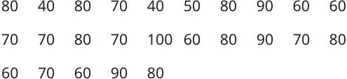


Kunci sumber: `B`; status AI: `verified`; jawaban diverifikasi AI: `B`.
Solusi minimum hasil AI: Identifikasi nilai < 70: 40 (ada 2), 50 (ada 1), 60 (ada 5). Total = 2 + 1 + 5 = 8 siswa.
Gambar sumber: images/kelas5_panduan_siswa_kelas5.pdf-0263-03.png. Transkripsi visual: Data nilai ulangan: 80, 40, 80, 70, 40, 50, 80, 90, 60, 60, 70, 70, 80, 70, 100, 60, 80, 90, 70, 80, 60, 70, 60, 90, 80. Total ada 25 data.

### 1. Pemeriksaan input dan fitur

Struktur: `pass`; alasan: `[]`. Grade/topik: kelas 5 / Matematika SD Kelas 5. KKO: `['menghitung']`; KKO hanya petunjuk bantu.
Isi dan kunci berasal dari sumber yang sama pada ketiga run. Versi konten: 2; hash: `1c462867fdab7ce4cdf15b0ae37387257e11fee9f85b208df3bca00444b07893`. Bukti verifikasi AI tidak sama dengan verifikasi ahli.

### 2. Penilaian Gemini blind — tiga run sebelum melihat IndoBERT

| Run | Status | Konten / kunci | Kognitif | Pengetahuan | Difficulty | Token |
|---:|---|---|---|---|---|---:|
| 1 | success | valid / verified | applying | procedural | Easy | 2584 |
| 2 | success | valid / verified | applying | procedural | Easy | 2666 |
| 3 | success | valid / verified | applying | procedural | Easy | 2683 |

Run 1 — solusi: Identifikasi nilai < 70: 40 (ada 2), 50 (ada 1), 60 (ada 5). Total = 2 + 1 + 5 = 8 siswa.
- Domain kognitif `classify/applying`: Siswa perlu mengklasifikasikan data mentah berdasarkan kriteria yang diberikan (kurang dari 70) dan melakukan operasi penjumlahan sederhana. Ini adalah penerapan prosedur rutin pada data yang diberikan.. Bukti: Jika siswa dengan nilai kurang dari 70 harus mengikuti remedi; ada berapa siswa yang mengikuti remedi?
- Dimensi pengetahuan `classify/procedural`: Soal ini menguji kemampuan siswa dalam mengolah data mentah menggunakan prosedur penghitungan yang terstruktur.. Bukti: Data berikut menunjukkan hasil ulangan Matematika
- Intended difficulty `classify/Easy`: Soal ini tergolong mudah karena hanya memerlukan pemindaian data (scanning) dan penghitungan sederhana tanpa transformasi data yang kompleks.. Bukti: Jika siswa dengan nilai kurang dari 70 harus mengikuti remedi; ada berapa siswa yang mengikuti remedi?

Profil difficulty run ini:

| Parameter | Nilai |
|---|---|
| expectedPrerequisite | Kemampuan membaca data dan membandingkan bilangan (kurang dari). |
| dependentSteps | 2 |
| routineStatus | familiar_routine |
| strategySelection | False |
| representationTransfer | False |
| relevantInformationUnits | 2 |
| interactingConstraints | 1 |
| calculationLoad | low |
| scaffoldLevel | none |
| distractorQuality | plausible |
| gradeRelativeRationale | Siswa kelas 5 sudah terbiasa mengolah data sederhana dalam bentuk daftar atau tabel. |

Run 2 — solusi: Identifikasi nilai < 70: 40 (ada 2), 50 (ada 1), 60 (ada 5). Total = 2 + 1 + 5 = 8 siswa.
- Domain kognitif `classify/applying`: Siswa perlu mengklasifikasikan data mentah ke dalam kategori (kurang dari 70) dan melakukan penjumlahan sederhana. Ini adalah penerapan konsep pengolahan data dasar.. Bukti: Jika siswa dengan nilai kurang dari 70 harus mengikuti remedi; ada berapa siswa yang mengikuti remedi?
- Dimensi pengetahuan `classify/procedural`: Soal ini menguji pemahaman prosedural dalam mengolah data mentah menjadi informasi yang bermakna (menghitung frekuensi nilai di bawah ambang batas).. Bukti: Data berikut menunjukkan hasil ulangan Matematika
- Intended difficulty `classify/Easy`: Soal ini tergolong mudah karena hanya memerlukan pemindaian data (scanning) dan penghitungan frekuensi sederhana tanpa transformasi data yang kompleks.. Bukti: Data berikut menunjukkan hasil ulangan Matematika siswa kelas V SD Mekarsari.; Jika siswa dengan nilai kurang dari 70 harus mengikuti remedi

Profil difficulty run ini:

| Parameter | Nilai |
|---|---|
| expectedPrerequisite | Kemampuan membaca tabel/daftar data dan membandingkan bilangan (kurang dari). |
| dependentSteps | 2 |
| routineStatus | familiar_routine |
| strategySelection | False |
| representationTransfer | False |
| relevantInformationUnits | 2 |
| interactingConstraints | 1 |
| calculationLoad | low |
| scaffoldLevel | none |
| distractorQuality | plausible |
| gradeRelativeRationale | Sesuai untuk kelas 5 SD karena melibatkan pengolahan data sederhana yang merupakan materi standar pada jenjang tersebut. |

Run 3 — solusi: Identifikasi nilai < 70: 40 (ada 2), 50 (ada 1), 60 (ada 5). Total = 2 + 1 + 5 = 8 siswa.
- Domain kognitif `classify/applying`: Siswa perlu mengklasifikasikan data mentah berdasarkan kriteria yang diberikan (kurang dari 70) dan melakukan penghitungan frekuensi sederhana. Ini adalah penerapan prosedur pengolahan data rutin.. Bukti: Jika siswa dengan nilai kurang dari 70 harus mengikuti remedi; Data berikut menunjukkan hasil ulangan Matematika
- Dimensi pengetahuan `classify/procedural`: Soal ini menguji pemahaman tentang bagaimana mengorganisir dan menginterpretasikan data mentah ke dalam kategori yang ditentukan (prosedur pengolahan data).. Bukti: Data berikut menunjukkan hasil ulangan Matematika; Jika siswa dengan nilai kurang dari 70 harus mengikuti remedi
- Intended difficulty `classify/Easy`: Soal ini tergolong mudah karena hanya melibatkan pemindaian data (scanning) dan penjumlahan sederhana. Tidak ada transformasi representasi yang kompleks atau strategi non-rutin.. Bukti: Data berikut menunjukkan hasil ulangan Matematika; Jika siswa dengan nilai kurang dari 70 harus mengikuti remedi

Profil difficulty run ini:

| Parameter | Nilai |
|---|---|
| expectedPrerequisite | Kemampuan membaca tabel/daftar data dan membandingkan bilangan (kurang dari). |
| dependentSteps | 2 |
| routineStatus | familiar_routine |
| strategySelection | False |
| representationTransfer | False |
| relevantInformationUnits | 2 |
| interactingConstraints | 1 |
| calculationLoad | low |
| scaffoldLevel | none |
| distractorQuality | plausible |
| gradeRelativeRationale | Siswa kelas 5 sudah terbiasa mengolah data sederhana dalam bentuk daftar atau tabel frekuensi. |

### 3. Voting awal dan adjudikasi

| Head | Suara awal | Pola / status akhir | Label akhir advisory |
|---|---|---|---|
| Domain kognitif | {"applying": 3} | unanimous_3_0 / unanimous | applying |
| Dimensi pengetahuan | {"procedural": 3} | unanimous_3_0 / unanimous | procedural |
| Intended difficulty | {"Easy": 3} | unanimous_3_0 / unanimous | Easy |

### 4. Diagnostik IndoBERT setelah label blind dikunci

Model membaca representation `metadata`; token input 139/256; truncation: `False`.

| Head | Probabilitas | Label | Confidence | Entropy | Action / alasan |
|---|---|---|---:|---:|---|
| Domain kognitif | knowing=0.000198; applying=0.999802; reasoning=0.000000 | applying | 0.999802 | 0.001717 | review / selective_threshold_gate_not_met |
| Dimensi pengetahuan | factual=0.040444; conceptual=0.947800; procedural=0.011756; metacognitive=0.000000 | conceptual | 0.947800 | 0.167922 | review / selective_threshold_gate_not_met |
| Intended difficulty | Easy=0.777299; Medium=0.217935; Hard=0.004766 | Easy | 0.777299 | 0.503675 | review / selective_threshold_gate_not_met |

Domain kognitif: Σp = 1.00000000; confidence = max(p) = 0.999802; −Σp ln(p) = 0.001887; H = 0.001887/ln(3) = 0.001717; T = 0.050000.


Dimensi pengetahuan: Σp = 1.00000000; confidence = max(p) = 0.947800; −Σp ln(p) = 0.232789; H = 0.232789/ln(4) = 0.167922; T = 0.209800.


Intended difficulty: Σp = 1.00000000; confidence = max(p) = 0.777299; −Σp ln(p) = 0.553343; H = 0.553343/ln(3) = 0.503675; T = 0.953328.


<details><summary>Input sebenarnya yang dibaca model</summary>

```text
Kelas: 5
Topik: Matematika SD Kelas 5
Subtopik: Mengumpulkan Data
Tipe soal: multiple_choice
Stimulus: -
Soal: Data berikut menunjukkan hasil ulangan Matematika siswa kelas V SD Mekarsari.

Jika siswa dengan nilai kurang dari 70 harus mengikuti remedi, ada berapa siswa yang mengikuti remedi?
Pilihan: A. 3 siswa
B. 8 siswa
C. 5 siswa
D. 14 siswa
Transkripsi visual: Data nilai ulangan: 80, 40, 80, 70, 40, 50, 80, 90, 60, 60, 70, 70, 80, 70, 100, 60, 80, 90, 70, 80, 60, 70, 60, 90, 80. Total ada 25 data.
```

</details>

### 5. Keputusan batch

Label advisory blind: `{"mathCognitiveDomain": "applying", "knowledgeDimension": "procedural", "intendedDifficulty": "Easy"}`. Routing: `pending_expert_review`.
Status konten: `valid`. Catatan konten: .
Perbedaan model dan blind: `{"mathCognitiveDomain": {"modelLabel": "applying", "blindLabel": "applying", "agreement": true}, "knowledgeDimension": {"modelLabel": "conceptual", "blindLabel": "procedural", "agreement": false}, "intendedDifficulty": {"modelLabel": "Easy", "blindLabel": "Easy", "agreement": true}}`.
Gold ahli tetap null; human review wajib. Confidence IndoBERT tidak digunakan untuk mengganti label blind.

## 61. Soal `e796428d8e43335b955f16db`

Data berikut menunjukkan hasil ulangan Matematika siswa kelas V SD Mekarsari.<br><br>Berapa nilai tertinggi pada hasil ulangan Matematika tersebut?

| Opsi | Isi |
|---|---|
| A | 100 |
| B | 80 |
| C | 90 |
| D | 40 |


Kunci sumber: `A`; status AI: `verified`; jawaban diverifikasi AI: `A`.
Solusi minimum hasil AI: Memeriksa seluruh data yang diberikan, nilai terbesar yang muncul adalah 100.
Gambar sumber: images/kelas5_panduan_siswa_kelas5.pdf-0263-03.png. Transkripsi visual: Data hasil ulangan Matematika: 80, 40, 80, 70, 40, 50, 80, 90, 60, 60, 70, 70, 80, 70, 100, 60, 80, 90, 70, 80, 60, 70, 60, 90, 80.

### 1. Pemeriksaan input dan fitur

Struktur: `pass`; alasan: `[]`. Grade/topik: kelas 5 / Matematika SD Kelas 5. KKO: `['menghitung']`; KKO hanya petunjuk bantu.
Isi dan kunci berasal dari sumber yang sama pada ketiga run. Versi konten: 2; hash: `4c54637d3f471f8782e1c235858a06e6e025282359e79d02e654077c429e7b5c`. Bukti verifikasi AI tidak sama dengan verifikasi ahli.

### 2. Penilaian Gemini blind — tiga run sebelum melihat IndoBERT

| Run | Status | Konten / kunci | Kognitif | Pengetahuan | Difficulty | Token |
|---:|---|---|---|---|---|---:|
| 1 | success | valid / verified | knowing | factual | Easy | 2466 |
| 2 | success | valid / verified | knowing | conceptual | Easy | 3458 |
| 3 | success | valid / verified | knowing | factual | Easy | 2593 |

Run 1 — solusi: Memeriksa seluruh data yang diberikan, nilai terbesar yang muncul adalah 100.
- Domain kognitif `classify/knowing`: Siswa hanya perlu melakukan pemindaian (scanning) data untuk mengenali nilai maksimum. Proses ini bersifat langsung dan tidak memerlukan strategi kompleks.. Bukti: Berapa nilai tertinggi pada hasil ulangan Matematika tersebut?
- Dimensi pengetahuan `classify/factual`: Soal ini menguji pemahaman faktual tentang konsep nilai maksimum dalam sekumpulan data numerik.. Bukti: Berapa nilai tertinggi
- Intended difficulty `classify/Easy`: Soal ini sangat mudah karena hanya memerlukan identifikasi nilai terbesar dari daftar angka yang diberikan tanpa perlu pengolahan data lebih lanjut.. Bukti: Data berikut menunjukkan hasil ulangan Matematika; Berapa nilai tertinggi

Profil difficulty run ini:

| Parameter | Nilai |
|---|---|
| expectedPrerequisite | Kemampuan membaca angka dan membandingkan nilai bilangan cacah. |
| dependentSteps | 1 |
| routineStatus | familiar_routine |
| strategySelection | False |
| representationTransfer | False |
| relevantInformationUnits | 2 |
| interactingConstraints | 0 |
| calculationLoad | low |
| scaffoldLevel | none |
| distractorQuality | plausible |
| gradeRelativeRationale | Untuk kelas 5, tugas mencari nilai tertinggi dalam kumpulan data adalah tugas dasar yang sudah familiar. |

Run 2 — solusi: Memeriksa seluruh data yang diberikan, nilai terbesar adalah 100.
- Domain kognitif `classify/knowing`: Siswa hanya perlu memindai data untuk menemukan nilai maksimum, yang merupakan proses kognitif langsung.. Bukti: Berapa nilai tertinggi pada hasil ulangan Matematika tersebut?
- Dimensi pengetahuan `classify/conceptual`: Memahami konsep nilai tertinggi dalam sekumpulan data numerik.. Bukti: Berapa nilai tertinggi
- Intended difficulty `classify/Easy`: Tugas ini adalah prosedur rutin untuk mencari nilai maksimum dalam daftar data yang diberikan.. Bukti: Data berikut menunjukkan hasil ulangan Matematika

Profil difficulty run ini:

| Parameter | Nilai |
|---|---|
| expectedPrerequisite | Memahami perbandingan bilangan cacah. |
| dependentSteps | 1 |
| routineStatus | familiar_routine |
| strategySelection | False |
| representationTransfer | False |
| relevantInformationUnits | 24 |
| interactingConstraints | 0 |
| calculationLoad | low |
| scaffoldLevel | none |
| distractorQuality | plausible |
| gradeRelativeRationale | Siswa kelas 5 sudah terbiasa membaca dan mengolah data sederhana. |

Run 3 — solusi: Memeriksa seluruh daftar data, nilai maksimum yang ditemukan adalah 100.
- Domain kognitif `classify/knowing`: Siswa hanya perlu melakukan pemindaian visual sederhana (scanning) untuk mengidentifikasi nilai maksimum dalam kumpulan data yang diberikan tanpa perlu melakukan manipulasi atau analisis lebih lanjut.. Bukti: Berapa nilai tertinggi pada hasil ulangan Matematika tersebut?
- Dimensi pengetahuan `classify/factual`: Soal ini menguji pemahaman faktual dasar tentang konsep nilai maksimum dalam sekumpulan data numerik.. Bukti: Berapa nilai tertinggi
- Intended difficulty `classify/Easy`: Tugas ini sangat langsung, hanya memerlukan identifikasi nilai terbesar dari daftar yang diberikan. Tidak ada langkah prosedural yang kompleks atau strategi non-rutin.. Bukti: Berapa nilai tertinggi pada hasil ulangan Matematika tersebut?

Profil difficulty run ini:

| Parameter | Nilai |
|---|---|
| expectedPrerequisite | Kemampuan membandingkan bilangan cacah dan mengenali nilai terbesar. |
| dependentSteps | 1 |
| routineStatus | familiar_routine |
| strategySelection | False |
| representationTransfer | False |
| relevantInformationUnits | 2 |
| interactingConstraints | 0 |
| calculationLoad | low |
| scaffoldLevel | none |
| distractorQuality | plausible |
| gradeRelativeRationale | Siswa kelas 5 sudah sangat familiar dengan membaca data mentah dan menentukan nilai ekstrem (tertinggi/terendah) sebagai bagian dari literasi data dasar. |

### 3. Voting awal dan adjudikasi

| Head | Suara awal | Pola / status akhir | Label akhir advisory |
|---|---|---|---|
| Domain kognitif | {"knowing": 3} | unanimous_3_0 / adjudicated | knowing |
| Dimensi pengetahuan | {"factual": 2, "conceptual": 1} | majority_2_of_3 / adjudicated | factual |
| Intended difficulty | {"Easy": 3} | unanimous_3_0 / adjudicated | Easy |

Adjudikasi AI: `success`; token `3635`.
Konten: `valid`; kunci: `verified`; masalah: .
- Domain kognitif `knowing`: Siswa hanya perlu melakukan pemindaian (scanning) data untuk mengenali nilai maksimum. Proses ini bersifat langsung dan tidak memerlukan strategi kompleks.
- Dimensi pengetahuan `factual`: Soal ini menguji pemahaman faktual tentang konsep nilai maksimum dalam sekumpulan data numerik.
- Intended difficulty `Easy`: Soal ini sangat mudah karena hanya memerlukan identifikasi nilai terbesar dari daftar angka yang diberikan tanpa perlu pengolahan data lebih lanjut.

Profil difficulty hasil adjudikasi:

| Parameter | Nilai |
|---|---|
| expectedPrerequisite | Kemampuan membaca angka dan membandingkan nilai bilangan cacah. |
| dependentSteps | 1 |
| routineStatus | familiar_routine |
| strategySelection | False |
| representationTransfer | False |
| relevantInformationUnits | 2 |
| interactingConstraints | 0 |
| calculationLoad | low |
| scaffoldLevel | none |
| distractorQuality | plausible |
| gradeRelativeRationale | Untuk kelas 5, tugas mencari nilai tertinggi dalam kumpulan data adalah tugas dasar yang sudah familiar. |

### 4. Diagnostik IndoBERT setelah label blind dikunci

Model membaca representation `metadata`; token input 122/256; truncation: `False`.

| Head | Probabilitas | Label | Confidence | Entropy | Action / alasan |
|---|---|---|---:|---:|---|
| Domain kognitif | knowing=0.000075; applying=0.999925; reasoning=0.000000 | applying | 0.999925 | 0.000719 | review / selective_threshold_gate_not_met |
| Dimensi pengetahuan | factual=0.347052; conceptual=0.638542; procedural=0.014406; metacognitive=0.000000 | conceptual | 0.638542 | 0.515612 | review / selective_threshold_gate_not_met |
| Intended difficulty | Easy=0.906365; Medium=0.091069; Hard=0.002566 | Easy | 0.906365 | 0.293671 | review / selective_threshold_gate_not_met |

Domain kognitif: Σp = 1.00000000; confidence = max(p) = 0.999925; −Σp ln(p) = 0.000790; H = 0.000790/ln(3) = 0.000719; T = 0.050000.


Dimensi pengetahuan: Σp = 1.00000000; confidence = max(p) = 0.638542; −Σp ln(p) = 0.714789; H = 0.714789/ln(4) = 0.515612; T = 0.209800.


Intended difficulty: Σp = 1.00000000; confidence = max(p) = 0.906365; −Σp ln(p) = 0.322631; H = 0.322631/ln(3) = 0.293671; T = 0.953328.


<details><summary>Input sebenarnya yang dibaca model</summary>

```text
Kelas: 5
Topik: Matematika SD Kelas 5
Subtopik: Mengumpulkan Data
Tipe soal: multiple_choice
Stimulus: -
Soal: Data berikut menunjukkan hasil ulangan Matematika siswa kelas V SD Mekarsari.

Berapa nilai tertinggi pada hasil ulangan Matematika tersebut?
Pilihan: A. 100
B. 80
C. 90
D. 40
Transkripsi visual: Data hasil ulangan Matematika: 80, 40, 80, 70, 40, 50, 80, 90, 60, 60, 70, 70, 80, 70, 100, 60, 80, 90, 70, 80, 60, 70, 60, 90, 80.
```

</details>

### 5. Keputusan batch

Label advisory blind: `{"mathCognitiveDomain": "knowing", "knowledgeDimension": "factual", "intendedDifficulty": "Easy"}`. Routing: `pending_expert_review`.
Status konten: `valid`. Catatan konten: .
Perbedaan model dan blind: `{"mathCognitiveDomain": {"modelLabel": "applying", "blindLabel": "knowing", "agreement": false}, "knowledgeDimension": {"modelLabel": "conceptual", "blindLabel": "factual", "agreement": false}, "intendedDifficulty": {"modelLabel": "Easy", "blindLabel": "Easy", "agreement": true}}`.
Gold ahli tetap null; human review wajib. Confidence IndoBERT tidak digunakan untuk mengganti label blind.

## 62. Soal `03ce645d3a0216321e3e95e0`

Tabel berikut adalah hasil penjualan kue apem selama seminggu yang dicatat Anggi.<br><br>Tabel 8.6 Hasil Penjualan Kue Apem<br><br>\|Hari\|Banyaknya Penjualan Kue Apem\|<br>\|---\|---\|<br>\|Senin\|40\|<br>\|Selasa\|35\|<br>\|Rabu\|30\|<br>\|Kamis\|37\|<br>\|Jumat\|27\|<br>\|Sabtu\|29\|<br><br>Satu kue apem dibeli ibunya Anggi seharga Rp1.200,00 dan dijual dengan harga Rp1.500,00. Tentukan keuntungan yang diperoleh ibunya Anggi dari hasil penjualan kue apem tersebut.

| Opsi | Isi |
|---|---|
| A | Rp5.940,00 |
| B | Rp237.600,00 |
| C | Rp59.400,00 |
| D | Rp297.000,00 |

Kunci sumber: `C`; status AI: `verified`; jawaban diverifikasi AI: `C`.
Solusi minimum hasil AI: Total kue = 40+35+30+37+27+29 = 198. Keuntungan per kue = 1.500 - 1.200 = 300. Total keuntungan = 198 * 300 = 59.400.
Gambar sumber: —. Transkripsi visual: —

### 1. Pemeriksaan input dan fitur

Struktur: `pass`; alasan: `[]`. Grade/topik: kelas 5 / Matematika SD Kelas 5. KKO: `['mengidentifikasi']`; KKO hanya petunjuk bantu.
Isi dan kunci berasal dari sumber yang sama pada ketiga run. Versi konten: 2; hash: `dd59925d0af7c218c199465a72891b4d5ea1ad2aa82e593285a52a7395658ccf`. Bukti verifikasi AI tidak sama dengan verifikasi ahli.

### 2. Penilaian Gemini blind — tiga run sebelum melihat IndoBERT

| Run | Status | Konten / kunci | Kognitif | Pengetahuan | Difficulty | Token |
|---:|---|---|---|---|---|---:|
| 1 | success | valid / verified | applying | procedural | Medium | 1528 |
| 2 | success | valid / verified | applying | procedural | Medium | 1652 |
| 3 | success | valid / verified | applying | procedural | Medium | 1517 |

Run 1 — solusi: Total kue = 40+35+30+37+27+29 = 198. Keuntungan per kue = 1.500 - 1.200 = 300. Total keuntungan = 198 * 300 = 59.400.
- Domain kognitif `classify/applying`: Siswa perlu mengintegrasikan data dari tabel (penjumlahan) dengan konsep keuntungan (selisih harga jual dan beli) untuk menyelesaikan masalah.. Bukti: Tentukan keuntungan yang diperoleh ibunya Anggi dari hasil penjualan kue apem tersebut.
- Dimensi pengetahuan `classify/procedural`: Soal memerlukan penerapan algoritma aritmatika (penjumlahan data dan perkalian) dalam konteks masalah ekonomi sederhana.. Bukti: Tentukan keuntungan yang diperoleh ibunya Anggi dari hasil penjualan kue apem tersebut.
- Intended difficulty `classify/Medium`: Soal melibatkan beberapa langkah rutin (menjumlahkan data tabel, menghitung selisih harga, dan perkalian) yang sesuai untuk tingkat kelas 5.. Bukti: Tabel berikut adalah hasil penjualan kue apem selama seminggu; Satu kue apem dibeli ibunya Anggi seharga Rp1.200,00 dan dijual dengan harga Rp1.500,00.

Profil difficulty run ini:

| Parameter | Nilai |
|---|---|
| expectedPrerequisite | Penjumlahan bilangan cacah dan konsep dasar keuntungan (harga jual - harga beli). |
| dependentSteps | 3 |
| routineStatus | familiar_routine |
| strategySelection | False |
| representationTransfer | False |
| relevantInformationUnits | 7 |
| interactingConstraints | 1 |
| calculationLoad | moderate |
| scaffoldLevel | none |
| distractorQuality | plausible |
| gradeRelativeRationale | Tingkat kesulitan sesuai untuk kelas 5 karena menggabungkan pembacaan data tabel dengan operasi aritmatika dasar yang berjenjang. |

Run 2 — solusi: Total kue = 40+35+30+37+27+29 = 198. Keuntungan per kue = Rp1.500 - Rp1.200 = Rp300. Total keuntungan = 198 x Rp300 = Rp59.400.
- Domain kognitif `classify/applying`: Siswa perlu mengintegrasikan data dari tabel, menghitung total, menentukan selisih harga, dan melakukan perkalian. Ini melibatkan penerapan prosedur matematika pada situasi rutin.. Bukti: Tentukan keuntungan yang diperoleh ibunya Anggi dari hasil penjualan kue apem tersebut.
- Dimensi pengetahuan `classify/procedural`: Soal memerlukan pemahaman tentang konsep keuntungan dan penggunaan algoritma aritmatika dasar (penjumlahan dan perkalian) untuk menyelesaikan masalah.. Bukti: Tabel 8.6 Hasil Penjualan Kue Apem; Satu kue apem dibeli ibunya Anggi seharga Rp1.200,00 dan dijual dengan harga Rp1.500,00.
- Intended difficulty `classify/Medium`: Soal ini dikategorikan Medium karena melibatkan beberapa langkah rutin yang saling terkait: menjumlahkan data tabel, menghitung selisih harga, dan mengalikan hasil keduanya.. Bukti: Tabel 8.6 Hasil Penjualan Kue Apem; Tentukan keuntungan yang diperoleh ibunya Anggi

Profil difficulty run ini:

| Parameter | Nilai |
|---|---|
| expectedPrerequisite | Penjumlahan bilangan cacah, konsep dasar keuntungan (harga jual - harga beli), dan perkalian bilangan. |
| dependentSteps | 3 |
| routineStatus | familiar_routine |
| strategySelection | False |
| representationTransfer | False |
| relevantInformationUnits | 7 |
| interactingConstraints | 1 |
| calculationLoad | moderate |
| scaffoldLevel | none |
| distractorQuality | plausible |
| gradeRelativeRationale | Sesuai untuk kelas 5 karena menggabungkan pembacaan data tabel dengan operasi aritmatika dasar yang sudah dipelajari. |

Run 3 — solusi: Total kue = 40+35+30+37+27+29 = 198. Keuntungan per kue = 1500 - 1200 = 300. Total keuntungan = 198 * 300 = 59400.
- Domain kognitif `classify/applying`: Siswa perlu memilih prosedur yang tepat (menjumlahkan data, menghitung selisih harga, lalu mengalikan) untuk menyelesaikan masalah kontekstual rutin.. Bukti: Tentukan keuntungan yang diperoleh ibunya Anggi dari hasil penjualan kue apem tersebut.
- Dimensi pengetahuan `classify/procedural`: Soal ini menguji pemahaman tentang algoritma perhitungan keuntungan dan penggunaan data tabel.. Bukti: Tabel berikut adalah hasil penjualan kue apem; Satu kue apem dibeli ibunya Anggi seharga Rp1.200,00 dan dijual dengan harga Rp1.500,00
- Intended difficulty `classify/Medium`: Soal memerlukan beberapa langkah rutin (penjumlahan data tabel, pengurangan harga, perkalian) yang saling terkait, namun prosedurnya standar untuk kelas 5.. Bukti: Tabel berikut adalah hasil penjualan kue apem selama seminggu; Tentukan keuntungan yang diperoleh

Profil difficulty run ini:

| Parameter | Nilai |
|---|---|
| expectedPrerequisite | Penjumlahan bilangan cacah, konsep dasar untung, dan perkalian bilangan. |
| dependentSteps | 3 |
| routineStatus | familiar_routine |
| strategySelection | False |
| representationTransfer | False |
| relevantInformationUnits | 7 |
| interactingConstraints | 1 |
| calculationLoad | moderate |
| scaffoldLevel | none |
| distractorQuality | plausible |
| gradeRelativeRationale | Siswa kelas 5 sudah terbiasa dengan pengolahan data tabel sederhana dan perhitungan aritmatika dasar terkait ekonomi. |

### 3. Voting awal dan adjudikasi

| Head | Suara awal | Pola / status akhir | Label akhir advisory |
|---|---|---|---|
| Domain kognitif | {"applying": 3} | unanimous_3_0 / unanimous | applying |
| Dimensi pengetahuan | {"procedural": 3} | unanimous_3_0 / unanimous | procedural |
| Intended difficulty | {"Medium": 3} | unanimous_3_0 / unanimous | Medium |

### 4. Diagnostik IndoBERT setelah label blind dikunci

Model membaca representation `metadata`; token input 180/256; truncation: `False`.

| Head | Probabilitas | Label | Confidence | Entropy | Action / alasan |
|---|---|---|---:|---:|---|
| Domain kognitif | knowing=0.000000; applying=1.000000; reasoning=0.000000 | applying | 1.000000 | 0.000000 | review / selective_threshold_gate_not_met |
| Dimensi pengetahuan | factual=0.001763; conceptual=0.986245; procedural=0.011992; metacognitive=0.000000 | conceptual | 0.986245 | 0.056183 | review / selective_threshold_gate_not_met |
| Intended difficulty | Easy=0.786866; Medium=0.200415; Hard=0.012718 | Easy | 0.786866 | 0.515434 | review / selective_threshold_gate_not_met |

Domain kognitif: Σp = 1.00000000; confidence = max(p) = 1.000000; −Σp ln(p) = 0.000000; H = 0.000000/ln(3) = 0.000000; T = 0.050000.


Dimensi pengetahuan: Σp = 1.00000000; confidence = max(p) = 0.986245; −Σp ln(p) = 0.077886; H = 0.077886/ln(4) = 0.056183; T = 0.209800.


Intended difficulty: Σp = 1.00000000; confidence = max(p) = 0.786866; −Σp ln(p) = 0.566262; H = 0.566262/ln(3) = 0.515434; T = 0.953328.


<details><summary>Input sebenarnya yang dibaca model</summary>

```text
Kelas: 5
Topik: Matematika SD Kelas 5
Subtopik: Piktogram
Tipe soal: multiple_choice
Stimulus: -
Soal: Tabel berikut adalah hasil penjualan kue apem selama seminggu yang dicatat Anggi.

Tabel 8.6 Hasil Penjualan Kue Apem

|Hari|Banyaknya Penjualan Kue Apem|
|---|---|
|Senin|40|
|Selasa|35|
|Rabu|30|
|Kamis|37|
|Jumat|27|
|Sabtu|29|

Satu kue apem dibeli ibunya Anggi seharga Rp1.200,00 dan dijual dengan harga Rp1.500,00. Tentukan keuntungan yang diperoleh ibunya Anggi dari hasil penjualan kue apem tersebut.
Pilihan: A. Rp5.940,00
B. Rp237.600,00
C. Rp59.400,00
D. Rp297.000,00
Transkripsi visual: -
```

</details>

### 5. Keputusan batch

Label advisory blind: `{"mathCognitiveDomain": "applying", "knowledgeDimension": "procedural", "intendedDifficulty": "Medium"}`. Routing: `pending_expert_review`.
Status konten: `valid`. Catatan konten: .
Perbedaan model dan blind: `{"mathCognitiveDomain": {"modelLabel": "applying", "blindLabel": "applying", "agreement": true}, "knowledgeDimension": {"modelLabel": "conceptual", "blindLabel": "procedural", "agreement": false}, "intendedDifficulty": {"modelLabel": "Easy", "blindLabel": "Medium", "agreement": false}}`.
Gold ahli tetap null; human review wajib. Confidence IndoBERT tidak digunakan untuk mengganti label blind.

## 63. Soal `52f23c67babf5a81e9ba7e79`

Sejak kecil, Nisa diajari orang tuanya untuk menabung. Ia sudah terbiasa menabung dari menyisihkan uang saku jika ingin membeli sesuatu. Piktogram pada Gambar 8.11 menunjukkan tabungan Nisa selama 5 minggu.<br><br>Jumlah Tabungan Nisa<br><br>Keterangan mewakili Rp4.000,00<br><br>Pada minggu berapa Nisa menabung paling banyak?

| Opsi | Isi |
|---|---|
| A | Minggu ke-5 |
| B | Minggu ke-2 |
| C | Minggu ke-3 |
| D | Minggu ke-1 |

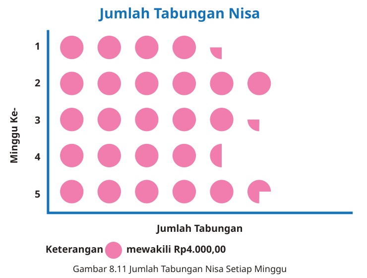


Kunci sumber: `B`; status AI: `verified`; jawaban diverifikasi AI: `B`.
Solusi minimum hasil AI: Bandingkan jumlah simbol lingkaran pada setiap baris. Minggu ke-2 memiliki 6 lingkaran penuh, yang merupakan jumlah terbanyak dibandingkan minggu lainnya (Minggu 1: 4,25; Minggu 3: 5,25; Minggu 4: 4,5; Minggu 5: 5,25).
Gambar sumber: images/kelas5_crop-p0286-piktogram.png. Transkripsi visual: Piktogram menunjukkan tabungan Nisa selama 5 minggu. Sumbu vertikal menunjukkan 'Minggu Ke-' (1 sampai 5). Sumbu horizontal menunjukkan 'Jumlah Tabungan'. Keterangan: satu lingkaran penuh mewakili Rp4.000,00. Data: Minggu 1 memiliki 4 lingkaran penuh dan 1/4 lingkaran. Minggu 2 memiliki 6 lingkaran penuh. Minggu 3 memiliki 5 lingkaran penuh dan 1/4 lingkaran. Minggu 4 memiliki 4 lingkaran penuh dan 1/2 lingkaran. Minggu 5 memiliki 5 lingkaran penuh dan 1/4 lingkaran.

### 1. Pemeriksaan input dan fitur

Struktur: `pass`; alasan: `[]`. Grade/topik: kelas 5 / Matematika SD Kelas 5. KKO: `['menghitung']`; KKO hanya petunjuk bantu.
Isi dan kunci berasal dari sumber yang sama pada ketiga run. Versi konten: 2; hash: `16e19aee3bea54418062df8f7afa31faefb634efd3306dad9e5604dfe2542a1d`. Bukti verifikasi AI tidak sama dengan verifikasi ahli.

### 2. Penilaian Gemini blind — tiga run sebelum melihat IndoBERT

| Run | Status | Konten / kunci | Kognitif | Pengetahuan | Difficulty | Token |
|---:|---|---|---|---|---|---:|
| 1 | success | valid / verified | knowing | conceptual | Easy | 2647 |
| 2 | success | valid / verified | applying | conceptual | Easy | 2718 |
| 3 | success | valid / verified | knowing | conceptual | Easy | 2633 |

Run 1 — solusi: Bandingkan jumlah simbol lingkaran pada setiap baris minggu. Minggu 2 memiliki 6 lingkaran penuh, yang merupakan jumlah terbanyak dibandingkan minggu lainnya (Minggu 1: 4,25; Minggu 3: 5,25; Minggu 4: 4,5; Minggu 5: 5,25).
- Domain kognitif `classify/knowing`: Siswa hanya perlu melakukan perbandingan visual langsung terhadap jumlah simbol pada piktogram untuk menentukan nilai maksimum, yang merupakan proses rutin.. Bukti: Pada minggu berapa Nisa menabung paling banyak?
- Dimensi pengetahuan `classify/conceptual`: Soal ini menguji pemahaman tentang cara membaca dan menginterpretasikan data yang disajikan dalam bentuk piktogram (representasi data).. Bukti: Piktogram pada Gambar 8.11 menunjukkan tabungan Nisa selama 5 minggu.
- Intended difficulty `classify/Easy`: Tugas ini bersifat langsung dan rutin bagi siswa kelas 5. Siswa hanya perlu menghitung atau membandingkan panjang baris simbol secara visual untuk menemukan nilai terbesar.. Bukti: Pada minggu berapa Nisa menabung paling banyak?

Profil difficulty run ini:

| Parameter | Nilai |
|---|---|
| expectedPrerequisite | Kemampuan membaca data sederhana dalam bentuk piktogram. |
| dependentSteps | 1 |
| routineStatus | familiar_routine |
| strategySelection | False |
| representationTransfer | False |
| relevantInformationUnits | 5 |
| interactingConstraints | 0 |
| calculationLoad | low |
| scaffoldLevel | none |
| distractorQuality | plausible |
| gradeRelativeRationale | Siswa kelas 5 sudah terbiasa membaca grafik sederhana. Soal ini tidak memerlukan perhitungan kompleks, hanya observasi visual. |

Run 2 — solusi: Bandingkan jumlah simbol lingkaran pada setiap baris minggu. Minggu ke-2 memiliki jumlah simbol terbanyak (6 lingkaran penuh), sedangkan minggu lainnya memiliki jumlah yang lebih sedikit (minggu 1: 4,25; minggu 3: 5,25; minggu 4: 4,5; minggu 5: 5,25). Maka minggu ke-2 adalah yang paling banyak.
- Domain kognitif `classify/applying`: Siswa diminta untuk membandingkan kuantitas data yang disajikan dalam bentuk piktogram untuk menentukan nilai maksimum. Ini adalah proses applying karena siswa harus menerapkan pemahaman tentang cara membaca dan membandingkan data pada representasi visual rutin.. Bukti: Pada minggu berapa Nisa menabung paling banyak?
- Dimensi pengetahuan `classify/conceptual`: Soal ini menguji pemahaman tentang bagaimana data diorganisir dan diinterpretasikan dalam bentuk piktogram, yang merupakan pengetahuan konseptual tentang representasi data.. Bukti: Piktogram pada Gambar 8.11 menunjukkan tabungan Nisa selama 5 minggu.
- Intended difficulty `classify/Easy`: Soal ini tergolong mudah karena siswa hanya perlu melakukan observasi visual langsung untuk membandingkan jumlah simbol pada setiap baris tanpa perlu melakukan perhitungan kompleks.. Bukti: Pada minggu berapa Nisa menabung paling banyak?; Piktogram pada Gambar 8.11 menunjukkan tabungan Nisa selama 5 minggu.

Profil difficulty run ini:

| Parameter | Nilai |
|---|---|
| expectedPrerequisite | Kemampuan membaca piktogram sederhana dan membandingkan jumlah objek. |
| dependentSteps | 1 |
| routineStatus | familiar_routine |
| strategySelection | False |
| representationTransfer | False |
| relevantInformationUnits | 5 |
| interactingConstraints | 0 |
| calculationLoad | low |
| scaffoldLevel | none |
| distractorQuality | plausible |
| gradeRelativeRationale | Siswa kelas 5 sudah sangat familiar dengan piktogram dan perbandingan kuantitas dasar. Soal ini tidak menuntut analisis mendalam. |

Run 3 — solusi: Bandingkan jumlah simbol lingkaran pada setiap baris minggu. Minggu ke-2 memiliki jumlah simbol terbanyak (6 lingkaran penuh), sedangkan minggu lainnya memiliki jumlah yang lebih sedikit.
- Domain kognitif `classify/knowing`: Siswa hanya perlu melakukan perbandingan visual langsung terhadap jumlah simbol pada piktogram untuk menentukan nilai maksimum tanpa perlu melakukan perhitungan nilai uang yang kompleks.. Bukti: Pada minggu berapa Nisa menabung paling banyak?
- Dimensi pengetahuan `classify/conceptual`: Soal ini menguji pemahaman siswa tentang cara membaca dan menginterpretasikan data yang disajikan dalam bentuk piktogram (representasi visual).. Bukti: Piktogram pada Gambar 8.11 menunjukkan tabungan Nisa selama 5 minggu.; Keterangan mewakili Rp4.000,00
- Intended difficulty `classify/Easy`: Soal ini tergolong mudah karena siswa hanya perlu membandingkan jumlah simbol secara visual. Tidak ada perhitungan rumit atau manipulasi data yang diperlukan untuk menjawab pertanyaan.. Bukti: Pada minggu berapa Nisa menabung paling banyak?

Profil difficulty run ini:

| Parameter | Nilai |
|---|---|
| expectedPrerequisite | Kemampuan membaca data sederhana dalam bentuk piktogram. |
| dependentSteps | 1 |
| routineStatus | familiar_routine |
| strategySelection | False |
| representationTransfer | False |
| relevantInformationUnits | 5 |
| interactingConstraints | 0 |
| calculationLoad | low |
| scaffoldLevel | none |
| distractorQuality | plausible |
| gradeRelativeRationale | Siswa kelas 5 sudah terbiasa dengan penyajian data sederhana seperti piktogram dan perbandingan jumlah objek. |

### 3. Voting awal dan adjudikasi

| Head | Suara awal | Pola / status akhir | Label akhir advisory |
|---|---|---|---|
| Domain kognitif | {"knowing": 2, "applying": 1} | majority_2_of_3 / adjudicated | knowing |
| Dimensi pengetahuan | {"conceptual": 3} | unanimous_3_0 / adjudicated | conceptual |
| Intended difficulty | {"Easy": 3} | unanimous_3_0 / adjudicated | Easy |

Adjudikasi AI: `success`; token `4106`.
Konten: `valid`; kunci: `verified`; masalah: .
- Domain kognitif `knowing`: Siswa hanya perlu melakukan perbandingan visual langsung terhadap jumlah simbol pada piktogram untuk menentukan nilai maksimum, yang merupakan proses rutin.
- Dimensi pengetahuan `conceptual`: Soal ini menguji pemahaman tentang cara membaca dan menginterpretasikan data yang disajikan dalam bentuk piktogram (representasi data).
- Intended difficulty `Easy`: Tugas ini bersifat langsung dan rutin bagi siswa kelas 5. Siswa hanya perlu menghitung atau membandingkan panjang baris simbol secara visual untuk menemukan nilai terbesar.

Profil difficulty hasil adjudikasi:

| Parameter | Nilai |
|---|---|
| expectedPrerequisite | Kemampuan membaca data sederhana dalam bentuk piktogram. |
| dependentSteps | 1 |
| routineStatus | familiar_routine |
| strategySelection | False |
| representationTransfer | False |
| relevantInformationUnits | 5 |
| interactingConstraints | 0 |
| calculationLoad | low |
| scaffoldLevel | none |
| distractorQuality | plausible |
| gradeRelativeRationale | Siswa kelas 5 sudah terbiasa membaca grafik sederhana. Soal ini tidak memerlukan perhitungan kompleks, hanya observasi visual. |

### 4. Diagnostik IndoBERT setelah label blind dikunci

Model membaca representation `metadata`; token input 217/256; truncation: `False`.

| Head | Probabilitas | Label | Confidence | Entropy | Action / alasan |
|---|---|---|---:|---:|---|
| Domain kognitif | knowing=0.000001; applying=0.999999; reasoning=0.000000 | applying | 0.999999 | 0.000018 | review / selective_threshold_gate_not_met |
| Dimensi pengetahuan | factual=0.016127; conceptual=0.918117; procedural=0.065756; metacognitive=0.000000 | conceptual | 0.918117 | 0.233695 | review / selective_threshold_gate_not_met |
| Intended difficulty | Easy=0.618173; Medium=0.366807; Hard=0.015020 | Easy | 0.618173 | 0.662900 | review / selective_threshold_gate_not_met |

Domain kognitif: Σp = 1.00000000; confidence = max(p) = 0.999999; −Σp ln(p) = 0.000020; H = 0.000020/ln(3) = 0.000018; T = 0.050000.


Dimensi pengetahuan: Σp = 1.00000000; confidence = max(p) = 0.918117; −Σp ln(p) = 0.323969; H = 0.323969/ln(4) = 0.233695; T = 0.209800.


Intended difficulty: Σp = 1.00000000; confidence = max(p) = 0.618173; −Σp ln(p) = 0.728271; H = 0.728271/ln(3) = 0.662900; T = 0.953328.


<details><summary>Input sebenarnya yang dibaca model</summary>

```text
Kelas: 5
Topik: Matematika SD Kelas 5
Subtopik: Piktogram
Tipe soal: multiple_choice
Stimulus: -
Soal: Sejak kecil, Nisa diajari orang tuanya untuk menabung. Ia sudah terbiasa menabung dari menyisihkan uang saku jika ingin membeli sesuatu. Piktogram pada Gambar 8.11 menunjukkan tabungan Nisa selama 5 minggu.

Jumlah Tabungan Nisa

Keterangan mewakili Rp4.000,00

Pada minggu berapa Nisa menabung paling banyak?
Pilihan: A. Minggu ke-5
B. Minggu ke-2
C. Minggu ke-3
D. Minggu ke-1
Transkripsi visual: Piktogram menunjukkan tabungan Nisa selama 5 minggu. Sumbu vertikal menunjukkan 'Minggu Ke-' (1 sampai 5). Sumbu horizontal menunjukkan 'Jumlah Tabungan'. Keterangan: satu lingkaran penuh mewakili Rp4.000,00. Data: Minggu 1 memiliki 4 lingkaran penuh dan 1/4 lingkaran. Minggu 2 memiliki 6 lingkaran penuh. Minggu 3 memiliki 5 lingkaran penuh dan 1/4 lingkaran. Minggu 4 memiliki 4 lingkaran penuh dan 1/2 lingkaran. Minggu 5 memiliki 5 lingkaran penuh dan 1/4 lingkaran.
```

</details>

### 5. Keputusan batch

Label advisory blind: `{"mathCognitiveDomain": "knowing", "knowledgeDimension": "conceptual", "intendedDifficulty": "Easy"}`. Routing: `pending_expert_review`.
Status konten: `valid`. Catatan konten: .
Perbedaan model dan blind: `{"mathCognitiveDomain": {"modelLabel": "applying", "blindLabel": "knowing", "agreement": false}, "knowledgeDimension": {"modelLabel": "conceptual", "blindLabel": "conceptual", "agreement": true}, "intendedDifficulty": {"modelLabel": "Easy", "blindLabel": "Easy", "agreement": true}}`.
Gold ahli tetap null; human review wajib. Confidence IndoBERT tidak digunakan untuk mengganti label blind.

## 64. Soal `1312d88be889daa8b0ab7ee7`

Perhatikan diagram batang berikut.<br><br>Kandungan Kalori Per 100 Gram Makanan<br><br>Diagram batang di atas menunjukkan kandungan kalori dari berbagai jenis makanan. Kalori dihitung untuk setiap 100 gram makanan. Kalori adalah satuan energi. Kalori dalam makanan itulah yang digunakan tubuh sebagai sumber energi untuk dapat melaksanakan fungsinya dengan baik.<br><br>Kebutuhan kalori anak usia 10–12 tahun adalah sekitar 2.000 kkal untuk anak perempuan dan 2.100 kkal untuk anak laki-laki. Dalam satu hari, Lukas makan 300 gram nasi putih, 200 gram daging ayam, dan 100 gram sayuran hijau. Ia masih makan makanan ringan yang mengandung 300 kkal dan 1 bungkus mi instan yang mengandung 350 kkal per bungkus. Menurutmu, apakah makanan yang dimakan Lukas kalorinya berlebihan? Mengapa demikian?

| Opsi | Isi |
|---|---|
| A | Tidak, karena totalnya 1.620 kkal, di bawah kebutuhan 2.100 kkal |
| B | Ya, karena totalnya 1.620 kkal, di atas kebutuhan 1.500 kkal |
| C | Ya, karena totalnya 2.270 kkal, di atas kebutuhan 2.100 kkal |
| D | Tidak, karena totalnya 970 kkal, di bawah kebutuhan 2.100 kkal |

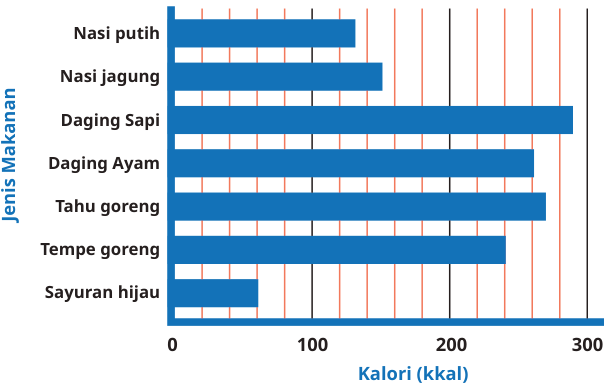


Kunci sumber: `A`; status AI: `verified`; jawaban diverifikasi AI: `A`.
Solusi minimum hasil AI: Nasi putih: 3 x 130 = 390 kkal. Daging ayam: 2 x 260 = 520 kkal. Sayuran hijau: 1 x 60 = 60 kkal. Makanan ringan: 300 kkal. Mi instan: 350 kkal. Total: 390 + 520 + 60 + 300 + 350 = 1.620 kkal. Lukas (laki-laki) membutuhkan 2.100 kkal. Karena 1.620 < 2.100, maka tidak berlebihan.
Gambar sumber: images/kelas5_panduan_siswa_kelas5.pdf-0282-04.png. Transkripsi visual: Diagram batang horizontal menunjukkan kandungan kalori per 100 gram makanan. Sumbu horizontal (bawah) menunjukkan kalori (kkal) dengan skala 0, 100, 200, 300. Garis kisi vertikal muncul setiap 25 kkal. Data: Nasi putih (130 kkal), Nasi jagung (150 kkal), Daging Sapi (290 kkal), Daging Ayam (260 kkal), Tahu goreng (270 kkal), Tempe goreng (240 kkal), Sayuran hijau (60 kkal).

### 1. Pemeriksaan input dan fitur

Struktur: `pass`; alasan: `[]`. Grade/topik: kelas 5 / Matematika SD Kelas 5. KKO: `[]`; KKO hanya petunjuk bantu.
Isi dan kunci berasal dari sumber yang sama pada ketiga run. Versi konten: 2; hash: `ac4f54706a5a43c895968bfd1cda6592838ea09c607297b0b479322bf1b7c9c7`. Bukti verifikasi AI tidak sama dengan verifikasi ahli.

### 2. Penilaian Gemini blind — tiga run sebelum melihat IndoBERT

| Run | Status | Konten / kunci | Kognitif | Pengetahuan | Difficulty | Token |
|---:|---|---|---|---|---|---:|
| 1 | success | valid / verified | applying | procedural | Medium | 3011 |
| 2 | success | valid / verified | applying | procedural | Medium | 2997 |
| 3 | success | valid / verified | reasoning | procedural | Medium | 3023 |

Run 1 — solusi: Nasi putih: 3 x 130 = 390. Daging ayam: 2 x 260 = 520. Sayuran: 1 x 60 = 60. Tambahan: 300 (snack) + 350 (mi) = 650. Total: 390 + 520 + 60 + 650 = 1.620 kkal. 1.620 < 2.100 (kebutuhan Lukas).
- Domain kognitif `classify/applying`: Siswa harus mengintegrasikan data dari grafik (per 100g) dengan data teks, melakukan perkalian untuk porsi, menjumlahkan total kalori, dan membandingkannya dengan ambang batas kebutuhan kalori.. Bukti: Lukas makan 300 gram nasi putih, 200 gram daging ayam, dan 100 gram sayuran hijau; Ia masih makan makanan ringan yang mengandung 300 kkal dan 1 bungkus mi instan yang mengandung 350 kkal
- Dimensi pengetahuan `classify/procedural`: Siswa menerapkan prosedur aritmatika (perkalian dan penjumlahan) pada data yang disajikan dalam bentuk grafik dan teks untuk menyelesaikan masalah kontekstual.. Bukti: Kandungan Kalori Per 100 Gram Makanan; Lukas makan 300 gram nasi putih
- Intended difficulty `classify/Medium`: Soal memerlukan beberapa langkah rutin (membaca grafik, mengalikan dengan porsi, menjumlahkan total) yang saling terkait. Ini adalah tugas standar untuk kelas 5.. Bukti: Lukas makan 300 gram nasi putih, 200 gram daging ayam, dan 100 gram sayuran hijau; makanan ringan yang mengandung 300 kkal dan 1 bungkus mi instan yang mengandung 350 kkal

Profil difficulty run ini:

| Parameter | Nilai |
|---|---|
| expectedPrerequisite | Kemampuan membaca diagram batang, perkalian dasar, dan penjumlahan bilangan ratusan. |
| dependentSteps | 5 |
| routineStatus | routine_selection |
| strategySelection | True |
| representationTransfer | True |
| relevantInformationUnits | 6 |
| interactingConstraints | 2 |
| calculationLoad | moderate |
| scaffoldLevel | none |
| distractorQuality | plausible |
| gradeRelativeRationale | Siswa kelas 5 diharapkan mampu melakukan operasi hitung campuran dan interpretasi data sederhana dalam konteks kehidupan sehari-hari. |

Run 2 — solusi: Nasi putih: 3 x 130 = 390. Daging ayam: 2 x 260 = 520. Sayuran hijau: 1 x 60 = 60. Tambahan: 300 (snack) + 350 (mi) = 650. Total: 390 + 520 + 60 + 650 = 1.620 kkal. 1.620 < 2.100 (kebutuhan Lukas).
- Domain kognitif `classify/applying`: Siswa perlu mengintegrasikan data dari diagram batang dengan informasi teks, melakukan operasi perkalian dan penjumlahan bertahap, serta membandingkan hasilnya dengan nilai referensi.. Bukti: Lukas makan 300 gram nasi putih, 200 gram daging ayam, dan 100 gram sayuran hijau; Ia masih makan makanan ringan yang mengandung 300 kkal dan 1 bungkus mi instan yang mengandung 350 kkal
- Dimensi pengetahuan `classify/procedural`: Siswa menerapkan prosedur perhitungan (perkalian dan penjumlahan) berdasarkan data yang diperoleh dari representasi visual (diagram batang).. Bukti: Kandungan Kalori Per 100 Gram Makanan; Lukas makan 300 gram nasi putih
- Intended difficulty `classify/Medium`: Soal memerlukan beberapa langkah rutin (membaca diagram, mengalikan per porsi, menjumlahkan total) yang saling terkait, namun prosedurnya jelas dan familiar bagi siswa kelas 5.. Bukti: 300 gram nasi putih, 200 gram daging ayam, dan 100 gram sayuran hijau; makanan ringan yang mengandung 300 kkal dan 1 bungkus mi instan yang mengandung 350 kkal

Profil difficulty run ini:

| Parameter | Nilai |
|---|---|
| expectedPrerequisite | Kemampuan membaca diagram batang, perkalian dasar, dan penjumlahan bilangan ratusan. |
| dependentSteps | 5 |
| routineStatus | routine_selection |
| strategySelection | True |
| representationTransfer | True |
| relevantInformationUnits | 7 |
| interactingConstraints | 2 |
| calculationLoad | moderate |
| scaffoldLevel | none |
| distractorQuality | plausible |
| gradeRelativeRationale | Siswa kelas 5 diharapkan mampu melakukan operasi hitung campuran dan interpretasi data sederhana dalam konteks kehidupan sehari-hari. |

Run 3 — solusi: Nasi putih: 3 x 130 = 390. Daging ayam: 2 x 260 = 520. Sayuran hijau: 1 x 60 = 60. Makanan ringan: 300. Mi instan: 350. Total: 390 + 520 + 60 + 300 + 350 = 1.620 kkal. Lukas (laki-laki) butuh 2.100 kkal. 1.620 < 2.100, jadi tidak berlebihan.
- Domain kognitif `classify/reasoning`: Siswa perlu mengintegrasikan data dari diagram batang dengan data teks, melakukan perkalian berdasarkan porsi (gram), menjumlahkan total kalori, dan membandingkannya dengan ambang batas kebutuhan kalori.. Bukti: Lukas makan 300 gram nasi putih, 200 gram daging ayam, dan 100 gram sayuran hijau; Ia masih makan makanan ringan yang mengandung 300 kkal dan 1 bungkus mi instan yang mengandung 350 kkal
- Dimensi pengetahuan `classify/procedural`: Siswa menerapkan prosedur matematika (perkalian dan penjumlahan) dalam konteks masalah dunia nyata yang memerlukan pemahaman hubungan antara data diagram dan kebutuhan kalori.. Bukti: Kandungan Kalori Per 100 Gram Makanan; 300 gram nasi putih, 200 gram daging ayam, dan 100 gram sayuran hijau
- Intended difficulty `classify/Medium`: Soal ini memerlukan beberapa langkah perhitungan (membaca diagram, mengalikan dengan porsi, menjumlahkan total) dan perbandingan logis. Ini melampaui prosedur satu langkah.. Bukti: 300 gram nasi putih, 200 gram daging ayam, dan 100 gram sayuran hijau; 300 kkal dan 1 bungkus mi instan yang mengandung 350 kkal

Profil difficulty run ini:

| Parameter | Nilai |
|---|---|
| expectedPrerequisite | Membaca diagram batang, operasi perkalian dasar, dan penjumlahan bilangan ratusan. |
| dependentSteps | 5 |
| routineStatus | routine_selection |
| strategySelection | True |
| representationTransfer | True |
| relevantInformationUnits | 7 |
| interactingConstraints | 2 |
| calculationLoad | moderate |
| scaffoldLevel | none |
| distractorQuality | plausible |
| gradeRelativeRationale | Siswa kelas 5 diharapkan mampu melakukan operasi hitung campuran dan interpretasi data sederhana, namun soal ini menuntut ketelitian dalam mengelola banyak variabel informasi. |

### 3. Voting awal dan adjudikasi

| Head | Suara awal | Pola / status akhir | Label akhir advisory |
|---|---|---|---|
| Domain kognitif | {"applying": 2, "reasoning": 1} | majority_2_of_3 / adjudicated | applying |
| Dimensi pengetahuan | {"procedural": 3} | unanimous_3_0 / adjudicated | procedural |
| Intended difficulty | {"Medium": 3} | unanimous_3_0 / adjudicated | Medium |

Adjudikasi AI: `success`; token `5006`.
Konten: `valid`; kunci: `verified`; masalah: .
- Domain kognitif `applying`: Siswa harus mengintegrasikan data dari grafik (per 100g) dengan data teks, melakukan perkalian untuk porsi, menjumlahkan total kalori, dan membandingkannya dengan ambang batas kebutuhan kalori. Ini adalah proses penerapan konsep dalam situasi rutin.
- Dimensi pengetahuan `procedural`: Siswa menerapkan prosedur aritmatika (perkalian dan penjumlahan) pada data yang disajikan dalam bentuk grafik dan teks untuk menyelesaikan masalah kontekstual.
- Intended difficulty `Medium`: Soal memerlukan beberapa langkah rutin (membaca diagram, mengalikan per porsi, menjumlahkan total) yang saling terkait, namun prosedurnya jelas dan familiar bagi siswa kelas 5.

Profil difficulty hasil adjudikasi:

| Parameter | Nilai |
|---|---|
| expectedPrerequisite | Kemampuan membaca diagram batang, perkalian dasar, dan penjumlahan bilangan ratusan. |
| dependentSteps | 5 |
| routineStatus | routine_selection |
| strategySelection | True |
| representationTransfer | True |
| relevantInformationUnits | 7 |
| interactingConstraints | 2 |
| calculationLoad | moderate |
| scaffoldLevel | none |
| distractorQuality | plausible |
| gradeRelativeRationale | Siswa kelas 5 diharapkan mampu melakukan operasi hitung campuran dan interpretasi data sederhana dalam konteks kehidupan sehari-hari. |

### 4. Diagnostik IndoBERT setelah label blind dikunci

Model membaca representation `metadata`; token input 356/256; truncation: `True`.

| Head | Probabilitas | Label | Confidence | Entropy | Action / alasan |
|---|---|---|---:|---:|---|
| Domain kognitif | knowing=0.000086; applying=0.999914; reasoning=0.000000 | applying | 0.999914 | 0.000808 | review / input_reached_truncation_limit; selective_threshold_gate_not_met |
| Dimensi pengetahuan | factual=0.030461; conceptual=0.648718; procedural=0.320821; metacognitive=0.000000 | conceptual | 0.648718 | 0.542323 | review / input_reached_truncation_limit; selective_threshold_gate_not_met |
| Intended difficulty | Easy=0.711946; Medium=0.275581; Hard=0.012473 | Easy | 0.711946 | 0.593257 | review / input_reached_truncation_limit; selective_threshold_gate_not_met |

Domain kognitif: Σp = 1.00000000; confidence = max(p) = 0.999914; −Σp ln(p) = 0.000888; H = 0.000888/ln(3) = 0.000808; T = 0.050000.


Dimensi pengetahuan: Σp = 1.00000000; confidence = max(p) = 0.648718; −Σp ln(p) = 0.751819; H = 0.751819/ln(4) = 0.542323; T = 0.209800.


Intended difficulty: Σp = 1.00000000; confidence = max(p) = 0.711946; −Σp ln(p) = 0.651760; H = 0.651760/ln(3) = 0.593257; T = 0.953328.


<details><summary>Input sebenarnya yang dibaca model</summary>

```text
Kelas: 5
Topik: Matematika SD Kelas 5
Subtopik: Diagram Batang
Tipe soal: multiple_choice
Stimulus: -
Soal: Perhatikan diagram batang berikut.

Kandungan Kalori Per 100 Gram Makanan

Diagram batang di atas menunjukkan kandungan kalori dari berbagai jenis makanan. Kalori dihitung untuk setiap 100 gram makanan. Kalori adalah satuan energi. Kalori dalam makanan itulah yang digunakan tubuh sebagai sumber energi untuk dapat melaksanakan fungsinya dengan baik.

Kebutuhan kalori anak usia 10–12 tahun adalah sekitar 2.000 kkal untuk anak perempuan dan 2.100 kkal untuk anak laki-laki. Dalam satu hari, Lukas makan 300 gram nasi putih, 200 gram daging ayam, dan 100 gram sayuran hijau. Ia masih makan makanan ringan yang mengandung 300 kkal dan 1 bungkus mi instan yang mengandung 350 kkal per bungkus. Menurutmu, apakah makanan yang dimakan Lukas kalorinya berlebihan? Mengapa demikian?
Pilihan: A. Tidak, karena totalnya 1.620 kkal, di bawah kebutuhan 2.100 kkal
B. Ya, karena totalnya 1.620 kkal, di atas kebutuhan 1.500 kkal
C. Ya, karena totalnya 2.270 kkal, di atas kebutuhan 2.100 kkal
D. Tidak, karena totalnya 970 kkal, di bawah kebutuhan 2.100 kkal
Transkripsi visual: Diagram batang horizontal menunjukkan kandungan kalori per 100 gram makanan. Sumbu horizontal (bawah) menunjukkan kalori (kkal) dengan skala 0, 100, 200, 300. Garis kisi vertikal muncul setiap 25 kkal. Data: Nasi putih (130 kkal), Nasi jagung (150 kkal), Daging Sapi (290 kkal), Daging Ayam (260 kkal), Tahu goreng (270 kkal), Tempe goreng (240 kkal), Sayuran hijau (60 kkal).
```

</details>

### 5. Keputusan batch

Label advisory blind: `{"mathCognitiveDomain": "applying", "knowledgeDimension": "procedural", "intendedDifficulty": "Medium"}`. Routing: `pending_expert_review`.
Status konten: `valid`. Catatan konten: .
Perbedaan model dan blind: `{"mathCognitiveDomain": {"modelLabel": "applying", "blindLabel": "applying", "agreement": true}, "knowledgeDimension": {"modelLabel": "conceptual", "blindLabel": "procedural", "agreement": false}, "intendedDifficulty": {"modelLabel": "Easy", "blindLabel": "Medium", "agreement": false}}`.
Gold ahli tetap null; human review wajib. Confidence IndoBERT tidak digunakan untuk mengganti label blind.

## 65. Soal `690a0d172f3a4c63acbfca28`

Tabel 8.13 Data Pengunjung Perpustakaan SD Pancasila<br><br>\|Hari\|Banyaknya Pengunjung\|<br>\|---\|---\|<br>\|Senin\|42\|<br>\|Selasa\|60\|<br>\|Rabu\|50\|<br>\|Kamis\|36\|<br>\|Jumat\|24\|<br>\|Sabtu\|48\|<br><br>Kapan perpustakaan tersebut menerima pengunjung paling sedikit?

| Opsi | Isi |
|---|---|
| A | Hari Sabtu |
| B | Hari Kamis |
| C | Hari Jumat |
| D | Hari Selasa |

Kunci sumber: `C`; status AI: `verified`; jawaban diverifikasi AI: `C`.
Solusi minimum hasil AI: Membandingkan nilai pada kolom 'Banyaknya Pengunjung': 42, 60, 50, 36, 24, 48. Nilai terkecil adalah 24, yang berkorespondensi dengan hari Jumat.
Gambar sumber: —. Transkripsi visual: —

### 1. Pemeriksaan input dan fitur

Struktur: `pass`; alasan: `[]`. Grade/topik: kelas 5 / Matematika SD Kelas 5. KKO: `[]`; KKO hanya petunjuk bantu.
Isi dan kunci berasal dari sumber yang sama pada ketiga run. Versi konten: 2; hash: `98d2c9f809f3305eb9f60e48d877d9999817a41d5e65a39c7c93bda2098d83c8`. Bukti verifikasi AI tidak sama dengan verifikasi ahli.

### 2. Penilaian Gemini blind — tiga run sebelum melihat IndoBERT

| Run | Status | Konten / kunci | Kognitif | Pengetahuan | Difficulty | Token |
|---:|---|---|---|---|---|---:|
| 1 | success | valid / verified | knowing | factual | Easy | 1365 |
| 2 | success | valid / verified | knowing | factual | Easy | 1346 |
| 3 | success | valid / verified | knowing | factual | Easy | 1339 |

Run 1 — solusi: Membandingkan nilai pada kolom 'Banyaknya Pengunjung': 42, 60, 50, 36, 24, 48. Nilai terkecil adalah 24, yang berkorespondensi dengan hari Jumat.
- Domain kognitif `classify/knowing`: Siswa hanya perlu membaca data dari tabel dan melakukan perbandingan sederhana untuk mengidentifikasi nilai minimum.. Bukti: Kapan perpustakaan tersebut menerima pengunjung paling sedikit?
- Dimensi pengetahuan `classify/factual`: Soal ini menguji pemahaman dasar tentang cara membaca dan menginterpretasikan data yang disajikan dalam bentuk tabel.. Bukti: Tabel 8.13 Data Pengunjung Perpustakaan SD Pancasila
- Intended difficulty `classify/Easy`: Soal ini bersifat langsung, hanya memerlukan satu langkah perbandingan nilai numerik sederhana tanpa manipulasi data lebih lanjut.. Bukti: Kapan perpustakaan tersebut menerima pengunjung paling sedikit?; 42, 60, 50, 36, 24, 48

Profil difficulty run ini:

| Parameter | Nilai |
|---|---|
| expectedPrerequisite | Kemampuan membaca tabel dan membandingkan bilangan cacah dua digit. |
| dependentSteps | 1 |
| routineStatus | familiar_routine |
| strategySelection | False |
| representationTransfer | False |
| relevantInformationUnits | 6 |
| interactingConstraints | 0 |
| calculationLoad | low |
| scaffoldLevel | none |
| distractorQuality | plausible |
| gradeRelativeRationale | Untuk kelas 5, membandingkan data dalam tabel adalah keterampilan dasar yang sudah dikuasai sejak kelas rendah. |

Run 2 — solusi: Membandingkan nilai pada kolom 'Banyaknya Pengunjung': 42, 60, 50, 36, 24, 48. Nilai terkecil adalah 24, yang berkorespondensi dengan hari Jumat.
- Domain kognitif `classify/knowing`: Siswa hanya perlu membaca data dari tabel dan melakukan perbandingan nilai sederhana untuk menentukan nilai minimum.. Bukti: Kapan perpustakaan tersebut menerima pengunjung paling sedikit?
- Dimensi pengetahuan `classify/factual`: Soal ini menguji pemahaman siswa terhadap data yang disajikan dalam bentuk tabel (fakta statistik).. Bukti: Tabel 8.13 Data Pengunjung Perpustakaan SD Pancasila
- Intended difficulty `classify/Easy`: Soal ini sangat langsung, hanya memerlukan satu langkah perbandingan nilai tanpa manipulasi data atau strategi kompleks.. Bukti: Kapan perpustakaan tersebut menerima pengunjung paling sedikit?

Profil difficulty run ini:

| Parameter | Nilai |
|---|---|
| expectedPrerequisite | Kemampuan membaca tabel dan membandingkan bilangan cacah dua digit. |
| dependentSteps | 1 |
| routineStatus | familiar_routine |
| strategySelection | False |
| representationTransfer | False |
| relevantInformationUnits | 6 |
| interactingConstraints | 0 |
| calculationLoad | low |
| scaffoldLevel | none |
| distractorQuality | plausible |
| gradeRelativeRationale | Siswa kelas 5 sudah sangat familiar dengan pembacaan tabel sederhana dan perbandingan bilangan. |

Run 3 — solusi: Membandingkan nilai pada kolom 'Banyaknya Pengunjung': 42, 60, 50, 36, 24, 48. Nilai terkecil adalah 24, yang berkorespondensi dengan hari Jumat.
- Domain kognitif `classify/knowing`: Siswa hanya perlu membaca data dari tabel dan melakukan perbandingan sederhana untuk menentukan nilai minimum, yang merupakan proses langsung.. Bukti: Kapan perpustakaan tersebut menerima pengunjung paling sedikit?
- Dimensi pengetahuan `classify/factual`: Soal ini menguji pemahaman faktual mengenai cara membaca dan menginterpretasikan data yang disajikan dalam bentuk tabel.. Bukti: Tabel 8.13 Data Pengunjung Perpustakaan SD Pancasila
- Intended difficulty `classify/Easy`: Soal ini sangat mendasar, hanya memerlukan satu langkah perbandingan nilai tanpa manipulasi data atau strategi kompleks.. Bukti: Kapan perpustakaan tersebut menerima pengunjung paling sedikit?

Profil difficulty run ini:

| Parameter | Nilai |
|---|---|
| expectedPrerequisite | Kemampuan membaca tabel dan membandingkan bilangan cacah. |
| dependentSteps | 1 |
| routineStatus | familiar_routine |
| strategySelection | False |
| representationTransfer | False |
| relevantInformationUnits | 6 |
| interactingConstraints | 0 |
| calculationLoad | low |
| scaffoldLevel | none |
| distractorQuality | plausible |
| gradeRelativeRationale | Untuk kelas 5, membandingkan data dalam tabel adalah keterampilan dasar yang sudah dikuasai sejak kelas rendah. |

### 3. Voting awal dan adjudikasi

| Head | Suara awal | Pola / status akhir | Label akhir advisory |
|---|---|---|---|
| Domain kognitif | {"knowing": 3} | unanimous_3_0 / unanimous | knowing |
| Dimensi pengetahuan | {"factual": 3} | unanimous_3_0 / unanimous | factual |
| Intended difficulty | {"Easy": 3} | unanimous_3_0 / unanimous | Easy |

### 4. Diagnostik IndoBERT setelah label blind dikunci

Model membaca representation `metadata`; token input 112/256; truncation: `False`.

| Head | Probabilitas | Label | Confidence | Entropy | Action / alasan |
|---|---|---|---:|---:|---|
| Domain kognitif | knowing=0.000001; applying=0.999999; reasoning=0.000000 | applying | 0.999999 | 0.000019 | review / selective_threshold_gate_not_met |
| Dimensi pengetahuan | factual=0.033662; conceptual=0.913139; procedural=0.053199; metacognitive=0.000000 | conceptual | 0.913139 | 0.254784 | review / selective_threshold_gate_not_met |
| Intended difficulty | Easy=0.884295; Medium=0.111994; Hard=0.003711 | Easy | 0.884295 | 0.341063 | review / selective_threshold_gate_not_met |

Domain kognitif: Σp = 1.00000000; confidence = max(p) = 0.999999; −Σp ln(p) = 0.000021; H = 0.000021/ln(3) = 0.000019; T = 0.050000.


Dimensi pengetahuan: Σp = 1.00000000; confidence = max(p) = 0.913139; −Σp ln(p) = 0.353206; H = 0.353206/ln(4) = 0.254784; T = 0.209800.


Intended difficulty: Σp = 1.00000000; confidence = max(p) = 0.884295; −Σp ln(p) = 0.374696; H = 0.374696/ln(3) = 0.341063; T = 0.953328.


<details><summary>Input sebenarnya yang dibaca model</summary>

```text
Kelas: 5
Topik: Matematika SD Kelas 5
Subtopik: Diagram Batang
Tipe soal: multiple_choice
Stimulus: -
Soal: Tabel 8.13 Data Pengunjung Perpustakaan SD Pancasila

|Hari|Banyaknya Pengunjung|
|---|---|
|Senin|42|
|Selasa|60|
|Rabu|50|
|Kamis|36|
|Jumat|24|
|Sabtu|48|

Kapan perpustakaan tersebut menerima pengunjung paling sedikit?
Pilihan: A. Hari Sabtu
B. Hari Kamis
C. Hari Jumat
D. Hari Selasa
Transkripsi visual: -
```

</details>

### 5. Keputusan batch

Label advisory blind: `{"mathCognitiveDomain": "knowing", "knowledgeDimension": "factual", "intendedDifficulty": "Easy"}`. Routing: `pending_expert_review`.
Status konten: `valid`. Catatan konten: .
Perbedaan model dan blind: `{"mathCognitiveDomain": {"modelLabel": "applying", "blindLabel": "knowing", "agreement": false}, "knowledgeDimension": {"modelLabel": "conceptual", "blindLabel": "factual", "agreement": false}, "intendedDifficulty": {"modelLabel": "Easy", "blindLabel": "Easy", "agreement": true}}`.
Gold ahli tetap null; human review wajib. Confidence IndoBERT tidak digunakan untuk mengganti label blind.

## 66. Soal `177f5534f5d559f72a66d033`

Diagram batang berikut menunjukan banyak siswa di SD Permata.<br><br>Apabila jumlah seluruh siswa di SD Permata adalah 346 siswa. Tentukan:<br><br>Banyak siswa kelas 2 SD Permata?

| Opsi | Isi |
|---|---|
| A | 292 siswa |
| B | 54 siswa |
| C | 154 siswa |
| D | 0 siswa |

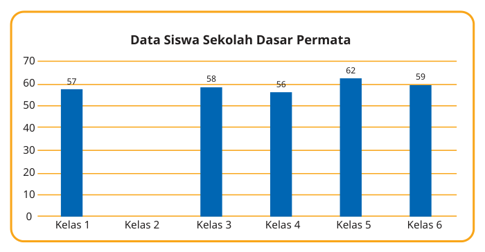


Kunci sumber: `B`; status AI: `verified`; jawaban diverifikasi AI: `B`.
Solusi minimum hasil AI: Jumlah siswa kelas 1, 3, 4, 5, 6 adalah 57 + 58 + 56 + 62 + 59 = 292. Siswa kelas 2 = 346 - 292 = 54.
Gambar sumber: images/kelas4_panduan_guru_kelas4.pdf-0244-06.png. Transkripsi visual: Diagram batang menunjukkan jumlah siswa di SD Permata untuk kelas 1, 3, 4, 5, dan 6. Nilai yang tertera di atas batang adalah: Kelas 1 = 57, Kelas 3 = 58, Kelas 4 = 56, Kelas 5 = 62, Kelas 6 = 59. Batang untuk Kelas 2 kosong.

### 1. Pemeriksaan input dan fitur

Struktur: `pass`; alasan: `[]`. Grade/topik: kelas 5 / Matematika SD Kelas 5. KKO: `['mengidentifikasi']`; KKO hanya petunjuk bantu.
Isi dan kunci berasal dari sumber yang sama pada ketiga run. Versi konten: 2; hash: `4b8e63d329864e97ef24ef37bdec8bdf253f72068c89e0454c4d17dd40797b23`. Bukti verifikasi AI tidak sama dengan verifikasi ahli.

### 2. Penilaian Gemini blind — tiga run sebelum melihat IndoBERT

| Run | Status | Konten / kunci | Kognitif | Pengetahuan | Difficulty | Token |
|---:|---|---|---|---|---|---:|
| 1 | success | valid / verified | applying | conceptual | Medium | 3355 |
| 2 | success | valid / verified | applying | procedural | Medium | 3433 |
| 3 | success | valid / verified | applying | procedural | Medium | 2687 |

Run 1 — solusi: Jumlah siswa kelas 1, 3, 4, 5, 6 adalah 57+58+56+62+59 = 292. Siswa kelas 2 = 346 - 292 = 54.
- Domain kognitif `classify/applying`: Siswa perlu mengintegrasikan informasi dari diagram (penjumlahan) dan menggunakan informasi total untuk mencari nilai yang hilang (pengurangan). Ini melibatkan penerapan prosedur pada situasi rutin.. Bukti: Tentukan: Banyak siswa kelas 2; jumlah seluruh siswa di SD Permata adalah 346
- Dimensi pengetahuan `classify/conceptual`: Memerlukan pemahaman tentang struktur diagram batang dan hubungan antara bagian (kelas) dengan keseluruhan (total).. Bukti: Diagram batang; jumlah seluruh siswa
- Intended difficulty `classify/Medium`: Soal ini memerlukan dua langkah rutin (penjumlahan data yang ada, lalu pengurangan dari total). Ini adalah tugas standar kelas 5.. Bukti: jumlah seluruh siswa di SD Permata adalah 346; Banyak siswa kelas 2

Profil difficulty run ini:

| Parameter | Nilai |
|---|---|
| expectedPrerequisite | Penjumlahan bilangan cacah dan pemahaman konsep diagram batang. |
| dependentSteps | 2 |
| routineStatus | familiar_routine |
| strategySelection | False |
| representationTransfer | False |
| relevantInformationUnits | 6 |
| interactingConstraints | 1 |
| calculationLoad | moderate |
| scaffoldLevel | none |
| distractorQuality | plausible |
| gradeRelativeRationale | Siswa kelas 5 diharapkan mampu melakukan operasi aritmatika dasar dan membaca data dari grafik batang untuk menyelesaikan masalah kontekstual. |

Run 2 — solusi: Jumlah siswa kelas 1, 3, 4, 5, dan 6 adalah 57 + 58 + 56 + 62 + 59 = 292. Banyak siswa kelas 2 adalah 346 - 292 = 54.
- Domain kognitif `classify/applying`: Siswa perlu mengintegrasikan informasi dari diagram (penjumlahan data yang tersedia) dan menggunakan informasi total untuk mencari nilai yang hilang melalui pengurangan. Ini adalah penerapan prosedur rutin pada masalah kontekstual.. Bukti: Tentukan: Banyak siswa kelas 2; jumlah seluruh siswa di SD Permata adalah 346
- Dimensi pengetahuan `classify/procedural`: Siswa menggunakan algoritma penjumlahan dan pengurangan (prosedural) untuk menyelesaikan masalah yang melibatkan hubungan bagian-keseluruhan dalam data statistik sederhana.. Bukti: Diagram batang; jumlah seluruh siswa di SD Permata adalah 346
- Intended difficulty `classify/Medium`: Soal ini memerlukan beberapa langkah rutin (penjumlahan data yang ada, lalu pengurangan dari total). Ini adalah tugas standar untuk kelas 5 yang melibatkan interpretasi data dan operasi aritmatika.. Bukti: Diagram batang; jumlah seluruh siswa di SD Permata adalah 346

Profil difficulty run ini:

| Parameter | Nilai |
|---|---|
| expectedPrerequisite | Penjumlahan dan pengurangan bilangan cacah. |
| dependentSteps | 2 |
| routineStatus | familiar_routine |
| strategySelection | False |
| representationTransfer | False |
| relevantInformationUnits | 6 |
| interactingConstraints | 1 |
| calculationLoad | moderate |
| scaffoldLevel | none |
| distractorQuality | plausible |
| gradeRelativeRationale | Siswa kelas 5 diharapkan mampu melakukan operasi aritmatika dasar dan membaca data dari diagram batang untuk menyelesaikan masalah bagian-keseluruhan. |

Run 3 — solusi: Jumlah siswa kelas 1, 3, 4, 5, 6 adalah 57 + 58 + 56 + 62 + 59 = 292. Jumlah siswa kelas 2 = Total - Jumlah kelas lain = 346 - 292 = 54.
- Domain kognitif `classify/applying`: Siswa perlu mengintegrasikan informasi dari diagram batang dengan informasi total yang diberikan untuk menyimpulkan nilai yang hilang (missing value). Ini melibatkan pemahaman hubungan bagian-keseluruhan.. Bukti: Apabila jumlah seluruh siswa di SD Permata adalah 346 siswa. Tentukan: Banyak siswa kelas 2
- Dimensi pengetahuan `classify/procedural`: Siswa menerapkan prosedur aritmatika (penjumlahan dan pengurangan) untuk menyelesaikan masalah yang berbasis pada konsep data statistik sederhana.. Bukti: Diagram batang berikut menunjukan banyak siswa; Apabila jumlah seluruh siswa di SD Permata adalah 346 siswa
- Intended difficulty `classify/Medium`: Soal ini dikategorikan Medium karena memerlukan beberapa langkah rutin yang saling terkait (menjumlahkan 5 data, lalu mengurangkan dari total) dan menuntut ketelitian dalam operasi hitung.. Bukti: 57 + 58 + 56 + 62 + 59 = 292; 346 - 292 = 54

Profil difficulty run ini:

| Parameter | Nilai |
|---|---|
| expectedPrerequisite | Penjumlahan bilangan cacah dan pemahaman dasar diagram batang. |
| dependentSteps | 2 |
| routineStatus | routine_selection |
| strategySelection | False |
| representationTransfer | False |
| relevantInformationUnits | 6 |
| interactingConstraints | 1 |
| calculationLoad | moderate |
| scaffoldLevel | none |
| distractorQuality | plausible |
| gradeRelativeRationale | Siswa kelas 5 diharapkan mampu melakukan operasi penjumlahan dan pengurangan bilangan tiga digit serta menginterpretasikan data dari grafik batang. |

### 3. Voting awal dan adjudikasi

| Head | Suara awal | Pola / status akhir | Label akhir advisory |
|---|---|---|---|
| Domain kognitif | {"applying": 3} | unanimous_3_0 / adjudicated | applying |
| Dimensi pengetahuan | {"conceptual": 1, "procedural": 2} | majority_2_of_3 / adjudicated | procedural |
| Intended difficulty | {"Medium": 3} | unanimous_3_0 / adjudicated | Medium |

Adjudikasi AI: `success`; token `4144`.
Konten: `valid`; kunci: `verified`; masalah: .
- Domain kognitif `applying`: Siswa perlu mengintegrasikan informasi dari diagram (penjumlahan data yang tersedia) dan menggunakan informasi total untuk mencari nilai yang hilang melalui pengurangan. Ini adalah penerapan prosedur rutin pada masalah kontekstual.
- Dimensi pengetahuan `procedural`: Siswa menggunakan algoritma penjumlahan dan pengurangan (prosedural) untuk menyelesaikan masalah yang melibatkan hubungan bagian-keseluruhan dalam data statistik sederhana.
- Intended difficulty `Medium`: Soal ini memerlukan beberapa langkah rutin yang saling terkait (menjumlahkan 5 data, lalu mengurangkan dari total) dan menuntut ketelitian dalam operasi hitung.

Profil difficulty hasil adjudikasi:

| Parameter | Nilai |
|---|---|
| expectedPrerequisite | Penjumlahan dan pengurangan bilangan cacah. |
| dependentSteps | 2 |
| routineStatus | familiar_routine |
| strategySelection | False |
| representationTransfer | False |
| relevantInformationUnits | 6 |
| interactingConstraints | 1 |
| calculationLoad | moderate |
| scaffoldLevel | none |
| distractorQuality | plausible |
| gradeRelativeRationale | Siswa kelas 5 diharapkan mampu melakukan operasi aritmatika dasar dan membaca data dari diagram batang untuk menyelesaikan masalah bagian-keseluruhan. |

### 4. Diagnostik IndoBERT setelah label blind dikunci

Model membaca representation `metadata`; token input 141/256; truncation: `False`.

| Head | Probabilitas | Label | Confidence | Entropy | Action / alasan |
|---|---|---|---:|---:|---|
| Domain kognitif | knowing=0.000000; applying=1.000000; reasoning=0.000000 | applying | 1.000000 | 0.000000 | review / selective_threshold_gate_not_met |
| Dimensi pengetahuan | factual=0.005799; conceptual=0.983413; procedural=0.010788; metacognitive=0.000000 | conceptual | 0.983413 | 0.068656 | review / selective_threshold_gate_not_met |
| Intended difficulty | Easy=0.650755; Medium=0.340528; Hard=0.008717 | Easy | 0.650755 | 0.626022 | review / selective_threshold_gate_not_met |

Domain kognitif: Σp = 1.00000000; confidence = max(p) = 1.000000; −Σp ln(p) = 0.000000; H = 0.000000/ln(3) = 0.000000; T = 0.050000.


Dimensi pengetahuan: Σp = 1.00000000; confidence = max(p) = 0.983413; −Σp ln(p) = 0.095177; H = 0.095177/ln(4) = 0.068656; T = 0.209800.


Intended difficulty: Σp = 1.00000000; confidence = max(p) = 0.650755; −Σp ln(p) = 0.687756; H = 0.687756/ln(3) = 0.626022; T = 0.953328.


<details><summary>Input sebenarnya yang dibaca model</summary>

```text
Kelas: 5
Topik: Matematika SD Kelas 5
Subtopik: Diagram Batang
Tipe soal: multiple_choice
Stimulus: -
Soal: Diagram batang berikut menunjukan banyak siswa di SD Permata.

Apabila jumlah seluruh siswa di SD Permata adalah 346 siswa. Tentukan:

Banyak siswa kelas 2 SD Permata?
Pilihan: A. 292 siswa
B. 54 siswa
C. 154 siswa
D. 0 siswa
Transkripsi visual: Diagram batang menunjukkan jumlah siswa di SD Permata untuk kelas 1, 3, 4, 5, dan 6. Nilai yang tertera di atas batang adalah: Kelas 1 = 57, Kelas 3 = 58, Kelas 4 = 56, Kelas 5 = 62, Kelas 6 = 59. Batang untuk Kelas 2 kosong.
```

</details>

### 5. Keputusan batch

Label advisory blind: `{"mathCognitiveDomain": "applying", "knowledgeDimension": "procedural", "intendedDifficulty": "Medium"}`. Routing: `pending_expert_review`.
Status konten: `valid`. Catatan konten: .
Perbedaan model dan blind: `{"mathCognitiveDomain": {"modelLabel": "applying", "blindLabel": "applying", "agreement": true}, "knowledgeDimension": {"modelLabel": "conceptual", "blindLabel": "procedural", "agreement": false}, "intendedDifficulty": {"modelLabel": "Easy", "blindLabel": "Medium", "agreement": false}}`.
Gold ahli tetap null; human review wajib. Confidence IndoBERT tidak digunakan untuk mengganti label blind.

## 67. Soal `a1af57352d757d10ac9304b8`

Nyatakan bilangan berikut dalam bentuk angka.<br><br>b. Sembilan ratus ribu tiga puluh tiga ribu empat ratus tiga.

| Opsi | Isi |
|---|---|
| A | 933.403 |
| B | 903.403 |
| C | 930.403 |
| D | 933.430 |

Kunci sumber: `A`; status AI: `verified`; jawaban diverifikasi AI: `A`.
Solusi minimum hasil AI: Sembilan ratus ribu (900.000) ditambah tiga puluh tiga ribu (33.000) ditambah empat ratus tiga (403) menghasilkan 933.403.
Gambar sumber: —. Transkripsi visual: —

### 1. Pemeriksaan input dan fitur

Struktur: `pass`; alasan: `[]`. Grade/topik: kelas 5 / Matematika SD Kelas 5. KKO: `[]`; KKO hanya petunjuk bantu.
Isi dan kunci berasal dari sumber yang sama pada ketiga run. Versi konten: 2; hash: `c56209a3c82ca3c1704eb8ebae1fb9fe8bbba0b4ebcb98af2d8fee6d0311b3e4`. Bukti verifikasi AI tidak sama dengan verifikasi ahli.

### 2. Penilaian Gemini blind — tiga run sebelum melihat IndoBERT

| Run | Status | Konten / kunci | Kognitif | Pengetahuan | Difficulty | Token |
|---:|---|---|---|---|---|---:|
| 1 | success | valid / verified | knowing | conceptual | Easy | 1440 |
| 2 | success | valid / verified | knowing | conceptual | Easy | 1561 |
| 3 | success | valid / verified | knowing | conceptual | Easy | 1425 |

Run 1 — solusi: Sembilan ratus ribu (900.000) ditambah tiga puluh tiga ribu (33.000) ditambah empat ratus tiga (403) menghasilkan 933.403.
- Domain kognitif `classify/knowing`: Siswa diminta untuk menerjemahkan representasi verbal bilangan ke dalam bentuk numerik standar. Ini adalah proses langsung yang melibatkan pengenalan nilai tempat dan notasi angka.. Bukti: Nyatakan bilangan berikut dalam bentuk angka; Sembilan ratus ribu tiga puluh tiga ribu empat ratus tiga
- Dimensi pengetahuan `classify/conceptual`: Soal ini menguji pemahaman tentang sistem penulisan bilangan cacah dan nilai tempat, yang merupakan pengetahuan konseptual dasar dalam matematika.. Bukti: Sembilan ratus ribu tiga puluh tiga ribu empat ratus tiga
- Intended difficulty `classify/Easy`: Soal ini bersifat langsung dan rutin bagi siswa kelas 5. Tidak ada langkah kompleks atau strategi nonrutin yang diperlukan, hanya pemahaman tentang notasi bilangan.. Bukti: Sembilan ratus ribu tiga puluh tiga ribu empat ratus tiga

Profil difficulty run ini:

| Parameter | Nilai |
|---|---|
| expectedPrerequisite | Pemahaman nilai tempat bilangan cacah sampai jutaan. |
| dependentSteps | 1 |
| routineStatus | familiar_routine |
| strategySelection | False |
| representationTransfer | True |
| relevantInformationUnits | 3 |
| interactingConstraints | 0 |
| calculationLoad | low |
| scaffoldLevel | none |
| distractorQuality | plausible |
| gradeRelativeRationale | Menuliskan bilangan dari bentuk kata ke angka adalah kompetensi dasar yang diharapkan sudah dikuasai dengan lancar di kelas 5. |

Run 2 — solusi: Sembilan ratus ribu (900.000) ditambah tiga puluh tiga ribu (33.000) ditambah empat ratus tiga (403) sama dengan 933.403.
- Domain kognitif `classify/knowing`: Siswa hanya perlu menerjemahkan representasi verbal bilangan ke dalam notasi angka standar, yang merupakan proses langsung tanpa memerlukan strategi kompleks.. Bukti: Nyatakan bilangan berikut dalam bentuk angka; Sembilan ratus ribu tiga puluh tiga ribu empat ratus tiga
- Dimensi pengetahuan `classify/conceptual`: Soal ini menguji pemahaman tentang sistem penamaan bilangan dan nilai tempat (place value) dalam notasi desimal.. Bukti: Sembilan ratus ribu tiga puluh tiga ribu empat ratus tiga
- Intended difficulty `classify/Easy`: Tugas ini bersifat rutin bagi siswa kelas 5, melibatkan konversi langsung dari bentuk kata ke angka tanpa langkah perhitungan yang rumit.. Bukti: Sembilan ratus ribu tiga puluh tiga ribu empat ratus tiga

Profil difficulty run ini:

| Parameter | Nilai |
|---|---|
| expectedPrerequisite | Pemahaman nilai tempat bilangan cacah sampai 1.000.000. |
| dependentSteps | 1 |
| routineStatus | familiar_routine |
| strategySelection | False |
| representationTransfer | True |
| relevantInformationUnits | 3 |
| interactingConstraints | 0 |
| calculationLoad | low |
| scaffoldLevel | none |
| distractorQuality | plausible |
| gradeRelativeRationale | Menuliskan bilangan dari bentuk kata ke angka adalah kompetensi dasar yang diharapkan sudah dikuasai dengan lancar di kelas 5. |

Run 3 — solusi: Sembilan ratus ribu (900.000) ditambah tiga puluh tiga ribu (33.000) ditambah empat ratus tiga (403) sama dengan 933.403.
- Domain kognitif `classify/knowing`: Siswa diminta untuk menerjemahkan representasi verbal bilangan ke dalam representasi numerik standar. Ini adalah proses langsung yang melibatkan pemahaman nilai tempat.. Bukti: Nyatakan bilangan berikut dalam bentuk angka; Sembilan ratus ribu tiga puluh tiga ribu empat ratus tiga
- Dimensi pengetahuan `classify/conceptual`: Soal ini menguji pemahaman tentang sistem penamaan bilangan dan nilai tempat (konsep dasar bilangan cacah).. Bukti: Sembilan ratus ribu tiga puluh tiga ribu empat ratus tiga
- Intended difficulty `classify/Easy`: Tugas ini bersifat prosedural langsung dengan representasi yang sangat familiar bagi siswa kelas 5, tanpa memerlukan strategi kompleks atau langkah ganda yang rumit.. Bukti: Sembilan ratus ribu tiga puluh tiga ribu empat ratus tiga

Profil difficulty run ini:

| Parameter | Nilai |
|---|---|
| expectedPrerequisite | Pemahaman nilai tempat hingga ratusan ribu. |
| dependentSteps | 1 |
| routineStatus | familiar_routine |
| strategySelection | False |
| representationTransfer | True |
| relevantInformationUnits | 3 |
| interactingConstraints | 0 |
| calculationLoad | low |
| scaffoldLevel | none |
| distractorQuality | plausible |
| gradeRelativeRationale | Menuliskan angka dari nama bilangan adalah keterampilan dasar yang diharapkan sudah dikuasai dengan lancar di kelas 5. |

### 3. Voting awal dan adjudikasi

| Head | Suara awal | Pola / status akhir | Label akhir advisory |
|---|---|---|---|
| Domain kognitif | {"knowing": 3} | unanimous_3_0 / unanimous | knowing |
| Dimensi pengetahuan | {"conceptual": 3} | unanimous_3_0 / unanimous | conceptual |
| Intended difficulty | {"Easy": 3} | unanimous_3_0 / unanimous | Easy |

### 4. Diagnostik IndoBERT setelah label blind dikunci

Model membaca representation `metadata`; token input 95/256; truncation: `False`.

| Head | Probabilitas | Label | Confidence | Entropy | Action / alasan |
|---|---|---|---:|---:|---|
| Domain kognitif | knowing=0.085282; applying=0.914718; reasoning=0.000000 | applying | 0.914718 | 0.265321 | review / selective_threshold_gate_not_met |
| Dimensi pengetahuan | factual=0.638193; conceptual=0.346695; procedural=0.015112; metacognitive=0.000000 | factual | 0.638193 | 0.517374 | review / selective_threshold_gate_not_met |
| Intended difficulty | Easy=0.917222; Medium=0.080644; Hard=0.002134 | Easy | 0.917222 | 0.268899 | review / selective_threshold_gate_not_met |

Domain kognitif: Σp = 1.00000000; confidence = max(p) = 0.914718; −Σp ln(p) = 0.291485; H = 0.291485/ln(3) = 0.265321; T = 0.050000.


Dimensi pengetahuan: Σp = 1.00000000; confidence = max(p) = 0.638193; −Σp ln(p) = 0.717232; H = 0.717232/ln(4) = 0.517374; T = 0.209800.


Intended difficulty: Σp = 1.00000000; confidence = max(p) = 0.917222; −Σp ln(p) = 0.295416; H = 0.295416/ln(3) = 0.268899; T = 0.953328.


<details><summary>Input sebenarnya yang dibaca model</summary>

```text
Kelas: 5
Topik: Matematika SD Kelas 5
Subtopik: Membaca dan Menulis Bilangan Cacah Sampai 1.000.000 dan Menentukan Nilai Tempatnya
Tipe soal: multiple_choice
Stimulus: -
Soal: Nyatakan bilangan berikut dalam bentuk angka.

b. Sembilan ratus ribu tiga puluh tiga ribu empat ratus tiga.
Pilihan: A. 933.403
B. 903.403
C. 930.403
D. 933.430
Transkripsi visual: -
```

</details>

### 5. Keputusan batch

Label advisory blind: `{"mathCognitiveDomain": "knowing", "knowledgeDimension": "conceptual", "intendedDifficulty": "Easy"}`. Routing: `pending_expert_review`.
Status konten: `valid`. Catatan konten: .
Perbedaan model dan blind: `{"mathCognitiveDomain": {"modelLabel": "applying", "blindLabel": "knowing", "agreement": false}, "knowledgeDimension": {"modelLabel": "factual", "blindLabel": "conceptual", "agreement": false}, "intendedDifficulty": {"modelLabel": "Easy", "blindLabel": "Easy", "agreement": true}}`.
Gold ahli tetap null; human review wajib. Confidence IndoBERT tidak digunakan untuk mengganti label blind.

## 68. Soal `ad1de3f95f757ac7d08e4e4d`

Komang mempunyai uang lima ratus enam puluh tujuh ribu rupiah. Bagaimana menulisnya dalam bentuk bilangan?

| Opsi | Isi |
|---|---|
| A | Rp500.067.000,00 |
| B | Rp567.000,00 |
| C | Rp576.000,00 |
| D | Rp56.700,00 |

Kunci sumber: `B`; status AI: `verified`; jawaban diverifikasi AI: `B`.
Solusi minimum hasil AI: Lima ratus enam puluh tujuh ribu rupiah ditulis sebagai Rp567.000,00.
Gambar sumber: —. Transkripsi visual: —

### 1. Pemeriksaan input dan fitur

Struktur: `pass`; alasan: `[]`. Grade/topik: kelas 5 / Matematika SD Kelas 5. KKO: `[]`; KKO hanya petunjuk bantu.
Isi dan kunci berasal dari sumber yang sama pada ketiga run. Versi konten: 2; hash: `e6ed32d97e1545fbeed6485c6a05ab755c851ab3e888448dfac00d97c949c50d`. Bukti verifikasi AI tidak sama dengan verifikasi ahli.

### 2. Penilaian Gemini blind — tiga run sebelum melihat IndoBERT

| Run | Status | Konten / kunci | Kognitif | Pengetahuan | Difficulty | Token |
|---:|---|---|---|---|---|---:|
| 1 | success | valid / verified | knowing | conceptual | Easy | 1254 |
| 2 | success | valid / verified | knowing | factual | Easy | 1240 |
| 3 | success | valid / verified | knowing | factual | Easy | 1215 |

Run 1 — solusi: Lima ratus enam puluh tujuh ribu ditulis sebagai 567.000.
- Domain kognitif `classify/knowing`: Siswa hanya perlu menerjemahkan representasi verbal (nama bilangan) ke dalam representasi numerik standar. Ini adalah proses langsung yang melibatkan pengenalan nilai tempat.. Bukti: Bagaimana menulisnya dalam bentuk bilangan?
- Dimensi pengetahuan `classify/conceptual`: Soal ini menguji pemahaman tentang sistem penulisan bilangan cacah dan nilai tempat, yang merupakan pengetahuan konseptual dasar tentang bagaimana angka disusun.. Bukti: lima ratus enam puluh tujuh ribu
- Intended difficulty `classify/Easy`: Soal ini bersifat rutin dan langsung bagi siswa kelas 5. Tidak ada langkah kompleks atau strategi non-rutin yang diperlukan.. Bukti: lima ratus enam puluh tujuh ribu; Rp567.000,00

Profil difficulty run ini:

| Parameter | Nilai |
|---|---|
| expectedPrerequisite | Pemahaman nilai tempat bilangan cacah sampai ratusan ribu. |
| dependentSteps | 1 |
| routineStatus | familiar_routine |
| strategySelection | False |
| representationTransfer | True |
| relevantInformationUnits | 1 |
| interactingConstraints | 0 |
| calculationLoad | low |
| scaffoldLevel | none |
| distractorQuality | plausible |
| gradeRelativeRationale | Membaca dan menulis bilangan sampai 1.000.000 adalah materi dasar kelas 5 yang sangat familiar. |

Run 2 — solusi: Lima ratus enam puluh tujuh ribu ditulis sebagai 567.000.
- Domain kognitif `classify/knowing`: Siswa hanya perlu menerjemahkan representasi verbal (nama bilangan) ke dalam representasi numerik standar. Ini adalah proses langsung yang melibatkan pengenalan simbol dan nilai tempat.. Bukti: Bagaimana menulisnya dalam bentuk bilangan?
- Dimensi pengetahuan `classify/factual`: Soal ini menguji pengetahuan tentang sistem penamaan bilangan dan bagaimana menerjemahkannya ke dalam notasi angka (simbol).. Bukti: lima ratus enam puluh tujuh ribu
- Intended difficulty `classify/Easy`: Soal ini bersifat rutin bagi siswa kelas 5. Tidak ada langkah kompleks atau strategi nonrutin yang diperlukan.. Bukti: lima ratus enam puluh tujuh ribu; Rp567.000,00

Profil difficulty run ini:

| Parameter | Nilai |
|---|---|
| expectedPrerequisite | Pemahaman nilai tempat bilangan cacah sampai ratusan ribu. |
| dependentSteps | 1 |
| routineStatus | familiar_routine |
| strategySelection | False |
| representationTransfer | True |
| relevantInformationUnits | 1 |
| interactingConstraints | 0 |
| calculationLoad | low |
| scaffoldLevel | none |
| distractorQuality | plausible |
| gradeRelativeRationale | Menulis bilangan cacah adalah kompetensi dasar kelas 5 yang bersifat prosedural langsung. |

Run 3 — solusi: Lima ratus enam puluh tujuh ribu ditulis sebagai 567.000.
- Domain kognitif `classify/knowing`: Soal ini meminta siswa untuk menerjemahkan representasi verbal bilangan ke dalam bentuk numerik standar, yang merupakan proses langsung dalam mengenali dan menulis bilangan.. Bukti: Bagaimana menulisnya dalam bentuk bilangan?
- Dimensi pengetahuan `classify/factual`: Soal ini menguji pemahaman tentang sistem penulisan bilangan cacah (fakta dasar numerasi), yang merupakan pengetahuan faktual.. Bukti: lima ratus enam puluh tujuh ribu
- Intended difficulty `classify/Easy`: Soal ini bersifat langsung dan rutin bagi siswa kelas 5, tidak memerlukan langkah kompleks atau strategi khusus.. Bukti: lima ratus enam puluh tujuh ribu

Profil difficulty run ini:

| Parameter | Nilai |
|---|---|
| expectedPrerequisite | Pemahaman nilai tempat dan penulisan bilangan cacah sampai 1.000.000. |
| dependentSteps | 1 |
| routineStatus | familiar_routine |
| strategySelection | False |
| representationTransfer | False |
| relevantInformationUnits | 1 |
| interactingConstraints | 0 |
| calculationLoad | low |
| scaffoldLevel | none |
| distractorQuality | plausible |
| gradeRelativeRationale | Penulisan bilangan hingga ratusan ribu adalah materi dasar kelas 5 yang bersifat prosedural rutin. |

### 3. Voting awal dan adjudikasi

| Head | Suara awal | Pola / status akhir | Label akhir advisory |
|---|---|---|---|
| Domain kognitif | {"knowing": 3} | unanimous_3_0 / adjudicated | knowing |
| Dimensi pengetahuan | {"conceptual": 1, "factual": 2} | majority_2_of_3 / adjudicated | factual |
| Intended difficulty | {"Easy": 3} | unanimous_3_0 / adjudicated | Easy |

Adjudikasi AI: `success`; token `2554`.
Konten: `valid`; kunci: `verified`; masalah: .
- Domain kognitif `knowing`: Siswa hanya perlu melakukan konversi langsung dari representasi verbal (nama bilangan) ke representasi numerik standar. Ini adalah proses pengenalan dan penulisan bilangan yang bersifat langsung.
- Dimensi pengetahuan `factual`: Soal ini menguji pengetahuan tentang konvensi penulisan bilangan dan sistem nilai tempat, yang merupakan pengetahuan faktual dasar dalam numerasi.
- Intended difficulty `Easy`: Soal ini sangat rutin dan langsung. Siswa hanya perlu menerjemahkan kata-kata menjadi angka tanpa memerlukan strategi pemecahan masalah atau langkah-langkah kompleks.

Profil difficulty hasil adjudikasi:

| Parameter | Nilai |
|---|---|
| expectedPrerequisite | Pemahaman sistem nilai tempat dan penulisan bilangan cacah sampai 1.000.000. |
| dependentSteps | 1 |
| routineStatus | familiar_routine |
| strategySelection | False |
| representationTransfer | True |
| relevantInformationUnits | 1 |
| interactingConstraints | 0 |
| calculationLoad | low |
| scaffoldLevel | none |
| distractorQuality | plausible |
| gradeRelativeRationale | Menulis bilangan cacah hingga ratusan ribu adalah kompetensi dasar yang sangat familiar bagi siswa kelas 5. |

### 4. Diagnostik IndoBERT setelah label blind dikunci

Model membaca representation `metadata`; token input 104/256; truncation: `False`.

| Head | Probabilitas | Label | Confidence | Entropy | Action / alasan |
|---|---|---|---:|---:|---|
| Domain kognitif | knowing=0.000099; applying=0.999901; reasoning=0.000000 | applying | 0.999901 | 0.000925 | review / selective_threshold_gate_not_met |
| Dimensi pengetahuan | factual=0.605761; conceptual=0.380127; procedural=0.014112; metacognitive=0.000000 | factual | 0.605761 | 0.527634 | review / selective_threshold_gate_not_met |
| Intended difficulty | Easy=0.917686; Medium=0.079777; Hard=0.002538 | Easy | 0.917686 | 0.269169 | review / selective_threshold_gate_not_met |

Domain kognitif: Σp = 1.00000000; confidence = max(p) = 0.999901; −Σp ln(p) = 0.001016; H = 0.001016/ln(3) = 0.000925; T = 0.050000.


Dimensi pengetahuan: Σp = 1.00000000; confidence = max(p) = 0.605761; −Σp ln(p) = 0.731456; H = 0.731456/ln(4) = 0.527634; T = 0.209800.


Intended difficulty: Σp = 1.00000000; confidence = max(p) = 0.917686; −Σp ln(p) = 0.295712; H = 0.295712/ln(3) = 0.269169; T = 0.953328.


<details><summary>Input sebenarnya yang dibaca model</summary>

```text
Kelas: 5
Topik: Matematika SD Kelas 5
Subtopik: Membaca dan Menulis Bilangan Cacah Sampai 1.000.000 dan Menentukan Nilai Tempatnya
Tipe soal: multiple_choice
Stimulus: -
Soal: Komang mempunyai uang lima ratus enam puluh tujuh ribu rupiah. Bagaimana menulisnya dalam bentuk bilangan?
Pilihan: A. Rp500.067.000,00
B. Rp567.000,00
C. Rp576.000,00
D. Rp56.700,00
Transkripsi visual: -
```

</details>

### 5. Keputusan batch

Label advisory blind: `{"mathCognitiveDomain": "knowing", "knowledgeDimension": "factual", "intendedDifficulty": "Easy"}`. Routing: `pending_expert_review`.
Status konten: `valid`. Catatan konten: .
Perbedaan model dan blind: `{"mathCognitiveDomain": {"modelLabel": "applying", "blindLabel": "knowing", "agreement": false}, "knowledgeDimension": {"modelLabel": "factual", "blindLabel": "factual", "agreement": true}, "intendedDifficulty": {"modelLabel": "Easy", "blindLabel": "Easy", "agreement": true}}`.
Gold ahli tetap null; human review wajib. Confidence IndoBERT tidak digunakan untuk mengganti label blind.

## 69. Soal `e7bc3c7cab3ea665b16281b4`

Isilah .... dengan bilangan-bilangan yang urutannya sesuai.<br><br>b. ....   500.000   700.000   ....   ....

| Opsi | Isi |
|---|---|
| A | 300.000, 900.000, dan 1.000.000 |
| B | 100.000, 900.000, dan 1.100.000 |
| C | 400.000, 800.000, dan 900.000 |
| D | 300.000, 900.000, dan 1.100.000 |

Kunci sumber: `D`; status AI: `verified`; jawaban diverifikasi AI: `D`.
Solusi minimum hasil AI: Pola bilangan adalah penambahan 200.000 (700.000 - 500.000 = 200.000). Maka: 500.000 - 200.000 = 300.000; 700.000 + 200.000 = 900.000; 900.000 + 200.000 = 1.100.000.
Gambar sumber: —. Transkripsi visual: —

### 1. Pemeriksaan input dan fitur

Struktur: `pass`; alasan: `[]`. Grade/topik: kelas 5 / Matematika SD Kelas 5. KKO: `[]`; KKO hanya petunjuk bantu.
Isi dan kunci berasal dari sumber yang sama pada ketiga run. Versi konten: 2; hash: `4e01043b212f91b3ecea517bf6f4d22c5888e9ff3991b4d691369981ed960e55`. Bukti verifikasi AI tidak sama dengan verifikasi ahli.

### 2. Penilaian Gemini blind — tiga run sebelum melihat IndoBERT

| Run | Status | Konten / kunci | Kognitif | Pengetahuan | Difficulty | Token |
|---:|---|---|---|---|---|---:|
| 1 | success | valid / verified | applying | conceptual | Easy | 1610 |
| 2 | success | valid / verified | applying | procedural | Easy | 1778 |
| 3 | success | valid / verified | applying | procedural | Easy | 1786 |

Run 1 — solusi: Pola bilangan adalah penambahan 200.000. Maka: 500.000 - 200.000 = 300.000; 700.000 + 200.000 = 900.000; 900.000 + 200.000 = 1.100.000.
- Domain kognitif `classify/applying`: Siswa perlu mengidentifikasi pola aritmatika sederhana (penambahan 200.000) dari dua angka yang berurutan dan menerapkannya untuk melengkapi deret.. Bukti: 500.000 700.000
- Dimensi pengetahuan `classify/conceptual`: Soal ini menguji pemahaman tentang struktur urutan bilangan dan prinsip penambahan konstan dalam deret.. Bukti: urutannya sesuai
- Intended difficulty `classify/Easy`: Soal ini tergolong mudah karena pola penambahan 200.000 sangat jelas dari dua angka yang diberikan, dan siswa hanya perlu melakukan operasi penjumlahan/pengurangan dasar.. Bukti: 500.000 700.000

Profil difficulty run ini:

| Parameter | Nilai |
|---|---|
| expectedPrerequisite | Penjumlahan dan pengurangan bilangan cacah sampai 1.000.000. |
| dependentSteps | 3 |
| routineStatus | familiar_routine |
| strategySelection | False |
| representationTransfer | False |
| relevantInformationUnits | 2 |
| interactingConstraints | 1 |
| calculationLoad | low |
| scaffoldLevel | none |
| distractorQuality | plausible |
| gradeRelativeRationale | Mengurutkan dan melengkapi pola bilangan adalah materi standar kelas 5 yang bersifat rutin. |

Run 2 — solusi: Pola bilangan adalah penambahan 200.000 (700.000 - 500.000 = 200.000). Maka, bilangan sebelum 500.000 adalah 500.000 - 200.000 = 300.000. Bilangan setelah 700.000 adalah 700.000 + 200.000 = 900.000, dan 900.000 + 200.000 = 1.100.000.
- Domain kognitif `classify/applying`: Siswa perlu mengidentifikasi pola penambahan konstan (200.000) dari dua angka yang diberikan dan menerapkan pola tersebut untuk melengkapi urutan. Ini termasuk dalam kategori applying karena menggunakan konsep pola bilangan rutin.. Bukti: 500.000 700.000; Isilah .... dengan bilangan-bilangan yang urutannya sesuai
- Dimensi pengetahuan `classify/procedural`: Soal ini menguji pemahaman tentang struktur urutan bilangan dan algoritma penambahan untuk menentukan suku berikutnya dalam barisan.. Bukti: 500.000 700.000
- Intended difficulty `classify/Easy`: Soal ini tergolong mudah karena pola penambahan (200.000) cukup jelas dari dua angka yang berdekatan, dan siswa hanya perlu melakukan operasi aritmatika dasar secara berulang.. Bukti: 500.000 700.000; .... 500.000 700.000 .... ....

Profil difficulty run ini:

| Parameter | Nilai |
|---|---|
| expectedPrerequisite | Pemahaman nilai tempat dan operasi penjumlahan bilangan cacah sampai 1.000.000. |
| dependentSteps | 3 |
| routineStatus | familiar_routine |
| strategySelection | False |
| representationTransfer | False |
| relevantInformationUnits | 2 |
| interactingConstraints | 1 |
| calculationLoad | low |
| scaffoldLevel | none |
| distractorQuality | plausible |
| gradeRelativeRationale | Siswa kelas 5 diharapkan sudah mahir mengurutkan dan menentukan pola bilangan besar hingga 1.000.000. |

Run 3 — solusi: Pola bilangan adalah penambahan 200.000 (700.000 - 500.000 = 200.000). Maka, bilangan sebelum 500.000 adalah 500.000 - 200.000 = 300.000. Bilangan setelah 700.000 adalah 700.000 + 200.000 = 900.000, dan 900.000 + 200.000 = 1.100.000.
- Domain kognitif `classify/applying`: Siswa perlu mengidentifikasi pola penambahan konstan (200.000) dari dua angka yang diberikan, kemudian menerapkan pola tersebut untuk melengkapi urutan. Ini termasuk dalam kategori applying karena menggunakan konsep pola bilangan pada situasi rutin.. Bukti: 500.000 700.000; Isilah .... dengan bilangan-bilangan yang urutannya sesuai
- Dimensi pengetahuan `classify/procedural`: Soal ini menguji pemahaman tentang struktur urutan bilangan dan algoritma penambahan untuk menentukan suku-suku berikutnya dalam pola aritmatika sederhana.. Bukti: 500.000 700.000; urutan
- Intended difficulty `classify/Easy`: Soal ini tergolong Easy karena melibatkan pola bilangan yang sangat rutin dan langsung, dengan satu operasi aritmatika dasar (penambahan 200.000) yang konsisten di seluruh urutan.. Bukti: 500.000 700.000; .... 500.000 700.000 .... ....

Profil difficulty run ini:

| Parameter | Nilai |
|---|---|
| expectedPrerequisite | Pemahaman nilai tempat dan operasi penjumlahan bilangan cacah sampai 1.000.000. |
| dependentSteps | 2 |
| routineStatus | familiar_routine |
| strategySelection | False |
| representationTransfer | False |
| relevantInformationUnits | 2 |
| interactingConstraints | 1 |
| calculationLoad | low |
| scaffoldLevel | none |
| distractorQuality | plausible |
| gradeRelativeRationale | Siswa kelas 5 diharapkan sudah mahir mengurutkan dan menentukan pola bilangan besar hingga jutaan. |

### 3. Voting awal dan adjudikasi

| Head | Suara awal | Pola / status akhir | Label akhir advisory |
|---|---|---|---|
| Domain kognitif | {"applying": 3} | unanimous_3_0 / adjudicated | applying |
| Dimensi pengetahuan | {"conceptual": 1, "procedural": 2} | majority_2_of_3 / adjudicated | procedural |
| Intended difficulty | {"Easy": 3} | unanimous_3_0 / adjudicated | Easy |

Adjudikasi AI: `success`; token `3439`.
Konten: `valid`; kunci: `verified`; masalah: .
- Domain kognitif `applying`: Siswa perlu mengidentifikasi pola aritmatika sederhana (penambahan 200.000) dari dua angka yang diberikan dan menerapkan prosedur tersebut untuk melengkapi deret. Ini adalah penerapan rutin dari konsep pola bilangan.
- Dimensi pengetahuan `procedural`: Soal ini menguji pemahaman tentang algoritma atau urutan langkah untuk menentukan suku berikutnya dalam barisan bilangan (pola aritmatika).
- Intended difficulty `Easy`: Soal ini tergolong mudah karena pola penambahan 200.000 sangat jelas dari dua angka yang diberikan, dan siswa hanya perlu melakukan operasi aritmatika dasar secara berulang.

Profil difficulty hasil adjudikasi:

| Parameter | Nilai |
|---|---|
| expectedPrerequisite | Pemahaman nilai tempat dan operasi penjumlahan bilangan cacah sampai 1.000.000. |
| dependentSteps | 3 |
| routineStatus | familiar_routine |
| strategySelection | False |
| representationTransfer | False |
| relevantInformationUnits | 2 |
| interactingConstraints | 1 |
| calculationLoad | low |
| scaffoldLevel | none |
| distractorQuality | plausible |
| gradeRelativeRationale | Siswa kelas 5 diharapkan sudah mahir mengurutkan dan menentukan pola bilangan besar hingga jutaan. |

### 4. Diagnostik IndoBERT setelah label blind dikunci

Model membaca representation `metadata`; token input 140/256; truncation: `False`.

| Head | Probabilitas | Label | Confidence | Entropy | Action / alasan |
|---|---|---|---:|---:|---|
| Domain kognitif | knowing=0.007906; applying=0.992094; reasoning=0.000000 | applying | 0.992094 | 0.042001 | review / selective_threshold_gate_not_met |
| Dimensi pengetahuan | factual=0.040610; conceptual=0.942103; procedural=0.017287; metacognitive=0.000000 | conceptual | 0.942103 | 0.184981 | review / selective_threshold_gate_not_met |
| Intended difficulty | Easy=0.768386; Medium=0.227009; Hard=0.004605 | Easy | 0.768386 | 0.513210 | review / selective_threshold_gate_not_met |

Domain kognitif: Σp = 1.00000000; confidence = max(p) = 0.992094; −Σp ln(p) = 0.046143; H = 0.046143/ln(3) = 0.042001; T = 0.050000.


Dimensi pengetahuan: Σp = 1.00000000; confidence = max(p) = 0.942103; −Σp ln(p) = 0.256438; H = 0.256438/ln(4) = 0.184981; T = 0.209800.


Intended difficulty: Σp = 1.00000000; confidence = max(p) = 0.768386; −Σp ln(p) = 0.563819; H = 0.563819/ln(3) = 0.513210; T = 0.953328.


<details><summary>Input sebenarnya yang dibaca model</summary>

```text
Kelas: 5
Topik: Matematika SD Kelas 5
Subtopik: Mengurutkan dan Membandingkan Bilangan Sampai 1.000.000
Tipe soal: multiple_choice
Stimulus: -
Soal: Isilah .... dengan bilangan-bilangan yang urutannya sesuai.

b. .... 500.000 700.000 .... ....
Pilihan: A. 300.000, 900.000, dan 1.000.000
B. 100.000, 900.000, dan 1.100.000
C. 400.000, 800.000, dan 900.000
D. 300.000, 900.000, dan 1.100.000
Transkripsi visual: -
```

</details>

### 5. Keputusan batch

Label advisory blind: `{"mathCognitiveDomain": "applying", "knowledgeDimension": "procedural", "intendedDifficulty": "Easy"}`. Routing: `pending_expert_review`.
Status konten: `valid`. Catatan konten: .
Perbedaan model dan blind: `{"mathCognitiveDomain": {"modelLabel": "applying", "blindLabel": "applying", "agreement": true}, "knowledgeDimension": {"modelLabel": "conceptual", "blindLabel": "procedural", "agreement": false}, "intendedDifficulty": {"modelLabel": "Easy", "blindLabel": "Easy", "agreement": true}}`.
Gold ahli tetap null; human review wajib. Confidence IndoBERT tidak digunakan untuk mengganti label blind.

## 70. Soal `2af433502475b5d052206497`

Sekolah mengadakan kegiatan pengumpulan dana untuk melakukan aksi sosial ke panti asuhan. Kelompok Yohana mengumpulkan Rp345.600,00. Kelompok Komang berhasil mengumpulkan Rp354.500,00. Berapakah dana yang lebih banyak terkumpul?

| Opsi | Isi |
|---|---|
| A | Rp345.600,00 |
| B | Rp700.100,00 |
| C | Rp354.500,00 |
| D | Rp8.900,00 |

Kunci sumber: `C`; status AI: `verified`; jawaban diverifikasi AI: `C`.
Solusi minimum hasil AI: Membandingkan nilai tempat puluh ribuan: 354.500 memiliki angka 5 di posisi puluh ribuan, sedangkan 345.600 memiliki angka 4. Karena 5 > 4, maka 354.500 > 345.600.
Gambar sumber: —. Transkripsi visual: —

### 1. Pemeriksaan input dan fitur

Struktur: `pass`; alasan: `[]`. Grade/topik: kelas 5 / Matematika SD Kelas 5. KKO: `['membandingkan']`; KKO hanya petunjuk bantu.
Isi dan kunci berasal dari sumber yang sama pada ketiga run. Versi konten: 2; hash: `e63d0fa9abd9d9d6c9fcc824282eefb8a1fee2526f39bc9f0e6aedf35c3fa7ca`. Bukti verifikasi AI tidak sama dengan verifikasi ahli.

### 2. Penilaian Gemini blind — tiga run sebelum melihat IndoBERT

| Run | Status | Konten / kunci | Kognitif | Pengetahuan | Difficulty | Token |
|---:|---|---|---|---|---|---:|
| 1 | success | valid / verified | knowing | conceptual | Easy | 1509 |
| 2 | success | valid / verified | knowing | conceptual | Easy | 1518 |
| 3 | success | valid / verified | knowing | conceptual | Easy | 1472 |

Run 1 — solusi: Membandingkan nilai tempat puluh ribuan: 354.500 memiliki angka 5 di posisi puluh ribuan, sedangkan 345.600 memiliki angka 4. Karena 5 > 4, maka 354.500 > 345.600.
- Domain kognitif `classify/knowing`: Siswa diminta untuk membandingkan dua bilangan bulat besar untuk menentukan mana yang lebih besar, yang merupakan proses langsung dalam memahami nilai tempat.. Bukti: Berapakah dana yang lebih banyak terkumpul?
- Dimensi pengetahuan `classify/conceptual`: Soal ini menguji pemahaman tentang sistem nilai tempat (place value) pada bilangan cacah besar, yang merupakan pengetahuan konseptual dasar.. Bukti: Rp345.600,00; Rp354.500,00
- Intended difficulty `classify/Easy`: Soal ini bersifat langsung dengan prosedur perbandingan yang familiar bagi siswa kelas 5, tanpa memerlukan langkah tambahan atau strategi kompleks.. Bukti: Rp345.600,00; Rp354.500,00; Berapakah dana yang lebih banyak terkumpul?

Profil difficulty run ini:

| Parameter | Nilai |
|---|---|
| expectedPrerequisite | Pemahaman nilai tempat bilangan sampai ratusan ribu. |
| dependentSteps | 1 |
| routineStatus | familiar_routine |
| strategySelection | False |
| representationTransfer | False |
| relevantInformationUnits | 2 |
| interactingConstraints | 0 |
| calculationLoad | low |
| scaffoldLevel | none |
| distractorQuality | plausible |
| gradeRelativeRationale | Membandingkan dua bilangan enam digit adalah standar kompetensi dasar untuk kelas 5, dan soal ini tidak memiliki jebakan atau kompleksitas tambahan. |

Run 2 — solusi: Membandingkan nilai tempat: 354.500 memiliki angka 5 pada posisi puluh ribuan, sedangkan 345.600 memiliki angka 4. Karena 5 > 4, maka 354.500 > 345.600.
- Domain kognitif `classify/knowing`: Siswa diminta untuk membandingkan dua bilangan bulat besar untuk menentukan mana yang lebih besar. Ini adalah proses langsung dalam membandingkan nilai tempat.. Bukti: Berapakah dana yang lebih banyak terkumpul?
- Dimensi pengetahuan `classify/conceptual`: Soal ini menguji pemahaman tentang sistem nilai tempat (place value) pada bilangan cacah hingga 1.000.000.. Bukti: Rp345.600,00; Rp354.500,00
- Intended difficulty `classify/Easy`: Soal ini bersifat langsung dengan prosedur perbandingan bilangan yang familiar bagi siswa kelas 5. Tidak ada langkah tambahan selain membandingkan angka pada nilai tempat yang relevan.. Bukti: Rp345.600,00; Rp354.500,00; Berapakah dana yang lebih banyak terkumpul?

Profil difficulty run ini:

| Parameter | Nilai |
|---|---|
| expectedPrerequisite | Pemahaman nilai tempat bilangan sampai ratusan ribu. |
| dependentSteps | 1 |
| routineStatus | familiar_routine |
| strategySelection | False |
| representationTransfer | False |
| relevantInformationUnits | 2 |
| interactingConstraints | 0 |
| calculationLoad | low |
| scaffoldLevel | none |
| distractorQuality | plausible |
| gradeRelativeRationale | Membandingkan dua bilangan enam digit adalah kompetensi dasar yang diharapkan sudah dikuasai di kelas 5. |

Run 3 — solusi: Membandingkan nilai tempat puluh ribuan: 5 (pada 354.500) lebih besar daripada 4 (pada 345.600), sehingga 354.500 > 345.600.
- Domain kognitif `classify/knowing`: Siswa diminta untuk membandingkan dua bilangan yang diberikan untuk menentukan mana yang lebih besar, yang merupakan proses langsung dalam memahami urutan bilangan.. Bukti: Berapakah dana yang lebih banyak terkumpul?
- Dimensi pengetahuan `classify/conceptual`: Soal ini menguji pemahaman tentang nilai tempat (place value) dalam sistem bilangan desimal, yang merupakan pengetahuan konseptual dasar.. Bukti: Rp345.600,00; Rp354.500,00
- Intended difficulty `classify/Easy`: Soal ini bersifat langsung dengan prosedur perbandingan bilangan yang familiar bagi siswa kelas 5, tanpa memerlukan langkah tambahan atau strategi kompleks.. Bukti: Rp345.600,00; Rp354.500,00; Berapakah dana yang lebih banyak terkumpul?

Profil difficulty run ini:

| Parameter | Nilai |
|---|---|
| expectedPrerequisite | Pemahaman nilai tempat bilangan sampai ratusan ribu. |
| dependentSteps | 1 |
| routineStatus | familiar_routine |
| strategySelection | False |
| representationTransfer | False |
| relevantInformationUnits | 2 |
| interactingConstraints | 0 |
| calculationLoad | low |
| scaffoldLevel | none |
| distractorQuality | plausible |
| gradeRelativeRationale | Membandingkan dua bilangan enam digit adalah standar kompetensi dasar untuk kelas 5. |

### 3. Voting awal dan adjudikasi

| Head | Suara awal | Pola / status akhir | Label akhir advisory |
|---|---|---|---|
| Domain kognitif | {"knowing": 3} | unanimous_3_0 / unanimous | knowing |
| Dimensi pengetahuan | {"conceptual": 3} | unanimous_3_0 / unanimous | conceptual |
| Intended difficulty | {"Easy": 3} | unanimous_3_0 / unanimous | Easy |

### 4. Diagnostik IndoBERT setelah label blind dikunci

Model membaca representation `metadata`; token input 122/256; truncation: `False`.

| Head | Probabilitas | Label | Confidence | Entropy | Action / alasan |
|---|---|---|---:|---:|---|
| Domain kognitif | knowing=0.000000; applying=1.000000; reasoning=0.000000 | applying | 1.000000 | 0.000000 | review / selective_threshold_gate_not_met |
| Dimensi pengetahuan | factual=0.190398; conceptual=0.784786; procedural=0.024816; metacognitive=0.000000 | conceptual | 0.784786 | 0.431160 | review / selective_threshold_gate_not_met |
| Intended difficulty | Easy=0.873684; Medium=0.122568; Hard=0.003748 | Easy | 0.873684 | 0.360637 | review / selective_threshold_gate_not_met |

Domain kognitif: Σp = 1.00000000; confidence = max(p) = 1.000000; −Σp ln(p) = 0.000000; H = 0.000000/ln(3) = 0.000000; T = 0.050000.


Dimensi pengetahuan: Σp = 1.00000000; confidence = max(p) = 0.784786; −Σp ln(p) = 0.597715; H = 0.597715/ln(4) = 0.431160; T = 0.209800.


Intended difficulty: Σp = 1.00000000; confidence = max(p) = 0.873684; −Σp ln(p) = 0.396200; H = 0.396200/ln(3) = 0.360637; T = 0.953328.


<details><summary>Input sebenarnya yang dibaca model</summary>

```text
Kelas: 5
Topik: Matematika SD Kelas 5
Subtopik: Mengurutkan dan Membandingkan Bilangan Sampai 1.000.000
Tipe soal: multiple_choice
Stimulus: -
Soal: Sekolah mengadakan kegiatan pengumpulan dana untuk melakukan aksi sosial ke panti asuhan. Kelompok Yohana mengumpulkan Rp345.600,00. Kelompok Komang berhasil mengumpulkan Rp354.500,00. Berapakah dana yang lebih banyak terkumpul?
Pilihan: A. Rp345.600,00
B. Rp700.100,00
C. Rp354.500,00
D. Rp8.900,00
Transkripsi visual: -
```

</details>

### 5. Keputusan batch

Label advisory blind: `{"mathCognitiveDomain": "knowing", "knowledgeDimension": "conceptual", "intendedDifficulty": "Easy"}`. Routing: `pending_expert_review`.
Status konten: `valid`. Catatan konten: .
Perbedaan model dan blind: `{"mathCognitiveDomain": {"modelLabel": "applying", "blindLabel": "knowing", "agreement": false}, "knowledgeDimension": {"modelLabel": "conceptual", "blindLabel": "conceptual", "agreement": true}, "intendedDifficulty": {"modelLabel": "Easy", "blindLabel": "Easy", "agreement": true}}`.
Gold ahli tetap null; human review wajib. Confidence IndoBERT tidak digunakan untuk mengganti label blind.

## 71. Soal `96994f5adee1bd93453d2335`

Ibu akan membeli seragam sekolah seharga Rp450.000,00. Ternyata Ibu hanya mempunyai uang 4 lembar seratus ribuan, 4 lembar sepuluh ribuan, 3 lembar seribuan. Berapakah kurangnya uang ibu?

| Opsi | Isi |
|---|---|
| A | Rp7.000,00 |
| B | Rp47.000,00 |
| C | Rp43.000,00 |
| D | Rp10.000,00 |

Kunci sumber: `A`; status AI: `verified`; jawaban diverifikasi AI: `A`.
Solusi minimum hasil AI: Total uang Ibu = (4 x 100.000) + (4 x 10.000) + (3 x 1.000) = 400.000 + 40.000 + 3.000 = 443.000. Kekurangan uang = 450.000 - 443.000 = 7.000.
Gambar sumber: —. Transkripsi visual: —

### 1. Pemeriksaan input dan fitur

Struktur: `pass`; alasan: `[]`. Grade/topik: kelas 5 / Matematika SD Kelas 5. KKO: `[]`; KKO hanya petunjuk bantu.
Isi dan kunci berasal dari sumber yang sama pada ketiga run. Versi konten: 2; hash: `8de16af05e0fc1a321ca3f46200373b83d4af43c3eea82dca669b00842fe50cb`. Bukti verifikasi AI tidak sama dengan verifikasi ahli.

### 2. Penilaian Gemini blind — tiga run sebelum melihat IndoBERT

| Run | Status | Konten / kunci | Kognitif | Pengetahuan | Difficulty | Token |
|---:|---|---|---|---|---|---:|
| 1 | success | valid / verified | applying | conceptual | Easy | 1618 |
| 2 | success | valid / verified | applying | conceptual | Easy | 1657 |
| 3 | success | valid / verified | applying | conceptual | Easy | 1604 |

Run 1 — solusi: Total uang Ibu = (4 x 100.000) + (4 x 10.000) + (3 x 1.000) = 400.000 + 40.000 + 3.000 = 443.000. Kekurangan uang = 450.000 - 443.000 = 7.000.
- Domain kognitif `classify/applying`: Siswa perlu mengonversi nilai nominal uang ke dalam bentuk angka (komposisi bilangan) dan melakukan operasi pengurangan untuk menemukan selisih, yang merupakan penerapan konsep dalam situasi rutin.. Bukti: Ibu hanya mempunyai uang 4 lembar seratus ribuan, 4 lembar sepuluh ribuan, 3 lembar seribuan; Berapakah kurangnya uang ibu?
- Dimensi pengetahuan `classify/conceptual`: Soal ini menguji pemahaman tentang nilai tempat dan komposisi bilangan (nilai nominal uang), yang merupakan pengetahuan konseptual.. Bukti: 4 lembar seratus ribuan, 4 lembar sepuluh ribuan, 3 lembar seribuan
- Intended difficulty `classify/Easy`: Soal ini melibatkan prosedur rutin (perkalian dasar dan pengurangan) dengan konteks yang familiar bagi siswa kelas 5.. Bukti: Ibu akan membeli seragam sekolah seharga Rp450.000,00; 4 lembar seratus ribuan, 4 lembar sepuluh ribuan, 3 lembar seribuan

Profil difficulty run ini:

| Parameter | Nilai |
|---|---|
| expectedPrerequisite | Pemahaman nilai tempat bilangan sampai ratusan ribu dan operasi hitung dasar. |
| dependentSteps | 2 |
| routineStatus | familiar_routine |
| strategySelection | False |
| representationTransfer | False |
| relevantInformationUnits | 4 |
| interactingConstraints | 1 |
| calculationLoad | low |
| scaffoldLevel | none |
| distractorQuality | plausible |
| gradeRelativeRationale | Sesuai untuk kelas 5 karena melibatkan operasi aritmatika dasar pada bilangan besar yang sudah dipelajari di tingkat ini. |

Run 2 — solusi: Total uang Ibu = (4 x 100.000) + (4 x 10.000) + (3 x 1.000) = 400.000 + 40.000 + 3.000 = 443.000. Kekurangan uang = 450.000 - 443.000 = 7.000.
- Domain kognitif `classify/applying`: Siswa perlu mengidentifikasi nilai dari komposisi uang yang diberikan (dekomposisi bilangan) dan menerapkan operasi pengurangan untuk menemukan selisihnya. Ini adalah penerapan konsep nilai tempat dan operasi dasar dalam situasi rutin.. Bukti: Ibu akan membeli seragam sekolah seharga Rp450.000,00; Ibu hanya mempunyai uang 4 lembar seratus ribuan, 4 lembar sepuluh ribuan, 3 lembar seribuan
- Dimensi pengetahuan `classify/conceptual`: Soal ini menguji pemahaman tentang struktur bilangan (nilai tempat) dan bagaimana angka disusun dari komponen-komponennya (ratus ribuan, puluh ribuan, ribuan).. Bukti: 4 lembar seratus ribuan, 4 lembar sepuluh ribuan, 3 lembar seribuan
- Intended difficulty `classify/Easy`: Soal ini melibatkan prosedur rutin (perkalian dasar dan pengurangan) dengan konteks yang familiar bagi siswa kelas 5. Tidak ada langkah non-rutin atau integrasi representasi yang kompleks.. Bukti: Ibu akan membeli seragam sekolah seharga Rp450.000,00; 4 lembar seratus ribuan, 4 lembar sepuluh ribuan, 3 lembar seribuan

Profil difficulty run ini:

| Parameter | Nilai |
|---|---|
| expectedPrerequisite | Pemahaman nilai tempat bilangan sampai ratus ribuan dan operasi pengurangan dasar. |
| dependentSteps | 2 |
| routineStatus | familiar_routine |
| strategySelection | False |
| representationTransfer | False |
| relevantInformationUnits | 4 |
| interactingConstraints | 0 |
| calculationLoad | low |
| scaffoldLevel | none |
| distractorQuality | plausible |
| gradeRelativeRationale | Sesuai untuk kelas 5 karena melibatkan operasi aritmatika dasar pada bilangan besar yang sudah dipelajari di kelas sebelumnya. |

Run 3 — solusi: Total uang Ibu = (4 x 100.000) + (4 x 10.000) + (3 x 1.000) = 400.000 + 40.000 + 3.000 = 443.000. Kekurangan uang = 450.000 - 443.000 = 7.000.
- Domain kognitif `classify/applying`: Siswa perlu mengonversi nilai nominal uang ke dalam bentuk angka (komposisi bilangan) dan melakukan operasi pengurangan untuk menemukan selisih, yang merupakan penerapan konsep dalam situasi rutin.. Bukti: Ibu hanya mempunyai uang 4 lembar seratus ribuan, 4 lembar sepuluh ribuan, 3 lembar seribuan; Berapakah kurangnya uang ibu?
- Dimensi pengetahuan `classify/conceptual`: Soal ini menguji pemahaman tentang nilai tempat dan dekomposisi bilangan (konsep nilai uang) untuk menyelesaikan masalah aritmatika.. Bukti: 4 lembar seratus ribuan, 4 lembar sepuluh ribuan, 3 lembar seribuan
- Intended difficulty `classify/Easy`: Soal ini tergolong mudah karena melibatkan prosedur rutin (perkalian dasar dan pengurangan) dengan konteks yang sangat familiar bagi siswa kelas 5.. Bukti: Ibu akan membeli seragam sekolah seharga Rp450.000,00; 4 lembar seratus ribuan, 4 lembar sepuluh ribuan, 3 lembar seribuan

Profil difficulty run ini:

| Parameter | Nilai |
|---|---|
| expectedPrerequisite | Pemahaman nilai tempat bilangan sampai ratusan ribu dan operasi pengurangan dasar. |
| dependentSteps | 2 |
| routineStatus | familiar_routine |
| strategySelection | False |
| representationTransfer | False |
| relevantInformationUnits | 4 |
| interactingConstraints | 1 |
| calculationLoad | low |
| scaffoldLevel | none |
| distractorQuality | plausible |
| gradeRelativeRationale | Siswa kelas 5 diharapkan sudah mahir melakukan operasi hitung bilangan cacah besar dan memahami komposisi nilai uang. |

### 3. Voting awal dan adjudikasi

| Head | Suara awal | Pola / status akhir | Label akhir advisory |
|---|---|---|---|
| Domain kognitif | {"applying": 3} | unanimous_3_0 / unanimous | applying |
| Dimensi pengetahuan | {"conceptual": 3} | unanimous_3_0 / unanimous | conceptual |
| Intended difficulty | {"Easy": 3} | unanimous_3_0 / unanimous | Easy |

### 4. Diagnostik IndoBERT setelah label blind dikunci

Model membaca representation `metadata`; token input 114/256; truncation: `False`.

| Head | Probabilitas | Label | Confidence | Entropy | Action / alasan |
|---|---|---|---:|---:|---|
| Domain kognitif | knowing=0.000002; applying=0.999998; reasoning=0.000000 | applying | 0.999998 | 0.000020 | review / selective_threshold_gate_not_met |
| Dimensi pengetahuan | factual=0.469580; conceptual=0.516896; procedural=0.013524; metacognitive=0.000000 | conceptual | 0.516896 | 0.544088 | review / selective_threshold_gate_not_met |
| Intended difficulty | Easy=0.911002; Medium=0.083985; Hard=0.005013 | Easy | 0.911002 | 0.290824 | review / selective_threshold_gate_not_met |

Domain kognitif: Σp = 1.00000000; confidence = max(p) = 0.999998; −Σp ln(p) = 0.000022; H = 0.000022/ln(3) = 0.000020; T = 0.050000.


Dimensi pengetahuan: Σp = 1.00000000; confidence = max(p) = 0.516896; −Σp ln(p) = 0.754266; H = 0.754266/ln(4) = 0.544088; T = 0.209800.


Intended difficulty: Σp = 1.00000000; confidence = max(p) = 0.911002; −Σp ln(p) = 0.319503; H = 0.319503/ln(3) = 0.290824; T = 0.953328.


<details><summary>Input sebenarnya yang dibaca model</summary>

```text
Kelas: 5
Topik: Matematika SD Kelas 5
Subtopik: Komposisi dan Dekomposisi Bilangan Sampai 1.000.000
Tipe soal: multiple_choice
Stimulus: -
Soal: Ibu akan membeli seragam sekolah seharga Rp450.000,00. Ternyata Ibu hanya mempunyai uang 4 lembar seratus ribuan, 4 lembar sepuluh ribuan, 3 lembar seribuan. Berapakah kurangnya uang ibu?
Pilihan: A. Rp7.000,00
B. Rp47.000,00
C. Rp43.000,00
D. Rp10.000,00
Transkripsi visual: -
```

</details>

### 5. Keputusan batch

Label advisory blind: `{"mathCognitiveDomain": "applying", "knowledgeDimension": "conceptual", "intendedDifficulty": "Easy"}`. Routing: `pending_expert_review`.
Status konten: `valid`. Catatan konten: .
Perbedaan model dan blind: `{"mathCognitiveDomain": {"modelLabel": "applying", "blindLabel": "applying", "agreement": true}, "knowledgeDimension": {"modelLabel": "conceptual", "blindLabel": "conceptual", "agreement": true}, "intendedDifficulty": {"modelLabel": "Easy", "blindLabel": "Easy", "agreement": true}}`.
Gold ahli tetap null; human review wajib. Confidence IndoBERT tidak digunakan untuk mengganti label blind.

## 72. Soal `14407bf745406032cd70e58f`

Tuliskan bilangan berikut dalam bentuk angka, kemudian bacalah.<br><br>c. Bilangan yang merupakan jumlah dari 8 ratus ribuan, 5 puluh ribuan, 7 ribuan, 2 ratusan, 5 puluhan, dan 9 satuan.

| Opsi | Isi |
|---|---|
| A | 857.529, dibaca delapan ratus lima puluh tujuh ribu lima ratus dua puluh sembilan |
| B | 857.295, dibaca delapan ratus lima puluh tujuh ribu dua ratus sembilan puluh lima |
| C | 875.259, dibaca delapan ratus tujuh puluh lima ribu dua ratus lima puluh sembilan |
| D | 857.259, dibaca delapan ratus lima puluh tujuh ribu dua ratus lima puluh sembilan |

Kunci sumber: `D`; status AI: `verified`; jawaban diverifikasi AI: `D`.
Solusi minimum hasil AI: 800.000 + 50.000 + 7.000 + 200 + 50 + 9 = 857.259
Gambar sumber: —. Transkripsi visual: —

### 1. Pemeriksaan input dan fitur

Struktur: `pass`; alasan: `[]`. Grade/topik: kelas 5 / Matematika SD Kelas 5. KKO: `['menyebutkan']`; KKO hanya petunjuk bantu.
Isi dan kunci berasal dari sumber yang sama pada ketiga run. Versi konten: 2; hash: `b15e971b5f8d18ef0830ace792f4c8bfcb5fca997c1cd5d6ecc154fbbef8fb53`. Bukti verifikasi AI tidak sama dengan verifikasi ahli.

### 2. Penilaian Gemini blind — tiga run sebelum melihat IndoBERT

| Run | Status | Konten / kunci | Kognitif | Pengetahuan | Difficulty | Token |
|---:|---|---|---|---|---|---:|
| 1 | success | valid / verified | knowing | conceptual | Easy | 2100 |
| 2 | success | valid / verified | knowing | conceptual | Easy | 1556 |
| 3 | success | valid / verified | knowing | conceptual | Easy | 1572 |

Run 1 — solusi: 800.000 + 50.000 + 7.000 + 200 + 50 + 9 = 857.259
- Domain kognitif `classify/knowing`: Siswa hanya perlu melakukan proses langsung menerjemahkan nilai tempat ke dalam notasi angka standar.. Bukti: 8 ratus ribuan, 5 puluh ribuan, 7 ribuan, 2 ratusan, 5 puluhan, dan 9 satuan
- Dimensi pengetahuan `classify/conceptual`: Soal ini menguji pemahaman tentang sistem nilai tempat (place value) sebagai konsep dasar bilangan.. Bukti: 8 ratus ribuan, 5 puluh ribuan, 7 ribuan, 2 ratusan, 5 puluhan, dan 9 satuan
- Intended difficulty `classify/Easy`: Soal ini bersifat rutin dan langsung, hanya memerlukan pemahaman nilai tempat standar tanpa manipulasi kompleks.. Bukti: 8 ratus ribuan, 5 puluh ribuan, 7 ribuan, 2 ratusan, 5 puluhan, dan 9 satuan

Profil difficulty run ini:

| Parameter | Nilai |
|---|---|
| expectedPrerequisite | Pemahaman nilai tempat hingga ratus ribuan. |
| dependentSteps | 1 |
| routineStatus | familiar_routine |
| strategySelection | False |
| representationTransfer | False |
| relevantInformationUnits | 6 |
| interactingConstraints | 0 |
| calculationLoad | low |
| scaffoldLevel | none |
| distractorQuality | plausible |
| gradeRelativeRationale | Sesuai untuk kelas 5, menguji pemahaman dasar komposisi bilangan. |

Run 2 — solusi: 8 ratus ribuan (800.000) + 5 puluh ribuan (50.000) + 7 ribuan (7.000) + 2 ratusan (200) + 5 puluhan (50) + 9 satuan (9) = 857.259.
- Domain kognitif `classify/knowing`: Siswa hanya perlu melakukan proses langsung menerjemahkan nilai tempat ke dalam notasi angka standar.. Bukti: jumlah dari 8 ratus ribuan, 5 puluh ribuan, 7 ribuan, 2 ratusan, 5 puluhan, dan 9 satuan
- Dimensi pengetahuan `classify/conceptual`: Soal ini menguji pemahaman tentang sistem nilai tempat (place value) dalam bilangan cacah besar.. Bukti: 8 ratus ribuan, 5 puluh ribuan, 7 ribuan, 2 ratusan, 5 puluhan, dan 9 satuan
- Intended difficulty `classify/Easy`: Tugas ini bersifat rutin dan langsung sesuai dengan kurikulum kelas 5 tentang komposisi bilangan.. Bukti: 8 ratus ribuan, 5 puluh ribuan, 7 ribuan, 2 ratusan, 5 puluhan, dan 9 satuan

Profil difficulty run ini:

| Parameter | Nilai |
|---|---|
| expectedPrerequisite | Pemahaman nilai tempat hingga ratus ribuan. |
| dependentSteps | 1 |
| routineStatus | familiar_routine |
| strategySelection | False |
| representationTransfer | False |
| relevantInformationUnits | 6 |
| interactingConstraints | 0 |
| calculationLoad | low |
| scaffoldLevel | none |
| distractorQuality | plausible |
| gradeRelativeRationale | Komposisi bilangan hingga 1.000.000 adalah materi dasar kelas 5 yang bersifat prosedural rutin. |

Run 3 — solusi: 8 ratus ribuan (800.000) + 5 puluh ribuan (50.000) + 7 ribuan (7.000) + 2 ratusan (200) + 5 puluhan (50) + 9 satuan (9) = 857.259.
- Domain kognitif `classify/knowing`: Siswa perlu mengidentifikasi nilai tempat setiap angka dan menyusunnya menjadi bilangan utuh, yang merupakan proses langsung dalam memahami sistem bilangan.. Bukti: jumlah dari 8 ratus ribuan, 5 puluh ribuan, 7 ribuan, 2 ratusan, 5 puluhan, dan 9 satuan
- Dimensi pengetahuan `classify/conceptual`: Soal ini menguji pemahaman tentang struktur sistem nilai tempat (place value) dalam bilangan cacah.. Bukti: 8 ratus ribuan, 5 puluh ribuan, 7 ribuan, 2 ratusan, 5 puluhan, dan 9 satuan
- Intended difficulty `classify/Easy`: Tugas ini bersifat rutin dan langsung, hanya memerlukan pemahaman dasar tentang nilai tempat untuk menyusun angka.. Bukti: 8 ratus ribuan, 5 puluh ribuan, 7 ribuan, 2 ratusan, 5 puluhan, dan 9 satuan

Profil difficulty run ini:

| Parameter | Nilai |
|---|---|
| expectedPrerequisite | Pemahaman nilai tempat bilangan sampai 1.000.000. |
| dependentSteps | 1 |
| routineStatus | familiar_routine |
| strategySelection | False |
| representationTransfer | False |
| relevantInformationUnits | 6 |
| interactingConstraints | 0 |
| calculationLoad | low |
| scaffoldLevel | none |
| distractorQuality | plausible |
| gradeRelativeRationale | Sesuai untuk kelas 5 karena merupakan penguatan konsep dasar nilai tempat yang sudah dipelajari di kelas sebelumnya. |

### 3. Voting awal dan adjudikasi

| Head | Suara awal | Pola / status akhir | Label akhir advisory |
|---|---|---|---|
| Domain kognitif | {"knowing": 3} | unanimous_3_0 / unanimous | knowing |
| Dimensi pengetahuan | {"conceptual": 3} | unanimous_3_0 / unanimous | conceptual |
| Intended difficulty | {"Easy": 3} | unanimous_3_0 / unanimous | Easy |

### 4. Diagnostik IndoBERT setelah label blind dikunci

Model membaca representation `metadata`; token input 162/256; truncation: `False`.

| Head | Probabilitas | Label | Confidence | Entropy | Action / alasan |
|---|---|---|---:|---:|---|
| Domain kognitif | knowing=0.000002; applying=0.999998; reasoning=0.000000 | applying | 0.999998 | 0.000021 | review / selective_threshold_gate_not_met |
| Dimensi pengetahuan | factual=0.021704; conceptual=0.951287; procedural=0.027010; metacognitive=0.000000 | conceptual | 0.951287 | 0.164601 | review / selective_threshold_gate_not_met |
| Intended difficulty | Easy=0.808135; Medium=0.184468; Hard=0.007397 | Easy | 0.808135 | 0.473553 | review / selective_threshold_gate_not_met |

Domain kognitif: Σp = 1.00000000; confidence = max(p) = 0.999998; −Σp ln(p) = 0.000023; H = 0.000023/ln(3) = 0.000021; T = 0.050000.


Dimensi pengetahuan: Σp = 1.00000000; confidence = max(p) = 0.951287; −Σp ln(p) = 0.228185; H = 0.228185/ln(4) = 0.164601; T = 0.209800.


Intended difficulty: Σp = 1.00000000; confidence = max(p) = 0.808135; −Σp ln(p) = 0.520251; H = 0.520251/ln(3) = 0.473553; T = 0.953328.


<details><summary>Input sebenarnya yang dibaca model</summary>

```text
Kelas: 5
Topik: Matematika SD Kelas 5
Subtopik: Komposisi dan Dekomposisi Bilangan Sampai 1.000.000
Tipe soal: multiple_choice
Stimulus: -
Soal: Tuliskan bilangan berikut dalam bentuk angka, kemudian bacalah.

c. Bilangan yang merupakan jumlah dari 8 ratus ribuan, 5 puluh ribuan, 7 ribuan, 2 ratusan, 5 puluhan, dan 9 satuan.
Pilihan: A. 857.529, dibaca delapan ratus lima puluh tujuh ribu lima ratus dua puluh sembilan
B. 857.295, dibaca delapan ratus lima puluh tujuh ribu dua ratus sembilan puluh lima
C. 875.259, dibaca delapan ratus tujuh puluh lima ribu dua ratus lima puluh sembilan
D. 857.259, dibaca delapan ratus lima puluh tujuh ribu dua ratus lima puluh sembilan
Transkripsi visual: -
```

</details>

### 5. Keputusan batch

Label advisory blind: `{"mathCognitiveDomain": "knowing", "knowledgeDimension": "conceptual", "intendedDifficulty": "Easy"}`. Routing: `pending_expert_review`.
Status konten: `valid`. Catatan konten: .
Perbedaan model dan blind: `{"mathCognitiveDomain": {"modelLabel": "applying", "blindLabel": "knowing", "agreement": false}, "knowledgeDimension": {"modelLabel": "conceptual", "blindLabel": "conceptual", "agreement": true}, "intendedDifficulty": {"modelLabel": "Easy", "blindLabel": "Easy", "agreement": true}}`.
Gold ahli tetap null; human review wajib. Confidence IndoBERT tidak digunakan untuk mengganti label blind.
